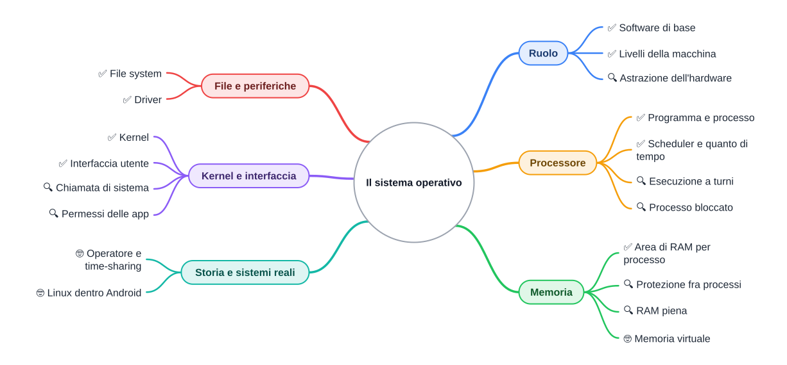
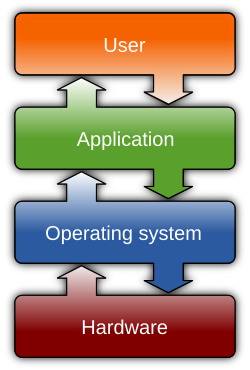

🏠 [Indice](../README.md) · [S2 - Il boot](%28STU%29%201CI%20nov-dic%20S2%20-%20Il%20boot.md) ➡️

# 🎛️ Il sistema operativo

**1CI · Novembre-Dicembre · S1 · Teoria**
⏱️ **Tempo di studio: circa 20 minuti per i soli ✅** · 🔍 altri 10 · 🤓 facoltativo · nessun compito a casa obbligatorio.

> **Legenda:** ✅ da sapere · 🔍 per capire fino in fondo · 🤓 facoltativo, per curiosi · 📜 storia · 🧪 esempio · ✏️ da fare · ⚠️ errore comune · 🎮 gioco · 🛠️ strumento · 🔧 lo faremo in laboratorio · 💭 da pensare · 🚪 uscita · 🃏 flashcard: rispondi a voce, poi apri per controllare

## 📜 Un programma alla volta

Negli anni Cinquanta un computer occupava una stanza e costava moltissimo. Lo usava una persona alla volta. Arrivavi con le tue schede perforate, un operatore le caricava, la macchina lavorava, poi toccava a un altro. Fra un lavoro e l'altro il computer restava fermo ad aspettare gli esseri umani. Era un enorme spreco.

Qualcuno ebbe un'idea: scrivere un programma che facesse l'operatore al posto dell'operatore. Nacquero così i primi **sistemi operativi**.

Oggi il tuo telefono fa quello che allora sembrava magia: la musica va, arriva un messaggio, la mappa si aggiorna, tutto insieme. Chi mette ordine? In questa dispensa lo scopri. E scopri anche una bugia ben organizzata: *ogni programma crede di avere il computer tutto per sé*.

🎮 **In classe giochiamo al ristorante:** voi siete i programmi, io il sistema operativo.

![[image.webp]]
*Una scheda perforata*

![[image-2.webp|7![[image-3.webp|279x186]]
*Un computer che occupa un'intera stanza: un ENIAC del 1945-1946*

## 🧭 Che cos'è

### ✅ Il regista fra hardware e programmi
#fatto👍 

**Il problema.** Un computer ha parti con compiti diversi: il processore calcola, la RAM ricorda, il disco conserva, lo schermo mostra. Se ogni programma le comandasse da solo, due programmi che vogliono scrivere sullo stesso disco nello stesso istante si pesterebbero i piedi. Serve qualcuno che metta ordine.

Il **sistema operativo** (SO) è il **software di base** che gestisce le risorse della macchina e offre servizi ai programmi che usi. Esempi: Windows, macOS, Linux, Android, iOS.

🧪 **Un'analogia, con un limite.** Il SO è come il direttore di un ristorante: non cucina, ma decide chi usa il forno e quando. Il limite: un direttore pensa e decide; il SO esegue soltanto regole scritte da persone.

<table>
  <tr>
    <td valign="middle"></td>
    <td valign="middle">
      👤 <b>User</b> (utente): tocchi, clicchi, scrivi 
      📱 <b>Application</b> (programmi): browser, messaggi, giochi 
      🎛️ <b>Operating system</b>: Android, iOS, Windows, macOS, Linux 
      🔌 <b>Hardware</b>: processore, RAM, disco, schermo, microfono
    </td>
  </tr>
</table>

*Didascalia: i programmi non toccano l'hardware; passano dal sistema operativo. Le etichette dell'immagine sono in inglese.*

Il SO fa quattro lavori. Le prossime sezioni li guardano uno per uno:

| Che cosa gestisce | Domanda a cui risponde           | Esempio sul telefono                     |
| ----------------- | -------------------------------- | ---------------------------------------- |
| **Processore**    | Chi lavora adesso?               | La musica e i messaggi vanno insieme.    |
| **Memoria**       | Dove sta ogni programma?         | Due app aperte non si mescolano.         |
| **File**          | Dove finisce ogni dato?          | La foto resta nella galleria.            |
| **Periferiche**   | Come si parla con i dispositivi? | Le cuffie funzionano appena le colleghi. |

⚠️ **Errori comuni.** «Windows è il computer»: no, è un software che gira sul computer. «Il SO è un programma come gli altri»: è un programma, ma è l'unico che comanda direttamente l'hardware; gli altri chiedono a lui.

🃏 <b>Che cos'è il sistema operativo?</b>

Il software di base che gestisce le risorse della macchina e offre servizi ai programmi.

🃏 <b>Quali quattro lavori fa il sistema operativo?</b>

Gestisce il processore, la memoria, i file e le periferiche.

🃏 <b>Un programma può comandare direttamente il disco?</b>

Di norma no: chiede al sistema operativo, che è l'unico a comandare l'hardware.

✏️ **Disegna (2 min).** Disegna i quattro livelli della tabella per il tuo telefono. Scrivi il nome del suo sistema operativo e di due programmi che usi.

### 🔍 Nascondere i dettagli

Un programma che salva una foto non sa se il disco è di una marca o di un'altra. Chiede al SO «salva questa foto» e il SO si occupa del resto. Nascondere i dettagli complicati dietro un'operazione semplice si chiama **astrazione**. Succede anche quando guidi: premi l'acceleratore senza conoscere il motore.

🃏 <b>Che cos'è l'astrazione?</b>

Nascondere i dettagli complicati dietro un'operazione semplice, come «salva» che funziona su qualunque disco.

## ⏱️ Il processore: chi lavora adesso

### ✅ Processi e scheduler

Un **programma** è un file con le istruzioni, fermo sul disco: come una ricetta nel libro. Un **processo** è un programma **in esecuzione**: la ricetta che stai cucinando adesso. Il telefono ha decine o centinaia di processi attivi.

Un **core** è un'unità di calcolo del processore: esegue le istruzioni di un processo alla volta. Un telefono recente ha di solito 8 core e da 6 a 12 GB di RAM (valori tipici e approssimati: il tuo può essere diverso).

🧪 **Prevedi prima di leggere.** Hai molti più processi che core, eppure musica, messaggi e mappa sembrano andare insieme. Come è possibile? Scrivi un'ipotesi in una riga, poi continua.

Il pezzo del SO che decide **quale processo usa un core e per quanto** si chiama **scheduler**. Il tempo concesso a ogni turno è il **quanto di tempo**: nei sistemi reali è dell'ordine di pochi millisecondi e dipende dal sistema. Con un core solo e tre processi, il lavoro si alterna così (numeri inventati per l'esempio):

| Da 0 a 10 ms | Da 10 a 20 ms | Da 20 a 30 ms | Da 30 a 40 ms | Da 40 a 50 ms |
| --- | --- | --- | --- | --- |
| Musica | Messaggi | Mappa | Musica | Messaggi |

*Didascalia: i processi si alternano così in fretta che sembrano andare insieme.*

È come la fila alla cassa, con un limite: la cassiera finisce un cliente e passa al successivo; lo scheduler **interrompe** un processo a metà e lo riprende più tardi. Con 8 core, otto processi possono andare davvero nello stesso istante; gli altri aspettano il proprio turno.

🃏 <b>Che differenza c'è fra programma e processo?</b>

Il programma è il file fermo sul disco; il processo è il programma in esecuzione.

🃏 <b>Che cosa decide lo scheduler?</b>

Quale processo usa un core e per quanto tempo.

🃏 <b>Che cos'è il quanto di tempo?</b>

Il tempo che un processo può usare un core prima di cedere il turno.

✏️ **Spiega a voce (1 min).** Perché non vediamo mai i turni dei processi? Spiegalo a un compagno usando il quanto di tempo.

### 🔍 Perché i processi vanno a turni

Il SO potrebbe far finire un processo e poi passare al successivo. Non lo fa per due motivi.

1. **Un processo spesso aspetta.** Un programma che attende un tuo tocco non calcola nulla: se tenesse il core fermo, lo spreco sarebbe come quello dell'operatore degli anni Cinquanta.
2. **Un processo può bloccarsi.** Se un programma sbaglia e gira all'infinito, senza i turni terrebbe fermo tutto il telefono.

Con i turni è il SO a restare al comando. Se un programma non risponde, può fermarlo e liberare le risorse.

### 🔍 Un processo bloccato

Quando un'app non risponde puoi chiuderla in modo forzato: su Windows con **Termina attività**, su Android con **Forza arresto** (le voci cambiano da telefono a telefono). Il resto del sistema continua a funzionare perché lo scheduler non ha mai dato a quel processo il controllo di tutta la macchina.

🃏 <b>Perché lo scheduler non lascia un processo andare finché vuole?</b>

Perché potrebbe aspettare senza fare nulla o bloccarsi, e terrebbe fermi tutti gli altri.

## 🧮 La memoria

### ✅ Un'area per ogni processo

La **RAM** è la memoria veloce e temporanea dove stanno i programmi in esecuzione e i loro dati: si svuota quando spegni. Il SO la divide in **aree**: ne assegna una a ogni processo e la riprende quando il processo finisce.

**Il problema.** Se due programmi scrivessero nella stessa zona di RAM, uno cancellerebbe i dati dell'altro. Il SO evita lo scontro: ciascun processo lavora nella propria area.

🛠️ **Dove vederlo.** Su Windows premi `Ctrl+Maiusc+Esc` (Gestione attività): trovi processi, uso del processore e della memoria. Sul telefono cerca nelle impostazioni la voce sulla memoria (cambia da modello a modello).

🃏 <b>Come divide la RAM il sistema operativo?</b>

Assegna un'area a ogni processo e la riprende quando il processo finisce.

### 🔍 Protezione e RAM piena

**Protezione.** Un processo non può leggere o scrivere nell'area di un altro. Se ci prova, il SO lo ferma. Così un gioco che si blocca non cancella le tue foto.

**RAM piena.** Quando manca spazio, il SO sceglie: su un telefono può chiudere app che stanno in secondo piano; su un computer può spostare dati poco usati sul disco, che è più lento. È uno dei motivi per cui un PC con troppe schede aperte rallenta.

🃏 <b>Che cosa succede se un processo tocca la memoria di un altro?</b>

Il sistema operativo lo ferma: la protezione impedisce che un processo rovini i dati di un altro.

🃏 <b>Che cosa può fare il sistema operativo quando la RAM è piena?</b>

Chiudere app in secondo piano o spostare dati sul disco, che è più lento.

### 🤓 Una bugia ben organizzata

> Ogni processo vede una memoria tutta sua, con indirizzi che partono da zero, come se la macchina fosse libera. Non è vero: dietro le quinte il SO traduce gli indirizzi del processo in zone reali della RAM. Si chiama **memoria virtuale**. È una finzione condivisa che tutti i programmi accettano senza saperlo, e funziona proprio perché nessuno la mette in dubbio.

## 📁 File e periferiche

### ✅ File system: dove finisce ogni dato

Un disco è una lunga fila di byte senza nomi. Il SO aggiunge un **file system**: dà un nome a ogni file, lo mette in una cartella e ricorda in quale posizione del disco sta. Quando apri `Foto/vacanza.jpg`, il SO sa dove andare a prendere quei byte.

🔧 **In laboratorio** lavoriamo con file e cartelle sul PC: è il file system al lavoro.

🃏 <b>A che cosa serve il file system?</b>

A dare nomi ai file, organizzarli in cartelle e ricordare dove stanno sul disco.

### ✅ Driver: il traduttore

Ogni dispositivo ha il suo linguaggio: una stampante e una tastiera non parlano allo stesso modo. Il **driver** è un piccolo programma che traduce fra il SO e un dispositivo. Esempio: colleghi una stampante nuova; senza il suo driver il SO non sa come darle gli ordini.

🃏 <b>Che cos'è un driver?</b>

Un piccolo programma che traduce fra il sistema operativo e un dispositivo, come una stampante.

## 🧱 Kernel e interfaccia

### ✅ Il kernel

Il **kernel** è il **nucleo** del sistema operativo: sta sempre in memoria e parla direttamente con l'hardware. Il SO completo è più grande: kernel, scheduler, file system, driver e le parti che usi tu, come le impostazioni.

⚠️ «Kernel» e «sistema operativo» non sono sinonimi: il kernel è un pezzo del SO.

### ✅ L'interfaccia utente

L'**interfaccia utente** è la parte del SO che vedi e tocchi: schermo, icone, menu. Può anche essere un terminale dove scrivi comandi. Cambia l'aspetto, non il lavoro sotto.

🃏 <b>Che cos'è il kernel?</b>

Il nucleo del sistema operativo: sta sempre in memoria e parla direttamente con l'hardware.

🃏 <b>Kernel e sistema operativo sono la stessa cosa?</b>

No: il kernel è il nucleo; il sistema operativo comprende anche file system, driver e interfaccia.

### 🔍 La chiamata di sistema

Un programma che vuole aprire una foto non va a leggere il disco da solo. Segue questi passi:

1. Il programma **chiede** al kernel di aprire il file. Questa richiesta si chiama **chiamata di sistema**.
2. Il kernel controlla che il programma abbia il permesso.
3. Il kernel passa la richiesta al driver del disco.
4. Il driver legge i dati.
5. I dati tornano al programma.

Perché tanti passaggi? Per due motivi. **Protezione:** un gioco non deve poter leggere le tue password. **Semplicità:** chi scrive il programma non deve conoscere ogni modello di disco.

### 🔍 I permessi delle app

Quando un'app ti chiede «Consenti l'accesso al microfono?», è il SO che le sta mettendo un cancello. È una protezione utile: una torcia non ha bisogno dei tuoi contatti. Ma c'è anche l'altra faccia: il SO vede tutto ciò che passa da lui. Chi lo scrive decide dove mettere i cancelli e quali regole seguire, quindi ti fidi di chi lo ha scritto.

💭 Il SO ti protegge dalle app, ma chi protegge te dal SO? Non c'è una risposta sola: prova a darne una, con un esempio.

🃏 <b>Che cos'è una chiamata di sistema?</b>

La richiesta con cui un programma chiede al kernel di fare qualcosa al suo posto, come aprire un file.

🃏 <b>Perché un'app chiede il permesso per il microfono?</b>

Perché è il sistema operativo a decidere che cosa può fare un'app; così protegge i tuoi dati.

## 📜 Dal turno dell'operatore ad Android

### 🤓 Operatore e time-sharing

> Nei primi anni Sessanta nascono i primi sistemi a **divisione di tempo** (*time-sharing*): molte persone, ciascuna davanti al proprio terminale, usavano la stessa macchina a turni così rapidi che ognuna credeva di averla per sé. È la stessa idea dello scheduler di oggi, applicata alle persone invece che ai processi.

### 🤓 Linux dentro Android

> Nel 1991 uno studente finlandese, Linus Torvalds, pubblicò le prime versioni di un kernel nuovo, poi chiamato **Linux**. Oggi lo usano molti server e anche Android: due sistemi con aspetto diversissimo possono avere lo stesso kernel sotto. Per questo ricordati: il kernel non è il sistema operativo.

## ✏️ Metti alla prova

1. **Chi lo fa? (✅, 3 min).** Per ogni situazione scrivi se il lavoro è del processore, della memoria, del file system o dei driver.
   - Colleghi un mouse nuovo e funziona subito.
   - Trovi un documento cercandolo per nome in una cartella.
   - Mentre scarichi un file puoi continuare a scrivere.
   - Un'app va in crash e le altre non perdono i loro dati.
2. **Scheduler a mano (✅, 5 min).** Un core, quanto di tempo 10 ms. Il processo A ha bisogno di 20 ms di calcolo, B di 10 ms, C di 30 ms. I turni vanno nell'ordine A, B, C, poi si ricomincia saltando chi ha finito. Scrivi in una tabella chi usa il core in ogni intervallo di 10 ms. Quanti intervalli servono? Chi finisce per primo?
3. **Riordina (✅, 2 min).** Metti in ordine i passi con cui un programma legge una foto dal disco:
   - A. Il driver legge i dati dal disco.
   - B. Il programma chiede al kernel di aprire la foto.
   - C. I dati tornano al programma.
   - D. Il kernel passa la richiesta al driver del disco.
   - E. Il kernel controlla che il programma abbia il permesso.
4. **Un'app non risponde (🔍, 3 min).** Un gioco si blocca, ma il resto del telefono funziona e riesci a chiuderlo. Spiega in tre frasi perché non si è bloccato tutto. Usa le parole *scheduler* e *turno*.
5. **La torcia curiosa (🔍, 3 min).** Un'app torcia chiede il permesso di leggere i tuoi contatti. Che cosa dovrebbe fare il SO prima di dare il permesso? Che cosa puoi fare tu?
6. **Guarda il SO al lavoro (🛠️, facoltativo, 5 min).** Su un computer Windows apri Gestione attività con `Ctrl+Maiusc+Esc`. Quanti processi vedi? Quale usa più memoria? Non toccare nulla.

**🚪 Uscita.** Rispondi in una frase: se due programmi vogliono usare il processore nello stesso istante, chi decide e con quale regola?

## 🔗 Dove andiamo

Nella [S1 di settembre-ottobre](../1%20SETT-OTT/%28STU%29%201CI%20sett-ott%20S1%20-%20Informatica%20e%20computer.md) hai visto hardware e software. Qui il SO è il ponte fra i due. Nella prossima dispensa vediamo **come si sveglia**: che cosa succede fra il pulsante di accensione e la schermata di blocco. E nelle ultime settimane scendiamo ancora più sotto, fino agli interruttori che stanno sotto al regista.

## 📚 Fonti e risorse

- [Sistema operativo (Wikipedia)](https://it.wikipedia.org/wiki/Sistema_operativo): definizione e componenti. Leggi solo l'inizio.
- [Scheduler (Wikipedia)](https://it.wikipedia.org/wiki/Scheduler): per approfondire come si sceglie quale processo va avanti. Guarda solo la prima parte.
- [Linux kernel (Wikipedia, in inglese)](https://en.wikipedia.org/wiki/Linux_kernel): la storia del kernel. Guarda la prima versione del 1991 nella scheda a destra.
- **Crediti immagine:** «Operating system placement», di Golftheman, licenza [CC BY-SA 3.0](https://creativecommons.org/licenses/by-sa/3.0/), da [Wikimedia Commons](https://commons.wikimedia.org/wiki/File:Operating_system_placement.svg).

---

🏠 [Indice](../README.md) · [S2 - Il boot](%28STU%29%201CI%20nov-dic%20S2%20-%20Il%20boot.md) ➡️
