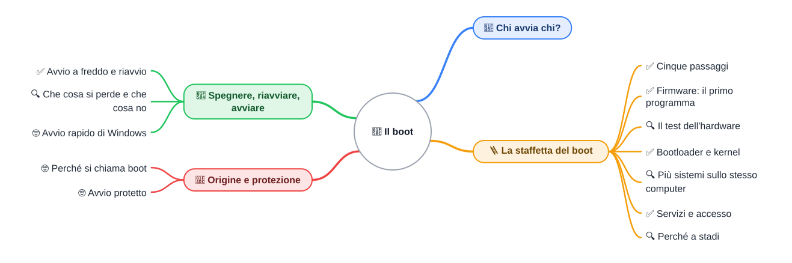
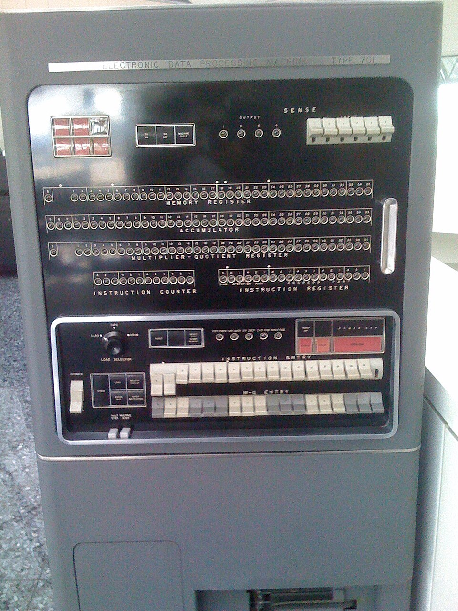
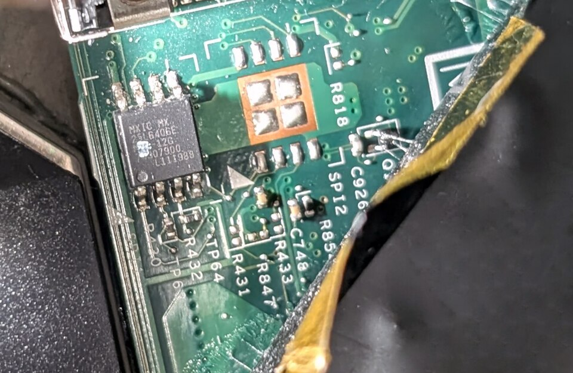

⬅️ [S1 - Il sistema operativo](%28STU%29%201CI%20nov-dic%20S1%20-%20Il%20sistema%20operativo.md) · 🏠 [Indice](../README.md) · [S3 - Dal relè alle porte](%28STU%29%201CI%20nov-dic%20S3%20-%20Dal%20rel%C3%A8%20alle%20porte.md) ➡️

# 🔌 Il boot

**1CI · Novembre-Dicembre · S2 · Teoria**
⏱️ **Tempo di studio: circa 20 minuti per i soli ✅** · 🔍 altri 10 · 🤓 facoltativo · nessun compito a casa obbligatorio.

> **Legenda:** ✅ da sapere · 🔍 per capire fino in fondo · 🤓 facoltativo, per curiosi · 📜 storia · 🧪 esempio · ✏️ da fare · ⚠️ errore comune · 🎮 gioco · 🛠️ strumento · 💭 da pensare · 🚪 uscita · 🃏 flashcard: rispondi a voce, poi apri per controllare

## 📜 Chi avvia chi?

In S1 hai visto che il sistema operativo mette in ordine tutto. Ora un problema da detective. Quando premi il pulsante di accensione, il sistema operativo sta sul disco e la RAM è **vuota**. Il processore sa soltanto eseguire istruzioni, ma le istruzioni dove sono? Per far partire il sistema operativo serve un programma già pronto; per far partire quel programma ne serve un altro... È il problema dell'uovo e della gallina.

I primi computer lo risolvevano a mano. Sull'IBM 701 (1952) l'operatore sceglieva con una manopola da dove leggere (schede, nastro o tamburo magnetico), premeva «Load» e la macchina leggeva una prima parola, che le diceva come leggere le altre. Poi arrivò una soluzione più elegante: le memorie **ROM**, che tengono un programma di avvio che non si cancella.

*Didascalia: la console di un IBM 701. In basso a sinistra, la manopola «Load Selector» sceglieva da dove leggere il primo programma.*

🎮 **In classe facciamo la staffetta:** cinque di voi sono i cinque passi del boot, io premo il pulsante.

## 🪜 La staffetta del boot

### ✅ Cinque passaggi

✏️ **Richiamo da S1 (1 min).** Ricordi che cosa fa il kernel? Rispondi a voce prima di continuare: tra poco entra in scena.

🧪 **Prevedi.** Accendi il computer: la RAM è vuota e il sistema operativo è sul disco. Da dove prende il processore le sue prime istruzioni? Scrivi un'ipotesi in una riga.

Il **boot** (avvio) è la sequenza di passaggi che porta dal pulsante di accensione al sistema pronto all'uso. È una **staffetta**: ogni programma ne avvia uno più grande e poi gli lascia il posto. (Il limite della metafora: in una staffetta i corridori sono alla pari; qui ogni stadio è più capace del precedente.)

| Passo | Chi lavora | Che cosa fa |
| --- | --- | --- |
| 1 | **Accensione** | Il processore parte sempre da un punto fisso, dove sta il firmware. |
| 2 | **Firmware** | Controlla che l'hardware risponda e cerca il bootloader. |
| 3 | **Bootloader** | Trova il kernel sul disco e lo copia in RAM. |
| 4 | **Kernel** | Parte e prepara memoria, scheduler e driver (come in S1). |
| 5 | **Servizi e accesso** | Partono i programmi in secondo piano; compare la schermata di accesso. |

*Didascalia: cinque passaggi, ognuno prepara il successivo.*

⚠️ **Errore comune.** Lo schermo che si accende non è il boot: la schermata di accesso è l'**ultimo** passo.

🃏 <b>Che cos'è il boot?</b>

La sequenza di passaggi che porta dal pulsante di accensione al sistema pronto all'uso.

🃏 <b>Quali sono i cinque passaggi del boot, in ordine?</b>

Accensione, firmware, bootloader, kernel, servizi e accesso utente.

### ✅ Firmware: il primo programma

Il **firmware** è un programma che sta in una memoria che **non si cancella** quando togli la corrente, sulla scheda madre. Quando premi il pulsante, il processore parte sempre dallo stesso punto, dove c'è il firmware: ecco la soluzione all'uovo e alla gallina. Sul telefono questo primo programma si chiama spesso *boot ROM*.

Due nomi da conoscere: **BIOS** (il nome storico) e **UEFI** (il successore moderno). Non devi entrare nelle impostazioni: basta sapere che sono due versioni dello stesso compito.

*Didascalia: il chip del firmware sulla scheda madre di un portatile. Il programma di avvio sta in questo piccolo rettangolo scuro.*

🃏 <b>Che cos'è il firmware?</b>

Il programma che parte per primo, memorizzato in una memoria che non si cancella senza corrente.

🃏 <b>Qual è la differenza fra BIOS e UEFI?</b>

Fanno lo stesso compito: BIOS è il nome storico, UEFI il successore moderno.

### 🔍 Il test dell'hardware

Prima di andare avanti il firmware controlla che processore, RAM e altre parti rispondano. Questo controllo si chiama **POST** (*Power-On Self-Test*, «autotest all'accensione»). Se qualcosa non va, molti PC emettono dei bip o accendono delle spie: sono messaggi in codice per chi ripara.

### ✅ Bootloader e kernel

Il firmware sa cercare un programma d'avvio, ma non sa dove sta il tuo sistema operativo. Lo sa il **bootloader**: un piccolo programma che **trova il kernel sul disco e lo carica in RAM**. Il kernel è il nucleo del SO: appena caricato, parte e prepara memoria, scheduler e driver.

### 🔍 Più sistemi sullo stesso computer

Se un PC ha due sistemi installati (per esempio Windows e Linux), il bootloader mostra un menu e carica il kernel che scegli.

🃏 <b>Che cosa fa il bootloader?</b>

Trova il kernel sul disco e lo carica in RAM.

🃏 <b>Perché il firmware non carica direttamente il kernel?</b>

Perché non sa dove sta il tuo sistema operativo: lo trova il bootloader.

### ✅ Servizi e accesso

Quando il kernel è pronto avvia i **servizi**: programmi che lavorano in secondo piano, senza finestra, come la rete, l'audio e gli aggiornamenti. Solo alla fine compare la schermata di blocco o di accesso. Sul telefono, dal pulsante a questa schermata passano di solito da pochi secondi a circa un minuto (valore tipico: varia da modello a modello).

🃏 <b>Che cos'è un servizio?</b>

Un programma che lavora in secondo piano, senza finestra, come la rete o l'audio.

### 🔍 Perché a stadi

Perché non scrivere un unico programma d'avvio grande? Perché il primo stadio deve stare in poca memoria fissa e partire senza alcun aiuto. È come costruire un ponte: prima una corda, poi una fune, poi il ponte. Ogni stadio prepara il terreno a uno più grande. Inoltre il kernel si può aggiornare con facilità, mentre il firmware cambia di rado.

## 🔄 Spegnere, riavviare, avviare

### ✅ Avvio a freddo e riavvio

L'**avvio a freddo** parte da computer spento. Il **riavvio** chiude il sistema e lo fa ripartire **senza togliere corrente**. In tutti e due i casi si rifà la staffetta.

Perciò la frase più famosa dell'assistenza tecnica funziona: «hai provato a spegnere e riaccendere?». Riporta la macchina a uno stato iniziale noto.

💭 Molti aggiornamenti richiedono un riavvio perché toccano file che il sistema sta usando. Aggiornare protegge dai difetti, ma ti obbliga a fidarti di chi manda l'aggiornamento: ritorna il tema dei permessi di S1.

🃏 <b>Che differenza c'è fra avvio a freddo e riavvio?</b>

L'avvio a freddo parte da spento; il riavvio chiude il sistema e lo rifà partire senza togliere corrente.

### 🔍 Che cosa si perde e che cosa no

| Dove | Dopo lo spegnimento |
| --- | --- |
| **RAM** | Si svuota: processi e documenti non salvati sono persi. |
| **Disco** | Resta: file, bootloader e kernel sono ancora lì. |
| **Firmware** | Resta: sta in una memoria che non si cancella. |

⚠️ **Errore comune.** «Spegnere cancella tutto»: dipende da dove stanno i dati.

### 🤓 Avvio rapido di Windows

> Su molti PC Windows il comando «Arresta» non fa uno spegnimento completo se è attivo l'*avvio rapido*: salva lo stato del kernel sul disco per ripartire più in fretta. «Riavvia», invece, fa un avvio completo. Per questo, quando un PC fa i capricci, riavviare è spesso meglio che spegnere e riaccendere.

## 📜 Origine e protezione

### 🤓 Perché si chiama boot

> *Boot* è l'abbreviazione di *bootstrap*, dall'espressione inglese *to pull oneself up by one's bootstraps*: sollevarsi tirandosi per i lacci degli stivali, un'impresa impossibile. Descrive bene il problema: far partire un computer con un programma che ancora non c'è. Il primo uso attestato della parola abbreviata è del 1975.

### 🤓 Avvio protetto

> Molti PC moderni hanno il **Secure Boot** (avvio protetto): il firmware controlla la firma digitale del bootloader prima di eseguirlo, così un programma dannoso non può installarsi prima del sistema operativo.

## ✏️ Metti alla prova

1. **Riordina la staffetta (✅, 3 min).** Metti in ordine questi cartelli:
   - A. Il bootloader carica il kernel in RAM.
   - B. Premi il pulsante di accensione.
   - C. Il firmware controlla l'hardware.
   - D. Compare la schermata di blocco.
   - E. Il kernel avvia i servizi.
2. **Trova l'errore (✅, 3 min).** Correggi queste tre frasi: «Il bootloader è il primo programma che parte.» · «Il kernel parte prima del firmware.» · «Il firmware si cancella quando spegni il PC.»
3. **Il documento perso (🔍, 3 min).** Scrivi un testo senza salvarlo e il PC si riavvia da solo. Il testo non c'è più, ma le foto sono intatte. Spiega perché, usando le parole *RAM* e *disco*.
4. **Sistema non trovato (🔍, 3 min).** Un PC mostra il messaggio «sistema operativo non trovato». Quale passaggio della staffetta si è interrotto? Perché sappiamo che non è quello prima?
5. **Il tuo dispositivo (🛠️, facoltativo, 3 min).** Cronometra quanti secondi passano dal pulsante di accensione alla schermata di blocco. Confrontate i tempi in classe e ipotizzate perché cambiano (i valori sono approssimati).

**🚪 Uscita.** Rispondi in una frase: perché il computer ha bisogno di un programma che sta in una memoria che non si cancella?

## 🔗 Dove andiamo

La staffetta parte da un piccolo chip. Ma come fa un pezzo di silicio, fatto di sola elettricità, a eseguire istruzioni? Nelle prossime settimane **scendiamo sotto il regista**: partiamo da un interruttore che decide.

## 📚 Fonti e risorse

- [Booting (Wikipedia, in inglese)](https://en.wikipedia.org/wiki/Booting): la storia del boot, dal caricamento a mano alle ROM. Leggi l'introduzione e la sezione sui primi computer.
- [Firmware (Wikipedia)](https://it.wikipedia.org/wiki/Firmware): che cos'è il firmware e dove sta. Leggi solo l'inizio.
- [UEFI (Wikipedia)](https://it.wikipedia.org/wiki/Unified_Extensible_Firmware_Interface): il successore del BIOS. Leggi solo l'introduzione.
- **Crediti immagini:**
  - «IBM 701 console», di Dan, licenza [CC BY 2.0](https://creativecommons.org/licenses/by/2.0/), da [Wikimedia Commons](https://commons.wikimedia.org/wiki/File:IBM_701console.jpg).
  - «BIOS chip MXIC 25L6406E on a ThinkPad X220 motherboard», di Siarhei Besarab, licenza [CC BY-SA 4.0](https://creativecommons.org/licenses/by-sa/4.0/), da [Wikimedia Commons](https://commons.wikimedia.org/wiki/File:BIOS_chip_MXIC_25L6406E_on_a_ThinkPad_X220_motherboard_%28FRU_04W3286%29.jpg).

---

⬅️ [S1 - Il sistema operativo](%28STU%29%201CI%20nov-dic%20S1%20-%20Il%20sistema%20operativo.md) · 🏠 [Indice](../README.md) · [S3 - Dal relè alle porte](%28STU%29%201CI%20nov-dic%20S3%20-%20Dal%20rel%C3%A8%20alle%20porte.md) ➡️
