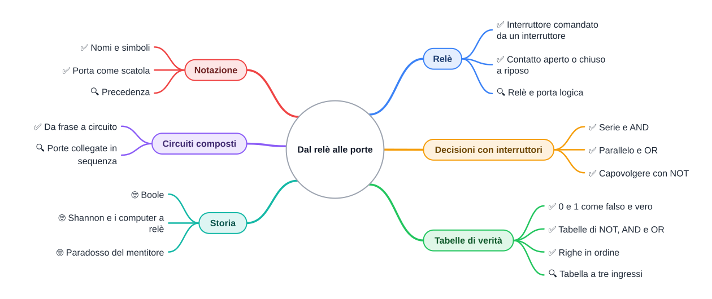
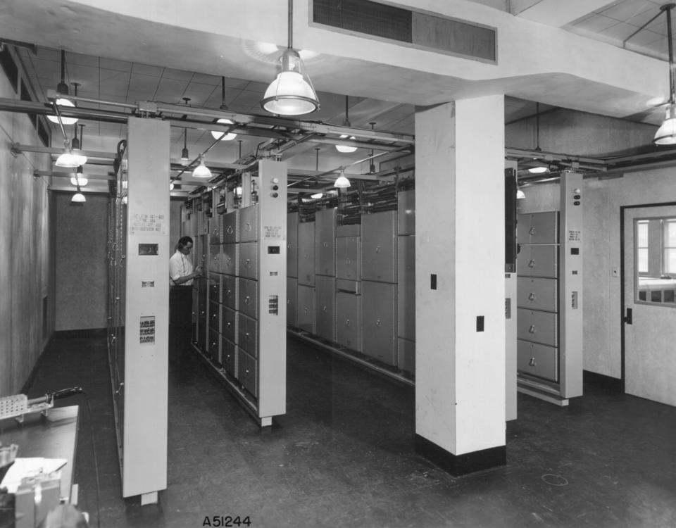

⬅️ [S2 - Il boot](%28STU%29%201CI%20nov-dic%20S2%20-%20Il%20boot.md) · 🏠 [Indice](../README.md) · [S4 - NAND](%28STU%29%201CI%20nov-dic%20S4%20-%20NAND.md) ➡️

# 💡 Dal relè alle porte

**1CI · Novembre-Dicembre · S3 · Teoria**
⏱️ **Tempo di studio: circa 20 minuti per i soli ✅** · 🔍 altri 10 · 🤓 facoltativo · nessun compito a casa obbligatorio.

>**Legenda:** ✅ da sapere · 🔍 per capire fino in fondo · 🤓 facoltativo, per curiosi · 📜 storia · 🧪 esempio · ✏️ da fare · ⚠️ errore comune · 🎮 gioco · 🛠️ strumento · 💭 da pensare · 🚪 uscita · 🃏 flashcard: rispondi a voce, poi apri per controllare



## 📜 Sotto il chip, un interruttore

La staffetta del boot parte da un piccolo chip. Quel chip è fatto di circuiti, e un circuito è fatto di **interruttori**. Questo è il fondo della scala: sotto non c'è altro. Allora la domanda diventa: come fa un interruttore a **decidere**?

La risposta ha una lunga storia. Per più di duemila anni la logica è stata una faccenda di parole: Aristotele fissa le regole per ragionare bene (con il sillogismo, per esempio *tutti gli uomini sono mortali, Socrate è un uomo, quindi Socrate è mortale*) e per secoli i filosofi discutono su quali frasi sono vere. Poi Leibniz, nel Seicento, sogna una lingua in cui le dispute si risolvano calcolando, «con carta e penna», invece di litigare.

Il sogno si avvera a metà Ottocento. Nel 1847 George Boole, un maestro inglese di umili origini che ha studiato quasi tutto da solo, scrive la logica come **algebra**: le frasi diventano simboli e le risposte sono soltanto due. Nel 1854 pubblica il libro che chiama *Le leggi del pensiero*. Non può sapere che il suo «pensiero» un giorno starà in una tasca.

Nel 1937 un ventunenne, Claude Shannon, studente al MIT, scrive una tesi che collega i due mondi: i circuiti fatti con i **relè**, che erano ovunque nelle centrali telefoniche, possono fare i calcoli di Boole. Quella tesi è spesso citata come una delle più influenti mai scritte.



*Didascalia: la sala dei relè di un computer costruito dai Bell Laboratories per l'esercito americano, negli anni Quaranta. Gli armadi sono pieni di relè.*

🎮 **In classe facciamo un circuito umano:** voi siete interruttori, io la lampadina.

## 🔌 Il relè

### ✅ Un interruttore comandato da un altro interruttore

Un **interruttore** apre o chiude un circuito. Si muove con la mano. Un **relè** è un interruttore che si muove da solo: dentro c'è una bobina di filo. Se la attraversa corrente, diventa un elettromagnete e tira una lamella di metallo. La lamella chiude (o apre) un secondo circuito.

Quindi: **una corrente piccola controlla un altro circuito**. Nelle centrali telefoniche e nei primi computer ce n'erano a migliaia. (Sì, è un interruttore che comanda un interruttore. Come i sogni dentro i sogni di *Inception*, ma con più clic.)

Un relè ha due ingressi e un'uscita nascosta:

- **Bobina:** è l'ingresso. Con corrente = 1, senza corrente = 0.
- **Contatto:** è l'uscita. Può essere **aperto a riposo** (si chiude quando la bobina è alimentata) oppure **chiuso a riposo** (si apre quando la bobina è alimentata).

<details>
<summary>🃏 <b>Che cos'è un relè?</b></summary>
Un interruttore che si muove da solo: una piccola corrente in una bobina chiude o apre un altro circuito.
</details>
<details>
<summary>🃏 <b>Che differenza c'è fra contatto aperto a riposo e chiuso a riposo?</b></summary>
Aperto a riposo si chiude quando la bobina riceve corrente; chiuso a riposo si apre quando la riceve.
</details>

### 🔍 Relè e porta non sono la stessa cosa

Il **relè** è un oggetto fisico, un mattone. La **porta logica** è la *funzione* che un circuito realizza (per esempio «accendi solo se tutti e due»). Una porta si può costruire con relè, con transistor o in altri modi: il lavoro è lo stesso, cambia il mattone. In S1 hai visto un'idea simile: l'astrazione.

<details>
<summary>🃏 <b>Il relè e la porta logica sono la stessa cosa?</b></summary>
No: il relè è un mattone fisico; la porta è la funzione realizzata, con relè o con altri componenti.
</details>

## 🔀 Decisioni con gli interruttori

### ✅ In serie: AND

**Il problema.** Una lampadina deve accendersi **solo se** due interruttori A e B sono chiusi. Come si collegano? Mettendoli **in serie**, uno dopo l'altro sullo stesso filo. Se ne manca uno, la corrente si ferma.

```text
pila ──[ A ]──[ B ]──( lampadina )── pila
```

*Didascalia: due interruttori in serie. La corrente passa solo se A e B sono chiusi.*

Questa decisione si chiama **AND** («e»).

### ✅ In parallelo: OR

Ora la lampadina deve accendersi se **almeno uno** dei due interruttori è chiuso. I due interruttori stanno su **due strade separate** che si ricongiungono: basta che una sia aperta alla corrente.

```text
         ┌──[ A ]──┐
pila ────┤         ├──( lampadina )── pila
         └──[ B ]──┘
```

*Didascalia: due interruttori in parallelo. Basta che uno sia chiuso.* Questa decisione si chiama **OR** («o»).

### ✅ Capovolgere: NOT

Per capovolgere una risposta serve un relè con il contatto **chiuso a riposo**. Senza corrente nella bobina la lampadina è accesa; se la bobina riceve corrente, il contatto si apre e la lampadina si spegne.

```text
ingresso A ──► bobina del relè        pila ──[ contatto del relè ]──( lampadina )── pila
```

Questa decisione si chiama **NOT** («non»).

🧪 **Un NOT che usi ogni giorno.** Sul telefono, il Wi-Fi è attivo se la modalità aereo **non** è attiva.

<details>
<summary>🃏 <b>Con quale collegamento si ottiene un AND?</b></summary>
Con interruttori in serie: la corrente passa solo se tutti sono chiusi.
</details>
<details>
<summary>🃏 <b>Con quale collegamento si ottiene un OR?</b></summary>
Con interruttori in parallelo: basta che uno sia chiuso.
</details>
<details>
<summary>🃏 <b>Quale relè serve per fare un NOT?</b></summary>
Uno con il contatto chiuso a riposo, che si apre quando la bobina riceve corrente.
</details>

✏️ **Immagina (2 min).** Tre interruttori in serie e una lampadina: quando si accende? E con tre in parallelo? Rispondi a un compagno senza disegnare, poi controllate disegnando.

## 📋 Tabelle di verità

### ✅ Falso è 0 e vero è 1

Ogni ingresso o uscita ha due stati. Scriviamo **0** per «niente corrente» (**falso**) e **1** per «corrente» (**vero**): è il bit di settembre-ottobre. Una **tabella di verità** elenca tutti i casi possibili degli ingressi, con l'uscita per ciascuno. Così non ci sono sorprese.

🧪 **Prevedi prima di leggere.** Per AND con due interruttori, quante righe avrà la tabella? Scrivi un numero.

Con 2 ingressi ci sono 4 righe, perché 2 × 2 = 4. In generale con N ingressi le righe sono 2<sup>N</sup>: se hai già visto la potenza di 2 in S3 di settembre-ottobre, è la stessa idea. Per non dimenticare nessuna riga, le scriviamo **in ordine di conteggio binario**: 00, 01, 10, 11.

| A | B | NOT A | A AND B | A OR B |
| --- | --- | --- | --- | --- |
| 0 | 0 | 1 | 0 | 0 |
| 0 | 1 | 1 | 0 | 1 |
| 1 | 0 | 0 | 0 | 1 |
| 1 | 1 | 0 | 1 | 1 |

*Didascalia: le tre tabelle di base. NOT guarda solo A; AND è 1 solo se A e B sono entrambi 1; OR è 0 solo se sono entrambi 0.*

⚠️ **Errore comune.** In italiano «o» a volte significa «una cosa o l'altra, non tutte e due». Il **OR** dei circuiti è diverso: dà 1 anche quando sono 1 tutti e due.

<details>
<summary>🃏 <b>Quante righe ha la tabella di verità con 3 ingressi?</b></summary>
Otto, perché 2 · 2 · 2 = 2<sup>3</sup> = 8.
</details>
<details>
<summary>🃏 <b>Quando è 1 un AND?</b></summary>
Solo quando tutti gli ingressi sono 1.
</details>
<details>
<summary>🃏 <b>Quando è 0 un OR?</b></summary>
Solo quando tutti gli ingressi sono 0.
</details>

### 🔍 Tre ingressi

Con A, B e C le righe sono otto, sempre in ordine binario: 000, 001, 010, 011, 100, 101, 110, 111. Per controllare di aver scritto tutte le righe, conta: devono essere otto. Una porta può avere anche tre ingressi, per esempio un AND a tre ingressi.

✏️ **Completa (3 min).** Scrivi la tabella di `(A AND B) OR C`. Quante righe hanno uscita 1?

## 🧩 Notazione: nomi, simboli e scatole

### ✅ Tre modi di scrivere la stessa cosa

Lo stesso concetto ha più nomi, a seconda di chi lo usa. Se a matematica hai già incontrato i simboli, ritrovali qui.

| Nome | Con le parole | Simbolo di matematica | Quando è 1 |
| --- | --- | --- | --- |
| **NOT** | non A | ¬A | A è 0 |
| **AND** | A e B | A ∧ B | tutti e due sono 1 |
| **OR** | A o B | A ∨ B | almeno uno è 1 |

*Didascalia: gli stessi tre concetti con i nomi dell'informatica e con i simboli della matematica.*

Chi progetta circuiti disegna ogni funzione come una **porta**: una scatola con uno o più ingressi a sinistra e **un'uscita** a destra. Dentro ci può essere qualunque mattone: relè, transistor... non importa. Per questo AND e OR si chiamano **porte logiche**.

```text
 A ──┐
     ├─[ AND ]── uscita
 B ──┘
```

<details>
<summary>🃏 <b>Quali sono i simboli di NOT, AND e OR in matematica?</b></summary>
NOT è ¬, AND è ∧, OR è ∨.
</details>
<details>
<summary>🃏 <b>Che cos'è una porta logica?</b></summary>
Una scatola con uno o più ingressi e un'uscita, che calcola una funzione come NOT, AND o OR.
</details>

### 🔍 Precedenza: chi si calcola per primo

Se in una frase compaiono più operazioni, serve un ordine. Si calcola **prima NOT, poi AND, poi OR**; le parentesi cambiano l'ordine. Esempio: `A OR B AND C` significa `A OR (B AND C)`. È come nell'aritmetica, dove la moltiplicazione viene prima dell'addizione.

<details>
<summary>🃏 <b>In quale ordine si calcolano NOT, AND e OR?</b></summary>
Prima NOT, poi AND, poi OR; le parentesi cambiano l'ordine.
</details>

## 🏗️ Circuiti composti

### ✅ Da una frase a un circuito

Una decisione reale di solito ha più condizioni. Il metodo, in tre passi:

1. **Dai un nome a ogni condizione** (con una lettera).
2. **Scrivi la frase con le parole** NOT, AND, OR.
3. **Disegna il circuito**: una porta per ogni parola.

🧪 **Esempio svolto.** «Il Wi-Fi si accende se la modalità aereo **non** è attiva **e** il router risponde.» Chiamiamo A la modalità aereo e R il router che risponde. La frase diventa `NOT A AND R`:

```text
 A ──[ NOT ]──┐
              ├─[ AND ]── Wi-Fi
 R ───────────┘
```

| A | R | NOT A | Wi-Fi (NOT A AND R) |
| --- | --- | --- | --- |
| 0 | 0 | 1 | 0 |
| 0 | 1 | 1 | 1 |
| 1 | 0 | 0 | 0 |
| 1 | 1 | 0 | 0 |

*Didascalia: il Wi-Fi funziona solo con aereo spento e router acceso (A = 0 e R = 1).*

<details>
<summary>🃏 <b>Quali sono i tre passi per passare da una frase a un circuito?</b></summary>
Dare un nome a ogni condizione, scrivere la frase con NOT, AND e OR, disegnare una porta per ogni parola.
</details>

### 🔍 Porte collegate in sequenza

L'uscita di una porta può diventare l'ingresso di un'altra, come nell'esempio. È questa la regola che permette di costruire qualunque circuito: **pochi mattoni, collegati in sequenza**. Nelle prossime settimane vedremo quanti pochi.

✏️ **Traduci (3 min).** «Suona l'allarme se la porta o la finestra è aperta, e l'allarme è inserito.» Dai un nome alle tre condizioni e scrivi la frase con NOT, AND, OR. Servono parentesi? Perché?

## 🎮 Nandgame

Il docente proietta [Nandgame](https://nandgame.com/), un gioco gratuito nel browser: parte dai relè e costruisce, livello dopo livello, tutti i pezzi di un computer. In classe giochiamo insieme i primi livelli. 🛠️ **Prima di aprire un livello, prevedi** che cosa dovrà fare il circuito e scrivi la tabella a mano: il gioco serve a **controllare** la tua idea, non a sostituirla.

## 💭 Un paradosso per pensare

Immagina questa frase: «**Questa frase è falsa.**» È vera o è falsa? Se è vera, allora dice la verità e quindi è falsa. Se è falsa, allora dice il falso, quindi è vera. Né 0 né 1: la frase non è una proposizione che si possa valutare. È il **paradosso del mentitore**, noto da più di duemila anni. Un circuito, invece, dà sempre una sola uscita fra 0 e 1. 💭 Una macchina potrebbe risolvere un paradosso? Tu che cosa risponderesti?

## 🤓 Per curiosi

### 🤓 Boole e i circuiti

> Boole non progettava circuiti, ma regole per il pensiero. Quasi un secolo dopo, Shannon si accorge che l'algebra di Boole descrive perfettamente anche i circuiti di interruttori: AND per la serie, OR per il parallelo. Da quel momento ogni progettista di circuiti usa l'algebra di Boole come lingua comune.

### 🤓 I computer a relè

> Negli anni Quaranta alcuni grandi calcolatori erano fatti proprio di relè, come quello della foto. Facevano clic-clac a ogni calcolo. Una storia celebre, resa popolare da Grace Hopper, racconta che intorno al 1947, nel calcolatore a relè Harvard Mark II, i tecnici trovarono una falena incastrata in un relè e la incollarono sul quaderno di registro con la scritta «primo caso reale di bug trovato». La parola *bug* («insetto») per indicare un guasto era però già in uso: l'aneddoto è famoso perché è divertente, non perché sia l'origine del termine.

## ✏️ Metti alla prova

1. **Serie o parallelo? (✅, 3 min).** Per ciascuna frase scrivi se servono due interruttori in serie o in parallelo, e quale porta rappresenta.
   - La stanza è in funzione se qualcuno ha la chiave oppure conosce il codice.
   - Il motorino parte solo se la cintura è allacciata e il freno è premuto.
2. **Tabella a mano (✅, 3 min).** Scrivi la tabella di verità di `NOT B AND A` con due ingressi, riga per riga. In quante righe l'uscita vale 1?
3. **Trova l'errore (✅, 3 min).** Un compagno dice: «L'OR dà 1 solo quando uno degli ingressi è 1 e l'altro è 0.» Trova una riga della tabella che lo smentisce.
4. **Circuito a due porte (🔍, 5 min).** Disegna un circuito con ingressi A, B e C che dia 1 solo quando C è 1 e almeno uno fra A e B è 1. Poi compila la tabella di verità a 8 righe.
5. **Quale lampadina? (🔍, 3 min).** Due lampadine sono comandate da A e B: la prima è `A AND B`, la seconda `A OR B`. Per A = 1 e B = 0, quale delle due è accesa? E con A = 0 e B = 0?
6. **Il relè non è la porta (🤓, facoltativo, 5 min).** Spiega con parole tue perché un circuito che realizza un AND può essere fatto con relè oppure con altri componenti. Riesci a pensare a un altro modo per fare un AND?

**🚪 Uscita.** Rispondi con tre azioni: 1) disegna due interruttori che accendano la lampadina solo se sono tutti e due chiusi; 2) scrivi la tabella di verità di un OR a due ingressi; 3) dimmi quante righe ha la tabella con quattro ingressi.

## 🔗 Dove andiamo

Nella [S2](%28STU%29%201CI%20nov-dic%20S2%20-%20Il%20boot.md) la staffetta partiva da un chip. Ora sai di che cosa è fatto: di decisioni a due risposte. Nella prossima dispensa scopriamo che **una sola porta basta** a costruire tutte le altre. Poi un circuito imparerà a **sommare**.

## 📚 Fonti e risorse

- [Nandgame](https://nandgame.com/): il gioco proiettato in classe; si parte dai relè e si costruisce un computer. Provalo a casa se hai voglia, nessun obbligo.
- [Logica booleana (Wikipedia)](https://it.wikipedia.org/wiki/Logica_booleana): storia di Boole. Leggi solo l'inizio.
- [A Symbolic Analysis of Relay and Switching Circuits (Wikipedia, in inglese)](https://en.wikipedia.org/wiki/A_Symbolic_Analysis_of_Relay_and_Switching_Circuits): la tesi di Shannon. Leggi la prima frase.
- **Crediti immagine:** «Bell Relay Computer», fotografia dell'esercito degli Stati Uniti, pubblico dominio, da [Wikimedia Commons](https://commons.wikimedia.org/wiki/File:Bell_Relay_Computer.png).

---

⬅️ [S2 - Il boot](%28STU%29%201CI%20nov-dic%20S2%20-%20Il%20boot.md) · 🏠 [Indice](../README.md) · [S4 - NAND](%28STU%29%201CI%20nov-dic%20S4%20-%20NAND.md) ➡️
