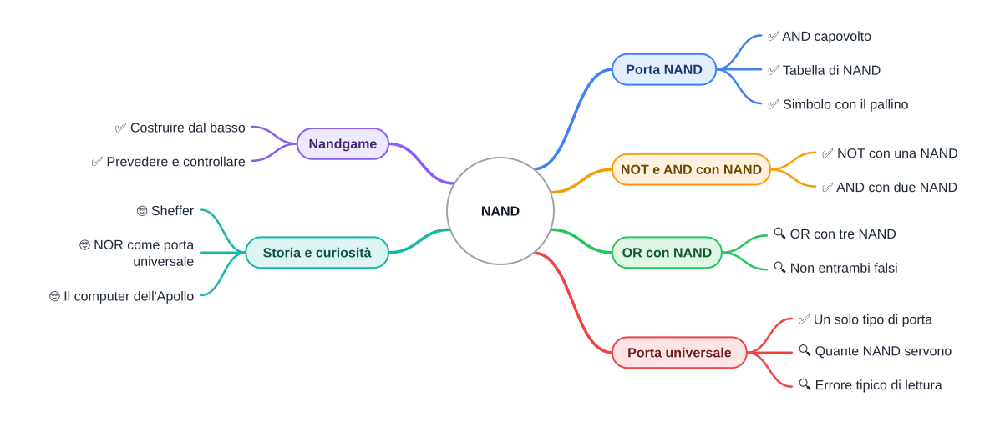

⬅️ [S3 - Dal relè alle porte](%28STU%29%201CI%20nov-dic%20S3%20-%20Dal%20rel%C3%A8%20alle%20porte.md) · 🏠 [Indice](../README.md) · [S5 - XOR e la somma](%28STU%29%201CI%20nov-dic%20S5%20-%20XOR%20e%20la%20somma.md) ➡️

# 🧱 NAND

**1CI · Novembre-Dicembre · S4 · Teoria**
⏱️ **Tempo di studio: circa 20 minuti per i soli ✅** · 🔍 altri 10 · 🤓 facoltativo · nessun compito a casa obbligatorio.

>**Legenda:** ✅ da sapere · 🔍 per capire fino in fondo · 🤓 facoltativo, per curiosi · 📜 storia · 🧪 esempio · ✏️ da fare · ⚠️ errore comune · 🎮 gioco · 🛠️ strumento · 💭 da pensare · 🚪 uscita · 🃏 flashcard: rispondi a voce, poi apri per controllare



## 📜 Un solo pezzo

Hai mai costruito qualcosa con i mattoncini? Con tanti pezzi di forme diverse, certo. Ma immagina un gioco in cui ti dessero **un solo tipo di mattoncino**, uguale per tutti, e ti dicessero: con questo costruisci qualunque cosa. Una casa, un'astronave, un computer.

Nei computer succede davvero. Un chip moderno contiene miliardi di interruttori (transistor), ma i progettisti non ragionano su ogni interruttore: ragionano su **porte**. E, fra tutte le porte, ce n'è una speciale: con **abbastanza copie di lei**, si può costruire tutto il resto. Questa porta si chiama **NAND**.

In S3 hai visto tre porte: NOT, AND, OR. Ora la domanda è: ne servivano proprio tre?

🎮 **In classe giochiamo a Nandgame:** partiamo dai relè e saliamo, livello dopo livello, tutti insieme.

## 🔄 La porta NAND

### ✅ L'AND con il risultato capovolto

**NAND** vuol dire «NOT AND» (*not and*): prima si calcola un AND, poi si capovolge il risultato.

🧪 **Prevedi prima di leggere.** Un AND dà 1 solo con A = 1 e B = 1. Se capovolgiamo il risultato, quando varrà 0 la NAND? Scrivi un'ipotesi.

| A | B | A AND B | A NAND B |
| --- | --- | --- | --- |
| 0 | 0 | 0 | 1 |
| 0 | 1 | 0 | 1 |
| 1 | 0 | 0 | 1 |
| 1 | 1 | 1 | **0** |

*Didascalia: la NAND vale 1 quasi sempre. Dà 0 solo quando tutti e due gli ingressi sono 1.*

Nei disegni la NAND è un AND con un **pallino** sull'uscita: il pallino significa «capovolgi».


*Didascalia: il simbolo della NAND. A e B sono gli ingressi, Q l'uscita; il pallino finale capovolge il risultato dell'AND.*

<details>
<summary>🃏 <b>Che cosa fa una NAND?</b></summary>
Calcola un AND e poi capovolge il risultato.
</details>
<details>
<summary>🃏 <b>Quando vale 0 una NAND?</b></summary>
Solo quando tutti gli ingressi sono 1.
</details>
<details>
<summary>🃏 <b>Che cosa indica il pallino sull'uscita di una porta?</b></summary>
Che il risultato viene capovolto, cioè passa per un NOT.
</details>

## 🧰 Costruire con sole NAND

### ✅ NOT: basta unire gli ingressi

**Il problema.** Hai soltanto porte NAND. Come fai un NOT? Collega **lo stesso segnale A a tutti e due gli ingressi**: la NAND diventa `A NAND A`.

```text
 A ──┬──┐
     │  ├─[ NAND ]── NOT A
     └──┘
```

| A | A NAND A |
| --- | --- |
| 0 | 1 |
| 1 | 0 |

*Didascalia: con i due ingressi uguali l'AND vale A, e la NAND lo capovolge.* Ecco un NOT fatto con **una** NAND.

### ✅ AND: NAND, poi NOT

Una NAND è un AND capovolto. Se la capovolgi ancora, torni all'AND: basta mettere dopo la NAND un NOT, fatto con una seconda NAND.

```text
 A ──┐
     ├─[ NAND ]──┬──┐
 B ──┘           │  ├─[ NAND ]── A AND B
                 └──┘
```

*Didascalia: due NAND. La prima calcola `NOT (A AND B)`, la seconda la capovolge e restituisce `A AND B`.* Ecco un AND fatto con **due** NAND.

<details>
<summary>🃏 <b>Come si fa un NOT con una NAND?</b></summary>
Si collega lo stesso segnale a tutti e due gli ingressi: A NAND A vale NOT A.
</details>
<details>
<summary>🃏 <b>Come si fa un AND con sole NAND?</b></summary>
Con due NAND: la prima calcola la NAND, la seconda la capovolge usando gli ingressi uniti.
</details>

✏️ **Prova a mano (2 min).** Per A = 1 e B = 1, segui il segnale nel circuito dell'AND: quanto vale l'uscita della prima NAND? E quella della seconda?

### 🔍 OR: il circuito meno ovvio

**Il problema.** Come si fa un OR con sole NAND? Pensa a che cosa dice l'OR: «A OR B è vero se **non è vero che A e B sono entrambi falsi**». Quindi:

1. Capovolgi A e capovolgi B (due NOT, fatti con due NAND);
2. Metti i due risultati in una NAND.

```text
 A ──[ NAND con ingressi uniti = NOT A ]──┐
                                          ├─[ NAND ]── A OR B
 B ──[ NAND con ingressi uniti = NOT B ]──┘
```

*Didascalia: tre NAND. Le prime due fanno i NOT, la terza combina.*

| A | B | NOT A | NOT B | NAND dei due | A OR B |
| --- | --- | --- | --- | --- | --- |
| 0 | 0 | 1 | 1 | 0 | 0 |
| 0 | 1 | 1 | 0 | 1 | 1 |
| 1 | 0 | 0 | 1 | 1 | 1 |
| 1 | 1 | 0 | 0 | 1 | 1 |

*Didascalia: l'ultima colonna del circuito coincide con la tabella dell'OR.* Ecco un OR fatto con **tre** NAND.

<details>
<summary>🃏 <b>Quante NAND servono per NOT, AND e OR?</b></summary>
Una per il NOT, due per l'AND, tre per l'OR.
</details>
<details>
<summary>🃏 <b>Come ragioni per costruire un OR con le NAND?</b></summary>
A OR B è vero se non è vero che A e B sono entrambi falsi: si capovolgono gli ingressi e si combinano con una NAND.
</details>

## 🌐 Una porta per tutte

### ✅ Un solo tipo di porta basta

Con la NAND hai costruito NOT, AND e OR. Quindi **ogni circuito fatto con quelle tre porte si può rifare con sole NAND**. Si dice che la NAND è una **porta universale**: da sola basta a costruire tutto.

🔍 **Perché un solo mattone?** Costruire milioni di copie dello stesso pezzo è più semplice che costruire pezzi diversi. In molti chip la NAND è un mattone molto usato, anche se non è l'unico.

### 🔍 Un errore tipico: NAND non è «NOT A AND NOT B»

Leggendo «not and» si è tentati di capovolgere A e B **prima** di fare l'AND. Ma l'ordine è un altro: **prima AND, poi NOT**. Per smascherare l'errore confronta le due tabelle sulla riga A = 0 e B = 1: la NAND vale 1, mentre `NOT A AND NOT B` vale 0.

<details>
<summary>🃏 <b>Che cosa vuol dire che una porta è universale?</b></summary>
Che da sola, in abbastanza copie, basta a costruire tutte le altre porte.
</details>
<details>
<summary>🃏 <b>NAND vuol dire NOT A AND NOT B?</b></summary>
No: prima si fa l'AND di A e B, poi si capovolge il risultato.
</details>

## 🎮 Nandgame

Il docente proietta [Nandgame](https://nandgame.com/) e giochiamo insieme i primi livelli: si parte dai relè e ogni livello usa i pezzi costruiti nei livelli precedenti. Questo è il meccanismo più importante dell'informatica: **costruisci un pezzo, lo chiudi in una scatola, e da quel momento lo usi senza ricostruirlo**. È la stessa astrazione di S1.

🛠️ **Come si gioca.** Prima di collegare, scrivi a mano la tabella che il livello ti chiede. Poi costruisci e controlla: il gioco ti dice se hai ragione.

## 💭 Un pezzo solo

Se tutto un computer si costruisce con un solo tipo di pezzo, che cosa lo rende «speciale»? Non il pezzo. La differenza sta in **quanti** ne metti e **come li colleghi**. Succede anche con le parole: le lettere dell'alfabeto sono poche, ma i libri sono infiniti. 💭 Secondo te, dove sta l'idea: nel mattone o nel progetto?

## 🤓 Per curiosi

### 🤓 Sheffer e la NAND

> La NAND porta il nome del logico americano Henry Sheffer, che all'inizio del Novecento studiò come un solo connettivo basti a esprimere tutti gli altri (nei libri di logica la NAND si scrive con una barra verticale, il «tratto di Sheffer»). Pare che qualcuno ci fosse arrivato prima, ma senza pubblicarlo: il filosofo Charles Peirce, a fine Ottocento.

### 🤓 La NOR, la sorella

> Anche la **NOR** («NOT OR») è universale: vale 1 solo quando tutti gli ingressi sono 0. Con le NAND si ricostruisce tutto; lo stesso con le NOR, con un altro disegno.

### 🤓 Il computer dell'Apollo

> Il computer che guidò le missioni Apollo verso la Luna (nella versione chiamata Block II) era costruito con circuiti integrati che contenevano porte **NOR**: un solo tipo di mattone, ripetuto moltissime volte.

## ✏️ Metti alla prova

1. **Tabella a mano (✅, 2 min).** Scrivi la tabella di verità di una NAND con tre ingressi A, B, C. In quante righe l'uscita vale 0?
2. **Disegna (✅, 3 min).** Disegna un NOT e un AND usando soltanto NAND. Quante NAND servono in tutto?
3. **Trova l'errore (✅, 2 min).** Un compagno dice: «La NAND dà 1 solo quando tutti gli ingressi sono 1.» Trova una riga della tabella che lo smentisce.
4. **Completa il circuito (🔍, 4 min).** Questo circuito dovrebbe fare un OR con tre NAND, ma manca un pezzo: `NAND( NAND(A,A), ... )`. Che cosa va al posto dei puntini? Verifica con la tabella.
5. **Che cosa fa? (🔍, 5 min).** Un circuito ha tre NAND: `X = NAND(A,B)`, `Y = NAND(A,A)` e `Z = NAND(X,Y)`. Compila la tabella con le quattro combinazioni di A e B. Quale funzione semplice riconosci in Z?
6. **La NOR (🤓, facoltativo, 5 min).** Come si costruisce un NOT con una sola NOR? Prova con la tabella.

**🚪 Uscita.** Rispondi con tre azioni: 1) completa la tabella di una NAND a due ingressi; 2) disegna un NOT con una sola NAND; 3) dimmi con quante NAND si costruisce un AND.

## 🔗 Dove andiamo

Nella [S3](%28STU%29%201CI%20nov-dic%20S3%20-%20Dal%20rel%C3%A8%20alle%20porte.md) hai visto come un interruttore decide. Qui hai visto che bastano pezzi tutti uguali. Nella prossima dispensa un circuito imparerà una cosa che sembra tutta umana: **sommare**.

## 📚 Fonti e risorse

- [Nandgame](https://nandgame.com/): il gioco proiettato in classe. A casa, solo se vuoi.
- [NAND gate (Wikipedia, in inglese)](https://en.wikipedia.org/wiki/NAND_gate): tabella e usi della NAND. Guarda soprattutto la parte sulle porte universali.
- [Sheffer stroke (Wikipedia, in inglese)](https://en.wikipedia.org/wiki/Sheffer_stroke): la NAND vista dalla logica. Leggi solo l'introduzione.
- [Apollo Guidance Computer (Wikipedia, in inglese)](https://en.wikipedia.org/wiki/Apollo_Guidance_Computer): il computer delle missioni lunari. Guarda la foto del chip con due porte NOR.
- **Crediti immagine:** «NAND ANSI Labelled», di Inductiveload, pubblico dominio, da [Wikimedia Commons](https://commons.wikimedia.org/wiki/File:NAND_ANSI_Labelled.svg).

---

⬅️ [S3 - Dal relè alle porte](%28STU%29%201CI%20nov-dic%20S3%20-%20Dal%20rel%C3%A8%20alle%20porte.md) · 🏠 [Indice](../README.md) · [S5 - XOR e la somma](%28STU%29%201CI%20nov-dic%20S5%20-%20XOR%20e%20la%20somma.md) ➡️
