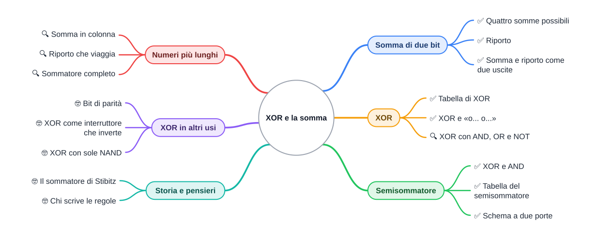

⬅️ [S4 - NAND](%28STU%29%201CI%20nov-dic%20S4%20-%20NAND.md) · 🏠 [Indice](../README.md) · [S6 - Ripasso attivo](%28STU%29%201CI%20nov-dic%20S6%20-%20Ripasso%20attivo.md) ➡️

# ➕ XOR e la somma

**1CI · Novembre-Dicembre · S5 · Teoria**
⏱️ **Tempo di studio: circa 15 minuti per i soli ✅** · 🔍 altri 15 · 🤓 facoltativo · nessun compito a casa obbligatorio.

> **Legenda:** ✅ da sapere · 🔍 per capire fino in fondo · 🤓 facoltativo, per curiosi · 📜 storia · 🧪 esempio · ✏️ da fare · ⚠️ errore comune · 🎮 gioco · 🛠️ strumento · 💭 da pensare · 🚪 uscita · 🃏 flashcard: rispondi a voce, poi apri per controllare



## 📜 Una macchina che sa contare

Un circuito non sa che cosa sia un numero. Non sa niente. Eppure ogni volta che il tuo telefono calcola quanta batteria è rimasta, o che una calcolatrice dice che 7 + 5 fa 12, **un circuito sta sommando**. E lo fa con le sole porte che conosci.

Nel novembre del 1937 un ricercatore dei Bell Laboratories, George Stibitz, completò un circuito a **relè** che sommava numeri binari. Lo chiamò **Model K**, con la K di *kitchen*, cucina: secondo la storia, lo assemblò sul tavolo della sua cucina. Era il periodo in cui Shannon scriveva la sua tesi: due persone diverse, nello stesso anno, capiscono che gli interruttori possono fare i conti.

Questa dispensa ricostruisce, con le porte che già hai, un circuito come quello. Alla fine saprai perché 1 + 1 fa 10.

🎮 **In classe sommiamo con le mani:** due file di cartelli «0» e «1», io faccio il riporto.

## ➕ Somma di due bit

### ✅ Le quattro somme

Un **bit** è una cifra binaria: 0 o 1. Sommando due bit hai solo quattro casi:

| A | + | B | = |
| --- | --- | --- | --- |
| 0 | + | 0 | 0 |
| 0 | + | 1 | 1 |
| 1 | + | 0 | 1 |
| 1 | + | 1 | **10** |

🧪 **Prevedi.** Nell'ultima riga, perché il risultato ha **due** cifre? Pensa al decimale: quando fai 9 + 1, che cosa succede?

Come in decimale, quando una colonna non basta si scrive la cifra più a destra e si **riporta** una unità alla colonna successiva. In binario `1 + 1 = 10`: scrivi **0** e riporti **1**. Quindi ogni somma di due bit ha **due uscite**:

- **S** (*somma*): la cifra che resta nella colonna;
- **C** (*carry*, riporto): la cifra che va alla colonna successiva.

| A | B | C (riporto) | S (somma) |
| --- | --- | --- | --- |
| 0 | 0 | 0 | 0 |
| 0 | 1 | 0 | 1 |
| 1 | 0 | 0 | 1 |
| 1 | 1 | **1** | **0** |

*Didascalia: leggendo C e S insieme (CS) si ottiene sempre la somma in binario: 00, 01, 01, 10.*

⚠️ **Errore comune.** `1 + 1 = 2` è vero, ma in binario la cifra 2 non esiste: il 2 si scrive **10**.

<details>
<summary>🃏 <b>Quanto fa 1 + 1 in binario?</b></summary>
10: si scrive 0 e si riporta 1.
</details>
<details>
<summary>🃏 <b>Quali sono le due uscite della somma di due bit?</b></summary>
La somma S (la cifra che resta) e il riporto C (la cifra che passa alla colonna successiva).
</details>

✏️ **Spiega a voce (1 min).** Quando il riporto vale 1? Rispondi con una frase.

## 🔀 XOR: la porta della somma

### ✅ Vale 1 se gli ingressi sono diversi

Guarda la colonna **S**: vale 1 quando A e B sono **diversi**, e 0 quando sono uguali. Questa funzione ha un nome: **XOR** (*eXclusive OR*, «OR esclusivo»). È la «o… o…» della lingua e della matematica (si scrive ⊻): «o l'uno o l'altro, **non tutti e due**». In S3 ti avevo avvisato: l'OR dei circuiti include il caso «tutti e due»; lo XOR lo esclude.

| A | B | A OR B | A XOR B |
| --- | --- | --- | --- |
| 0 | 0 | 0 | 0 |
| 0 | 1 | 1 | 1 |
| 1 | 0 | 1 | 1 |
| 1 | 1 | 1 | **0** |

*Didascalia: OR e XOR sono uguali tranne nell'ultima riga.*

<details>
<summary>🃏 <b>Quando vale 1 uno XOR?</b></summary>
Quando i due ingressi sono diversi.
</details>
<details>
<summary>🃏 <b>In che cosa lo XOR differisce dall'OR?</b></summary>
Con tutti e due gli ingressi a 1 l'OR dà 1, lo XOR dà 0.
</details>

### 🔍 XOR con le porte che già conosci

Lo XOR si può costruire con porte note, ragionando sulla frase: «**almeno uno è 1, ma non tutti e due**».

`A XOR B = (A OR B) AND NOT (A AND B)`

Per controllare, guarda la riga 11: l'OR dà 1, l'AND dà 1 e quindi `NOT(AND)` dà 0: il risultato è 0, come deve essere.

<details>
<summary>🃏 <b>Come si descrive lo XOR con le parole?</b></summary>
Almeno uno è 1, ma non tutti e due.
</details>

## 🧮 Il semisommatore

### ✅ Una XOR e una AND

Ora il colpo di scena: guarda di nuovo le due colonne.

- **S** è uguale a XOR: `S = A XOR B`.
- **C** è uguale a AND: `C = A AND B`.

Quindi per sommare due bit bastano **due porte**. Questo circuito si chiama **semisommatore** (in inglese *half adder*).


*Didascalia: il semisommatore. A e B entrano in due porte (XOR e AND): da una esce la somma S, dall'altra il riporto C.*

Il nome è onesto: è «mezzo» sommatore, perché non sa gestire un riporto che arriva dalla colonna precedente. Serve per le somme più lunghe, e lì arriviamo.

<details>
<summary>🃏 <b>Quali due porte formano un semisommatore?</b></summary>
Uno XOR per la somma S e un AND per il riporto C.
</details>
<details>
<summary>🃏 <b>Come si legge l'uscita CS del semisommatore?</b></summary>
Come un numero binario di due cifre, uguale alla somma dei due bit.
</details>

✏️ **Segui il segnale (2 min).** Nel semisommatore metti A = 1 e B = 1. Quanto vale l'uscita dello XOR? E quella dell'AND? Che numero binario leggi in CS?

## 🧱 Numeri più lunghi

### 🔍 Somma in colonna

Per sommare numeri a più cifre si va **colonna per colonna da destra**, come in decimale. Il riporto di una colonna entra in quella a sinistra.

🧪 **Esempio svolto.** `0110 + 0011` (cioè 6 + 3):

```text
  riporti:  1 1 0
            0 1 1 0
          + 0 0 1 1
          ---------
            1 0 0 1
```

Colonna per colonna, da destra: `0 + 1 = 1`; `1 + 1 = 10` (scrivo 0, riporto 1); `1 + 0 + 1 = 10` (scrivo 0, riporto 1); `0 + 0 + 1 = 1`. Il risultato è `1001`, cioè 9 in decimale: 6 + 3 = 9.

### 🔍 Il riporto che viaggia

Il semisommatore va bene per la colonna di destra, che non riceve riporti. Le altre colonne ricevono **tre** bit: i due da sommare più il riporto della colonna precedente. Serve un **sommatore completo** (*full adder*): somma tre bit e dà due uscite, somma e riporto. Si può costruire con **due semisommatori e un OR**.

Con quattro sommatori collegati in fila (il riporto di uno entra nel successivo) si sommano numeri a quattro bit. È lo stesso principio del sommatore a relè di Stibitz: pochi mattoni, ripetuti e collegati. Questa è l'idea dei computer: **la CPU somma con circuiti di questo tipo, ripetuti per quanti bit servono**.

<details>
<summary>🃏 <b>Perché per le colonne a sinistra non basta un semisommatore?</b></summary>
Perché ricevono tre bit (due da sommare e il riporto della colonna precedente), mentre il semisommatore ne gestisce solo due.
</details>
<details>
<summary>🃏 <b>Come è fatto un sommatore completo?</b></summary>
Con due semisommatori e un OR: somma tre bit e dà somma e riporto.
</details>

✏️ **Ripasso nascosto (3 min).** Somma `0110 + 0111` in colonna, scrivendo i riporti. Poi converti il risultato in decimale e in esadecimale, come a settembre-ottobre: i tre numeri devono essere coerenti.

## 🤓 Per curiosi

### 🤓 Il bit di parità

> Fai XOR dei bit di un messaggio uno dopo l'altro: il risultato vale 1 se i bit a 1 sono in numero **dispari**. Per esempio per `1011` ottieni 1. Se aggiungi quel bit al messaggio, chi lo riceve rifà il calcolo e capisce se un bit è stato cambiato per strada. È il bit di parità, che hai visto a settembre-ottobre.

### 🤓 XOR come interruttore che inverte

> Con 1 come secondo ingresso, lo XOR **capovolge** il primo (`A XOR 1 = NOT A`); con 0 lo lascia com'è (`A XOR 0 = A`). Per questo lo XOR compare in tanti trucchi: è un interruttore che si può girare e rigirare.

### 🤓 Lo XOR con sole NAND

> Quattro NAND bastano per un XOR. Prova: `N1 = NAND(A,B)`, `N2 = NAND(A,N1)`, `N3 = NAND(B,N1)`, `XOR = NAND(N2,N3)`. Controlla con la tabella a quattro righe: se torna, hai appena costruito uno XOR da un solo tipo di porta.

### 🤓 Il sommatore di Stibitz

> Nel novembre 1937, al Bell Labs, George Stibitz completò un sommatore binario a relè e lo chiamò Model K («kitchen»: secondo la storia, lo assemblò sul tavolo della sua cucina). Fu uno dei primi passi verso i calcolatori a relè che hai visto in foto in S3, e poi verso i computer elettronici.

### 🤓 Chi scrive le regole

> Un sommatore non decide niente di importante: somma e basta. Ma la stessa idea, ripetuta, calcola punteggi, medie, probabilità. Quando una macchina trasforma una persona in un numero (un voto, un punteggio, un rischio), le regole del calcolo le hanno scritte esseri umani. 💭 Chi dovrebbe controllare quelle regole? Che cosa non si lascia ridurre a un numero?

## 🎮 Nandgame

Nei livelli successivi del gioco si costruiscono lo XOR e poi il semisommatore, con le NAND di S4. Per chi vuole spingere: è la sfida facoltativa di oggi. A coppie, in due minuti, **prevedete** la tabella prima di collegare.

## ✏️ Metti alla prova

1. **Somme di due bit (✅, 3 min).** Completa la tabella di S e C per i quattro casi e verifica che CS letto come numero coincida con A + B.
2. **Quale porta? (✅, 2 min).** Quale porta dà il riporto? Quale dà la cifra di somma? Rispondi con i nomi e con una frase.
3. **Trova l'errore (✅, 2 min).** Un compagno scrive `1 + 1 = 2` in binario. Che cosa risponderesti, in una frase?
4. **Somma in colonna (🔍, 5 min).** Calcola `0101 + 0110` mostrando i riporti. Poi converti il risultato in decimale e controlla con 5 + 6.
5. **XOR a mano (🔍, 4 min).** Scrivi la tabella di `(A OR B) AND NOT(A AND B)` riga per riga e confrontala con quella dello XOR.
6. **Quattro NAND (🤓, facoltativo, 5 min).** Verifica con la tabella che `N1 = NAND(A,B)`, `N2 = NAND(A,N1)`, `N3 = NAND(B,N1)`, `NAND(N2,N3)` dia lo XOR.

**🚪 Uscita.** Rispondi con tre azioni: 1) scrivi somma e riporto di `1 + 1` in binario; 2) dimmi con una frase che cosa fa uno XOR; 3) dimmi quale porta dà il riporto.

## 🔗 Dove andiamo

Da un interruttore che decide a un circuito che somma: hai salito tutta la scala. Nella prossima settimana ripassiamo il bimestre, dal sistema operativo ai circuiti, e daremo un'occhiata a uno strumento per **disegnare** le decisioni.

## 📚 Fonti e risorse

- [Adder (Wikipedia, in inglese)](https://en.wikipedia.org/wiki/Adder_%28electronics%29): semisommatore e sommatore completo, con gli schemi. Guarda soprattutto le immagini.
- [George Stibitz (Wikipedia, in inglese)](https://en.wikipedia.org/wiki/George_Stibitz): chi era e il «Model K» del 1937. Leggi la sezione sulla sua carriera.
- [Nandgame](https://nandgame.com/): per chi vuole costruire il semisommatore da sé.
- **Crediti immagine:** «Half Adder», di Inductiveload, pubblico dominio, da [Wikimedia Commons](https://commons.wikimedia.org/wiki/File:Half_Adder.svg).

---

⬅️ [S4 - NAND](%28STU%29%201CI%20nov-dic%20S4%20-%20NAND.md) · 🏠 [Indice](../README.md) · [S6 - Ripasso attivo](%28STU%29%201CI%20nov-dic%20S6%20-%20Ripasso%20attivo.md) ➡️
