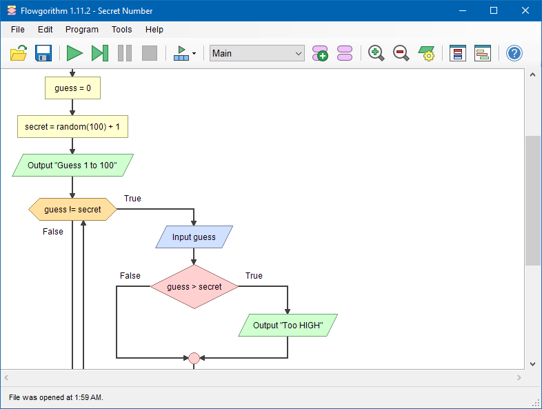

⬅️ [S5 - XOR e la somma](%28STU%29%201CI%20nov-dic%20S5%20-%20XOR%20e%20la%20somma.md) · 🏠 [Indice](../README.md) · S7 - Verifica e recupero ➡️

# 🧠 Ripasso attivo

**1CI · Novembre-Dicembre · S6 · Ripasso**
⏱️ **Tempo di studio: circa 20 minuti in classe, più 15 minuti per l'assaggio di Flowgorithm** · a casa solo se vuoi: **3 giri da 10 minuti** in giorni diversi · nessun compito a casa obbligatorio.

>**Legenda:** ✅ da sapere · 🔍 per capire fino in fondo · 🤓 facoltativo, per curiosi · 🧠 da ricordare · 🧪 esempio · ✏️ da fare · ⚠️ errore comune · 🎮 gioco · 🛠️ strumento · 💭 da pensare · 🚪 uscita · 🃏 flashcard: rispondi a voce, poi apri per controllare

## 🧠 Ripassare bene

### ✅ Chiudi il quaderno, poi prova

Rileggere dà una bella sensazione: «lo so». Ma spesso è un'illusione, perché **riconoscere** una cosa che vedi è più facile che **ricordarla** da soli. Fissa meglio il contrario: chiudere il quaderno, provare a dire o a scrivere la risposta, e solo dopo controllare.

🧠 <u>Prima ricorda, poi controlla.</u> Anche un tentativo sbagliato aiuta: la risposta giusta si nota di più.

### ✅ Il semaforo

Per ogni riga della lista segna **🟢** (lo so spiegare a un compagno), **🟡** (più o meno) o **🔴** (non ancora). Poi ripassa soltanto i rossi e i gialli: è più veloce che rifare tutto.

| Argomento | Che cosa sai fare |
| --- | --- |
| Sistema operativo | Dire in una frase che cos'è e nominare i suoi quattro lavori. |
| Processi | Spiegare la differenza fra programma e processo, e che cosa decide lo scheduler. |
| Kernel | Dire che cos'è e perché non è il sistema operativo intero. |
| Boot | Ordinare i cinque passaggi e dire a che cosa serve il firmware. |
| RAM e disco | Dire che cosa si perde e che cosa resta dopo uno spegnimento. |
| Relè e porte | Disegnare serie e parallelo e dire quale porta realizzano. |
| Tabelle di verità | Scrivere le righe in ordine, anche per tre ingressi. |
| NAND | Costruire un NOT e un AND con sole NAND. |
| Somma | Sommare due bit scrivendo somma e riporto, e dire quali porte servono. |

### 🔍 Tre giri brevi

Se vuoi ripassare a casa, tre giri da 10 minuti in **giorni diversi** valgono più di un'ora in una sera: la memoria si fissa quando devi fare un piccolo sforzo per ritrovare le cose. Giro 1: soltanto i 🔴. Giro 2: i 🔴 e i 🟡. Giro 3: tutto, chiudendo il quaderno.

🃏 <b>Perché chiudere il quaderno aiuta a ricordare?</b>

Perché richiamare le informazioni da soli fissa la memoria più che rileggerle.

🃏 <b>Che cosa si ripassa nel semaforo?</b>

Solo le righe segnate in rosso e in giallo.

## 🗺️ La scala del bimestre

In queste settimane sei sceso, un gradino alla volta, dentro la macchina:

<table>
  <tr><td>🎛️ <b>Sistema operativo</b></td><td>il regista: processi, memoria, file, periferiche, kernel</td></tr>
  <tr><td>🔌 <b>Boot</b></td><td>la staffetta: firmware, bootloader, kernel, servizi, accesso</td></tr>
  <tr><td>💡 <b>Relè e porte</b></td><td>un interruttore decide: NOT, AND, OR</td></tr>
  <tr><td>🧱 <b>NAND</b></td><td>un solo tipo di porta basta per tutte</td></tr>
  <tr><td>➕ <b>XOR e somma</b></td><td>un circuito conta: somma e riporto</td></tr>
</table>

*Didascalia: dal software agli interruttori. Ogni gradino poggia su quello sotto.*

### ✅ Che cosa devi saper dire a voce

Con un compagno, in due minuti, rispondete **senza guardare** a questa domanda: *«Che cosa succede, dal pulsante di accensione fino a una somma fatta da un circuito?»* Chi parla deve nominare almeno quattro gradini. L'altro conta quanti ne ha detti e aggiunge quello che manca.

🃏 <b>Quali sono i cinque gradini del bimestre?</b>

Sistema operativo, boot, relè e porte, NAND, XOR e somma.

## 🔎 Trova l'errore

### ✅ Errori in tabelle e sequenze

In ognuno di questi tre casi **c'è almeno un errore**. Trovalo, scrivilo e correggilo. Spiega con una frase *come* lo hai scoperto.

**Caso 1 · Tabella di NAND.**

| A | B | A NAND B |
| --- | --- | --- |
| 0 | 0 | 1 |
| 0 | 1 | 1 |
| 1 | 0 | 0 |
| 1 | 1 | 0 |

**Caso 2 · Staffetta del boot.** «Premo il pulsante. Parte il bootloader, che prepara il firmware. Poi parte il kernel, poi i servizi e infine compare la schermata di accesso.»

**Caso 3 · Due frasi.** «Il kernel è il sistema operativo intero.» · «Quando un programma deve leggere un file, comanda lui stesso il disco.»

### 🔍 Problemi che uniscono più argomenti

1. **Il circuito dello sblocco.** Il telefono mostra la schermata di accesso solo se il kernel è partito **e** i servizi sono pronti. Disegna il circuito, scrivi la tabella di verità e dimmi quale gradino della staffetta è l'ultimo.
2. **Chi fa che cosa.** Per ognuna di queste situazioni scrivi se il lavoro è del sistema operativo o di un circuito (e di quale porta): a) due app aperte non si cancellano i dati a vicenda; b) un bit di somma vale 1 quando i due bit sono diversi; c) il computer trova il kernel sul disco.
3. **Dopo il riavvio.** Il PC si riavvia da solo mentre scrivi un testo non salvato. Che cosa trovi dopo il riavvio, e perché? Usa le parole *RAM* e *disco*.

🃏 <b>Come si cerca un errore in una tabella di verità?</b>

Si controlla riga per riga, con la regola della porta: per esempio la NAND vale 0 solo con tutti gli ingressi a 1.

## 🎮 Allenamento a coppie

### ✅ Duello di flashcard

A turno, uno legge una domanda dalle **flashcard** di S1-S5 senza mostrare la risposta; l'altro risponde a voce. Se risponde bene, prende un gettone. Dopo cinque domande si cambia ruolo. Vince chi ha più gettoni, ma soprattutto **vince chi trova le domande che non sa ancora**.

### 🔍 Costruisci tu l'esercizio

Scrivi su un foglio un esercizio **per il compagno**, su uno degli argomenti dove hai il rosso, con una risposta che conosci. Passalo al compagno: se non è chiaro, riscrivilo meglio. Spiegare bene è la prova più difficile di sapere bene.

## 🛠️ Un assaggio di Flowgorithm

### 🤓 Disegnare una decisione

Finora i circuiti decidevano con interruttori. Anche un programma decide, e per **raccontare** una decisione un informatico spesso la **disegna**. Il disegno si chiama **diagramma di flusso** (*flowchart*). Oggi ne diamo un assaggio con **Flowgorithm**, un programma gratuito pensato per disegnare diagrammi di flusso e vederli funzionare.

*Didascalia: un diagramma di Flowgorithm (un programma che fa indovinare un numero segreto). Il rombo con le uscite True e False è una decisione.*

Poche forme, da conoscere:

| Forma | A che cosa serve |
| --- | --- |
| **Ovale** | Inizio e fine del diagramma. |
| **Rettangolo** | Un'azione da eseguire. |
| **Parallelogramma** | Mostrare un messaggio o ricevere un dato. |
| **Rombo** | Una **decisione**: due uscite, vero e falso. |

*Didascalia: il rombo è la forma che ci interessa, perché è una porta logica disegnata.*

🧪 **Da frase a diagramma.** «Il Wi-Fi si accende se la modalità aereo non è attiva **e** il router risponde.» Si disegna con **due rombi in fila**: il primo chiede «la modalità aereo è attiva?»; se la risposta è no, passa al secondo, «il router risponde?»; solo se anche questa è sì, il diagramma arriva a «Wi-Fi acceso».

Due decisioni **in fila** lavorano come un **AND**: bisogna superarle tutte e due. Due strade diverse che portano allo stesso risultato lavorano come un **OR**.

✏️ **Disegna (5 min).** Su un foglio disegna il diagramma di flusso del Wi-Fi con due rombi. Poi disegnane un altro per «suona l'allarme se la porta **o** la finestra è aperta»: quanti rombi servono? Dove si incontrano le due strade?

🛠️ **In classe.** Il docente mostra Flowgorithm e prova a disegnare insieme a voi la decisione del Wi-Fi. Se il programma non è disponibile, basta il foglio: **l'assaggio non entra nella verifica**.

🃏 <b>Che cos'è un diagramma di flusso?</b>

Un disegno che racconta i passi di un'azione, con forme collegate da frecce.

🃏 <b>Che cosa rappresenta il rombo?</b>

Una decisione, con due uscite: vero e falso.

🃏 <b>Quale porta logica ricordano due rombi in fila?</b>

L'AND: bisogna superarli tutti e due.

## ✏️ Metti alla prova

1. **Dal tuo telefono (✅, 3 min).** Elenca i quattro lavori del sistema operativo e per ciascuno fai un esempio dal tuo telefono.
2. **La staffetta (✅, 2 min).** Scrivi da memoria i cinque passaggi del boot, in ordine. Controlla poi con la dispensa S2.
3. **Tabelle (✅, 4 min).** Scrivi le tabelle di NOT, AND e OR in una sola volta, partendo dalla riga 00.
4. **Costruisci (✅, 3 min).** Con sole NAND, disegna un NOT e un AND. Quante NAND ti servono in tutto?
5. **Somma (✅, 3 min).** Somma `1 + 1` in binario scrivendo S e C. Poi fai `0110 + 0011` in colonna.
6. **Quattro righe, tre porte (🔍, 5 min).** Una porta ha un ingresso A, uno B e un'uscita che vale 1 solo quando A e B sono diversi. Come si chiama? Costruiscila con porte note e verifica con la tabella.
7. **Il bug (🔍, 4 min).** Un PC mostra il messaggio «sistema operativo non trovato». Quale gradino della staffetta si è interrotto, e come lo capisci?
8. **Spiega a un compagno (🔍, 4 min).** Perché basta un solo tipo di porta, la NAND, per costruire tutti i circuiti? Spiegalo a voce senza guardare gli appunti.

**🚪 Uscita.** Scrivi su un foglietto: 1) un gradino del bimestre che ti è chiaro; 2) uno che vuoi ripassare; 3) una domanda per il docente.

## 🔗 Dove andiamo

Nella [S5](%28STU%29%201CI%20nov-dic%20S5%20-%20XOR%20e%20la%20somma.md) hai visto un circuito che somma. Qui hai rimesso insieme tutto. La prossima settimana c'è la verifica: ti diciamo come è fatta, che cosa portare e come leggere gli errori. A gennaio l'idea del rombo tornerà protagonista, perché un **algoritmo** è proprio un diagramma di decisioni.

## 📚 Fonti e risorse

- [Diagramma di flusso (Wikipedia)](https://it.wikipedia.org/wiki/Diagramma_di_flusso): le forme dei diagrammi di flusso. Guarda soprattutto la tabella dei simboli.
- [Flowgorithm (Wikipedia, in inglese)](https://en.wikipedia.org/wiki/Flowgorithm): che cos'è il programma e a che cosa serve. Leggi l'introduzione.
- [Nandgame](https://nandgame.com/): per ripassare le porte giocando, a casa solo se vuoi.
- **Crediti immagine:** «Flowgorithm Editor», schermata del programma Flowgorithm, licenza [CC BY-SA 4.0](https://creativecommons.org/licenses/by-sa/4.0/), da [Wikimedia Commons](https://commons.wikimedia.org/wiki/File:Flowgorithm_Editor.png).

---

⬅️ [S5 - XOR e la somma](%28STU%29%201CI%20nov-dic%20S5%20-%20XOR%20e%20la%20somma.md) · 🏠 [Indice](../README.md) · S7 - Verifica e recupero ➡️
