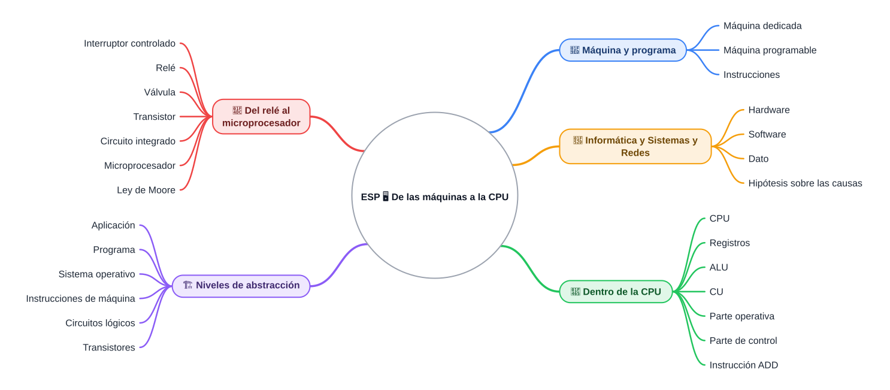

🏠 [Índice](%28STU%29%20ESP%203EI%20-%20SETT-OTT.md) · [S2 - La máquina de Von Neumann](%28STU%29%20ESP%203EI%20sett-ott%20S2%20-%20La%20m%C3%A1quina%20de%20Von%20Neumann.md) ➡️

# 🖥️ De las máquinas a la CPU

**3EI · Septiembre-Octubre · S1 · Teoría**

> **Leyenda:** ✅ hay que saber · 🔍 para entender a fondo · 🤓 opcional, para curiosos · 🃏 flashcard: responde en voz alta, luego ábrela para comprobar



## 🧭 Máquina y programa

Una persona escribe un programa. Pero ¿quién ejecuta de verdad sus instrucciones? Decir «el ordenador» es un comienzo, no una explicación. Dentro de la máquina hay componentes que guardan valores, otros que los transforman y otros que coordinan el trabajo. Ninguno de ellos entiende el propósito del programa como lo entiende una persona: el resultado nace de transformaciones físicas bien organizadas.

Durante siglos, construir una máquina significó darle **un trabajo**: medir el tiempo, tejer, calcular. La programabilidad lo cambia todo: la misma máquina puede hacer trabajos distintos cuando cambian las instrucciones. Entender esta separación es el primer paso para entender tanto un ordenador como las redes que lo conectan con los demás.

## 🔭 Informática y Sistemas y Redes

### ✅ Hardware, software y datos

En Informática estudiamos, entre otras cosas, cómo describir un procedimiento y escribirlo en un lenguaje de programación. En Sistemas y Redes miramos también **la máquina que lo ejecuta y la infraestructura que hace que las máquinas se comuniquen**. No es una división entre quien piensa y quien monta piezas: las dos perspectivas requieren razonamiento y se encuentran continuamente.

- **Hardware:** los componentes físicos.
- **Software:** los programas y sus instrucciones.
- **Dato:** una información representada en una forma que el sistema puede procesar.

El programa establece cómo tratar los datos, pero sin hardware no realiza ningún trabajo.

<details>
<summary>🃏 <b>¿Qué observa Sistemas y Redes, además del programa?</b></summary>

La máquina que ejecuta el programa y la infraestructura que hace que las máquinas se comuniquen. Informática y Sistemas y Redes son dos perspectivas que se encuentran, no una división entre quien piensa y quien monta piezas.

</details>
<details>
<summary>🃏 <b>¿Qué es el hardware?</b></summary>

El conjunto de componentes físicos del sistema.

</details>
<details>
<summary>🃏 <b>¿Qué es el software?</b></summary>

El conjunto de programas y de sus instrucciones.

</details>
<details>
<summary>🃏 <b>¿Qué es un dato?</b></summary>

Una información representada en una forma que el sistema puede procesar.

</details>
<details>
<summary>🃏 <b>¿Un programa puede funcionar sin hardware?</b></summary>

No. El programa establece cómo tratar los datos, pero el trabajo lo ejecuta el hardware.

</details>

### ✅ Síntoma y causa

Un sitio lento puede tener varias causas. Algunos ejemplos:
- Poca memoria disponible en el servidor
- Una conexión congestionada
- Un software que lo gestiona de forma ineficiente

Algunas de estas causas son de software, otras de hardware. Un experto en informática aprende a hacer _hipótesis_ sobre dónde puede estar el problema, para luego comprobarlas. Y no siempre es fácil.

El síntoma, por sí solo, no dice la causa. Antes de proponer una solución pregúntate: **¿dónde se pierde tiempo?** ¿Qué observación distinguiría una hipótesis de la otra?

<details>
<summary>🃏 <b>Un sitio es lento: ¿cuáles pueden ser las causas?</b></summary>

Por ejemplo, un algoritmo ineficiente, poca memoria disponible o una conexión congestionada: partes distintas del sistema.

</details>

## 👥 Dentro de la CPU

### ✅ Registros, ALU y CU

Tomemos la tarea «suma 7 y 5 y guarda el resultado». Una persona lo resuelve con papel y lápiz y ni siquiera se da cuenta de los pasos. Una máquina, en cambio, debe hacer **tres trabajos distintos**:

1. **Guardar** los números en algún sitio, listos para usarse.
2. **Calcular**: transformar 7 y 5 en 12.
3. **Coordinar**: decidir qué pasa y en qué orden. Primero tomas 7 y 5, luego sumas, después dejas guardado el 12.

En el procesador, cada uno de estos trabajos tiene un componente dedicado.

| Trabajo | Componente | Qué es, en palabras sencillas |
|---|---|---|
| Guardar los valores | **Registros** | Memorias muy pequeñas dentro del procesador. Cada una tiene un nombre (R1, R2, R3...) y guarda un número a la vez. |
| Calcular | **ALU**, unidad aritmético-lógica | Un circuito que recibe dos números y la indicación de la operación (suma, resta, comparación...) y devuelve el resultado. |
| Coordinar | **CU**, unidad de control | Un circuito que recibe la instrucción y envía a los componentes las señales eléctricas que indican qué hacer. |

Para imaginarlos puedes pensar en una cocina: la **encimera de trabajo** con los ingredientes listos (registros), el **robot de cocina** que transforma lo que le metes dentro (ALU) y la **receta** que dice qué hacer y en qué orden (CU). Funciona hasta cierto punto: más adelante veremos dónde se rompe.

- Los **registros** son pequeños, pero están muy cerca de quien calcula, así que son rapidísimos de usar. No sirven para guardar archivos: sirven para tener pocos valores *ahora mismo*.
- La **ALU** no decide qué calcular. Solo hace la operación que se le indica sobre los dos números que recibe.
- La **CU** no calcula. Lee la instrucción y envía señales del tipo: «que estos dos registros pongan su contenido hacia la ALU», «la ALU haga la suma», «aquel registro copie el resultado».

La **CPU**, o procesador, es el conjunto de todo esto más las conexiones que hacen que colaboren. **La CPU no es solo la ALU**: sin registros no hay dónde guardar los números; sin CU nadie decide el orden de las acciones.

<details>
<summary>🃏 <b>¿Para qué sirven los registros?</b></summary>

Para tener listos los valores: son pequeñas memorias internas del procesador.

</details>
<details>
<summary>🃏 <b>¿Qué hace la ALU?</b></summary>

Es la unidad aritmético-lógica: transforma los valores con operaciones aritméticas y lógicas.

</details>
<details>
<summary>🃏 <b>¿Qué hace la CU?</b></summary>

Es la unidad de control: interpreta las instrucciones y genera las señales que activan las operaciones en el orden correcto.

</details>
<details>
<summary>🃏 <b>¿La CPU es solo la ALU?</b></summary>

No. La CPU incluye registros, ALU, CU y las conexiones entre ellos: guardar y coordinar son tan indispensables como calcular.

</details>
<details>
<summary>🃏 <b>¿Qué tres trabajos debe hacer una máquina para sumar 7 y 5?</b></summary>

Guardar los números (registros), calcular (ALU) y coordinar el orden de las acciones (CU).

</details>
<details>
<summary>🃏 <b>¿Los registros sirven para guardar archivos?</b></summary>

No. Guardan pocos valores en uso ahora, muy cerca de quien calcula, y son rapidísimos de usar.

</details>
<details>
<summary>🃏 <b>¿La ALU decide qué calcular?</b></summary>

No. Ejecuta la operación que se le indica sobre los dos números que recibe.

</details>

### ✅ Parte operativa y parte de control

Los ingenieros dividen los circuitos de la CPU en dos grupos, según una pregunta sencilla: **¿este circuito *toca* los datos o *manda* sobre quien los toca?**

```text
                   UNIDAD DE CONTROL
                  interpreta la instrucción
                           |
                    señales de control
                           v
             REGISTROS --> ALU --> REGISTRO RESULTADO
               7, 5       +               12
```

- **Parte operativa:** todo aquello por lo que pasan los datos. Son los registros que los guardan, la ALU que los transforma y las conexiones que los llevan de un punto a otro.
- **Parte de control:** la CU. No contiene los datos del usuario y no calcula: solo envía señales que indican qué conexiones abrir y qué operación ejecutar.

En el esquema, las flechas de abajo (de 7 y 5 hacia la ALU, de la ALU hacia el resultado) son **datos que se mueven**: es la parte operativa. La flecha de arriba está hecha de **órdenes**: es la parte de control.

| Pregunta | Dónde está la respuesta |
|---|---|
| ¿Dónde está el 7 antes de la suma? | En un registro: parte operativa |
| ¿Quién hace llegar el 7 y el 5 a la ALU? | Las conexiones, abiertas por las señales: parte operativa, comandada por el control |
| ¿Quién decide que hay que hacer una suma y no una resta? | La CU: parte de control |

Incluso mover un dato de un registro a otro, sin ningún cálculo, es trabajo de la parte operativa. El control sigue siendo necesario: alguien tiene que decir *qué* registro copia *cuál*.

<details>
<summary>🃏 <b>¿Con qué pregunta se dividen los circuitos de la CPU en dos grupos?</b></summary>

¿Este circuito toca los datos o manda sobre quien los toca? En el primer caso es parte operativa; en el segundo, parte de control.

</details>
<details>
<summary>🃏 <b>¿Qué es la parte operativa?</b></summary>

El conjunto de circuitos que guardan, transfieren y transforman los datos: ALU, registros y rutas de datos.

</details>
<details>
<summary>🃏 <b>¿Qué es la parte de control?</b></summary>

El conjunto de circuitos que coordinan transferencias y operaciones.

</details>
<details>
<summary>🃏 <b>¿Mover un dato sin hacer cálculos es trabajo de la parte operativa?</b></summary>

Sí. También una transferencia es trabajo de la parte operativa.

</details>

### ✅ Ejemplo resuelto: `ADD R3, R1, R2`

`ADD R3, R1, R2` es una notación didáctica: no es un comando que se escriba en el PC. Es la forma en que escribimos **una instrucción**, es decir, una orden que la CPU sabe ejecutar. Se lee así:

- `ADD` es la acción: sumar.
- `R3` va **primero** porque es el destino, es decir, donde terminará el resultado. En esta notación el destino se escribe antes; otras notaciones usan el orden contrario, así que lee siempre la regla.
- `R1` y `R2` son los dos registros que contienen los números a sumar.

Frase completa: «suma el contenido de R1 y el contenido de R2, y escribe el resultado en R3».

**Situación inicial:** R1 contiene 7, R2 contiene 5. Veamos qué pasa dentro de la CPU, paso a paso.

| Paso | Qué ocurre | Quién actúa |
|---|---|---|
| 1 | La CU recibe la instrucción y la reconoce: es una suma, con R1 y R2 como fuentes y R3 como destino | Control |
| 2 | La CU envía señales a R1 y R2: «poned vuestro contenido en las conexiones hacia la ALU». Envía una señal a la ALU: «operación: suma» | Control |
| 3 | La ALU recibe 7 y 5 y, tras un instante brevísimo, presenta 12 en su salida | Operativa |
| 4 | La CU envía una señal a R3: «copia lo que llega de la ALU» | Control |
| 5 | R3 contiene 12. R1 y R2 no han cambiado: solo han *prestado* su valor | Operativa |

**¿Por qué R1 y R2 no cambian?** Porque leer un registro no lo vacía: los números se copian en las conexiones. El único registro que cambia es aquel en el que escribes, R3. Si R3 ya contenía un número, ese número se sustituye.

**¿Y si quisiera restar?** No cambiarías la ALU: cambiarías la instrucción. Con `SUB R3, R1, R2` la CU pediría a la ALU una operación distinta. Esta es la idea que retomaremos en la próxima lección: **la máquina es siempre la misma, cambia la instrucción**.

La CU no ha «entendido el problema»: sus circuitos reaccionan ante una instrucción codificada. Tampoco la ALU elige por sí misma: ejecuta la operación que se le indica. En las próximas semanas veremos cómo llega la instrucción desde la memoria.

> ⏸️ **Detente y reconstruye:** tapa la tabla y explica qué información entra, quién la transforma y dónde queda el resultado.

<details>
<summary>🃏 <b>¿Por qué en ADD R3, R1, R2 el destino se escribe primero?</b></summary>

Es la convención de esta notación. Otras notaciones usan el orden contrario, así que hay que comprobar siempre la regla.

</details>
<details>
<summary>🃏 <b>¿Cómo se lee ADD R3, R1, R2?</b></summary>

Suma el contenido de R1 y el de R2, y escribe el resultado en R3.

</details>
<details>
<summary>🃏 <b>¿Quién hace qué durante ADD R3, R1, R2?</b></summary>

La CU selecciona los registros y la operación suma; la ALU calcula; la CU habilita la escritura del resultado en R3.

</details>
<details>
<summary>🃏 <b>¿Después de la suma cambian R1 y R2?</b></summary>

No. Conservan sus valores: cambia solo el registro destino, R3.

</details>
<details>
<summary>🃏 <b>¿Para restar en lugar de sumar hay que cambiar la ALU?</b></summary>

No. Se cambia la instrucción: la CU pide a la ALU otra operación. La máquina es la misma, cambia la instrucción.

</details>
<details>
<summary>🃏 <b>¿La CU «entiende» el problema?</b></summary>

No. Sus circuitos reaccionan ante una instrucción codificada; tampoco la ALU elige la operación por sí misma: ejecuta la que se le indica.

</details>

### 🔍 Límites de la metáfora

Para entender la CPU hemos usado la imagen de un equipo, o de una cocina con encimera, robot y receta. Ayuda, pero deja de funcionar en tres puntos. Conocerlos evita hacerse una idea equivocada del procesador.

1. **Las personas entienden peticiones vagas, los circuitos no.** A un ayudante de cocina puedes decirle «pásame ese bote». A la CPU no: cada señal debe indicar exactamente *qué* registros, *qué* operación, *qué* destino. No existe un «más o menos».
2. **El cocinero puede improvisar, la CU no.** La CU no es un pequeño hombrecillo dentro del procesador. Es un circuito: si recibe la misma instrucción y está en el mismo estado, produce siempre las mismas señales.
3. **Una persona se da cuenta de un error, la máquina no.** Si una instrucción pide sumar los números equivocados, la CPU los suma igualmente. El resultado será incorrecto aunque la ALU sea perfecta.

Por tanto, ante un resultado incorrecto, la pregunta útil no es «¿el ordenador se ha equivocado?». Es: **¿dónde está el paso incorrecto? ¿En los datos, en el programa o en los circuitos?** Distinguir control, datos y operaciones ayuda a buscar una explicación sin atribuir intenciones a la máquina.

> 🔧 **Conexión con el laboratorio:** al observar un PC, CPU, módulo RAM y disipador son objetos distintos. La ALU y los registros, en cambio, no son componentes separados visibles en la placa base: son partes internas del procesador. El esquema funcional no es una fotografía del montaje.

<details>
<summary>🃏 <b>¿En qué tres puntos no funciona la metáfora del equipo?</b></summary>

Las personas entienden peticiones vagas y los circuitos no; el cocinero puede improvisar y la CU no; una persona se da cuenta de un error y la máquina no.

</details>
<details>
<summary>🃏 <b>¿La CU es un pequeño hombrecillo dentro del procesador?</b></summary>

No. Es un circuito: con la misma instrucción y el mismo estado produce siempre las mismas señales.

</details>
<details>
<summary>🃏 <b>¿Un resultado incorrecto significa que la ALU está estropeada?</b></summary>

No necesariamente: pueden estar mal los datos o el programa. La pregunta útil es dónde está el paso incorrecto.

</details>
<details>
<summary>🃏 <b>¿Se ven la ALU y los registros en la placa base?</b></summary>

No. Son partes internas del procesador; en la placa se ven objetos como la CPU, los módulos RAM y el disipador.

</details>

## 📜 Del relé al microprocesador

### ✅ Un interruptor controlado por una señal

Para que una máquina calcule hace falta representar los 0 y los 1 y cambiarlos de forma **segura y rápida**. La técnica es siempre la misma, desde el siglo XIX hasta hoy: un **interruptor controlado por una señal eléctrica**.

Un interruptor normal lo accionas con un dedo. Este lo acciona otro circuito: una señal pequeña abre o cierra un camino para una señal más grande. Si un circuito puede controlar a otro, los circuitos se pueden **encadenar** y construir con interruptores también operaciones lógicas:

- dos interruptores **en serie** dejan pasar la corriente solo si *ambos* están cerrados: es una **AND**;
- dos interruptores **en paralelo** la dejan pasar si *al menos uno* está cerrado: es una **OR**;
- un interruptor que se abre cuando recibe corriente y se cierra cuando no la recibe da una **NOT**.

La intuición que une interruptores y lógica es de 1937. El joven Claude Shannon, en el MIT, demostró en su tesis que los circuitos de relés podían ejecutar el álgebra de Boole. De ahí nace el diseño de los circuitos digitales.

Las tecnologías que siguen son **formas distintas de construir el mismo interruptor**, cada vez más pequeño, rápido y fiable.

<details>
<summary>🃏 <b>¿Cuál es la idea común a relés, válvulas y transistores?</b></summary>

Son todos interruptores controlados por una señal eléctrica: una señal pequeña abre o cierra un camino.

</details>
<details>
<summary>🃏 <b>¿Cómo se obtiene un AND y un OR con interruptores?</b></summary>

AND: dos interruptores en serie; pasa corriente solo si ambos están cerrados. OR: dos en paralelo; pasa si al menos uno está cerrado.

</details>
<details>
<summary>🃏 <b>¿Qué demostró Claude Shannon en 1937?</b></summary>

Que los circuitos de relés podían ejecutar el álgebra de Boole: es el inicio del diseño de circuitos digitales.

</details>

### 🔍 Relé, válvulas y transistor
*(Omitida la válvula termoiónica)*

| Tecnología | Cómo controla la corriente | Límite principal |
|---|---|---|
| **Relé** | Una bobina se convierte en electroimán y mueve una lámina que cierra un contacto | Piezas móviles: lento, ruidoso, se desgasta |
| **Válvula termoiónica** | Una tensión en una rejilla deja pasar o detiene un flujo de electrones en el vacío | Filamento caliente: consumo, calor, se quema |
| **Transistor** | Una tensión en un terminal controla la corriente entre los otros dos, dentro de un cristal semiconductor | Límites físicos y de fabricación |

**Relé.** Dentro hay una bobina de hilo. Cuando pasa corriente se convierte en un electroimán y atrae una lámina de metal, que cierra (o abre) un contacto eléctrico. Una señal débil controla así un circuito separado. Funciona, pero tiene **piezas que se mueven**: cada conmutación requiere un tiempo medible, hace un «clac» y con el tiempo los contactos se desgastan. Son máquinas de relés la Z3 de Konrad Zuse (1941) y el Harvard Mark I (1944), que tardaban algunos segundos en hacer una multiplicación.

**Válvula termoiónica.** Es una ampolla de vidrio de la que se ha quitado el aire. Dentro, un filamento calentado emite electrones (como en una bombilla); una placa con tensión positiva los atrae. Entre los dos hay una **rejilla**: si recibe una pequeña tensión negativa, repele los electrones y la corriente se detiene; si no, pasa. Así, una señal pequeña enciende o apaga una corriente más grande, **sin ninguna parte mecánica**. Es mucho más rápida que el relé. El nombre «válvula» viene de la válvula de agua, que deja pasar el flujo en un solo sentido. El precio: el filamento calienta, consume y tarde o temprano se quema, como una bombilla.

> 🏭 **El ENIAC** (1946) tenía 17.468 válvulas y consumía unos 150 kW. De media, se estropeaba una cada dos días, y encontrar la averiada entre todas las demás requería un cuarto de hora. El diseñador de Colossus, Tommy Flowers, había entendido que las válvulas se rompen sobre todo cuando las enciendes y apagas: dejadas siempre encendidas duran mucho más.

**Transistor.** Está construido con un **semiconductor** (silicio o germanio), un material que conduce la corriente solo en ciertas condiciones. Tiene tres terminales: aplicando una pequeña tensión a uno, se controla la corriente que pasa entre los otros dos. Hace el mismo trabajo que la válvula, pero **en estado sólido**: sin vacío, sin filamento, sin piezas móviles. Es más pequeño, calienta menos, dura más y es más rápido. Fue demostrado en 1947 en los Bell Labs por John Bardeen y Walter Brattain, con William Shockley; los tres recibieron el Nobel de Física en 1956.

<details>
<summary>🃏 <b>¿Cómo funciona un relé, y qué límite tiene?</b></summary>

Una bobina recorrida por corriente se convierte en electroimán y mueve una lámina que cierra un contacto. Tiene piezas móviles: es lento y se desgasta.

</details>
<details>
<summary>🃏 <b>¿Cómo funciona una válvula termoiónica, y qué límite tiene?</b></summary>

Un filamento caliente emite electrones en el vacío; una rejilla con una pequeña tensión los deja pasar o los detiene. El filamento calienta, consume y se quema.

</details>
<details>
<summary>🃏 <b>¿Cómo funciona un transistor, y cuándo se demostró?</b></summary>

Una pequeña tensión en un terminal controla la corriente entre los otros dos, dentro de un semiconductor, sin piezas móviles. Se demostró en 1947 en los Bell Labs.

</details>
<details>
<summary>🃏 <b>¿El ENIAC era una máquina de relés?</b></summary>

No. El ENIAC, de 1946, usaba miles de válvulas: 17.468.

</details>

### 🔍 Del transistor al chip

Conectar a mano los transistores uno a uno, con cables, se vuelve imposible cuando son miles. A finales de los años cincuenta, Jack Kilby (Texas Instruments, 1958) y Robert Noyce (Fairchild, 1959) llegaron, de forma independiente, a una solución: construir varios componentes y sus conexiones **juntos, sobre la misma oblea de silicio**, con procesos fotográficos. Nace el **circuito integrado**, o chip.

En 1971 el **Intel 4004** puso una CPU entera en un solo chip: es el primer microprocesador vendido como componente. Tenía unos 2.300 transistores, procesaba 4 bits cada vez y nació para las calculadoras de una empresa japonesa, Busicom. Lo diseñaron Federico Faggin (italiano, de Vicenza), Ted Hoff, Stanley Mazor y Masatoshi Shima; Faggin firmó el chip con sus iniciales, F.F.

El sentido no es «cada novedad borra enseguida la anterior»: las tecnologías conviven. Pero la integración ha hecho los sistemas mucho más compactos. Un chip actual contiene miles de millones de transistores. ⚠️ **Más pequeño no significa sin consumo ni sin límites.**

<details>
<summary>🃏 <b>¿Qué es un circuito integrado, y quién lo inventó?</b></summary>

Un chip en el que muchos componentes y sus conexiones se construyen juntos sobre una oblea de silicio. Lo desarrollaron de forma independiente Jack Kilby (1958) y Robert Noyce (1959).

</details>
<details>
<summary>🃏 <b>¿Qué es un microprocesador, y cuál fue el primero?</b></summary>

Una CPU entera en un chip. El primero vendido como componente fue el Intel 4004, de 1971, con unos 2.300 transistores.

</details>
<details>
<summary>🃏 <b>¿Cada nueva tecnología borró enseguida la anterior?</b></summary>

No, las tecnologías conviven. La integración ha hecho los sistemas mucho más compactos, pero más pequeño no significa sin consumo ni sin límites.

</details>

### 🤓 El primer «bug»

> El 9 de septiembre de 1947 (según la tradición), los operadores del **Harvard Mark II**, un calculador de relés, encontraron un error causado por una **polilla** atrapada en un relé. La pegaron en el registro con la anotación «First actual case of bug being found» (primer caso real de bicho encontrado). Grace Hopper hizo famosa la historia. 🐛
>
> El juego de palabras funcionaba porque *bug* («bicho») ya llevaba décadas siendo un término de ingenieros para los pequeños defectos: Edison lo usaba en una carta de 1878. Hoy los bugs de los programas ya no tienen alas, pero el nombre se ha quedado.

<details>
<summary>🃏 <b>¿De dónde viene el término «bug»?</b></summary>

Ya era un término de ingenieros para los pequeños defectos (Edison, 1878). La historia de la polilla encontrada en un relé del Harvard Mark II, hacia 1947, lo hizo famoso.

</details>

### 🤓 La ley de Moore

> En 1965 Gordon Moore describió una tendencia: el número de componentes que se podían integrar en un chip crecía a un ritmo regular. La previsión se reformuló después. No es una ley de la naturaleza, y no garantiza que cada programa termine el trabajo en la mitad de tiempo cada dos años. Más transistores pueden convertirse en más cachés, más núcleos o nuevas funciones: la ventaja depende de cómo el sistema y el programa los usan.
>
> La pregunta interesante pasa a ser: **¿qué recurso limita este trabajo?** Un ordenador velocísimo puede quedarse parado esperando los datos. Volveremos a esta idea al hablar de memorias.

<details>
<summary>🃏 <b>¿Qué describió Gordon Moore en 1965?</b></summary>

Una tendencia: el número de componentes integrables en un chip crecía a un ritmo regular. La previsión se reformuló después.

</details>
<details>
<summary>🃏 <b>¿La ley de Moore garantiza que los programas sean dos veces más rápidos cada dos años?</b></summary>

No. No es una ley de la naturaleza: más transistores pueden convertirse en más cachés, más núcleos o nuevas funciones, y la ventaja depende de cómo se usan.

</details>
<details>
<summary>🃏 <b>¿Qué pregunta conviene hacerse en lugar de «¿cuántos transistores?»</b></summary>

¿Qué recurso limita este trabajo? Un ordenador velocísimo puede quedarse parado esperando los datos.

</details>

## 🏗️ Niveles de abstracción

### ✅ Niveles y abstracción

Cuando escribes un mensaje no piensas en los transistores, y no hace falta. Un ordenador se puede mirar por **niveles**. Cada nivel usa el que tiene debajo sin conocer sus detalles, y ofrece servicios al de encima. Esto se llama **abstracción**: ocultar los detalles que, en ese nivel, no hacen falta.

| Nivel | Qué ve | Ejemplo |
|---|---|---|
| **Aplicación** | Las funciones que usa una persona | Una app de mensajes |
| **Programa** | Instrucciones escritas por un programador en un lenguaje | `suma = a + b;` |
| **Sistema operativo** | Recursos que repartir entre los programas: memoria, archivos, pantalla | Windows, Linux, Android |
| **Instrucciones máquina** | Las órdenes que la CPU sabe ejecutar | `ADD R3, R1, R2` |
| **Circuitos lógicos** | Puertas AND, OR, NOT, registros, ALU | El circuito que suma |
| **Transistor** | Interruptores controlados | Miles de millones en un chip |

La línea `suma = a + b;` que escribe un programador se convierte, más abajo, en una instrucción como `ADD R3, R1, R2`; esta hace trabajar a los registros y a la ALU, hechos de puertas lógicas, a su vez hechas de transistores. **Es siempre la misma suma vista desde alturas distintas.**

¿Para qué sirve? Porque nadie puede tener en la cabeza todos los niveles a la vez. Un programador trabaja arriba, un diseñador de chips trabaja abajo. En Sistemas y Redes subimos y bajamos a menudo, y los encontraremos también en las redes, organizadas también por niveles.

<details>
<summary>🃏 <b>¿Qué es la abstracción?</b></summary>

Ocultar los detalles que, a un cierto nivel, no hacen falta. Cada nivel usa el de abajo sin conocer sus detalles y ofrece servicios al de arriba.

</details>
<details>
<summary>🃏 <b>¿Cuáles son los niveles, de arriba abajo?</b></summary>

Aplicación, programa, sistema operativo, instrucciones máquina, circuitos lógicos, transistor.

</details>
<details>
<summary>🃏 <b>¿Cómo se relacionan `a + b` y `ADD R3, R1, R2`?</b></summary>

Son la misma suma vista en niveles distintos: la línea del programa se convierte en una instrucción máquina que la CPU ejecuta con registros y ALU.

</details>

### 🔍 Problemas y niveles

Un fallo, o un resultado extraño, puede tener origen **en un nivel distinto de aquel en el que lo ves**. Un sitio lento puede depender del programa, del sistema operativo, del hardware o de la red. Por eso, ante el síntoma, hay que preguntarse *en qué nivel* buscar.

Ocurre también que un nivel alto «olvide» un límite del nivel bajo. Cuando escribes un número en un programa piensas en números sin fin; pero en los registros cada número ocupa una cantidad limitada de bits. Si el resultado es demasiado grande puede aparecer un número incorrecto, a veces incluso negativo. El programador no se ha equivocado en la suma: ha ignorado un límite que estaba más abajo. Lo veremos de cerca en las próximas semanas.

<details>
<summary>🃏 <b>¿Un problema siempre se ve en el nivel donde tiene su origen?</b></summary>

No. Un síntoma visible arriba puede nacer en un nivel más bajo, o en otro nivel: por eso hay que preguntarse en qué nivel buscar.

</details>
<details>
<summary>🃏 <b>¿Por qué un número puede salir incorrecto aunque la suma del programa sea correcta?</b></summary>

Porque en los registros los números ocupan una cantidad limitada de bits: un nivel alto puede ignorar un límite del nivel bajo.

</details>

## 🧩 Pon a prueba el modelo

1. **Base.** ¿En qué se diferencian hardware y software? ¿Cuáles son los papeles de los registros, la ALU y la CU?
2. **Aplicación.** R1 contiene 9 y R2 contiene 4. Ejecuta `ADD R3, R1, R2`: indica el resultado y qué registros no cambian.
3. **Conexión.** ¿Por qué una CPU no se puede describir solo como una ALU?
4. **Conexión.** En una frase, ¿qué hace la parte operativa y qué hace la parte de control? Pon un ejemplo para cada una.
5. **Historia.** Elige dos entre relé, válvula y transistor y compara cómo controlan la corriente y qué límite tiene cada uno.
6. **Niveles.** Escribe, para la frase «guardo un documento», un nivel alto y un nivel bajo donde podría originarse un problema.
7. **Intuición.** La ALU está libre, pero los datos necesarios todavía no están disponibles. ¿Basta con hacer la ALU más rápida para resolver el problema?
8. **Razonamiento.** Un sitio web responde lentamente. Propón dos causas en partes distintas del sistema y una observación que ayude a distinguirlas.

**🚪 Salida de la lección:** completa «La parte operativa ..., mientras que la parte de control ...».

**🏠 Opcional en casa:** inventa una metáfora distinta del equipo e indica también dónde no funciona.

## 📚 Fuentes y recursos

- [Computer History Museum - Timeline](https://www.computerhistory.org/timeline/) (en inglés): compara las fechas 1946, 1947, 1958 y 1971. Usa las fechas y las imágenes para entender qué problema se resolvía, no para aprender una lista.
- [Wikipedia - Vacuum tube](https://en.wikipedia.org/wiki/Vacuum_tube) (en inglés): cómo funciona una válvula, su uso en los primeros ordenadores y las cifras sobre el ENIAC. Lee las partes «Description» y «Use in electronic computers».
- [Wikipedia - Intel 4004](https://en.wikipedia.org/wiki/Intel_4004) (en inglés): la historia del primer microprocesador comercial y de las personas que lo diseñaron.
- [Wikipedia - Software bug](https://en.wikipedia.org/wiki/Software_bug) (en inglés): la sección «History» cuenta la polilla del Mark II y el origen de la palabra.
- [Historia de los bits](../../Integrazioni%20e%20curiosit%C3%A0/Storia/Storia%20dei%20bit.md): de la lógica de Boole a los circuitos digitales, con Shannon y los relés. Lectura breve para curiosos.
- [Intel - Moore's Law](https://www.intel.com/content/www/us/en/newsroom/resources/moores-law.html) (en inglés): para descubrir qué decía realmente la previsión de Moore.
- [Wikimedia Commons - ENIAC](https://commons.wikimedia.org/wiki/ENIAC): fotografías de la máquina. Si quieres reutilizar una, revisa la licencia y la atribución en la página de cada archivo.
- [NandGame](https://nandgame.com/): juego en línea opcional; construyes funciones complejas partiendo de puertas lógicas sencillas.

---

[🗺️ Índice del bimestre](%28STU%29%20ESP%203EI%20-%20SETT-OTT.md) · [S2 - La máquina de Von Neumann ➡️](%28STU%29%20ESP%203EI%20sett-ott%20S2%20-%20La%20m%C3%A1quina%20de%20Von%20Neumann.md)

🏠 [Índice](%28STU%29%20ESP%203EI%20-%20SETT-OTT.md) · [S2 - La máquina de Von Neumann](%28STU%29%20ESP%203EI%20sett-ott%20S2%20-%20La%20m%C3%A1quina%20de%20Von%20Neumann.md) ➡️
