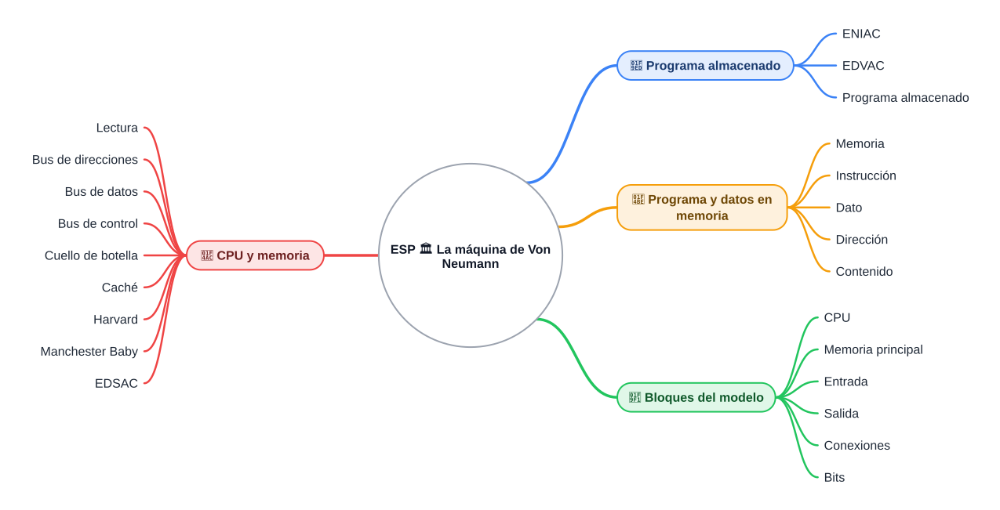

⬅️ [S1 - De las máquinas a la CPU](%28STU%29%20ESP%203EI%20sett-ott%20S1%20-%20De%20las%20m%C3%A1quinas%20a%20la%20CPU.md) · 🏠 [Índice](%28STU%29%20ESP%203EI%20-%20SETT-OTT.md) · [S3 - Registros y recorridos de datos](%28STU%29%20ESP%203EI%20sett-ott%20S3%20-%20Registros%20y%20recorridos%20de%20datos.md) ➡️

# ESP 🏛️ La máquina de Von Neumann

**3EI · Septiembre-Octubre · S2 · Teoría**

> **Leyenda:** ✅ hay que saber · 🔍 para entender a fondo · 🤓 opcional, para curiosos · 🃏 tarjeta de estudio (flashcard): responde en voz alta y luego despliega la respuesta



## 🧭 Programa almacenado

Una hoja de cálculo, un videojuego y una aplicación de música funcionan en el mismo computador. No cambiamos los circuitos cada vez: cambiamos los programas. Pero ¿dónde están las instrucciones cuando el procesador debe ejecutarlas?

En los primeros computadores, cambiar de tarea podía significar reconfigurar la máquina con interruptores, cables o paneles de control. El **ENIAC**, de 1946, se «programaba» así: había que volver a conectar cables y mover interruptores, y preparar un cálculo nuevo podía tomar días. El trabajo lo realizaba un grupo de mujeres matemáticas, entre ellas Kay McNulty, Jean Jennings y Betty Snyder: fueron las primeras programadoras de un computador electrónico, y durante mucho tiempo su historia quedó olvidada. La idea de **guardar también el programa en la memoria** cambió la relación entre máquina y tarea: las instrucciones se convirtieron en información que podía cargarse y sustituirse. <u>La máquina seguía siendo la misma; el programa le asignaba un trabajo diferente.</u> De días de cableado se pasó a minutos de carga. ⚡

Este modelo lleva el nombre de John von Neumann, pero no nació del trabajo aislado de una sola persona. En los años cuarenta, matemáticos, ingenieros y técnicos buscaban juntos la forma de construir computadores electrónicos programables. La guerra había vuelto urgentes cálculos complejos, por ejemplo tablas de tiro y simulaciones; al mismo tiempo, las ideas desarrolladas entonces serían útiles incluso mucho después de la guerra. El modelo nos ayuda a entender el principio, pero no describe cada cable o componente de un computador moderno.

Retomemos los papeles de la [CPU](%28STU%29%20ESP%203EI%20sett-ott%20S1%20-%20De%20las%20m%C3%A1quinas%20a%20la%20CPU.md) y los colocamos dentro de la máquina completa.

## 💾 Programa y datos en memoria

### ✅ Instrucciones y datos en la misma memoria

En el modelo de Von Neumann, **las instrucciones y los datos están en la misma memoria**. Un programa es una secuencia de instrucciones guardadas allí, igual que los valores con los que trabajan esas instrucciones. La CPU accede a la memoria, obtiene la instrucción que debe ejecutar, la interpreta y realiza la operación pedida. Luego pasa a la siguiente instrucción, salvo que el programa le pida seguir otro camino.

La diferencia frente a una máquina diseñada para una sola tarea es concreta: <u>para cambiar de cálculo no hace falta reconstruir el procesador</u>. Se prepara otra secuencia de instrucciones y se carga en memoria. Más adelante veremos con más detalle cómo la CPU lleva la cuenta de la instrucción actual y cómo la ejecuta; aquí nos interesa el principio que permite cambiar de programa.

<details>
<summary>🃏 <b>¿Qué significa «programa almacenado»?</b></summary>

Que las instrucciones del programa están guardadas en memoria, en la misma memoria que los datos. La CPU las obtiene, las interpreta y las ejecuta una tras otra.

</details>
<details>
<summary>🃏 <b>¿Por qué el programa almacenado fue un cambio importante?</b></summary>

Porque para cambiar de tarea basta con cambiar las instrucciones en memoria, sin rehacer conexiones ni ajustes a mano.

</details>
<details>
<summary>🃏 <b>¿Von Neumann inventó todo él solo?</b></summary>

No. Su nombre está ligado a un modelo fundamental, nacido de investigaciones colectivas de los años cuarenta.

</details>

### ✅ Dirección y contenido

Imagina la memoria como una fila de cajones numerados. La **dirección** es el número del cajón; el **contenido** es lo que hay dentro. <u>El número del cajón no es el objeto que hay dentro.</u> Aunque ambos sean números, tienen papeles distintos.

<details>
<summary>🃏 <b>¿Qué diferencia hay entre dirección y contenido?</b></summary>

La dirección identifica una posición de memoria, como el número de un cajón; el contenido es lo que hay en esa posición.

</details>
<details>
<summary>🃏 <b>Si la dirección y el contenido son números, ¿son lo mismo?</b></summary>

No. Pueden ser ambos números, pero tienen papeles distintos: uno indica dónde y el otro qué.

</details>

## 🧱 Bloques del modelo

### ✅ Los cinco bloques

| Bloque                 | Función                                              | Ejemplo                                                |
| ---------------------- | ---------------------------------------------------- | ------------------------------------------------------ |
| **CPU**                | Coordina y ejecuta las instrucciones                 | unidad de control (CU), ALU y registros colaboran      |
| **Memoria principal**  | Mantiene disponibles las instrucciones y los datos en uso | Programa cargado y valores por procesar           |
| **Entrada**            | Lleva información al sistema                         | Teclado, sensor                                        |
| **Salida**             | Lleva información hacia el exterior                  | Pantalla, actuador                                     |
| **Conexiones**         | Transfieren información y señales entre los bloques  | Peticiones a la memoria y valores devueltos            |

```text
                        +-----------------------+
                        | CPU                   |
                        | CU + ALU + REGISTROS  |
                        +-----------+-----------+
                                    |
                        conexiones / bus
                        /           |           \
              +---------+    +---------------+    +---------+
              | ENTRADA |    | MEMORIA       |    | SALIDA  |
              +---------+    | instrucciones |    +---------+
                             | y datos       |
                             +---------------+
```

Las líneas muestran relaciones funcionales, no todos los cables de un PC. ⚠️ La CU **está dentro de la CPU**: no es un segundo procesador externo que manda sobre una CPU formada solo por la ALU. Algunos dispositivos, como la tarjeta de red, son a la vez de entrada y de salida.

<details>
<summary>🃏 <b>¿Cuáles son los bloques del modelo de Von Neumann?</b></summary>

CPU, memoria principal, entrada, salida y las conexiones que transfieren información y señales entre ellos (bus).

</details>
<details>
<summary>🃏 <b>¿Qué hace la memoria principal?</b></summary>

Mantiene disponibles las instrucciones y los datos en uso: el programa cargado y los valores por procesar.

</details>
<details>
<summary>🃏 <b>¿Qué diferencia hay entre entrada y salida?</b></summary>

La entrada lleva información al sistema, como un teclado o un sensor; la salida la lleva hacia el exterior, como una pantalla o un actuador. Algunos dispositivos, como la tarjeta de red, hacen las dos cosas.

</details>
<details>
<summary>🃏 <b>¿Dónde está la CU en el esquema?</b></summary>

Dentro de la CPU, junto con la ALU y los registros. No es un segundo procesador externo.

</details>
<details>
<summary>🃏 <b>¿Las líneas del esquema son los cables del PC?</b></summary>

No. Muestran relaciones funcionales entre los bloques, no todos los cables reales.

</details>

### ✅ Ejemplo resuelto: LOAD y ADD

Usamos una memoria didáctica: cada celda contiene un valor entero o una instrucción completa. (No estamos diciendo que una instrucción real ocupe siempre una celda de un byte.)

| Dirección | Contenido legible |
| --------- | ----------------- |
| 10        | `LOAD R1, [20]`   |
| 11        | `ADD R3, R1, R2`  |
| 20        | 7                 |
| 21        | 99                |

Seguimos la máquina sin saltarnos ningún paso. La CPU encuentra la primera instrucción en la dirección 10: `LOAD R1, [20]`. La lee como un comando y luego usa la dirección 20 indicada en el comando para pedir el dato. La celda 20 contiene 7, así que copia **7** en R1. <u>El número 20 servía para encontrar la celda: no es el dato que se copia.</u>

R2 contiene ya 5. La CPU pasa a la instrucción de la dirección 11: `ADD R3, R1, R2`. La ALU suma los contenidos de R1 y R2, es decir 7 y 5, y el resultado 12 se escribe en R3. La celda 21 contiene 99, pero ninguna instrucción la indica: por eso el programa no la usa. <u>Estar presente en la memoria no basta para participar en el cálculo.</u>

El ejemplo separa tres preguntas que es fácil confundir: **¿qué instrucción ejecutar?** (dirección 10 u 11); **¿qué dato leer?** (dirección 20); **¿qué resultado obtener?** (12 en R3). En los computadores reales la representación se hace con bits y las instrucciones tienen formatos precisos; las direcciones 10, 11 y 20 se eligen aquí solo para hacer visibles los papeles.

Si en lugar de la suma pusiéramos una resta, cambiaría el trabajo realizado. <u>No modificamos físicamente la ALU: elegimos, con otra instrucción, una función que la máquina ya sabe hacer.</u>

> ⏸️ **Fijación:** en la tabla busca una dirección, un dato y una instrucción. Explica cómo los has distinguido sin fijarte solo en su aspecto.

<details>
<summary>🃏 <b>¿Qué hace LOAD R1, [20]?</b></summary>

Copia en R1 el contenido de la celda 20. Si la celda 20 contiene 7, en R1 llega 7, no 20.

</details>
<details>
<summary>🃏 <b>¿Un valor se usa solo porque está en memoria?</b></summary>

No. Se usa solo si una instrucción lo pide: en el ejemplo, el 99 de la celda 21 queda sin usar.

</details>
<details>
<summary>🃏 <b>¿Para restar en lugar de sumar hay que modificar la ALU?</b></summary>

No. Basta con otra instrucción que elija una función que la máquina ya sabe hacer.

</details>

### 🔍 Instrucciones y datos como bits

`LOAD` y `ADD` son formas legibles de escribir instrucciones. La memoria real guarda secuencias de bits. El **formato de la instrucción** y el momento de la ejecución permiten al procesador tratarlas como comandos. Otras secuencias se convierten en números, caracteres o direcciones.

No existe una etiqueta universal que diga a cada CPU «estos bits son una instrucción». En nuestro modelo seguimos simplemente el programa desde las posiciones indicadas.

<details>
<summary>🃏 <b>¿En memoria está escrito realmente «LOAD»?</b></summary>

No. LOAD y ADD son formas legibles de escribir instrucciones; la memoria guarda secuencias de bits.

</details>
<details>
<summary>🃏 <b>¿Cómo trata el procesador unos bits como una instrucción?</b></summary>

Gracias al formato de la instrucción y al momento de la ejecución. Otras secuencias de bits se convierten en números, caracteres o direcciones.

</details>

## 💬 CPU y memoria

### 🔍 Anatomía de una lectura

Para leer la memoria no basta con decir «envíame algo». La CPU y la memoria deben coordinarse, un poco como dos personas que preparan un intercambio: hay que indicar qué posición interesa y qué acción se quiere realizar. En una lectura, la memoria devuelve el contenido de esa posición. En el modelo didáctico distinguimos tres informaciones:

- **¿Dónde?** Una dirección, por ejemplo 20.
- **¿Qué operación?** Una lectura, distinta de una escritura.
- **¿Qué valor?** El contenido devuelto, por ejemplo 7.

Imagina que la CPU debe leer la celda 20. En la línea de direcciones comunica **20**; con la línea de control señala **lectura**; la memoria responde devolviendo, por el camino de los datos, el contenido **7**. Son papeles distintos aunque los elementos viajen por el mismo sistema de conexiones. Estos papeles anticipan los buses de direcciones, de control y de datos. Incluso una instrucción leída de la memoria viaja como contenido por el camino de los datos: «bus de datos» no significa «prohibido para las instrucciones».

<details>
<summary>🃏 <b>¿Qué tres informaciones hacen falta para leer la memoria?</b></summary>

Dónde (una dirección), qué operación (lectura o escritura) y qué valor (el contenido devuelto).

</details>
<details>
<summary>🃏 <b>¿A qué bus corresponden las tres preguntas?</b></summary>

El dónde al bus de direcciones, la operación al bus de control y el valor al bus de datos.

</details>
<details>
<summary>🃏 <b>¿Una instrucción puede viajar por el bus de datos?</b></summary>

Sí. Cuando se lee de la memoria es un contenido como cualquier otro.

</details>

### 🔍 El cuello de botella de Von Neumann

El **cuello de botella de Von Neumann** es el límite que puede aparecer cuando la CPU y la memoria intercambian instrucciones y datos a través de una conexión con capacidad limitada. La CPU puede ejecutar operaciones muy rápido, pero para trabajar necesita que lleguen las instrucciones y los datos. Si la conexión no los transfiere con suficiente rapidez, la CPU debe esperar, o el trabajo avanza más despacio de lo que permitiría su velocidad de cálculo.

Retomemos el ejemplo anterior. Para completar `LOAD R1, [20]`, la máquina debe primero obtener la instrucción de la memoria y luego leer el dato de la dirección 20. Después, todavía debe obtener la instrucción `ADD`. En el modelo más sencillo, estas transferencias pasan por un recurso compartido y no ocurren todas en el mismo instante. Mientras la memoria o la conexión atiende una petición, la CPU puede no tener aún el siguiente elemento con el que trabajar. Si peticiones parecidas se acumulan, se forma una cola: <u>es esta ralentización de los intercambios, y no una CPU «poco inteligente», lo que explica el cuello de botella.</u>

La cocina con una sola puerta lo ilustra: incluso cocineros muy rápidos deben esperar si los ingredientes llegan uno a uno por una puerta lenta. La metáfora tiene un límite: un computador no tiene realmente una puerta, y las arquitecturas reales usan soluciones distintas. Lo que cuenta es la capacidad efectiva de transferir información entre la memoria y el procesador; no basta comparar «GHz de la CPU» y «GB/s de la memoria», porque miden magnitudes distintas. La caché, que veremos más adelante, guarda cerca de la CPU algunos datos e instrucciones usados con frecuencia y reduce ciertas esperas. No elimina toda espera ni hace la memoria infinita o instantánea.

> 🔧 **Conexión con el laboratorio:** el módulo de RAM y el SSD forman parte ambos del sistema de memoria, pero no hacen el mismo trabajo. El modelo de hoy describe la memoria usada directamente durante la ejecución. Un archivo guardado en el disco no está ya listo en los registros de la CPU.

<details>
<summary>🃏 <b>¿Qué es el cuello de botella de Von Neumann?</b></summary>

La CPU puede terminar un cálculo rápido y luego esperar el siguiente dato: datos e instrucciones compiten por el mismo acceso a la memoria.

</details>
<details>
<summary>🃏 <b>¿Se pueden comparar directamente los GHz de la CPU y los GB/s de la memoria?</b></summary>

No. Miden magnitudes distintas.

</details>
<details>
<summary>🃏 <b>¿La caché hace instantánea la memoria?</b></summary>

No. Reduce algunas esperas, pero no hace la memoria infinita ni instantánea.

</details>
<details>
<summary>🃏 <b>¿RAM y SSD hacen el mismo trabajo?</b></summary>

No. El modelo describe la memoria usada durante la ejecución; un archivo guardado en el disco no está ya en los registros de la CPU.

</details>

### 🤓 Von Neumann, Harvard y las primeras máquinas

> En la arquitectura **Harvard**, las instrucciones y los datos tienen memorias o caminos separados. Si los caminos pueden funcionar en el mismo momento, el procesador puede, por ejemplo, obtener una instrucción mientras accede a un dato: es una forma de reducir la contención descrita antes. La separación, sin embargo, exige diseñar y gestionar dos caminos; no significa «memoria dentro de la CPU» frente a «memoria fuera». Von Neumann y Harvard son modelos útiles para comparar decisiones de organización, no etiquetas que lo cuenten todo por sí solas sobre un computador.
>
> Muchos sistemas modernos mezclan las ideas: por ejemplo, usan una memoria principal compartida y cachés separadas para instrucciones y datos cerca del procesador. Una caché separada puede ofrecer caminos distintos en ese nivel, aunque más abajo las informaciones compartan otros recursos. Por eso, al describir una máquina, conviene preguntarse **a qué nivel** nos referimos, en lugar de buscar una sola etiqueta válida para todo el computador.
>
> 🕰️ El **Manchester Baby** ejecutó un programa almacenado en 1948. No era un computador moderno en miniatura: era una máquina experimental, construida para comprobar una idea. Su éxito mostró que las instrucciones podían guardarse electrónicamente y luego ser ejecutadas por la máquina. De ese principio, desarrollado gracias al trabajo de varios grupos, procede una parte importante de la informática que usamos hoy. En 1949, en Cambridge, entró en funcionamiento el **EDSAC**, dirigido por Maurice Wilkes: fue uno de los primeros computadores de programa almacenado usados de verdad, durante años, para trabajo científico. Quién fue «el primero» depende de cómo se defina un computador: por eso los historiadores siguen discutiéndolo.

<details>
<summary>🃏 <b>¿Cómo se programaba el ENIAC, y quién lo hacía?</b></summary>

Volviendo a conectar cables y moviendo interruptores; un cálculo nuevo podía llevar días. Lo hacía un grupo de mujeres matemáticas, entre ellas Kay McNulty, Jean Jennings y Betty Snyder.

</details>
<details>
<summary>🃏 <b>¿Qué fue el EDSAC?</b></summary>

Un computador de programa almacenado que entró en funcionamiento en Cambridge en 1949, dirigido por Maurice Wilkes y usado para trabajo científico.

</details>
<details>
<summary>🃏 <b>¿Qué separa la arquitectura Harvard?</b></summary>

Memoria y caminos para las instrucciones y para los datos. Puede permitir accesos simultáneos, con otras decisiones y otras limitaciones.

</details>
<details>
<summary>🃏 <b>¿Los computadores modernos son Von Neumann puros o Harvard puros?</b></summary>

A menudo mezclan las ideas: memoria principal única y cachés separadas para instrucciones y datos.

</details>
<details>
<summary>🃏 <b>¿Qué demostró el Manchester Baby en 1948?</b></summary>

Que un programa almacenado podía ser ejecutado de verdad por una máquina electrónica.

</details>

## 🧩 Pon a prueba el modelo

1. **Base.** ¿Qué significa «programa almacenado»? ¿Qué bloques colaboran en la ejecución?
2. **Aplicación.** La celda 30 contiene 8 y la celda 8 contiene 90. ¿Qué valor devuelve una lectura en la dirección 30? Justifica.
3. **Conexión.** ¿Por qué en el esquema la CU se dibuja dentro de la CPU?
4. **Intuición.** ¿Duplicar la capacidad de la RAM garantiza reducir a la mitad el tiempo de cada lectura?
5. **Discusión.** ¿Cambiar de programa y cambiar de hardware son lo mismo? Pon un ejemplo en el que baste lo primero y otro en el que pueda hacer falta lo segundo.

**🚪 Salida:** escribe una frase con «misma memoria» y otra con «papeles distintos». Prohibido usar «el computador sabe» como explicación.

## 📚 Fuentes y recursos

- [Computer History Museum - 1945](https://www.computerhistory.org/timeline/1945/) (en inglés): el informe sobre el EDVAC, dentro del trabajo sobre los primeros computadores. Observa cuántas personas estaban implicadas.
- [Computer History Museum - 1948](https://www.computerhistory.org/timeline/1948/) (en inglés): la entrada sobre el Manchester Baby; distingue la demostración de un principio de un computador vendido en el mercado.
- [Nand2Tetris - Project 5](https://www.nand2tetris.org/project05) (en inglés, para curiosos): un computador didáctico construido desde cero. No coincide en cada detalle con nuestro modelo.

---

⬅️ [S1 - De las máquinas a la CPU](%28STU%29%20ESP%203EI%20sett-ott%20S1%20-%20De%20las%20m%C3%A1quinas%20a%20la%20CPU.md) · 🏠 [Índice](%28STU%29%20ESP%203EI%20-%20SETT-OTT.md) · [S3 - Registros y recorridos de datos](%28STU%29%20ESP%203EI%20sett-ott%20S3%20-%20Registros%20y%20recorridos%20de%20datos.md) ➡️
