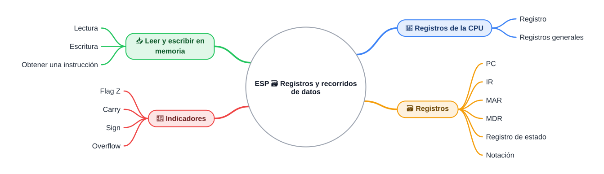

⬅️ [S2 - La máquina de Von Neumann](%28STU%29%20ESP%203EI%20sett-ott%20S2%20-%20La%20m%C3%A1quina%20de%20Von%20Neumann.md) · 🏠 [Índice](%28STU%29%20ESP%203EI%20-%20SETT-OTT.md) · [S4 - El ciclo de máquina](%28STU%29%20ESP%203EI%20sett-ott%20S4%20-%20El%20ciclo%20de%20m%C3%A1quina.md) ➡️

# 🗃️ Registros y recorridos de datos

**3EI · Septiembre-Octubre · S3 · Teoría**

> **Leyenda:** ✅ hay que saber · 🔍 para entender a fondo · 🤓 opcional, para curiosos · 🃏 flashcard: responde en voz alta, luego ábrela para comprobar



## 🧭 Registros de la CPU

En el [modelo de Von Neumann](%28STU%29%20ESP%203EI%20sett-ott%20S2%20-%20La%20m%C3%A1quina%20de%20Von%20Neumann.md) la CPU ejecuta instrucciones guardadas en memoria. Pero mientras espera una lectura, ¿dónde guarda la dirección? Y cuando llega la instrucción, ¿dónde la guarda mientras prepara los datos?

Hacen falta pequeños puestos de trabajo internos. Es el mismo problema que al seguir una receta: necesitas un marcador, la línea que estás leyendo y los ingredientes con los que trabajas. En la CPU, estos papeles los cumplen los **registros**.

## 🗃️ Registros

### ✅ Registros y papeles

Un **registro** es una pequeña memoria dentro del procesador, con capacidad limitada. Guarda bits: pero cada registro tiene un **papel**, y es el papel el que da significado a esos bits. Los **registros generales**, aquí R1, R2 y R3, guardan operandos y resultados temporales. En nuestro modelo, otros registros tienen tareas específicas.

| Nombre                             | Pregunta a la que responde                  | Contenido en el modelo                         |
| ---------------------------------- | ------------------------------------------- | ---------------------------------------------- |
| **PC**, Program Counter            | ¿Dónde tomaré la próxima instrucción?       | Una dirección de instrucción                   |
| **IR**, Instruction Register       | ¿Qué instrucción estoy ejecutando?          | La instrucción buscada                         |
| **MAR**, Memory Address Register   | ¿Qué celda interesa en el acceso en curso?  | Una dirección de memoria                       |
| **MDR**, Memory Data Register      | ¿Qué contenido estoy recibiendo o enviando? | El valor leído o el que hay que escribir       |
| **Flag**, en el registro de estado | ¿Qué propiedad ha tenido un resultado?      | Información resumida, no el resultado completo |

PC y MAR pueden contener el mismo número en un momento dado, pero **no tienen el mismo papel**. El PC sigue la secuencia de las instrucciones; el MAR sirve para cada acceso, también a los datos. El MDR puede contener una instrucción: para la memoria es solo un contenido transferido.

Estos nombres describen nuestra máquina didáctica. No todas las CPU del mercado tienen un registro físico con cada uno de estos nombres.

⚠️ **¡PC no es el ordenador!** Aquí PC significa *Program Counter*, el contador del programa. En el lenguaje común, PC también es *Personal Computer*. La sigla es la misma, la cosa no: en informática pasa a menudo, y conviene preguntarse siempre «¿PC de qué tipo?». 😄

<details>
<summary>🃏 <b>¿Qué es un registro?</b></summary>

Una pequeña memoria dentro del procesador, con capacidad limitada.

</details>
<details>
<summary>🃏 <b>¿Para qué sirven los registros generales como R1, R2, R3?</b></summary>

Para guardar operandos y resultados temporales.

</details>
<details>
<summary>🃏 <b>¿Qué contiene el PC, Program Counter?</b></summary>

La dirección de la próxima instrucción que hay que buscar.

</details>
<details>
<summary>🃏 <b>¿Qué contiene el IR, Instruction Register?</b></summary>

La instrucción que la CPU está ejecutando.

</details>
<details>
<summary>🃏 <b>¿Qué contiene el MAR, Memory Address Register?</b></summary>

La dirección de la celda afectada por el acceso en curso, ya sea a instrucciones o a datos.

</details>
<details>
<summary>🃏 <b>¿Qué contiene el MDR, Memory Data Register?</b></summary>

El contenido que la CPU está recibiendo de la memoria o enviando a la memoria.

</details>
<details>
<summary>🃏 <b>¿Qué son los flags?</b></summary>

Información resumida, en el registro de estado, sobre algunas propiedades de un resultado. No contienen el resultado completo.

</details>
<details>
<summary>🃏 <b>PC y MAR contienen el mismo número: ¿tienen el mismo papel?</b></summary>

No. El PC sigue la secuencia de las instrucciones; el MAR sirve para cada acceso a la memoria, también a los datos.

</details>
<details>
<summary>🃏 <b>¿Todas las CPU tienen registros llamados PC, IR, MAR y MDR?</b></summary>

No. Son los nombres de nuestra máquina didáctica, no de cada CPU del mercado.

</details>
<details>
<summary>🃏 <b>¿Qué significa PC en estos apuntes, y qué significa en el lenguaje común?</b></summary>

En estos apuntes, Program Counter: el registro con la dirección de la próxima instrucción. En el lenguaje común es Personal Computer: misma sigla, cosas distintas.

</details>

### ✅ Notación
- `R1 <- 7` significa «copia 7 en R1». La flecha no es una igualdad y no vacía el origen.
- `MEM[40]` indica **el contenido** de la celda de dirección 40.
- `MAR <- 40` y `MDR <- MEM[40]` hacen trabajos distintos.

En los ejemplos usamos celdas abstractas: una celda contiene un dato entero o una instrucción entera. Byte y capacidad llegarán más adelante, con hipótesis declaradas.

Para consultar la tabla de instrucciones usadas en los ejemplos, mira el material sobre el [lenguaje ensamblador básico](%28STU%29%20ESP%203EI%20-%20Lenguaje%20ensamblador%20b%C3%A1sico.md).

<details>
<summary>🃏 <b>¿Qué significa R1 &lt;- 7?</b></summary>

Copia 7 en R1. No es una igualdad y no vacía el origen.

</details>
<details>
<summary>🃏 <b>¿Qué indica MEM[40]?</b></summary>

El contenido de la celda de dirección 40, no el número 40.

</details>
<details>
<summary>🃏 <b>¿Qué contiene una celda abstracta en nuestros ejemplos?</b></summary>

Un dato entero o una instrucción entera.

</details>

## 📥 Leer y escribir en memoria

### ✅ Ejemplo resuelto: leer el valor 23

**Cada vez que tengamos que leer y escribir en la memoria, debemos usar MAR y MDR.**
La celda 40 contiene 23 y queremos copiarlo en R1. Por ahora ignoramos la búsqueda de la instrucción que ordena esta operación.

| Paso | Acción | Para qué sirve |
|---|---|---|
| 1 | `MAR <- 40` | Indica la celda que hay que leer |
| 2 | La CU pide `READ` | Distingue la lectura de la escritura |
| 3 | Espera | La memoria no es instantánea ⏳ |
| 4 | `MDR <- MEM[MAR]`, y por tanto MDR = 23 | Recibe el contenido |
| 5 | `R1 <- MDR`, y por tanto R1 = 23 | Guarda el valor en el registro destino |

```text
MAR = 40 -- dirección --> MEMORIA
CU       -- READ ------> MEMORIA
                         MEM[40] = 23
                              |
                              v
                         MDR = 23 --> R1 = 23
```

Una lectura normal **no borra** el valor de la memoria: después de la secuencia, MEM[40] sigue valiendo 23. R1 no recibe 40, porque 40 dice *dónde* buscar, no *qué* hay.

> ⏸️ **Fijación:** rehaz la secuencia con MEM[60] = 14 y destino R2. En cada paso di en voz alta «dirección» o «contenido».

<details>
<summary>🃏 <b>¿Cuáles son los pasos de una lectura de memoria?</b></summary>

El MAR recibe la dirección; la CU pide READ; se espera; el MDR recibe el contenido; el valor se copia en el registro destino.

</details>
<details>
<summary>🃏 <b>¿Por qué hay un paso de espera en la lectura?</b></summary>

Porque la memoria no es instantánea.

</details>
<details>
<summary>🃏 <b>Después de una lectura, ¿el valor sigue en memoria?</b></summary>

Sí. Una lectura normal no borra el contenido de la celda.

</details>
<details>
<summary>🃏 <b>Al leer la celda 40, ¿el registro destino recibe 40?</b></summary>

No. Recibe el contenido de la celda: 40 dice dónde buscar, no qué hay.

</details>

### 🔍 Búsqueda de una instrucción (fetch)

**También la búsqueda de una instrucción en la memoria pasa por MAR y MDR.**
Supongamos PC = 10 y MEM[10] = `LOAD R1, [40]`. Para buscarla copiamos el PC en el MAR, pedimos una lectura y recibimos la instrucción en el MDR. Después la copiamos en el IR. Ahora la CU puede interpretarla.

```text
PC = 10 --> MAR = 10 --> MEM[10]
                              |
IR = LOAD R1,[40] <-- MDR <----+
```

Cuando se ejecuta la `LOAD`, el MAR recibe 40 y el MDR recibe 23. Mientras tanto, el IR sigue guardando la instrucción. Por eso conviene separar los papeles: la CPU no pierde la orden mientras va a buscar el dato. Los próximos apuntes completarán la secuencia con el avance del PC.

<details>
<summary>🃏 <b>¿Cómo llega una instrucción al IR?</b></summary>

Se copia el PC en el MAR, se pide una lectura, la instrucción llega al MDR y luego se copia en el IR.

</details>
<details>
<summary>🃏 <b>Durante una LOAD, ¿por qué el IR y el MDR contienen cosas distintas?</b></summary>

El IR guarda la instrucción, mientras que el MDR recibe el dato pedido: así la CPU no pierde la orden mientras va a buscar el dato.

</details>

### 🔍 Escritura en memoria

Queremos copiar en memoria el valor de R3 = 12, en la celda 50. Se preparan `MAR <- 50` y `MDR <- R3`, y luego la CU activa `WRITE`. Al final MEM[50] contiene 12: el contenido antiguo de esa celda queda **sustituido**. R3 sigue valiendo 12.

La dirección y el valor deben prepararse antes de la escritura. Una dirección equivocada modifica otra celda, aunque el valor sea correcto.

<details>
<summary>🃏 <b>¿Cuáles son los pasos de una escritura en memoria?</b></summary>

El MAR recibe la dirección de destino, el MDR recibe el valor y después la CU activa WRITE.

</details>
<details>
<summary>🃏 <b>¿Qué pasa con el contenido antiguo de la celda escrita?</b></summary>

Se sustituye por el nuevo valor. El registro origen, en cambio, conserva su valor.

</details>
<details>
<summary>🃏 <b>¿Por qué la dirección y el valor se preparan antes de WRITE?</b></summary>

Porque con una dirección equivocada se modifica otra celda, aunque el valor sea correcto.

</details>

## 🚩 Flag

### 🔍 Flags y resultados

Después de la resta $7-7$ el resultado es 0 y el flag **Z** (zero) puede valer 1 para indicarlo. Una instrucción posterior puede usar esta información para elegir por qué camino seguir.

Otros flags típicos: **carry** (acarreo en las operaciones sin signo), **sign/negative** (ligado al bit de signo), **overflow** (resultado fuera de rango en las operaciones con signo). No son intercambiables. Qué instrucciones actualizan cada flag depende de la arquitectura.

> 🔧 **Conexión con el laboratorio:** añadir un módulo RAM aumenta la memoria principal, no el número de registros de la CPU. La capacidad escrita en un módulo no describe la memoria interna del procesador.

<details>
<summary>🃏 <b>¿Para qué sirve el flag Z?</b></summary>

Indica que el resultado es cero, por ejemplo después de 7 - 7. Una instrucción posterior puede usarlo para elegir por qué camino seguir.

</details>
<details>
<summary>🃏 <b>¿Qué indican carry, sign y overflow?</b></summary>

Carry: un acarreo en las operaciones sin signo. Sign o negative: el bit de signo. Overflow: un resultado fuera de rango en las operaciones con signo.

</details>
<details>
<summary>🃏 <b>¿Todas las CPU actualizan los flags de la misma manera?</b></summary>

No. Qué instrucciones actualizan cada flag depende de la arquitectura.

</details>
<details>
<summary>🃏 <b>¿Añadir RAM aumenta los registros de la CPU?</b></summary>

No. Aumenta la memoria principal, no la memoria interna del procesador.

</details>

### 🤓 Overflow y acarreo

> Un registro de 4 bits tiene 16 configuraciones. Como enteros sin signo representan los números de 0 a 15. La suma $15+1$ necesitaría cinco bits: `1111 + 0001 = 10000`. Si solo conservamos cuatro, queda `0000`, con un acarreo.
>
> No es un error de la máquina: es el límite de la representación elegida. Si interpretamos los mismos bits como números con signo, cambian el rango y el significado de las comprobaciones. Por eso «carry» y «overflow» no son dos nombres de la misma cosa. 🎮 Curiosidad: varios glitches de los videojuegos antiguos nacen justamente de contadores que «vuelven a empezar desde cero».

<details>
<summary>🃏 <b>¿Qué números sin signo representa un registro de 4 bits?</b></summary>

De 0 a 15: 16 configuraciones.

</details>
<details>
<summary>🃏 <b>¿Qué pasa si en 4 bits calculas 15 + 1?</b></summary>

Se necesitarían cinco bits, 10000. Si conservamos cuatro, queda 0000, con un acarreo.

</details>
<details>
<summary>🃏 <b>¿Carry y overflow son lo mismo?</b></summary>

No. El carry se refiere a las operaciones sin signo; el overflow, a las operaciones con signo.

</details>

## 🧩 Pon a prueba el modelo

1. **Base.** Relaciona PC, IR, MAR y MDR con: dirección de la próxima instrucción, instrucción actual, dirección del acceso, contenido transferido.
2. **Aplicación.** MEM[18] = 6. Escribe los pasos para copiar ese valor en R2.
3. **Procedimiento.** R3 = 15. Describe la escritura en MEM[24]: ¿qué valores cambian y cuáles se mantienen?
4. **Conexión.** Durante la lectura de un dato, ¿por qué el IR y el MDR pueden contener cosas distintas?
5. **Intuición.** PC y MAR valen ambos 10. ¿Significa que uno de los dos es inútil? Justifica pensando en la lectura de un dato.
6. **Base.** El flag Z vale 1: ¿significa que el registro de estado contiene el resultado de la operación?

**🚪 Salida:** dibuja MAR y MDR con un valor cada uno y explica por qué no los has intercambiado.

**🏠 Opcional en casa:** cuenta la misma lectura en cuatro líneas sin siglas, luego vuélvelas a poner.

## 📚 Fuentes y recursos

- [Nand2Tetris - Project 5](https://www.nand2tetris.org/project05) (en inglés, para curiosos): compara la CPU y la memoria de un ordenador didáctico real con nuestro modelo; los nombres de los registros no coinciden todos.
- [RISC-V - especificaciones oficiales](https://riscv.org/specifications/) (en inglés, muy técnico): solo para quien quiera ver cómo una arquitectura real define sus propios registros.

---

⬅️ [S2 - La máquina de Von Neumann](%28STU%29%20ESP%203EI%20sett-ott%20S2%20-%20La%20m%C3%A1quina%20de%20Von%20Neumann.md) · 🏠 [Índice](%28STU%29%20ESP%203EI%20-%20SETT-OTT.md) · [S4 - El ciclo de máquina](%28STU%29%20ESP%203EI%20sett-ott%20S4%20-%20El%20ciclo%20de%20m%C3%A1quina.md) ➡️
