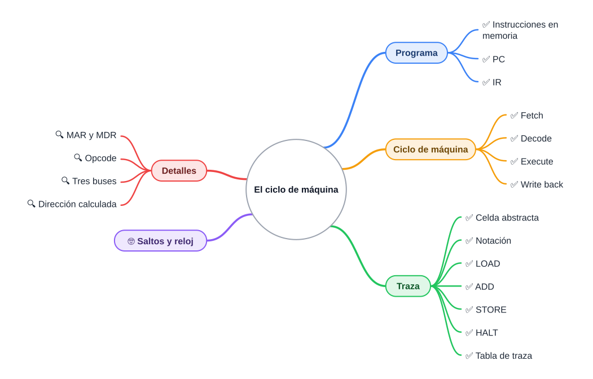
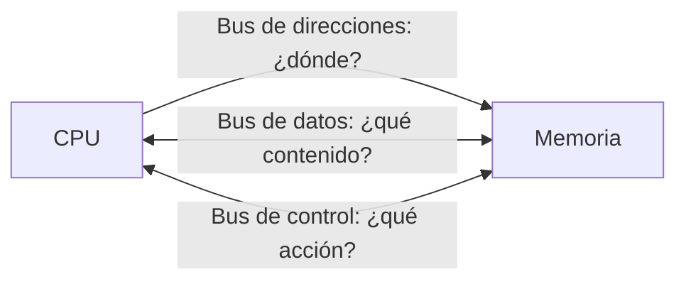

⬅️ [S3 - Registros y recorridos de datos](%28STU%29%20ESP%203EI%20sett-ott%20S3%20-%20Registros%20y%20recorridos%20de%20datos.md) · 🏠 [Índice](%28STU%29%20ESP%203EI%20-%20SETT-OTT.md) · [S5 - Direcciones y jerarquía de memoria](%28STU%29%20ESP%203EI%20sett-ott%20S5%20-%20Direcciones%20y%20jerarqu%C3%ADa%20de%20memoria.md) ➡️

# 🔄 El ciclo de máquina

**3EI · Septiembre-Octubre · S4 · Teoría**

⏱️ **Tiempo:** unos 25 minutos para lo esencial; otros 15 minutos para detalles y profundización.

> **Leyenda:** 🔄 tema · ✅ hay que saber · 🔍 para entender a fondo · 🤓 opcional, para curiosos · 🧪 ejemplo · ✏️ actividad · 🃏 tarjeta: responde en voz alta y luego despliega la respuesta · 🧭 contexto · ⚙️ práctica · ⏱️ tiempo



## ✅ El programa se convierte en acción

Un **programa** es una secuencia de instrucciones guardada en memoria. La **CPU** las ejecuta una a una, repitiendo siempre el mismo recorrido: <u>busca una instrucción, la interpreta y la ejecuta</u>. Este recorrido se llama **ciclo de máquina**.

La CPU no «entiende» el programa como una persona: sigue las instrucciones. En el modelo de **programa almacenado** ([S2](%28STU%29%20ESP%203EI%20sett-ott%20S2%20-%20La%20m%C3%A1quina%20de%20Von%20Neumann.md)), la máquina sigue siendo la misma y lo que cambia es el programa en memoria.

Para seguir el recorrido necesitamos dos registros que ya vimos en [S3](%28STU%29%20ESP%203EI%20sett-ott%20S3%20-%20Registros%20y%20recorridos%20de%20datos.md):

| Registro | En palabras simples |
|---|---|
| **PC** (contador de programa) | Indica dónde está la siguiente instrucción que hay que buscar. |
| **IR** (registro de instrucción) | Guarda la instrucción que la CPU está ejecutando. |

🧭 **¿Para qué sirve este recorrido?** Ya aparece en 1945 en el *First Draft of a Report on the EDVAC*, un texto ligado al proyecto de un computador programable. La idea central sigue siendo útil: la máquina repite un procedimiento sencillo; lo que cambia son las instrucciones.

⚙️ **En la práctica.** También los procesadores modernos ejecutan instrucciones, pero usan técnicas adicionales para trabajar más rápido. Aquí estudiamos el modelo básico; las técnicas avanzadas llegarán más adelante.

## ✅ El ciclo en tres fases

### ✅ Fetch, decode, execute

Para cada instrucción la CPU realiza tres acciones, siempre en este orden:

```text
1. FETCH       toma de la memoria la instrucción indicada por el PC
2. DECODE      reconoce la operación y los datos que necesita
3. EXECUTE     realiza la operación
               luego el ciclo vuelve a empezar con la siguiente instrucción
```

| Fase | En palabras simples | Ejemplo: `ADD R3, R1, R2` |
|---|---|---|
| **Fetch** (búsqueda) | La CPU toma de la memoria la instrucción indicada por el PC y la pone en el IR. | La CPU busca `ADD R3, R1, R2`. |
| **Decode** (interpretación) | La **CU**, unidad de control, reconoce la operación y los **operandos**, es decir, los datos con los que trabaja. | Operación: suma. Operandos: R1 y R2. Destino: R3. |
| **Execute** (ejecución) | La **ALU**, unidad aritmético-lógica, realiza el cálculo. | La ALU suma los valores de R1 y R2. |

El resultado se escribe después donde haga falta: esta escritura se llama **write-back**. El nombre indica el resultado final, no un paso idéntico para todas las instrucciones.

| Instrucción | Qué hace | Dónde escribe |
|---|---|---|
| `LOAD R1, [40]` | Lee el valor de la celda 40. | En el registro R1. |
| `ADD R3, R1, R2` | Suma los valores de R1 y R2. | En el registro R3. |
| `STORE [41], R3` | Copia el valor de R3. | En la celda 41 de la memoria. |

<u>El resultado puede acabar en un registro o en memoria.</u>

<details>
<summary>🃏 <b>¿Qué pasa en el fetch?</b></summary>

La CPU toma de la memoria la instrucción que hay que ejecutar.

</details>

<details>
<summary>🃏 <b>¿Qué pasa en la decode?</b></summary>

La CU reconoce la operación pedida y sus operandos.

</details>

<details>
<summary>🃏 <b>¿Qué pasa en el execute?</b></summary>

La CPU realiza el trabajo: un cálculo, un acceso a la memoria o un cambio de camino en el programa.

</details>

<details>
<summary>🃏 <b>¿Qué son los operandos?</b></summary>

Los datos con los que trabaja la instrucción. <i>En ADD R3, R1, R2 son R1 y R2.</i>

</details>

<details>
<summary>🃏 <b>¿Qué es el write-back?</b></summary>

La escritura del resultado, que a veces se describe como un paso aparte de la ejecución.

</details>

<details>
<summary>🃏 <b>¿Todas las instrucciones leen datos de la RAM y escriben en un registro?</b></summary>

No. Por ejemplo, una STORE escribe en memoria, no en un registro.

</details>

## ✅ Traza de un programa

### ✅ Las reglas de nuestra máquina

Para seguir un programa paso a paso necesitamos una máquina pequeña, con reglas claras. La nuestra es un **modelo**: una versión simplificada, pensada para estudiar. En los computadores reales algunos detalles cambian, y lo diremos cada vez.

Una **celda** es una posición numerada de la memoria: el número es la **dirección**, y lo que hay dentro es el **contenido**. Por eso dirección y contenido no son lo mismo.

En el modelo usamos una **celda abstracta**, lo bastante grande para contener una instrucción completa o un valor entero. En cambio, en los computadores reales las instrucciones pueden ocupar varios bytes.

```text
dirección:  10                 11                12                 13      ...   40    41
contenido:  LOAD R1, [40]      ADD R3, R1, R2    STORE [41], R3     HALT          7     0
```

En el dibujo, las instrucciones están en las direcciones **10–13**; el dato `7` está en la dirección **40**. <u>El PC sigue las instrucciones: no salta a la dirección del dato.</u>

| Escritura | Se lee | Ejemplo |
|---|---|---|
| `MEM[40]` | el contenido de la celda de dirección 40 | si en la celda 40 hay 7, entonces MEM[40] = 7 |
| `[40]` dentro de una instrucción | «la celda de dirección 40» | `LOAD R1, [40]` |
| `A <- B` | copia B en A; B no cambia (ver [S3](%28STU%29%20ESP%203EI%20sett-ott%20S3%20-%20Registros%20y%20recorridos%20de%20datos.md)) | `PC <- PC + 1` |

**Las cuatro instrucciones del modelo:**

- `LOAD R1, [40]`: copia el contenido de la celda 40 en R1; la celda 40 no cambia.
- `ADD R3, R1, R2`: suma R1 y R2 y escribe el resultado en R3; R1 y R2 no cambian.
- `STORE [41], R3`: copia el contenido de R3 en la celda 41.
- `HALT`: detiene el programa.

En este modelo las instrucciones ocupan celdas consecutivas. Después del fetch el PC avanza de uno (`PC <- PC + 1`); en los computadores reales el avance depende de la longitud de la instrucción.

<details>
<summary>🃏 <b>¿Qué es una celda abstracta?</b></summary>

Un cajón de memoria simplificado, lo bastante grande para contener una instrucción completa o un valor entero. <i>En la celda 10 hay LOAD R1, [40]; en la celda 40 hay 7.</i>

</details>

<details>
<summary>🃏 <b>¿Qué significa MEM[40]?</b></summary>

El contenido de la celda de dirección 40.

</details>

<details>
<summary>🃏 <b>¿Cuánto aumenta el PC después de la búsqueda, en nuestro modelo?</b></summary>

En uno, porque cada instrucción ocupa una celda abstracta y las instrucciones están en celdas consecutivas. Solo vale para este modelo.

</details>

<details>
<summary>🃏 <b>¿Qué hacen LOAD y STORE?</b></summary>

LOAD copia un valor de la memoria a un registro; STORE copia un registro en la memoria. Ninguna de las dos borra el origen.

</details>

<details>
<summary>🃏 <b>¿Qué modifica ADD R3, R1, R2?</b></summary>

Solo R3, donde escribe la suma de R1 y R2.

</details>

<details>
<summary>🃏 <b>¿Qué hace HALT?</b></summary>

Termina la simulación.

</details>

### ✅ Ejemplo resuelto: LOAD, ADD, STORE

✏️ **Antes de leer la traza:** después de la `LOAD`, ¿según tú el PC valdrá 11 o 40? ¿R1 valdrá 0 o 7? ¿Cambiará la celda 40?

**Estado inicial:** PC = 10; R1 = 0; R2 = 5; R3 = 0.

| Dirección | Contenido |
|---:|---|
| 10 | `LOAD R1, [40]` |
| 11 | `ADD R3, R1, R2` |
| 12 | `STORE [41], R3` |
| 13 | `HALT` |
| 40 | 7 |
| 41 | 0 |

La tabla muestra el estado **después de cada instrucción**. El PC avanza durante el fetch; después la CPU completa la operación.

| Instrucción buscada en | Qué hace | Estado después de la instrucción: PC, R1, R2, R3, MEM[40], MEM[41] |
|---:|---|---|
| 10 | Lee `MEM[40] = 7` y lo copia en R1. | **11, 7**, 5, 0, 7, 0 |
| 11 | Suma R1 y R2: `7 + 5 = 12`; escribe 12 en R3. | **12**, 7, 5, **12**, 7, 0 |
| 12 | Copia R3, es decir 12, en la celda 41. | **13**, 7, 5, 12, 7, **12** |
| 13 | Detiene el programa. El PC había avanzado como siempre, pero la celda 14 no se ejecuta. | **14**, 7, 5, 12, 7, 12 |

<u>La `LOAD` copia 7 de MEM[40] a R1: no lleva el PC a 40 y no borra la celda 40.</u>

✏️ **Control rápido:** indica en la tabla qué fila cambia la memoria y cuál cambia un registro. Luego explica en una frase por qué el PC pasa de 10 a 11.

<details>
<summary>🃏 <b>¿Después de un LOAD desde 40, el PC salta a 40?</b></summary>

No. 40 es la dirección de un dato; el PC indica la siguiente instrucción del programa, es decir, la celda siguiente.

</details>

<details>
<summary>🃏 <b>En el ejemplo resuelto, ¿qué cambia después de la STORE?</b></summary>

La celda 41 recibe 12; R3 sigue valiendo 12 y el PC pasa a 13.

</details>

<details>
<summary>🃏 <b>¿Después de HALT se ejecuta la celda siguiente?</b></summary>

No. El PC queda avanzado como dice la regla, pero la simulación se detiene.

</details>

<details>
<summary>🃏 <b>¿Cómo se sigue un programa en papel sin perderse?</b></summary>

Se escribe el estado inicial y se actualiza una tabla de PC, registros y memoria después de cada instrucción.

</details>

## 🔍 Dentro del ciclo

### 🔍 El fetch en detalle

Durante el fetch intervienen otros dos registros:

| Registro | En palabras simples |
|---|---|
| **MAR** (registro de direcciones de memoria) | Guarda la dirección de la celda que se va a leer o escribir. |
| **MDR** (registro de datos de memoria) | Guarda el contenido que pasa entre la memoria y la CPU. |

Para buscar `LOAD R1, [40]` en la celda 10:

| Paso | Qué pasa | Resultado |
|---:|---|---|
| 1 | El MAR recibe el valor del PC. | MAR = 10 |
| 2 | La CU pide a la memoria que lea esa dirección (**READ**, «lee»). | La memoria busca la celda 10. |
| 3 | La instrucción pasa de la memoria al MDR. | MDR = `LOAD R1, [40]` |
| 4 | La instrucción pasa del MDR al IR. | El IR guarda la orden. |
| 5 | El PC avanza a la celda siguiente. | PC = 11 |

Después la CPU interpreta la orden. **Opcode** significa «código de la operación»: aquí es `LOAD`. Para ejecutar la LOAD hace falta un segundo acceso a la memoria: el MAR recibe 40, la CU pide READ, el valor 7 llega al MDR y se copia en R1.

Así, la memoria se lee **dos veces**: la primera para tomar la instrucción, la segunda para tomar el dato. El IR guarda la orden mientras el MDR se reutiliza para el valor 7.

<details>
<summary>🃏 <b>¿Cuáles son los pasos del fetch?</b></summary>

El MAR recibe el PC; la CU pide READ; la instrucción pasa al MDR y luego al IR; el PC avanza.

</details>

<details>
<summary>🃏 <b>¿Qué es el opcode?</b></summary>

La parte de la instrucción que indica la operación, por ejemplo LOAD.

</details>

<details>
<summary>🃏 <b>¿Cuántas veces accede a la memoria una LOAD?</b></summary>

Dos: primero para tomar la instrucción y después para leer el dato pedido.

</details>

<details>
<summary>🃏 <b>¿Por qué el dato de la LOAD no sobrescribe el IR?</b></summary>

Porque el dato llega al MDR: el IR guarda la orden hasta que la instrucción termina.

</details>

### 🔍 Los tres buses en acción

La CPU y la memoria deben intercambiar información. Un **bus** es un conjunto de conexiones usadas para este intercambio. En cada acceso hacen falta tres informaciones: **dónde** leer o escribir, **qué datos** transferir y **qué acción** realizar.



| Bus | Qué transporta | Dirección |
|---|---|---|
| **Direcciones** | El número de la celda afectada | Siempre CPU → memoria: es la CPU quien pide, la memoria no elige sola |
| **Datos** | El contenido leído o que hay que escribir | Depende: en lectura memoria → CPU, en escritura CPU → memoria |
| **Control** | La petición **READ** («lee») o **WRITE** («escribe») y la señal de finalización | La petición va de la CPU a la memoria; la finalización vuelve a la CPU |

**Los mismos buses, en nuestro ejemplo resuelto:**

| Qué pasa | Bus de direcciones (¿dónde?) | Bus de control (¿qué acción?) | Bus de datos (¿qué contenido?) |
|---|---|---|---|
| Fetch de `LOAD R1, [40]` desde la celda 10 | 10 | READ | `LOAD R1, [40]`, de la memoria a la CPU |
| Lectura del dato pedido por la LOAD | 40 | READ | 7, de la memoria a la CPU |
| Escritura de la `STORE [41], R3` | 41 | WRITE | 12, de la CPU a la memoria |

<u>Sin el bus de control, la memoria no sabría si debe leer o escribir.</u> Con dirección 41 y dato 12, READ y WRITE piden dos acciones distintas.

**¿Y la CU?** No lleva los números «a mano» ni calcula en lugar de la ALU: genera las señales que eligen los caminos y habilitan las operaciones (por ejemplo READ o WRITE). Una transferencia entre dos registros usa conexiones internas del procesador, sin pasar por los buses hacia la RAM.

<details>
<summary>🃏 <b>¿En qué dirección va el bus de direcciones?</b></summary>

De la CPU a la memoria, tanto en el fetch como en la escritura de un dato.

</details>

<details>
<summary>🃏 <b>¿En qué dirección va el bus de datos?</b></summary>

Depende: en el fetch, de la memoria a la CPU; en la escritura, de la CPU a la memoria.

</details>

<details>
<summary>🃏 <b>¿Qué pasa por el bus de control?</b></summary>

La orden de lectura o escritura y las señales de finalización.

</details>

<details>
<summary>🃏 <b>¿La CU transporta los números o hace los cálculos?</b></summary>

No. Genera señales que eligen caminos y habilitan operaciones; los cálculos los hace la ALU.

</details>

<details>
<summary>🃏 <b>¿Copiar un valor entre dos registros necesita la RAM?</b></summary>

No. Usa conexiones internas del procesador.

</details>

<details>
<summary>🃏 <b>¿Por qué hace falta el bus de control?</b></summary>

Para decir a la memoria qué acción realizar. <i>Dirección 41 y valor 12 no bastan: hacen falta WRITE (escribe) o READ (lee).</i>

</details>

<details>
<summary>🃏 <b>¿Qué pasa por los tres buses cuando la STORE escribe 12 en la celda 41?</b></summary>

Direcciones: 41. Datos: 12. Control: WRITE.

</details>

### 🔍 Dirección calculada

Esta sección muestra una forma habitual de encontrar un dato: **dirección de partida + desplazamiento**. Sirve, por ejemplo, cuando los valores de una lista están en celdas consecutivas: el programa guarda en un registro la dirección de partida y cambia el desplazamiento para llegar a otra celda.

`LOAD R1, [R2+4]` es una **notación didáctica inventada para este ejemplo**, no una instrucción escrita así en todos los procesadores. Significa: <u>suma 4 a la dirección contenida en R2, luego copia en R1 el contenido de la celda encontrada</u>. La dirección obtenida se llama **dirección efectiva**.

🧪 **Ejemplo en nuestro modelo.** Si R2 = 36 y el desplazamiento es de 4 celdas, la ALU calcula `36 + 4 = 40`. Si MEM[40] contiene 7, en R1 llega **7**.

| R2: dirección de partida | Desplazamiento | Dirección efectiva | Contenido leído y copiado en R1 |
|---:|---:|---:|---:|
| 36 | 4 celdas | 40 | 7 |

La suma de la ALU encuentra **dónde** leer; la memoria entrega **qué** contenido leer.

> **En las CPU reales** existen instrucciones que calculan la dirección usando un registro base y un desplazamiento. La forma exacta depende del procesador. Por ejemplo, en MIPS se escribe `lw $t0, 4($s0)`: `4` indica un desplazamiento en **bytes**, no cuatro celdas abstractas. Aquí basta entender la idea; la unidad de medida y la notación cambian entre el modelo y las arquitecturas reales.

<details>
<summary>🃏 <b>¿Qué significa LOAD R1, [R2+4]?</b></summary>

Se suma el desplazamiento al valor de R2 para encontrar la dirección efectiva; después se copia en R1 el contenido de esa celda.

</details>

<details>
<summary>🃏 <b>En una dirección calculada, ¿para qué sirve la ALU?</b></summary>

Para calcular la dirección efectiva; el dato se lee después de la memoria.

</details>

<details>
<summary>🃏 <b>Cuando haces clic para iniciar un programa, ¿la CPU ejecuta una sola instrucción?</b></summary>

No. El clic inicia un programa formado por muchísimas instrucciones; la traza en papel sigue una cada vez.

</details>

### 🤓 Saltos, ciclos y reloj

> Hasta ahora la CPU ejecutó todas las instrucciones en orden. Pero un programa también debe poder elegir: por ejemplo, un programa que dice **si no quedan entradas disponibles, no vender ninguna**. Para saltar las instrucciones de la venta hay que cambiar el PC.
>
> Un **salto condicional**, o *branch*, cambia el PC solo si una condición es verdadera. Usamos `BEQ`, ya presente en la [hoja de notación assembly](%28STU%29%20ESP%203EI%20-%20Lenguaje%20ensamblador%20b%C3%A1sico.md): significa «salta si los dos registros contienen valores iguales».
>
> 🧪 **Ejemplo: vender una entrada, pero solo si quedan.** MEM[40] contiene el número de entradas disponibles. Al principio PC = 10 y R2 = 0; R2 se queda en cero durante todo el programa.
>
> | Dirección | Etiqueta | Instrucción | Qué hace |
> |---|---|---|---|
> | 10 |  | `LOAD R1, [40]` | Lee cuántas entradas quedan. |
> | 11  |  | `BEQ R1, R2, fin` | Si R1 es cero como R2, salta a `fin`. |
> | 12  |  | `ADDI R1, R1, -1` | Quita una entrada del conteo en R1. |
> | 13  |  | `STORE [40], R1` | Actualiza el conteo en memoria. |
> | 14 | `fin` | `HALT` | Detiene la simulación. |
>
> Una **etiqueta** es un nombre dado a la dirección de una instrucción: aquí `fin` significa **14** y no ocupa una celda más. `ADDI` suma un número escrito en la instrucción: sumar −1 significa restar uno.
>
> **Si quedan 3 entradas**, R1 recibe 3. La comparación `3 = 0` es falsa: la CPU sigue desde 12, reduce el conteo a 2 y lo escribe en memoria. Las direcciones de las instrucciones ejecutadas son **10 → 11 → 12 → 13 → 14**.
>
> **Si quedan 0 entradas**, R1 recibe 0. La comparación `0 = 0` es verdadera: la CPU pasa directamente a 14. Las direcciones de las instrucciones ejecutadas son **10 → 11 → 14**; el conteo se queda en cero, no pasa a −1.
>
> <u>Durante el fetch de la BEQ el PC avanza de 11 a 12; durante el execute, si la condición es verdadera, la BEQ lo sustituye por 14.</u> El salto cambia **qué instrucción viene después**, no el valor de R1 o R2.
>
> Esto es un pequeño `if`: «si las entradas son cero, salta la venta». Un salto hacia atrás puede en cambio hacer repetir una parte del programa: es la idea detrás de los ciclos. En nuestro modelo el salto tiene efecto inmediato; los detalles de las CPU reales dependen de la arquitectura.
>
> ✏️ **Pruébalo tú:** empieza con MEM[40] = 1 y escribe las direcciones de las instrucciones ejecutadas y el conteo final.
>
> El **reloj** produce impulsos que ayudan a coordinar las operaciones. Un paso del modelo no equivale a un impulso: también la relación entre instrucciones e impulsos depende del procesador. Las técnicas más avanzadas, como el **pipeline** (superposición de partes de instrucciones), se verán más adelante.

<details>
<summary>🃏 <b>¿Qué hace un salto?</b></summary>

Cambia el PC por un destino distinto de la celda siguiente.

</details>

<details>
<summary>🃏 <b>¿Qué hace un salto condicional?</b></summary>

Cambia el PC solo si una condición es verdadera; por ejemplo, BEQ salta si dos registros contienen el mismo valor.

</details>

<details>
<summary>🃏 <b>¿Cómo se comprueba con BEQ si R1 es cero?</b></summary>

Se compara R1 con un registro que contiene cero, como R2 en nuestro ejemplo.

</details>

<details>
<summary>🃏 <b>¿Qué es la etiqueta fin?</b></summary>

Es un nombre para la dirección de la instrucción HALT, aquí 14, no una instrucción adicional.

</details>

<details>
<summary>🃏 <b>¿BEQ necesita un flag de cero ya establecido?</b></summary>

No. La BEQ de nuestro modelo compara directamente los dos registros indicados.

</details>

<details>
<summary>🃏 <b>¿En las CPU reales el PC aumenta siempre de uno?</b></summary>

No. Las instrucciones pueden ocupar varios bytes, con longitud fija o variable.

</details>

<details>
<summary>🃏 <b>¿Un paso del ciclo corresponde a un ciclo de reloj?</b></summary>

No. El reloj produce impulsos de coordinación; los pasos descritos son un modelo del trabajo, no una medida de tiempos.

</details>

## ✏️ Pon a prueba el modelo

1. **Base.** ¿Qué distingue el fetch, el decode y el execute?
2. **Procedimiento.** En el fetch, pon en orden: `IR <- MDR`, `MAR <- PC`, petición READ, recepción en MDR, avance del PC. ¿Quién pide READ?
3. **Aplicación.** En el programa resuelto cambia R2 inicial a 4 y MEM[40] a 9. Vuelve a completar la tabla hasta STORE.
4. **Conexión.** ¿Qué diferencia hay entre buscar `LOAD R1,[40]` y leer el dato que pide?
5. **Detalle.** En nuestro modelo, para `LOAD R1,[R2+4]`, con R2 = 60 y MEM[64] = 17, ¿cuáles son la dirección efectiva y el valor final de R1?
6. **Intuición.** Si el resultado de la ALU no se escribe en ningún sitio, ¿basta con que el cálculo haya ocurrido para usarlo más tarde?

**Salida:** completa «La LOAD hace llegar ..., mientras que su fetch hace llegar ...».

**🤓 Opcional, para curiosos:** cuenta el programa a alguien sin usar las palabras «magia» o «el computador entiende».

---

## Fuentes y recursos

- [Nand2Tetris - Project 5](https://www.nand2tetris.org/project05) (en inglés, para curiosos): un computador didáctico que funciona; compara sus decisiones con las de nuestra simulación.
- [RISC-V - especificaciones oficiales](https://riscv.org/specifications/) (en inglés, muy técnico): para ver cómo cambian las instrucciones, los registros y el direccionamiento de una arquitectura a otra.

---

⬅️ [S3 - Registros y recorridos de datos](%28STU%29%20ESP%203EI%20sett-ott%20S3%20-%20Registros%20y%20recorridos%20de%20datos.md) · 🏠 [Índice](%28STU%29%20ESP%203EI%20-%20SETT-OTT.md) · [S5 - Direcciones y jerarquía de memoria](%28STU%29%20ESP%203EI%20sett-ott%20S5%20-%20Direcciones%20y%20jerarqu%C3%ADa%20de%20memoria.md) ➡️
