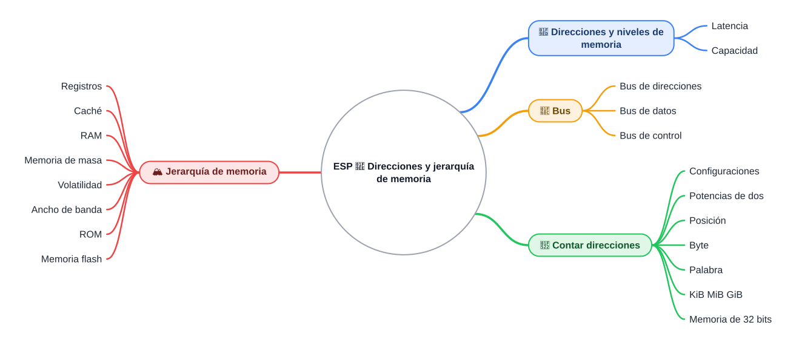

⬅️ [S4 - El ciclo de máquina](%28STU%29%20ESP%203EI%20sett-ott%20S4%20-%20El%20ciclo%20de%20m%C3%A1quina.md) · 🏠 [Índice](%28STU%29%20ESP%203EI%20-%20SETT-OTT.md) · [S6 - Caché, localidad y reloj](%28STU%29%20ESP%203EI%20sett-ott%20S6%20-%20Cach%C3%A9,%20localidad%20y%20reloj.md) ➡️

# ESP 🧮 Direcciones y jerarquía de memoria

**3EI · Septiembre-Octubre · S5 · Teoría**

> **Leyenda:** ✅ hay que saber · 🔍 para entender a fondo · 🤓 opcional, para curiosos · 🃏 tarjeta: responde en voz alta y luego despliega la respuesta



## 🧭 Direcciones y niveles de memoria

En el [ciclo de máquina](%28STU%29%20ESP%203EI%20sett-ott%20S4%20-%20El%20ciclo%20de%20m%C3%A1quina.md) bastaba con escribir «celda 40». Pero una máquina real debe escribir esa dirección con un número limitado de bits y mover el contenido por conexiones reales. ¿Cuántos lugares puede distinguir? ¿Cuánto contienen? ¿Cuánto hay que esperar?

El crecimiento de los computadores no ha borrado estas preguntas. Las memorias más grandes permiten programas y datos más grandes, pero **capacidad y velocidad no crecen necesariamente juntas**. Construir un sistema significa decidir cómo usar recursos limitados, no buscar un único componente perfecto.

Un ejemplo histórico lo deja claro. En los primeros computadores, como el EDSAC (1949), muchos bits se guardaban en tubos llenos de mercurio, donde un impulso viajaba como una onda sonora: para leer un bit había que **esperar a que la onda pasara** por el punto correcto. La capacidad existía, pero la espera era larga. Después llegaron los núcleos de ferrita y, por último, las memorias de semiconductores. El compromiso entre espacio, espera y costo nunca desapareció.

**El principio del mercurio.** El tubo de mercurio funcionaba como un anillo. Al inicio del tubo, un cristal convertía un impulso eléctrico en una onda sonora de alta frecuencia, es decir, un sonido demasiado agudo para el oído humano. La onda atravesaba el mercurio, llegaba al final y allí un segundo cristal la convertía de nuevo en un impulso eléctrico. Ese impulso no se perdía: volvía a entrar en el tubo y empezaba el recorrido otra vez. Por eso el bit **daba vueltas sin parar**.

Para leer un bit había que **esperar** a que su impulso pasara delante del lector. Si el bit acababa de pasar, había que esperar casi una vuelta completa del tubo. Esta es la latencia de la que hablaremos: no depende de cuántos datos tengas, sino de cuánto tiempo tienes que esperar para encontrarlos.

<details>
<summary>🃏 <b>¿Por qué era lenta la lectura de un bit en el tubo de mercurio?</b></summary>

Porque el bit daba vueltas en el tubo como en un anillo: había que esperar a que pasara delante del lector, y a veces hacía falta casi una vuelta completa.

</details>

## 🚌 Bus

### ✅ Datos, direcciones y control

Un **bus** es un conjunto de conexiones que se usan para comunicarse según reglas precisas. En nuestro modelo separamos tres funciones:

| Función | Pregunta | Ejemplo de lectura |
|---|---|---|
| **Direcciones** | ¿Dónde? | La CPU indica 40 |
| **Datos** | ¿Qué contenido? | La memoria devuelve 7 |
| **Control** | ¿Qué operación, y cuándo? | READ y señal «dato listo» |

En una escritura, el contenido va de la CPU a la memoria. Las señales de control no van todas en la misma dirección: la confirmación «hecho» vuelve hacia quien pidió la operación.

Es una separación por funciones. Un PC moderno puede usar conexiones punto a punto, en serie o compartidas en el tiempo: no busques en la placa base tres haces de cables idénticos al dibujo.

<details>
<summary>🃏 <b>¿Qué es un bus?</b></summary>

Un conjunto de conexiones que se usan para comunicarse según reglas precisas.

</details>
<details>
<summary>🃏 <b>¿Cuáles son las tres funciones del bus, y a qué pregunta responde cada una?</b></summary>

Direcciones: ¿dónde? Datos: ¿qué contenido? Control: ¿qué operación, y cuándo?

</details>
<details>
<summary>🃏 <b>En una escritura, ¿en qué dirección va el contenido?</b></summary>

De la CPU a la memoria. La confirmación de operación completada vuelve, en cambio, hacia quien la pidió.

</details>
<details>
<summary>🃏 <b>¿En la placa base hay tres haces de cables, uno por función?</b></summary>

No necesariamente. Es una separación por funciones: un PC moderno puede usar conexiones punto a punto, en serie o compartidas en el tiempo.

</details>

## 🔢 Contar direcciones

### ✅ Bits y direcciones

Un bit tiene dos configuraciones: 0 y 1. Dos bits tienen cuatro, tres bits ocho. Cada bit más **duplica** las posibilidades, porque delante de cada secuencia anterior podemos poner 0 o 1.

| Bits de la dirección | Configuraciones | Direcciones, desde cero |
| ------------------ | -------------- | --------------------------- |
| 1                  | 2              | 0-1                         |
| 2                  | 4              | 0-3                         |
| 3                  | 8              | 0-7                         |
| 4                  | 16             | 0-15                        |

Con $n$ bits de dirección distinguimos:

$$N = 2^n\ \text{posiciones}$$

⚠️ El número de posiciones no es la última dirección: con 16 posiciones la última es 15. Y todavía no es una capacidad en bytes: hay que saber cuánto contiene cada posición.

<details>
<summary>🃏 <b>¿Por qué cada bit más duplica las configuraciones?</b></summary>

Porque delante de cada secuencia anterior se puede poner 0 o 1.

</details>
<details>
<summary>🃏 <b>Con n bits de dirección, ¿cuántas posiciones se distinguen?</b></summary>

2 elevado a n.

</details>
<details>
<summary>🃏 <b>Con 2 elevado a n posiciones, ¿cuál es la última dirección?</b></summary>

2 elevado a n, menos 1, porque se empieza desde cero.

</details>
<details>
<summary>🃏 <b>¿El número de posiciones ya es una capacidad en bytes?</b></summary>

No. Hay que saber cuánto contiene cada posición.

</details>

### ✅ Ejemplo resuelto: memoria direccionada a byte

Aquí cada dirección identifica **un byte** (8 bits). Con 12 bits de dirección:

$$N = 2^{12} = 4096\ \text{posiciones}$$

$$C = 4096\ \text{posiciones} \times 1\ \frac{\text{byte}}{\text{posición}} = 4096\ \text{byte} = 4\ \text{KiB}$$

Las direcciones van de 0 a 4095. Ojo: este es el espacio **representable**, no la memoria que está realmente montada en el computador.

> ⏸️ **Repaso:** si añades un bit a la dirección, ¿cuántas posiciones se vuelven distinguibles? Explícalo primero con las combinaciones y luego con la fórmula.

<details>
<summary>🃏 <b>¿Cómo se calcula la capacidad de una memoria?</b></summary>

Número de posiciones por bytes que contiene cada posición.

</details>
<details>
<summary>🃏 <b>¿Qué significa «memoria direccionada a byte»?</b></summary>

Que cada dirección identifica un byte, es decir, 8 bits.

</details>
<details>
<summary>🃏 <b>Con 12 bits de dirección a byte, ¿cuánta memoria es representable?</b></summary>

4096 posiciones de un byte: 4096 bytes, es decir, 4 KiB, con direcciones de 0 a 4095.

</details>
<details>
<summary>🃏 <b>¿El espacio representable es la RAM montada en el computador?</b></summary>

No. Es lo que se puede direccionar en el modelo, no la memoria instalada.

</details>

### 🔍 Bytes, palabras y unidades

Un byte contiene 8 bits. Usamos **KiB = 1024 bytes**, **MiB = $2^{20}$ bytes**, **GiB = $2^{30}$ bytes**. Los prefijos decimales kB, MB y GB, en cambio, indican potencias de 1000. No son errores: son convenciones distintas, y hay que indicarlas.

Si cada posición contiene una **palabra de 2 bytes** y las direcciones son de 12 bits, las posiciones siguen siendo 4096, pero la capacidad pasa a ser $4096\times2=8192$ bytes, es decir, 8 KiB. El mismo número de direcciones, distinta cantidad por posición.

El ancho del bus de datos indica cuánto se transfiere de una vez; el de las direcciones, cuántas posiciones se distinguen. Un bus de datos de 16 bits **no** demuestra que haya solo $2^{16}$ bytes de memoria. Y «CPU de 64 bits» no nos dice, por sí solo, cuántas líneas de dirección físicas existen.

<details>
<summary>🃏 <b>¿Cuántos bytes son 1 KiB, 1 MiB y 1 GiB?</b></summary>

1 KiB = 1024 bytes; 1 MiB = 2 elevado a 20 bytes; 1 GiB = 2 elevado a 30 bytes.

</details>
<details>
<summary>🃏 <b>¿Qué diferencia hay entre KiB y kB?</b></summary>

KiB es una potencia de 2, 1024 bytes; kB es una potencia de 10, 1000 bytes. Son convenciones distintas que hay que indicar.

</details>
<details>
<summary>🃏 <b>Si cada posición contiene una palabra de 2 bytes, ¿qué cambia?</b></summary>

El número de direcciones sigue igual, la capacidad se duplica.

</details>
<details>
<summary>🃏 <b>Bus de datos y bus de direcciones: ¿qué dice el ancho de cada uno?</b></summary>

El bus de datos indica cuánto se transfiere de una vez; el bus de direcciones, cuántas posiciones se distinguen.

</details>

### 🤓 Memoria de 32 bits

> En un modelo de bytes, $2^{32}$ direcciones corresponden a 4 GiB. Pero en una máquina real intervienen direcciones físicas y virtuales, zonas reservadas a los dispositivos, límites del procesador y del sistema operativo. No todas las direcciones corresponden a RAM instalada. 💾 Por eso, hace años, muchos PC con sistemas de 32 bits «veían» menos RAM de la que tenían instalada.
>
> La lección de método vale también sin conocer estos mecanismos: **una fórmula es fiable cuando sus hipótesis están escritas con claridad**.

<details>
<summary>🃏 <b>¿Cuánta memoria direccionan 32 bits en un modelo de bytes?</b></summary>

4 GiB.

</details>
<details>
<summary>🃏 <b>¿Por qué muchos PC de 32 bits veían menos RAM de la instalada?</b></summary>

Porque no todas las direcciones corresponden a RAM: intervienen zonas reservadas a dispositivos, direcciones físicas y virtuales, y límites del procesador y del sistema operativo.

</details>
<details>
<summary>🃏 <b>¿Cuándo es fiable una fórmula?</b></summary>

Cuando sus hipótesis están escritas con claridad.

</details>

## 🏔️ Jerarquía de memoria

### ✅ Niveles y compromisos

La memoria ideal sería enorme, rapidísima, barata y capaz de conservar los datos incluso sin corriente. Las tecnologías reales obligan a hacer compromisos. Por eso un computador usa varios niveles.

```text
REGISTROS    pocos valores que la CPU usa de inmediato
   |
CACHÉ        copias de partes útiles de la memoria principal
   |
RAM          programas y datos activos
   |
SSD / HDD    archivos y datos que conservar incluso con la máquina apagada
```

En general, al subir hacia los registros disminuyen la capacidad y el tiempo de acceso, mientras aumenta el costo por bit. Es un modelo orientativo, no una escala con valores iguales para cada dispositivo.

**Volátil** significa que la memoria necesita corriente para mantener el contenido: registros, caché y RAM son volátiles. SSD y HDD no son volátiles. ⚠️ La persistencia **no aumenta poco a poco** al bajar por los niveles: es una propiedad separada, que hay que indicar aparte.

<details>
<summary>🃏 <b>¿Por qué un computador usa varios tipos de memoria?</b></summary>

Porque ninguna tecnología es a la vez enorme, rapidísima, barata y capaz de conservar datos sin corriente: hacen falta compromisos.

</details>
<details>
<summary>🃏 <b>¿Cuáles son los niveles de la jerarquía, desde el más cercano a la CPU?</b></summary>

Registros, caché, RAM, memoria de masa como SSD y HDD.

</details>
<details>
<summary>🃏 <b>Al subir hacia los registros, ¿cómo cambian capacidad, tiempo de acceso y costo?</b></summary>

Disminuyen la capacidad y el tiempo de acceso, y aumenta el costo por bit. Es un modelo orientativo.

</details>
<details>
<summary>🃏 <b>¿Qué significa «volátil»?</b></summary>

Que la memoria necesita corriente para mantener el contenido.

</details>
<details>
<summary>🃏 <b>¿Qué memorias son volátiles y cuáles no?</b></summary>

Registros, caché y RAM son volátiles; SSD y HDD no lo son.

</details>
<details>
<summary>🃏 <b>¿La persistencia aumenta poco a poco al bajar por la jerarquía?</b></summary>

No. Es una propiedad separada, que hay que indicar aparte.

</details>

### 🔍 Capacidad, latencia, ancho de banda

- **Capacidad:** cuánta información puedo conservar (bytes, GiB).
- **Latencia:** cuánto espero para obtener la respuesta a un acceso (nanosegundos).
- **Ancho de banda:** cuánta información puedo transferir cada segundo (GB/s).
- **Costo por bit y consumo:** cuántos recursos hacen falta para construir y usar la memoria.

Un gran archivo puede contener muchísimos documentos, pero necesita tiempo para encontrar el primero. Un canal puede transferir muchos bytes por segundo sin eliminar la espera inicial. Decir solo «esta memoria es mejor» oculta la pregunta real: **¿mejor para qué trabajo?**

Por el mismo motivo, **más RAM no hace más rápido al procesador**. Una RAM más grande permite tener listos más programas y datos, pero no cambia la velocidad a la que la CPU calcula.

<details>
<summary>🃏 <b>¿Qué es la capacidad de una memoria?</b></summary>

Cuánta información puede conservar, en bytes o GiB.

</details>
<details>
<summary>🃏 <b>¿Qué es la latencia?</b></summary>

Cuánto se espera para obtener la respuesta a un acceso, por ejemplo en nanosegundos.

</details>
<details>
<summary>🃏 <b>¿Qué es el ancho de banda?</b></summary>

Cuánta información se puede transferir cada segundo, por ejemplo en GB/s.

</details>
<details>
<summary>🃏 <b>¿Un ancho de banda alto elimina la espera inicial?</b></summary>

No. Un canal puede transferir muchos bytes por segundo y, aun así, hacer esperar antes del primero.

</details>
<details>
<summary>🃏 <b>¿Qué pregunta esconde «esta memoria es mejor»?</b></summary>

¿Mejor para qué trabajo?

</details>
<details>
<summary>🃏 <b>¿Más RAM hace más rápido al procesador?</b></summary>

No. Más RAM permite tener listos más programas y datos, pero no cambia la velocidad con la que la CPU calcula.

</details>

### 🔍 RAM, ROM y memoria de masa

La **RAM** principal permite acceder directamente a cada posición, leyendo y escribiendo durante el trabajo. La **memoria de masa** conserva archivos y programas incluso con el computador apagado; para ejecutarlos, el sistema lleva a la RAM las partes necesarias.

**ROM** significa memoria de solo lectura: en las formas tradicionales el contenido no se modifica durante el uso normal. Hoy gran parte del firmware está en memoria **flash**, no volátil pero reescribible con procedimientos específicos. ROM y flash no son «un escalón entre la RAM y el disco»: hay que describirlas por tecnología y función. El firmware y el arranque del computador los veremos en el próximo bimestre.

> 🔧 **Conexión con el laboratorio:** en las fichas técnicas, «16 GB de RAM» y «512 GB de SSD» describen recursos distintos. Sumarlas y llamarlas «RAM disponible» sería un error.

<details>
<summary>🃏 <b>¿Qué caracteriza a la RAM principal?</b></summary>

Permite acceder directamente a cada posición, leyendo y escribiendo durante el trabajo.

</details>
<details>
<summary>🃏 <b>Para ejecutar un programa guardado en SSD, ¿qué hace el sistema?</b></summary>

Lleva a la RAM las partes necesarias.

</details>
<details>
<summary>🃏 <b>¿Qué significa ROM?</b></summary>

Memoria de solo lectura: en las formas tradicionales el contenido no se modifica durante el uso normal.

</details>
<details>
<summary>🃏 <b>¿Dónde está hoy gran parte del firmware?</b></summary>

En memoria flash: no volátil, pero reescribible con procedimientos específicos.

</details>
<details>
<summary>🃏 <b>¿16 GB de RAM y 512 GB de SSD suman 528 GB de RAM?</b></summary>

No. Describen recursos distintos y no deben sumarse.

</details>

## 🧩 Pon a prueba el modelo

1. **Base.** Distingue capacidad, latencia y volatilidad con una frase cada una.
2. **Aplicación.** Un modelo tiene 10 bits de dirección y posiciones de un byte. Calcula posiciones, capacidad y última dirección.
3. **Detalle.** Repite el cálculo con los mismos 10 bits, pero con posiciones de 2 bytes. ¿Qué cambia?
4. **Aplicación.** Con 16 bits de dirección a byte, ¿cuántos KiB son representables? ¿El resultado demuestra cuánta RAM está instalada?
5. **Conexión.** ¿Por qué una caché más grande no se convierte automáticamente en una memoria no volátil?
6. **Intuición.** Para leer MEM[40] = 7, ¿qué información viaja como dirección, cuál como control y cuál como contenido?

**🚪 Salida:** completa «$2^n$ cuenta ..., para obtener los bytes debo saber ...».

**🏠 Opcional:** lee dos capacidades en una ficha técnica y explica qué recursos describen, sin comparar productos solo según el número más grande.

## 📚 Fuentes y recursos

- [NIST - Prefijos para múltiplos binarios](https://physics.nist.gov/cuu/Units/binary.html) (en inglés): la tabla oficial para distinguir KiB/MiB/GiB de kB/MB/GB, con la historia de la confusión entre los dos sistemas.
- [Nand2Tetris - Proyecto 3](https://www.nand2tetris.org/project03) (en inglés, para curiosos): cómo se construye una memoria didáctica formada por direcciones y celdas.

---

⬅️ [S4 - El ciclo de máquina](%28STU%29%20ESP%203EI%20sett-ott%20S4%20-%20El%20ciclo%20de%20m%C3%A1quina.md) · 🏠 [Índice](%28STU%29%20ESP%203EI%20-%20SETT-OTT.md) · [S6 - Caché, localidad y reloj](%28STU%29%20ESP%203EI%20sett-ott%20S6%20-%20Cach%C3%A9,%20localidad%20y%20reloj.md) ➡️
