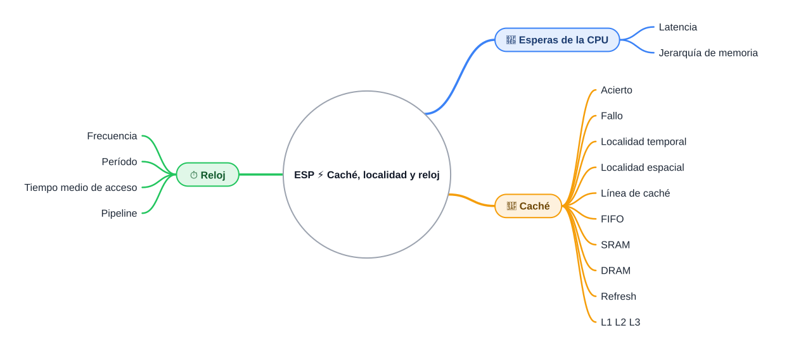

⬅️ [S5 - Direcciones y jerarquía de memoria](%28STU%29%20ESP%203EI%20sett-ott%20S5%20-%20Direcciones%20y%20jerarqu%C3%ADa%20de%20memoria.md) · 🏠 [Índice](%28STU%29%20ESP%203EI%20-%20SETT-OTT.md) · [S7 - Reconstruir la máquina](%28STU%29%20ESP%203EI%20sett-ott%20S7%20-%20Reconstruir%20la%20m%C3%A1quina.md) ➡️

# ⚡ Caché, localidad y reloj

**3EI · Septiembre-Octubre · S6 · Teoría**

> **Leyenda:** ✅ hay que saber · 🔍 para entender a fondo · 🤓 opcional, para curiosos · 🃏 tarjeta de estudio (flashcard): responde en voz alta, luego despliega la respuesta para comprobar



## 🧭 Esperas de la CPU

En el siglo XX no solo creció la velocidad de cálculo: también creció la cantidad de información que pedimos a las máquinas que procesen. Un procesador rápido no elimina el tiempo necesario para llegar a esa información. De la [jerarquía de memorias](%28STU%29%20ESP%203EI%20sett-ott%20S5%20-%20Direcciones%20y%20jerarqu%C3%ADa%20de%20memoria.md) surge una pregunta: ¿podemos evitar hacer siempre el camino más lento?

Cuando estudias tienes sobre la mesa algunas páginas: no llevas toda la biblioteca junto al bolígrafo. 📚 Funciona porque no usas todos los libros con la misma probabilidad. También muchos programas tienen regularidades: por eso existe la caché, no una capacidad mágica de la CPU para predecir el futuro.

La idea no es reciente. En 1965 Maurice Wilkes, el mismo del EDSAC, describió una pequeña memoria rápida que actúa como «asistente» de una memoria grande y lenta, a la que llamó *slave memory*. Pocos años después apareció en las computadoras comerciales: uno de los primeros con caché fue el IBM System/360 Model 85, a finales de los años sesenta.

## 🎯 Caché

### ✅ Acierto y fallo

La **caché** guarda copias de partes de la memoria principal cerca del procesador. Si el contenido pedido ya está en el nivel consultado hay un **acierto** (hit); si no está, hay un **fallo** (miss). Entonces el sistema debe buscarlo en el nivel siguiente, con una espera adicional.

```text
petición de la CPU
       |
       v
¿contenido en caché? -- SÍ --> acierto: usa la copia disponible
       |
       NO
       v
fallo: recupera del nivel siguiente y actualiza la caché
```

Un fallo **no es un error del programa**: es un evento previsto. La caché es pequeña, así que no puede contener todo y a veces debe expulsar contenidos antiguos. En los procesadores comunes todo esto lo gestiona el hardware: no elegimos nosotros cada transferencia.

La caché **no es una parte de la RAM** ni es otra memoria extra en la que el programador elige dónde escribir: es una **copia** de algunos contenidos, mantenida más cerca de la CPU.

<details>
<summary>🃏 <b>¿Qué es la caché?</b></summary>

Una memoria que guarda copias de partes de la memoria principal cerca del procesador.

</details>
<details>
<summary>🃏 <b>¿Qué diferencia hay entre acierto y fallo?</b></summary>

Acierto: el contenido pedido ya está en el nivel consultado. Fallo: no está, y hay que buscarlo en el nivel siguiente, con una espera adicional.

</details>
<details>
<summary>🃏 <b>¿Un fallo es un error del programa?</b></summary>

No. Es un evento previsto: la caché es pequeña y no puede contener todo.

</details>
<details>
<summary>🃏 <b>¿Quién decide qué entra en la caché?</b></summary>

En los procesadores comunes, el hardware: no se elige a mano cada transferencia.

</details>
<details>
<summary>🃏 <b>¿La caché es una parte de la RAM?</b></summary>

No. Es una copia de algunos contenidos, mantenida más cerca de la CPU.

</details>

### ✅ Localidad temporal y espacial

**Localidad temporal:** un contenido usado hace poco puede volver a servir pronto. Por ejemplo, un programa repite las instrucciones de un bucle, o vuelve varias veces sobre el mismo valor.

**Localidad espacial:** después de una dirección pueden hacer falta las cercanas. Si los elementos de una secuencia están en celdas consecutivas y los visitamos en orden, leer un bloque que contiene varios evita esperas posteriores.

Los programas no siempre respetan estas regularidades. Los accesos dispersos a muchas direcciones lejanas aprovechan poco la caché. Y repetir un acceso no garantiza un acierto: el contenido podría haber sido sustituido mientras tanto.

<details>
<summary>🃏 <b>¿Qué es la localidad temporal?</b></summary>

Un contenido usado hace poco puede volver a servir pronto, como las instrucciones de un bucle.

</details>
<details>
<summary>🃏 <b>¿Qué es la localidad espacial?</b></summary>

Después de una dirección pueden hacer falta las cercanas, como los elementos consecutivos de una secuencia visitados en orden.

</details>
<details>
<summary>🃏 <b>¿Todos los programas aprovechan bien la caché?</b></summary>

No. Los accesos dispersos a muchas direcciones lejanas la aprovechan poco.

</details>
<details>
<summary>🃏 <b>¿Volver a leer un dato garantiza un acierto?</b></summary>

No. El contenido podría haber sido sustituido mientras tanto.

</details>

### ✅ Bloques y líneas de caché

La caché se organiza en **líneas**, que contienen bloques de posiciones consecutivas. Llevar a la caché, junto con el valor pedido, también sus vecinos aprovecha la localidad espacial. Ojo a no confundir el tamaño de una línea con la capacidad total de la caché.

En una simulación con bloques de cuatro direcciones, una petición a la dirección 8 puede llevar a la caché todo el bloque 8-11. Una petición posterior a la 9 puede encontrar ya el dato, aunque la 9 nunca se hubiera pedido antes.

<details>
<summary>🃏 <b>¿Qué es una línea de caché?</b></summary>

Un espacio de la caché que contiene un bloque de posiciones consecutivas.

</details>
<details>
<summary>🃏 <b>¿Por qué se transfiere un bloque entero y no solo el valor pedido?</b></summary>

Para aprovechar la localidad espacial: los vecinos del valor pedido podrían hacer falta enseguida.

</details>
<details>
<summary>🃏 <b>¿El tamaño de la línea y la capacidad de la caché son lo mismo?</b></summary>

No. La línea es un único espacio; la capacidad es el espacio total de la caché.

</details>
<details>
<summary>🃏 <b>¿Cómo puede haber un acierto en una dirección nunca pedida?</b></summary>

Si un acceso anterior llevó a la caché el bloque que la contiene.

</details>

### 🔍 Simulación de una caché

Nuestra caché de papel:

- al principio está **vacía**;
- tiene **dos líneas**;
- cada línea contiene un bloque de **cuatro posiciones**: 0-3, 4-7, 8-11, ...;
- cualquier bloque puede ir a una línea libre;
- si ambas líneas están ocupadas, se expulsa el bloque **cargado hace más tiempo** (regla FIFO, *first in, first out*);
- un acierto **no** cambia este orden;
- consideramos solo lecturas; todos los datos están disponibles en RAM.

Secuencia de lecturas: **8, 9, 8, 12, 13, 16, 8**.

| Acceso | Resultado | Bloques en caché tras el acceso, del más antiguo | Motivo |
|---|---|---|---|
| 8 | Fallo | 8-11 | Caché vacía |
| 9 | Acierto | 8-11 | Ya está en el bloque |
| 8 | Acierto | 8-11 | Sigue presente |
| 12 | Fallo | 8-11; 12-15 | Se llena la segunda línea |
| 13 | Acierto | 8-11; 12-15 | Mismo bloque que 12 |
| 16 | Fallo | 12-15; 16-19 | Sale el bloque 8-11, el más antiguo |
| 8 | Fallo | 16-19; 8-11 | El bloque pedido ya no está |

Resultado: **3 aciertos y 4 fallos**. El último acceso muestra que «ya leído una vez» y «todavía presente» no son lo mismo. Es una caché didáctica con reglas elegidas por nosotros; las cachés reales usan organizaciones y políticas distintas.

<details>
<summary>🃏 <b>¿Por qué una simulación de caché debe declarar sus reglas?</b></summary>

Porque aciertos y fallos dependen de la capacidad, del tamaño de los bloques, del estado inicial y de la regla de sustitución.

</details>
<details>
<summary>🃏 <b>¿Qué dice la regla FIFO?</b></summary>

First in, first out: cuando la caché está llena se expulsa el bloque cargado hace más tiempo.

</details>
<details>
<summary>🃏 <b>Con la regla FIFO, ¿un acierto cambia el orden de los bloques?</b></summary>

No. Solo cuenta el orden en que se cargaron los bloques.

</details>
<details>
<summary>🃏 <b>¿«Ya leído una vez» significa «todavía en caché»?</b></summary>

No. El bloque puede haber sido sustituido, como ocurre en el último acceso del ejemplo.

</details>

### 🔍 SRAM y DRAM

La **SRAM** guarda cada bit con un circuito estable mientras esté alimentada. No necesita «refrescar» las celdas como la DRAM, pero ocupa más espacio por bit: por eso se usa en las cachés. ⚠️ «Static» no significa no volátil.

La **DRAM** guarda el bit como carga eléctrica en un minúsculo condensador. La carga se pierde, así que hace falta un **refresco** periódico. Las celdas son muy pequeñas y densas: por eso la DRAM se usa para la memoria principal (RAM). El refresco mantiene la información física: no tiene nada que ver con la actualización de un programa.

Las cachés suelen dividirse en niveles **L1, L2 y L3**: L1 suele ser la más pequeña y rápida, los niveles siguientes son más grandes. Cuántos niveles hay y cómo se reparten entre los núcleos depende del procesador. No existen valores universales de tamaño o latencia que haya que memorizar.

<details>
<summary>🃏 <b>¿Cómo guarda los bits la SRAM, y dónde se usa?</b></summary>

Con un circuito estable mientras esté alimentada, sin refresco; ocupa más espacio por bit y se usa en las cachés.

</details>
<details>
<summary>🃏 <b>¿La SRAM es no volátil?</b></summary>

No. Static no significa no volátil: sin corriente pierde los datos.

</details>
<details>
<summary>🃏 <b>¿Cómo guarda los bits la DRAM, y dónde se usa?</b></summary>

Como carga eléctrica en minúsculos condensadores; las celdas son pequeñas y densas, por eso se usa en la memoria principal.

</details>
<details>
<summary>🃏 <b>¿Qué es el refresco de la DRAM?</b></summary>

Un refresco periódico de las celdas, porque la carga se pierde. Mantiene la información física; no tiene que ver con la actualización de los programas.

</details>
<details>
<summary>🃏 <b>¿Qué son L1, L2 y L3?</b></summary>

Niveles de caché: L1 suele ser la más pequeña y rápida, y los siguientes son más grandes. Cuántos hay y cómo se comparten depende del procesador.

</details>

## ⏱️ Reloj

### ✅ Reloj y frecuencia

El **reloj** es una señal periódica que marca el tiempo de los circuitos síncronos. La **frecuencia** cuenta los ciclos por segundo: 2 GHz significa dos mil millones de ciclos por segundo, **no necesariamente dos mil millones de instrucciones completadas**.


Una operación puede requerir varios pasos, y una espera de la memoria puede consumir tiempo sin producir nuevos resultados. Para comparar dos sistemas hay que mirar el trabajo realizado y el tiempo empleado, no solo los GHz escritos en la caja.

> ⏸️ **Fijación:** relaciona «instrucciones que se repiten» y «posiciones cercanas recorridas en orden» con los dos tipos de localidad. Después explica por qué un reloj más rápido no convierte la caché en infinita.

<details>
<summary>🃏 <b>¿Qué es el reloj?</b></summary>

Una señal periódica que marca el tiempo de los circuitos síncronos.

</details>
<details>
<summary>🃏 <b>¿Qué mide la frecuencia del reloj?</b></summary>

Los ciclos por segundo, en hercios: 2 GHz son dos mil millones de ciclos por segundo.

</details>
<details>
<summary>🃏 <b>¿2 GHz significa dos mil millones de instrucciones completadas por segundo?</b></summary>

No. Una operación puede requerir varios pasos, y las esperas de la memoria consumen tiempo sin producir resultados.

</details>
<details>
<summary>🃏 <b>¿Cómo se comparan realmente dos sistemas?</b></summary>

Mirando el trabajo realizado y el tiempo empleado, no solo los GHz.

</details>

### 🔍 Frecuencia y periodo

Si la frecuencia es $f$, la duración de un ciclo (periodo) es:

$$T = \frac{1}{f}$$

Para $f=2\,\text{GHz}=2\times10^9\,\text{Hz}$:

$$T = 0{,}5\times10^{-9}\,\text{s}=0{,}5\,\text{ns}$$

Este valor describe un ciclo de reloj. Para obtener el tiempo de un programa completo faltan otros datos, que veremos en noviembre-diciembre. Dos CPU con la misma frecuencia no ejecutan necesariamente un programa en el mismo tiempo.

> 🔧 **Conexión con el laboratorio:** «caché de 12 MB» en la ficha de una CPU y «RAM de 16 GB» en la ficha del PC no son dos cantidades del mismo espacio de trabajo. La caché reduce algunas esperas; más RAM permite mantener activos más datos. Resuelven problemas distintos.

<details>
<summary>🃏 <b>¿Qué relación hay entre frecuencia y periodo?</b></summary>

El periodo es la inversa de la frecuencia: T = 1 / f.

</details>
<details>
<summary>🃏 <b>¿Cuánto dura un ciclo a 2 GHz?</b></summary>

0,5 nanosegundos.

</details>
<details>
<summary>🃏 <b>¿Del periodo se obtiene el tiempo de un programa?</b></summary>

No, faltan otros datos. Dos CPU con la misma frecuencia no ejecutan necesariamente un programa en el mismo tiempo.

</details>
<details>
<summary>🃏 <b>¿Una caché de 12 MB y una RAM de 16 GB son el mismo tipo de recurso?</b></summary>

No. La caché reduce algunas esperas; más RAM permite mantener activos más datos.

</details>

### 🤓 Tiempo medio de acceso

> En un modelo de dos niveles, si cada acceso paga el tiempo de consulta de la caché y solo los fallos pagan una penalización **adicional**, el tiempo medio de acceso es:
>
> $$AMAT = t_{acierto} + p_{fallo}\times t_{penalización}$$
>
> Con consulta de 2 ns, probabilidad de fallo del 5% y penalización adicional de 50 ns:
>
> $$AMAT=2+0{,}05\times50=4{,}5\,\text{ns}$$
>
> No significa que cada acceso dure 4,5 ns: es una media. Un acierto cuesta 2 ns, un fallo 52 ns. ¡Basta un 5% de fallos para más que duplicar el tiempo medio!
>
> Otra idea para aprovechar mejor el tiempo es solapar las fases de instrucciones distintas, como en una cadena de montaje 🏭: se llama **pipeline** y la estudiaremos en el próximo bimestre.

<details>
<summary>🃏 <b>¿Qué mide el AMAT?</b></summary>

El tiempo medio de acceso a la memoria: tiempo de consulta de la caché más probabilidad de fallo por penalización adicional.

</details>
<details>
<summary>🃏 <b>¿Un AMAT de 4,5 ns significa que cada acceso dura 4,5 ns?</b></summary>

No. Es una media entre aciertos rápidos y fallos mucho más lentos.

</details>
<details>
<summary>🃏 <b>¿Qué es, a grandes rasgos, una pipeline?</b></summary>

Solapar las fases de instrucciones distintas, como en una cadena de montaje. La estudiaremos en el próximo bimestre.

</details>

## 🧩 Pon a prueba el modelo

1. **Base.** ¿En qué se distinguen acierto y fallo? ¿Un fallo significa que la RAM ha perdido el dato?
2. **Aplicación.** Volver a la misma posición poco tiempo después y visitar posiciones consecutivas: ¿qué localidad muestra cada comportamiento?
3. **Procedimiento.** Empieza con la caché didáctica vacía y aplica todas las reglas a la secuencia **0, 1, 4, 0, 8, 0**. Anota acierto/fallo y los bloques presentes después de cada acceso.
4. **Detalle.** ¿Por qué la SRAM no es una memoria no volátil? ¿Para qué sirve el refresco de la DRAM?
5. **Detalle.** Un reloj de 4 GHz ¿qué periodo tiene? ¿Basta con eso para saber cuántas instrucciones ejecuta en un segundo?
6. **Intuición.** Si un programa lee una sola vez muchas direcciones lejanas, ¿podemos garantizar una gran ventaja de la caché?

**🚪 Salida:** explica cómo se puede acertar en una dirección que nunca se había solicitado antes.

**🏠 Opcional:** inventa una secuencia que aproveche la localidad temporal y otra que aproveche la espacial. Declara las reglas de la caché.

## 📚 Fuentes y recursos

- [Cornell CS3410 - Caches](https://www.cs.cornell.edu/courses/cs3410/2024fa/notes/caches.html) (en inglés, nivel universitario): para quien quiera profundizar en localidad, bloques y organización de las cachés. Las primeras secciones (*Memory Bottleneck*, *SRAM vs DRAM*, *Locality*) son las más accesibles.
- [NIST - Prefijos del SI](https://physics.nist.gov/cuu/Units/prefixes.html) (en inglés): tabla de los prefijos giga, nano y similares, útil para las conversiones entre Hz y segundos.

---

⬅️ [S5 - Direcciones y jerarquía de memoria](%28STU%29%20ESP%203EI%20sett-ott%20S5%20-%20Direcciones%20y%20jerarqu%C3%ADa%20de%20memoria.md) · 🏠 [Índice](%28STU%29%20ESP%203EI%20-%20SETT-OTT.md) · [S7 - Reconstruir la máquina](%28STU%29%20ESP%203EI%20sett-ott%20S7%20-%20Reconstruir%20la%20m%C3%A1quina.md) ➡️
