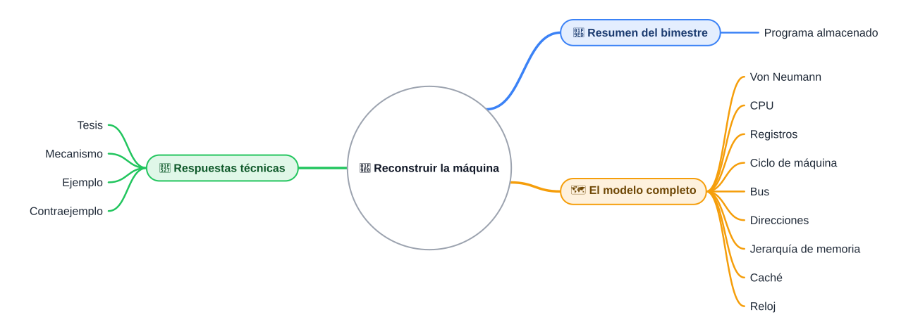

⬅️ [S6 - Caché, localidad y reloj](%28STU%29%20ESP%203EI%20sett-ott%20S6%20-%20Cach%C3%A9%2C%20localidad%20y%20reloj.md) · 🏠 [Índice](%28STU%29%20ESP%203EI%20-%20SETT-OTT.md)

# 🧠 Reconstruir la máquina

**3EI · Septiembre-Octubre · S7 · Repaso**

> **Leyenda:** ✅ hay que saber · 🔍 para entender a fondo · 🤓 opcional, para curiosos · 🃏 tarjeta de estudio (flashcard): responde en voz alta y luego ábrela para comprobar



## 🧭 Resumen del bimestre

Al principio nos preguntamos: ¿cómo hace una máquina para realizar tareas distintas sin tener que reconstruirse cada vez? Ahora sabemos que no basta con responder «con un programa». Hay que guardar las instrucciones, buscarlas, interpretarlas, mover los datos y conservar los resultados.

La historia del ordenador puede leerse como una cadena de problemas conectados: hacer circuitos fiables y pequeños, almacenar los programas, coordinar las operaciones, reducir las esperas. Este repaso reconstruye esas conexiones. **No añade temas nuevos.**

## 🗺️ El modelo completo

### ✅ Mapa del modelo

```text
PROGRAMA: instrucciones codificadas, guardadas en memoria
    |
    v
CPU: la unidad de control (CU) coordina; la ALU calcula; los registros guardan valores
    |
    +---- FETCH -> DECODE -> EXECUTE -> instrucción siguiente
    |        |
    |        +-- PC, IR, MAR, MDR tienen funciones distintas
    |
    +---- direcciones, datos, control conectan CPU y memoria
    |
    +---- registros / caché / RAM / memoria de masa
              esperas, capacidad, coste y persistencia

ENTRADA lleva información al sistema; SALIDA la devuelve
```

- En el modelo de **Von Neumann**, las instrucciones y los datos están en la misma memoria.
- La **CPU** no es solo la ALU: hace falta quien coordine, la **unidad de control (CU)**, y hacen falta sitios donde guardar el estado del trabajo, los **registros**.
- El **contador de programa (PC)** indica dónde buscar la siguiente instrucción; el **registro de instrucción (IR)** guarda la instrucción actual. El **registro de direcciones de memoria (MAR)** contiene la dirección del acceso en curso; el **registro de datos de memoria (MDR)**, el contenido transferido.
- Una **copia** deja intacto el valor original.
- Con $n$ bits se distinguen $2^n$ direcciones. Para la capacidad, se multiplica por los bytes de cada posición de memoria.
- La **caché** guarda copias y aprovecha la localidad temporal y la espacial. Un **fallo (miss)** exige un acceso al nivel siguiente: no es una avería y no significa «voy al disco».

CPU = ALU + CU + REGISTROS

<details>
<summary>🃏 <b>¿Qué guarda la memoria en el modelo de Von Neumann?</b></summary>

Instrucciones y datos, en la misma memoria.

</details>
<details>
<summary>🃏 <b>¿De qué partes está hecha la CPU, y qué hace cada una?</b></summary>

La CU coordina, la ALU calcula, los registros guardan los valores del trabajo en curso.

</details>
<details>
<summary>🃏 <b>¿Cuáles son las fases del ciclo de máquina?</b></summary>

Búsqueda (fetch), interpretación (decode), ejecución (execute), y luego se pasa a la instrucción siguiente.

</details>
<details>
<summary>🃏 <b>PC, IR, MAR, MDR: un papel para cada uno.</b></summary>

PC: dónde buscar la siguiente instrucción. IR: instrucción actual. MAR: dirección del acceso en curso. MDR: contenido transferido.

</details>
<details>
<summary>🃏 <b>¿Cuáles son las tres funciones de las conexiones entre CPU y memoria?</b></summary>

Direcciones, datos y control.

</details>
<details>
<summary>🃏 <b>¿Qué pasa con el origen después de una copia?</b></summary>

Queda intacto, salvo que otra operación lo modifique.

</details>
<details>
<summary>🃏 <b>¿Cómo se calcula la capacidad de una memoria con n bits de dirección?</b></summary>

2 elevado a n posiciones, por los bytes que contiene cada una.

</details>
<details>
<summary>🃏 <b>¿Cuáles son los niveles de la jerarquía de memorias?</b></summary>

Registros, caché, RAM, memoria de masa. Se diferencian en esperas, capacidad y coste; la persistencia es una propiedad aparte.

</details>
<details>
<summary>🃏 <b>¿En qué regularidades se basa la caché?</b></summary>

En la localidad temporal y en la localidad espacial.

</details>
<details>
<summary>🃏 <b>¿Un fallo (miss) significa «voy al disco»?</b></summary>

No. Significa acceder al nivel siguiente, y no es una avería.

</details>

### ✅ Tres preguntas de control

Cuando sigas una instrucción, pregúntate: **¿dónde estamos?**, **¿qué hemos leído?**, **¿qué cambia de verdad?** Decir el nombre de un registro sin su función no basta. Decir que una memoria es «grande» no dice cuán rápida es ni si conserva los datos sin corriente.

<details>
<summary>🃏 <b>¿Con qué pregunta se dividen los circuitos de la CPU en dos grupos?</b></summary>

¿Este circuito toca los datos o manda sobre quien los toca? En el primer caso es parte operativa; en el segundo, parte de control.

</details>
<details>
<summary>🃏 <b>¿Basta con decir el nombre de un registro?</b></summary>

No. Hay que decir también su función en ese momento.

</details>
<details>
<summary>🃏 <b>«Esta memoria es grande»: ¿eso dice también que es rápida?</b></summary>

No. Capacidad, velocidad y persistencia son propiedades distintas.

</details>

## 🔧 Respuestas técnicas

### 🔍 Tesis, mecanismo, ejemplo

Una buena respuesta técnica tiene una **tesis**, un **mecanismo** y un **ejemplo**. «La caché es rápida» es una propiedad genérica. «Si un bloque ya está en caché, el acceso puede evitar la espera del nivel siguiente» describe un mecanismo, con una condición que se puede comprobar.

También una fórmula hay que explicarla. Con 9 bits de dirección, a byte, se distinguen $2^9=512$ posiciones de memoria: la memoria contiene 512 bytes, no 512 bits, y la última dirección es la 511. Si cada posición contuviera dos bytes, cambiaría la capacidad, no el número de direcciones.

<details>
<summary>🃏 <b>Mover un dato de un registro a otro, sin cálculos, ¿es trabajo de la parte operativa o de la de control?</b></summary>

De la parte operativa: el dato se transfiere. El control hace falta igualmente, porque alguien debe decir qué registro copia a cuál.

</details>
<details>
<summary>🃏 <b>¿Cómo puede haber un acierto (hit) en una dirección que nunca se había pedido antes?</b></summary>

Si un acceso anterior trajo a la caché el bloque que la contiene.

</details>
<details>
<summary>🃏 <b>¿Cuándo es fiable una fórmula?</b></summary>

Cuando sus hipótesis están escritas con claridad.

</details>

### 🔍 Cuatro ejercicios de conexión

Responde en pocas líneas, con un esquema cuando haga falta.

| Ejercicio | Enunciado |
|---|---|
| **A. Sistema** 🏛️ | Dibuja CPU, memoria y E/S; coloca CU, ALU y registros en su sitio. Etiqueta las tres funciones de las conexiones. |
| **B. Recorrido** 🔄 | PC = 5, MEM[5] = `LOAD R1, [70]`, MEM[70] = 6. ¿Qué dos direcciones usa el MAR, en orden? ¿Qué contiene R1 al final? |
| **C. Dimensiones** 🧮 | 8 bits de dirección, 2 bytes por posición: ¿cuántas posiciones, cuántos bytes, cuál es la última dirección? |
| **D. Compromisos** ⚖️ | Compara caché, RAM y SSD por función, volatilidad y capacidad típica. Explica por qué no son intercambiables. |

En el ejercicio B usamos las reglas de S4: una celda por cada instrucción y el PC aumenta en uno después de la búsqueda (fetch).

> 🔧 **Conexión con el laboratorio:** reconocer una RAM o leer una ficha técnica resulta útil cuando sabes explicar qué problema resuelve ese componente. Pero el esquema funcional no es una foto de la placa base: la CU no es una tarjeta que buscar cerca del procesador.

<details>
<summary>🃏 <b>¿El esquema funcional es una fotografía de la placa base?</b></summary>

No. Muestra funciones: por ejemplo, la CU no es una tarjeta que buscar cerca del procesador.

</details>

### 🤓 Contraejemplos

> En la ciencia, una regla se vuelve más precisa cuando buscamos dónde deja de funcionar. Elige una frase: «más GHz significa siempre menos tiempo» o «un dato usado antes estará en caché». Construye una situación que muestre qué condición falta.
>
> No hace falta conocer una CPU concreta: bastan las ideas de espera y de espacio limitado.

<details>
<summary>🃏 <b>¿Qué indica MEM[40]?</b></summary>

El contenido de la celda de dirección 40, no el número 40.

</details>
<details>
<summary>🃏 <b>¿Qué significa R1 &lt;- 7?</b></summary>

Copia 7 en R1. No es una igualdad y no vacía el origen.

</details>

## 🃏 Baraja de repaso mixta

### ✅ Todo el bimestre, en orden aleatorio

Las tarjetas de abajo están **mezcladas a propósito**: vienen de todas las semanas, no del orden en que las estudiaste. Responde en voz alta y luego ábrelas para comprobar. Aparta las que hayas fallado y repásalas al día siguiente.

<details>
<summary>🃏 <b>Con 7 bits de dirección, ¿cuántas posiciones se distinguen y cuál es la última dirección?</b></summary>

2⁷ = 128 posiciones; la última dirección es 127, porque se empieza en 0.

</details>
<details>
<summary>🃏 <b>¿Qué hace la LOAD?</b></summary>

Copia el contenido de una celda en un registro. La celda no cambia.

</details>
<details>
<summary>🃏 <b>¿Qué mide la frecuencia del reloj?</b></summary>

Cuántos ciclos de reloj, es decir, pulsos de la señal de ritmo, ocurren en un segundo.

</details>
<details>
<summary>🃏 <b>Dirección y contenido son ambos números: ¿son lo mismo?</b></summary>

No. La dirección dice dónde está la celda; el contenido es lo que hay dentro.

</details>
<details>
<summary>🃏 <b>¿Qué es un acierto (hit)?</b></summary>

Un acceso en el que el dato buscado ya está en caché.

</details>
<details>
<summary>🃏 <b>¿Después de <code>ADD R3, R1, R2</code> cambian R1 y R2?</b></summary>

No. Solo cambia el registro destino, R3.

</details>
<details>
<summary>🃏 <b>¿Qué significa «volátil»?</b></summary>

Que la memoria pierde su contenido cuando falta la corriente.

</details>
<details>
<summary>🃏 <b>¿Qué hace la CU?</b></summary>

Coordina: decide qué operación hacer y qué conexiones activar. No calcula ni guarda datos.

</details>
<details>
<summary>🃏 <b>¿Qué es la localidad espacial?</b></summary>

La tendencia a acceder a direcciones cercanas a las usadas hace poco.

</details>
<details>
<summary>🃏 <b>¿Qué hace la STORE?</b></summary>

Copia el contenido de un registro en una celda. El contenido anterior de la celda se sustituye.

</details>
<details>
<summary>🃏 <b>¿Un fallo (miss) es un error del programa?</b></summary>

No. Significa que el dato no está en caché y hay que traerlo del nivel siguiente.

</details>
<details>
<summary>🃏 <b>¿Qué hace el MAR?</b></summary>

Contiene la dirección del acceso a memoria en curso.

</details>
<details>
<summary>🃏 <b>¿3 GHz significan tres mil millones de instrucciones por segundo?</b></summary>

No: tres mil millones de ciclos de reloj por segundo. Cuántas instrucciones se completan depende de cuántos ciclos necesite cada una.

</details>
<details>
<summary>🃏 <b>¿Qué hace la ALU?</b></summary>

Ejecuta las operaciones aritméticas y lógicas. No decide por sí sola qué operación hacer: eso lo decide la CU.

</details>
<details>
<summary>🃏 <b>¿Cómo se calcula la capacidad de una memoria?</b></summary>

Número de posiciones (2ⁿ) por los bytes de cada posición.

</details>
<details>
<summary>🃏 <b>¿RAM y SSD hacen el mismo trabajo?</b></summary>

No. La RAM es rápida y volátil y guarda lo que se necesita ahora; el SSD tiene más capacidad y conserva los datos sin corriente.

</details>
<details>
<summary>🃏 <b>¿Después de una <code>LOAD R1, [40]</code>, el PC salta a la celda 40?</b></summary>

No. El PC sigue con la instrucción siguiente; 40 es la dirección del dato, no de la instrucción.

</details>
<details>
<summary>🃏 <b>¿Volver a leer un dato garantiza un acierto?</b></summary>

No. Mientras tanto, el bloque podría haber sido sustituido por otro.

</details>
<details>
<summary>🃏 <b>¿Cuál es el orden de la jerarquía, de la más rápida a la de mayor capacidad?</b></summary>

Registros, caché, RAM, memoria de masa.

</details>
<details>
<summary>🃏 <b>¿Cuál es la diferencia entre bus de direcciones, bus de datos y bus de control?</b></summary>

Direcciones: dónde. Datos: qué se transfiere. Control: qué operación (por ejemplo, lectura o escritura).

</details>
<details>
<summary>🃏 <b>¿Qué es la localidad temporal?</b></summary>

La tendencia a volver a usar pronto un dato que acaba de usarse.

</details>
<details>
<summary>🃏 <b>Con 10 bits de dirección, a byte, ¿cuántos bytes tiene la memoria?</b></summary>

2¹⁰ = 1024 bytes, es decir, 1 KiB.

</details>
<details>
<summary>🃏 <b>¿Un valor sigue en memoria después de que la CPU lo haya leído?</b></summary>

Sí. La lectura es una copia: el original no cambia.

</details>
<details>
<summary>🃏 <b>¿Qué guarda el PC y cuándo cambia?</b></summary>

La dirección de la siguiente instrucción. Avanza en uno después de la búsqueda (fetch).

</details>
<details>
<summary>🃏 <b>¿Por qué el IR no se sobrescribe con el dato de una LOAD?</b></summary>

El dato pasa por el MDR y llega al registro destino; el IR sigue guardando la instrucción en curso.

</details>
<details>
<summary>🃏 <b>¿Añadir RAM aumenta los registros de la CPU?</b></summary>

No. Los registros están dentro de la CPU y son pocos; la RAM es otro nivel.

</details>
<details>
<summary>🃏 <b>¿Un paso del ciclo de máquina equivale siempre a un ciclo de reloj?</b></summary>

No. Son escalas distintas: un paso lógico puede necesitar uno o más ciclos.

</details>
<details>
<summary>🃏 <b>¿Qué diferencia hay entre KiB y kB?</b></summary>

KiB es una potencia de 2: 1024 bytes; kB es una potencia de 10: 1000 bytes. Son convenciones distintas que hay que declarar.

</details>
<details>
<summary>🃏 <b>Con 6 bits de dirección y 2 bytes por posición, ¿cuántos bytes?</b></summary>

64 posiciones × 2 bytes = 128 bytes. La última dirección sigue siendo la 63.

</details>
<details>
<summary>🃏 <b>¿Cuáles son los bloques del modelo de Von Neumann?</b></summary>

CPU, memoria principal, entrada, salida y las conexiones que transfieren información y señales entre los bloques.

</details>
<details>
<summary>🃏 <b>¿Cuánta memoria direccionan 32 bits en un modelo a byte?</b></summary>

4 GiB.

</details>
<details>
<summary>🃏 <b>¿Cuántos bytes son 1 KiB, 1 MiB y 1 GiB?</b></summary>

1 KiB = 1024 bytes; 1 MiB = 2 elevado a 20 bytes; 1 GiB = 2 elevado a 30 bytes.

</details>
<details>
<summary>🃏 <b>Si cada posición contiene una palabra de 2 bytes, ¿qué cambia?</b></summary>

El número de direcciones sigue igual; la capacidad se duplica.

</details>
<details>
<summary>🃏 <b>¿Cuál es el periodo de un reloj de 1 GHz?</b></summary>

Un nanosegundo: periodo = 1 ÷ frecuencia.

</details>
<details>
<summary>🃏 <b>¿Qué es la línea (o bloque) de una caché?</b></summary>

El grupo de posiciones consecutivas que se copia junto. No es la capacidad total de la caché.

</details>
<details>
<summary>🃏 <b>¿Qué describió Gordon Moore en 1965?</b></summary>

Una tendencia: el número de componentes integrables en un chip crecía a ritmo regular. La previsión se reformuló más tarde.

</details>
<details>
<summary>🃏 <b>¿Cómo se obtienen un AND y un OR con interruptores?</b></summary>

AND: interruptores en serie; pasa corriente solo si todos están cerrados. OR: en paralelo; basta con que uno esté cerrado.

</details>
<details>
<summary>🃏 <b>¿Dónde está la CU en el esquema?</b></summary>

Dentro de la CPU, junto con la ALU y los registros. No es un segundo procesador externo.

</details>
<details>
<summary>🃏 <b>¿Qué diferencia hay entre entrada y salida?</b></summary>

La entrada lleva información al sistema, como el teclado o un sensor; la salida la lleva hacia fuera, como la pantalla o un actuador.

</details>
<details>
<summary>🃏 <b>¿Qué contiene una celda en nuestros ejemplos?</b></summary>

Una instrucción completa o un entero.

</details>
<details>
<summary>🃏 <b>El PC y el MAR pueden contener el mismo número: ¿tienen el mismo papel?</b></summary>

No. El PC indica dónde buscar la siguiente instrucción; el MAR indica la dirección del acceso en curso.

</details>
<details>
<summary>🃏 <b>¿Por qué muchos PC de 32 bits veían menos RAM de la instalada?</b></summary>

Porque no todas las direcciones corresponden a RAM: intervienen zonas reservadas a dispositivos, direcciones físicas y virtuales, y límites del procesador y del sistema operativo.

</details>

## 🧩 Pon a prueba el modelo

### 📝 Prueba de entrenamiento

Tiempo orientativo: 30 minutos, primero solo. No se piden AMAT, pipeline, CISC/RISC ni procedimientos de arranque. Los ejercicios mezclan temas distintos a propósito: para practicar mejor, no respondas en el orden en que los estudiaste, sino empieza por el que te sientas menos seguro y vuelve después a los primeros.

1. **Sistema.** Dibuja el modelo de Von Neumann. Explica por qué guardar las instrucciones permite cambiar de tarea sin reconstruir el hardware.
2. **Registros.** Distingue PC, IR, MAR y MDR. ¿Por qué el MDR puede cambiar durante una `LOAD` sin sustituir la instrucción del IR?
3. **Traza.** Ejecuta el programa de abajo e indica PC, R1, R3, MEM[60] y MEM[61] justo después de la `STORE`, antes de ejecutar `HALT`. Reglas: el PC aumenta en uno después de cada búsqueda (fetch); cada celda contiene una instrucción completa o un entero; el PC empieza en 20, R2 en 3, los demás registros generales en 0.

| Dirección | Contenido inicial |
|---|---|
| 20 | `LOAD R1, [60]` |
| 21 | `ADD R3, R1, R2` |
| 22 | `STORE [61], R3` |
| 23 | `HALT` |
| 60 | 8 |
| 61 | 0 |

`LOAD` copia de la memoria al registro; `ADD` escribe la suma solo en el registro destino; `STORE` copia el registro en la memoria; `HALT` termina la simulación.

4. **Direcciones.** Calcula número de posiciones, bytes, KiB y última dirección de una memoria direccionada a byte con 11 bits de dirección. Escribe el procedimiento.
5. **Caché.** Caché inicialmente vacía con **una sola línea**; bloques de cuatro posiciones (0-3, 4-7, 8-11, ...). Cada fallo sustituye la línea por el bloque pedido, traído de la RAM. Para la secuencia **4, 5, 8, 4** indica acierto o fallo y el bloque presente después de cada acceso.
6. **Explicación.** Corrige justificando: «la SRAM no necesita refresco, así que mantiene los datos sin corriente»; «3 GHz significa tres mil millones de instrucciones completadas por segundo».

### ✍️ Corregir un error sin borrarlo

Después de la puesta en común en clase, elige un punto que mejorar. No cambies solo un número: escribe qué paso del razonamiento debe cambiar.

| Mi respuesta | El paso que revisar | La regla correcta | Un nuevo ejemplo |
|---|---|---|---|
| … | … | … | … |

**🚪 Salida:** escribe una relación que sepas explicar bien y otra que todavía quieras aclarar.

**🏠 Opcional:** prepara una página de repaso con un dibujo de la máquina, un cálculo de capacidad y un ejemplo de localidad.

## 📚 Fuentes y recursos

Para repasar, vuelve a los apuntes del bimestre:

- [El ciclo de máquina](%28STU%29%20ESP%203EI%20sett-ott%20S4%20-%20El%20ciclo%20de%20m%C3%A1quina.md): cómo cambia el estado durante una traza.
- [Direcciones y jerarquía de memoria](%28STU%29%20ESP%203EI%20sett-ott%20S5%20-%20Direcciones%20y%20jerarqu%C3%ADa%20de%20memoria.md): unidades de medida y propiedades de las memorias.
- [Caché, localidad y reloj](%28STU%29%20ESP%203EI%20sett-ott%20S6%20-%20Cach%C3%A9%2C%20localidad%20y%20reloj.md): reglas de la simulación de la caché.

---

⬅️ [S6 - Caché, localidad y reloj](%28STU%29%20ESP%203EI%20sett-ott%20S6%20-%20Cach%C3%A9%2C%20localidad%20y%20reloj.md) · 🏠 [Índice](%28STU%29%20ESP%203EI%20-%20SETT-OTT.md)
