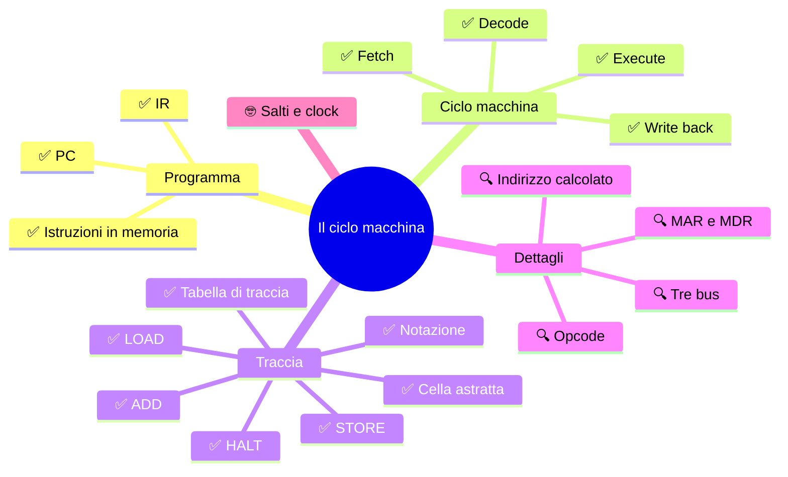
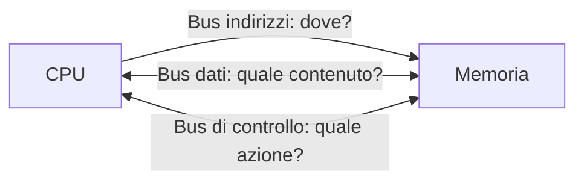

⬅️ [S3 - Registri e percorsi dei dati](%28STU%29%203EI%20sett-ott%20S3%20-%20Registri%20e%20percorsi%20dei%20dati.md) · 🏠 [Indice](../README.md) · [S5 - Indirizzi e gerarchia delle memorie](%28STU%29%203EI%20sett-ott%20S5%20-%20Indirizzi%20e%20gerarchia%20delle%20memorie.md) ➡️

# 🔄 Il ciclo macchina

**3EI · Settembre-Ottobre · S4 · Teoria**

⏱️ **Tempo:** circa 25 minuti per l'essenziale; altri 15 minuti per dettagli e approfondimenti.

> **Legenda:** 🔄 argomento · ✅ essenziale · 🔍 dettaglio · 🤓 facoltativo · 🧪 esempio · ✏️ attività · 🃏 ripasso · 🧭 contesto · ⚙️ pratica · ⏱️ tempo



## ✅ Il programma diventa azione

Un **programma** è una sequenza di istruzioni conservata in memoria. La **CPU** le esegue una alla volta, ripetendo sempre lo stesso giro: <u>trova un'istruzione, la interpreta, la esegue</u>. Questo giro si chiama **ciclo macchina**.

La CPU non «capisce» il programma come una persona: segue le istruzioni. Nel modello di **programma memorizzato** ([S2](%28STU%29%203EI%20sett-ott%20S2%20-%20La%20macchina%20di%20Von%20Neumann.md)), la macchina resta la stessa e cambia il programma in memoria.

Per seguire il giro servono due registri già incontrati in [S3](%28STU%29%203EI%20sett-ott%20S3%20-%20Registri%20e%20percorsi%20dei%20dati.md):

| Registro | In parole semplici |
|---|---|
| **PC** (contatore di programma) | Indica dove si trova la prossima istruzione da prelevare. |
| **IR** (registro istruzione) | Conserva l'istruzione che la CPU sta eseguendo. |

🧭 **Perché serve questo giro?** È descritto già nel 1945 nel *First Draft of a Report on the EDVAC*, un testo legato al progetto di un computer programmabile. L'idea centrale è ancora utile: la macchina ripete un procedimento semplice; sono le istruzioni a cambiare.

⚙️ **Nella pratica.** Anche i processori moderni eseguono istruzioni, ma usano tecniche aggiuntive per lavorare più velocemente. Qui studiamo il modello base; le tecniche avanzate arrivano più avanti.

## ✅ Il ciclo in tre fasi

### ✅ Fetch, decode, execute

Per ogni istruzione la CPU compie tre azioni, sempre in quest'ordine:

```text
1. FETCH       prende dalla memoria l'istruzione indicata dal PC
2. DECODE      riconosce l'operazione e i dati che le servono
3. EXECUTE     svolge l'operazione
               poi il ciclo ricomincia dalla prossima istruzione
```

| Fase | In parole semplici | Esempio: `ADD R3, R1, R2` |
|---|---|---|
| **Fetch** (prelievo) | La CPU prende dalla memoria l'istruzione indicata dal PC e la mette nell'IR. | La CPU preleva `ADD R3, R1, R2`. |
| **Decode** (interpretazione) | La **CU**, unità di controllo, riconosce l'operazione e gli **operandi**, cioè i dati su cui lavora. | Operazione: somma. Operandi: R1 e R2. Destinazione: R3. |
| **Execute** (esecuzione) | L'**ALU**, unità aritmetico-logica, esegue il calcolo. | L'ALU somma i valori di R1 e R2. |

Il risultato va poi scritto dove serve: questa scrittura si chiama **write-back**. Il nome indica il risultato finale, non un passaggio identico per tutte le istruzioni.

| Istruzione | Che cosa fa | Dove scrive |
|---|---|---|
| `LOAD R1, [40]` | Legge il valore nella cella 40. | Nel registro R1. |
| `ADD R3, R1, R2` | Somma i valori di R1 e R2. | Nel registro R3. |
| `STORE [41], R3` | Copia il valore di R3. | Nella cella 41 della memoria. |

<u>Il risultato può finire in un registro oppure in memoria.</u>

<details>
<summary>🃏 <b>Che cosa succede nel fetch?</b></summary>
La CPU prende dalla memoria l'istruzione da eseguire.
</details>
<details>
<summary>🃏 <b>Che cosa succede nella decode?</b></summary>
La CU riconosce l'operazione richiesta e i suoi operandi.
</details>
<details>
<summary>🃏 <b>Che cosa succede nell'execute?</b></summary>
La CPU svolge il lavoro: un calcolo, un accesso alla memoria o un cambio di percorso nel programma.
</details>
<details>
<summary>🃏 <b>Che cosa sono gli operandi?</b></summary>
I dati su cui lavora l'istruzione. <i>In ADD R3, R1, R2 sono R1 e R2.</i>
</details>
<details>
<summary>🃏 <b>Che cos'è il write-back?</b></summary>
La scrittura del risultato, spesso descritta come passo a sé dell'esecuzione.
</details>
<details>
<summary>🃏 <b>Tutte le istruzioni leggono dati dalla RAM e scrivono un registro?</b></summary>
No. Per esempio una STORE scrive in memoria, non in un registro.
</details>

## ✅ Traccia di un programma

### ✅ Le regole della nostra macchina

Per seguire un programma passo per passo ci serve una macchina piccola, con regole chiare. La nostra è un **modello**: una versione semplificata, pensata per studiare. Nei computer veri alcuni dettagli cambiano, e lo diremo ogni volta.

Una **cella** è una posizione numerata della memoria: il numero è l'**indirizzo**, ciò che vi trovi è il **contenuto**. Per questo indirizzo e contenuto non sono la stessa cosa.

Nel modello usiamo una **cella astratta**, abbastanza grande da contenere un'istruzione intera oppure un valore intero. Nei computer reali, invece, le istruzioni possono occupare più byte.

```text
indirizzo:  10                 11                12                 13      ...   40    41
contenuto:  LOAD R1, [40]      ADD R3, R1, R2    STORE [41], R3     HALT          7     0
```

Nel disegno, le istruzioni sono agli indirizzi **10–13**; il dato `7` è all'indirizzo **40**. <u>Il PC segue le istruzioni: non salta all'indirizzo del dato.</u>

| Scrittura | Si legge | Esempio |
|---|---|---|
| `MEM[40]` | il contenuto della cella di indirizzo 40 | se nella cella 40 c'è 7, allora MEM[40] = 7 |
| `[40]` dentro un'istruzione | «la cella di indirizzo 40» | `LOAD R1, [40]` |
| `A <- B` | copia B in A; B non cambia (vedi [S3](%28STU%29%203EI%20sett-ott%20S3%20-%20Registri%20e%20percorsi%20dei%20dati.md)) | `PC <- PC + 1` |

**Le quattro istruzioni del modello:**

- `LOAD R1, [40]`: copia il contenuto della cella 40 in R1; la cella 40 non cambia.
- `ADD R3, R1, R2`: somma R1 e R2 e scrive il risultato in R3; R1 e R2 non cambiano.
- `STORE [41], R3`: copia il contenuto di R3 nella cella 41.
- `HALT`: ferma il programma.

In questo modello le istruzioni occupano celle consecutive. Dopo il fetch il PC avanza di uno (`PC <- PC + 1`); nei computer reali l'avanzamento dipende dalla lunghezza dell'istruzione.

<details>
<summary>🃏 <b>Che cos'è una cella astratta?</b></summary>
Un cassetto della memoria semplificato, abbastanza grande da contenere un'istruzione intera o un valore intero. <i>Nella cella 10 c'è LOAD R1, [40]; nella cella 40 c'è 7.</i>
</details>
<details>
<summary>🃏 <b>Che cosa significa MEM[40]?</b></summary>
Il contenuto della cella di indirizzo 40.
</details>
<details>
<summary>🃏 <b>Di quanto aumenta il PC dopo il prelievo, nel nostro modello?</b></summary>
Di uno, perché ogni istruzione occupa una cella astratta e le istruzioni sono in celle consecutive. Vale solo per questo modello.
</details>
<details>
<summary>🃏 <b>Che cosa fanno LOAD e STORE?</b></summary>
LOAD copia un valore dalla memoria a un registro; STORE copia un registro in memoria. Nessuna delle due cancella la sorgente.
</details>
<details>
<summary>🃏 <b>Che cosa modifica ADD R3, R1, R2?</b></summary>
Solo R3, dove scrive la somma di R1 e R2.
</details>
<details>
<summary>🃏 <b>Che cosa fa HALT?</b></summary>
Termina la simulazione.
</details>

### ✅ Esempio svolto: LOAD, ADD, STORE

✏️ **Prima di leggere la traccia:** dopo la `LOAD`, secondo te il PC sarà 11 o 40? R1 varrà 0 o 7? La cella 40 cambierà?

**Stato iniziale:** PC = 10; R1 = 0; R2 = 5; R3 = 0.

| Indirizzo | Contenuto |
|---:|---|
| 10 | `LOAD R1, [40]` |
| 11 | `ADD R3, R1, R2` |
| 12 | `STORE [41], R3` |
| 13 | `HALT` |
| 40 | 7 |
| 41 | 0 |

La tabella mostra lo stato **dopo ogni istruzione**. Il PC avanza durante il fetch; poi la CPU completa l'operazione.

| Istruzione prelevata da | Che cosa fa | Stato dopo l'istruzione: PC, R1, R2, R3, MEM[40], MEM[41] |
|---:|---|---|
| 10 | Legge `MEM[40] = 7` e lo copia in R1. | **11, 7**, 5, 0, 7, 0 |
| 11 | Somma R1 e R2: `7 + 5 = 12`; scrive 12 in R3. | **12**, 7, 5, **12**, 7, 0 |
| 12 | Copia R3, cioè 12, nella cella 41. | **13**, 7, 5, 12, 7, **12** |
| 13 | Ferma il programma. Il PC era avanzato come sempre, ma la cella 14 non viene eseguita. | **14**, 7, 5, 12, 7, 12 |

<u>La `LOAD` copia 7 da MEM[40] a R1: non sposta il PC a 40 e non cancella la cella 40.</u>

✏️ **Controllo rapido:** indica nella tabella quale riga cambia la memoria e quale cambia un registro. Poi spiega in una frase perché il PC passa da 10 a 11.

<details>
<summary>🃏 <b>Dopo una LOAD da 40, il PC salta a 40?</b></summary>
No. 40 è l'indirizzo di un dato; il PC indica la prossima istruzione del programma, cioè la cella successiva.
</details>
<details>
<summary>🃏 <b>Nell'esempio svolto, che cosa cambia dopo la STORE?</b></summary>
La cella 41 riceve 12; R3 resta 12 e il PC passa a 13.
</details>
<details>
<summary>🃏 <b>Dopo HALT si esegue la cella successiva?</b></summary>
No. Il PC risulta avanzato come da regola, ma la simulazione si ferma.
</details>
<details>
<summary>🃏 <b>Come si segue un programma su carta senza perdersi?</b></summary>
Si scrive lo stato iniziale e si aggiorna una tabella di PC, registri e memoria dopo ogni istruzione.
</details>

## 🔍 Dentro il ciclo

### 🔍 Il fetch in dettaglio

Durante il fetch entrano in gioco altri due registri:

| Registro | In parole semplici |
|---|---|
| **MAR** (registro degli indirizzi di memoria) | Tiene l'indirizzo della cella da leggere o scrivere. |
| **MDR** (registro dei dati di memoria) | Tiene il contenuto che passa fra memoria e CPU. |

Per prelevare `LOAD R1, [40]` dalla cella 10:

| Passo | Che cosa succede | Risultato |
|---:|---|---|
| 1 | Il MAR riceve il valore del PC. | MAR = 10 |
| 2 | La CU chiede alla memoria di leggere quell'indirizzo (**READ**, «leggi»). | La memoria cerca la cella 10. |
| 3 | L'istruzione passa dalla memoria all'MDR. | MDR = `LOAD R1, [40]` |
| 4 | L'istruzione passa dall'MDR all'IR. | L'IR conserva il comando. |
| 5 | Il PC avanza alla cella successiva. | PC = 11 |

Poi la CPU interpreta il comando. **Opcode** significa «codice dell'operazione»: qui è `LOAD`. Per eseguire la LOAD, serve un secondo accesso alla memoria: MAR riceve 40, la CU chiede READ, il valore 7 arriva nell'MDR e viene copiato in R1.

La memoria viene quindi letta **due volte**: la prima per prendere l'istruzione, la seconda per prendere il dato. L'IR conserva il comando mentre l'MDR viene riutilizzato per il valore 7.

<details>
<summary>🃏 <b>Quali sono i passi del fetch?</b></summary>
Il MAR riceve il PC; la CU chiede READ; l'istruzione passa nell'MDR e poi nell'IR; il PC avanza.
</details>
<details>
<summary>🃏 <b>Che cos'è l'opcode?</b></summary>
La parte dell'istruzione che indica l'operazione, per esempio LOAD.
</details>
<details>
<summary>🃏 <b>Quante volte una LOAD accede alla memoria?</b></summary>
Due: prima per prelevare l'istruzione, poi per leggere il dato richiesto.
</details>
<details>
<summary>🃏 <b>Perché l'IR non viene sovrascritto dal dato della LOAD?</b></summary>
Perché il dato arriva nell'MDR: l'IR conserva il comando finché l'istruzione non è finita.
</details>

### 🔍 I tre bus in azione

CPU e memoria devono scambiarsi informazioni. Un **bus** è un insieme di collegamenti usati per questo scambio. A ogni accesso servono tre informazioni: **dove** leggere o scrivere, **quali dati** trasferire e **quale azione** compiere.



| Bus | Che cosa trasporta | Direzione |
|---|---|---|
| **Indirizzi** | Il numero della cella interessata | Sempre CPU → memoria: è la CPU a chiedere, la memoria non sceglie da sola |
| **Dati** | Il contenuto letto o da scrivere | Dipende: in lettura memoria → CPU, in scrittura CPU → memoria |
| **Controllo** | La richiesta **READ** («leggi») o **WRITE** («scrivi») e il segnale di completamento | La richiesta va dalla CPU alla memoria; il completamento torna alla CPU |

**Gli stessi bus, sul nostro esempio svolto:**

| Che cosa succede | Bus indirizzi (dove?) | Bus di controllo (azione?) | Bus dati (contenuto?) |
|---|---|---|---|
| Fetch di `LOAD R1, [40]` dalla cella 10 | 10 | READ | `LOAD R1, [40]`, dalla memoria alla CPU |
| Lettura del dato richiesto dalla LOAD | 40 | READ | 7, dalla memoria alla CPU |
| Scrittura della `STORE [41], R3` | 41 | WRITE | 12, dalla CPU alla memoria |

<u>Senza il bus di controllo, la memoria non saprebbe se leggere o scrivere.</u> Con indirizzo 41 e dato 12, READ e WRITE chiedono due azioni diverse.

**E la CU?** Non porta i numeri «a mano» e non calcola al posto dell'ALU: genera i segnali che scelgono i percorsi e abilitano le operazioni (per esempio READ o WRITE). Un trasferimento fra due registri usa collegamenti interni al processore, senza passare dai bus verso la RAM.

<details>
<summary>🃏 <b>In quale direzione va il bus indirizzi?</b></summary>
Dalla CPU alla memoria, sia nel fetch sia nella scrittura di un dato.
</details>
<details>
<summary>🃏 <b>In quale direzione va il bus dati?</b></summary>
Dipende: nel fetch dalla memoria alla CPU, nella scrittura dalla CPU alla memoria.
</details>
<details>
<summary>🃏 <b>Che cosa passa sul bus di controllo?</b></summary>
Il comando di lettura o scrittura e i segnali di completamento.
</details>
<details>
<summary>🃏 <b>La CU trasporta i numeri o fa i calcoli?</b></summary>
No. Genera segnali che scelgono percorsi e abilitano operazioni; i calcoli li fa l'ALU.
</details>
<details>
<summary>🃏 <b>Copiare un valore fra due registri richiede la RAM?</b></summary>
No. Usa collegamenti interni al processore.
</details>
<details>
<summary>🃏 <b>Perché serve il bus di controllo?</b></summary>
Per dire alla memoria che azione fare. <i>Indirizzo 41 e valore 12 non bastano: servono WRITE (scrivi) o READ (leggi).</i>
</details>
<details>
<summary>🃏 <b>Che cosa passa sui tre bus quando la STORE scrive 12 nella cella 41?</b></summary>
Indirizzi: 41. Dati: 12. Controllo: WRITE.
</details>

### 🔍 Indirizzo calcolato
#no

Questa sezione mostra un modo comune per trovare un dato: **indirizzo di partenza + spostamento**. Serve, per esempio, quando i valori di un elenco sono in celle consecutive: il programma tiene in un registro l'indirizzo di partenza e cambia lo spostamento per raggiungere un'altra cella.

`LOAD R1, [R2+4]` è una **notazione didattica inventata per questo esempio**, non un'istruzione scritta così in tutti i processori. Significa: <u>somma 4 all'indirizzo contenuto in R2, poi copia in R1 il contenuto della cella trovata</u>. L'indirizzo ottenuto si chiama **indirizzo effettivo**.

🧪 **Esempio nel nostro modello.** Se R2 = 36 e lo spostamento è 4 celle, l'ALU calcola `36 + 4 = 40`. Se MEM[40] contiene 7, in R1 arriva **7**.

| R2: indirizzo di partenza | Spostamento | Indirizzo effettivo | Contenuto letto e copiato in R1 |
|---:|---:|---:|---:|
| 36 | 4 celle | 40 | 7 |

La somma dell'ALU trova **dove** leggere; la memoria fornisce **che cosa** leggere.

> **Nelle CPU reali** esistono istruzioni che calcolano l'indirizzo usando un registro di base e uno spostamento. La forma precisa dipende dal processore. Per esempio, in MIPS si scrive `lw $t0, 4($s0)`: `4` indica uno spostamento in **byte**, non quattro celle astratte. Qui basta capire l'idea; l'unità di misura e la notazione cambiano fra il modello e le architetture reali.

<details>
<summary>🃏 <b>Che cosa significa LOAD R1, [R2+4]?</b></summary>
Si somma lo spostamento al valore di R2 per trovare l'indirizzo effettivo; poi si copia in R1 il contenuto di quella cella.
</details>
<details>
<summary>🃏 <b>In un indirizzo calcolato, a che cosa serve l'ALU?</b></summary>
A calcolare l'indirizzo effettivo; il dato viene letto poi dalla memoria.
</details>
<details>
<summary>🃏 <b>Quando clicchi per avviare un programma, la CPU esegue una sola istruzione?</b></summary>
No. Il clic avvia un programma composto da moltissime istruzioni; la traccia su carta ne segue una alla volta.
</details>

### 🤓 Salti, cicli e clock

> Finora la CPU ha eseguito tutte le istruzioni in ordine. Ma un programma deve anche poter scegliere: ad esempio un programma che dice **se non ci sono biglietti disponibili, non venderne uno**. Per saltare le istruzioni della vendita serve cambiare il PC.
>
> Un **salto condizionato**, o *branch*, cambia il PC solo se una condizione è vera. Usiamo `BEQ`, già presente nel [foglio di notazione assembly](%28STU%29%203EI%20-%20Linguaggio%20assembly%20base.md): significa «salta se i due registri contengono valori uguali».
>
> 🧪 **Esempio: vendere un biglietto, ma solo se ne rimangono.** MEM[40] contiene il numero di biglietti disponibili. All'inizio PC = 10 e R2 = 0; R2 rimane zero per tutto il programma.
>
> | Indirizzo | Etichetta | Istruzione | Che cosa fa |
> |---|---|---|---|
> | 10 | `LOAD R1, [40]` | Legge quanti biglietti rimangono. |
> | 11  | `BEQ R1, R2, fine` | Se R1 è zero come R2, salta a `fine`. |
> | 12  | `ADDI R1, R1, -1` | Toglie un biglietto dal conteggio in R1. |
> | 13  | `STORE [40], R1` | Aggiorna il conteggio in memoria. |
> | 14 | `fine` | `HALT` | Ferma la simulazione. |
>
> Un'**etichetta** è un nome dato all'indirizzo di un'istruzione: qui `fine` significa **14** e non occupa una cella in più. `ADDI` somma un numero scritto nell'istruzione: aggiungere −1 significa sottrarre uno.
>
> **Se rimangono 3 biglietti**, R1 riceve 3. Il confronto `3 = 0` è falso: la CPU prosegue da 12, riduce il conteggio a 2 e lo scrive in memoria. Gli indirizzi delle istruzioni eseguite sono **10 → 11 → 12 → 13 → 14**.
>
> **Se rimangono 0 biglietti**, R1 riceve 0. Il confronto `0 = 0` è vero: la CPU passa direttamente a 14. Gli indirizzi delle istruzioni eseguite sono **10 → 11 → 14**; il conteggio resta zero, non diventa −1.
>
> <u>Durante il fetch della BEQ il PC avanza da 11 a 12; durante l'execute, se la condizione è vera, la BEQ lo sostituisce con 14.</u> Il salto cambia **quale istruzione viene dopo**, non il valore di R1 o R2.
>
> Questo è un piccolo `if`: «se i biglietti sono zero, salta la vendita». Un salto all'indietro può invece far ripetere una parte del programma: è l'idea alla base dei cicli. Nel nostro modello il salto ha effetto immediato; i dettagli delle CPU reali dipendono dall'architettura.
>
> ✏️ **Prova tu:** parti con MEM[40] = 1 e scrivi gli indirizzi delle istruzioni eseguite e il conteggio finale.
>
> Il **clock** produce impulsi che aiutano a coordinare le operazioni. Un passo del modello non equivale a un impulso: anche il rapporto fra istruzioni e impulsi dipende dal processore. Le tecniche più avanzate, come la **pipeline** (sovrapposizione di parti di istruzioni), si vedranno più avanti.

<details>
<summary>🃏 <b>Che cosa fa un salto?</b></summary>
Cambia il PC con una destinazione diversa dalla cella successiva.
</details>
<details>
<summary>🃏 <b>Che cosa fa un salto condizionato?</b></summary>
Cambia il PC solo se una condizione è vera; per esempio BEQ salta se due registri contengono lo stesso valore.
</details>
<details>
<summary>🃏 <b>Come si controlla se R1 è zero con BEQ?</b></summary>
Si confronta R1 con un registro che contiene zero, come R2 nel nostro esempio.
</details>
<details>
<summary>🃏 <b>Che cos'è l'etichetta fine?</b></summary>
È un nome per l'indirizzo dell'istruzione HALT, qui 14, non un'istruzione aggiuntiva.
</details>
<details>
<summary>🃏 <b>BEQ deve leggere un flag zero già impostato?</b></summary>
No. La BEQ del nostro modello confronta direttamente i due registri indicati.
</details>
<details>
<summary>🃏 <b>Nelle CPU reali il PC aumenta sempre di uno?</b></summary>
No. Le istruzioni possono occupare più byte, con lunghezza fissa o variabile.
</details>
<details>
<summary>🃏 <b>Un passo del ciclo corrisponde a un ciclo di clock?</b></summary>
No. Il clock produce impulsi di coordinamento; i passi descritti sono un modello del lavoro, non una misura dei tempi.
</details>

## ✏️ Metti alla prova il modello

1. **Base.** Che cosa distingue fetch, decode ed execute?
2. **Procedimento.** Nel fetch, metti in ordine: `IR <- MDR`, `MAR <- PC`, richiesta READ, ricezione in MDR, avanzamento del PC. Chi richiede READ?
3. **Applicazione.** Nel programma svolto cambia R2 iniziale in 4 e MEM[40] in 9. Ricompila la tabella fino a STORE.
4. **Collegamento.** Che differenza c'è fra prelevare `LOAD R1,[40]` e leggere il dato che richiede?
5. **Dettaglio.** Nel nostro modello, per `LOAD R1,[R2+4]`, con R2 = 60 e MEM[64] = 17, quali sono l'indirizzo effettivo e il valore finale di R1?
6. **Intuizione.** Se il risultato dell'ALU non viene scritto da nessuna parte, basta che il calcolo sia avvenuto per usarlo più tardi?

**Uscita:** completa «La LOAD fa arrivare ..., mentre il suo fetch fa arrivare ...».

**🤓 Facoltativo:** racconta il programma a qualcuno senza usare le parole «magia» o «il computer capisce».

## Fonti e risorse

- [Nand2Tetris - Project 5](https://www.nand2tetris.org/project05) (in inglese, per curiosi): un computer didattico funzionante; confronta le sue scelte con quelle della nostra simulazione.
- [RISC-V - specifiche ufficiali](https://riscv.org/specifications/) (in inglese, molto tecnico): per vedere che istruzioni, registri e indirizzamento cambiano da un'architettura all'altra.

---

⬅️ [S3 - Registri e percorsi dei dati](%28STU%29%203EI%20sett-ott%20S3%20-%20Registri%20e%20percorsi%20dei%20dati.md) · 🏠 [Indice](../README.md) · [S5 - Indirizzi e gerarchia delle memorie](%28STU%29%203EI%20sett-ott%20S5%20-%20Indirizzi%20e%20gerarchia%20delle%20memorie.md) ➡️
