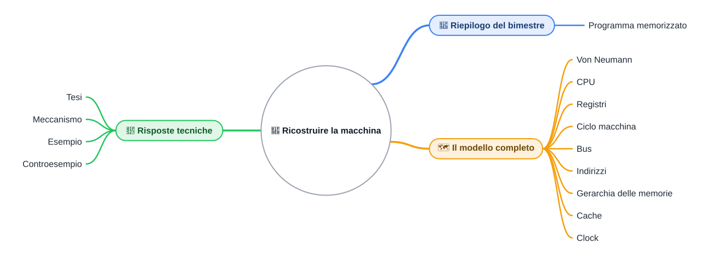

f⬅️ [S6 - Cache localita e clock](%28STU%29%203EI%20sett-ott%20S6%20-%20Cache%20localita%20e%20clock.md) · 🏠 [Indice](../README.md)

# 🧠 Ricostruire la macchina

**3EI · Settembre-Ottobre · S7 · Ripasso**

> **Legenda:** ✅ da sapere · 🔍 per capire fino in fondo · 🤓 facoltativo, per curiosi · 🃏 flashcard: rispondi a voce, poi apri per controllare



## 🧭 Riepilogo del bimestre

All'inizio ci siamo chiesti: come fa una macchina a svolgere compiti diversi senza essere ricostruita ogni volta? Ora sappiamo che non basta rispondere «con un programma». Bisogna conservare le istruzioni, raggiungerle, interpretarle, spostare i dati e tenere i risultati.

La storia del computer si può rileggere come una catena di problemi collegati: rendere i circuiti affidabili e piccoli, memorizzare i programmi, coordinare le operazioni, ridurre le attese. Questo ripasso ricostruisce quei collegamenti. **Non aggiunge argomenti nuovi.**

## 🗺️ Il modello completo

### ✅ Mappa del modello

```text
PROGRAMMA: istruzioni codificate, conservate in memoria
    |
    v
CPU: CU coordina; ALU calcola; registri conservano valori
    |
    +---- FETCH -> DECODE -> EXECUTE -> istruzione successiva
    |        |
    |        +-- PC, IR, MAR, MDR hanno compiti distinti
    |
    +---- indirizzi, dati, controllo collegano CPU e memoria
    |
    +---- registri / cache / RAM / memoria di massa
              attese, capacita', costo e persistenza

INPUT porta informazioni nel sistema; OUTPUT le restituisce
```

- Nel modello di **Von Neumann** istruzioni e dati stanno nella stessa memoria.
- La **CPU** non è solo l'ALU: serve chi coordina (CU) e servono posti dove tenere lo stato del lavoro (registri).
- Il **PC** indica dove prendere la prossima istruzione; l'**IR** tiene l'istruzione corrente. Il **MAR** contiene l'indirizzo dell'accesso in corso; l'**MDR** il contenuto trasferito.
- Una **copia** lascia intatto il valore originale.
- Con $n$ bit si distinguono $2^n$ indirizzi. Per la capacità si moltiplica per i byte di ogni locazione.
- La **cache** conserva copie e sfrutta la località temporale e spaziale. Un miss richiede un accesso al livello successivo: non è un guasto e non significa «vado sul disco».

CPU = ALU + CU + REGISTRI

<details>
<summary>🃏 <b>Che cosa conserva la memoria nel modello di Von Neumann?</b></summary>
Istruzioni e dati, nella stessa memoria.
</details>
<details>
<summary>🃏 <b>Da quali parti è fatta la CPU, e che cosa fa ciascuna?</b></summary>
CU coordina, ALU calcola, registri conservano i valori del lavoro in corso.
</details>
<details>
<summary>🃏 <b>Quali sono le fasi del ciclo macchina?</b></summary>
Fetch, decode, execute, poi si passa all'istruzione successiva.
</details>
<details>
<summary>🃏 <b>PC, IR, MAR, MDR: un ruolo per ciascuno.</b></summary>
PC: dove prendere la prossima istruzione. IR: istruzione corrente. MAR: indirizzo dell'accesso in corso. MDR: contenuto trasferito.
</details>
<details>
<summary>🃏 <b>Quali sono le tre funzioni dei collegamenti fra CPU e memoria?</b></summary>
Indirizzi, dati e controllo.
</details>
<details>
<summary>🃏 <b>Che cosa succede alla sorgente dopo una copia?</b></summary>
Resta intatta, salvo un'altra operazione che la modifichi.
</details>
<details>
<summary>🃏 <b>Come si calcola la capacità di una memoria con n bit di indirizzo?</b></summary>
2 elevato alla n locazioni, per i byte contenuti in ogni locazione.
</details>
<details>
<summary>🃏 <b>Quali sono i livelli della gerarchia delle memorie?</b></summary>
Registri, cache, RAM, memoria di massa. Differiscono per attese, capacità e costo; la persistenza è una proprietà a parte.
</details>
<details>
<summary>🃏 <b>Su quali regolarità si basa la cache?</b></summary>
Sulla località temporale e sulla località spaziale.
</details>
<details>
<summary>🃏 <b>Un miss significa «vado sul disco»?</b></summary>
No. Significa accedere al livello successivo, e non è un guasto.
</details>

### ✅ Tre domande di controllo

Quando segui un'istruzione chiediti: **dove siamo?**, **che cosa abbiamo letto?**, **che cosa cambia davvero?** Dire il nome di un registro senza il suo ruolo non basta. Dire che una memoria è «grande» non dice quanto è veloce o se tiene i dati senza corrente.

<details>
<summary>🃏 <b>Con quale domanda si dividono i circuiti della CPU in due gruppi?</b></summary>
Questo circuito tocca i dati oppure comanda chi li tocca? Nel primo caso è parte operativa, nel secondo parte di controllo.
</details>
<details>
<summary>🃏 <b>Basta dire il nome di un registro?</b></summary>
No. Bisogna dire anche il suo ruolo in quel momento.
</details>
<details>
<summary>🃏 <b>«Questa memoria è grande» dice anche che è veloce?</b></summary>
No. Capacità, velocità e persistenza sono proprietà diverse.
</details>

## 🔧 Risposte tecniche

### 🔍 Tesi, meccanismo, esempio

Una buona risposta tecnica ha una **tesi**, un **meccanismo** e un **esempio**. «La cache è veloce» è una proprietà generica. «Se un blocco è già in cache, l'accesso può evitare l'attesa del livello successivo» descrive un meccanismo, con una condizione che si può controllare.

Anche una formula va raccontata. Con 9 bit di indirizzo a byte si distinguono $2^9=512$ locazioni: la memoria contiene 512 byte, non 512 bit, e l'ultimo indirizzo è 511. Se ogni locazione contenesse due byte, cambierebbe la capacità, non il numero di indirizzi.

<details>
<summary>🃏 <b>Spostare un dato da un registro all'altro, senza calcoli, è lavoro della parte operativa o di controllo?</b></summary>
Della parte operativa: il dato viene trasferito. Il controllo serve comunque, perché qualcuno deve dire quale registro copia quale.
</details>
<details>
<summary>🃏 <b>Come si può avere un hit su un indirizzo mai richiesto prima?</b></summary>
Se un accesso precedente ha portato in cache il blocco che lo contiene.
</details>
<details>
<summary>🃏 <b>Quando una formula è affidabile?</b></summary>
Quando le sue ipotesi sono scritte chiaramente.
</details>

### 🔍 Quattro esercizi di collegamento

Rispondi in poche righe, con uno schema quando serve.

| Esercizio | Consegna |
|---|---|
| **A. Sistema** 🏛️ | Disegnate CPU, memoria e I/O; mettete CU, ALU e registri al posto giusto. Etichettate le tre funzioni dei collegamenti. |
| **B. Percorso** 🔄 | PC = 5, MEM[5] = `LOAD R1, [70]`, MEM[70] = 6. Quali due indirizzi usa il MAR, in ordine? Che cosa contiene R1 alla fine? |
| **C. Dimensioni** 🧮 | 8 bit di indirizzo, 2 byte per locazione: quante posizioni, quanti byte, quale ultimo indirizzo? |
| **D. Compromessi** ⚖️ | Confrontate cache, RAM e SSD per ruolo, volatilità e capacità tipica. Spiegate perché non sono intercambiabili. |

Nell'esercizio B usiamo le regole di S4: una cella per ogni istruzione e PC che aumenta di uno dopo il fetch.

> 🔧 **Collegamento con il laboratorio:** riconoscere una RAM o leggere una scheda tecnica diventa utile quando sai spiegare quale problema risolve quel componente. Ma lo schema funzionale non è una foto della scheda madre: la CU non è una scheda da cercare vicino al processore.

<details>
<summary>🃏 <b>Lo schema funzionale è una fotografia della scheda madre?</b></summary>
No. Mostra i ruoli: per esempio la CU non è una scheda da cercare vicino al processore.
</details>

### 🤓 Controesempi

> Nella scienza una regola diventa più precisa quando cerchiamo dove smette di funzionare. Scegli una frase: «più GHz significa sempre meno tempo» oppure «un dato usato prima sarà in cache». Costruisci una situazione che mostri quale condizione manca.
>
> Non serve conoscere una CPU particolare: bastano le idee di attesa e di spazio limitato.

<details>
<summary>🃏 <b>Che cosa indica MEM[40]?</b></summary>
Il contenuto della cella di indirizzo 40, non il numero 40.
</details>
<details>
<summary>🃏 <b>Che cosa significa R1 &lt;- 7?</b></summary>
Copia 7 in R1. Non è un'uguaglianza e non svuota la sorgente.
</details>

## 🃏 Mazzo di ripasso misto

### ✅ Tutto il bimestre, in ordine sparso

Le flashcard qui sotto sono **mescolate di proposito**: vengono da tutte le settimane, non dall'ordine in cui le hai studiate. Rispondi a voce, poi apri per controllare. Metti da parte quelle che hai sbagliato e ripassale il giorno dopo.

<details>
<summary>🃏 <b>Con 7 bit di indirizzo, quante locazioni si distinguono e qual è l'ultimo indirizzo?</b></summary>
2⁷ = 128 locazioni; l'ultimo indirizzo è 127, perché si parte da 0.
</details>
<details>
<summary>🃏 <b>Che cosa fa la LOAD?</b></summary>
Copia il contenuto di una cella in un registro. La cella non cambia.
</details>
<details>
<summary>🃏 <b>Che cosa misura la frequenza del clock?</b></summary>
Quanti cicli di clock, cioè battiti del segnale di ritmo, avvengono in un secondo.
</details>
<details>
<summary>🃏 <b>Indirizzo e contenuto sono entrambi numeri: sono la stessa cosa?</b></summary>
No. L'indirizzo dice dove sta la cella; il contenuto è ciò che c'è dentro.
</details>
<details>
<summary>🃏 <b>Che cos'è un hit?</b></summary>
Un accesso in cui il dato cercato è già in cache.
</details>
<details>
<summary>🃏 <b>Dopo <code>ADD R3, R1, R2</code> cambiano R1 e R2?</b></summary>
No. Cambia solo il registro destinazione, R3.
</details>
<details>
<summary>🃏 <b>Che cosa significa «volatile»?</b></summary>
Che la memoria perde il contenuto quando manca la corrente.
</details>
<details>
<summary>🃏 <b>Che cosa fa la CU?</b></summary>
Coordina: stabilisce quale operazione fare e quali collegamenti attivare. Non calcola e non conserva i dati.
</details>
<details>
<summary>🃏 <b>Che cos'è la località spaziale?</b></summary>
La tendenza ad accedere a indirizzi vicini a quelli appena usati.
</details>
<details>
<summary>🃏 <b>Che cosa fa la STORE?</b></summary>
Copia il contenuto di un registro in una cella. Il vecchio contenuto della cella viene sostituito.
</details>
<details>
<summary>🃏 <b>Un miss è un guasto del programma?</b></summary>
No. Significa che il dato non è in cache e va preso dal livello successivo.
</details>
<details>
<summary>🃏 <b>Che cosa fa il MAR?</b></summary>
Contiene l'indirizzo dell'accesso alla memoria in corso.
</details>
<details>
<summary>🃏 <b>3 GHz significano tre miliardi di istruzioni al secondo?</b></summary>
No: tre miliardi di cicli di clock al secondo. Quante istruzioni si completano dipende da quanti cicli ne servono.
</details>
<details>
<summary>🃏 <b>Che cosa fa l'ALU?</b></summary>
Esegue le operazioni aritmetiche e logiche. Non decide da sola quale operazione fare: lo stabilisce la CU.
</details>
<details>
<summary>🃏 <b>Come si calcola la capacità di una memoria?</b></summary>
Numero di locazioni (2ⁿ) per i byte di ogni locazione.
</details>
<details>
<summary>🃏 <b>RAM e SSD fanno lo stesso lavoro?</b></summary>
No. La RAM è veloce e volatile e tiene ciò che serve ora; l'SSD è più capiente e conserva i dati anche senza corrente.
</details>
<details>
<summary>🃏 <b>Dopo una <code>LOAD R1, [40]</code> il PC salta alla cella 40?</b></summary>
No. Il PC continua con l'istruzione successiva; 40 è l'indirizzo del dato, non dell'istruzione.
</details>
<details>
<summary>🃏 <b>Rileggere un dato garantisce un hit?</b></summary>
No. Nel frattempo il blocco potrebbe essere stato sostituito da un altro.
</details>
<details>
<summary>🃏 <b>Qual è l'ordine della gerarchia, dalla più veloce alla più capiente?</b></summary>
Registri, cache, RAM, memoria di massa.
</details>
<details>
<summary>🃏 <b>Qual è la differenza fra bus indirizzi, bus dati e controllo?</b></summary>
Indirizzi: dove. Dati: che cosa si trasferisce. Controllo: quale operazione (per esempio lettura o scrittura).
</details>
<details>
<summary>🃏 <b>Che cos'è la località temporale?</b></summary>
La tendenza a riusare presto un dato appena usato.
</details>
<details>
<summary>🃏 <b>Con 10 bit di indirizzo a byte, quanti byte ha la memoria?</b></summary>
2¹⁰ = 1024 byte, cioè 1 KiB.
</details>
<details>
<summary>🃏 <b>Un valore resta in memoria dopo che la CPU lo ha letto?</b></summary>
Sì. La lettura è una copia: l'originale non cambia.
</details>
<details>
<summary>🃏 <b>Che cosa tiene il PC e quando cambia?</b></summary>
L'indirizzo della prossima istruzione. Avanza di uno dopo il fetch.
</details>
<details>
<summary>🃏 <b>Perché l'IR non viene sovrascritto dal dato di una LOAD?</b></summary>
Il dato passa dall'MDR e arriva al registro destinazione; l'IR continua a tenere l'istruzione in corso.
</details>
<details>
<summary>🃏 <b>Aggiungere RAM aumenta i registri della CPU?</b></summary>
No. I registri sono dentro la CPU e sono pochi; la RAM è un altro livello.
</details>
<details>
<summary>🃏 <b>Un passo del ciclo macchina equivale sempre a un ciclo di clock?</b></summary>
No. Sono due scale diverse: un passo logico può richiedere uno o più cicli.
</details>
<details>
<summary>🃏 <b>Che differenza c'è fra KiB e kB?</b></summary>
KiB è una potenza di 2, 1024 byte; kB è una potenza di 10, 1000 byte. Sono convenzioni diverse da dichiarare.
</details>
<details>
<summary>🃏 <b>Con 6 bit di indirizzo e 2 byte per locazione, quanti byte?</b></summary>
64 locazioni × 2 byte = 128 byte. L'ultimo indirizzo resta 63.
</details>
<details>
<summary>🃏 <b>Quali sono i blocchi del modello di Von Neumann?</b></summary>
CPU, memoria principale, ingresso, uscita e i collegamenti che trasferiscono informazioni e segnali fra i blocchi.
</details>
<details>
<summary>🃏 <b>Quanta memoria indirizzano 32 bit in un modello a byte?</b></summary>
4 GiB.
</details>
<details>
<summary>🃏 <b>Quanti byte sono 1 KiB, 1 MiB e 1 GiB?</b></summary>
1 KiB = 1024 byte; 1 MiB = 2 elevato alla 20 byte; 1 GiB = 2 elevato alla 30 byte.
</details>
<details>
<summary>🃏 <b>Se ogni locazione contiene una parola da 2 byte, che cosa cambia?</b></summary>
Il numero di indirizzi resta uguale, la capacità raddoppia.
</details>
<details>
<summary>🃏 <b>Qual è il periodo di un clock da 1 GHz?</b></summary>
Un nanosecondo: periodo = 1 ÷ frequenza.
</details>
<details>
<summary>🃏 <b>Che cos'è la linea (o blocco) di una cache?</b></summary>
Il gruppo di posizioni consecutive che si copia insieme. Non è la capacità totale della cache.
</details>
<details>
<summary>🃏 <b>Che cosa descrisse Gordon Moore nel 1965?</b></summary>
Una tendenza: il numero di componenti integrabili in un chip cresceva a ritmo regolare. La previsione fu poi riformulata.
</details>
<details>
<summary>🃏 <b>Come si ottiene un AND e un OR con degli interruttori?</b></summary>
AND: interruttori in serie, passa corrente solo se sono tutti chiusi. OR: in parallelo, basta che uno sia chiuso.
</details>
<details>
<summary>🃏 <b>Dove sta la CU nello schema?</b></summary>
Dentro la CPU, insieme ad ALU e registri. Non è un secondo processore esterno.
</details>
<details>
<summary>🃏 <b>Che differenza c'è fra ingresso e uscita?</b></summary>
L'ingresso porta informazioni nel sistema, come tastiera o sensore; l'uscita le porta verso l'esterno, come schermo o attuatore.
</details>
<details>
<summary>🃏 <b>Che cosa contiene una cella nei nostri esempi?</b></summary>
Un'intera istruzione oppure un intero.
</details>
<details>
<summary>🃏 <b>Il PC e il MAR possono contenere lo stesso numero: hanno lo stesso ruolo?</b></summary>
No. Il PC dice dove prendere la prossima istruzione; il MAR indica l'indirizzo dell'accesso in corso.
</details>
<details>
<summary>🃏 <b>Perché molti PC a 32 bit vedevano meno RAM di quella montata?</b></summary>
Perché non tutti gli indirizzi corrispondono a RAM: entrano in gioco zone riservate ai dispositivi, indirizzi fisici e virtuali, limiti di processore e sistema operativo.
</details>

## 🧩 Metti alla prova il modello

### 📝 Prova di allenamento

Tempo indicativo: 30 minuti, prima da solo. Non sono richiesti AMAT, pipeline, CISC/RISC o procedure di avvio. Gli esercizi mescolano di proposito argomenti diversi: per esercitarti meglio, non rispondere nell'ordine in cui li hai studiati, ma parti da quello in cui ti senti meno sicuro e torna poi ai primi.

1. **Sistema.** Disegna il modello di Von Neumann. Spiega perché memorizzare le istruzioni permette di cambiare compito senza ricostruire l'hardware.
2. **Registri.** Distingui PC, IR, MAR e MDR. Perché l'MDR può cambiare durante una `LOAD` senza sostituire l'istruzione nell'IR?
3. **Traccia.** Esegui il programma qui sotto e indica PC, R1, R3, MEM[60] e MEM[61] subito dopo la `STORE`, prima di eseguire `HALT`. Regole: il PC aumenta di uno dopo ogni fetch; ogni cella contiene un'intera istruzione o un intero; PC parte da 20, R2 da 3, gli altri registri generali da 0.

| Indirizzo | Contenuto iniziale |
|---|---|
| 20 | `LOAD R1, [60]` |
| 21 | `ADD R3, R1, R2` |
| 22 | `STORE [61], R3` |
| 23 | `HALT` |
| 60 | 8 |
| 61 | 0 |

`LOAD` copia dalla memoria al registro; `ADD` scrive la somma solo nel registro destinazione; `STORE` copia il registro in memoria; `HALT` termina la simulazione.

4. **Indirizzi.** Calcola numero di locazioni, byte, KiB e ultimo indirizzo di una memoria indirizzata a byte con 11 bit di indirizzo. Scrivi il procedimento.
5. **Cache.** Cache inizialmente vuota con **una sola linea**; blocchi da quattro posizioni (0-3, 4-7, 8-11, ...). Ogni miss sostituisce la linea con il blocco richiesto, preso dalla RAM. Per la sequenza **4, 5, 8, 4** indica hit/miss e blocco presente dopo ogni accesso.
6. **Spiegazione.** Correggi motivando: «la SRAM non ha bisogno di refresh, quindi mantiene i dati senza corrente»; «3 GHz significa tre miliardi di istruzioni completate al secondo».

### ✍️ Correggere un errore senza cancellarlo

Dopo il confronto in classe, scegli un punto da migliorare. Non cambiare solo un numero: scrivi quale passaggio del ragionamento deve cambiare.

| La mia risposta | Il passaggio da rivedere | La regola corretta | Un nuovo esempio |
|---|---|---|---|
| … | … | … | … |

**🚪 Uscita:** scrivi una relazione che sai spiegare bene e una che vuoi ancora chiarire.

**🏠 Facoltativo:** prepara una pagina di ripasso con un disegno della macchina, un calcolo di capacità e un esempio di località.

## 📚 Fonti e risorse

Per ripassare, torna alle dispense del bimestre:

- [Il ciclo macchina](%28STU%29%203EI%20sett-ott%20S4%20-%20Il%20ciclo%20macchina.md): come cambia lo stato durante una traccia.
- [Indirizzi e gerarchia delle memorie](%28STU%29%203EI%20sett-ott%20S5%20-%20Indirizzi%20e%20gerarchia%20delle%20memorie.md): unità di misura e proprietà delle memorie.
- [Cache, località e clock](%28STU%29%203EI%20sett-ott%20S6%20-%20Cache%20localita%20e%20clock.md): regole della simulazione della cache.

---

⬅️ [S6 - Cache localita e clock](%28STU%29%203EI%20sett-ott%20S6%20-%20Cache%20localita%20e%20clock.md) · 🏠 [Indice](../README.md)
