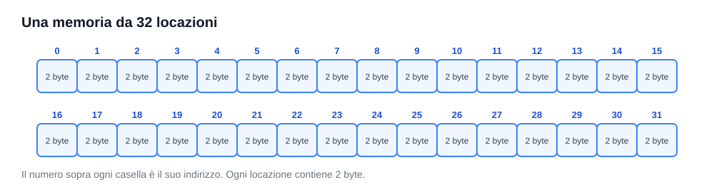
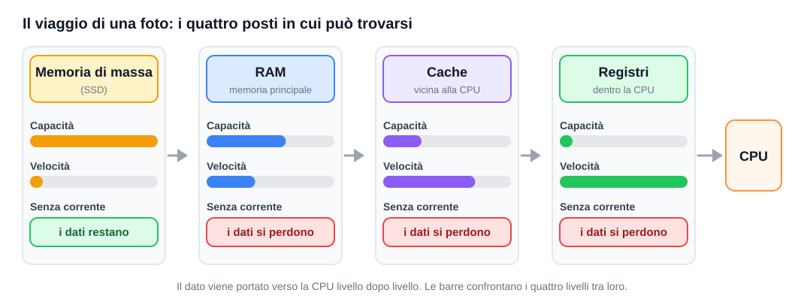
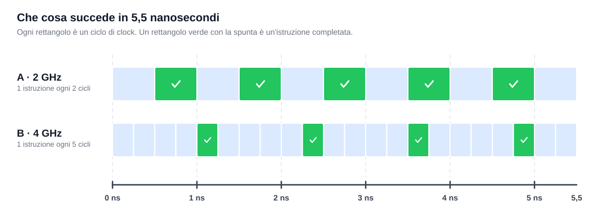
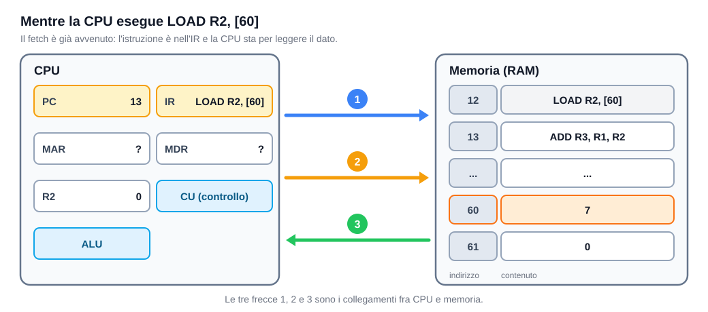

# 🎯 Allenamento · 3EI sett-ott (versione 2)

**Allenamento**, da svolgere insieme in classe. Stessa struttura e stessi punteggi della verifica; le domande sono però **diverse**: serve ragionare, non ricordare.

**Totale 10 punti (+2 facoltativi)** · ✅ base · 🔍 più impegnativa · ⭐ extra · **40 minuti** · nessuna calcolatrice.

| Parte | Argomento | Livello | Domande | Punti |
|---|---|---|---|---:|
| 1 | Concetti della macchina, memorie e clock | ✅ | 10 crocette | 2,5 |
| 2 | Seguire un programma | ✅ | 3 righe | 1,5 |
| 3 | Indirizzi e capacità | ✅ | 3 crocette | 1,5 |
| 4 | Dentro la macchina, cache e clock | 🔍 | 6 crocette | 1,5 |
| 5 | Domande aperte con disegno | 🔍 | 3 domande | 3 |
| | **Totale** | | | **10** |
| ⭐ | Extra | facoltativa | 4 crocette | +2 |

**Tempi suggeriti:** parte 1 circa 8 minuti · parte 2 circa 6 · parte 3 circa 3 · parte 4 circa 7 · parte 5 circa 14.

**Regole delle crocette:** una sola risposta corretta. Una risposta sbagliata o lasciata vuota vale 0: non ci sono penalità, quindi rispondi sempre. Le crocette non richiedono motivazione.

**Spazio per la discussione di gruppo:** `______________________________________________`

---

## Parte 1 · Concetti della macchina, memorie e clock ✅ (2,5 punti)

💬 *Suggerimento: prima di guardare le opzioni, prova a dire la risposta a voce. Poi cerca quella che somiglia di più.*

Ogni domanda vale **0,25 punti**.

**1.1 Una macchina a programma memorizzato si distingue dalle altre perché:**

- [ ] A) ha sempre più registri delle altre macchine.
- [ ] B) le istruzioni stanno in memoria insieme ai dati e si possono sostituire.
- [ ] C) il suo processore è più veloce.
- [ ] D) il programma è fisso nei circuiti dell'ALU.

**1.2 Nella cella di indirizzo 40 c'è scritto il numero 7. Quale affermazione è vera?**

- [ ] A) `MEM[7] = 40`.
- [ ] B) 7 è l'indirizzo della cella.
- [ ] C) `MEM[40] = 7`.
- [ ] D) 40 è il contenuto della cella.

**1.3 Quale compito spetta all'unità di controllo (CU)?**

- [ ] A) Coordinare quali operazioni eseguire e quando.
- [ ] B) Calcolare la somma di due numeri.
- [ ] C) Conservare il risultato dell'ultima operazione.
- [ ] D) Conservare le istruzioni del programma.

**1.4 A che cosa serve il PC (program counter)?**

- [ ] A) A contare quante istruzioni contiene il programma.
- [ ] B) A conservare il risultato dell'ultimo calcolo.
- [ ] C) A conservare l'istruzione che si sta eseguendo.
- [ ] D) A indicare l'indirizzo della prossima istruzione.

**1.5 `R1` contiene 5. La CPU esegue `STORE [30], R1`. Che cosa succede?**

- [ ] A) Il numero 30 viene copiato nella cella 5.
- [ ] B) Il numero 5 viene copiato nella cella 30; `R1` continua a contenere 5.
- [ ] C) Il contenuto della cella 30 viene copiato in `R1`.
- [ ] D) Il numero 5 viene spostato nella cella 30 e `R1` resta vuoto.

**1.6 Quale collegamento porta alla memoria l'indirizzo della cella da leggere?**

- [ ] A) Il bus degli indirizzi.
- [ ] B) Il bus dei dati.
- [ ] C) Il bus di controllo.
- [ ] D) Nessuno: la memoria trova la cella da sola.

**1.7 Quale ordine va dalla memoria più veloce alla più lenta?**

- [ ] A) RAM, cache, registri, SSD.
- [ ] B) cache, registri, SSD, RAM.
- [ ] C) SSD, RAM, cache, registri.
- [ ] D) registri, cache, RAM, SSD.

**1.8 Spegni il computer mentre scrivi un documento non ancora salvato e perdi il testo. Perché?**

- [ ] A) Perché la CPU cancella il disco a ogni spegnimento.
- [ ] B) Perché la RAM è troppo piccola per un documento.
- [ ] C) Perché il testo era solo nella RAM, che senza corrente perde i dati.
- [ ] D) Perché il computer dimentica l'indirizzo del documento.

**1.9 Che cosa contiene la cache?**

- [ ] A) Il programma intero, al posto della RAM.
- [ ] B) Copie di dati e istruzioni usati spesso, tenute vicino alla CPU.
- [ ] C) I file salvati, per conservarli a computer spento.
- [ ] D) Uno spazio in più dove il programma sceglie di scrivere.

**1.10 Che cosa indica la frequenza di clock di una CPU?**

- [ ] A) Quanti cicli di clock avvengono in un secondo.
- [ ] B) Quante istruzioni vengono completate in un secondo, sempre.
- [ ] C) Quanta RAM è disponibile per i programmi.
- [ ] D) A che velocità i dati viaggiano verso il disco.

🃏 <b>Parte 1 — Soluzioni</b>

| ID | Risposta | Note per la correzione |
|---|:-:|---|
| 1.1 | B | È il cuore di Von Neumann. D è l'idea della macchina dedicata. |
| 1.2 | C | L'indirizzo dice dove (40); il contenuto dice che cosa c'è (7). A, B, D scambiano i due. |
| 1.3 | A | La CU comanda, non calcola (B) e non conserva dati (C, D). |
| 1.4 | D | C descrive l'IR. |
| 1.5 | B | `STORE` copia da registro a cella. C descrive una `LOAD`; D dimentica che la copia lascia intatta la sorgente. |
| 1.6 | A | Indirizzi: *dove*. Dati: *che cosa*. Controllo: *quale azione*. |
| 1.7 | D | Registri, cache e RAM sono più veloci dell'SSD; la velocità cala scendendo. |
| 1.8 | C | Volatilità: la RAM perde i dati senza corrente. |
| 1.9 | B | La cache tiene **copie**. D è l'errore frequente «la cache è RAM in più». |
| 1.10 | A | Il clock dà il ritmo, non misura il lavoro. B è la misconcezione «più GHz = più istruzioni». |

**Criteri:** 0,25 per ogni risposta corretta.

---

## Parte 2 · Seguire un programma ✅ (1,5 punti)

💬 *Suggerimento: segui le istruzioni una alla volta. Attenzione a quale registro viene modificato e a quale cella viene letta o scritta.*

Nella memoria ci sono queste istruzioni, una per cella. Qui esegui **solo le prime tre** (celle 25, 26, 27); il resto del programma ti serve nella parte 4.

| Cella | Istruzione |
|---:|---|
| 25 | `LOAD R2, [90]` |
| 26 | `ADD R2, R2, R2` |
| 27 | `STORE [91], R2` |
| 28 | `LOAD R1, [91]` |
| 29 | `ADD R3, R1, R2` |
| 30 | `STORE [90], R3` |
| 31 | `HALT` |

**Stato iniziale:** `PC = 25`; `R2 = 0`. Nella memoria: `MEM[90] = 5`, `MEM[91] = 1`. Dopo il fetch il PC avanza di uno.

**Dopo ciascuna istruzione, scrivi i nuovi valori.** `R1` e `R3` non cambiano in queste tre righe: non serve scriverli. La prima riga mostra lo stato iniziale. Ogni riga giusta vale **0,5 punti**.

| Istruzione eseguita | PC | R2 | MEM[90] | MEM[91] |
|---|:---:|:---:|:---:|:---:|
| (stato iniziale) | 25 | 0 | 5 | 1 |
| `LOAD R2, [90]` | `____` | `____` | `____` | `____` |
| `ADD R2, R2, R2` | `____` | `____` | `____` | `____` |
| `STORE [91], R2` | `____` | `____` | `____` | `____` |

🃏 <b>Parte 2 — Soluzione</b>

| Istruzione eseguita | PC | R2 | MEM[90] | MEM[91] |
|---|:---:|:---:|:---:|:---:|
| `LOAD R2, [90]` | 26 | 5 | 5 | 1 |
| `ADD R2, R2, R2` | 27 | 10 | 5 | 1 |
| `STORE [91], R2` | 28 | 10 | 5 | 10 |

**Criteri:** 0,5 per riga, se tutti i valori sono giusti; 0,25 se un solo valore è sbagliato. Errore propagato: se la riga è coerente con valori sbagliati venuti dalla riga prima, punteggio pieno.

**Errori frequenti:** PC non avanzato; PC = 90 dopo la `LOAD`; `ADD R2, R2, R2` letta come `R2 + 0` o come 1; `MEM[90]` azzerata dopo la lettura; `STORE` scambiata con `LOAD` (`R2` modificato invece di `MEM[91]`).

---

## Parte 3 · Indirizzi e capacità ✅ (1,5 punti)

💬 *Suggerimento: ogni bit in più raddoppia il numero di indirizzi. Raddoppia 1, 2, 4, ... finché arrivi al numero di locazioni.*

Ogni domanda vale **0,5 punti**.

**3.1 Quanti bit servono per scrivere l'indirizzo di ogni locazione?**

- [ ] A) 32 bit.
- [ ] B) 31 bit.
- [ ] C) 6 bit.
- [ ] D) 5 bit.

**3.2 Quale capacità totale ha la memoria?**

- [ ] A) 32 byte.
- [ ] B) 34 byte.
- [ ] C) 64 byte.
- [ ] D) 16 byte.

**3.3 Si aggiunge un bit all'indirizzo, senza cambiare la dimensione delle locazioni (2 byte). Che cosa succede?**

- [ ] A) La memoria ha 33 locazioni e 66 byte.
- [ ] B) La memoria ha 64 locazioni e 64 byte.
- [ ] C) La memoria ha 64 locazioni e 128 byte.
- [ ] D) La memoria ha 32 locazioni da 4 byte.

🃏 <b>Parte 3 — Soluzioni</b>

| ID | Risposta | Note per la correzione |
|---|:-:|---|
| 3.1 | D | $2^5 = 32$ (1, 2, 4, 8, 16, 32 raddoppiando). A è il numero di locazioni, B l'ultimo indirizzo, C il «32 più uno». |
| 3.2 | C | 32 locazioni × 2 byte = 64 byte. A dimentica che ogni locazione è da 2 byte. |
| 3.3 | C | Un bit in più raddoppia le locazioni ($2^6 = 64$); ognuna resta da 2 byte, quindi 128 byte. A aggiunge 1 invece di raddoppiare; B dimentica i 2 byte. |

**Criteri:** 0,5 per ogni risposta corretta.

---

## Parte 4 · Dentro la macchina, cache e clock 🔍 (1,5 punti)

💬 *Suggerimento: questa parte è più impegnativa. Per le prime tre domande pensa al programma della parte 2: riparti dalla cella 28, quando* `R2 = 10` *e* `MEM[91] = 10`*. Non serve rieseguirlo.*

Ogni domanda vale **0,25 punti**.

### 4.1 Il programma già eseguito

**4.1a Nel *fetch* della `LOAD R1, [91]` (cella 28), quanto vale il MAR?**

- [ ] A) 91.
- [ ] B) 29.
- [ ] C) 28.
- [ ] D) 10.

**4.1b Nell'*execute* della stessa `LOAD`, quando il dato arriva dalla memoria, che cosa contengono MAR e MDR?**

- [ ] A) Il MAR l'indirizzo 91, l'MDR il contenuto di `MEM[91]`.
- [ ] B) Il MAR il contenuto di `MEM[91]`, l'MDR l'indirizzo 91.
- [ ] C) Entrambi contengono l'indirizzo 91.
- [ ] D) Il MAR contiene il PC, l'MDR l'istruzione.

**4.1c Quante volte la CPU accede alla memoria per eseguire `ADD R3, R1, R2` (cella 29), fetch compreso?**

- [ ] A) Nessuna volta.
- [ ] B) Una volta: solo il fetch.
- [ ] C) Due volte.
- [ ] D) Tre volte.

### 4.2 Cache, clock e memorie

**4.2d La cache carica blocchi di 8 posizioni consecutive (32-39, 40-47, ...). Hai appena letto l'indirizzo 35 (MISS). Ora leggi il 38, mai letto prima. Che cosa succede?**

- [ ] A) MISS, perché il 38 non è mai stato letto.
- [ ] B) HIT, perché il blocco 32-39 è già in cache.
- [ ] C) MISS, perché il 38 è lontano dal 35.
- [ ] D) Dipende dal clock della CPU.

**4.2e La CPU A ha clock a 2 GHz e completa 1 istruzione ogni 2 cicli. La CPU B ha clock a 4 GHz e completa 1 istruzione ogni 5 cicli. Chi completa più istruzioni al secondo?**

- [ ] A) B, perché ha più GHz.
- [ ] B) Nessuna delle due: completano lo stesso lavoro.
- [ ] C) A: circa 1 miliardo di istruzioni contro 800 milioni al secondo.
- [ ] D) Non si può sapere.

**4.2f Si raddoppia la RAM di un computer. Che cosa è più probabile?**

- [ ] A) La CPU calcola il doppio più in fretta.
- [ ] B) Raddoppia anche la cache.
- [ ] C) I dati sopravvivono allo spegnimento.
- [ ] D) Si possono tenere pronti più programmi e dati, con meno ricorsi alla memoria di massa.

🃏 <b>Parte 4 — Soluzioni</b>

| ID | Risposta | Note per la correzione |
|---|:-:|---|
| 4.1a | C | Nel fetch il MAR riceve il valore del PC **prima** che avanzi (28). B è il PC già avanzato; A e D scambiano indirizzo e contenuto. |
| 4.1b | A | Il MAR tiene l'**indirizzo**, l'MDR il **contenuto**. B li scambia. L'IR non cambia fino a fine istruzione. |
| 4.1c | B | La `ADD` lavora solo sui registri: un solo accesso (il fetch). `LOAD` e `STORE` ne fanno due. |
| 4.2d | B | Il MISS sul 35 ha portato in cache tutto il blocco 32-39 (località **spaziale**). Un hit può riguardare un indirizzo mai chiesto prima. |
| 4.2e | C | A: 2 GHz = 2 miliardi di cicli al secondo, ÷ 2 = 1 miliardo di istruzioni. B: 4 GHz ÷ 5 = 800 milioni. Più GHz non significano più lavoro. |
| 4.2f | D | Più RAM serve a tenere pronti più dati; non accelera la CPU (A), non cambia la cache (B), non rende la RAM permanente (C). |

**Criteri:** 0,25 per ogni risposta corretta.

---

## Parte 5 · Domande aperte con disegno 🔍 (3 punti)

💬 *Suggerimento: guarda prima il disegno, poi rispondi. Bastano frasi brevi e precise: due o tre per domanda.*

### 5.1 Il viaggio di una foto *(1 punto)*

Apri una foto salvata nel telefono. Il disegno mostra i quattro posti in cui un dato può trovarsi.

**a)** Quando il telefono è spento, in quale livello si trova la foto? *(0,25)*

Risposta: `______________________________________________`

**b)** La CPU non lavora direttamente sulla foto nel livello più grande: la foto passa da tutti i livelli fino alla CPU. Perché? Usa il disegno. *(0,75)*

Risposta: `______________________________________________`

`______________________________________________`

### 5.2 Chi completa più lavoro? *(1 punto)*

Due processori lavorano per lo stesso tempo. Ogni rettangolo è un ciclo di clock; un rettangolo verde con la spunta è un'istruzione completata.

**a)** Quante istruzioni completa A e quante ne completa B nel tempo del disegno? *(0,25)*

Risposta: `______________________________________________`

**b)** Un cliente dice: «B ha il doppio dei GHz, quindi va il doppio più veloce». Che cosa rispondi, guardando il disegno? *(0,5)*

Risposta: `______________________________________________`

**c)** Indica un motivo, legato alla memoria, per cui una CPU potrebbe impiegare più cicli per completare un'istruzione. *(0,25)*

Risposta: `______________________________________________`

### 5.3 Che cosa viaggia sui collegamenti? *(1 punto)*

La CPU sta eseguendo l'istruzione che si trova nella cella 12 e sta per leggere il dato. Il disegno mostra la macchina in questo momento.

**a)** Un compagno dice: «Quando esegui `LOAD R2, [60]`, il PC diventa 60». Spiega perché sbaglia: che cos'è il 60 e dove va? *(0,5)*

Risposta: `______________________________________________`

**b)** Che cosa trasporta ciascuna delle tre frecce numerate (1, 2, 3)? *(0,5)*

Risposta: `______________________________________________`

🃏 <b>Parte 5 — Soluzioni</b>

**5.1**

**a)** Nella **memoria di massa (SSD)**: è l'unico livello che mantiene i dati senza corrente. *Criteri:* 0,25.

**b)** La memoria di massa è la più capiente ma anche la più lenta; i livelli vicini alla CPU sono veloci ma piccoli. Per questo si porta vicino alla CPU soltanto ciò che serve ora, livello dopo livello. *Criteri:* 0,25 per «la memoria grande è lenta»; 0,25 per «i livelli vicini alla CPU sono veloci ma piccoli»; 0,25 per l'idea di portare vicino solo i dati che servono. *Errori frequenti:* «perché l'SSD è rotto/non funziona»; «per sicurezza»; dire che la cache è «una RAM in più».

**5.2**

**a)** **A completa 5 istruzioni, B ne completa 4.** *Criteri:* 0,25 se entrambi i numeri sono giusti; 0,1 se uno solo.

**b)** B ha più cicli, ma ne usa 5 per ogni istruzione, quindi in questo caso completa meno lavoro. Il clock dà il ritmo, non misura il lavoro: per confrontare due processori bisogna contare le istruzioni completate nel tempo. *Criteri:* 0,25 per «B ha più cicli ma completa meno istruzioni»; 0,25 per «il clock non misura il lavoro svolto / GHz non è uguale a prestazioni».

**c)** Quando il dato non è in cache (MISS) bisogna aspettare un livello più lento, per esempio la RAM, e la CPU resta ferma. *Criteri:* 0,25 per un motivo corretto legato alla memoria (miss in cache, attesa della RAM, dato lontano). Non vale «perché ha più GHz».

**5.3**

**a)** Il 60 è l'**indirizzo di un dato**, non di un'istruzione. Va nel **MAR**. Il PC vale 13 (la prossima istruzione, la `ADD` nella cella 13) e non cambia per leggere il dato. *Criteri:* 0,25 per «60 è l'indirizzo del dato»; 0,25 per «va nel MAR / il PC continua con la prossima istruzione». *Errore frequente:* confondere l'indirizzo del dato con quello della prossima istruzione.

**b)** **Freccia 1:** l'indirizzo, **60** (bus degli indirizzi, dalla CPU alla memoria). **Freccia 2:** il comando **READ** (bus di controllo, dalla CPU alla memoria). **Freccia 3:** il dato, **7** (bus dati, dalla memoria alla CPU). *Criteri:* 0,5 per tutte e tre; 0,25 per due su tre. Si accetta la descrizione a parole («dove», «quale azione», «che cosa») al posto del nome del bus.

---

## ⭐ Extra (+2 punti, facoltativo)

Non serve per arrivare a 10. Il voto finale non supera 10. L'istruzione `BEQ` non è stata svolta come obiettivo della verifica: se vuoi provarla, la regola è qui.

`BEQ R1, R2, fine`: se `R1` e `R2` hanno lo stesso valore, il programma continua dalla cella con l'etichetta `fine`; altrimenti passa alla cella successiva.

| Cella | Istruzione |
|---:|---|
| 50 | `LOAD R1, [40]` |
| 51 | `LOAD R2, [41]` |
| 52 | `BEQ R1, R2, fine` |
| 53 | `STORE [42], R1` |
| 54 | `fine: HALT` |

Stato iniziale: `MEM[40] = 4`; `MEM[42] = 0`. Ogni domanda vale **0,5 punti**.

**⭐1 Se `MEM[41] = 4`, che cosa succede alla `STORE` della cella 53?**

- [ ] A) Viene eseguita e `MEM[42]` diventa 4.
- [ ] B) Viene saltata e `MEM[42]` resta 0.
- [ ] C) Viene eseguita e `MEM[42]` resta 0.
- [ ] D) Viene saltata e `MEM[42]` diventa 4.

**⭐2 Se `MEM[41] = 9`, che cosa succede alla `STORE` della cella 53?**

- [ ] A) Viene saltata e `MEM[42]` resta 0.
- [ ] B) Viene saltata e `MEM[42]` diventa 9.
- [ ] C) Viene eseguita e `MEM[42]` diventa 9.
- [ ] D) Viene eseguita e `MEM[42]` diventa 4.

**⭐3 Uno studente scrive `STORE R3, [72]` per salvare `R3` nella cella 72. Qual è il problema?**

- [ ] A) Nessuno: va bene così.
- [ ] B) Gli argomenti sono invertiti: prima l'indirizzo tra parentesi quadre, poi il registro.
- [ ] C) Manca l'`HALT` subito dopo.
- [ ] D) `STORE` non può usare `R3`.

**⭐4 La cache ha una sola linea da 4 posizioni (blocchi 0-3, 4-7, ...); ogni MISS sostituisce la linea. Il programma legge 0, 4, 0, 4. Quanti MISS ci sono?**

- [ ] A) 1.
- [ ] B) 2.
- [ ] C) 3.
- [ ] D) 4.

🃏 <b>⭐ — Soluzioni</b>

| ID | Risposta | Note per la correzione |
|---|:-:|---|
| ⭐1 | B | `R1 = R2 = 4`: il `BEQ` salta a `fine`, la `STORE` viene saltata e `MEM[42]` resta 0. |
| ⭐2 | D | `R1 = 4`, `R2 = 9`: diversi, il `BEQ` non salta, la `STORE` viene eseguita e scrive `R1` (4), non `R2`. C è l'errore di scambiare i registri. |
| ⭐3 | B | `STORE [indirizzo], registro`: l'indirizzo viene per primo. |
| ⭐4 | D | 0 e 4 stanno in blocchi diversi e si sostituiscono a vicenda: nessuna lettura trova il blocco giusto, quindi 4 MISS su 4 letture. |

**Criteri:** 0,5 per ogni risposta corretta.

---

## Promemoria · le istruzioni della nostra macchina

Questa tabella serve solo da aiuto: non va imparata a memoria.

| Istruzione | Che cosa fa |
|---|---|
| `LOAD R1, [50]` | Copia in `R1` il contenuto della cella 50. La cella non cambia. |
| `STORE [52], R3` | Copia il contenuto di `R3` nella cella 52. `R3` non cambia. |
| `ADD R3, R1, R2` | Somma `R1` e `R2` e scrive il risultato in `R3` (la destinazione è la prima). |
| `HALT` | Ferma il programma. |
| `BEQ R1, R2, fine` | (solo extra ⭐) Se `R1` e `R2` sono uguali, salta all'etichetta `fine`. |

Dopo il fetch di ogni istruzione il PC avanza di uno.
