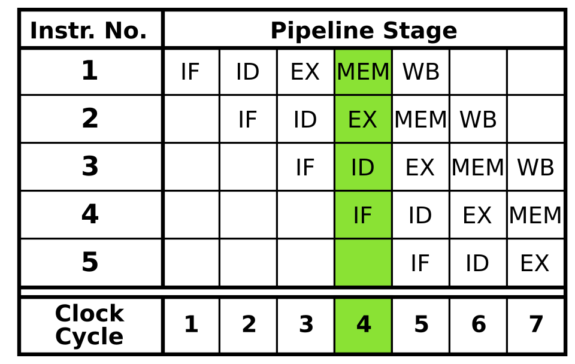
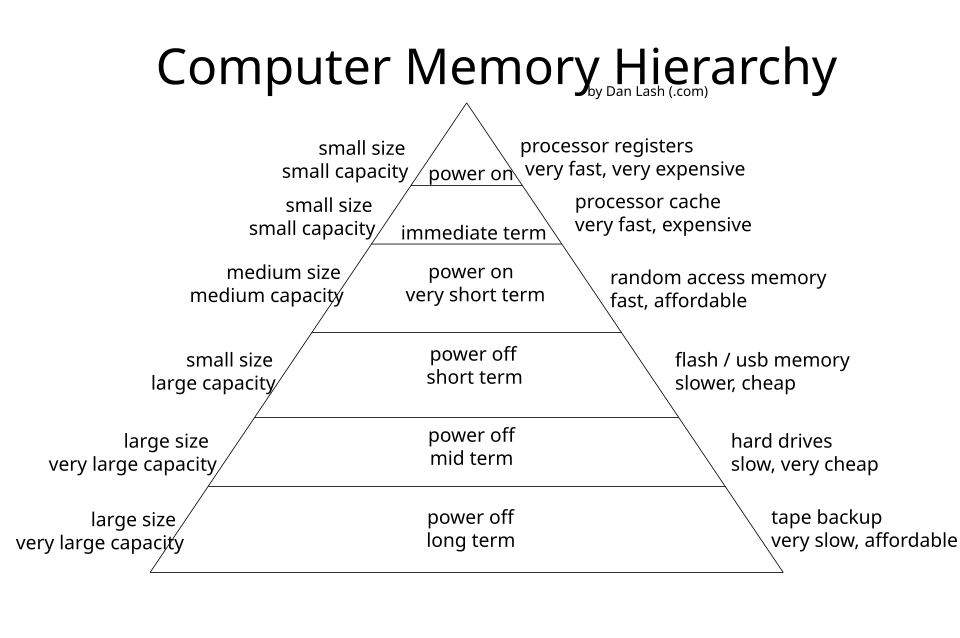

⬅️ [S7 - Ripasso e collegamenti](./%28STU%29%203EI%20nov-dic%20S7%20-%20Ripasso%20e%20collegamenti.md) · 🏠 [Indice](../README.md)

# 🛠️ Eserciziario · 3EI Novembre-Dicembre — Far lavorare, avviare, ospitare

3EI · Novembre-Dicembre · Eserciziario · Sistemi e Reti · Argomenti S1-S6

⏱️ **Tempo di studio dichiarato:** circa 1 ora e 40 minuti in totale (✅ circa 60 minuti, 🔍 circa 40 minuti). I 🤓 sono facoltativi. Carta, penna e calcolatrice sono ammesse.

> **Legenda:** ✅ minimo per la sufficienza · 🔍 dettagli per il voto massimo · 🤓 approfondimento facoltativo · 🟢 esercizio svolto · ✏️ da fare · 📜 caso reale · 🧪 caso inventato (dati dichiarati) · 📌 controllo · ⚠️ errore comune · 🧠 da ricordare · 🔁 richiamo di ottobre · 🃏 soluzione

**Filo rosso.** Sei il tecnico del laboratorio di informatica della scuola. I docenti ti mandano richieste: un PC lento, un avvio che non finisce, una macchina virtuale che scatta. Ogni argomento è una richiesta. I nomi (LAB-3, PC-07) e i valori dei casi inventati sono inventati e dichiarati come tali.

**Nota.** Gli argomenti sono quelli del meta del bimestre (S1-S6). La verifica docente non esiste ancora; quando ci sarà, la struttura potrà cambiare.

---

## 🧭 Come usare questo eserciziario

Ogni categoria segue lo stesso ordine: 📜 un caso reale, poi 🟢 esercizi svolti da leggere e rifare, poi ✏️ esercizi da fare. La soluzione di ogni ✏️ è nel 🃏 a tendina: prova prima da solo.

| Livello | Che cosa trovi | Tempo |
|---|---|---|
| ✅ | 🟢 svolti e ✏️ di livello ✅ | circa 60 minuti |
| 🔍 | ✏️ di livello 🔍 e cacce all'errore | circa 40 minuti |
| 🤓 | riquadri facoltativi, senza esercizi | a piacere |

🧠 Ogni conto ha tre passi: scrivi la formula, sostituisci i valori, controlla le unità.

---

## 🧮 Formule del bimestre

| Che cosa calcoli | Formula | Dove |
|---|---|---|
| Tempo di CPU | `T = N × CPI ÷ f` (istruzioni × cicli per istruzione ÷ cicli al secondo) | S1 |
| Periodo di clock | `1 ÷ f` | S1 |
| Cicli con la pipeline (modello ideale) | `stadi + (istruzioni − 1)` | S2 |
| Tempo medio di accesso (modello semplificato) | `h × t_cache + (1 − h) × t_RAM` (h = hit rate) | 🔁 ottobre S6, S6 |
| GB e GiB | 1 GB = 10⁹ byte (confezione); 1 GiB = 2³⁰ byte = 1 073 741 824 byte (sistema) | S3 |
| Settori indirizzabili con MBR | `2³² = 4 294 967 296` settori | S4 |

---

## 1 · ⚡ Prestazioni e istruzioni (S1)

📜 **Caso reale.** Nel novembre 2020 Apple annuncia i Mac con processori Apple Silicon, di famiglia ARM. La famiglia ARM è nata con l'idea RISC, mentre i Mac precedenti usavano processori Intel della famiglia x86, storicamente CISC. Il cambio ha mostrato che la scelta CISC o RISC non decide da sola la velocità: contano il programma, il CPI e la frequenza.

### 1.1 🟢 Svolto · ✅ — Tempo di CPU di un programma

**Consegna.** Il programma P ha 6 × 10⁸ istruzioni (valore inventato). Il processore ha frequenza 2,4 GHz e CPI 1,8. Calcola il periodo di clock e il tempo di CPU.

**Svolgimento.**
1. Periodo: `1 ÷ 2,4 × 10⁹` = circa 0,42 ns.
2. Cicli totali: `6 × 10⁸ × 1,8` = 1,08 × 10⁹ cicli.
3. Tempo: `1,08 × 10⁹ ÷ 2,4 × 10⁹` = **0,45 s**.

📌 **Controllo.** Unità: istruzioni × (cicli per istruzione) ÷ (cicli al secondo) = secondi. Il risultato è sotto un secondo, come atteso per un programma piccolo.

⚠️ **Errore comune:** moltiplicare per la frequenza invece di dividere. Il numero esce di ordine 10¹⁸ secondi, assurdo.

> 🧠 Il tempo di CPU appartiene a un programma: un processore, da solo, non ha un tempo.

### 1.2 🟢 Svolto · ✅ — Due processori, stesso programma

**Consegna.** Il programma ha 5 × 10⁸ istruzioni. Processore X: 3,0 GHz, CPI 2,0. Processore Y: 2,0 GHz, CPI 1,2. Quale finisce prima e di quanto?

**Svolgimento.**
1. X: `5 × 10⁸ × 2,0 ÷ 3,0 × 10⁹` = 0,33 s.
2. Y: `5 × 10⁸ × 1,2 ÷ 2,0 × 10⁹` = 0,30 s.
3. Y finisce prima: circa il 10% di tempo in meno.

📌 **Controllo.** Y ha la frequenza più bassa e vince: il CPI più basso compensa.

⚠️ **Errore comune:** «X ha più GHz, quindi è più veloce». Senza il CPI non si conclude nulla.

### 1.3 ✏️ Da fare (teoria) · ✅ — CISC o RISC?

**Consegna.** Scrivi **C** (CISC) o **R** (RISC) accanto a ciascuna affermazione.
1. Poche istruzioni per programma, ciascuna complessa.
2. Solo `LOAD` e `STORE` accedono alla memoria.
3. Istruzioni spesso della stessa lunghezza.
4. Programma più corto, ma decodifica più complicata.

🃏 <b>1.3 — Soluzione</b>

1. **C**: istruzioni potenti, meno per programma.
2. **R**: la memoria si usa solo con LOAD e STORE.
3. **R**: lunghezza fissa, più facile far lavorare più istruzioni insieme.
4. **C**: il decoder deve capire istruzioni complesse.

### 1.4 ✏️ Da fare (pratica) · ✅ — CPI medio

**Consegna.** Un programma ha 5 `ADD` (1 ciclo ciascuna), 3 `LOAD` (4 cicli ciascuna) e 2 `STORE` (3 cicli ciascuna). Calcola il numero di istruzioni, i cicli totali e il CPI medio.

🃏 <b>1.4 — Soluzione</b>

Istruzioni: 5 + 3 + 2 = 10. Cicli: 5 × 1 + 3 × 4 + 2 × 3 = 5 + 12 + 6 = 23. CPI medio: 23 ÷ 10 = **2,3**.

### 1.5 ✏️ Da fare (pratica) · ✅ — Quale frequenza serve?

**Consegna.** Lo stesso mix di istruzioni dell'1.4 (CPI 2,3), ma il programma ha 4 × 10⁹ istruzioni. Vuoi che finisca in 3,0 s. Quale frequenza serve?

🃏 <b>1.5 — Soluzione</b>

Cicli totali: 4 × 10⁹ × 2,3 = 9,2 × 10⁹. Frequenza: `f = 9,2 × 10⁹ ÷ 3,0` = 3,07 × 10⁹ Hz, cioè circa **3,07 GHz**.

### 1.6 ✏️ Da fare (pratica) · 🔍 — Due processori con leve diverse

**Consegna.** Stesso programma dell'1.5 (4 × 10⁹ istruzioni). Il processore P1 ha 2,5 GHz e CPI 2,3. Il processore P2 ha 2,0 GHz e CPI 1,9. Calcola il tempo di entrambi e dì quale finisce prima, di quanto.

🃏 <b>1.6 — Soluzione</b>

P1: `4 × 10⁹ × 2,3 ÷ 2,5 × 10⁹` = 3,68 s. P2: `4 × 10⁹ × 1,9 ÷ 2,0 × 10⁹` = 3,80 s. P1 finisce prima, di circa 0,12 s (circa il 3%). P2 guadagna sul CPI, ma perde più sulla frequenza.

### 1.7 ✏️ Da fare (caccia all'errore) · 🔍

**Consegna.** Un collega scrive: «Un processore CISC esegue sempre ogni istruzione in meno cicli di un RISC, quindi è sempre più veloce.» Trova i due errori e riscrivi la frase in modo corretto.

🃏 <b>1.7 — Soluzione</b>

Errore 1: «sempre meno cicli» non è una regola. Un'istruzione CISC può richiedere più cicli di una RISC. Errore 2: «quindi più veloce» non segue: per un programma il tempo dipende da N, dal CPI e dalla frequenza insieme.

---

## 2 · 🏭 Pipelining (S2)

📜 **Caso reale.** Il Pentium 4 nella versione «Prescott», uscito nel 2004, aveva una pipeline di 31 stadi. Più stadi permettevano frequenze più alte, ma ogni salto sbagliato costava più lavoro buttato. Il caso mostra che «più stadi» non è gratis.

*Cinque stadi, un'istruzione per riga: l'immagine di riferimento per gli esercizi di questa categoria.*

### 2.1 🟢 Svolto · ✅ — Cicli e latenza di quattro istruzioni

**Consegna.** Pipeline ideale (senza pause) a cinque stadi, processore a 2 GHz, quattro istruzioni. Calcola: cicli con e senza pipeline, latenza di una istruzione, throughput a regime.

**Svolgimento.**
1. Con pipeline: `5 + (4 − 1)` = **8 cicli**.
2. Senza pipeline: `4 × 5` = **20 cicli**.
3. Periodo: `1 ÷ 2 × 10⁹` = 0,5 ns. Latenza: 5 cicli × 0,5 ns = **2,5 ns**, con o senza pipeline.
4. Throughput a regime: 1 istruzione per ciclo = 2 × 10⁹ istruzioni al secondo.

📌 **Controllo.** Il rapporto 20 ÷ 8 = 2,5: la pipeline riduce il tempo totale, non la latenza.

⚠️ **Errore comune:** «la pipeline rende ogni istruzione più veloce». La singola istruzione dura come prima.

> 🧠 Latenza: quanto aspetti una istruzione. Throughput: quante ne escono nello stesso tempo.

### 2.2 🟢 Svolto · ✅ — Griglia e hazard di dati

**Consegna.** Tre istruzioni su cinque stadi, modello ideale:
- `LOAD R1, [40]`
- `ADD R3, R1, R2`
- `STORE [41], R3`

Disegna la griglia e trova le istruzioni che leggono un valore non ancora pronto.

**Svolgimento.** Ogni riga è un'istruzione, ogni colonna un ciclo.

| Istruzione | 1 | 2 | 3 | 4 | 5 | 6 | 7 |
|---|---|---|---|---|---|---|---|
| `LOAD R1, [40]` | IF | ID | EX | MEM | WB | | |
| `ADD R3, R1, R2` | | IF | ID | EX | MEM | WB | |
| `STORE [41], R3` | | | IF | ID | EX | MEM | WB |

1. Fine al ciclo 7: `5 + (3 − 1)` = 7 cicli, come previsto.
2. `ADD` legge `R1` in ID al ciclo 3. `LOAD` scrive `R1` in WB al ciclo 5. Hazard di dati.
3. `STORE` legge `R3` in ID al ciclo 4. `ADD` scrive `R3` in WB al ciclo 6. Secondo hazard di dati.

📌 **Controllo.** Ogni istruzione passa per IF, ID, EX, MEM, WB, in quest'ordine, un ciclo alla volta.

⚠️ **Errore comune:** pensare che l'hazard sia un errore nel programma. È un limite della catena: la CPU deve fermarsi o far passare il dato in anticipo.

### 2.3 ✏️ Da fare (teoria) · ✅ — Latenza o throughput?

**Consegna.** Scrivi **L** (latenza) o **T** (throughput).
1. Quanto dura una istruzione dall'inizio alla fine.
2. Quante istruzioni escono in un secondo a pipeline piena.
3. Non cambia con la pipeline.
4. Cresce con la pipeline.

🃏 <b>2.3 — Soluzione</b>

1. **L**. 2. **T**. 3. **L**. 4. **T**.

### 2.4 ✏️ Da fare (pratica) · ✅ — Sei istruzioni a 2,5 GHz

**Consegna.** Pipeline ideale a cinque stadi, processore a 2,5 GHz, sei istruzioni. Calcola i cicli totali, il tempo con la pipeline e il tempo senza pipeline.

🃏 <b>2.4 — Soluzione</b>

Cicli con pipeline: 5 + (6 − 1) = 10. Periodo: 1 ÷ 2,5 × 10⁹ = 0,4 ns. Tempo con pipeline: 10 × 0,4 = **4 ns**. Senza pipeline: 6 × 5 = 30 cicli, cioè **12 ns**.

### 2.5 ✏️ Da fare (pratica) · ✅ — Quante istruzioni?

**Consegna.** Pipeline ideale a cinque stadi. Il programma impiega 12 cicli. Quante istruzioni contiene?

🃏 <b>2.5 — Soluzione</b>

12 = 5 + (n − 1), quindi n − 1 = 7 e **n = 8** istruzioni.

### 2.6 ✏️ Da fare (pratica) · 🔍 — Più stadi contro più GHz

**Consegna.** Modello ideale, 100 istruzioni. Processore A: 5 stadi, 2 GHz. Processore B: 15 stadi, 3 GHz. Calcola i cicli e il tempo di ciascuno. Poi spiega in una frase perché B potrebbe perdere il vantaggio quando sbaglia dei salti.

🃏 <b>2.6 — Soluzione</b>

A: 5 + 99 = 104 cicli × 0,5 ns = **52 ns**. B: 15 + 99 = 114 cicli × 0,333 ns = **38 ns**. Nel modello ideale B vince. Con un salto sbagliato, B scarta più stadi di A: ogni errore costa di più, e il vantaggio può sparire.

### 2.7 ✏️ Da fare (teoria) · ✅ — Riconosci l'hazard

**Consegna.** Scrivi il tipo di hazard per ciascun caso.
- (a) Due istruzioni vogliono la memoria nello stesso ciclo.
- (b) `ADD` usa `R1` appena scritto da una `LOAD`.
- (c) Dopo una `BEQ` la CPU non sa quale istruzione prendere.

🃏 <b>2.7 — Soluzione</b>

(a) strutturale. (b) di dati. (c) di controllo.

### 2.8 ✏️ Da fare (caccia all'errore) · 🔍

**Consegna.** Un compagno scrive: «La pipeline accorcia la latenza di ogni istruzione e quindi rende ogni programma veloce di un fattore pari al numero di stadi.» Trova i due errori.

🃏 <b>2.8 — Soluzione</b>

Errore 1: la latenza non cambia. Errore 2: il fattore vale solo a regime e con molte istruzioni. Con 100 istruzioni e 5 stadi il tempo passa da 500 cicli a 104: circa 4,8 volte, non 5.

🤓 <b>Riquadro facoltativo: salti e predizione</b>

Per evitare di aspettare il risultato di un salto, la CPU prova a indovinare la strada: è la predizione dei salti. Se indovina, nessuna pausa; se sbaglia, scarta il lavoro fatto. Non fa parte della verifica.

---

## 3 · 💾 Memorie di massa e interfacce (S3)

📜 **Caso reale.** Nel 1956 IBM presenta il RAMAC 305, con il disco magnetico 350: circa 5 MB di capacità, 50 dischi da 24 pollici (circa 61 cm) di diametro. Oggi un SSD da 1 TB sta in una tasca: sono circa 200 000 volte più dei 5 MB del RAMAC. Il valore del RAMAC è dato con l'approssimazione delle fonti.

### 3.1 🟢 Svolto · ✅ — Quanti GiB vede il sistema?

**Consegna.** Un SSD è dichiarato da 1 TB, cioè 1 000 000 000 000 byte. Quanti GiB mostra il sistema operativo?

**Svolgimento.**
1. Un GiB = 1 073 741 824 byte.
2. `1 000 000 000 000 ÷ 1 073 741 824` = 931,3.
3. Il sistema mostra circa **931 GiB**.

📌 **Controllo.** Il produttore conta in multipli di 1000, il sistema in multipli di 1024: lo stesso disco, due conteggi.

⚠️ **Errore comune:** pensare che il disco sia difettoso perché mostra meno del dichiarato.

### 3.2 🟢 Svolto · ✅ — Volatile o persistente, formato o interfaccia?

**Consegna.** Classifica: RAM, SSD, HDD, chiavetta USB, registro della CPU (V = volatile, P = persistente). Poi: 2,5 pollici, SATA, M.2, NVMe, USB (F = formato, I = interfaccia).

**Svolgimento.**
- RAM **V**: si svuota allo spegnimento. Registro della CPU **V**: stessa logica, più piccolo.
- SSD **P**, HDD **P**, chiavetta **P**: conservano i dati senza corrente.
- 2,5 pollici **F**: forma e misura. M.2 **F**: forma. SATA **I**, NVMe **I**, USB **I**: collegamento e linguaggio.

🧠 Un SSD M.2 può usare SATA o NVMe: la forma è la stessa, l'interfaccia cambia.

### 3.3 ✏️ Da fare (pratica) · ✅ — Quanto tempo per 2 GB?

**Consegna.** Un file da 2 GB. Con un collegamento SATA a 550 MB/s, quanti secondi servono? E con NVMe a 3 GB/s? Di quante volte è più veloce il secondo? Valori tipici, approssimati.

🃏 <b>3.3 — Soluzione</b>

SATA: 2 000 MB ÷ 550 MB/s = **3,6 s**. NVMe: 2 GB ÷ 3 GB/s = **0,67 s**. Rapporto: 3,6 ÷ 0,67 ≈ **5,5 volte**.

### 3.4 ✏️ Da fare (pratica) · ✅ — Un disco da 2 TB

**Consegna.** Un disco è dichiarato da 2 TB, cioè 2 × 10¹² byte. Quanti GiB mostra il sistema, arrotondati?

🃏 <b>3.4 — Soluzione</b>

`2 × 10¹² ÷ 1 073 741 824` = 1 862,6, cioè circa **1 863 GiB**.

### 3.5 ✏️ Da fare (teoria) · ✅ — Dal più veloce al più lento

**Consegna.** Tempi di accesso tipici: RAM 0,0001 ms, SSD 0,1 ms, HDD 7 ms. Ordina dal più veloce al più lento, poi dì quante volte è più lento l'HDD rispetto all'SSD.

🃏 <b>3.5 — Soluzione</b>

RAM, SSD, HDD. Rapporto: 7 ÷ 0,1 = **70 volte**. Sono ordini di grandezza, non specifiche di un modello.

### 3.6 ✏️ Da fare (pratica) · 🔍 — Mille accessi casuali

**Consegna.** Un programma fa 1 000 accessi casuali al disco.
a) Quanto tempo impiega con l'HDD (7 ms) e con l'SSD (0,1 ms)?
b) Quante volte 1 TB è più grande dei 5 MB del RAMAC?

🃏 <b>3.6 — Soluzione</b>

a) HDD: 1 000 × 7 ms = **7 s**. SSD: 1 000 × 0,1 ms = **0,1 s**. b) 1 TB = 10¹² byte; 5 MB = 5 × 10⁶ byte; rapporto **200 000**.

### 3.7 ✏️ Da fare (caccia all'errore) · 🔍

**Consegna.** Un compagno scrive: «Cancellare un file azzera subito i suoi byte sul disco: per questo i file cancellati non si recuperano.» Trova i due errori.

🃏 <b>3.7 — Soluzione</b>

Errore 1: di solito si toglie la voce dal catalogo (file system); i byte restano finché non vengono sovrascritti. Errore 2: spesso i file cancellati si recuperano, proprio per questo.

---

## 4 · 🚀 Dall'accensione al sistema operativo (S4, S6)

📜 **Caso reale.** Il primo IBM PC, del 1981, teneva il firmware (BIOS) in una memoria ROM sulla scheda madre. Quando il PC si accende, nessun programma è in RAM: il primo a partire è il firmware, che si trova già in memoria non volatile.

### 4.1 🟢 Svolto · ✅ — Le sei tappe e chi è in esecuzione

**Consegna.** Metti in ordine le sei tappe dall'accensione al sistema operativo e scrivi, per ciascuna, chi è in esecuzione e dove sta il programma. Tappe: sistema operativo, accensione, bootloader, firmware, caricamento del SO, controlli (POST).

**Svolgimento.**

| Ordine | Tappa | Chi è in esecuzione | Dove sta il programma |
|---|---|---|---|
| 1 | Accensione | nessuno | — |
| 2 | Firmware | firmware | chip sulla scheda madre |
| 3 | Controlli (POST) | firmware | chip sulla scheda madre |
| 4 | Bootloader | bootloader | disco, copiato in RAM |
| 5 | Caricamento del SO | bootloader | disco, copiato in RAM |
| 6 | Sistema operativo | sistema operativo | RAM |

📌 **Controllo.** Ogni tappa passa il lavoro alla successiva. Il firmware non si sposta: resta nel suo chip.

⚠️ **Errore comune:** «il sistema operativo parte da solo». Lo carica il bootloader.

### 4.2 🟢 Svolto · ✅ — Dove sta il ritardo?

🧪 *Caso inventato, tempi dichiarati.* Un PC si accende e le app sono lente. Tempi misurati:
- firmware e controlli: 9 s
- ordine di avvio: 4 s
- bootloader: 3 s
- caricamento del SO e dei programmi di avvio: 40 s

**Consegna.** Quale fase va indagata? Quanta parte del tempo è prima del sistema operativo?

**Svolgimento.**
1. Totale: 9 + 4 + 3 + 40 = 56 s.
2. Prima del caricamento del SO: 9 + 4 + 3 = 16 s, cioè circa il 29%.
3. Caricamento del SO e programmi di avvio: 40 s, cioè circa il 71%.
4. Il ritardo è dopo il bootloader: guardare il firmware serve poco.

📌 **Controllo.** Il dato decisivo è il tempo per fase, non il tempo totale da solo.

⚠️ **Errore comune:** «il disco è lento, quindi è rotto». Un disco può essere lento senza essere guasto.

### 4.3 ✏️ Da fare (teoria) · ✅ — Vero o falso?

**Consegna.** Scrivi V o F.
a) Il BIOS è il sistema operativo.
b) La UEFI può leggere una partizione con file.
c) Il firmware sta in memoria non volatile.
d) Il sistema operativo parte da solo all'accensione.

🃏 <b>4.3 — Soluzione</b>

a) F: è firmware. b) V. c) V: deve esserci anche da spento. d) F: lo carica il bootloader.

### 4.4 ✏️ Da fare (pratica) · ✅ — Un disco da 3 TB con MBR

**Consegna.** Un disco da 3 TB (3 × 10¹² byte) ha settori da 512 byte. Lo schema MBR indirizza 2³² settori. Quanti settori ha il disco? Lo schema MBR basta?

🃏 <b>4.4 — Soluzione</b>

Settori: 3 × 10¹² ÷ 512 = 5 859 375 000. MBR indirizza 2³² = 4 294 967 296 settori, circa 2 TiB. Non basta: serve uno schema più recente come GPT, che la UEFI sa leggere.

### 4.5 ✏️ Da fare (pratica) · ✅ — Quanto guadagni con un SSD?

**Consegna.** Un avvio dura 38 s: firmware e controlli 8 s, ordine di avvio 2 s, bootloader 3 s, caricamento del SO 25 s. Ipotesi inventata: con un SSD il caricamento del SO scende a 10 s. Quanti secondi risparmi? Quale percentuale del totale?

🃏 <b>4.5 — Soluzione</b>

Nuovo totale: 8 + 2 + 3 + 10 = 23 s. Risparmio: 38 − 23 = **15 s**. Percentuale: 15 ÷ 38 ≈ **39%**. Il risparmio è solo sulla fase del caricamento.

### 4.6 ✏️ Da fare (teoria) · 🔍 — Accensione rapida, app lente

**Consegna.** Un amico dice: «Il PC si accende in 10 secondi, ma le app si aprono lente.» Quale fase indagheresti? Quale misura ti serve per deciderlo?

🃏 <b>4.6 — Soluzione</b>

Se il firmware parte in 10 s, la lentezza è dopo: nel caricamento del sistema, nei programmi di avvio o nel disco. Misura: quali programmi partono da soli e quanta attività del disco c'è quando si apre un'app.

### 4.7 ✏️ Da fare (caccia all'errore) · 🔍

**Consegna.** Una dispensa scrive: «Il BIOS carica Windows nella ROM, poi Windows parte da solo.» Trova i due errori e correggi.

🃏 <b>4.7 — Soluzione</b>

Errore 1: il BIOS è firmware, non sistema operativo: carica un bootloader dal disco. Errore 2: il sistema operativo non sta nella ROM e non parte da solo: viene caricato in RAM dal bootloader.

---

## 5 · 🖥️ Virtualizzazione (S5)

📜 **Caso reale.** Nel 1967 IBM sviluppa CP-67 per il System/360 Model 67: ogni utente ha l'illusione di una macchina tutta sua. Oggi lo stesso principio lo usi quando un Mac apre Windows con un programma come Parallels Desktop.

### 5.1 🟢 Svolto · ✅ — RAM di host e guest

🧪 *Dato inventato.* Un server ha 32 GB di RAM. Ci girano tre macchine virtuali da 8 GB ciascuna.

**Consegna.** Quanta RAM resta all'host?

**Svolgimento.**
1. RAM assegnata alle VM: 3 × 8 = 24 GB.
2. RAM rimasta all'host: 32 − 24 = **8 GB**.

📌 **Controllo.** Il conto ignora la RAM che usa il sistema dell'host: va dichiarato.

⚠️ **Errore comune:** sommare la RAM delle VM a quella dell'host. Una VM non aggiunge RAM: la prende.

### 5.2 🟢 Svolto · ✅ — Chi è chi

📜 Caso reale: un Mac su cui gira Windows con Parallels Desktop.

**Consegna.** Indica host, guest e hypervisor.

**Svolgimento.**
- **Host:** il Mac, con la sua CPU, la sua RAM e il suo disco.
- **Guest:** Windows, con il suo sistema operativo.
- **Hypervisor:** Parallels, che gira sopra macOS e divide le risorse del Mac fra i guest.

🧠 L'hypervisor è il gestore: decide quanta parte dell'host va a ciascun guest.

### 5.3 ✏️ Da fare (teoria) · ✅ — Isolamento e limite

**Consegna.** Spiega in una frase ciascuna.
a) Perché un guest non legge la memoria di un altro guest.
b) Perché, se l'host è carico, tutti i guest rallentano.

🃏 <b>5.3 — Soluzione</b>

a) L'hypervisor assegna a ciascun guest porzioni di memoria separate: è l'isolamento. b) Le risorse fisiche (CPU, RAM, disco) sono dell'host: se sono sature, ne soffrono tutti i guest. Isolamento e limite sono due cose diverse.

### 5.4 ✏️ Da fare (pratica) · ✅ — Spazio per i dischi virtuali

**Consegna.** L'SSD dell'host ha 200 GB liberi. Crei due dischi virtuali fissi da 80 GB ciascuno. Quanto spazio libero resta?

🃏 <b>5.4 — Soluzione</b>

200 − 2 × 80 = **40 GB**. Ogni disco virtuale è un file che occupa spazio nell'host.

### 5.5 ✏️ Da fare (pratica) · 🔍 — Una VM in più

**Consegna.** L'host ha 8 GB di RAM e altri programmi ne usano 6 GB. Avvii una VM con 4 GB.
a) Quanta RAM libera resta all'host prima di avviare la VM? Che cosa ti aspetti?
b) Sull'host da 32 GB del 5.1 con tre VM da 8 GB, arriva una quarta VM da 12 GB. Quanta RAM serve in tutto? Ci sta?

🃏 <b>5.5 — Soluzione</b>

a) Liberi: 8 − 6 = 2 GB. La VM ne chiede 4: ne mancano 2. Previsione: rallentamento, perché la RAM richiesta supera quella libera. b) 24 + 12 = 36 GB su 32: non ci sta. Serve chiudere una VM o ridurne la RAM.

### 5.6 ✏️ Da fare (teoria) · ✅ — Tipo 1 o tipo 2?

**Consegna.** Indica 1 (gira direttamente sull'hardware) o 2 (gira sopra un sistema operativo): VMware ESXi; VirtualBox su Windows; Parallels su Mac.

🃏 <b>5.6 — Soluzione</b>

ESXi: **1**. VirtualBox su Windows: **2**. Parallels su Mac: **2**.

### 5.7 ✏️ Da fare (caccia all'errore) · 🔍

**Consegna.** Un compagno scrive: «La VM non costa nulla: non usa risorse dell'host, quindi non può rallentarlo.» Trova i due errori.

🃏 <b>5.7 — Soluzione</b>

Errore 1: la VM usa CPU, RAM e disco dell'host. Errore 2: proprio per questo può rallentare l'host, e viceversa.

---

## 6 · 🧩 Ricostruire il sistema (S6)

📜 **Caso reale.** Nel 1995 William Wulf e Sally McKee pubblicano «Hitting the Memory Wall». L'idea: la CPU diventa più veloce più in fretta della memoria, e il tempo se ne va ad aspettare i dati. È il motivo per cui la gerarchia delle memorie conta.

### 6.1 🟢 Svolto · ✅ — Un sintomo, tre domande

🧪 *Caso inventato.* Il video scatta mentre un download è attivo sullo stesso PC.

**Consegna.** Applica le tre domande: che cosa aspetta la macchina? quale livello è lento? quale dato decide?

**Svolgimento.**
1. Il video aspetta dati che passano dal disco, mentre il download scrive sullo stesso disco.
2. Il livello sospettato è il disco.
3. Il dato decisivo: quanto è occupato il disco nel momento dello scatto, e se la CPU è sotto carico.

📌 **Controllo.** Se la CPU è al 20%, la spiegazione «CPU satura» cade. Un dato solo può escludere un'ipotesi.

⚠️ **Errore comune:** dire «è colpa della CPU» senza misura.

### 6.2 🟢 Svolto · 🔍 — Tempo medio di accesso

🔁 *Richiamo di ottobre, modello semplificato e dichiarato.* Cache con tempo 2 ns, RAM con tempo 60 ns, hit rate del 90% (il dato è in cache nel 90% dei casi).

**Consegna.** Calcola il tempo medio di accesso.

**Svolgimento.** Formula: `h × t_cache + (1 − h) × t_RAM`.
1. `0,9 × 2 + 0,1 × 60` = 1,8 + 6.
2. Tempo medio: **7,8 ns**.

📌 **Controllo.** Il risultato sta vicino ai 2 ns della cache, perché la cache serve la maggior parte degli accessi. Ma ogni miss costa 60 ns, circa 30 volte la cache.

*Dalla cache alla memoria di massa: più in alto piccolo e veloce, più in basso grande e lento.*

### 6.3 ✏️ Da fare (pratica) · ✅ — Due hit rate

**Consegna.** Stesse cache (2 ns) e RAM (60 ns). Calcola il tempo medio con hit rate del 50% e con hit rate del 99%.

🃏 <b>6.3 — Soluzione</b>

50%: 0,5 × 2 + 0,5 × 60 = **31 ns**. 99%: 0,99 × 2 + 0,01 × 60 = 1,98 + 0,60 = **2,58 ns**, circa 2,6 ns. Più l'hit rate sale, più il tempo medio scende verso quello della cache.

### 6.4 ✏️ Da fare (teoria) · ✅ — Tre compromessi

**Consegna.** Per ciascuno scrivi un vantaggio e un costo.
a) Più RAM.
b) Un avvio con molti controlli.
c) Una macchina virtuale.

🃏 <b>6.4 — Soluzione</b>

a) Vantaggio: meno scambi con il disco. Costo: spesa, e non accelera una CPU già al limite. b) Vantaggio: più sicuro. Costo: più lento. c) Vantaggio: isola i sistemi. Costo: condivide l'hardware dell'host.

### 6.5 ✏️ Da fare (pratica) · ✅ — La RAM serve sempre?

**Consegna.** Gestione attività su un PC lento mostra: RAM usata al 40%, CPU al 100% per un solo programma, disco quasi fermo (2%). a) Quale livello è il collo di bottiglia? b) Aggiungere RAM aiuta?

🃏 <b>6.5 — Soluzione</b>

a) La CPU, occupata da un solo programma. b) No: la RAM non è al limite. Conviene capire quale programma consuma la CPU.

### 6.6 ✏️ Da fare (pratica) · 🔍 — Venti schede aperte

🧪 *Caso inventato.* Un portatile con venti schede aperte rallenta a ogni cambio di scheda. Misure: RAM al 95%, disco al 100%, CPU al 20%.

**Consegna.** Quale collo di bottiglia è più probabile? Quale misura confermeresti nel tempo?

🃏 <b>6.6 — Soluzione</b>

Il collo è la memoria: la RAM è quasi piena e il disco lavora al massimo. La CPU non è il limite. Conferma: misura RAM e disco durante lo scatto e confronta con il momento in cui il PC è libero.

### 6.7 ✏️ Da fare (caccia all'errore) · 🔍

**Consegna.** Un compagno scrive: «Più RAM risolve sempre i rallentamenti, quindi è sempre la scelta giusta.» Trova i due errori.

🃏 <b>6.7 — Soluzione</b>

Errore 1: «sempre» non è vero: la RAM aiuta se è lei il collo di bottiglia. Errore 2: «sempre la scelta giusta» non segue: serve anche misurare e considerare il costo.

🤓 <b>Riquadro facoltativo: memoria virtuale</b>

Quando la RAM finisce, il sistema può spostare parti della memoria sul disco. Il disco è molto più lento, quindi l'attesa cresce. È un cenno: non fa parte della verifica.

---

## 7 · 🎯 Caso finale integrato (S7)

🧪 *Caso inventato.* Il PC-07 del laboratorio LAB-3 si accende in 90 s. Fasi misurate: firmware e controlli 10 s; ordine di avvio e bootloader 10 s; caricamento del SO 70 s, durante il quale il disco è al 100%. Il docente aggiunge: la VM di Linux per il corso scatta quando il PC-07 è acceso, con l'host a 8 GB di RAM e la VM a 4 GB.

### 7.1 ✏️ Da fare (pratica) · 🔍 — Quale fase?

**Consegna.** Quale percentuale dell'avvio è il caricamento del SO? Quale livello è lento, secondo le misure?

🃏 <b>7.1 — Soluzione</b>

70 ÷ 90 ≈ **78%** del tempo. Il livello lento è il disco: durante il caricamento è al 100%. Il firmware, con 20 s, pesa poco.

### 7.2 ✏️ Da fare (teoria) · 🔍 — Due spiegazioni per lo scatto

**Consegna.** Per lo scatto della VM ci sono due spiegazioni: (a) la RAM dell'host è satura; (b) il file del disco virtuale è su un supporto lento. Quale misura le separa?

🃏 <b>7.2 — Soluzione</b>

Misura l'uso di RAM e CPU dell'host mentre la VM scatta, e dove sta il file del disco virtuale. Se la RAM è al limite, è (a); se la RAM è libera e il file è su una chiavetta lenta, è (b).

### 7.3 ✏️ Da fare (pratica) · 🔍 — Chiudi il caso

**Consegna.** Scrivi il caso in tre righe: sintomo, livello sospettato, dato che manca. Poi di' quale delle due spiegazioni del 7.2 è più probabile e perché.

🃏 <b>7.3 — Soluzione</b>

Esempio di risposta: «PC-07 avvia in 90 s; il 78% va nel caricamento del SO, con disco al 100%; manca la misura della RAM dell'host durante lo scatto della VM.» Più probabile, con i dati attuali: il disco. Ma la misura della RAM dell'host decide.

---

## 📚 Fonti e crediti

- **Immagine pipeline** (categoria 2): «5 Stage Pipeline», di Inductiveload, [pubblico dominio](https://commons.wikimedia.org/wiki/File:5_Stage_Pipeline.svg). Versione PNG nella cartella `Allegati`. Usa: leggi una riga e una colonna.
- **Immagine gerarchia** (categoria 6): «Computer Memory Hierarchy», di Danlash, [pubblico dominio](https://commons.wikimedia.org/wiki/File:Computer_Memory_Hierarchy.svg). Versione PNG nella cartella `Allegati`. Usa: confronta i tempi di due livelli.
- **Pentium 4 Prescott, 31 stadi**: voce [Pentium 4 - Wikipedia](https://en.wikipedia.org/wiki/Pentium_4) (in inglese). Usa: vedi come la lunghezza della pipeline cambia le prestazioni.
- **IBM RAMAC 305 (1956), 5 MB e 50 dischi da 24 pollici**: voce [IBM 350 - Wikipedia](https://en.wikipedia.org/wiki/IBM_350) (in inglese). Usa: confronta le capacità. I valori sono approssimati.
- **Apple Silicon (novembre 2020)**: [annuncio ufficiale di Apple](https://www.apple.com/newsroom/2020/11/apple-unleashes-m1/), sulla transizione dei Mac dai processori Intel a quelli ARM. Usa: discuti CISC e RISC nei dispositivi reali.
- **William Wulf e Sally McKee (1995)**, «Hitting the Memory Wall»: articolo su *ACM SIGARCH Computer Architecture News*. Usa: per il contesto storico della gerarchia.
- **CP-67 (1967)** su System/360 Model 67: voce [CP-67 - Wikipedia](https://en.wikipedia.org/wiki/CP-67) (in inglese). Usa: per capire l'origine delle macchine virtuali.

Tutti i valori numerici dei casi inventati sono dichiarati; i valori tipici (tempi di accesso, velocità dei collegamenti) sono ordini di grandezza.

---

⬅️ [S7 - Ripasso e collegamenti](./%28STU%29%203EI%20nov-dic%20S7%20-%20Ripasso%20e%20collegamenti.md) · 🏠 [Indice](../README.md)
