🏠 [Indice](../README.md) · [S2 - Dall'accensione al sistema operativo](./%28STU%29%203EI%20nov-dic%20S2%20-%20Dall%27accensione%20al%20sistema%20operativo.md) ➡️

# 💾 Memorie di massa

**3EI · Novembre-Dicembre · S1 · Teoria · ⏱️ circa 40 minuti** (lettura e ✏️; i 🤓 sono facoltativi).

> **Legenda:** ✅ minimo da sapere · 🔍 dettagli per il voto massimo · 🤓 approfondimento facoltativo · 📜 storia · 🧪 esempio · 🧠 da ricordare · ✏️ da fare · ⚠️ errore comune · 🛠️ strumento · 🃏 flashcard: rispondi a voce, poi apri per controllare · 🚪 uscita · 🔁 ripasso

🔁 **Ripasso da ottobre:** [S5 - Indirizzi e gerarchia delle memorie](../1%20SETT-OTT/%28STU%29%203EI%20sett-ott%20S5%20-%20Indirizzi%20e%20gerarchia%20delle%20memorie.md) (registri, cache, RAM e memoria di massa).

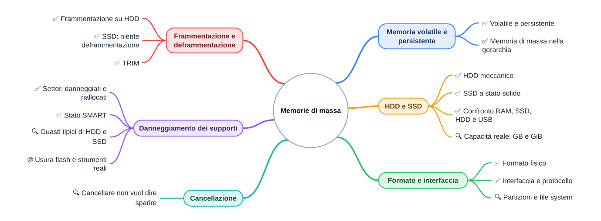

## 📜 Perché partire dal disco?

Immagina di voler installare un secondo sistema operativo sul tuo PC, per esempio Linux, oppure di accorgerti che il portatile impiega due minuti ad aprire una cartella. Prima di toccare qualsiasi cosa, devi sapere **dove vivono davvero i tuoi file** e perché un disco veloce può diventare lento o smettere di rispondere.

📜 Nel 1956 IBM presentò il **RAMAC 305**, il primo sistema commerciale con dischi magnetici: cinquanta piatti grandi come pizze giganti, chiusi in un armadio pesante quasi una tonnellata, per contenere circa 5 megabyte (cifra approssimativa). Oggi un SSD da 512 gigabyte sta su una schedina grande come un chewing gum. Il problema però è sempre lo stesso: <u>tenere i dati al sicuro anche quando togli la corrente, e leggerli senza far aspettare troppo il processore.</u>

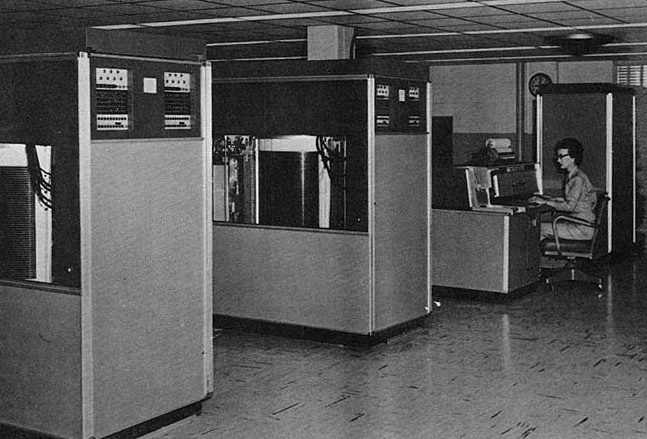

*L'IBM 305 RAMAC (1956): un intero armadio per appena 5 megabyte di memoria magnetica.*

In queste quattro lezioni useremo un filo comune: *come si prepara un PC per farci vivere un secondo sistema operativo come Linux*. Tutto parte da qui: conoscere il disco su cui stiamo lavorando.

---

## Memoria volatile e persistente

### ✅ Volatile e persistente

Prova questa scena. Stai scrivendo un file di testo senza salvarlo. Qualcuno stacca la spina del PC. Quando lo riaccendi, quel testo non c'è più. Le foto delle vacanze, invece, sono ancora lì. Che cosa cambia tra i due casi? Il posto in cui stavano i dati.

- **Memoria volatile:** conserva i dati solo finché c'è corrente elettrica. Esempio: la **RAM** del tuo PC o del tuo telefono. Quando spegni, si svuota.
- **Memoria persistente** (o non volatile): conserva i dati anche senza corrente. Esempio: l'**SSD**, l'**HDD**, la chiavetta USB.

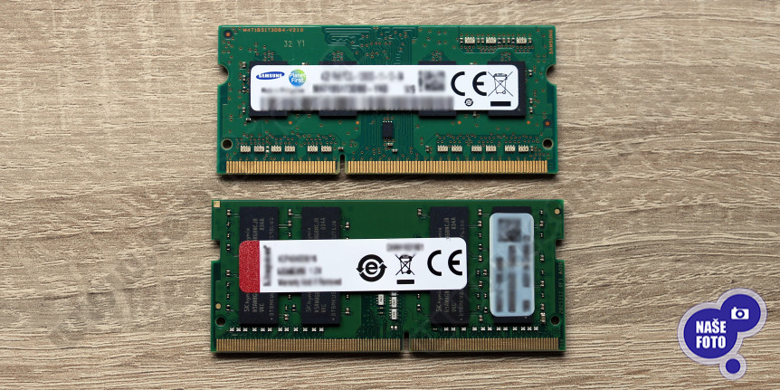

*Moduli di memoria **RAM** per PC fisso: velocissimi finché c'è corrente, ma vuoti appena spegni.*

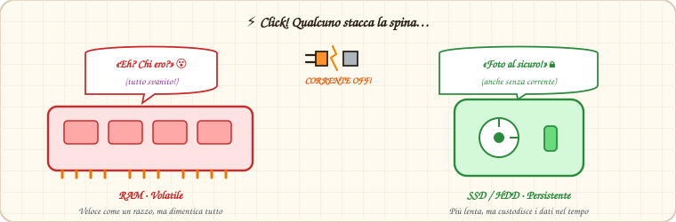

*Quando togli la corrente la **RAM** si svuota di colpo, mentre **SSD** e **HDD** tengono al sicuro file e sistema operativo.*

<details>
<summary>🃏 <b>Che cos'è la memoria volatile?</b></summary>
Una memoria che perde tutto quando manca la corrente, come la RAM.
</details>
<details>
<summary>🃏 <b>Fai un esempio di memoria persistente.</b></summary>
Un SSD, un HDD o la memoria flash del telefono: le foto restano anche a dispositivo spento.
</details>

✏️ **Classifica.** Scrivi accanto a ciascuno **V** (volatile) o **P** (persistente): RAM, SSD, cache L1 della CPU, chiavetta USB, HDD.

### ✅ Memoria di massa nella gerarchia

Nella [gerarchia delle memorie](../1%20SETT-OTT/%28STU%29%203EI%20sett-ott%20S5%20-%20Indirizzi%20e%20gerarchia%20delle%20memorie.md) di ottobre abbiamo visto registri, cache, RAM e, all'ultimo livello, la **memoria di massa**. È molto più capiente della RAM, costa molto meno per ogni gigabyte, ma è molto più lenta.

Quando apri un'app o un gioco, il sistema operativo lo copia dal disco alla RAM, perché la CPU lavora sulla RAM e non direttamente dal disco.

> 🧠 <u>Capacità, velocità e persistenza sono tre proprietà diverse.</u> La memoria di massa è grande, lenta e persistente; la RAM è più piccola, velocissima e volatile.

<details>
<summary>🃏 <b>Perché un programma viene copiato in RAM prima di essere eseguito?</b></summary>
Perché la CPU lavora sulla RAM, che è ordini di grandezza più veloce della memoria di massa.
</details>

---

## HDD e SSD

Sui PC e sui telefoni di oggi i dati persistenti vivono in due tecnologie diverse. Dietro le quinte del tuo dispositivo fanno lo stesso lavoro, ma in modi opposti.

### ✅ HDD meccanico

**HDD** (*Hard Disk Drive*, disco rigido): dentro la scatola di metallo ci sono piatti magnetici che girano velocemente e una testina montata su un braccetto che si sposta per leggere e scrivere. Nei PC fissi i piatti girano tipicamente a 7200 giri al minuto; trovare un dato richiede circa 5-10 millisecondi (valori tipici e approssimati).

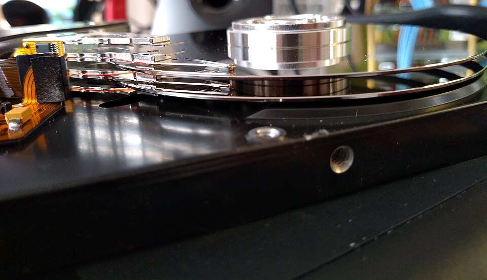

*Un HDD da 3,5 pollici aperto: i piatti magnetici girano e la testina si sposta sopra di essi senza toccarli.*

⚠️ **Errore comune:** «un HDD è una RAM lenta». No: è una tecnologia meccanica diversa, molto più lenta della RAM ma capace di tenere i dati senza corrente.

📽️ [Slow motion hard disk writing](https://youtu.be/3owqvmMf6No?si=qrn80CfzWayTfgp6)

<details>
<summary>🃏 <b>Che cosa si muove dentro un HDD?</b></summary>
I piatti magnetici che girano e il braccetto con la testina che si sposta sulla superficie.
</details>

### ✅ SSD a stato solido

**SSD** (*Solid-State Drive*, disco a stato solido): non ha nulla che gira o si muove. È fatto di chip di **memoria flash** (celle elettriche che intrappolano cariche anche senza corrente). Il tempo di accesso è dell'ordine di qualche decimo di millisecondo (valore tipico e approssimato): decine di volte più rapido di un HDD, e molto più resistente agli urti.

🛠️ **Sul tuo dispositivo:** su Windows apri Gestione attività (`Ctrl + Maiusc + Esc`) → scheda *Prestazioni* → *Disco*: vedi subito se hai un **SSD** o un **HDD** e quanta capacità ha. Su Android guarda in *Impostazioni → Archiviazione*.

✏️ **Prevedi, poi controlla.** Senza guardare la tabella qui sotto, metti in ordine dal più veloce al più lento: HDD, RAM, chiavetta USB, SSD. Poi verifica nella tabella.

📽️ [Come funziona una memoria flash](https://youtu.be/UQ5Api0a3nc?si=WpQs2S8WjIsgaKA1)

### ✅ Confronto RAM, SSD, HDD e USB

| Memoria | Persistente? | Capacità tipica | Tempo di accesso tipico |
|---|---|---|---|
| RAM | No | 8–16 GB | circa 0,0001 ms |
| SSD | Sì | 256 GB – 2 TB | circa 0,1 ms |
| HDD | Sì | 1–4 TB | circa 5–10 ms |
| Chiavetta USB | Sì | 16–128 GB | più lenta di un SSD, molto variabile |

*Valori tipici e approssimati (2026), utili solo come ordini di grandezza.*

<details>
<summary>🃏 <b>Qual è la differenza principale tra HDD e SSD?</b></summary>
L'HDD usa piatti rotanti e testine meccaniche; l'SSD usa celle flash senza parti mobili, quindi è più veloce e regge gli urti.
</details>

✴️ [Gemini: le chiavette USB sono memorie flash?](https://share.google/aimode/kLJ4JpGUwHafq6DHo)
 
### 🔍 Capacità reale: GB e GiB

Compri un SSD da **512 GB**, lo colleghi al PC e Windows dice **477 GB**. Nessuno ti ha truffato: sono due modi diversi di contare.

- I produttori di dischi usano il **GB** decimale: 1 GB = $10^9 = 1\,000\,000\,000$ byte.
- Il sistema operativo conta spesso a potenze di 2, usando il **GiB** (gibibyte): 1 GiB = $2^{30} = 1\,073\,741\,824$ byte.

🧪 **Conto reale:** $512\,000\,000\,000 \div 1\,073\,741\,824 \approx 476{,}8\text{ GiB}$. Lo spazio fisico è lo stesso, cambia l'unità di misura.

<details>
<summary>🃏 <b>Perché un SSD da 512 GB appare come circa 477 GB nel sistema operativo?</b></summary>
Perché il produttore conta a potenze di 1000 (GB), mentre molti sistemi operativi contano a potenze di 1024 (GiB).
</details>

---

## Formato e interfaccia

Quando apri un portatile o guardi la scheda tecnica di un PC, due parole vengono spesso confuse: **formato** e **interfaccia**.

### ✅ Formato fisico

Il **formato** è la forma e la dimensione fisica del disco:

- **3,5 pollici:** il formato grande degli HDD nei PC fissi.
- **2,5 pollici:** il formato più piccolo dei portatili (usato sia da HDD sia da molti SSD).
- **M.2:** una piccola schedina rettangolare che si avvita direttamente sulla scheda madre, senza cavi.

### ✅ Interfaccia e protocollo

L'**interfaccia** è il collegamento elettrico e il linguaggio con cui il disco parla alla scheda madre (richiamando i bus di ottobre).

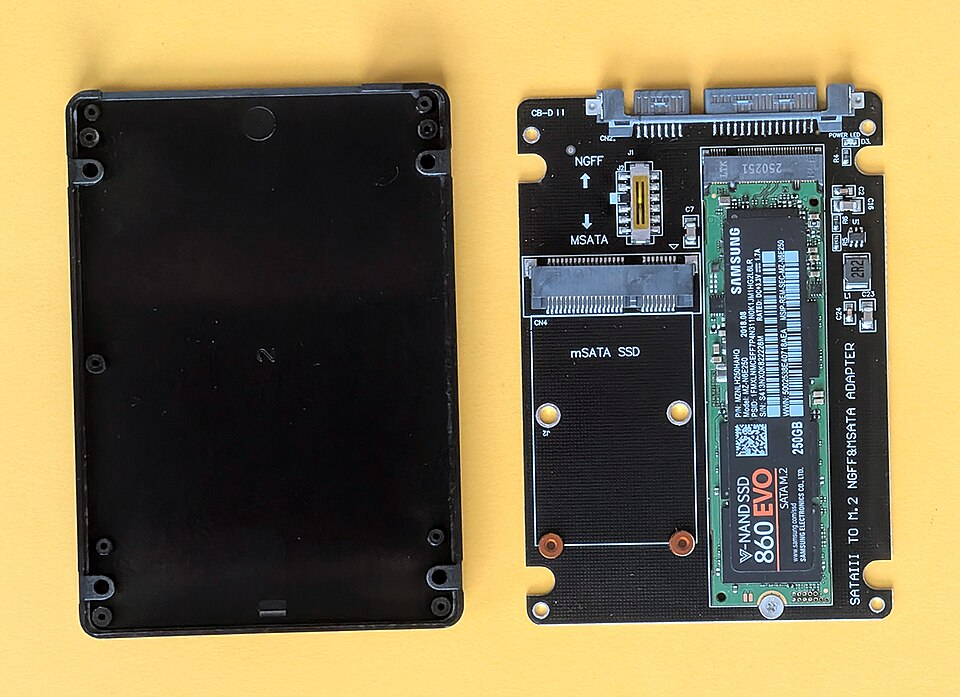

*Un SSD in formato M.2 montato su un adattatore: la forma fisica è M.2, ma qui l'interfaccia usata è SATA.*

| Interfaccia / Protocollo | Dove la trovi | Velocità tipica (ordine di grandezza) |
|---|---|---|
| **SATA** | Cavo piatto; dischi da 2,5" e 3,5", qualche M.2 | fino a circa 550 MB/s |
| **PCIe con NVMe** | Slot sulla scheda madre; SSD M.2 recenti | circa 3–7 GB/s nei modelli moderni |
| **USB** | Chiavette e dischi esterni | dipende dalla versione USB (da decine di MB/s a qualche GB/s) |

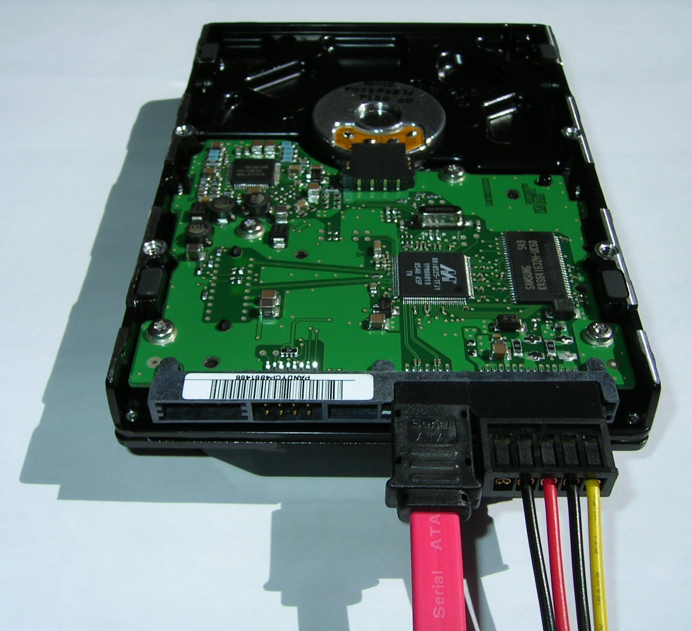

*Collegamento **SATA**: il cavo più stretto porta i dati, quello più largo porta l'alimentazione.*

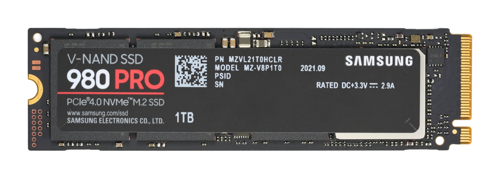

*Un **SSD M.2 NVMe**: si inserisce direttamente nello slot sulla scheda madre, senza cavi SATA.*

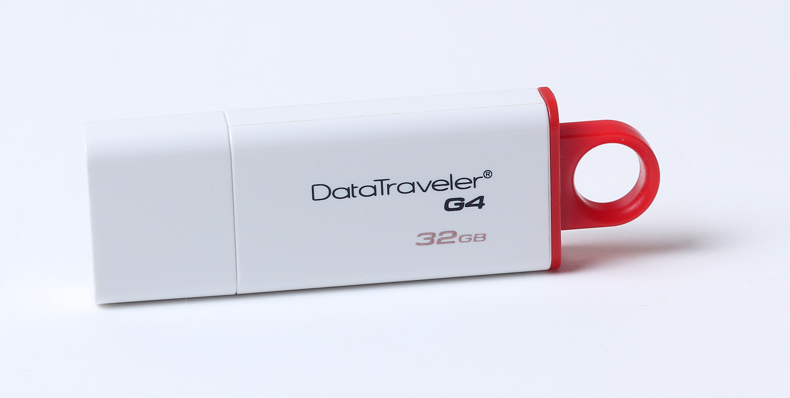

*Una **chiavetta USB**: memoria flash portatile pensata per spostare file fra dispositivi diversi.*

⚠️ **Errore comune:** «M.2 vuol dire NVMe». No: **M.2 è la forma**, **NVMe è il linguaggio** pensato per gli SSD veloci. Esistono anche SSD M.2 che parlano SATA e vanno molto più piano.

<details>
<summary>🃏 <b>Che differenza c'è fra formato e interfaccia di un disco?</b></summary>
Il formato è la forma fisica (es. M.2, 2,5"), l'interfaccia è il collegamento e il protocollo con cui parla alla scheda madre (es. SATA, PCIe/NVMe).
</details>

✏️ **Classifica.** Scrivi **F** (formato) o **I** (interfaccia/protocollo) accanto a: M.2, SATA, 3,5 pollici, NVMe, USB.

### 🔍 Partizioni e file system

Un disco nuovo è un'unica distesa di blocchi. Prima di metterci un sistema operativo, lo dividiamo logicamente:

- **Partizione:** una fetta del disco che il sistema vede come un disco separato. Immagina un magazzino diviso da un muro: l'edificio è uno solo, ma ci sono due stanze con porte diverse. *Limite della metafora:* il muro tra due partizioni è solo un'informazione scritta sul disco, si può spostare senza mattoni.
- **File system:** il «catalogo» dentro una partizione, cioè le regole che dicono dove sta ogni file, con nome, cartelle e permessi. Esempi reali: **NTFS** (Windows), **ext4** (molti Linux), **exFAT** e **FAT32** (chiavette USB).

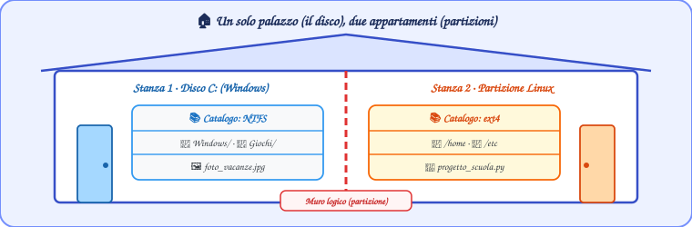

*Lo stesso disco fisico diviso in due **partizioni** (i contenitori), ciascuna con il proprio **file system** (il catalogo).*

⚠️ **Errore comune:** confondere partizione e file system. La partizione è il contenitore; il file system è il modo in cui sono ordinati i file dentro quel contenitore. Nella prossima dispensa useremo proprio le partizioni per capire come si avvia il PC e come si affianca Linux a Windows.

<details>
<summary>🃏 <b>Che differenza c'è fra partizione e file system?</b></summary>
La partizione è una fetta logica del disco; il file system è il catalogo che organizza i file e le cartelle dentro quella partizione.
</details>

🤓 **Come funziona un file system e perché ne esistono tanti.** Il file system funziona come l'indice di un libro: tiene una tabella nascosta dove annota nome del file, dimensione, permessi e numeri dei blocchi in cui il file è salvato sul disco. Non esiste un solo file system perché ogni dispositivo ha bisogni diversi: **FAT32** (nato nel 1996) è semplicissimo e funziona ovunque (TV, autoradio, fotocamere), ma ha un limite rigido di **4 GB** per singolo file; **exFAT** nasce per chiavette e schede SD moderne e toglie quel limite; **NTFS** (Windows) aggiunge permessi utente e un registro per non perdere dati se manca la corrente; **ext4** (Linux) gestisce bene i permessi Unix e riduce la frammentazione. *(Trivia: se copi un file da 5 GB su una chiavetta nuova da 64 GB e Windows dice «file troppo grande», quasi sempre la chiavetta è formattata in FAT32!)*

🤓 **Stili di partizione (MBR e GPT).** Prima ancora del file system, serve decidere *come* scrivere la mappa delle partizioni all'inizio del disco: lo schema storico **MBR** (anni '80) si ferma a 4 partizioni primarie e ~2 TB, mentre lo schema moderno **GPT** (*GUID Partition Table*) usa identificatori univoci (GUID), tiene una copia di riserva alla fine del disco e, per non farsi sovrascrivere dai vecchi programmi che non lo capiscono, mette nel primo settore un falso MBR (*Protective MBR*) che dichiara il disco «tutto occupato». Li vedremo nel dettaglio in [S2 - Dall'accensione al sistema operativo](./%28STU%29%203EI%20nov-dic%20S2%20-%20Dall%27accensione%20al%20sistema%20operativo.md).

---

## Frammentazione e deframmentazione

Perché un PC con un vecchio HDD, dopo mesi di utilizzo, diventa lento ad aprire i file anche se ha spazio libero? Succede per colpa della **frammentazione**.

### ✅ Frammentazione su HDD

Quando salvi, modifichi e cancelli file ogni giorno, sul disco si creano buchi liberi sparsi. Se salvi un file nuovo più grande di un singolo buco, il sistema operativo lo spezza in più parti e le mette dove trova spazio. Quel file è **frammentato**.

Su un **HDD** questo costa caro: per leggere un solo file, la testina meccanica deve spostarsi in più punti diversi del piatto e aspettare che il piatto giri sotto di lei.

La **deframmentazione** è l'operazione con cui un programma riordina i pezzi dei file per metterli uno accanto all'altro, in modo che la testina possa leggerli in una sola passata.

🧪 **Analogia.** Immagina un libro i cui capitoli sono stati sparsi su dieci scaffali diversi della biblioteca: per leggerlo perdi più tempo a camminare che a leggere. Deframmentare rimette tutti i capitoli sullo stesso scaffale.

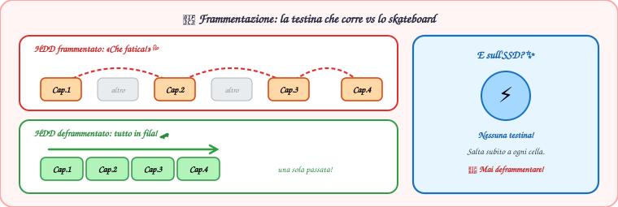

*Su HDD riordinare i pezzi evita alla testina di saltare avanti e indietro; su SSD invece non serve.*

📽️ **Video di esempio**:
[Deframmentazione visualizzata](https://www.youtube.com/watch?v=DsX6d_VvGR4)
[Frammentazione e deframmentazione](https://youtu.be/0QUvYwNaeFs?si=4zTLSaoGPJrl1nnG)

<details>
<summary>🃏 <b>Che cos'è la frammentazione di un file?</b></summary>
È la situazione in cui un file è salvato in pezzi sparsi in punti diversi del disco invece che in blocchi contigui.
</details>
<details>
<summary>🃏 <b>Perché la frammentazione rallenta un HDD?</b></summary>
Perché la testina meccanica deve spostarsi più volte in punti lontani del piatto per leggere tutti i pezzi del file.
</details>


### ✅ SSD: niente deframmentazione

Su un **SSD** non c'è nessuna testina che si sposta: leggere la cella 1000 o la cella 9 milioni costa esattamente lo stesso tempo. <u>Quindi su un SSD la frammentazione non rallenta quasi per nulla la lettura, e deframmentare non serve.</u>

Anzi, <u>deframmentare un SSD fa danno</u>: per spostare i file in ordine, il programma riscrive gigabyte di dati. Le celle della memoria flash reggono un numero finito di scritture, quindi deframmentare consuma inutilmente il disco.

⚠️ **Errore comune:** «ho il PC lento, lancio la deframmentazione sull'SSD». Non farlo: per fortuna Windows e Linux moderni riconoscono l'SSD e impediscono la deframmentazione classica.

<details>
<summary>🃏 <b>Perché non si deve deframmentare un SSD?</b></summary>
Perché non ha testine mobili (quindi non guadagna velocità) e le scritture inutili consumano le celle flash.
</details>

### ✅ TRIM

Al posto della deframmentazione, gli SSD usano un comando chiamato **TRIM**.

Per capire a che cosa serve, bisogna sapere una regola fisica della memoria **flash**: su un HDD puoi sovrascrivere subito un vecchio blocco con dati nuovi; su un SSD, invece, una cella già scritta **non può essere riscritta al volo**. Prima deve essere **svuotata (azzerata)**, e la flash può svuotare solo un intero blocco grande alla volta — un'operazione molto più lenta della scrittura.

Quando cancelli un file dal Cestino, il sistema operativo toglie solo il nome dal catalogo: l'SSD da solo non sa che quei blocchi sono ormai inutili. Senza TRIM, quando dovrai salvare un nuovo file l'SSD scoprirà solo all'ultimo momento che il blocco è ancora «sporco», dovrà svuotarlo al volo e poi scrivere: risultato, l'SSD rallenta. Con **TRIM**, invece, il sistema operativo avvisa subito il controllore dell'SSD: *«questi blocchi non servono più, puoi svuotarli in anticipo mentre il PC riposa»*. Così le celle sono già pulite e pronte per scrivere a piena velocità.

🛠️ **Sul tuo dispositivo:** su Windows cerca nel menu Start **Deframmenta e ottimizza unità**. Vedrai i tuoi dischi: su un HDD il pulsante esegue la deframmentazione; su un SSD esegue l'**ottimizzazione**, cioè lancia il comando TRIM.

✏️ **Prevedi.** Un file da 2 GB è spezzato in 1500 frammenti. Su quale disco noterai un rallentamento evidente in apertura: HDD o SSD? Spiega in due righe il motivo.

<details>
<summary>🃏 <b>Che cosa fa il comando TRIM su un SSD?</b></summary>
Informa il controllore dell'SSD quali blocchi sono stati cancellati dal sistema operativo, così può svuotarli in anticipo invece di farlo al momento di una nuova scrittura.
</details>

---

## Danneggiamento dei supporti

I dischi non sono eterni. Prima di affidare a un disco un intero sistema operativo (o le tue foto), conviene sapere come si guastano e come ci avvisano.

### ✅ Settori danneggiati e riallocati

Un disco è diviso in piccoli blocchi chiamati **settori** (tipicamente da 512 byte o 4096 byte). Un **settore danneggiato** (*bad sector*) è un settore che il disco non riesce più a leggere correttamente. Può essere di due tipi:

- **Danno fisico (*hard bad sector*):** la superficie magnetica del piatto si è graffiata oppure una cella flash è esaurita. Non si ripara.
- **Danno logico (*soft bad sector*):** il settore non è rotto fisicamente, ma i dati scritti dentro sono stati corrotti (per esempio perché è mancata la corrente mentre il PC stava scrivendo). Riscrivendolo, torna utilizzabile.


*Danno **hard** (supporto rotto, non si ripara) contro danno **soft** (solo dati corrotti, riscrivibile).*

I dischi moderni hanno una piccola scorta di **settori di riserva** nascosti. Quando il controllore del disco si accorge che un settore fisico sta fallendo, copia i dati salvabili in un settore di riserva e segna quello vecchio come inutilizzabile: questo si chiama **settore riallocato**. Il sistema operativo non vede nulla, finché i settori di riserva non finiscono.

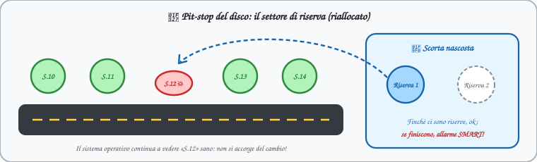

*Il controllore sposta i dati dal settore difettoso a uno dei settori di riserva nascosti: il sistema operativo continua a lavorare senza accorgersene.*

<details>
<summary>🃏 <b>Che differenza c'è fra un settore danneggiato fisico e uno logico?</b></summary>
Quello fisico è un danno permanente del supporto; quello logico è una corruzione dei dati che spesso si risolve riscrivendo il settore.
</details>
<details>
<summary>🃏 <b>Che cos'è un settore riallocato?</b></summary>
Un settore difettoso che il disco ha sostituito automaticamente usando uno dei suoi settori di riserva.
</details>

### ✅ Stato SMART

**SMART** (*Self-Monitoring, Analysis and Reporting Technology*) è il sistema di autodiagnosi integrato dentro quasi tutti gli HDD e SSD moderni. Il disco tiene un registro di contatori interni: ore di accensione, temperatura, errori di lettura, numero di settori riallocati.

Quando un contatore critico supera una soglia di sicurezza, lo stato SMART segnala un pericolo. È il momento di **copiare subito i dati altrove**, prima che il disco muoia del tutto.

⚠️ **Limite importante:** SMART aiuta a cogliere segnali di allarme, ma non è infallibile. Molti dischi si rompono all'improvviso senza aver mai dato un avviso SMART. <u>L'unica vera protezione resta la copia di sicurezza (backup).</u>

🛠️ **Sul tuo dispositivo (Windows, sola lettura):** puoi controllare lo stato di salute senza installare nulla in due modi:
- **Via grafica:** apri *Impostazioni → Sistema → Archiviazione → Impostazioni di archiviazione avanzate → Dischi e volumi*, poi clicca su **Proprietà** del tuo disco (su SSD NVMe mostra anche la salute stimata e la temperatura).
- **Da PowerShell:** esegui il comando qui sotto

  ```
  Get-PhysicalDisk | Select FriendlyName, MediaType, HealthStatus, OperationalStatus
  ``` 

se leggi `Healthy` e `OK`, i controlli base non segnalano allarmi.

<details>
<summary>🃏 <b>Che cosa fa il sistema SMART di un disco?</b></summary>
Raccoglie statistiche interne di salute del disco (errori, temperatura, settori riallocati) per avvisare prima di un guasto grave.
</details>

### 🔍 Guasti tipici di HDD e SSD

- **HDD:** essendo meccanico, soffre gli urti (soprattutto mentre è acceso!). Se la testina tocca il piatto (*head crash*), graffia lo strato magnetico. Un segnale classico di guasto meccanico è un ticchettio ripetuto chiamato *click of death*: la testina prova a leggere, fallisce, torna a zero e riprova all'infinito.
- **SSD:** non teme gli urti fisici, ma le sue celle flash si consumano dopo migliaia di cicli di scrittura. Quando un SSD arriva a fine vita, molti modelli passano in **sola lettura**: puoi ancora copiare via i file, ma non puoi più scrivere nulla.

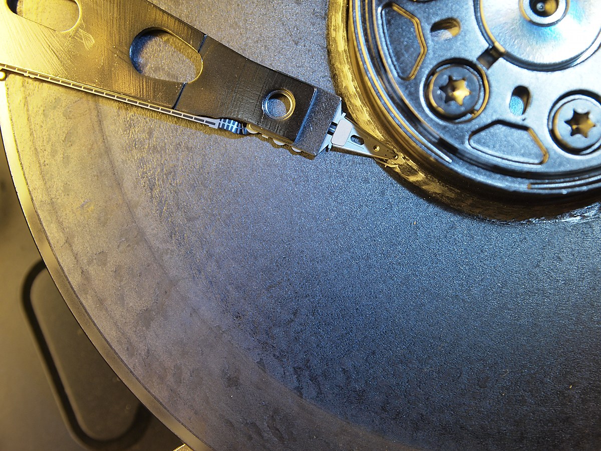

*Un piatto HDD rovinato da un **head crash**: il solco circolare è il punto in cui la testina ha toccato la superficie magnetica.*

✏️ **Diagnosi rapida.** Associa ogni sintomo alla causa più probabile (*frammentazione*, *settore danneggiato*, *guasto meccanico HDD*): (a) il PC fa «clic-clic-clic» ritmico e non si avvia; (b) un singolo video scaricato dà errore di lettura, gli altri file vanno bene; (c) un vecchio HDD impiega un minuto ad aprire una cartella piena di foto.

### 🤓 Usura flash e strumenti reali

Per evitare che poche celle molto usate (come quelle del catalogo dei file) si brucino prima delle altre, il controllore dell'SSD sparge le scritture in modo uniforme su tutta la memoria: questa tecnica si chiama **wear leveling** («livellamento dell'usura»).

Se vuoi vedere con i tuoi occhi i valori SMART del tuo PC, esistono strumenti gratuiti come **CrystalDiskInfo** (su Windows, con un semaforo verde/giallo/rosso) o **smartctl** (da riga di comando su Linux e Windows). Inoltre, aziende come [Backblaze](https://www.backblaze.com/cloud-storage/resources/hard-drive-test-data) pubblicano ogni anno statistiche reali sui tassi di guasto di decine di migliaia di dischi nei loro data center: guarda le tabelle annuali per vedere quanto spesso e dopo quanti anni i dischi si rompono davvero.

---

## Cancellazione

### 🔍 Cancellare non vuol dire sparire

Quando sposti un file nel Cestino e lo svuoti, di solito il sistema operativo non cancella davvero tutti i byte dal disco: toglie soltanto la riga dal **catalogo** (il file system) e segna quei blocchi come «liberi». I dati restano lì finché un altro file non li sovrascrive.

Per questo motivo, con programmi appositi di recupero dati, spesso si riescono a recuperare file cancellati per errore — a patto di non continuare a scrivere sul disco. Su un SSD con **TRIM** attivo, però, il recupero diventa molto più difficile, perché il controllore azzera i blocchi liberi in fretta.

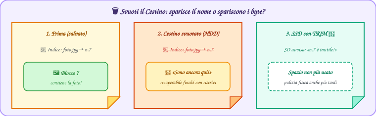

*Svuotare il Cestino toglie la riga dal catalogo: su HDD i byte restano sul piatto finché non riscrivi, su SSD con TRIM il controllore li azzera in anticipo.*

✏️ **Prevedi.** Cancelli per sbaglio una cartella di foto dal Cestino e non salvi più nulla sul disco. Hai più probabilità di recuperarla su un **HDD** o su un **SSD moderno con TRIM attivo**? Spiega il perché in due righe.

<details>
<summary>🃏 <b>Che cosa succede davvero ai dati quando svuoti il Cestino su un HDD rispetto a un SSD con TRIM?</b></summary>
Il file system toglie la voce dal catalogo: su HDD i byte restano recuperabili finché non vengono sovrascritti, mentre su SSD il comando TRIM fa svuotare i blocchi in anticipo.
</details>

> 🧠 <u>Tutto ha un compromesso:</u> l'HDD offre tanta capacità a basso prezzo, ma è lento, meccanico e soffre la frammentazione; l'SSD è veloce e silenzioso, ma costa di più per gigabyte e le sue celle si consumano con le scritture. Nessuno dei due è eterno: il backup serve sempre.

---

## 🚪 Uscita

Completa a voce o su carta senza guardare, poi verifica con le flashcard qui sotto:
1. ✏️ La RAM è \_\_\_ perché \_\_\_; l'SSD è \_\_\_ perché \_\_\_.
2. ✏️ Su un SSD non si deframmenta perché \_\_\_; invece il sistema usa \_\_\_ per \_\_\_.
3. ✏️ Un disco `M.2 SATA` usa il formato \_\_\_ e l'interfaccia \_\_\_; se senti un *clic-clic* continuo da un HDD probabilmente è \_\_\_.

<details>
<summary>🃏 <b>Verifica uscita 1 — RAM contro SSD</b></summary>
La RAM è volatile perché perde i dati senza corrente; l'SSD è persistente perché conserva i dati anche a dispositivo spento.
</details>
<details>
<summary>🃏 <b>Verifica uscita 2 — SSD e TRIM</b></summary>
Su un SSD non si deframmenta perché non ci sono testine mobili e le scritture inutili consumano le celle flash; invece il sistema usa TRIM per avvisare l'SSD di svuotare i blocchi cancellati in anticipo.
</details>
<details>
<summary>🃏 <b>Verifica uscita 3 — Formato, interfaccia e guasti</b></summary>
Un disco M.2 SATA usa il formato M.2 e l'interfaccia SATA; il ticchettio continuo su un HDD indica quasi sempre un guasto meccanico alla testina (click of death).
</details>

---

## 📚 Fonti e risorse

- [MyTekDev](https://mytekdev.com/tools/pc-workshop) - Assembla il tuo computer ("giochino" 3D)
- [PC anatomy](https://pc-anatomy.com/) - Atlante di anatomia di un computer
- [Frammentazione (informatica) — Wikipedia IT](https://it.wikipedia.org/wiki/Frammentazione_(informatica)) e [Deframmentazione — Wikipedia IT](https://it.wikipedia.org/wiki/Deframmentazione): perché i file si spezzano e come funziona la deframmentazione.
- [TRIM — Wikipedia IT](https://it.wikipedia.org/wiki/TRIM): a cosa serve TRIM sugli SSD.
- [Bad sector — Wikipedia EN](https://en.wikipedia.org/wiki/Bad_sector): differenza fra danni fisici (*hard*) e logici (*soft*), e settori riallocati.
- [S.M.A.R.T. — Wikipedia IT](https://it.wikipedia.org/wiki/S.M.A.R.T.): l'autodiagnosi dei dischi.
- [Hard disk drive failure — Wikipedia EN](https://en.wikipedia.org/wiki/Hard_disk_drive_failure) e [Click of death — Wikipedia EN](https://en.wikipedia.org/wiki/Click_of_death): guasti tipici dei dischi meccanici.
- [Wear leveling — Wikipedia EN](https://en.wikipedia.org/wiki/Wear_leveling): come gli SSD distribuiscono l'usura delle celle.
- [Hard Drive Test Data — Backblaze](https://www.backblaze.com/cloud-storage/resources/hard-drive-test-data) (in inglese, 🤓): statistiche reali di guasto su decine di migliaia di dischi.
- Immagine HDD: «3.5 inch hard disk drive, side view» di Gunnar Wolf, [CC BY-SA 4.0](https://creativecommons.org/licenses/by-sa/4.0), [Wikimedia Commons](https://commons.wikimedia.org/wiki/File:3.5_inch_hard_disk_drive,_side_view.jpg).
- Immagine SSD M.2: «Dual SSD SATA adapter with Samsung 860 EVO SSD and 2.5-inch enclosure» di Siarhei Besarab, [CC BY-SA 4.0](https://creativecommons.org/licenses/by-sa/4.0), [Wikimedia Commons](https://commons.wikimedia.org/wiki/File:Dual_SSD_SATA_adapter_with_Samsung_860_EVO_SSD_and_2.5-inch_enclosure.jpg).
- Immagine SATA: «Serial ATA hard disk connected» di Thomas Rosenau (User:Pumbaa80), [CC BY-SA 2.5](https://creativecommons.org/licenses/by-sa/2.5), [Wikimedia Commons](https://commons.wikimedia.org/wiki/File:Serial_ATA_hard_disk_connected.jpg).
- Immagine SSD M.2 NVMe: «Samsung 980 PRO PCIe 4.0 NVMe SSD 1TB» di D-Kuru, [CC BY-SA 4.0](https://creativecommons.org/licenses/by-sa/4.0), [Wikimedia Commons](https://commons.wikimedia.org/wiki/File:Samsung_980_PRO_PCIe_4.0_NVMe_SSD_1TB-top_PNr%C2%B00915.jpg).
- Immagine chiavetta USB: «Kingston Technology DataTraveler G4 USB flash drive USB 3.0 32 Gb» di Dmitry Makeev, [CC BY-SA 4.0](https://creativecommons.org/licenses/by-sa/4.0), [Wikimedia Commons](https://commons.wikimedia.org/wiki/File:Kingston_Technology_DataTraveler_G4_USB_flash_drive_USB_3.0_32_Gb.jpg).
- Immagine IBM 305 RAMAC: «BRL61-IBM 305 RAMAC», dominio pubblico, [Wikimedia Commons](https://commons.wikimedia.org/wiki/File:BRL61-IBM_305_RAMAC.jpeg).
- Immagine moduli RAM: «Ddr3-vs-ddr4-cl-02» di Klavesakm, [CC BY-SA 4.0](https://creativecommons.org/licenses/by-sa/4.0), [Wikimedia Commons](https://commons.wikimedia.org/wiki/File:Ddr3-vs-ddr4-cl-02.jpg).
- Schema cancellazione e TRIM: schema originale per questa dispensa (`Allegati/s1-cancellazione-trim.svg`).
- Schema settori danneggiati e riallocati: schema originale per questa dispensa (`Allegati/s1-settori-riallocati.svg`).
- Altri schemi originali in stile Excalidraw: `Allegati/s1-volatile-vs-persistente.svg`, `Allegati/s1-partizioni-filesystem.svg`, `Allegati/s1-frammentazione-hdd-ssd.svg`, `Allegati/s1-hard-vs-soft-bad-sector.svg`.
- Immagine head crash HDD: «Hard disk failure» di Piksi, [CC BY-SA 3.0](https://creativecommons.org/licenses/by-sa/3.0), [Wikimedia Commons](https://commons.wikimedia.org/wiki/File:Hard_disk_failure.jpeg).

---

🏠 [Indice](../README.md) · [S2 - Dall'accensione al sistema operativo](./%28STU%29%203EI%20nov-dic%20S2%20-%20Dall%27accensione%20al%20sistema%20operativo.md) ➡️
