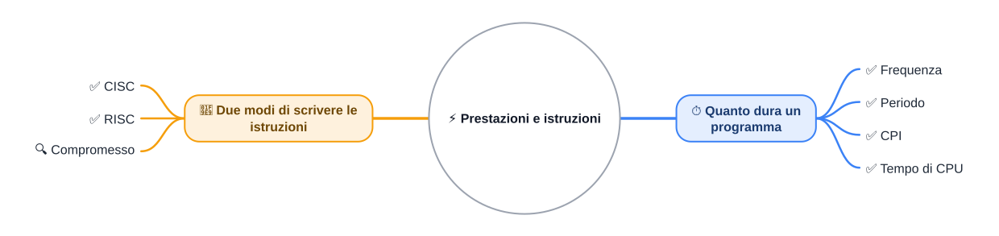
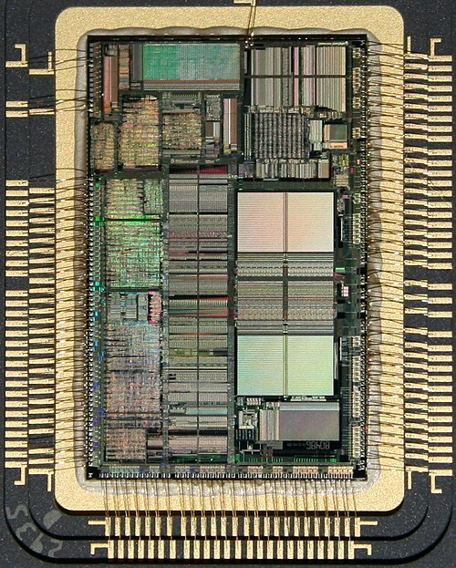

🏠 [Indice](../README.md) · [S2](./%28STU%29%203EI%20nov-dic%20S2%20-%20Pipelining.md) ➡️

# ⚡ Prestazioni e istruzioni

**3EI · Novembre-Dicembre · S1 · Teoria**

⏱️ **Tempo di studio stimato:** 35-45 minuti. Comprende lettura e ✏️; i 🤓 si possono saltare.

> **Legenda:** ✅ da sapere · 🔍 per capire fino in fondo · 🤓 facoltativo, per curiosi · 📜 storia · 🧪 esempio · ⚙️ tecnica · 🧠 da ricordare · ✏️ da fare · ⚠️ errore comune · 🚪 uscita · 🔁 ripasso · 🃏 flashcard: rispondi a voce, poi apri per controllare

🔁 **Ripasso da ottobre:** [S4 - Il ciclo macchina](../1%20SETT-OTT/%28STU%29%203EI%20sett-ott%20S4%20-%20Il%20ciclo%20macchina.md) e [S6 - Cache localita e clock](../1%20SETT-OTT/%28STU%29%203EI%20sett-ott%20S6%20-%20Cache%20localita%20e%20clock.md).

## 📜 Fare prima: perché ci interessa?

Nel 1804 il tessitore francese Joseph Marie Jacquard collegò il disegno di un tessuto a schede di cartone forate: ogni foro era un ordine per il telaio. Cambiare schede significava cambiare tessuto, senza rifare la macchina. Da allora la domanda non è più soltanto *quale* lavoro far fare a una macchina, ma *quanto in fretta* lo fa.

Ogni processore che hai in tasca risolve ogni giorno la stessa domanda: quanto tempo serve per fare quello che gli chiedi? Quando il telefono rallenta, a pagare il prezzo sei tu, che aspetti.

Fare prima dipende da due cose: <u>quanto lavoro c'è nel programma, e quanto del tempo di ogni passo viene sprecato</u>. Non esiste un numero magico che misuri la velocità.

Negli anni Sessanta IBM lanciò la famiglia System/360: macchine diverse, ma capaci di eseguire lo stesso insieme di istruzioni. Il software poteva passare da una all'altra. Intanto, fra la fine degli anni Settanta e gli anni Ottanta, alcuni laboratori universitari provarono la strada opposta: poche istruzioni molto semplici. Le date sono approssimate, come spesso accade con la storia dei calcolatori.

## ⏱️ Il tempo di un programma

### ✅ Frequenza e periodo

Il processore ha un **orologio interno** (in inglese *clock*): genera impulsi regolari che scandiscono il lavoro. Ogni impulso è un **ciclo di clock**, o semplicemente ciclo. La **frequenza** è quanti cicli avvengono in un secondo; si misura in hertz (Hz). <u>1 GHz significa 1 miliardo di cicli al secondo.</u>

Il **periodo** è la durata di un ciclo: 1 diviso per la frequenza.

🧪 Un processore a 2 GHz compie 2 miliardi di cicli al secondo. Ogni ciclo dura 1 / (2 × 10⁹) secondi, cioè 0,5 nanosecondi (mezzo miliardesimo di secondo).

Valori tipici e approssimati: il processore di un telefono recente lavora spesso fra 2 e 3,5 GHz. Per il tuo PC: su Windows, in Gestione attività → Prestazioni → CPU, la velocità è indicata in GHz. Sul telefono la frequenza si trova di solito nella scheda tecnica del produttore, come valore massimo.

> ⚠️ La frequenza dice quanti cicli al secondo, non quante istruzioni al secondo. Il numero di cicli per istruzione è una storia diversa, che arriva fra poco.

🃏 <b>Che cosa misura la frequenza di un processore?</b>

Quanti cicli di clock compie in un secondo. 3 GHz significa 3 miliardi di cicli al secondo.

🃏 <b>Che cosa è il periodo di clock?</b>

La durata di un ciclo, cioè 1 diviso la frequenza. A 2 GHz un ciclo dura 0,5 nanosecondi.

🃏 <b>Una frequenza più alta dà un periodo più lungo o più corto?</b>

Più corto: i cicli sono più fitti nel tempo.

### ✅ CPI: cicli per istruzione

Una istruzione non sempre richiede lo stesso numero di cicli. Il **CPI** (*Cycles Per Instruction*, cicli per istruzione) è il numero medio di cicli che un programma impiega per ogni istruzione.

🧪 Valori inventati per l'esempio: `ADD` richiede 1 ciclo, `LOAD` (che legge dalla memoria) ne richiede 4. Un programma con 3 `ADD` e 2 `LOAD` usa 3 × 1 + 2 × 4 = 11 cicli per 5 istruzioni. Il suo CPI medio è 11 / 5 = 2,2.

<u>Il CPI non dipende solo dal processore: dipende anche dalle istruzioni che il programma usa.</u>

🃏 <b>Che cosa significa CPI?</b>

Cycles Per Instruction: il numero medio di cicli per istruzione. Nell'esempio, 11 cicli su 5 istruzioni danno 2,2.

🃏 <b>Il CPI dipende solo dal processore?</b>

No. Dipende anche dal mix di istruzioni che il programma usa, come una media su un gruppo di istruzioni diverse.

✏️ **Da fare:** un programma ha 4 `ADD` da 1 ciclo e 1 `STORE` da 3 cicli (valori inventati). Prevedi se il suo CPI medio sarà sopra o sotto 2, poi calcolalo.

### ✅ Tempo di CPU: la formula

Il **tempo di CPU** è il tempo che il processore impiega per eseguire un programma. Si calcola così:

`Tempo di CPU = Numero di istruzioni × CPI ÷ Frequenza`

Le unità si semplificano: istruzioni × cicli per istruzione ÷ cicli al secondo lascia **secondi**. Una formula con tre fattori: quante istruzioni, quanti cicli per istruzione, quanti cicli al secondo.

🧪 Stesso programma, valori inventati: 1 miliardo di istruzioni (10⁹), CPI 2, frequenza 2 GHz.
Tempo = 10⁹ × 2 / (2 × 10⁹) = **1 secondo**.

<u>Il tempo di CPU appartiene a un programma: un processore, da solo, non ha un tempo unico.</u>

> 🧠 Per accorciare il tempo hai tre leve: meno istruzioni, meno cicli per istruzione, più cicli al secondo. Ogni leva ha un prezzo. Alzare la frequenza fa salire consumi e calore; ridurre i cicli richiede un progetto più raffinato.

🃏 <b>Qual è la formula del tempo di CPU?</b>

Numero di istruzioni × CPI ÷ frequenza. Le unità si semplificano e il risultato è in secondi.

🃏 <b>Un processore con più GHz è sempre più veloce?</b>

No: conta anche il CPI. Esempio: 3 GHz con CPI 4 può essere più lento di 2 GHz con CPI 2.

### 🔍 Confrontare due processori

🧪 Stesso programma, 1 miliardo di istruzioni (valori inventati):

| Processore | Frequenza | CPI | Tempo di CPU |
| ---------- | --------- | --- | ------------ |
| A          | 3 GHz     | 4   | circa 1,33 s |
| B          | 2 GHz     | 2   | 1 s          |

Il processore B è più veloce, pur avendo la frequenza più bassa. <u>Chi guarda solo i GHz sbaglia confronto.</u>

Il confronto vale solo a parità di programma: cambiando programma cambiano il numero di istruzioni e il loro mix, quindi anche il CPI.

🃏 <b>Quando un confronto di prestazioni è valido?</b>

Quando il programma è lo stesso: serve la stessa quantità di lavoro da svolgere su entrambi.

🃏 <b>Se il CPI si dimezza e la frequenza resta uguale, come cambia il tempo di CPU?</b>

Si dimezza, a parità di programma. Per esempio, passando da 2 a 1 ciclo per istruzione.

✏️ **Da fare:** il processore C ha frequenza 2,5 GHz e CPI 1,5, sullo stesso programma da 10⁹ istruzioni. Prevedi se batte B, poi calcola il tempo di CPU.

## 🧩 CISC e RISC: due modi di scrivere le istruzioni

### ✅ Istruzioni potenti o istruzioni semplici

Il **set di istruzioni** (in inglese *instruction set*) è l'elenco dei comandi che un processore sa eseguire, come `ADD` (somma) e `LOAD` (leggi dalla memoria). Quanti e quali comandi includere è una scelta di progetto.

Il problema è semplice. Se ogni istruzione fa molto, il programma è corto ma il processore è complicato. Se ogni istruzione fa poco, il processore è semplice ma servono più istruzioni.

- **CISC** (*Complex Instruction Set Computer*): istruzioni potenti, che possono leggere dalla memoria, calcolare e riscrivere in un colpo solo.
- **RISC** (*Reduced Instruction Set Computer*): istruzioni semplici; per usare la memoria si usano solo `LOAD` (leggi) e `STORE` (scrivi).

🧪 Il lavoro: aumentare di 2 il valore nella cella 20, usando `R2` come valore da sommare.

- In stile CISC: `ADD [20], R2`, una sola istruzione.
- In stile RISC: `LOAD R1, [20]`, poi `ADD R1, R1, R2`, poi `STORE [20], R1`: tre istruzioni.

<u>Stesso lavoro, due strade: il CISC ne usa meno, il RISC ne usa di più, ma più semplici.</u>

*Un Intel 80486 aperto, circa 1990: un processore CISC della famiglia x86. Al centro il chip con i circuiti; intorno, contenitore e collegamenti.*

🃏 <b>Che cosa significa CISC?</b>

Complex Instruction Set Computer: istruzioni potenti, anche con accesso alla memoria. Esempio: `ADD [20], R2` fa tutto in una istruzione.

🃏 <b>Che cosa significa RISC?</b>

Reduced Instruction Set Computer: istruzioni semplici. La memoria si usa solo con `LOAD` e `STORE`.

🃏 <b>Quante istruzioni RISC servono per il lavoro «aggiungi 2 alla cella 20»?</b>

Tre: `LOAD`, `ADD` e `STORE`.

🃏 <b>Un CISC è sempre più veloce di un RISC?</b>

No. Meno istruzioni non vuol dire sempre meno cicli: conta il processore reale e il lavoro da svolgere.

✏️ **Da fare:** riscrivi in stile RISC l'istruzione `ADD [30], R4`, che aggiunge R4 alla cella 30. Elenca le istruzioni, poi conta quante ne servono.

### 🔍 Il prezzo di ogni scelta

| Aspetto                          | CISC                                | RISC                                  |
| -------------------------------- | ----------------------------------- | ------------------------------------- |
| Istruzioni per programma         | meno                                | più                                   |
| Complessità di una istruzione    | alta                                | bassa                                 |
| Tempo per istruzione             | più vario                           | di solito più regolare                |
| Lunghezza delle istruzioni       | spesso variabile                    | spesso fissa                          |
| Esempi storici                   | famiglia x86 (Intel, AMD)           | famiglia ARM, MIPS, SPARC             |

Le istruzioni RISC hanno spesso tutte la stessa lunghezza: il processore sa dove inizia la successiva senza doverla decifrare tutta. Questo aiuta a far lavorare più istruzioni insieme, come vedremo nella prossima dispensa.

> ⚠️ Errore comune: «RISC = un'istruzione per ciclo». Non è una regola. Il numero di cicli dipende dal processore e dall'istruzione.

> 🧠 Il CISC risparmia istruzioni e complica il processore; il RISC semplifica il processore e allunga i programmi. Nessuna delle due soluzioni è gratis.

🃏 <b>Perché le istruzioni RISC hanno spesso la stessa lunghezza?</b>

Così il processore trova subito dove inizia la successiva. Facilita il lavoro a catena della pipeline, di cui parleremo nella prossima dispensa.

🃏 <b>Quale delle due scelte produce programmi più lunghi?</b>

Il RISC: lo stesso lavoro richiede più istruzioni, ciascuna però semplice.

✏️ **Da fare:** in una frase, spiega perché un CISC rende più corto il programma, ma più difficile la vita al decoder, cioè alla parte del processore che legge le istruzioni.

### 🤓 CISC e RISC oggi

> Un processore x86 moderno traduce al volo le sue istruzioni complesse in passi interni più semplici, quasi come un RISC dentro un CISC. Anche la famiglia ARM, nata come RISC, ha oggi molte istruzioni: alcuni Mac recenti la usano. Quindi «telefono = RISC, PC = CISC» è una scorciatoia storica, con molte eccezioni.
>
> Negli anni Ottanta i progetti universitari di Berkeley (RISC) e Stanford (MIPS) portarono l'idea RISC fuori dai laboratori. Il dibattito fra le due famiglie non si è chiuso con un vincitore: si è trasformato in una ricerca di equilibrio.

## 🧠 In sintesi

> 🧠 Fare prima dipende dal lavoro, dai cicli che ogni istruzione richiede e dai cicli al secondo: tre leve con un prezzo ciascuna. CISC e RISC sono due risposte a un solo problema: quante cose deve fare una istruzione?

🚪 **Uscita:** scrivi una frase con «CPI» e una con «frequenza», senza usare la parola «veloce».

## 📚 Fonti e risorse

- [Clock rate - Wikipedia](https://en.wikipedia.org/wiki/Clock_rate) (in inglese): frequenza e cicli di clock, con una panoramica storica. Leggi la parte iniziale.
- [Cycles per instruction - Wikipedia](https://en.wikipedia.org/wiki/Cycles_per_instruction) (in inglese): il CPI e il suo uso nei confronti. Osserva come cambia con il programma.
- [Complex instruction set computer - Wikipedia](https://en.wikipedia.org/wiki/Complex_instruction_set_computer) (in inglese): la filosofia CISC e gli esempi storici.
- [Reduced instruction set computer - Wikipedia](https://en.wikipedia.org/wiki/Reduced_instruction_set_computer) (in inglese): la filosofia RISC; confronta con la voce CISC e nota le eccezioni.
- Immagine: «Die (the 'heart') of a microprocessor Intel 80486 with 1.2 millions of transistors, ca. 1990», autore Thomy pc (de.wikipedia), licenza pubblico dominio (rilasciata dall'autore), foto del 16 febbraio 2008. Pagina del file: [Wikimedia Commons](https://commons.wikimedia.org/wiki/File:Die_%28the_%27heart%27%29_of_a_microprocessor_Intel_80486_with_1.2_millions_of_transistors%2C_ca._1990.jpg). Versione usata: `Allegati/cpu-die-intel-80486.jpg`, ridotta a 500 px.

---

🏠 [Indice](../README.md) · [S2](./%28STU%29%203EI%20nov-dic%20S2%20-%20Pipelining.md) ➡️
