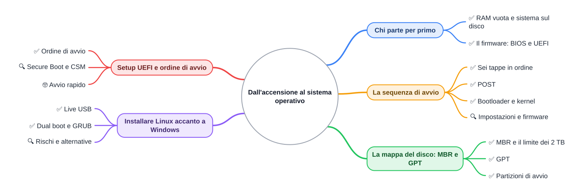
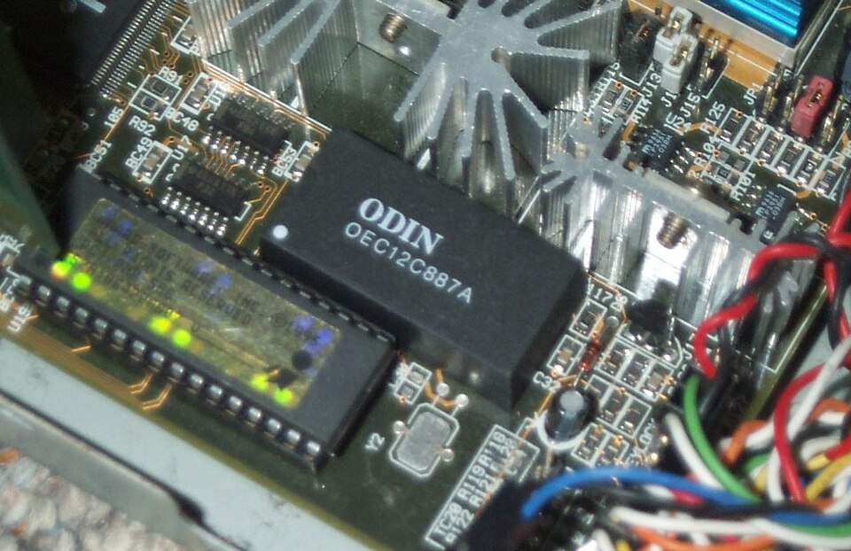

⬅️ [S1 - Memorie di massa](./%28STU%29%203EI%20nov-dic%20S1%20-%20Memorie%20di%20massa.md) · 🏠 [Indice](../README.md) · [S3 - Virtualizzazione](./%28STU%29%203EI%20nov-dic%20S3%20-%20Virtualizzazione.md) ➡️

# 🚀 Dall'accensione al sistema operativo

**3EI · Novembre-Dicembre · S2 · Teoria · ⏱️ circa 45 minuti** (lettura e ✏️; i 🤓 sono facoltativi).

> **Legenda:** ✅ minimo da sapere · 🔍 dettagli per il voto massimo · 🤓 approfondimento facoltativo · 📜 storia · 🧪 esempio · 🧠 da ricordare · ✏️ da fare · ⚠️ errore comune · 🛠️ strumento · 🃏 flashcard: rispondi a voce, poi apri per controllare · 🚪 uscita · 🔁 ripasso

🔁 **Ripasso:** [ciclo macchina (ottobre S4)](../1%20SETT-OTT/%28STU%29%203EI%20sett-ott%20S4%20-%20Il%20ciclo%20macchina.md) e [partizioni e memorie persistenti (S1)](./%28STU%29%203EI%20nov-dic%20S1%20-%20Memorie%20di%20massa.md).

## 📜 Il problema dell'uovo e della gallina

Ogni mattina premi il pulsante di accensione del tuo PC e, dopo qualche secondo, compare la schermata di blocco. Eppure, un attimo prima di premere quel pulsante, la RAM era completamente vuota e nessun programma stava girando. Come fa una macchina che parte da zero a caricare un sistema operativo grande decine di gigabyte? È il problema dell'uovo e della gallina: per far partire un programma dal disco serve un altro programma che sappia leggere il disco.

📜 Nei primi computer degli anni Cinquanta, come l'**IBM 701** (1952), la soluzione era umana: l'operatore girava una manopola per scegliere da dove leggere (schede perforate o nastro) e premeva *Load*, facendo entrare la prima istruzione a mano. Poi arrivò l'idea delle memorie non volatili saldate sulla scheda madre, e negli anni Ottanta il PC IBM rese standard il **BIOS**. Oggi quasi tutti i PC usano il suo successore moderno, la **UEFI**.

E questo è esattamente il momento in cui il nostro filo rosso entra nel vivo: <u>se vuoi installare Linux sul tuo PC accanto a Windows, devi capire chi parte per primo e come il disco è diviso in partizioni.</u>

---

## Chi parte per primo

### ✅ RAM vuota e sistema sul disco

Quando il PC è spento:

- La **RAM** (memoria di lavoro) è **vuota**, perché è volatile.
- Il **sistema operativo** (Windows, Linux o macOS) sta sul **disco** (SSD o HDD), che è persistente.

Appena dai corrente, la CPU non sa ancora che cosa sia un file, una cartella o un SSD: sa soltanto eseguire istruzioni da un indirizzo fisso. <u>All'accensione il sistema operativo non può partire da solo.</u>

🛠️ **Sul tuo dispositivo:** su Windows scrivi `msinfo32` nella ricerca di Start e premi Invio. Guarda le righe **Memoria fisica installata (RAM)** e **Modalità BIOS**: leggerai quasi certamente **UEFI** (sui PC più vecchi, *Legacy*). Solo lettura, non si modifica nulla.

🃏 <b>Perché il sistema operativo non parte subito dal disco all'accensione?</b>

Perché la RAM è vuota e la CPU non sa ancora leggere i file sul disco senza un programma iniziale già pronto.

### ✅ Il firmware: BIOS e UEFI

La soluzione al problema dell'uovo e della gallina è il **firmware**: un piccolo programma già salvato in una **memoria non volatile** (flash/ROM) direttamente sulla **scheda madre**. Non si cancella quando spegni il PC.

Appena arriva corrente, la CPU punta subito a quella memoria ed esegue il firmware.

- **BIOS** (*Basic Input/Output System*): il firmware storico dei PC (nato negli anni Ottanta).
- **UEFI** (*Unified Extensible Firmware Interface*): il firmware moderno presente sui PC attuali, più veloce, con interfaccia grafica e supporto a dischi enormi.

*Un chip del firmware su una scheda madre: il programma di partenza vive qui dentro, non sul disco.*

🃏 <b>Dove si trova il firmware e perché non sparisce allo spegnimento?</b>

Sta in una memoria non volatile sulla scheda madre, quindi conserva i dati anche senza corrente.

🃏 <b>Che differenza c'è fra BIOS e UEFI?</b>

Svolgono lo stesso compito di avvio, ma BIOS è il sistema storico e UEFI è lo standard moderno, capace di leggere partizioni e dischi oltre 2 TB.

---

## La sequenza di avvio

### ✅ Sei tappe in ordine

Il **boot** (abbreviazione di *bootstrap*) è una **staffetta**: ogni programma prepara il terreno a un programma più grande e gli passa il testimone. *Limite della metafora:* in una staffetta i corridori sono alla pari; nel boot ogni corridore sa fare molte più cose del precedente.

| Tappa | Chi lavora | Che cosa succede | Dove sta il programma |
|---|---|---|---|
| 1. **Accensione** | Alimentatore e hardware | Arriva corrente e la CPU parte da un indirizzo fisso. | — |
| 2. **Firmware** | BIOS o UEFI | Prende il controllo del processore. | Chip sulla scheda madre |
| 3. **POST** | Firmware | Controlla che CPU, RAM e periferiche rispondano. | Chip sulla scheda madre |
| 4. **Bootloader** | Firmware → Bootloader | Il firmware cerca il disco di avvio e carica in RAM il bootloader. | Disco → copiato in RAM |
| 5. **Caricamento del SO** | Bootloader | Trova il sistema operativo e lo copia in RAM. | Disco → copiato in RAM |
| 6. **Sistema operativo** | Kernel e servizi | Il **kernel** (nucleo del SO) prende il controllo e avvia rete, grafica e schermata di accesso. | RAM |

🃏 <b>Elenca in ordine le sei tappe dall'accensione al sistema operativo.</b>

Accensione, firmware, POST, bootloader, caricamento del sistema operativo, sistema operativo in esecuzione.

### ✅ POST

**POST** (*Power-On Self-Test*, auto-test all'accensione) è il controllo rapido che il firmware fa sui componenti essenziali. Se un banco di RAM è staccato o guasto, il POST si ferma e il PC avvisa con dei bip o una spia lampeggiante, perché senza RAM funzionante non c'è dove caricare il sistema.

### ✅ Bootloader e kernel

Il firmware non conosce i dettagli di Windows o Linux. Il **bootloader** è il ponte: un piccolo programma che sa leggere il disco, mostrare un menu se ci sono più sistemi (per esempio **GRUB** su Linux) e caricare in RAM il **kernel**, cioè il nucleo del sistema operativo.

✏️ **Riordina senza guardare.** Metti in ordine: *kernel in esecuzione, POST, accensione, bootloader, firmware*. Per ciascuno, scrivi se il programma sta sul chip, sul disco o in RAM.

🃏 <b>Che cos'è il POST?</b>

Il controllo iniziale che il firmware esegue all'accensione per verificare che CPU, RAM e periferiche rispondano.

🃏 <b>Che cos'è il bootloader?</b>

Il piccolo programma caricato dal firmware che trova il sistema operativo sul disco e ne carica il kernel in RAM.

### 🔍 Impostazioni e firmware

Il firmware è un **programma**; le sue preferenze (data, ora, ordine di avvio) sono **dati** salvati in una piccola memoria sulla scheda madre alimentata da una batteria a bottone (spesso una pila CR2032). Se quella batteria si scarica dopo molti anni, il firmware non sparisce, ma dimentica l'ora e le impostazioni.

---

## La mappa del disco: MBR e GPT

Per trovare il bootloader, il firmware deve sapere come è diviso il disco. In S1 abbiamo visto che un disco si divide in **partizioni**. All'inizio del disco c'è sempre una **tabella delle partizioni**: la mappa che dice dove inizia e dove finisce ogni partizione. Esistono due formati storici di questa mappa.

### ✅ MBR e il limite dei 2 TB

**MBR** (*Master Boot Record*) è lo schema nato negli anni Ottanta per i PC con BIOS. Sta tutto nei primi **512 byte** del disco (il primo settore) e contiene un piccolo codice di avvio più una tabella che descrive le partizioni.

L'MBR ha due limiti rigidi:

1. Può descrivere al massimo **4 partizioni primarie** (per averne di più bisognava trasformarne una in *partizione estesa* e metterci dentro delle *partizioni logiche*).
2. Usa numeri a 32 bit per contare i settori da 512 byte: $2^{32} \times 512\text{ byte} \approx 2{,}2\text{ TB}$. <u>Oltre i **2 TB**, l'MBR non riesce più a indirizzare lo spazio del disco.</u>

🃏 <b>Quali sono i due limiti principali dello schema MBR?</b>

Al massimo 4 partizioni primarie e un limite di capacità di circa 2 TB per il disco.

### ✅ GPT

**GPT** (*GUID Partition Table*) è lo schema moderno progettato insieme alla **UEFI**. Supera i limiti dell'MBR:

- Supporta dischi enormi (ben oltre i 2 TB, fino a miliardi di terabyte) e fino a 128 partizioni standard senza trucchi.
- Tiene una **copia di sicurezza** della tabella alla fine del disco e usa un controllo di integrità (CRC): se l'inizio del disco si corrompe, il sistema può recuperare la mappa.

✏️ **Prevedi e spiega.** Compri un SSD nuovo da 4 TB per il tuo PC fisso. Puoi formattarlo con schema MBR se vuoi usarlo tutto? Perché?

🃏 <b>Perché oggi si usa GPT invece di MBR?</b>

Perché GPT supera il limite dei 2 TB e delle 4 partizioni dell'MBR, e conserva una copia di sicurezza della tabella delle partizioni.

### ✅ Partizioni di avvio

Se apri lo strumento di gestione dei dischi sul tuo PC Windows, non vedrai una sola partizione `C:`, ma diverse partizioni piccole attorno a essa. Ognuna ha un ruolo preciso:

| Partizione | Dimensione tipica | A che cosa serve |
|---|---|---|
| **Partizione EFI (ESP)** | 100–500 MB (FAT32) | È la «stanza d'ingresso» della UEFI: contiene i file dei **bootloader** (sia di Windows sia di un eventuale Linux). |
| **Partizione di sistema (Windows)** | Quasi tutto il disco (NTFS) | Contiene Windows, i programmi e i tuoi file (`C:`). |
| **Partizione di ripristino** | 500 MB – qualche GB | Contiene gli strumenti di emergenza (*Windows RE*) per riparare il PC se Windows non parte più. |

*(Sui PC Windows con GPT c'è spesso anche una minuscola partizione riservata MSR da 16 MB usata internamente dal sistema.)*

🛠️ **Sul tuo dispositivo:** su Windows clicca con il tasto destro sul pulsante Start → **Gestione disco**. Vedrai esattamente queste partizioni in sola lettura: osserva dove sta la partizione di sistema EFI e quanto è piccola rispetto a `C:`.

🃏 <b>Che cosa contiene la partizione EFI (ESP)?</b>

Contiene i bootloader dei sistemi operativi installati, così la UEFI sa che cosa avviare.

🃏 <b>A che cosa serve la partizione di ripristino?</b>

Contiene gli strumenti di emergenza per avviare e riparare il sistema operativo quando non riesce più a partire normalmente.

---

## Setup UEFI e ordine di avvio

### ✅ Ordine di avvio

Di solito il PC cerca il bootloader sull'SSD interno e avvia Windows. Ma se vuoi installare Linux (o avviare uno strumento di emergenza), devi far partire il PC da una **chiavetta USB**.

Nel menu di configurazione della UEFI c'è l'**ordine di avvio** (*boot order*): una lista di dispositivi provati in sequenza (per esempio: *1. Chiavetta USB, 2. SSD interno*).

**Come si entra nel setup UEFI:** subito dopo aver premuto il tasto di accensione, prima che compaia Windows, si preme un tasto specifico che dipende dal produttore del PC (i più comuni sono **F2**, **Canc / DEL**, **F10**, **F12** o **Esc**, spesso indicati per un secondo sullo schermo iniziale). Oggi Windows permette anche di entrarci riavviando dalle impostazioni di ripristino (*Avvio avanzato*).

🃏 <b>A che cosa serve cambiare l'ordine di avvio nella UEFI?</b>

Serve a dire al firmware di provare prima un altro dispositivo (per esempio una chiavetta USB) invece del disco interno.

### 🔍 Secure Boot e CSM

Dentro il setup UEFI compaiono spesso due opzioni importanti quando si parla di altri sistemi operativi:

- **Secure Boot:** un controllo di sicurezza che fa partire solo bootloader con una **firma digitale** riconosciuta, per bloccare virus che provano a nascondersi prima del sistema operativo. Le distribuzioni Linux più diffuse (come Ubuntu) hanno firme riconosciute e funzionano anche con Secure Boot attivo.
- **CSM (*Compatibility Support Module* / Legacy):** una modalità di compatibilità che fa comportare la UEFI come un vecchio BIOS (per avviare dischi MBR molto vecchi). Sui PC recenti si tiene quasi sempre disattivata.

### 🤓 Avvio rapido di Windows

Quando clicchi *Arresta il sistema* su Windows, spesso il PC non si spegne del tutto: con l'**Avvio rapido** (*Fast Startup*) salva su disco lo stato del kernel per ripartire prima. Questo crea un problema pratico se usi due sistemi sullo stesso PC: Windows lascia il disco «bloccato» a metà, quindi Linux non può scrivere sulla partizione di Windows senza rischiare errori. Il comando **Riavvia**, invece, fa una chiusura completa.

---

## Installare Linux accanto a Windows

Eccoci al cuore del nostro filo rosso: *come si mette Linux su un PC che ha già Windows?*

### ✅ Live USB

Prima di modificare il disco fisso, quasi tutte le distribuzioni Linux permettono di avviare una **live USB**: una chiavetta USB avviabile che contiene un intero sistema Linux funzionante.

Scegliendo la chiavetta dall'ordine di avvio della UEFI, il sistema operativo parte **direttamente dalla chiavetta e lavora in RAM**, senza scrivere una sola riga sull'SSD interno. Serve per:

1. Provare se Wi-Fi, audio e schermo funzionano sul tuo PC.
2. Usare strumenti di recupero se Windows è bloccato.
3. Avviare il programma di installazione vero e proprio.

🃏 <b>Che cos'è una live USB e perché conviene usarla prima di installare Linux?</b>

È una chiavetta avviabile che fa girare Linux in RAM senza toccare il disco interno, permettendo di provare la compatibilità prima di installare.

### ✅ Dual boot e GRUB

Avere due sistemi operativi sullo stesso disco si chiama **dual boot**. Installare Linux accanto a Windows richiede **tre decisioni** precise (nessuna va fatta a caso):

1. **Liberare spazio sul disco:** si riduce la partizione di Windows (`C:`) per creare spazio non allocato dove mettere le nuove partizioni di Linux (di solito con file system **ext4**).
2. **Condividere la partizione EFI:** non serve creare una seconda partizione EFI; l'installer di Linux aggiunge il proprio bootloader dentro la **stessa partizione EFI** già usata da Windows.
3. **Scegliere il sistema all'accensione con GRUB:** Linux installa **GRUB** (*Grand Unified Bootloader*). Da quel momento, quando accendi il PC, la UEFI avvia GRUB, che ti mostra un menu per scegliere se far partire Linux oppure Windows.

✏️ **Metti in ordine le tre decisioni.** Un tuo compagno vuole installare Linux accanto a Windows. Scrivi in tre frasi semplici che cosa succede allo spazio sul disco, alla partizione EFI e alla schermata di accensione.

🃏 <b>Che cos'è il dual boot e quale ruolo ha GRUB?</b>

Il dual boot è la presenza di due sistemi operativi sullo stesso disco; GRUB è il bootloader che mostra il menu all'accensione per scegliere quale avviare.

### 🔍 Rischi e alternative

Il dual boot fa girare Linux **direttamente sull'hardware**, a piena velocità, ma ha due rischi reali:

- **Errore di partizionamento:** scegliere la partizione sbagliata durante l'installazione cancella Windows e tutti i dati personali. **Regola d'oro: fare sempre un backup su un disco esterno prima di toccare le partizioni.**
- **Aggiornamenti:** a volte un grande aggiornamento di Windows riscrive l'ordine di avvio nella UEFI facendo sparire il menu di GRUB (Linux è ancora sul disco, ma bisogna rimettere GRUB in cima all'ordine di avvio).

Se vuoi solo provare Linux o programmarci sopra senza alcun rischio per il disco, esistono alternative molto più sicure: una **macchina virtuale** (che vedremo in S3) oppure **WSL** (*Windows Subsystem for Linux*, su Windows).

> 🧠 <u>Tutto ha un compromesso:</u> la catena del boot garantisce che la macchina parta sempre da una base sicura (firmware) e possa caricare sistemi diversi (bootloader). Il dual boot ti dà tutta la potenza dell'hardware per due sistemi, ma al prezzo di toccare le partizioni e rischiare i dati.

---

## 🚪 Uscita

1. Che cosa succede se un disco da 3 TB viene inizializzato con MBR invece che con GPT?
2. Quali sono i tre elementi che uniscono Windows e Linux quando sono installati in dual boot sullo stesso PC UEFI?

---

## 📚 Fonti e risorse

- [Unified Extensible Firmware Interface — Wikipedia IT](https://it.wikipedia.org/wiki/Unified_Extensible_Firmware_Interface) e [BIOS — Wikipedia IT](https://it.wikipedia.org/wiki/BIOS): differenze tra BIOS e UEFI.
- [Master Boot Record — Wikipedia IT](https://it.wikipedia.org/wiki/Master_Boot_Record) e [GUID Partition Table — Wikipedia IT](https://it.wikipedia.org/wiki/GUID_Partition_Table): limiti dell'MBR (4 partizioni, 2 TB) e vantaggi di GPT.
- [Partizione (informatica) — Wikipedia IT](https://it.wikipedia.org/wiki/Partizione_(informatica)) e [EFI system partition — Wikipedia EN](https://en.wikipedia.org/wiki/EFI_system_partition): partizioni primarie, estese e ruolo dell'ESP.
- [UEFI/GPT-based hard drive partitions — Microsoft Learn](https://learn.microsoft.com/en-us/windows-hardware/manufacture/desktop/configure-uefigpt-based-hard-drive-partitions) e [Secure boot — Microsoft Learn](https://learn.microsoft.com/en-us/windows-hardware/design/device-experiences/oem-secure-boot): layout ufficiale delle partizioni Windows e funzionamento di Secure Boot.
- [Live USB — Wikipedia IT](https://it.wikipedia.org/wiki/Live_USB) e [GRUB — Wikipedia IT](https://it.wikipedia.org/wiki/GRUB): live USB e bootloader multi-sistema.
- [Install Ubuntu Desktop — Ubuntu Tutorials](https://ubuntu.com/tutorials/install-ubuntu-desktop) (in inglese, con immagini): guida ufficiale passo-passo per capire cosa chiede un installer Linux reale.
- Immagine chip BIOS: Zac Luzader (Codeczero), *AT Motherboard RTC and BIOS*, Wikimedia Commons, [CC BY 3.0](https://creativecommons.org/licenses/by/3.0), [pagina del file](https://commons.wikimedia.org/wiki/File:AT_Motherboard_RTC_and_BIOS.jpg).

---

⬅️ [S1 - Memorie di massa](./%28STU%29%203EI%20nov-dic%20S1%20-%20Memorie%20di%20massa.md) · 🏠 [Indice](../README.md) · [S3 - Virtualizzazione](./%28STU%29%203EI%20nov-dic%20S3%20-%20Virtualizzazione.md) ➡️
