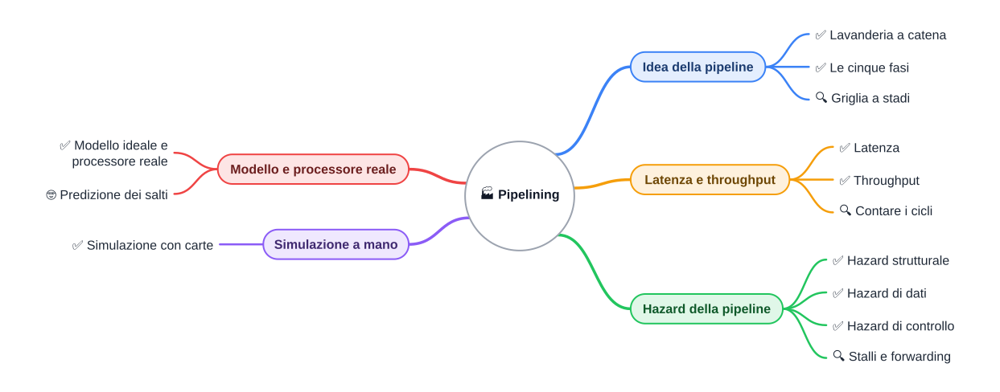
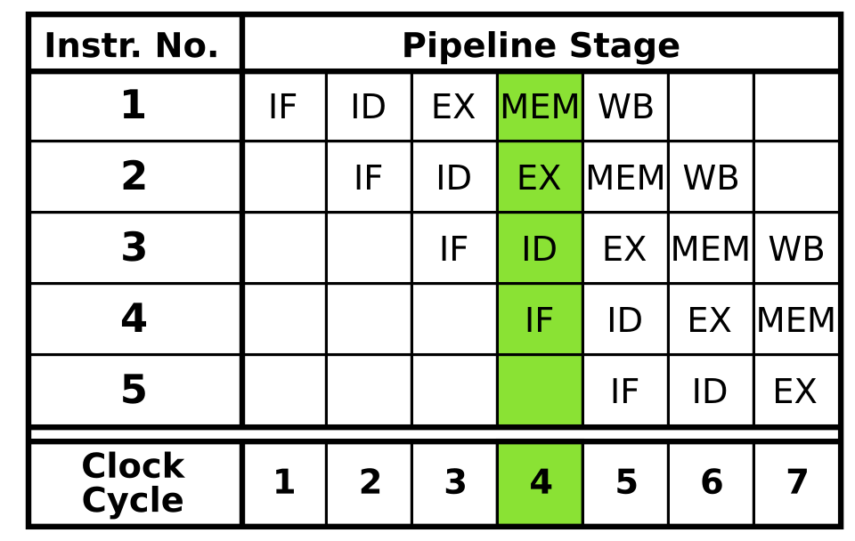

⬅️ [S1](./%28STU%29%203EI%20nov-dic%20S1%20-%20Prestazioni%20e%20istruzioni.md) · 🏠 [Indice](../README.md) · [S3](./%28STU%29%203EI%20nov-dic%20S3%20-%20Memorie%20di%20massa.md) ➡️

3EI · Novembre-Dicembre · S2 · Teoria · ⏱️ circa 40 minuti

# 🏭 Pipelining

📌 **Ripassa prima:** [sett-ott S4 - Il ciclo macchina](../1%20SETT-OTT/%28STU%29%203EI%20sett-ott%20S4%20-%20Il%20ciclo%20macchina.md), con fetch, decode ed execute.

>**Legenda:** ✅ minimo per la sufficienza · 🔍 dettagli per il voto massimo · 🤓 approfondimento facoltativo · 📌 ripasso · 📜 storia · 🧪 esempio · 🧠 da ricordare · ✏️ da fare · ⚠️ errore comune · ⚙️ nella pratica · 🃏 flashcard · ⏱️ tempo

📜 Per molto tempo la CPU ha fatto una cosa alla volta: finiva un'istruzione, poi iniziava la successiva. Ma ogni istruzione passa da fasi diverse: prelevare, capire, calcolare, scrivere. Mentre una fase lavora, le altre aspettano. I progettisti hanno preso un'idea dalle fabbriche: far lavorare insieme più pezzi, ciascuno su una fase diversa. Già negli anni Sessanta alcune macchine usavano questa idea. Più tardi, verso il 2000, la corsa ai GHz rallentò e il parallelismo diventò la strada principale. Date da verificare sulle fonti.

## Idea della pipeline

### ✅ Lavanderia a catena

Una **pipeline** (catena di lavoro) divide il lavoro in fasi. Ogni fase è uno **stadio**. Più istruzioni occupano stadi diversi nello stesso momento.

🧪 **Esempio.** Una lavanderia ha tre passaggi: lavare, asciugare, stirare. Mentre la terza camicia viene stirata, la seconda si asciuga e la prima è ancora in lavatrice. Nessuna camicia si lava più in fretta, ma tutta la pila finisce prima.

<u>La pipeline non accorcia la singola istruzione: fa uscire più istruzioni nello stesso tempo.</u>

⚠️ **Errore comune:** «la pipeline rende ogni istruzione più veloce». Non è così: rende il lavoro complessivo più veloce.

✏️ **Spiega a voce**, in una frase, perché la pipeline non rende più veloce una singola istruzione.

> 🧠 La pipeline è una catena di stadi: molte istruzioni avanzano insieme, ciascuna in una fase diversa.

🃏 <b>Che cos'è una pipeline?</b>

Una catena in cui più istruzioni occupano stadi diversi nello stesso momento.

🃏 <b>Che cos'è uno stadio?</b>

Una fase del lavoro, per esempio IF o EX. In ogni ciclo di clock, ogni stadio lavora su un'istruzione diversa.

🃏 <b>Quali tre azioni ripete il ciclo di ottobre?</b>

Fetch, decode ed execute: prelevare, interpretare, eseguire.

🃏 <b>Che cosa contiene il PC?</b>

L'indirizzo della prossima istruzione da prelevare.

### ✅ Le cinque fasi

Il modello classico ha **cinque stadi**. Ogni istruzione passa da tutti e cinque, anche se in alcuni non fa nulla. Il ciclo di ottobre era fetch, decode, execute: qui ci sono due fasi in più.

| Sigla | Nome | In parole semplici |
|---|---|---|
| **IF** | *instruction fetch*, prelievo | Prende l'istruzione dalla memoria. |
| **ID** | *instruction decode*, decodifica | Capisce l'operazione e legge i registri che servono. |
| **EX** | *execute*, esecuzione | La ALU fa il calcolo. |
| **MEM** | *memory*, accesso alla memoria | Legge o scrive la memoria. La usano davvero solo LOAD e STORE. |
| **WB** | *write-back*, scrittura del risultato | Scrive il risultato nel registro. |

⚙️ **Nella pratica.** I processori reali hanno più di cinque stadi. Il modello a cinque basta per capire l'idea.

🃏 <b>Che cosa significa IF?</b>

Instruction fetch: la CPU preleva l'istruzione dalla memoria.

🃏 <b>Quali sono i cinque stadi del modello?</b>

IF, ID, EX, MEM e WB.

🃏 <b>Che cosa fa lo stadio MEM?</b>

Legge o scrive la memoria. Per esempio, una LOAD legge un dato dalla memoria.

### 🔍 Griglia a stadi

La **griglia** è il disegno che mostra la pipeline. Ogni **riga** è un'istruzione. Ogni **colonna** è un ciclo di clock. Dentro la cella c'è lo stadio in cui si trova quell'istruzione in quel ciclo.

Si legge in due modi. Una riga racconta la vita di una istruzione. Una colonna racconta che cosa fa la CPU in un ciclo.

*Ogni riga è un'istruzione, ogni colonna un ciclo: la cella dice in quale stadio si trova.*

🃏 <b>Che cosa indica una riga della griglia?</b>

La vita di una istruzione, ciclo dopo ciclo, dagli stadi iniziali a quelli finali.

🃏 <b>Che cosa indica una colonna della griglia?</b>

Tutto ciò che la CPU fa nello stesso ciclo di clock, in stadi diversi.

## Latenza e throughput

### ✅ Latenza

La **latenza** è il tempo che passa dall'inizio alla fine di una singola istruzione.

🧪 **Esempio.** Un PC con clock a 3 GHz (valore tipico) ha un ciclo di circa 0,33 ns. Con cinque stadi, una istruzione dura cinque cicli: circa 1,7 ns. La pipeline non abbassa questo numero.

Sul tuo PC, la velocità del processore si legge in Gestione attività, scheda Prestazioni, voce CPU.

✏️ **Prevedi, poi calcola.** Con un clock di 2 GHz, un ciclo dura 0,5 ns. La latenza di cinque stadi sarà più grande o più piccola di 1,7 ns? Scrivi la previsione, poi fai il conto.

> 🧠 La latenza è quanto aspetti una istruzione. Non cambia con la pipeline.

🃏 <b>Che cos'è la latenza?</b>

Il tempo che passa dall'inizio alla fine di una singola istruzione.

🃏 <b>La pipeline riduce la latenza di una istruzione?</b>

No. Una singola istruzione dura quanto prima, mentre il throughput aumenta.

### ✅ Throughput

Il **throughput** è quante istruzioni finiscono nell'unità di tempo. A regime, con la pipeline piena, esce una istruzione per ciclo.

🧪 **Esempio.** Senza pipeline, ogni istruzione occupa cinque cicli prima che inizi la successiva: esce una istruzione ogni cinque cicli. Con la pipeline, a regime, esce una istruzione a ogni ciclo.

<u>La latenza dice quanto aspetti una istruzione; il throughput dice quante ne escono nello stesso tempo.</u>

> 🧠 La pipeline non è più veloce per una singola istruzione: è più veloce per tutto il lavoro insieme.

🃏 <b>Che cos'è il throughput?</b>

Quante istruzioni finiscono nell'unità di tempo. <i>Con la pipeline piena: una ogni ciclo.</i>

### 🔍 Contare i cicli

Nel modello ideale, senza pause, la formula è:

<u>cicli totali = numero di stadi + (numero di istruzioni − 1)</u>

La prima istruzione finisce dopo cinque cicli. Ogni istruzione successiva esce un ciclo dopo la precedente.

🧪 **Esempio.** Tre istruzioni su cinque stadi: 5 + (3 − 1) = **7 cicli** con la pipeline. Senza pipeline: 3 × 5 = **15 cicli**.

✏️ **Prevedi, poi traccia.** Quattro istruzioni su cinque stadi. Scrivi quanti cicli prevedi. Poi disegna la griglia su un foglio, riga per riga, e conta le colonne.

> 🧠 Le pause non compaiono in questa formula: appartengono al processore reale.

🃏 <b>Quanti cicli servono a tre istruzioni su cinque stadi, nel modello ideale?</b>

Sette: cinque per la prima, poi uno in più per ciascuna delle altre due.

## Hazard della pipeline

Un **hazard** è un intoppo che impedisce a una istruzione di avanzare come previsto. Ce ne sono tre tipi.

Nel modello ideale questi intoppi non compaiono. Li mostriamo qui perché in una CPU vera capitano spesso.

### ✅ Hazard strutturale

Un **hazard strutturale** si ha quando due stadi vogliono la stessa risorsa nello stesso ciclo.

🧪 **Esempio.** Nella griglia, al ciclo 4 l'istruzione 1 è in MEM e l'istruzione 4 è in IF. Se una sola memoria serve sia per i dati sia per le istruzioni, le due richieste si scontrano. Una deve aspettare.

⚙️ **Nella pratica.** Di solito le CPU hanno memorie separate per le istruzioni e per i dati (cache). Così il conflitto raramente si presenta.

🃏 <b>Che cos'è un hazard strutturale?</b>

Due stadi chiedono la stessa risorsa nello stesso ciclo, per esempio la memoria.

### ✅ Hazard di dati

Un **hazard di dati** si ha quando un'istruzione usa un risultato che un'istruzione precedente non ha ancora pronto.

🧪 **Esempio.** Il nostro programma: `LOAD R1, [40]` seguito da `ADD R3, R1, R2`. ADD vuole subito R1. Ma LOAD porta il 7 dentro R1 solo verso la fine del suo percorso. Se ADD non aspetta, legge il vecchio valore di R1.

La pipeline deve fermarsi per un po' e attendere il dato giusto.

⚠️ **Errore comune:** pensare che sia un errore del programma. È un limite della catena, che il processore sa gestire.

🃏 <b>Che cos'è un hazard di dati?</b>

Un'istruzione usa un risultato che non è ancora pronto. <i>Per esempio, ADD che usa R1 appena caricato dalla LOAD.</i>

### ✅ Hazard di controllo

Un **hazard di controllo** si ha quando la CPU non sa ancora quale istruzione viene dopo, perché c'è un salto.

🧪 **Esempio.** La `BEQ R1, R2, fine` alla cella 11 può saltare alla cella 14. Mentre la BEQ viene decodificata, la CPU ha già prelevato la cella 12. Se il salto è preso, la cella 12 era la strada sbagliata: il lavoro fatto va buttato.

🃏 <b>Che cos'è un hazard di controllo?</b>

La CPU non sa quale istruzione viene dopo, perché c'è un salto. <i>Per esempio, una BEQ che può saltare.</i>

🃏 <b>Perché un salto sbagliato costa lavoro?</b>

Le istruzioni già entrate nella catena vanno scartate, perché non sono quelle giuste.

✏️ **Classifica tre casi.** (a) Due istruzioni vogliono la memoria nello stesso ciclo. (b) ADD usa R1 appena caricato da una LOAD. (c) Dopo una BEQ la CPU non sa quale strada prendere. Scrivi il tipo di hazard per ciascun caso.

> 🧠 Ogni hazard è una domanda: la catena ha ciò che serve, al ciclo giusto?

### 🔍 Stalli e forwarding

Lo **stallo** è una pausa inserita nella catena: uno stadio resta fermo, mentre gli altri aspettano.

Il **forwarding** (inoltro) è l'idea di far passare un risultato direttamente dal punto in cui esiste al punto in cui serve, senza aspettare che entri nel registro. È come passare un pacco di mano in mano, senza metterlo prima sullo scaffale.

Non calcoliamo quante pause servono: in questo corso basta capire l'idea.

⚠️ **Errore comune:** lo stallo non è un guasto. È la pipeline che aspetta il dato giusto.

🃏 <b>Che cos'è uno stallo?</b>

Una pausa inserita nella catena: uno stadio resta fermo mentre la pipeline aspetta.

🃏 <b>Che cos'è il forwarding?</b>

Il passaggio diretto di un risultato dove serve, senza aspettare che entri nel registro.

> 🧠 Ogni hazard ha un prezzo: la pipeline ferma, scarta o aspetta.

## Modello e processore reale

### ✅ Modello ideale e processore reale

Il **modello ideale** ha stadi tutti della stessa durata, un ciclo ciascuno, nessuna pausa e memoria sempre veloce. Serve per capire.

Il **processore reale** ha stadi di durata diversa, pause, memorie che a volte rallentano e istruzioni di lunghezza diversa. Il processore reale è quello che usi davvero.

<u>I numeri della griglia sono un modello: una CPU vera può contare cicli diversi.</u>

🧪 **Esempio.** Un PC moderno ha pipeline di decine di stadi (ordine di grandezza, valore approssimato). Più stadi permettono un clock più alto, ma ogni salto sbagliato costa di più.

📜 Nel 2004 il Pentium 4 «Prescott» aveva circa trenta stadi: un caso in cui più stadi non hanno dato il risultato sperato. Data da verificare sulle fonti.

⚠️ **Errore comune:** «più stadi significa sempre più veloce».

✏️ **Prevedi, poi apri.** Su Gestione attività annota la velocità della CPU in GHz. Se il clock fosse il doppio, la latenza in nanosecondi sarebbe la metà? Scrivi la previsione e ragiona su che cosa resta uguale.

> 🧠 Il modello ideale è uno strumento per capire. Il processore reale è più complicato del modello.

🃏 <b>Che cos'è il modello ideale?</b>

Una pipeline con stadi uguali e senza pause: serve a capire, non misura una CPU vera.

🃏 <b>Perché più stadi non sono sempre più veloci?</b>

Perché un salto sbagliato fa buttare via più lavoro, e con più stadi ce n'è di più.

### 🤓 Predizione dei salti

> La CPU non vuole aspettare l'esito di un salto. Prova quindi a **indovinare** dove andrà il programma: si chiama **predizione dei salti**. Se indovina, nessuna pausa. Se sbaglia, scarta il lavoro fatto.
>
> Alcuni processori hanno anche più pipeline in parallelo, detti superscalari. È solo un cenno: non fa parte della verifica.

🃏 <b>Che cos'è la predizione dei salti?</b>

La CPU indovina la strada del salto per non fermarsi ad aspettare.

## Simulazione a mano

### ✅ Simulazione con carte

Ti servono cinque cartoncini, uno per stadio: IF, ID, EX, MEM, WB. Usa altri cartoncini per le istruzioni: `LOAD`, `ADD`, `STORE`.

Ogni **colpo di clock** sposta tutti i cartoncini di uno stadio in avanti. Entra una nuova istruzione in IF. Poi disegni una riga della griglia con lo stato del ciclo.

🧪 **Esempio di inizio** (modello ideale, senza pause):

| Ciclo | IF | ID | EX | MEM | WB |
|---:|---|---|---|---|---|
| 1 | `LOAD R1, [40]` | | | | |
| 2 | `ADD R3, R1, R2` | `LOAD R1, [40]` | | | |

<u>Ogni cartoncino avanza sempre di un solo stadio per colpo di clock.</u>

✏️ **Prevedi, poi esegui.** Scrivi quanti cicli prevedi per il programma `LOAD`, `ADD`, `STORE` nel modello ideale. Poi continua la simulazione con le carte fino all'ultima istruzione e conta i cicli. Il risultato deve coincidere con la formula.

> 🧠 Con le carte si vede il movimento. Senza carte la griglia resta una figura piatta.

🃏 <b>Che cosa rappresenta un cartoncino nella simulazione?</b>

Un'istruzione, che si sposta di uno stadio a ogni colpo di clock.

🃏 <b>Che cosa si fa a ogni colpo di clock?</b>

Si spostano tutti i cartoncini di uno stadio in avanti e si mette in IF la nuova istruzione.

## Fonti e risorse

- **Immagine:** *5 Stage Pipeline*, di Inductiveload, pubblico dominio (licenza: public domain). Pagina del file: <https://commons.wikimedia.org/wiki/File:5_Stage_Pipeline.svg>. Scaricata come PNG 960×608 nella cartella `Allegati`. Uso in classe: mostrala e chiedi di leggere una riga e una colonna.
- Patterson e Hennessy, *Computer Organization and Design* (riferimento per il modello a cinque stadi IF, ID, EX, MEM, WB; per chi vuole approfondire).
- Wikipedia in inglese, voce *Instruction pipelining* (in inglese, per curiosi): <https://en.wikipedia.org/wiki/Instruction_pipelining>.

---

⬅️ [S1](./%28STU%29%203EI%20nov-dic%20S1%20-%20Prestazioni%20e%20istruzioni.md) · 🏠 [Indice](../README.md) · [S3](./%28STU%29%203EI%20nov-dic%20S3%20-%20Memorie%20di%20massa.md) ➡️
