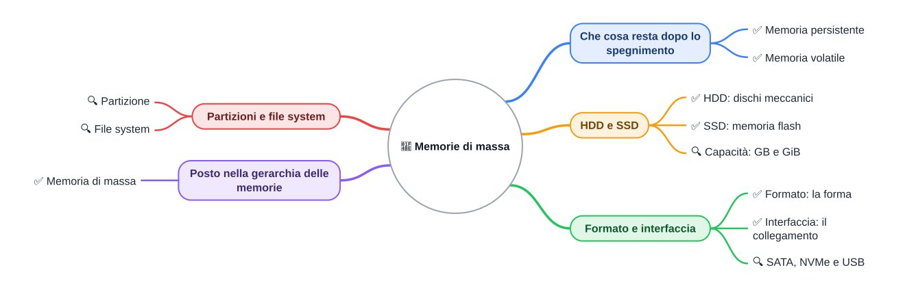
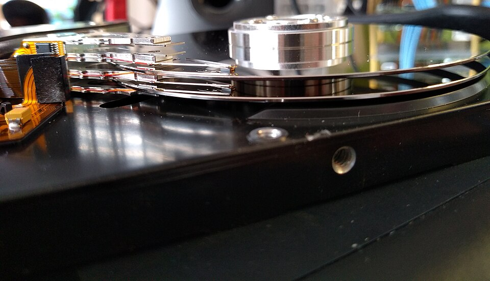
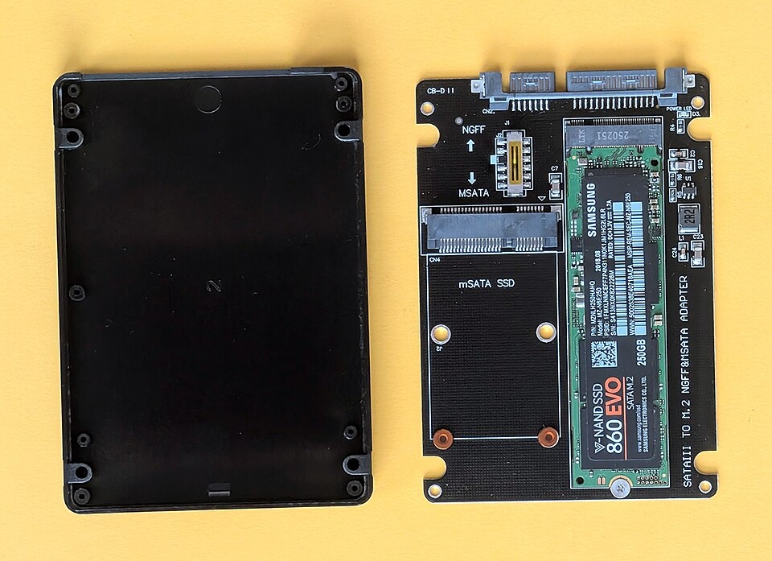

⬅️ [S2](./%28STU%29%203EI%20nov-dic%20S2%20-%20Pipelining.md) · 🏠 [Indice](../README.md) · [S4](./%28STU%29%203EI%20nov-dic%20S4%20-%20Dall%27accensione%20al%20sistema%20operativo.md) ➡️

# 💾 Memorie di massa

**3EI · Novembre-Dicembre · S3 · Teoria**

⏱️ **Tempo di studio stimato:** circa 35 minuti. Comprende lettura e ✏️; i 🤓 si possono saltare.

**Legenda:** ✅ minimo da sapere · 🔍 dettagli per il voto alto · 🤓 approfondimento facoltativo · 🧪 esempio · 🧠 da ricordare · ⚠️ errore comune · ✏️ da fare · 🔧 In laboratorio · 🃏 flashcard: rispondi a voce, poi apri per controllare · 📜 storia · 🚪 uscita

Passa il mouse sulle voci della mappa per leggere la descrizione.

Prima di questa dispensa abbiamo visto la [gerarchia delle memorie](../1%20SETT-OTT/%28STU%29%203EI%20sett-ott%20S5%20-%20Indirizzi%20e%20gerarchia%20delle%20memorie.md) di ottobre: registri, cache, RAM e, all'ultimo livello, la memoria di massa. Qui chiediamo: <u>che cosa resta quando il computer si spegne?</u>

## 💾 Memoria volatile e persistente

Prova questo. Stai scrivendo un documento e non lo salvi. Spegni il PC. Il documento sparisce. Ora prova con una foto salvata nel telefono: spegni il telefono, lo riaccendi, e la foto c'è ancora. Che cosa cambia tra i due casi? Il posto dove stanno i dati.

📜 Nel 1956 IBM presentò il RAMAC, un sistema con dischi magnetici che giravano su un asse. Erano dischi grandi, di circa 60 cm di diametro, e immagazzinavano circa 5 MB (cifra approssimativa, da verificare). Oggi un SSD da 512 GB sta in una tasca. Il lavoro di chi conserva i dati è sempre stato lo stesso: tenere le informazioni anche quando la macchina si ferma.
### ✅ Che cosa resta dopo lo spegnimento

**Memoria volatile**: conserva i dati solo finché c'è corrente elettrica. Esempio: la RAM del tuo PC. Quando spegni, il contenuto si perde.

**Memoria persistente**: conserva i dati anche senza corrente. Esempio: le foto nel telefono, o un file su un SSD.

🃏 <b>Che cos'è la memoria volatile?</b>

Una memoria che perde i dati quando manca la corrente, per esempio la RAM.

🃏 <b>Fai un esempio di memoria persistente.</b>

Le foto salvate nel telefono: restano anche a telefono spento.

🃏 <b>La RAM è volatile o persistente?</b>

Volatile: allo spegnimento si svuota.

🃏 <b>Dove resta un documento salvato dopo lo spegnimento?</b>

In una memoria persistente, come un SSD o un HDD.

✏️ **Classifica.** Scrivi accanto a ciascuno la lettera **V** (volatile) o **P** (persistente): RAM, SSD, HDD, chiavetta USB, registro della CPU.

### ✅ Memoria di massa: l'ultimo livello

La **memoria di massa** è la memoria grande e persistente che conserva programmi e file. Nella gerarchia di ottobre sta all'ultimo livello: è molto più capiente della RAM, ma più lenta.

Il programma, quindi, vive sul disco. Quando lo avvii, il sistema lo copia in RAM, perché la CPU lavora dalla RAM e non direttamente dal disco.

> 🧠 <u>Persistenza e velocità sono due proprietà diverse.</u> Scendere nella gerarchia non rende automaticamente una memoria persistente.

🃏 <b>Dove sta la memoria di massa nella gerarchia?</b>

All'ultimo livello: è grande, persistente e più lenta della RAM.

🃏 <b>Perché un programma viene copiato in RAM prima di partire?</b>

Perché la CPU lavora sulla RAM, che è molto più veloce del disco.

## 🧲 HDD e SSD

Nel PC e nel telefono i dati stanno in dischi di due famiglie diverse.

### ✅ HDD: dischi che girano e una testina

**HDD** (hard disk drive, disco rigido): contiene piatti magnetici che girano e una testina che legge e scrive. Nei PC fissi i piatti girano tipicamente a 7200 giri al minuto; per trovare un dato servono circa 5-10 millisecondi (valori tipici, approssimati).

*Un HDD da 3,5 pollici aperto: si vedono i piatti magnetici e le testine che li leggono.*

🧪 **Esempio.** Un file è spezzato in pezzi su due punti lontani del piatto. La testina deve spostarsi due volte. Ogni spostamento costa tempo.

⚠️ <u>Un HDD non è una RAM lenta</u>: è una tecnologia diversa, con parti meccaniche, e conserva i dati senza corrente.

🃏 <b>Che cos'è un HDD?</b>

Un disco con piatti magnetici che girano e una testina che legge e scrive.

🃏 <b>Quali parti si muovono in un HDD?</b>

I piatti, che girano, e la testina, che si sposta sulla superficie.

🃏 <b>Perché un HDD è lento quando un file è spezzato in punti lontani?</b>

Perché la testina deve spostarsi più volte per leggere i pezzi.

### ✅ SSD: memoria flash senza parti in movimento

**SSD** (solid-state drive, disco a stato solido): è fatto di celle di memoria **flash**, che trattengono i dati anche senza corrente. Non ha parti meccaniche. Il suo tempo di accesso è dell'ordine di qualche decimo di millisecondo (valore tipico, approssimato).

🃏 <b>Che cos'è un SSD?</b>

Un disco fatto di celle di memoria flash, senza parti che si muovono.

🃏 <b>Un SSD è volatile?</b>

No: i dati restano anche senza corrente.

🃏 <b>Qual è la differenza principale tra SSD e HDD?</b>

L'SSD non ha parti meccaniche: è più veloce e regge meglio gli urti.

🧪 **Il tuo dispositivo.** Su Windows apri Gestione attività, scheda Prestazioni, voce Disco: vedi se il disco è SSD o HDD e la sua capacità. Su Android trovi la memoria in Impostazioni, voce Archiviazione.

✏️ **Ordina a memoria.** Senza guardare la tabella qui sotto, scrivi RAM, SSD, HDD e chiavetta USB dal più veloce al più lento. Poi controlla.

### ✅ Confronto: RAM, SSD, HDD e chiavetta

| Memoria | Persistente? | Capacità tipica | Tempo di accesso tipico |
| ------- | ------------ | --------------- | ----------------------- |
| RAM | no | 8-16 GB | circa 0,0001 ms |
| SSD | sì | 256 GB - 1 TB | circa 0,1 ms |
| HDD | sì | 1-4 TB | circa 5-10 ms |
| Chiavetta USB | sì | 16-128 GB | più lenta di un SSD, con grande variabilità |

*Valori tipici e approssimati, da leggere come ordini di grandezza. Non sono le specifiche di un modello preciso.*

### 🔍 Quanto è grande un disco?

Un **byte** è 8 bit. Un **GB** (gigabyte) è 1 miliardo di byte, come lo scrive il produttore sulla confezione. Il sistema operativo, però, spesso usa un gigabyte da 1024 × 1024 × 1024 byte (chiamato GiB). Così un SSD da 512 GB dichiarati appare come circa 477 GB.

🧪 Un SSD da 512 000 000 000 byte, diviso per 1 073 741 824 byte (un GiB), dà circa 477. Non è un disco difettoso: sono due modi di contare.

⚠️ Non confondere: 512 GB sulla confezione e circa 477 GB nel sistema descrivono lo stesso disco.

🃏 <b>Quanti byte valgono 1 GB secondo la confezione del produttore?</b>

Circa un miliardo, cioè mille milioni: 1 000 000 000 byte.

🃏 <b>Perché un SSD da 512 GB può apparire come circa 477 GB?</b>

Perché il sistema conta i GB in multipli di 1024, mentre il produttore li conta in multipli di 1000.

### 🤓 Usura delle celle flash

> Ogni cella flash regge un numero limitato di scritture. Il controllore dell'SSD distribuisce le scritture su celle diverse, tecnica chiamata *wear leveling*, per farle durare più a lungo.

> 🧠 <u>HDD: grande, economico per byte, ma lento e con parti che si muovono. SSD: veloce, silenzioso e senza parti mobili, ma più caro per GB.</u> Nessuno dei due è il migliore in assoluto: dipende dal lavoro.

## 🔌 Formato e interfaccia

Due parole sembrano uguali e non lo sono. **Formato** è la forma fisica del disco. **Interfaccia** è il collegamento e il linguaggio con cui il disco parla alla scheda madre.

### ✅ Formato: la forma

**Formato**: la misura e la forma del componente. Esempi: 3,5 pollici (HDD dei PC fissi), 2,5 pollici (dischi dei portatili), **M.2** (una piccola basetta stretta che si inserisce direttamente sulla scheda madre).

### ✅ Interfaccia: il collegamento

**Interfaccia**: il modo in cui il disco è collegato e comunica con la scheda madre.

*Un SSD M.2 inserito in un adattatore: la forma è M.2, l'interfaccia qui è SATA.*

🧪 **Esempio.** Un SSD M.2 può parlare SATA oppure NVMe su PCIe. La forma è la stessa, l'interfaccia cambia.

| Interfaccia | Dove la trovi | Velocità tipica |
| ----------- | ------------- | --------------- |
| SATA | cavo con due connettori piatti; dischi da 2,5 e 3,5 pollici | fino a circa 550 MB/s, limite del collegamento |
| PCIe con NVMe | slot della scheda madre; SSD M.2 | da circa 3 a 7 GB/s nei modelli recenti |
| USB | chiavette e dischi esterni | varia molto, a seconda della versione USB |

*Valori tipici e approssimati.*

🃏 <b>Che cosa indica il formato di un disco?</b>

La sua forma fisica e la sua misura, per esempio 2,5 pollici oppure M.2.

🃏 <b>Che cos'è l'interfaccia di un disco?</b>

Il collegamento e il linguaggio con cui il disco parla alla scheda madre.

🃏 <b>Un SSD M.2 usa sempre la stessa interfaccia?</b>

No: può usare SATA oppure NVMe su PCIe, a seconda del modello.

⚠️ <u>NVMe non è un connettore</u>: è il linguaggio pensato per gli SSD. Il collegamento fisico è un'altra cosa.

✏️ **Classifica.** Accanto a ciascun elemento scrivi **F** (formato) o **I** (interfaccia): 2,5 pollici, SATA, M.2, NVMe, USB.

## 🗂️ Partizioni e file system

Un disco nuovo è una superficie unica. Il sistema, però, può trattarlo in parti diverse.

### 🔍 Partizione: una parte del disco vista come disco a sé

**Partizione**: una parte del disco che il sistema vede come un disco a sé. Esempio ipotetico: un disco da 1 TB diviso in due parti, una da 900 GB e una da 100 GB. Il sistema le vede come due dischi separati.

Immagina un magazzino diviso da un muro: due aree, con porte diverse, anche se l'edificio è uno solo.

### 🔍 File system: come sono organizzati i file

**File system**: le regole che dicono dove si trova ogni file, con nomi, cartelle e dimensioni. Esempi: NTFS (Windows), ext4 (molti sistemi Linux), FAT32 e exFAT (molte chiavette USB).

Pensa al catalogo di una biblioteca. Il catalogo dice dove sta ogni libro. Il file system fa la stessa cosa per i file.

⚠️ <u>La partizione non è il file system.</u> La partizione è il pezzo di disco; il file system è il catalogo che sta dentro quel pezzo.

✏️ **Trova l'errore.** La frase è: «La partizione è il file system, cioè il modo in cui i file sono organizzati.» Correggila in una frase sola.

### 🔍 Cancellare non vuol dire sempre sparire

Quando cancelli un file, il sistema toglie di solito solo la voce dal catalogo. I dati restano sul disco finché un altro file non li sovrascrive. Per questo, a volte, i file cancellati si recuperano.

🃏 <b>Che cos'è una partizione?</b>

Una parte del disco che il sistema vede come un disco separato.

🃏 <b>Che cos'è un file system?</b>

Le regole che dicono dove si trova ogni file dentro una partizione.

🃏 <b>Quale file system è comune nelle chiavette USB?</b>

FAT32 o exFAT, molto diffusi nelle chiavette.

🃏 <b>Cancellare un file lo toglie sempre subito dal disco?</b>

No: di solito toglie solo la voce dal catalogo; i dati restano finché non vengono sovrascritti.

🔧 **In laboratorio** vedrete come un sistema mostra partizioni e file system. Qui non ci sono procedure da seguire.

## 🚪 Uscita

Completa due frasi, senza guardare: la RAM è ___ perché ___; il disco è ___ perché ___.

## 📚 Fonti e crediti

- Wikipedia (in inglese), [Solid-state drive](https://en.wikipedia.org/wiki/Solid-state_drive): SSD e celle flash.
- Wikipedia (in inglese), [Hard disk drive](https://en.wikipedia.org/wiki/Hard_disk_drive): piatti, testina e tempi di accesso.
- Wikipedia (in inglese), [Disk partitioning](https://en.wikipedia.org/wiki/Disk_partitioning) e [File system](https://en.wikipedia.org/wiki/File_system): partizioni e file system.
- Wikipedia (in inglese), [NVM Express](https://en.wikipedia.org/wiki/NVM_Express): il protocollo NVMe.
- Immagine HDD: «3.5 inch hard disk drive, side view» di Gunnar Wolf, [CC BY-SA 4.0](https://creativecommons.org/licenses/by-sa/4.0), [pagina del file](https://commons.wikimedia.org/wiki/File:3.5_inch_hard_disk_drive,_side_view.jpg). Ridimensionata.
- Immagine SSD M.2: «Dual SSD SATA adapter with Samsung 860 EVO SSD and 2.5-inch enclosure» di Siarhei Besarab, [CC BY-SA 4.0](https://creativecommons.org/licenses/by-sa/4.0), [pagina del file](https://commons.wikimedia.org/wiki/File:Dual_SSD_SATA_adapter_with_Samsung_860_EVO_SSD_and_2.5-inch_enclosure.jpg). Ridimensionata.

---

⬅️ [S2](./%28STU%29%203EI%20nov-dic%20S2%20-%20Pipelining.md) · 🏠 [Indice](../README.md) · [S4](./%28STU%29%203EI%20nov-dic%20S4%20-%20Dall%27accensione%20al%20sistema%20operativo.md) ➡️
