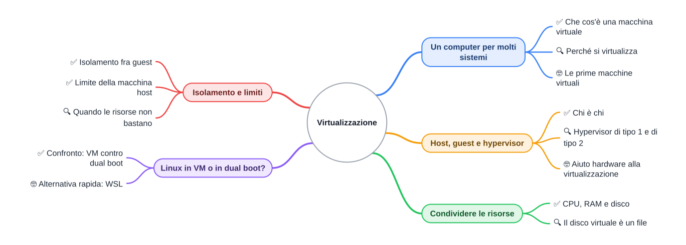
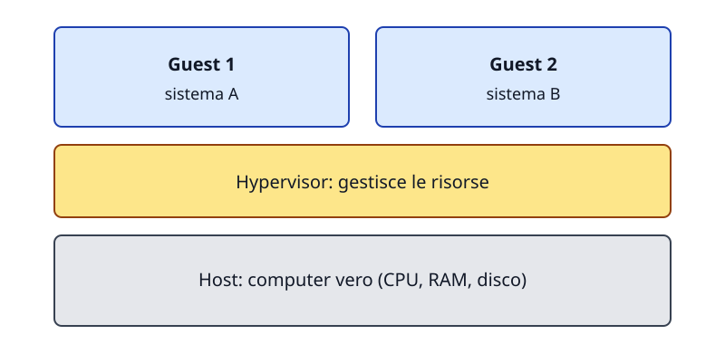
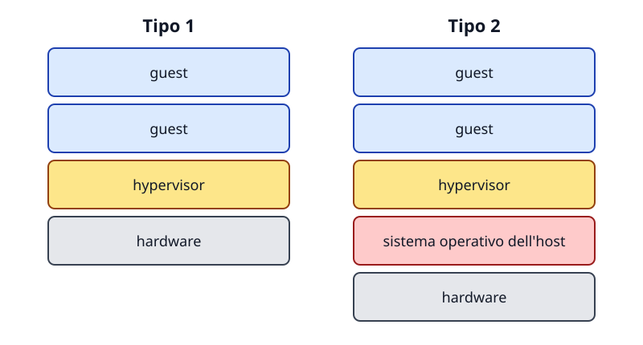

⬅️ [S2 - Dall'accensione al sistema operativo](./%28STU%29%203EI%20nov-dic%20S2%20-%20Dall%27accensione%20al%20sistema%20operativo.md) · 🏠 [Indice](../README.md) · [S4 - Pipelining, parallelismo e set di istruzioni](./%28STU%29%203EI%20nov-dic%20S4%20-%20Pipelining%2C%20parallelismo%20e%20set%20di%20istruzioni.md) ➡️

# 🖥️ Virtualizzazione

**3EI · Novembre-Dicembre · S3 · Teoria · ⏱️ circa 35 minuti** (lettura e ✏️; i 🤓 sono facoltativi).

> **Legenda:** ✅ minimo da sapere · 🔍 dettagli per il voto massimo · 🤓 approfondimento facoltativo · 📜 storia · ⚙️ tecnica · 🧪 esempio · 🧠 da ricordare · ✏️ da fare · ⚠️ errore comune · 🛠️ strumento · 🃏 flashcard: rispondi a voce, poi apri per controllare · 🚪 uscita · 🔁 ripasso

🔁 **Ripasso:** [ciclo macchina (ottobre S4)](../1%20SETT-OTT/%28STU%29%203EI%20sett-ott%20S4%20-%20Il%20ciclo%20macchina.md), [memorie di massa (S1)](./%28STU%29%203EI%20nov-dic%20S1%20-%20Memorie%20di%20massa.md) e [dual boot e partizioni (S2)](./%28STU%29%203EI%20nov-dic%20S2%20-%20Dall%27accensione%20al%20sistema%20operativo.md).

## 📜 Un computer per molti sistemi

In S2 hai visto come si mette Linux sul PC con il **dual boot**: riduci la partizione di Windows, condividi la partizione EFI, installi GRUB. Funziona bene, ma un errore sulle partizioni può cancellare i tuoi dati e ogni volta che vuoi cambiare sistema devi riavviare. C'è un'altra strada: **far girare Linux dentro una finestra di Windows, come se fosse un normale programma**.

📜 Negli anni Sessanta i calcolatori costavano come palazzi. In un centro di calcolo universitario decine di programmatori volevano usare la macchina nello stesso momento. In IBM nacque l'idea di **CP-67** (sul System/360 Model 67): far credere a ogni utente di avere un intero computer tutto per sé, mentre la macchina fisica era una sola. Da quell'idea è nata la **virtualizzazione** moderna — la stessa che oggi ti permette di provare Linux sul portatile senza rischiare nulla, e che regge quasi tutto il cloud.

---

## Un computer per molti sistemi

### ✅ Che cos'è una macchina virtuale

Una **macchina virtuale** (**VM**, dall'inglese *virtual machine*) è un computer simulato dal software dentro un computer vero. Dentro la VM puoi installare un intero sistema operativo (per esempio Ubuntu o Linux Mint), con la sua schermata di avvio, il suo bootloader e il suo disco, senza che si accorga di girare dentro una finestra.

🧪 **Esempio.** Sul tuo portatile Windows apri un programma come VirtualBox, crei una nuova VM, le assegni 4 GB di RAM e un file da 30 GB come disco, e avvii l'installer di Linux da un file ISO. Linux si installa esattamente come in S2, ma **non tocca nessuna partizione del tuo SSD reale**.

🃏 <b>Che cos'è una macchina virtuale (VM)?</b>

Una macchina simulata dal software dentro un computer reale, nella quale gira un sistema operativo completo.

### 🔍 Perché si virtualizza

Tre motivi concreti nel mondo reale:

- **Provare un sistema senza rischi:** puoi installare Linux, sperimentare comandi o rompere il sistema per errore; se qualcosa va storto, cancelli un file e il tuo PC vero è intatto.
- **Più sistemi su un solo server:** un'azienda non compra dieci computer fisici per dieci servizi diversi; usa un solo server potente con dieci VM sopra, risparmiando spazio ed elettricità.
- **Separare i servizi:** se la VM che ospita un sito di prova si blocca, la VM che gestisce i file dell'ufficio continua a lavorare tranquilla.

<u>La virtualizzazione non è gratis:</u> ogni VM consuma una fetta di CPU, RAM e disco del computer vero.

🃏 <b>Fai due esempi concreti di quando conviene usare una macchina virtuale.</b>

Per provare un secondo sistema operativo (come Linux) senza rischiare il disco reale, oppure per far girare più servizi isolati su un solo server.

### 🤓 Le prime macchine virtuali

Alla fine degli anni Sessanta IBM sviluppò **CP-67** per il System/360 Model 67. Ogni utente riceveva una propria «macchina virtuale» su cui eseguire un sistema operativo indipendente, mentre la CPU reale serviva tutti a turno (*tempo condiviso*). Nel 1974 Popek e Goldberg definirono le condizioni matematiche che rendono una CPU adatta alla virtualizzazione.

---

## Host, guest e hypervisor

### ✅ Chi è chi

Quando fai girare Linux dentro Windows, ci sono tre attori con ruoli precisi:

- **Host:** il computer fisico vero, con la sua CPU, la sua RAM e il suo SSD. *Esempio: il tuo portatile.*
- **Guest:** la macchina virtuale, con dentro il sistema operativo ospitato. *Esempio: la VM con Linux.*
- **Hypervisor:** il software «arbitro» che crea i guest, simula l'hardware virtuale e distribuisce le risorse dell'host. *Esempio: VirtualBox o VMware.*

*Due guest sopra l'hypervisor, e sotto tutti l'host: il computer fisico vero.*

<u>Il guest non tocca direttamente l'hardware reale:</u> parla a un disco virtuale e a una scheda di rete virtuale, e l'hypervisor traduce ogni richiesta verso la macchina host.

🃏 <b>Che differenza c'è fra host, guest e hypervisor?</b>

L'host è il computer fisico reale, il guest è la macchina virtuale ospitata, e l'hypervisor è il software che crea i guest e distribuisce loro le risorse.

### 🔍 Hypervisor di tipo 1 e di tipo 2

In base a dove si appoggiano, gli hypervisor si dividono in due famiglie:

- **Tipo 1 (*bare-metal*):** l'hypervisor gira **direttamente sull'hardware**, senza nessun sistema operativo sotto. È la scelta dei data center e dei server aziendali, perché spreca pochissime risorse. *Esempi: VMware ESXi, Proxmox VE, Microsoft Hyper-V.*
- **Tipo 2 (*hosted*):** l'hypervisor è una **normale app** installata sopra il sistema operativo dell'host (Windows, macOS o Linux). È la scelta tipica per studiare e provare sistemi sul proprio PC. *Esempi: VirtualBox, VMware Workstation, Parallels.*

*A sinistra l'hypervisor di tipo 1 appoggiato direttamente sull'hardware; a destra il tipo 2 sopra il sistema operativo dell'host.*

✏️ **Disegna e collega.** Su un foglio disegna tre scatole impilate per il tuo PC con Windows e una VM Linux in VirtualBox. Scrivi chi è host, chi è hypervisor e chi è guest, e indica di che tipo è l'hypervisor.

🃏 <b>Qual è la differenza fra un hypervisor di tipo 1 e uno di tipo 2?</b>

Il tipo 1 gira direttamente sull'hardware (tipico dei server); il tipo 2 gira come programma sopra il sistema operativo dell'host (tipico dei PC di casa).

### 🤓 Aiuto hardware alla virtualizzazione

Senza aiuto dalla CPU, tradurre tutte le istruzioni di un guest sarebbe lentissimo. Per questo quasi tutti i processori moderni hanno istruzioni dedicate alla virtualizzazione: **Intel VT-x** sui processori Intel e **AMD-V** sui processori AMD. Nei setup UEFI (visti in S2) c'è spesso un'opzione per attivarle o disattivarle.

---

## Condividere le risorse

### ✅ CPU, RAM e disco

L'hypervisor prende le risorse fisiche dell'host e le divide fra i guest in tre modi diversi:

- **CPU a turni:** la CPU lavora un po' per Windows (host) e un po' per Linux (guest), alternandosi migliaia di volte al secondo (**tempo condiviso** o *time-sharing*). Se entrambi fanno calcoli pesanti insieme, nessuno dei due va alla velocità massima.
- **RAM in fette fisse:** quando accendi la VM, le assegni una quota presa dalla RAM dell'host (per esempio 4 GB su 16 GB totali). Quei 4 GB non sono più disponibili per Windows finché la VM è accesa.
- **Disco come file:** per il guest il suo disco è un SSD normale da 30 GB con dentro le sue partizioni (EFI ed `ext4`); per l'host è un **singolo file** (per esempio `Ubuntu.vdi`) salvato dentro una cartella.

🛠️ **Sul tuo dispositivo:** apri Gestione attività (`Ctrl + Maiusc + Esc`) → *Prestazioni* → *Memoria* per vedere quanta RAM hai in totale sul PC. Con 8 GB di RAM puoi far girare una VM Linux leggera da 2–3 GB; con 16 GB lavori comodo.

✏️ **Prevedi.** Il tuo PC host ha 16 GB di RAM. Accendi due VM Linux e dai 6 GB di RAM a ciascuna. Quanta RAM resta all'host Windows? E che cosa succede se provi ad accendere una terza VM da 6 GB?

🃏 <b>Come vengono condivisi CPU, RAM e disco tra host e guest?</b>

La CPU lavora a turni (tempo condiviso), la RAM viene assegnata a fette fisse prese dall'host, e il disco del guest è un file dentro il disco dell'host.

### 🔍 Il disco virtuale è un file

Poiché il disco della VM è un semplice file sull'host, puoi copiarlo su una chiavetta, farne una copia di sicurezza prima di un esperimento, o cancellarlo con un clic quando hai finito di provare Linux.

⚠️ **Errore comune:** «il guest vede tutto il disco del mio PC». No: il guest vede soltanto il proprio file-disco virtuale, non le cartelle personali dell'host (a meno che tu non attivi una cartella condivisa apposta).

---

## Isolamento e limiti

### ✅ Isolamento fra guest

**Isolamento** significa che ogni macchina virtuale vive in una stanza chiusa: un guest non può leggere la RAM di un altro guest né toccare i file di un altro guest. Se prendi un programma sperimentale (o un virus di prova) dentro la VM Linux e quella VM si blocca, l'host Windows e le altre VM continuano a funzionare.

🧪 **Analogia.** Pensa a un condominio: ogni appartamento ha la sua porta chiusa a chiave. *Dove smette di funzionare:* gli appartamenti stanno tutti nello stesso palazzo e usano gli stessi tubi dell'acqua e la stessa rete elettrica.

🃏 <b>Che cosa significa «isolamento» fra macchine virtuali?</b>

Che ogni guest resta separato dagli altri e dall'host: non può leggere la memoria né i file delle altre VM.

### ✅ Limite della macchina host

Tutto ciò che il guest usa arriva dall'host. Perciò:

- ⚠️ «La VM è un altro computer fisico» → **Falso:** è software che simula un computer usando l'hardware dell'host.
- ⚠️ «La VM può essere più veloce dell'host» → **Falso:** ha meno RAM e condivide la CPU con l'host, quindi non può superarlo.
- ⚠️ «Aggiungere VM è gratis» → **Falso:** ogni VM accesa toglie RAM, CPU e spazio su disco all'host.

🃏 <b>Perché una macchina virtuale non può essere più veloce del computer host?</b>

Perché usa una porzione delle risorse fisiche dell'host (CPU, RAM, disco) e passa attraverso l'hypervisor.

### 🔍 Quando le risorse non bastano

Se il PC host ha 8 GB di RAM e provi ad avviare due VM che ne chiedono 4 GB ciascuna, l'host rimane senza RAM per sé. A quel punto o l'hypervisor rifiuta di accendere la seconda VM, oppure il sistema inizia a usare il disco come memoria di riserva e tutto rallenta drasticamente. La **RAM** è quasi sempre il primo limite che incontri quando virtualizzi.

---

## Linux in VM o in dual boot?

### ✅ Confronto: VM contro dual boot

Ora hai davanti tutte e due le strade per mettere Linux sul tuo PC (S2 e S3). Quale scegliere? Dipende da che cosa ti serve:

| Aspetto | Macchina virtuale (S3) | Dual boot (S2) |
|---|---|---|
| **Rischio per i dati di Windows** | Nessuno (è un file) | Alto se sbagli partizione (serve backup) |
| **Prestazioni** | Ridotte (condivide CPU e RAM) | Piene (usa tutto l'hardware direttamente) |
| **Come si avvia** | In una finestra dentro Windows | Riavviando il PC e scegliendo nel menu di GRUB |
| **Come si cancella** | Elimini un file in 2 secondi | Devi eliminare partizioni e ripristinare il boot |
| **Quando sceglierla** | Per imparare, provare e fare test | Per usare Linux tutti i giorni come sistema principale |

✏️ **Decidi tu.** Un amico vuole provare Linux per la prima volta per imparare i comandi base, ma ha paura di rovinare i compiti salvati su Windows. Gli consigli una VM o il dual boot? Motiva in due frasi.

### 🤓 Alternativa rapida: WSL

Su Windows 10 e 11 esiste anche **WSL** (*Windows Subsystem for Linux*): con un comando (`wsl --install`) puoi aprire un terminale Linux reale dentro Windows senza creare una VM pesante né partizionare il disco. Attenzione però alla differenza concettuale: WSL condivide molte parti con il sistema Windows (non è una separazione totale come una VM completa), ed è pensato soprattutto per programmatori che vogliono gli strumenti da terminale di Linux.

> 🧠 <u>Tutto ha un compromesso:</u> la macchina virtuale isola il sistema ospite e azzera i rischi per il disco, ma al prezzo di dividere CPU e RAM dell'host e rinunciare alle prestazioni piene del dual boot.

---

## 🚪 Uscita

1. Spiega con parole tue chi sono host, guest e hypervisor quando avvii Ubuntu dentro VirtualBox su un PC Windows.
2. Qual è la differenza tra *isolamento* e *limite* in una macchina virtuale?

---

## 📚 Fonti e risorse

- [Virtualizzazione — Wikipedia IT](https://it.wikipedia.org/wiki/Virtualizzazione): panoramica su VM, host, guest e hypervisor.
- [Hypervisor — Wikipedia EN](https://en.wikipedia.org/wiki/Hypervisor): distinzione tra tipo 1 (*bare-metal*) e tipo 2 (*hosted*) con esempi reali.
- [CP-67 — Wikipedia EN](https://en.wikipedia.org/wiki/CP-67) (🤓): la storia delle prime macchine virtuali IBM negli anni Sessanta.
- [Windows Subsystem for Linux — Microsoft Learn](https://learn.microsoft.com/en-us/windows/wsl/about) (🤓): che cosa è WSL e in che cosa si differenzia da una VM tradizionale.
- Immagini: schemi originali per questa dispensa (`Allegati/nov-dic-s5-host-guest-hypervisor.svg` e `Allegati/nov-dic-s5-tipo-1-e-tipo-2-hypervisor.svg`).

---

⬅️ [S2 - Dall'accensione al sistema operativo](./%28STU%29%203EI%20nov-dic%20S2%20-%20Dall%27accensione%20al%20sistema%20operativo.md) · 🏠 [Indice](../README.md) · [S4 - Pipelining, parallelismo e set di istruzioni](./%28STU%29%203EI%20nov-dic%20S4%20-%20Pipelining%2C%20parallelismo%20e%20set%20di%20istruzioni.md) ➡️
