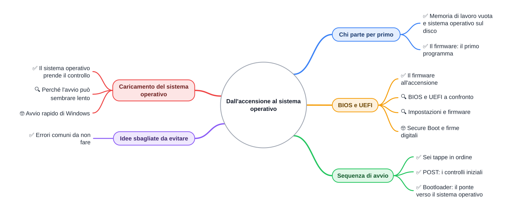
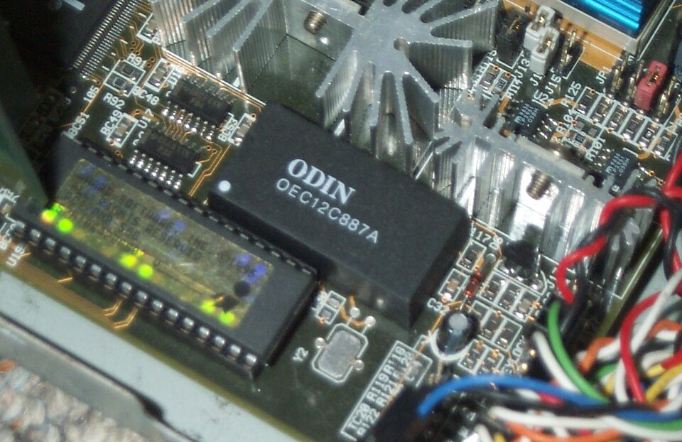

⬅️ [S3](./%28STU%29%203EI%20nov-dic%20S3%20-%20Memorie%20di%20massa.md) · 🏠 [Indice](../README.md) · [S5](./%28STU%29%203EI%20nov-dic%20S5%20-%20Virtualizzazione.md) ➡️

# Dall'accensione al sistema operativo

3EI · Novembre-Dicembre · S4 · Teoria · ⏱️ circa 40 minuti

⏱️ **Tempo di studio:** circa 25 minuti per i ✅ e 15 per i 🔍. I 🤓 sono facoltativi e non entrano nel conteggio.

📚 **Ripassa prima:** [il ciclo macchina (ottobre S4)](../1%20SETT-OTT/%28STU%29%203EI%20sett-ott%20S4%20-%20Il%20ciclo%20macchina.md) e [le memorie (ottobre S5)](../1%20SETT-OTT/%28STU%29%203EI%20sett-ott%20S5%20-%20Indirizzi%20e%20gerarchia%20delle%20memorie.md).

>**Legenda:** ✅ minimo per la sufficienza · 🔍 dettagli per il voto massimo · 🤓 approfondimento facoltativo · 📜 storia · 🧪 esempio · 🧠 da ricordare · ✏️ da fare · ⚠️ errore comune · 🃏 flashcard · 🛠️ strumento per guardare · 🔧 rimando al laboratorio

## Chi parte per primo

📜 **Una domanda vecchia quanto il PC.** Ogni mattina accendi un dispositivo e, in pochi secondi, compare il tuo spazio di lavoro. Ma in quel momento la memoria di lavoro è vuota e nessun programma è in funzione. Chi dà il primo colpo? La risposta è sempre stata la stessa: serve un programma già pronto, che si avvia da solo. Da lui parte tutto il resto.

### ✅ Memoria di lavoro vuota e sistema operativo sul disco

Quando premi il pulsante di accensione del tuo PC, la **memoria di lavoro**, detta **RAM**, è vuota. La RAM è **volatile**: perde il suo contenuto quando il PC si spegne. <u>All'accensione nessun programma gira.</u>

Il sistema operativo, invece, sta sul **disco**. Un SSD da 512 GB è una dimensione tipica. Il disco conserva i dati anche da spento, ma il processore (CPU) non sa usarlo da solo: prima serve un programma che sappia leggerlo.

🧪 **Esempio.** Un PC con 8 GB di RAM ha circa 8 miliardi di byte di memoria di lavoro (valore tipico). Subito dopo l'accensione quella memoria non contiene ancora il sistema operativo.

🛠️ **Dove verificare.** Su Windows scrivi `msinfo32` nella ricerca. Nella finestra leggi «Memoria fisica installata» (la RAM) e «Modalità BIOS»: vedrai UEFI oppure Legacy. Si legge soltanto, non si cambia nulla.

🃏 <b>Che cos'è la RAM?</b>

La memoria in cui il computer lavora; si svuota quando il PC si spegne. <i>Esempio: un documento aperto e non salvato sparisce allo spegnimento.</i>

🃏 <b>Perché il sistema operativo non parte subito dal disco?</b>

Perché il processore non sa ancora leggere il disco: serve prima un programma che lo faccia.

### ✅ Il firmware: il primo programma

Il primo programma che gira si chiama **firmware**. Sta in una memoria **non volatile**: una memoria che conserva i dati anche da spenta. Il firmware è in un chip sulla **scheda madre**, la grande scheda che collega processore, memoria e periferiche del PC.

🧪 **Analogia.** Pensa a un capo cantiere che apre il cantiere ogni mattina. Controlla che gli attrezzi ci siano, poi fa partire il primo operaio. Dove smette di funzionare: il capo cantiere non costruisce la casa da solo.

*Un chip BIOS su una vecchia scheda madre: il firmware sta in un chip così, non sul disco.*

🃏 <b>Che cos'è il firmware?</b>

Un programma conservato in una memoria non volatile sulla scheda madre; è il primo a partire.

🃏 <b>Che cos'è una memoria non volatile?</b>

Una memoria che conserva i dati anche da spenta. <i>Esempio: la chiavetta USB non perde i file quando la stacchi.</i>

🃏 <b>Richiamo (ottobre S5): perché la ROM non si svuota allo spegnimento?</b>

Perché è una memoria non volatile: conserva i dati anche senza corrente.

✏️ **Prova tu:** prevedi prima di rileggere. Se spegni il PC con un documento aperto e non salvato, che cosa resta? Scrivi la previsione in una frase, poi confrontala con la RAM.

🧠 Il firmware parte per primo perché sta già nella scheda madre, non sul disco.

## BIOS e UEFI

### ✅ Il firmware all'accensione

Il firmware ha due compiti base. Il primo è controllare che i componenti principali rispondano. Il secondo è cercare un dispositivo da cui partire: un disco o una chiavetta che contiene un **bootloader**, cioè un piccolo programma che sa avviare il sistema.

Il **BIOS** (*Basic Input/Output System*, sistema di base per ingresso e uscita) è il firmware dei PC più vecchi. La **UEFI** (*Unified Extensible Firmware Interface*, interfaccia firmware unificata ed estensibile) è quella più diffusa nei PC di oggi. Hanno lo stesso compito di base.

🃏 <b>Che cosa significa BIOS?</b>

Basic Input/Output System: il firmware dei PC più vecchi.

🃏 <b>Che cosa fa il firmware all'accensione?</b>

Controlla i componenti principali e cerca un dispositivo da cui partire.

### 🔍 BIOS e UEFI a confronto

Il BIOS legge il **primo settore** del disco, cioè il primo blocco di 512 byte. È un blocco troppo piccolo per un sistema operativo intero: il BIOS carica solo un pezzo del programma di avvio.

La UEFI legge una **partizione**, cioè una parte ordinata del disco che contiene file. Dentro ci sono i programmi di avvio, anche grandi.

🧪 **Esempio.** Lo schema vecchio di organizzazione del disco (MBR) arriva a circa 2 TB (valore tipico). Un disco da 4 TB si organizza con lo schema GPT, che la UEFI sa leggere.

🃏 <b>Che cosa legge il BIOS all'avvio?</b>

Il primo settore del disco, un blocco di 512 byte.

🃏 <b>Che cosa legge la UEFI all'avvio?</b>

Una partizione con file, dove stanno i programmi di avvio.

### 🔍 Impostazioni e firmware

Il firmware è un **programma**. Le sue impostazioni sono **dati**, per esempio l'ordine dei dispositivi da controllare. Si conservano in una piccola memoria alimentata da una batteria sulla scheda madre.

🧪 **Esempio.** Un'app è il programma; le sue preferenze salvate sono i dati. Cambiare una preferenza non cambia l'app.

🔧 **In laboratorio** vedrai il chip del firmware su una scheda reale. In questa dispensa non si configura nulla.

🃏 <b>Il firmware e le sue impostazioni sono la stessa cosa?</b>

No. Il firmware è il programma; le impostazioni sono dati che il programma legge.

### 🤓 Secure Boot e firme digitali

> La UEFI può controllare il programma di avvio prima di eseguirlo. Il **Secure Boot** fa partire solo programmi con una **firma digitale**, cioè un sigillo elettronico che dice chi ha prodotto il programma. Se il sigillo non torna, il programma non parte. È un cenno: non entra nella verifica.

🃏 <b>Che cos'è il Secure Boot?</b>

Un controllo della UEFI che fa partire solo programmi di avvio con una firma digitale riconosciuta.

✏️ **Prova tu:** scrivi due frasi. Nella prima dici che cosa legge il BIOS; nella seconda che cosa legge la UEFI. Usa le parole «settore» e «partizione».

🧠 <u>Il BIOS e la UEFI fanno lo stesso lavoro di base, ma leggono il disco in modi diversi.</u>

## Sequenza di avvio

### ✅ Sei tappe in ordine

Ecco il percorso completo. <u>Ogni tappa passa il lavoro alla successiva.</u> Il firmware non si sposta: resta nel suo chip.

| Tappa | Che cosa succede | Chi è in esecuzione | Dove sta il programma |
|---|---|---|---|
| 1. Accensione | L'alimentazione arriva ai componenti. | Nessuno | — |
| 2. Firmware | Il firmware prende il controllo del processore. | Firmware | Chip sulla scheda madre |
| 3. Controlli (POST) | Il firmware verifica i componenti principali. | Firmware | Chip sulla scheda madre |
| 4. Bootloader | Il firmware cerca il disco di avvio, copia il bootloader in RAM e gli passa il controllo. | Bootloader | Disco, copiato in RAM |
| 5. Caricamento del SO | Il bootloader copia il sistema operativo in RAM. | Bootloader | Disco, copiato in RAM |
| 6. Sistema operativo | Il sistema operativo prende il controllo. | Sistema operativo | RAM |

🃏 <b>Quante tappe ci sono dall'accensione al sistema operativo?</b>

Sei: accensione, firmware, controlli, bootloader, caricamento del sistema operativo e sistema operativo in esecuzione.

🃏 <b>Che cosa succede subito dopo l'accensione?</b>

Il firmware prende il controllo del processore.

### ✅ POST: i controlli iniziali

Il **POST** (*Power-On Self-Test*, auto-test all'accensione) è il primo controllo del firmware. Verifica che processore, memoria e tastiera rispondano. Se un controllo fallisce, di solito il PC emette bip o mostra un messaggio.

🧪 **Esempio.** Un modulo di RAM inserito male può far fallire il controllo della memoria. Il PC di solito si ferma e ti avvisa. Il POST dura di solito pochi secondi (valore tipico: cambia molto da PC a PC).

🃏 <b>Che cos'è il POST?</b>

Il controllo iniziale che il firmware fa all'accensione per verificare i componenti principali.

🃏 <b>Perché il POST controlla la memoria?</b>

Perché senza memoria funzionante non c'è dove caricare il sistema operativo.

### ✅ Bootloader: il ponte verso il sistema operativo

Il **bootloader** è un programma piccolo. Sa leggere il disco e trovare il sistema operativo. Il firmware non conosce tutti i sistemi operativi possibili; il bootloader sa come leggerne uno.

🧪 **Esempio.** Su un PC con due sistemi, il menu che chiede quale avviare è spesso un bootloader. Su molte installazioni Linux è **GRUB**; su Windows è il gestore di avvio di Windows.

🃏 <b>Che cos'è il bootloader?</b>

Un programma piccolo che sa leggere il disco e caricare il sistema operativo.

🃏 <b>Un menu che chiede quale sistema avviare è un bootloader?</b>

Spesso sì. <i>GRUB, per esempio, è il menu di avvio di molte installazioni Linux.</i>

✏️ **Riordina:** scrivi le sei tappe su sei foglietti, mescolali e rimettili in ordine senza guardare la tabella. Poi controlla.

✏️ **Spiega:** perché esiste il bootloader, se il firmware cerca già il disco? Rispondi in una frase.

🧠 <u>Il firmware controlla e cerca il disco; il bootloader trova il sistema; il sistema operativo prende il controllo.</u>

## Caricamento del sistema operativo

### ✅ Il sistema operativo prende il controllo

Il **sistema operativo** è il programma che gestisce la macchina e fa partire gli altri programmi. Il suo nucleo si chiama **kernel**: è la parte che parte per prima e resta in RAM a lavorare.

<u>Quando vedi la schermata di accesso, il sistema operativo è già in RAM e lavora.</u> Il ciclo macchina della CPU (ottobre S4) non cambia: cambia il programma che la CPU esegue.

🃏 <b>Che cos'è il sistema operativo?</b>

Il programma che gestisce la macchina e fa partire gli altri programmi.

🃏 <b>Che cos'è il kernel?</b>

Il nucleo del sistema operativo: la parte che parte per prima e resta in RAM.

### 🔍 Perché l'avvio può sembrare lento

L'avvio ha tre attese: i controlli del POST, la lettura del sistema dal disco e il caricamento in RAM. Spesso la CPU aspetta il disco più che fare calcoli. Su un PC con SSD l'avvio completo dura spesso decine di secondi (valore tipico, varia molto).

🧪 **Esempio.** Due PC uguali: uno ha un HDD (disco magnetico con una testina che si sposta) e uno un SSD (memoria flash senza parti in movimento). Il primo di solito impiega più tempo a leggere il sistema.

🃏 <b>Perché un PC veloce può avviarsi lentamente?</b>

Perché spesso la CPU aspetta il disco o i controlli iniziali, più che fare calcoli.

🃏 <b>Richiamo (S3): che cosa cambia tra HDD e SSD all'avvio?</b>

La lettura: l'SSD, senza parti in movimento, di solito è più rapido.

### 🤓 Avvio rapido di Windows

> Windows ha un'opzione chiamata «avvio rapido». Quando spegni il PC, non chiude del tutto la sessione del sistema: salva parte del suo stato su disco, per riaccendersi più in fretta. Quindi «spento» non sempre vuol dire «tutto azzerato».

🃏 <b>Lo spegnimento con avvio rapido azzera tutto?</b>

No. Il sistema salva parte del suo stato sul disco per ripartire prima.

✏️ **Prevedi:** due PC uguali, uno con HDD e uno con SSD. Quale carica prima il sistema operativo? Scrivi la previsione prima di rileggere la sezione.

🧠 Il sistema operativo entra in RAM e lavora lì. <u>L'attesa dell'avvio spesso è attesa di lettura, non di calcolo.</u>

## Idee sbagliate da evitare

### ✅ Errori comuni da non fare

- ⚠️ «Il BIOS è il sistema operativo.» → Il firmware viene prima.
- ⚠️ «Il sistema operativo parte da solo.» → Qualcuno deve caricarlo: il bootloader.
- ⚠️ «Spegnere cancella tutto.» → La RAM si svuota; il firmware e il disco conservano i dati.
- ⚠️ «L'avvio lento è colpa della CPU.» → Spesso la CPU aspetta il disco.

🃏 <b>Il sistema operativo parte da solo dal disco?</b>

No. Serve un programma che lo carichi: il bootloader, dopo il firmware.

🃏 <b>Che cosa succede alla RAM quando spegni il PC?</b>

Si svuota. Firmware e disco, invece, conservano i dati.

✏️ **Trova l'errore:** leggi la frase «Il BIOS carica Windows nella ROM». Scrivi in una frase che cosa è sbagliato, poi correggi la frase.

🧠 <u>Tre idee da tenere: il firmware viene prima, la RAM si svuota, il sistema operativo va caricato.</u>

**Fonti e risorse**

- **Immagine:** Zac Luzader (Codeczero), *AT Motherboard RTC and BIOS*, Wikimedia Commons, licenza [CC BY 3.0](https://creativecommons.org/licenses/by/3.0), pagina del file: <https://commons.wikimedia.org/wiki/File:AT_Motherboard_RTC_and_BIOS.jpg>. Versione ridotta a 960 px.
- **Wikipedia in inglese**, voci «BIOS», «UEFI», «Power-on self-test» e «Bootloader» (in inglese): leggi solo l'introduzione di ciascuna. Per date e cifre controlla sempre più fonti.
- **UEFI Forum**, <https://uefi.org>: specifiche ufficiali, molto tecniche e in inglese. Per curiosi, non per la verifica.
- **Documentazione Microsoft su «Fast Startup»** (in inglese, 🤓): spiega l'avvio rapido di Windows.

---

⬅️ [S3](./%28STU%29%203EI%20nov-dic%20S3%20-%20Memorie%20di%20massa.md) · 🏠 [Indice](../README.md) · [S5](./%28STU%29%203EI%20nov-dic%20S5%20-%20Virtualizzazione.md) ➡️
