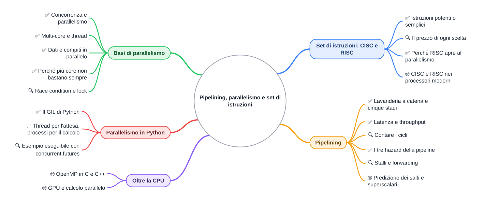
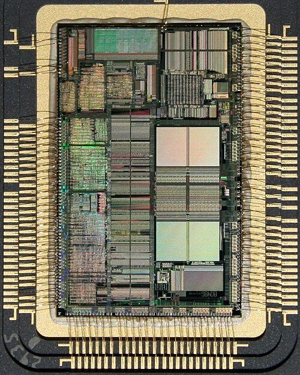
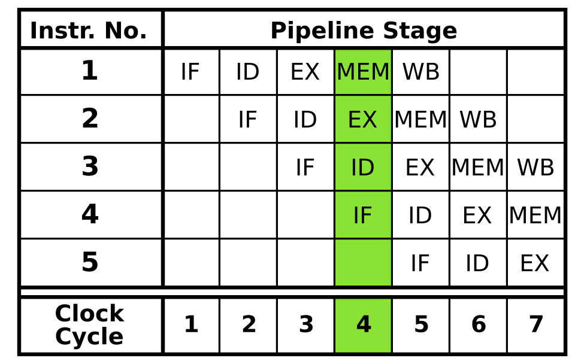

⬅️ [S3 - Virtualizzazione](./%28STU%29%203EI%20nov-dic%20S3%20-%20Virtualizzazione.md) · 🏠 [Indice](../README.md) · [S5 - Ripasso e collegamenti](./%28STU%29%203EI%20nov-dic%20S5%20-%20Ripasso%20e%20collegamenti.md) ➡️

# 🏭 Pipelining, parallelismo e set di istruzioni

**3EI · Novembre-Dicembre · S4 · Teoria · ⏱️ circa 50 minuti** (lettura e ✏️; i 🤓 sono facoltativi).

> **Legenda:** ✅ minimo da sapere · 🔍 dettagli per il voto massimo · 🤓 approfondimento facoltativo · 📜 storia · ⚙️ tecnica · 🧪 esempio · 🧠 da ricordare · ✏️ da fare · ⚠️ errore comune · 🛠️ strumento · 🃏 flashcard: rispondi a voce, poi apri per controllare · 🚪 uscita · 🔁 ripasso

🔁 **Ripasso da ottobre:** [S3 - Registri e percorsi dei dati](../1%20SETT-OTT/%28STU%29%203EI%20sett-ott%20S3%20-%20Registri%20e%20percorsi%20dei%20dati.md), [S4 - Il ciclo macchina](../1%20SETT-OTT/%28STU%29%203EI%20sett-ott%20S4%20-%20Il%20ciclo%20macchina.md) e [S6 - Cache, località e clock](../1%20SETT-OTT/%28STU%29%203EI%20sett-ott%20S6%20-%20Cache%20localita%20e%20clock.md).



## 📜 Dal muro dei GHz ai molti core

Per trent'anni l'industria dei computer ha seguito una ricetta semplice: rendere i transistor più piccoli e alzare la frequenza di clock (i gigahertz). Ogni due anni il processore nuovo andava al doppio della frequenza, e tutti i programmi diventavano più veloci da soli, senza cambiare una riga di codice.

📜 Intorno al **2004–2005**, però, quella corsa si è schiantata contro un muro fisico: il **muro dei GHz** (e del calore). Processori come l'Intel **Pentium 4** (versione *Prescott*) salirono oltre i 3,8 GHz, ma consumavano così tanta corrente e scaldavano così tanto da diventare difficili da raffreddare. Nel 2005 arrivarono i primi processori **dual core** per il mercato di massa (Intel **Pentium D** e AMD **Athlon 64 X2**): invece di un solo cervello velocissimo, due cervelli affiancati a frequenza più tranquilla.

Da allora la regola è cambiata: <u>per andare più veloce, un dispositivo fa più cose insieme</u>. Succede a due livelli:

1. **Dentro un singolo core**, con istruzioni ordinate e messe in catena (**CISC/RISC** e **pipelining**).
2. **Su più core e più programmi**, con il **parallelismo** — che riguarda direttamente il codice Python che scrivi a scuola.

---

## Set di istruzioni: CISC e RISC

### ✅ Istruzioni potenti o semplici

Il **set di istruzioni** (*instruction set*) è il vocabolario dei comandi che una CPU sa eseguire (`ADD`, `LOAD`, `STORE`, ecc.). Quanti e quali comandi mettere in quel vocabolario è una scelta di progetto:

- **CISC** (*Complex Instruction Set Computer*): poche istruzioni molto potenti, capaci di leggere dalla memoria, fare un calcolo e riscrivere in un colpo solo.
- **RISC** (*Reduced Instruction Set Computer*): molte istruzioni semplici e corte; per accedere alla memoria si usano solo `LOAD` (leggi) e `STORE` (scrivi).

🧪 **Esempio.** Il lavoro è: aggiungi `R2` al numero salvato nella cella di memoria `20`.

- In stile **CISC:** `ADD [20], R2` → **1 sola istruzione**.
- In stile **RISC:**
  1. `LOAD R1, [20]`
  2. `ADD R1, R1, R2`
  3. `STORE [20], R1` → **3 istruzioni**.

<p align="center"></p>

*Un Intel 80486 aperto (circa 1990): uno storico processore CISC della famiglia x86.*

<details>
<summary>🃏 <b>Che differenza c'è fra CISC e RISC?</b></summary>
Il CISC usa poche istruzioni complesse che possono accedere direttamente alla memoria; il RISC usa istruzioni semplici e accede alla memoria solo con LOAD e STORE.
</details>

✏️ **Prova tu.** Riscrivi in stile RISC l'istruzione CISC `ADD [30], R4` usando i registri `R1` e `R4`. Quante istruzioni servono?

### 🔍 Il prezzo di ogni scelta

| Aspetto | CISC (es. famiglia x86) | RISC (es. ARM, RISC-V) |
|---|---|---|
| **Istruzioni per programma** | meno | di più |
| **Complessità di una istruzione** | alta | bassa |
| **Lunghezza delle istruzioni** | spesso variabile (1–15 byte) | spesso fissa (es. 4 byte) |
| **Complessità del decodificatore** | alta (molti circuiti e consumo) | bassa (meno circuiti e meno calore) |

⚠️ **Errore comune:** «RISC significa sempre 1 istruzione per ciclo di clock». Falso: il numero di cicli dipende dall'istruzione e da come è costruita la CPU reale.

<details>
<summary>🃏 <b>Un programma RISC ha più o meno istruzioni di un programma CISC equivalente?</b></summary>
Di più, perché ogni singola istruzione fa un passo più piccolo.
</details>

### ✅ Perché RISC apre al parallelismo

Ecco il ponte verso il resto della lezione. Se ogni istruzione ha **lunghezza fissa** (come in quasi tutti i RISC), il processore sa esattamente dove inizia l'istruzione successiva *ancora prima di aver finito di decifrare quella prima*.

In un CISC a lunghezza variabile, invece, finché non decifri i primi byte di un'istruzione non sai dove comincia la prossima.

<u>Istruzioni regolari e semplici permettono al processore di mettere molte istruzioni in fila come una catena di montaggio, e di replicare facilmente più unità semplici sullo stesso chip.</u> È uno dei motivi per cui l'architettura **ARM** (nata RISC) consuma poca batteria e domina smartphone, tablet e portatili recenti.

<details>
<summary>🃏 <b>Perché la lunghezza fissa delle istruzioni RISC aiuta il lavoro in parallelo?</b></summary>
Perché la CPU sa subito dove inizia l'istruzione successiva senza dover prima decifrare tutta l'istruzione corrente.
</details>

### 🤓 CISC e RISC nei processori moderni

I confini oggi sono sfumati. Un processore x86 moderno di Intel o AMD accetta dall'esterno istruzioni CISC (per compatibilità con tutto il software esistente), ma al suo interno le spezza al volo in micro-operazioni semplici, molto simili a un RISC. Allo stesso tempo, i chip ARM moderni hanno aggiunto centinaia di istruzioni specializzate. Quindi «CISC contro RISC» non è una guerra con un vincitore: è un compromesso storico che si è fuso.

---

## Pipelining

### ✅ Lavanderia a catena e cinque stadi

A ottobre abbiamo visto il ciclo macchina in tre passi: *fetch, decode, execute*. Se la CPU aspetta che un'istruzione finisca tutto il giro prima di iniziare la successiva, gran parte dei circuiti resta ferma ad aspettare.

Una **pipeline** (catena di lavoro) divide l'esecuzione in fasi, dette **stadi**. Più istruzioni occupano stadi diversi nello stesso momento.

🧪 **Analogia.** Una lavanderia ha tre stadi: *lavare, asciugare, stirare*. Mentre la camicia 1 si stira, la camicia 2 si asciuga e la camicia 3 è in lavatrice. Nessuna camicia si lava più in fretta, ma tutta la pila finisce molto prima. *Limite della metafora:* le camicie sono indipendenti; le istruzioni di un programma, invece, possono dipendere l'una dall'altra.

Nel modello classico la pipeline ha **cinque stadi**:

| Sigla | Nome | Che cosa fa |
|---|---|---|
| **IF** | *Instruction Fetch* | Preleva l'istruzione dalla memoria. |
| **ID** | *Instruction Decode* | Capisce il comando e legge i registri. |
| **EX** | *Execute* | La ALU esegue il calcolo. |
| **MEM** | *Memory* | Legge o scrive la memoria (usata davvero solo da `LOAD` e `STORE`). |
| **WB** | *Write-Back* | Scrive il risultato nel registro. |



*Ogni riga è un'istruzione, ogni colonna è un ciclo di clock: a regime, cinque istruzioni diverse avanzano insieme.*

<details>
<summary>🃏 <b>Che cos'è una pipeline e quali sono i cinque stadi del modello classico?</b></summary>
Una catena in cui più istruzioni avanzano in fasi diverse nello stesso ciclo; i cinque stadi sono IF, ID, EX, MEM e WB.
</details>

### ✅ Latenza e throughput

- **Latenza:** il tempo che passa dall'inizio alla fine di **una singola istruzione**. Con 5 stadi da 1 ciclo, la latenza è 5 cicli: **la pipeline non la riduce**.
- **Throughput:** quante istruzioni **completano** in un'unità di tempo. Senza pipeline esce 1 istruzione ogni 5 cicli; con la pipeline piena, a regime, esce **1 istruzione ogni ciclo**.

<u>La pipeline non rende più veloce la singola istruzione: aumenta il throughput, cioè il ritmo con cui finisce tutto il lavoro.</u>

⚠️ **Errore comune:** «la pipeline dimezza la durata di ogni istruzione». No: riduce il tempo totale del programma perché sovrappone le fasi.

<details>
<summary>🃏 <b>La pipeline riduce la latenza di una singola istruzione o aumenta il throughput?</b></summary>
Aumenta il throughput (più istruzioni completate nello stesso tempo); la latenza della singola istruzione non diminuisce.
</details>

### 🔍 Contare i cicli

Nel **modello ideale** (stadi tutti lunghi 1 ciclo, nessuna pausa):

<u>cicli totali = numero di stadi + (numero di istruzioni − 1)</u>

🧪 **Esempio.** 4 istruzioni su 5 stadi: $5 + (4 - 1) = 8\text{ cicli}$. Senza pipeline sarebbero serviti $4 \times 5 = 20\text{ cicli}$.

✏️ **Prevedi, poi disegna.** Con 3 istruzioni su 5 stadi nel modello ideale, quanti cicli prevedi? Scrivi il numero, poi disegna la griglia 3×7 sul quaderno per verificarlo.

### ✅ I tre hazard della pipeline

Un **hazard** è un intoppo che impedisce all'istruzione successiva di avanzare nel ciclo previsto:

1. **Hazard strutturale:** due stadi vogliono la **stessa risorsa fisica** nello stesso ciclo (per esempio, una sola memoria per istruzioni e dati usata insieme da `IF` e `MEM`).
2. **Hazard di dati:** un'istruzione ha bisogno di un risultato che l'istruzione precedente non ha ancora finito di scrivere. *Esempio:* `LOAD R1, [40]` seguita subito da `ADD R3, R1, R2` (la `ADD` vuole `R1`, ma `LOAD` lo carica solo nello stadio `MEM`/`WB`).
3. **Hazard di controllo:** c'è un salto (`if`, `BEQ`, ciclo) e la CPU ha già prelevato l'istruzione successiva prima di sapere se il salto verrà preso. Se il salto cambia strada, il lavoro già fatto va buttato.

✏️ **Classifica.** Indica il tipo di hazard: (a) `LOAD R1, [10]` seguito da `ADD R2, R1, R3`; (b) un `if` salta a un'altra riga del programma; (c) due istruzioni chiedono l'accesso all'unica memoria nello stesso ciclo.

<details>
<summary>🃏 <b>Quali sono i tre tipi di hazard in una pipeline?</b></summary>
Hazard strutturale (risorsa contesa), hazard di dati (risultato non ancora pronto) e hazard di controllo (salto con istruzione successiva ancora incerta).
</details>

### 🔍 Stalli e forwarding

Quando nasce un hazard, la CPU inserisce uno **stallo**: una pausa di uno o più cicli finché il dato o la risorsa sono pronti. Per ridurre gli stalli sui dati si usa il **forwarding** (inoltro): passare il risultato appena calcolato dalla ALU direttamente allo stadio che ne ha bisogno, senza aspettare che venga scritto nel registro.

### 🤓 Predizione dei salti e superscalari

Per evitare di fermarsi a ogni `if`, le CPU moderne fanno **predizione dei salti** (*branch prediction*): indovinano in anticipo quale strada prenderà il programma e cominciano a eseguirla. Inoltre i processori moderni sono **superscalari**: hanno più pipeline parallele dentro lo stesso core, così possono iniziare più istruzioni nello stesso ciclo di clock.

---

## Basi di parallelismo

Finora siamo rimasti dentro un singolo core. Ma la tua CPU oggi ha 4, 8, 16 core. Che cosa cambia?

### ✅ Concorrenza e parallelismo

Due parole spesso usate come sinonimi, ma diverse:

- **Concorrenza:** più lavori che **avanzano nello stesso periodo** alternandosi a turno su una sola risorsa (come abbiamo visto in S3 con la CPU a turni per le VM).
- **Parallelismo:** più lavori che **vengono eseguiti nello stesso istante fisico**, su unità di calcolo separate.

🧪 **Analogia.** Un solo cuoco che taglia le cipolle, poi gira il sugo, poi controlla il forno lavora in **concorrenza**. Tre cuochi in tre cucine che fanno le tre cose nello stesso secondo lavorano in **parallelismo**. *Limite della metafora:* i cuochi non condividono la stessa RAM; i core di una CPU sì, quindi devono coordinarsi.

<details>
<summary>🃏 <b>Che differenza c'è fra concorrenza e parallelismo?</b></summary>
La concorrenza alterna più attività a turno su una risorsa; il parallelismo le esegue davvero nello stesso istante su più unità di calcolo.
</details>

### ✅ Multi-core e thread

- **Core:** una vera e propria CPU completa (con la sua ALU, i suoi registri e la sua pipeline) dentro lo stesso chip. Un processore *quad-core* ha 4 core fisici.
- **Processo:** un programma in esecuzione, con il proprio spazio di memoria isolato (es. il browser, Python, Spotify).
- **Thread:** un singolo «filo di esecuzione» dentro un processo. Un programma può aprire più thread che condividono la stessa memoria e possono essere assegnati dal sistema operativo a core diversi.

🛠️ **Sul tuo dispositivo:** su Windows apri Gestione attività (`Ctrl + Maiusc + Esc`) → *Prestazioni* → *CPU*: in basso a destra leggi **Core** (fisici) e **Processori logici** (spesso il doppio dei core, grazie a tecniche come l'*Hyper-Threading*, dove ogni core gestisce due thread alternati).

<details>
<summary>🃏 <b>Che differenza c'è fra un core e un thread?</b></summary>
Il core è l'unità hardware fisica che esegue istruzioni; il thread è un flusso di esecuzione software che il sistema operativo assegna a un core.
</details>

### ✅ Dati e compiti in parallelo

Quando scrivi un programma parallelo, dividi il lavoro in due modi classici:

- **Parallelismo sui dati (*data parallelism*):** fai la **stessa operazione** su tanti dati diversi nello stesso momento. *Esempio:* applicare un filtro bianco e nero a 1000 foto: ogni core elabora 250 foto.
- **Parallelismo sui compiti (*task parallelism*):** fai **operazioni diverse** nello stesso momento. *Esempio:* in un gioco, un thread calcola la fisica, uno disegna l'audio, uno gestisce la rete.

### ✅ Perché più core non bastano sempre

⚠️ **Errore comune:** «se un programma ci mette 10 secondi su 1 core, su 10 core ci mette 1 secondo».

Non funziona quasi mai così. Quasi ogni programma ha una parte che **deve** essere eseguita in sequenza, un passo dopo l'altro (per esempio leggere un file all'inizio o mettere insieme i risultati alla fine).

Questa idea è nota come **legge di Amdahl**: la parte che non si può parallelizzare mette un tetto massimo al guadagno. Se il 50% di un programma è per forza sequenziale, anche con mille core non potrai mai andare più veloce del doppio!

✏️ **Prevedi.** Un programma impiega 100 secondi: 80 secondi sono una parte obbligatoriamente sequenziale, 20 secondi si possono dividere tra più core. Passando da 1 core a 4 core, il tempo totale scende a 25 secondi oppure resta sopra gli 80 secondi? Spiega in una frase.

<details>
<summary>🃏 <b>Perché raddoppiare i core non raddoppia quasi mai la velocità di un programma?</b></summary>
Perché resta sempre una parte sequenziale del lavoro che non può essere divisa fra più core e fa da collo di bottiglia (legge di Amdahl).
</details>

### 🔍 Race condition e lock

Quando due thread lavorano in parallelo sugli stessi dati in memoria, può nascere un bug subdolo chiamato **race condition** («corsa critica»).

🧪 **Esempio.** Sul conto ci sono `100 €`. Due thread devono entrambi aggiungere `10 €` nello stesso millisecondo: entrambi leggono `100`, entrambi calcolano `110`, entrambi scrivono `110`. Risultato: `110 €` invece di `120 €`.

Per evitarlo si usa un **lock** (o *mutex*, lucchetto): un thread blocca quel dato, fa il suo aggiornamento e poi lo sblocca. Il prezzo è che gli altri thread devono aspettare: troppi lock distruggono il parallelismo.

---

## Parallelismo in Python

Ora portiamo tutto sul terreno che conosci già: **Python**. Se lanci un programma Python sul tuo PC con 8 o 16 core, li sta usando tutti? Quasi sempre la risposta è **no**.

### ✅ Il GIL di Python

Nella versione standard di Python (**CPython**), esiste un lucchetto globale chiamato **GIL** (*Global Interpreter Lock*).

Il GIL permette a **un solo thread alla volta** di eseguire codice Python dentro lo stesso processo, anche se il tuo PC ha 16 core. Fu introdotto per proteggere la memoria interna di Python dalle *race condition* in modo semplice e rendere veloce il codice singolo.

<u>Conseguenza pratica: in Python, usare più `threading` NON accelera i calcoli matematici puri (lavori *CPU-bound*).</u>

<details>
<summary>🃏 <b>Che cos'è il GIL in Python e che effetto ha sui thread?</b></summary>
Il Global Interpreter Lock è un lucchetto che in CPython lascia eseguire istruzioni Python a un solo thread alla volta, impedendo ai thread di accelerare i calcoli puri su più core.
</details>

### ✅ Thread per l'attesa, processi per il calcolo

Come si sceglie lo strumento giusto in Python? Dipende da che cosa fa il programma:

| Tipo di lavoro | Esempio | Strumento in Python | Perché funziona |
|---|---|---|---|
| **Attesa di rete o disco (*I/O-bound*)** | Scaricare 20 pagine web, leggere file | `threading` o `asyncio` | Mentre un thread aspetta la risposta della rete, lascia il GIL e un altro thread lavora. |
| **Calcolo pesante (*CPU-bound*)** | Elaborare milioni di numeri o immagini | `multiprocessing` | Crea **più processi separati**: ogni processo ha il proprio interprete e il proprio GIL, così usa davvero più core. |

✏️ **Scegli lo strumento.** Devi scrivere in Python: (a) uno script che controlla lo stato di 50 siti web; (b) uno script che calcola i numeri primi fino a 10 milioni. In quale usi `threading` (o `asyncio`) e in quale `multiprocessing`?

<details>
<summary>🃏 <b>Quando conviene usare multiprocessing invece di threading in Python?</b></summary>
Per lavori di calcolo pesante (CPU-bound), perché multiprocessing crea processi separati ognuno con il proprio GIL e sfrutta davvero più core.
</details>

### 🔍 Esempio eseguibile con concurrent.futures

Il modulo standard `concurrent.futures` offre un modo pulito per usare sia i thread (`ThreadPoolExecutor`) sia i processi (`ProcessPoolExecutor`). Salva questo codice in un file `.py` (su Windows il blocco `if __name__ == "__main__":` è obbligatorio per i processi) ed eseguilo:

```python
import os
import time
from concurrent.futures import ThreadPoolExecutor, ProcessPoolExecutor

def attesa_rete(n):
    time.sleep(0.1)  # Simula l'attesa di una risposta di rete
    return n * 2

def calcolo_pesante(n):
    return sum(i * i for i in range(n))

if __name__ == "__main__":
    print("Core logici disponibili:", os.cpu_count())

    t0 = time.perf_counter()
    with ThreadPoolExecutor(max_workers=4) as ex:
        risultati = list(ex.map(attesa_rete, [1, 2, 3, 4]))
    print("Thread I/O:", risultati, f"in {time.perf_counter() - t0:.2f}s")

    t0 = time.perf_counter()
    with ProcessPoolExecutor() as ex:
        somme = list(ex.map(calcolo_pesante, [200_000, 200_000, 200_000, 200_000]))
    print("Processi CPU:", len(somme), f"in {time.perf_counter() - t0:.2f}s")
```

Le quattro attese da `0,1 s` con i thread finiscono tutte insieme in circa `0,10 s` invece di `0,40 s`. I quattro calcoli vengono invece distribuiti su più core reali tramite processi separati.

---

## Oltre la CPU

### 🤓 OpenMP in C e C++

Prima che esistessero librerie comode in Python, nei linguaggi compilati come C, C++ e Fortran nacque **OpenMP** (1997): uno standard che permette di parallelizzare un ciclo `for` aggiungendo una sola riga di commento speciale al compilatore:

```c
#pragma omp parallel for
for (int i = 0; i < 1000000; i++) {
    risultato[i] = calcola(dati[i]);
}
```

Il compilatore divide automaticamente il milione di iterazioni fra i core della CPU, senza che il programmatore debba gestire i thread a mano. È il motivo per cui OpenMP è rimasto un classico nel calcolo scientifico, e anche il motivo per cui in Python (che è interpretato e ha il GIL) le cose funzionano diversamente.

### 🤓 GPU e calcolo parallelo

Una **CPU** moderna ha pochi core (8–16) molto grandi, veloci e bravissimi a gestire salti, `if` e programmi complessi. Una **GPU** (scheda video) fa l'opposto: ha **migliaia di core piccolissimi e semplici**, progettati per fare la stessa operazione matematica su milioni di pixel nello stesso istante (parallelismo puro sui dati).

Quando oggi si allena un'intelligenza artificiale o si fanno simulazioni fisiche, si usa proprio la GPU (attraverso piattaforme come **CUDA** di NVIDIA o **OpenCL**): per moltiplicare milioni di numeri tutti insieme, migliaia di «operai semplici» battono di gran lunga pochi «ingegneri velocissimi».

> 🧠 <u>Tutto ha un compromesso:</u> la pipeline e il parallelismo moltiplicano il lavoro completato nello stesso tempo, ma non eliminano le parti sequenziali né i costi di coordinamento (hazard, lock, GIL).

---

## 🚪 Uscita

1. Spiega in due frasi perché le istruzioni RISC a lunghezza fissa aiutano la pipeline.
2. Hai un PC con 8 core e scrivi un calcolo matematico pesante in Python usando `threading`: perché non va 8 volte più veloce?

---

## 📚 Fonti e risorse

- [Instruction pipelining — Wikipedia EN](https://en.wikipedia.org/wiki/Instruction_pipelining): stadi della pipeline e hazard.
- [Pentium 4 — Wikipedia IT](https://it.wikipedia.org/wiki/Pentium_4) e [Pentium D — Wikipedia IT](https://it.wikipedia.org/wiki/Pentium_D): la storia del muro dei GHz e dei primi dual core.
- [Concorrenza (informatica) — Wikipedia IT](https://it.wikipedia.org/wiki/Concorrenza_(informatica)) e [Calcolo parallelo — Wikipedia IT](https://it.wikipedia.org/wiki/Calcolo_parallelo): concetti base di concorrenza e parallelismo.
- [Processore multicore — Wikipedia IT](https://it.wikipedia.org/wiki/Processore_multicore) e [Thread (informatica) — Wikipedia IT](https://it.wikipedia.org/wiki/Thread_(informatica)).
- [Legge di Amdahl — Wikipedia IT](https://it.wikipedia.org/wiki/Legge_di_Amdahl): perché la parte sequenziale limita lo speedup.
- [Global Interpreter Lock — Wikipedia IT](https://it.wikipedia.org/wiki/Global_Interpreter_Lock) e [concurrent.futures — Python Docs](https://docs.python.org/3/library/concurrent.futures.html): il GIL e gli executor in Python.
- [OpenMP — Wikipedia IT](https://it.wikipedia.org/wiki/OpenMP) e [GPU — Wikipedia IT](https://it.wikipedia.org/wiki/Unit%C3%A0_di_elaborazione_grafica) (🤓): direttive per il calcolo parallelo e architettura GPU.
- Immagine CPU 80486: «Die of a microprocessor Intel 80486», autore Thomy pc, pubblico dominio, [Wikimedia Commons](https://commons.wikimedia.org/wiki/File:Die_%28the_%27heart%27%29_of_a_microprocessor_Intel_80486_with_1.2_millions_of_transistors%2C_ca._1990.jpg).
- Immagine pipeline: *5 Stage Pipeline*, Inductiveload, pubblico dominio, [Wikimedia Commons](https://commons.wikimedia.org/wiki/File:5_Stage_Pipeline.svg).

---

⬅️ [S3 - Virtualizzazione](./%28STU%29%203EI%20nov-dic%20S3%20-%20Virtualizzazione.md) · 🏠 [Indice](../README.md) · [S5 - Ripasso e collegamenti](./%28STU%29%203EI%20nov-dic%20S5%20-%20Ripasso%20e%20collegamenti.md) ➡️
