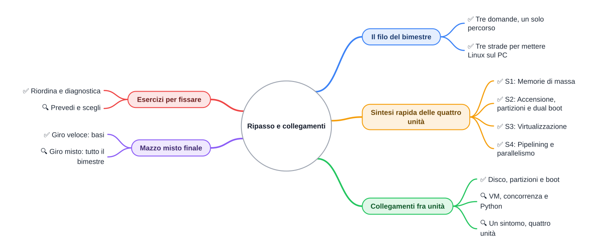
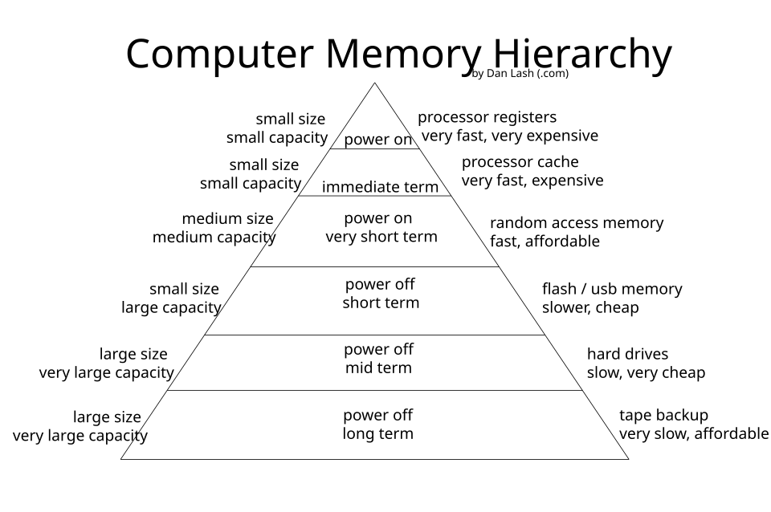

⬅️ [S4 - Pipelining, parallelismo e set di istruzioni](./%28STU%29%203EI%20nov-dic%20S4%20-%20Pipelining%2C%20parallelismo%20e%20set%20di%20istruzioni.md) · 🏠 [Indice](../README.md)

# 🧩 Ripasso e collegamenti

**3EI · Novembre-Dicembre · S5 · Studio e ripasso · ⏱️ circa 60-75 minuti** (consigliato in due o tre sessioni brevi).

> **Legenda:** ✅ minimo da sapere · 🔍 dettagli per il voto massimo · 🤓 approfondimento facoltativo · 📜 storia · 🧪 esempio · 🧠 da ricordare · ✏️ da fare · ⚠️ errore comune · 🃏 flashcard: rispondi a voce, poi apri per controllare · 🚪 uscita · 🔁 ripasso

## Il filo del bimestre

### ✅ Tre domande, un solo percorso

Ottobre ha costruito la macchina di Von Neumann dentro la CPU. Novembre e dicembre hanno risposto a tre domande pratiche:

1. **Che cosa resta quando spegni il PC?** (S1) → La RAM si svuota, la memoria di massa no. HDD e SSD hanno limiti diversi su frammentazione, TRIM e usura.
2. **Chi parte per primo e chi ospita chi?** (S2–S3) → All'accensione parte il firmware dalla scheda madre, legge la mappa del disco (MBR o GPT) e lancia il bootloader. Lo stesso schema si ripete dentro una macchina virtuale, ma al sicuro in un file.
3. **Come fa una macchina più cose insieme?** (S4) → Con istruzioni regolari (RISC), fasi sovrapposte (pipelining), più core fisici e attenzione alle regole del linguaggio (il GIL in Python).

📜 Dalla prima tessera perforata del telaio di Jacquard al PC multi-core con due sistemi operativi, l'idea di fondo non è cambiata: **organizzare lavoro e memoria con compromessi chiari**.

### ✅ Tre strade per mettere Linux sul PC

| Strada | Come funziona | Rischio sui dati | Prestazioni | Unità |
|---|---|---|---|---|
| **Live USB** | Linux gira dalla chiavetta in RAM | Nessuno | Medie (dipende da USB) | S2 |
| **Macchina virtuale** | Linux gira in una finestra sopra Windows | Nessuno (è un file) | Ridotte (risorse divise) | S3 |
| **Dual boot** | Linux e Windows condividono disco ed EFI | Alto se sbagli partizione | Piene | S2 |

---

## Sintesi rapida delle quattro unità

### ✅ S1: Memorie di massa

*Gerarchia delle memorie: più in alto è piccola e veloce, più in basso è grande, lenta e persistente.*

- **Volatile vs persistente:** RAM perde tutto allo spegnimento; SSD, HDD e USB no.
- **HDD vs SSD:** piatti magnetici e testina contro celle flash senza parti mobili.
- **Formato vs interfaccia:** forma (M.2, 2,5", 3,5") contro collegamento e protocollo (SATA, PCIe/NVMe, USB).
- **Frammentazione e TRIM:** su HDD i file sparsi rallentano la testina (serve deframmentare); su SSD non si deframmenta mai, si usa **TRIM**.
- **Danneggiamento:** settori danneggiati (fisici o logici), settori riallocati (di riserva), **SMART** (autodiagnosi, utile ma non infallibile: serve il backup).

### ✅ S2: Accensione, partizioni e dual boot

- **Staffetta del boot:** Accensione → Firmware (BIOS/UEFI su scheda madre) → POST → Bootloader (es. GRUB) → Kernel e servizi in RAM.
- **MBR vs GPT:** MBR sta in 512 byte, massimo 4 partizioni primarie e **2 TB**; GPT supera i 2 TB e ha copia di sicurezza.
- **Partizioni di avvio:** **EFI (ESP)** contiene i bootloader; poi partizione di sistema e partizione di ripristino.
- **UEFI e Linux:** ordine di avvio per partire da live USB; dual boot richiede spazio libero, condivisione della EFI e GRUB.

### ✅ S3: Virtualizzazione

- **Host** (PC vero), **Guest** (VM con il suo SO), **Hypervisor** (il gestore: Tipo 1 sull'hardware, Tipo 2 sopra il SO dell'host).
- **Risorse:** CPU a turni (*time-sharing*), RAM a fette fisse, disco virtuale come un file.
- **Isolamento vs limite:** i guest non si vedono fra loro, ma dipendono tutti dalla RAM e dalla CPU dell'host.

### ✅ S4: Pipelining e parallelismo

- **CISC vs RISC:** istruzioni potenti vs istruzioni semplici; la lunghezza fissa RISC facilita la pipeline e il parallelismo.
- **Pipelining:** 5 stadi (`IF`, `ID`, `EX`, `MEM`, `WB`); non riduce la latenza della singola istruzione, aumenta il **throughput**. Nel modello ideale: $\text{cicli} = \text{stadi} + (\text{istruzioni} - 1)$.
- **Tre hazard:** strutturale (risorsa contesa), di dati (risultato non pronto), di controllo (salto).
- **Parallelismo:** concorrenza (a turno) contro parallelismo (insieme su più core); parallelismo sui dati vs sui compiti; **legge di Amdahl** (la parte sequenziale mette un limite).
- **Python:** il **GIL** blocca più thread di calcolo nello stesso processo → `threading`/`asyncio` per attese I/O, `multiprocessing` per calcoli pesanti.

---

## Collegamenti fra unità

### ✅ Disco, partizioni e boot

Un PC non si avvia se il disco non ha una mappa leggibile: il firmware UEFI cerca una tabella **GPT** e dentro di essa una **partizione EFI** in FAT32. Se sull'SSD si guasta il settore dove sta la tabella (e non c'è copia) o cancelli per sbaglio la partizione EFI, il sistema operativo è ancora intatto nella sua partizione, ma il PC dice *«No bootable device»*.

### 🔍 VM, concorrenza e Python

La parola **concorrenza** compare due volte con lo stesso principio:
- In **S3**, l'hypervisor fa avanzare due VM su un solo core alternandole migliaia di volte al secondo (*tempo condiviso*).
- In **S4**, Python con `threading` alterna più thread sullo stesso interprete per colpa del **GIL**.

In entrambi i casi, finché aspetti qualcosa (rete o disco) l'alternanza sembra velocissima; quando tutti chiedono calcolo puro insieme, il limite di un singolo core o del GIL si vede subito.

### 🔍 Un sintomo, quattro unità

🧪 **Caso.** Avvii il PC e noti due problemi: ci mette due minuti ad aprire i file e quando apri una VM Linux dentro Windows tutto scatta.

- Il ritardo sui file può venire da un **HDD frammentato** o con **settori danneggiati** (S1).
- Lo scatto della VM viene quasi sempre dalla **RAM dell'host satura** o dalla CPU condivisa (S3).
- Prima di cambiare pezzi, guardi Gestione attività e stato **SMART**: *non si indovina senza un dato*.

---

## Esercizi per fissare

### ✅ Riordina e diagnostica

1. **✏️ Riordina il boot (S2).** Scrivi nella giusta sequenza: *GRUB mostra il menu · Il kernel avvia la rete · Premi il pulsante · Il firmware esegue il POST · Il bootloader carica il kernel in RAM*.
2. **✏️ Diagnostica il disco (S1).** Un amico vuole deframmentare il suo nuovo SSD NVMe perché «così va più veloce». Spiegagli in tre righe perché è una cattiva idea e che cosa fa invece il sistema operativo.
3. **✏️ Scegli per Linux (S2–S3).** Un compagno ha un portatile con 8 GB di RAM e vuole provare Linux per un mese senza rischiare i suoi file di scuola. Confronta dual boot e macchina virtuale su rischio, prestazioni e facilità di rimozione.

### 🔍 Prevedi e scegli

4. **✏️ Pipeline e hazard (S4).** Data la sequenza `LOAD R1, [20]` seguita da `ADD R2, R1, R3` e `BEQ R2, R0, fine`: individua quali hazard compaiono e calcola quanti cicli richiederebbero 4 istruzioni su 5 stadi nel modello ideale (senza hazard).
5. **✏️ Python e Amdahl (S4).** Uno script Python deve scaricare 100 file da internet e poi sommare tutti i risultati in un'unica lista finale. Quale parte conviene parallelizzare con `ThreadPoolExecutor`? E perché aggiungere 16 core non azzera comunque il tempo totale?

---

## Mazzo misto finale

*Le domande qui sotto mescolano apposta S1, S2, S3 e S4: rispondi a voce prima di aprire.*

### ✅ Giro veloce: basi

🃏 <b>1. Che differenza c'è fra memoria volatile e memoria persistente?</b>

La volatile (es. RAM) si svuota quando manca la corrente; la persistente (SSD, HDD) conserva i dati anche a PC spento.

🃏 <b>2. Che cos'è il firmware e dove risiede?</b>

Il primo programma che parte all'accensione, salvato in una memoria non volatile sulla scheda madre.

🃏 <b>3. Chi è l'hypervisor?</b>

Il software che crea le macchine virtuali e distribuisce loro CPU, RAM e disco dell'host.

🃏 <b>4. Che cos'è la latenza in una pipeline?</b>

Il tempo che passa dall'inizio alla fine di una singola istruzione; la pipeline non la riduce.

🃏 <b>5. Perché su un SSD non si fa la deframmentazione?</b>

Perché non ha testine mobili (nessun guadagno di tempo) e le scritture inutili consumano le celle flash.

🃏 <b>6. Qual è il limite massimo di capacità di uno schema MBR?</b>

Circa 2 TB (e al massimo 4 partizioni primarie).

🃏 <b>7. Che differenza c'è fra concorrenza e parallelismo?</b>

La concorrenza alterna più lavori su una risorsa; il parallelismo li esegue nello stesso istante su più unità di calcolo.

🃏 <b>8. Che cosa fa il comando TRIM?</b>

Avvisa il controllore dell'SSD quali blocchi sono stati cancellati dal sistema operativo, così può prepararli per future scritture.

🃏 <b>9. Che cos'è una live USB?</b>

Una chiavetta avviabile che esegue Linux in RAM senza modificare il disco interno del PC.

🃏 <b>10. Che cos'è un guest?</b>

La macchina virtuale con dentro il proprio sistema operativo, ospitata da un host.

🃏 <b>11. Quali sono i cinque stadi della pipeline classica?</b>

IF (prelievo), ID (decodifica), EX (esecuzione), MEM (accesso memoria), WB (scrittura risultato).

🃏 <b>12. Che cos'è il GIL in Python?</b>

Il lucchetto globale che in CPython permette a un solo thread alla volta di eseguire codice Python nello stesso processo.

🃏 <b>13. A che cosa serve la partizione EFI (ESP)?</b>

Contiene i bootloader dei sistemi operativi installati in modalità UEFI.

🃏 <b>14. Che cosa controlla il POST all'accensione?</b>

Verifica che i componenti essenziali (CPU, RAM, periferiche di base) rispondano correttamente prima di caricare il bootloader.

🃏 <b>15. Che differenza c'è fra formato e interfaccia di un disco?</b>

Il formato è la forma fisica (es. M.2, 2,5"), l'interfaccia è il collegamento e protocollo di comunicazione (es. SATA, PCIe/NVMe).

🃏 <b>16. Perché una macchina virtuale non può essere più veloce del PC host?</b>

Perché usa una fetta delle risorse fisiche dell'host e passa attraverso l'hypervisor.

🃏 <b>17. Che cos'è GRUB?</b>

Il bootloader usato da molte distribuzioni Linux che permette di scegliere quale sistema avviare in dual boot.

🃏 <b>18. Che cos'è un core fisico rispetto a un thread?</b>

Il core è l'unità di calcolo hardware nella CPU; il thread è un flusso di esecuzione software dentro un programma.

### 🔍 Giro misto: tutto il bimestre

🃏 <b>19. Perché un SSD da 512 GB viene mostrato come circa 477 GB dal sistema operativo?</b>

Perché i produttori usano multipli di 1000 (GB) e il sistema operativo conta spesso in multipli di 1024 (GiB).

🃏 <b>20. Che differenza c'è fra un settore danneggiato fisico e uno logico?</b>

Quello fisico è un danno permanente del supporto (spesso sostituito con un settore riallocato); quello logico è una corruzione dei dati recuperabile riscrivendo il settore.

🃏 <b>21. Perché SMART non sostituisce il backup?</b>

Perché molti dischi si guastano all'improvviso senza che i contatori SMART abbiano segnalato errori in anticipo.

🃏 <b>22. Perché la lunghezza fissa delle istruzioni RISC aiuta la pipeline?</b>

Perché la CPU sa subito dove inizia l'istruzione successiva prima ancora di finire la decodifica della prima.

🃏 <b>23. Quanti cicli servono a 5 istruzioni su 5 stadi nel modello ideale?</b>

9 cicli: 5 + (5 - 1) = 9 (contro 25 senza pipeline).

🃏 <b>24. Che differenza c'è fra hazard di dati e hazard di controllo?</b>

Quello di dati nasce quando un'istruzione aspetta un risultato non ancora pronto; quello di controllo nasce da un salto che rende incerta l'istruzione successiva.

🃏 <b>25. Che cos'è il forwarding nella pipeline?</b>

Il passaggio diretto di un risultato appena calcolato allo stadio che lo aspetta, senza attendere la scrittura nel registro.

🃏 <b>26. Quando usi ThreadPoolExecutor e quando ProcessPoolExecutor in Python?</b>

ThreadPoolExecutor per attese di rete o disco (I/O-bound); ProcessPoolExecutor per calcoli pesanti su più core (CPU-bound, aggira il GIL).

🃏 <b>27. Che cosa dice in parole semplici la legge di Amdahl?</b>

Che la parte sequenziale di un programma limita il guadagno massimo ottenibile aggiungendo altri core.

🃏 <b>28. Che cos'è una race condition?</b>

Un errore che nasce quando due thread leggono e modificano lo stesso dato condiviso nello stesso momento senza un lock.

🃏 <b>29. Come entra il dual boot nella partizione EFI?</b>

Linux non crea una seconda partizione EFI: aggiunge il file di GRUB dentro la stessa partizione EFI già usata da Windows.

🃏 <b>30. Che differenza c'è fra hypervisor di tipo 1 e di tipo 2?</b>

Il tipo 1 gira direttamente sull'hardware (data center); il tipo 2 è un programma sopra il sistema operativo dell'host (PC di casa).

🃏 <b>31. Come è rappresentato il disco di una VM sull'host?</b>

È un normale file (es. `.vdi`) salvato dentro una cartella del disco dell'host.

🃏 <b>32. Che cosa succede se tutte le VM accese chiedono più RAM di quella fisica dell'host?</b>

L'hypervisor rifiuta l'avvio della nuova VM oppure usa il disco come riserva e tutto rallenta drasticamente.

🃏 <b>33. Perché cancellare un file non lo fa sparire subito dal disco?</b>

Perché il file system toglie solo la voce dal catalogo; i byte restano finché non vengono sovrascritti (o azzerati da TRIM su SSD).

🃏 <b>34. Perché il tempo di CPU per un programma RISC può essere ottimo anche se usa più istruzioni di un CISC?</b>

Perché istruzioni più semplici permettono pipeline più scorrevoli, decodificatori meno complessi e meno stalli.

🃏 <b>35. Che differenza c'è fra partizione e file system?</b>

La partizione è una divisione logica del disco; il file system è l'organizzazione di file e cartelle dentro quella partizione.

🃏 <b>36. Perché «Arresta il sistema» con Avvio rapido su Windows può dare fastidio in dual boot?</b>

Perché Windows non chiude del tutto il file system ma salva lo stato del kernel su disco, lasciando la partizione bloccata per Linux.

🃏 <b>37. Qual è il rischio principale del dual boot rispetto a una macchina virtuale?</b>

Un errore nel ridimensionare o scegliere le partizioni può cancellare Windows e i dati; nella VM il disco è solo un file isolato.

🃏 <b>38. Che cos'è il parallelismo sui dati rispetto al parallelismo sui compiti?</b>

Sui dati: stessa operazione applicata a dati diversi su più core; sui compiti: operazioni diverse eseguite in contemporanea su più core.

🃏 <b>39. Richiamo da ottobre: perché un programma su disco viene copiato in RAM prima di partire?</b>

Perché la CPU preleva le istruzioni dalla RAM, che è ordini di grandezza più veloce della memoria di massa.

🃏 <b>40. Che cosa significano le sigle CSM e Secure Boot nel setup UEFI?</b>

Secure Boot controlla la firma digitale del bootloader all'avvio; CSM attiva la modalità di compatibilità per vecchi sistemi BIOS/MBR.

---

## 🚪 Uscita

Scrivi su un foglio tre punti che sai spiegare a un compagno senza guardare le dispense e **un** argomento su cui hai ancora un dubbio da rivedere prima della verifica.

---

## 📚 Fonti

- Dispense [S1](./%28STU%29%203EI%20nov-dic%20S1%20-%20Memorie%20di%20massa.md), [S2](./%28STU%29%203EI%20nov-dic%20S2%20-%20Dall%27accensione%20al%20sistema%20operativo.md), [S3](./%28STU%29%203EI%20nov-dic%20S3%20-%20Virtualizzazione.md) e [S4](./%28STU%29%203EI%20nov-dic%20S4%20-%20Pipelining%2C%20parallelismo%20e%20set%20di%20istruzioni.md).
- Immagine gerarchia memorie: *Computer Memory Hierarchy*, Danlash (en.wikipedia), pubblico dominio, [Wikimedia Commons](https://commons.wikimedia.org/wiki/File:Computer_Memory_Hierarchy.svg).

---

⬅️ [S4 - Pipelining, parallelismo e set di istruzioni](./%28STU%29%203EI%20nov-dic%20S4%20-%20Pipelining%2C%20parallelismo%20e%20set%20di%20istruzioni.md) · 🏠 [Indice](../README.md)
