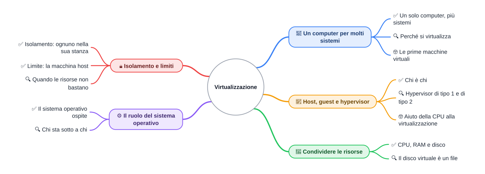
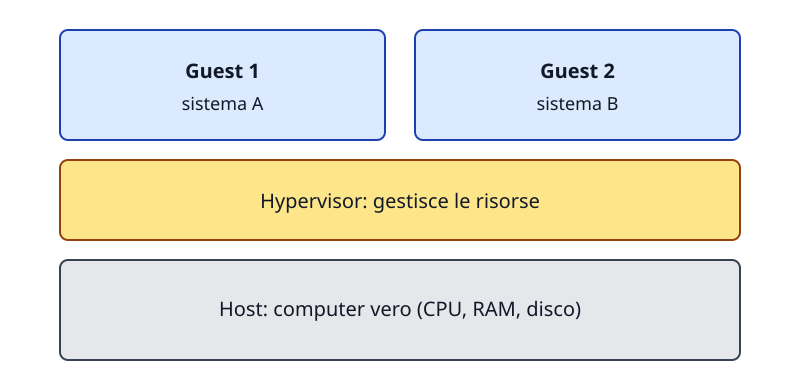
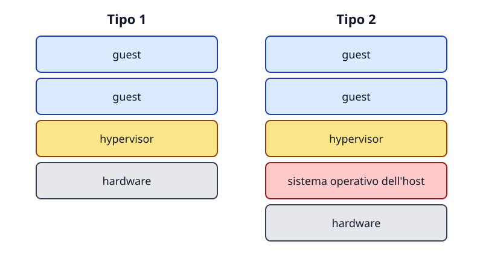

⬅️ [S4](./%28STU%29%203EI%20nov-dic%20S4%20-%20Dall%27accensione%20al%20sistema%20operativo.md) · 🏠 [Indice](../README.md) · [S6](./%28STU%29%203EI%20nov-dic%20S6%20-%20Ricostruire%20il%20sistema.md) ➡️

# Virtualizzazione

**3EI · Novembre-Dicembre · S5 · Teoria · ⏱️ 35 minuti**

> **Legenda:** ✅ minimo per la sufficienza · 🔍 dettagli per il voto massimo · 🤓 approfondimento facoltativo · 📜 storia · ⚙️ tecnica · 🧪 esempio · 🧠 da ricordare · ✏️ da fare · ⚠️ errore comune · 🃏 flashcard: rispondi a voce, poi apri per controllare · 🛠️ strumento · 🔧 rimando al laboratorio

Ripasso: CPU e ciclo macchina sono in [sett-ott S4 - Il ciclo macchina](../1%20SETT-OTT/%28STU%29%203EI%20sett-ott%20S4%20-%20Il%20ciclo%20macchina.md). Qui la CPU lavora per più sistemi.

## 📜 Un computer per molti sistemi

Immagina un grande calcolatore degli anni Sessanta, in un centro di calcolo. Molte persone vogliono usarlo nello stesso momento. Ognuno vorrebbe una macchina tutta sua, ma costruirne cento costa troppo. Qualcuno ha un'idea: far credere a ciascuno di avere un computer proprio, mentre la macchina vera è una sola. È la stessa domanda che ci facciamo oggi, sul portatile di casa: perché non far vivere dentro un computer anche un altro sistema? <u>Una macchina può rappresentarne un'altra.</u>

### ✅ Un solo computer, più sistemi

Un **sistema operativo** (SO) è il programma che gestisce le risorse del computer e fa partire le app: Windows, Linux, macOS, Android. Una **macchina virtuale** (VM, dall'inglese *virtual machine*) è una macchina finta, creata dal software dentro un computer vero. Dentro la VM gira un sistema operativo, che crede di avere un computer tutto suo.

🧪 **Esempio inventato:** un server di casa, cioè un PC sempre acceso in un angolo, con 16 GB di RAM. Dentro ci sono tre VM: una per i file, una per un sito di prova, una per gli esperimenti. Il server è uno solo; i sistemi sono tre.

🃏 <b>Che cos'è una macchina virtuale (VM)?</b>

Una macchina finta, creata dal software dentro un computer vero, dove gira un sistema operativo.

🃏 <b>Perché un server di casa può ospitare più sistemi?</b>

Perché ogni sistema vive in una VM separata, che usa una parte delle risorse della macchina vera.

🃏 <b>Il sistema operativo è la stessa cosa della VM?</b>

No. Il SO gestisce le risorse; la VM è la macchina finta in cui il SO gira. *Esempio: Windows dentro una VM è un SO dentro una macchina finta.*

✏️ **Elenca.** Scrivi due sistemi che usi sul tuo PC o telefono. Per ciascuno, dì quale motivo potrebbe averlo in una VM: provare, separare, risparmiare un computer.

### 🔍 Perché si virtualizza

Tre motivi concreti:

- **Più sistemi su un solo server:** meno computer accesi, meno spazio e meno corrente.
- **Provare un sistema nuovo** senza toccare quello che già funziona.
- **Separare i servizi:** se la VM di prova si blocca, la VM dei file continua a lavorare.

<u>Non è gratis:</u> ogni VM usa una parte di CPU, RAM e disco della macchina vera. Il vantaggio ha sempre un prezzo.

🃏 <b>Dai un vantaggio della virtualizzazione.</b>

Usare più sistemi su un solo server, oppure provare un sistema nuovo senza rischiare quello vero.

🃏 <b>Quale costo ha ogni macchina virtuale?</b>

Usa una parte della CPU, della RAM e del disco della macchina vera, che quindi non sono più tutti disponibili per l'host.

> 🧠 Virtualizzare risolve il problema di avere tanti sistemi con poche macchine; crea il problema di condividere le stesse risorse.

### 🤓 Le prime macchine virtuali

> Alla fine degli anni Sessanta, in IBM, il sistema **CP-67** permise a più utenti di lavorare come se ognuno avesse una macchina propria, sul calcolatore System/360 Model 67. Da qui nasce il **tempo condiviso**: la CPU serve più utenti a turno. Date e nomi da verificare sulle fonti in fondo.

🃏 <b>Quale sistema IBM della fine degli anni Sessanta è una delle prime macchine virtuali?</b>

Il CP-67, eseguito sul System/360 Model 67.

## 🧱 Host, guest e hypervisor

### ✅ Chi è chi

Tre parole, tre ruoli:

- **Host:** il computer vero, con la sua CPU, la sua RAM e il suo disco. *Esempio: il server di casa.*
- **Guest:** la macchina virtuale con dentro il suo sistema operativo. *Esempio: la VM con Linux per il sito di prova.*
- **Hypervisor:** il software che crea le VM e divide le risorse dell'host fra i guest. È il gestore. *Esempio: la schermata che decide "a questa VM 4 GB di RAM".*

*Due guest sopra l'hypervisor, e sotto tutti l'host: il computer vero.*

<u>Il guest non tocca direttamente l'hardware:</u> usa un hardware virtuale, e l'hypervisor traduce le sue richieste verso il computer vero.

🃏 <b>Che cos'è l'host?</b>

Il computer vero, con le sue risorse fisiche: CPU, RAM e disco.

🃏 <b>Che cos'è l'hypervisor?</b>

Il software che crea le VM e distribuisce CPU, RAM e disco fra i guest.

🃏 <b>Chi è il guest?</b>

La macchina virtuale, con dentro il suo sistema operativo.

### 🔍 Hypervisor di tipo 1 e di tipo 2

Gli hypervisor si dividono in due famiglie, in base a dove stanno:

- **Tipo 1:** l'hypervisor sta direttamente sull'hardware, senza un sistema operativo sotto. È la scelta tipica dei data center, le grandi sale di server. *Esempio: VMware ESXi.*
- **Tipo 2:** l'hypervisor è un programma che gira sopra il sistema operativo normale del computer, detto SO host. È la scelta tipica di chi usa una VM sul proprio PC. *Esempio: VirtualBox.*

*Dal basso verso l'alto: a sinistra l'hypervisor sta sull'hardware; a destra sta sopra il sistema operativo dell'host.*

🃏 <b>Dove sta l'hypervisor di tipo 1?</b>

Direttamente sull'hardware, senza un sistema operativo sotto.

🃏 <b>Quale tipo usa di solito chi lavora su un normale PC?</b>

Il tipo 2, che gira sopra il sistema operativo del PC. *Esempio: VirtualBox.*

### 🤓 Aiuto della CPU alla virtualizzazione

> Alcune CPU moderne hanno istruzioni dedicate alla virtualizzazione, per esempio Intel VT-x e AMD-V. Aiutano l'hypervisor a controllare i guest senza rallentarli troppo. È solo un cenno: il nome basta.

🃏 <b>Che cosa sono VT-x e AMD-V?</b>

Nomi di istruzioni della CPU che aiutano la virtualizzazione. Basta sapere che esistono.

✏️ **Disegna.** Disegna host, hypervisor e due guest per due sistemi che usi (per esempio Windows e Linux). Accanto a ogni riquadro scrivi una parola chiave. In una frase, dì chi comanda chi.

> 🧠 Lo hypervisor divide il computer vero in più macchine finte: risolve il problema di avere più sistemi, e porta con sé la condivisione delle stesse risorse.

## 🔀 Condividere le risorse

### ✅ CPU, RAM e disco

Ogni risorsa si divide in modo diverso:

- **CPU a turni:** la CPU lavora per un guest, poi per l'altro, così in fretta che sembrano lavorare insieme. Il nome è **tempo condiviso** (in inglese *time-sharing*). Due VM che chiedono tutta la CPU non vanno ciascuna alla velocità piena.
- **RAM in pezzi:** a ogni guest si assegna una quantità fissa, per esempio 4 GB, presa dalla RAM dell'host. Un PC portatile di oggi ha spesso fra 8 e 16 GB di RAM (ordine di grandezza tipico).
- **Disco come file:** il disco di ogni guest è un file dentro il disco dell'host.

🛠️ **Gestione attività** (Windows) o **Monitoraggio attività** (Mac) mostra quanta CPU e RAM usa ogni programma. Guardala, senza modificare nulla. Per la RAM totale del tuo PC: Impostazioni › Sistema › Informazioni su Windows, menu Apple › Informazioni su questo Mac su Mac.

🃏 <b>Che cosa significa tempo condiviso?</b>

La CPU serve più sistemi a turno, così in fretta che sembrano lavorare insieme.

🃏 <b>Come si divide la RAM fra le VM?</b>

Ogni guest riceve una quantità fissa, per esempio 4 GB, presa dalla RAM della macchina host.

🃏 <b>Due VM che vogliono tutta la CPU vanno entrambe alla velocità piena?</b>

No. Si alternano, quindi ciascuna lavora per una parte del tempo.

✏️ **Prevedi.** Il server di casa ha 16 GB di RAM. Assegni 4 GB a ciascuna di tre VM. Quanta RAM resta all'host? Scrivi il conto prima di cercare la risposta nel testo.

### 🔍 Il disco virtuale è un file

Il disco di una VM è un file, che di solito occupa lo spazio che gli hai assegnato (per esempio 40 GB). Per il guest è un disco normale; per l'host è un file come un altro. Per questo puoi copiarlo o spostarlo.

⚠️ **Errore comune:** il guest vede tutto il disco dell'host. Non è così: vede solo il proprio disco virtuale.

🃏 <b>Che cos'è un disco virtuale?</b>

Un file, dentro il disco dell'host, che per il guest appare come un disco.

🃏 <b>Il guest vede tutto il disco dell'host?</b>

No: vede solo il proprio disco virtuale, cioè il suo file.

✏️ **Trova l'errore.** Leggi questa frase: «Il disco della VM è una parte fisica del disco dell'host, quindi la VM è più veloce dell'host». Scrivi in una frase che cosa non torna.

> 🧠 Ogni guest riceve la sua fetta, e tutte le fette vengono dalla stessa torta: la macchina host.

## 🔒 Isolamento e limiti

### ✅ Isolamento: ognuno nella sua stanza

**Isolamento** vuol dire che ogni guest resta separato dagli altri: non legge la loro memoria e non vede i loro file. *Esempio: la VM di prova si blocca, la VM dei file continua a funzionare.*

È come un condominio: ogni appartamento ha la sua porta chiusa. *Dove smette di funzionare:* gli appartamenti stanno tutti nello stesso palazzo, cioè sulla stessa macchina host.

🃏 <b>Che cos'è l'isolamento fra guest?</b>

Ogni guest resta separato dagli altri: non ne legge la memoria né i file.

🃏 <b>Perché un guest non legge la memoria di un altro guest?</b>

Perché l'hypervisor assegna a ogni guest i propri spazi di memoria e impedisce l'accesso agli altri.

### ✅ Limite: la macchina host

Tutto ciò che hanno i guest viene dall'host. Nessuna VM può avere più risorse di quelle che l'host possiede. *Dove smette di funzionare l'esempio del condominio:* gli appartamenti non si disturbano a vicenda con le porte chiuse, ma se l'acqua del palazzo è poca, tutti aspettano.

⚠️ **Errori comuni:**

- «La VM è un altro computer fisico.» No: è software dentro un computer vero.
- «La VM è più veloce dell'host.» No: usa le risorse dell'host, quindi non può andare oltre quello che l'host offre.
- «La VM non costa nulla.» No: usa CPU, RAM e disco.

🃏 <b>Da dove vengono le risorse di un guest?</b>

Dalla macchina host: nessuna VM può usare più di quello che l'host possiede.

🃏 <b>Una VM può essere più veloce dell'host?</b>

No. Usa le risorse dell'host, quindi non può superarle.

✏️ **Spiega a un compagno.** Con parole tue, in una frase: perché «isolamento» e «limite» sono due cose diverse?

> 🧠 L'isolamento protegge i sistemi l'uno dall'altro. Il limite ricorda che tutti dipendono dalla stessa macchina host.

### 🔍 Quando le risorse non bastano

Esempio inventato: il server ha 16 GB di RAM. Tre VM da 4 GB usano 12 GB, e restano 4 GB per l'host. Aggiungi una quarta VM da 8 GB: servono 20 GB, ne hai 16. Non c'è RAM per tutti.

Che cosa succede? Dipende dall'hypervisor. Alcuni rifiutano di avviare la quarta VM; altri la avviano, ma allora tutte le macchine rallentano, anche quelle che non hai toccato. La RAM è spesso il primo limite che si incontra.

🃏 <b>Che cosa succede se le VM chiedono più RAM di quella dell'host?</b>

Dipende dall'hypervisor: può rifiutare l'avvio, oppure avviare tutto e far rallentare ogni macchina.

🃏 <b>Qual è spesso il primo limite quando si aprono molte VM?</b>

La RAM. *Esempio: la somma delle RAM dei guest supera quella dell'host.*

> 🧠 Più VM non significano più risorse: significano le stesse risorse divise in più parti.

## ⚙️ Il ruolo del sistema operativo

### ✅ Il sistema operativo ospite

Il sistema operativo del guest lavora come su un computer normale: avvia programmi, gestisce file, chiede CPU e RAM. Di solito non deve sapere che la macchina è finta.

Ci sono due livelli di gestione. Il SO del guest decide quali programmi girano dentro la sua VM. L'hypervisor decide quante risorse concedere alla VM.

🧪 **Esempio:** l'emulatore di Android sul PC è una VM con dentro un telefono. Lì il sistema Android decide quali app girano; il PC decide quanta RAM dare all'emulatore.

🃏 <b>Chi decide quali programmi girano dentro un guest?</b>

Il sistema operativo del guest.

🃏 <b>Chi decide quanta RAM concedere a un guest?</b>

L'hypervisor, dentro i limiti della macchina host.

### 🔍 Chi sta sotto a chi

Sotto ogni guest ci sono sempre l'hypervisor e l'hardware. Nel tipo 2, in mezzo c'è anche il sistema operativo dell'host. Nel tipo 1 no.

🃏 <b>Che cosa c'è sotto il guest in un hypervisor di tipo 2?</b>

L'hypervisor, il sistema operativo dell'host e poi l'hardware.

✏️ **Riordina.** Metti in ordine dall'alto verso il basso: guest, hardware, hypervisor, sistema operativo dell'host (caso tipo 2). Scrivi la sequenza su carta.

> 🧠 Il sistema operativo gestisce i programmi dentro la sua macchina; l'hypervisor gestisce le macchine dentro l'host.

## 📚 Fonti e risorse

- [Wikipedia in italiano - Virtualizzazione](https://it.wikipedia.org/wiki/Virtualizzazione): panoramica generale, utile per ripassare i termini host, guest e hypervisor.
- [Wikipedia in inglese - Hypervisor](https://en.wikipedia.org/wiki/Hypervisor) (in inglese): distinzione fra tipo 1 e tipo 2, con esempi di prodotti.
- [Wikipedia in inglese - CP-67](https://en.wikipedia.org/wiki/CP-67) (in inglese, per curiosi 🤓): la storia del primo sistema di macchine virtuali IBM. Controlla le date sulle fonti primarie.
- Popek e Goldberg (1974), *Formal Requirements for Virtualizable Third Generation Architectures*, Communications of the ACM (per curiosi 🤓): il testo classico su che cosa rende virtualizzabile una CPU. Non serve per la verifica.
- Baldino, Rondano, Spano, Iacobelli, *Internetworking Sistemi e Reti*, vol. 1, Juvenilia Scuola: libro di testo in adozione, da consultare per il quadro generale.

---

⬅️ [S4](./%28STU%29%203EI%20nov-dic%20S4%20-%20Dall%27accensione%20al%20sistema%20operativo.md) · 🏠 [Indice](../README.md) · [S6](./%28STU%29%203EI%20nov-dic%20S6%20-%20Ricostruire%20il%20sistema.md) ➡️
