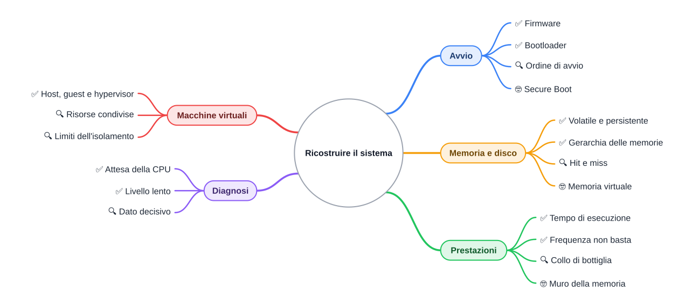
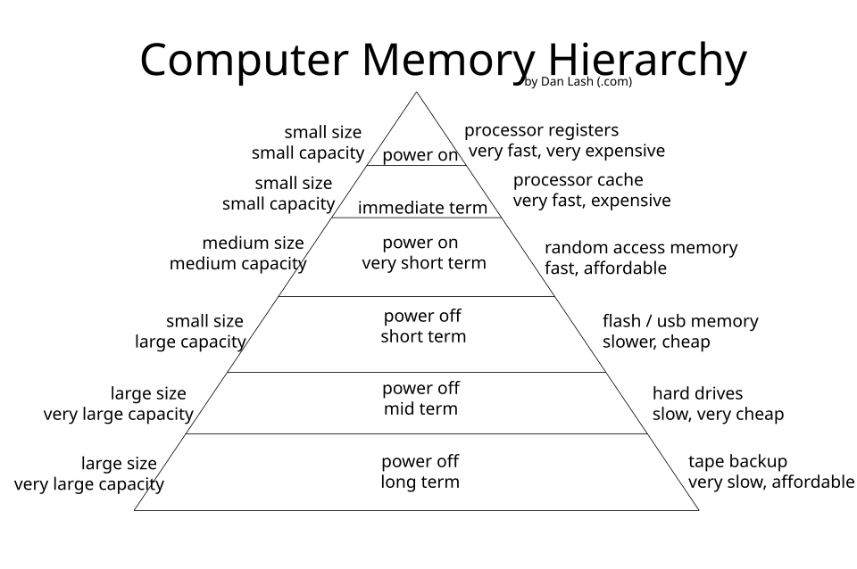

⬅️ [S5](./%28STU%29%203EI%20nov-dic%20S5%20-%20Virtualizzazione.md) · 🏠 [Indice](../README.md) · [S7](./%28STU%29%203EI%20nov-dic%20S7%20-%20Ripasso%20e%20collegamenti.md) ➡️

# 🧩 Ricostruire il sistema

3EI · Novembre-Dicembre · S6 · Teoria · ⏱️ 40 minuti

> **Tempo di studio: 40 minuti**, lettura e ✏️ inclusi. I 🤓 si possono saltare senza perdere il filo.
>
> **Richiamo:** ciclo macchina e gerarchia delle memorie (ottobre). Se hai poco tempo, leggi i ✅ e il metodo in tre domande.

**Legenda:** ✅ minimo da sapere · 🔍 dettagli per capire fino in fondo · 🤓 approfondimento facoltativo · 📜 storia · 🧭 metodo · 🚀 avvio · 💾 memoria e disco · ⏱️ prestazioni · 🖥️ macchine virtuali · 🧪 caso (reale o inventato, dichiarato) · 🧠 da ricordare · ✏️ da fare · ⚠️ errore comune · 🛠️ strumento · 🔧 in laboratorio · 🃏 flashcard · 🗺️ mappa

## 🗺️ Mappa



## 📜 Dal nulla al programma

Premi il tasto di accensione. Nella RAM non c'è niente: la memoria volatile si è svuotata da sola all'ultimo spegnimento. Eppure in pochi secondi compare una schermata che ti chiede una password. Come fa una macchina partita dal vuoto a fare cose complesse?

📜 Nei primi calcolatori a farla partire erano le mani di un operatore, con interruttori e schede perforate. Poi l'idea cambia: un piccolo programma resta scritto in una memoria che non perde i dati (ROM), e sa come far partire il resto. Il primo anello della catena è il firmware; il suo erede moderno è l'UEFI, nato dalle idee dell'EFI di Intel. Date e passaggi precisi da verificare.

<u>Il sistema si ricostruisce come una catena</u>: ogni anello carica il successivo, e nessuno parte da solo.

## 🧭 Metodo: tre domande

### ✅ Tre domande in ordine

Quando un sintomo sembra strano, chiediti in quest'ordine:

1. **Che cosa sta aspettando la macchina?** Un calcolo, un disco, una risposta della rete, un input.
2. **Quale livello è lento?** CPU, RAM, disco, firmware o macchina ospite.
3. **Quale dato mi serve per decidere?** Una misura, non un'impressione.

<u>Attesa non è lavoro</u>: una CPU che aspetta il disco può sembrare piena senza fare nulla di utile. Dire «è colpa della CPU» senza una misura è il primo errore da evitare.

<details>
<summary>🃏 <b>Che cosa significa «attesa non è lavoro»?</b></summary>
Una CPU ferma in attesa di un dato può sembrare occupata, ma non sta facendo calcoli utili.
</details>

<details>
<summary>🃏 <b>Quali sono le tre domande del metodo?</b></summary>
Che cosa aspetta la macchina? Quale livello è lento? Quale dato serve per decidere?
</details>

✏️ **Prevedi, poi confronta.** Il sintomo è: «il video scatta mentre il download è attivo». Prima di leggere oltre, scrivi quale livello sospetti e perché. Poi confrontalo con i casi qui sotto.

## 🚀 Avvio

### ✅ La catena dell'accensione

```text
accensione (alimentatore stabile)
    |
    v
firmware in memoria non volatile (BIOS o UEFI)
    |  controlla i componenti essenziali
    v
ordine di avvio: prova il primo disco o periferica
    |
    v
bootloader: piccolo programma letto dal disco
    |
    v
sistema operativo: carica il kernel e i servizi
    |
    v
programmi di avvio e accesso
```

- **Firmware**: programma incorporato nel computer, il primo a partire. Esempio: la schermata del produttore che compare subito dopo l'accensione.
- **Bootloader**: piccolo programma che sa dove sta il sistema operativo e lo carica. Esempio: il menu che, su alcuni computer con più sistemi, chiede quale avviare.

⚠️ Lo schema è semplificato: su un PC reale i passi possono essere più numerosi, e ogni produttore li ordina a modo suo.

<details>
<summary>🃏 <b>Che cosa fa il firmware?</b></summary>
È il primo programma a partire: controlla i componenti essenziali e cerca il disco da cui avviare.
</details>

<details>
<summary>🃏 <b>Chi carica il sistema operativo in memoria?</b></summary>
Il bootloader, letto dal disco.
</details>

<details>
<summary>🃏 <b>Perché il firmware sta in memoria non volatile?</b></summary>
Perché deve esserci anche quando il computer è spento e la RAM si è svuotata.
</details>

<details>
<summary>🃏 <b>Il sistema operativo parte da solo all'accensione?</b></summary>
No. Parte una catena di programmi, e il sistema operativo arriva per ultimo, caricato dal bootloader.
</details>

✏️ **Riordina.** Scrivi su un foglio questi cinque passi nell'ordine in cui accadono: programmi di avvio, bootloader, accensione, firmware, sistema operativo. Ricontrolla lo schema solo alla fine.

### ✅ Caso: avvio lento

🧪 *Caso inventato. Valori tipici e approssimati.* Mario ha un portatile con SSD (tipico). Il logo del produttore compare in pochi secondi; la schermata di accesso arriva dopo circa un minuto.

- **Spiegazione più ovvia:** il disco o il sistema operativo sono lenti.
- **Alternativa 1:** il firmware cerca dispositivi di avvio in un ordine lungo, prima di trovare il disco giusto.
- **Alternativa 2:** il sistema parte, ma poi si avviano molti programmi da soli.
- **Dato che decide:** quanto dura la fase prima del bootloader e quanto la fase dopo. Il solo dato «un minuto» non basta.

⚠️ «Avvio lento = disco guasto» non segue: un disco può essere lento senza essere rotto, e il ritardo può stare prima del disco.

🛠️ **Gestione attività** (Windows, da `Ctrl+Maiusc+Esc`) mostra CPU, memoria e disco; la scheda Avvio elenca i programmi che partono da soli. Su macOS lo strumento si chiama Monitoraggio attività.

✏️ **Trova l'informazione mancante.** Un amico dice: «il mio PC si accende in dieci secondi, ma le app si aprono lente». Quale fase indagheresti? Scrivi una misura che ti servirebbe per deciderlo.

<details>
<summary>🃏 <b>Un avvio lento dimostra che il disco è rotto?</b></summary>
No. Dimostra che c'è un'attesa: il disco può essere lento senza essere guasto, oppure il ritardo può essere prima del disco.
</details>

<details>
<summary>🃏 <b>Quale dato separa un ritardo del firmware da un ritardo del sistema operativo?</b></summary>
Il tempo di ciascuna fase: quanto passa prima del bootloader e quanto dopo.
</details>

### 🔍 Scegliere fra due spiegazioni

Due spiegazioni possono dare lo stesso sintomo. Per distinguerle serve una misura che una delle due renderebbe diversa dall'altra.

- Se il ritardo sta **prima** del sistema operativo, guarda il firmware e l'ordine di avvio.
- Se il ritardo sta **dopo** il sistema operativo, guarda i programmi che partono da soli e l'attività del disco.
- Se nessuna delle due è misurabile, la spiegazione resta un'ipotesi, non una conclusione.

<details>
<summary>🃏 <b>Quando una spiegazione resta un'ipotesi?</b></summary>
Quando nessuna misura disponibile può distinguerla dall'altra.
</details>

## 💾 Memoria e disco

### ✅ Dove restano i dati

- **Volatile**: la RAM perde il contenuto senza corrente.
- **Persistente**: SSD e HDD conservano i dati anche da spenti.
- **Gerarchia**: registri, cache, RAM, memoria di massa. Più in alto significa piccola e veloce; più in basso, grande e lenta.



*Gerarchia delle memorie: in alto piccola e veloce, in basso grande e lenta.*

<u>Capacità, velocità e persistenza sono tre proprietà diverse</u>: una memoria può essere grande, lenta e persistente allo stesso tempo.

<details>
<summary>🃏 <b>Una memoria grande è anche veloce?</b></summary>
Non necessariamente: capacità e velocità sono proprietà diverse, e spesso vanno in direzioni opposte.
</details>

<details>
<summary>🃏 <b>Che cosa significa «persistente»?</b></summary>
Conserva i dati anche quando manca la corrente.
</details>

<details>
<summary>🃏 <b>Che cos'è un hit in cache?</b></summary>
Il dato cercato è già nella cache, quindi non serve andare al livello successivo.
</details>

<details>
<summary>🃏 <b>Un miss è un guasto?</b></summary>
No. Significa che il dato va preso dal livello successivo: è normale funzionamento.
</details>

### 🔍 Caso: venti schede aperte

🧪 *Caso inventato. Valori tipici e approssimati.* Un portatile ha 8 GB di RAM (tipico: circa 8 miliardi di byte). Con venti schede del browser aperte il sistema rallenta quando si passa da una scheda all'altra, e il disco lavora in continuazione.

- **Spiegazione più ovvia:** la RAM è piena.
- **Alternativa:** un programma in background tiene la CPU al 100%, oppure il disco è quasi pieno.
- **Dato che decide:** uso di RAM, percentuale della CPU e attività del disco nel momento del rallentamento. Si leggono in 🛠️ Gestione attività, scheda Prestazioni.

⚠️ «Più RAM risolve sempre»: non se il collo di bottiglia è la CPU.

✏️ **Prevedi, poi confronta.** La RAM è al 40% ma la CPU è al 100% per un solo programma. Quale rallentamento ti aspetti passando fra le schede? Quale delle due spiegazioni cade?

<details>
<summary>🃏 <b>Più RAM risolve sempre un rallentamento?</b></summary>
No. Serve se la RAM è il collo di bottiglia; se a essere saturata è la CPU, la RAM in più non aiuta.
</details>

<details>
<summary>🃏 <b>Quale dato mostra se la CPU è il limite?</b></summary>
La percentuale di utilizzo della CPU nel momento del rallentamento.
</details>

### 🤓 Memoria virtuale (cenno)

> Quando la RAM finisce, il sistema può spostare parti della memoria sul disco. Il disco è molto più lento della RAM, quindi l'attesa cresce. Questo spiega molti rallentamenti, ma non lo verifichiamo in questa dispensa.

## ⏱️ Prestazioni

### ✅ Tempo di esecuzione

Il tempo di un programma dipende da tre fattori:

- **N**: quante istruzioni esegue;
- **CPI**: quanti cicli di clock servono in media per ogni istruzione;
- **f**: quanti cicli al secondo fa il processore (la frequenza).

$$T = \frac{N \cdot CPI}{f}$$

<u>La frequenza dice quanti cicli, non quante istruzioni</u>. Più GHz non significano sempre più velocità.

<details>
<summary>🃏 <b>Che cosa misura la frequenza?</b></summary>
I cicli di clock al secondo, non le istruzioni completate.
</details>

<details>
<summary>🃏 <b>Quali sono i tre fattori del tempo di esecuzione?</b></summary>
Quante istruzioni (N), quanti cicli per istruzione (CPI) e quanti cicli al secondo (f).
</details>

### 🔍 Caso: più GHz, stesso tempo

🧪 *Caso inventato, numeri fittizi, non specifiche di un processore reale.* Lo stesso programma gira su due processori. Il programma esegue $N = 10^9$ istruzioni (un miliardo).

- **Processore A:** 3 GHz, CPI = 1,5.
- **Processore B:** 2 GHz, CPI = 1,0.

✏️ **Prevedi prima di leggere il calcolo:** quale processore finisce prima? Oppure finiscono insieme?

Calcolo con la formula:

- A: $T_A = \dfrac{10^9 \cdot 1{,}5}{3 \cdot 10^9} = 0{,}5\ \text{s}$
- B: $T_B = \dfrac{10^9 \cdot 1{,}0}{2 \cdot 10^9} = 0{,}5\ \text{s}$

⚠️ «Il processore con più GHz è sempre più veloce»: qui il processore più lento in frequenza ha lo stesso tempo.

✏️ **Trova l'informazione mancante.** Un confronto dice: «il processore B va quanto A». Per dirlo anche di un altro programma, quale dato ti manca? Scrivi la risposta in una frase.

<details>
<summary>🃏 <b>Perché il processore a 2 GHz può finire insieme a quello a 3 GHz?</b></summary>
Perché esegue meno cicli per istruzione: CPI 1,0 contro 1,5, quindi compensa la frequenza più bassa.
</details>

<details>
<summary>🃏 <b>Dove si legge la frequenza del proprio PC?</b></summary>
Nelle Informazioni di sistema o nella scheda tecnica del produttore. Il CPI, invece, va misurato sul programma reale.
</details>

### 🤓 Muro della memoria

> 📜 Nel 1995 William Wulf e Sally McKee pubblicano un articolo breve, «Hitting the Memory Wall». L'idea: la CPU cresce più in fretta della memoria, e prima o poi il tempo se ne va ad aspettare la memoria. Il tema torna oggi nei data center, ma qui è solo un cenno, con la fonte in fondo.

## 🖥️ Macchine virtuali

### ✅ Host, guest e hypervisor

- **Host**: la macchina reale, per esempio il tuo PC.
- **Guest**: la macchina virtuale che gira dentro l'host, per esempio Linux in una finestra di Windows.
- **Hypervisor**: il programma che crea i guest e distribuisce loro le risorse.

<u>Il guest crede di avere un suo processore e una sua RAM, ma sono porzioni dell'host</u>.

Il guest ha il proprio avvio, come una macchina vera, ma consuma le risorse dell'host.

<details>
<summary>🃏 <b>Che cos'è l'host in una macchina virtuale?</b></summary>
La macchina reale che ospita le macchine virtuali, per esempio il PC su cui si lavora.
</details>

<details>
<summary>🃏 <b>Che cos'è il guest?</b></summary>
La macchina virtuale che gira dentro l'host e che usa le risorse da esso distribuite.
</details>

<details>
<summary>🃏 <b>Il guest ha un processore tutto suo?</b></summary>
No. Usa porzioni del processore dell'host, distribuite dall'hypervisor.
</details>

✏️ **Prevedi.** Chiudi una macchina virtuale: la RAM dell'host si libera subito? E il processore dell'host? Scrivi la previsione prima di pensare alla risposta.

🔧 **In laboratorio:** installerai una macchina virtuale. Qui ne leggiamo solo il comportamento, senza procedure.

### 🔍 Caso: emulatore a scatti

🧪 *Caso inventato. Valori tipici e approssimati.* Giulia usa una macchina virtuale Linux per un corso. L'host ha 8 GB di RAM (tipico per un portatile); il guest ne ha 4 GB. Il file del disco virtuale sta su una chiavetta USB, che è lenta. Il guest scatta quando nell'host si apre il browser.

- **Spiegazione 1:** le risorse condivise sono sature.
- **Spiegazione 2:** il disco virtuale è su un supporto lento.
- **Dato che decide:** uso di CPU e RAM dell'host mentre il guest scatta, e dove sta il file del disco virtuale.

⚠️ «Una VM è un computer fisico»: il guest non ha hardware proprio, usa quello dell'host.

<details>
<summary>🃏 <b>Quale dato chiarisce se il guest è rallentato dalle risorse condivise?</b></summary>
L'uso di CPU e RAM dell'host nel momento in cui il guest scatta.
</details>

<details>
<summary>🃏 <b>Dove sta il disco di una macchina virtuale?</b></summary>
In un file, che può trovarsi su un disco interno, esterno o su una chiavetta.
</details>

### 🔍 Limiti dell'isolamento

Il guest non tocca la memoria dell'altro guest: è questo l'isolamento. Ma la separazione non è gratuita: quando l'host è carico, tutti i guest aspettano insieme. Spiegare il limite è più importante che ricordare la definizione.

🧠 **Isolamento e condivisione vanno insieme**: la macchina virtuale protegge i guest l'uno dall'altro, ma non regala risorse.

## 🧠 Compromessi da ricordare

### ✅ Tre compromessi

- **Più RAM** riduce gli scambi con il disco, ma costa e non accelera una CPU già al limite.
- **Un avvio con molti controlli** è più sicuro, ma più lento.
- **Una macchina virtuale** isola i sistemi, ma condivide l'hardware dell'host.

## 🔍 Riprendere gli scogli

### 🔍 Ripasso veloce

| Argomento | Una frase da ricordare |
|---|---|
| Ciclo macchina | La CPU prende, decodifica, esegue, poi passa alla successiva. |
| Volatile e persistente | La RAM si svuota; il disco no. |
| Cache | Un miss è un accesso al livello successivo, non un guasto. |
| Frequenza | I GHz sono cicli, non istruzioni. |
| Host e guest | Il guest vede una macchina, ma usa le risorse dell'host. |
| Boot | Ogni anello carica il successivo. |

✏️ **Scrivi un caso tuo in tre righe:** un sintomo, il livello che sospetti e il dato che ti manca.

<details>
<summary>🃏 <b>Che cosa fa il bootloader?</b></summary>
Carica il sistema operativo dal disco.
</details>

<details>
<summary>🃏 <b>Un guest ha hardware proprio?</b></summary>
No: usa porzioni dell'hardware dell'host.
</details>

## 📚 Fonti

- Programma ufficiale 3EI Sistemi e reti, progressione NOV-DIC 2026/2027: contenuti del bimestre.
- Baldino, Rondano, Spano, Iacobelli, *Internetworking Sistemi e Reti*, Juvenilia Scuola, vol. 1: libro di testo in adozione.
- William Wulf e Sally McKee, «Hitting the Memory Wall: Implications of the Obvious», *ACM SIGARCH Computer Architecture News*, 1995.
- Specifiche UEFI: <https://uefi.org/specifications>.
- Immagine: *Computer Memory Hierarchy*, autore Danlash (en.wikipedia), pubblico dominio, versione PNG derivata dal file SVG: <https://commons.wikimedia.org/wiki/File:Computer_Memory_Hierarchy.svg>.

---

⬅️ [S5](./%28STU%29%203EI%20nov-dic%20S5%20-%20Virtualizzazione.md) · 🏠 [Indice](../README.md) · [S7](./%28STU%29%203EI%20nov-dic%20S7%20-%20Ripasso%20e%20collegamenti.md) ➡️
