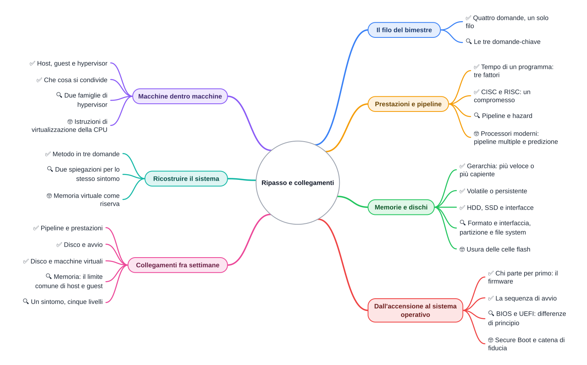
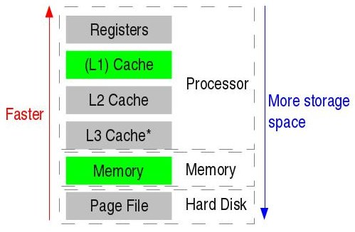

⬅️ [S6](%28STU%29%203EI%20nov-dic%20S6%20-%20Ricostruire%20il%20sistema.md) · 🏠 [Indice](../README.md)

# Ripasso e collegamenti

**3EI · Novembre-Dicembre · S7 · Ripasso · ⏱️ 60-75 minuti** (in due o tre sessioni; 🤓 esclusi)

📚 **Prima di iniziare:** rivedi [la dispensa di ottobre sul modello della macchina](../1%20SETT-OTT/%28STU%29%203EI%20sett-ott%20S7%20-%20Ricostruire%20la%20macchina.md). Qui il modello diventa uno strumento per leggere sintomi e scelte reali.

> **Legenda:** ✅ minimo per la sufficienza · 🔍 dettagli per il voto massimo · 🤓 approfondimento facoltativo · 📜 storia · ⚙️ tecnica · 🧪 esempio · 🧠 da ricordare · ✏️ da fare · ⚠️ errore comune · 🃏 flashcard · 🔧 rimando al laboratorio

Quattro idee chiudono il bimestre: il tempo, la memoria che resta, l'avvio, la virtualizzazione. Ogni sezione qui sotto le riprende da un punto di vista diverso.

## 📜 Il filo del bimestre

### ✅ Quattro domande, un solo filo

Una macchina che esegue istruzioni non è ancora veloce, comoda o pronta all'accensione. Ogni settimana ha risolto un problema diverso, e ogni soluzione ha un prezzo.

- **Il tempo.** Come fare più lavoro nello stesso tempo? La risposta è la pipeline, ma ha i suoi intoppi.
- **La memoria che resta.** <u>Spegnere il PC non deve cancellare tutto.</u> Per questo esistono i dischi e le memorie persistenti.
- **L'avvio.** All'accensione il sistema operativo non è ancora in esecuzione. Qualcuno deve partire per primo.
- **La virtualizzazione.** <u>Una macchina può ospitarne un'altra.</u> Ma la macchina che ospita ha limiti fisici.

📜 **Un filo lungo.** All'inizio dell'Ottocento il telaio di Jacquard tesseva disegni seguendo schede di carta forate: cambiando le schede cambiava il disegno. Nel 1956 il disco RAMAC di IBM occupava uno spazio grande come un mobile. Nel 1964 la famiglia System/360 faceva girare gli stessi programmi su macchine diverse. Il punto in comune è questo: <u>il programma è un dato, e può stare in un posto diverso dalla CPU.</u> Date e dettagli da verificare.

> 🧠 Una macchina moderna è una catena di soluzioni. Ogni anello risolve un problema e ne crea un altro.

🃏 <b>Che cosa resta nella RAM quando spegni il PC?</b>

Niente: la RAM è volatile. <i>Esempio: il documento non salvato sparisce; il file salvato sul disco resta.</i>

🃏 <b>Perché all'accensione un programma deve già esistere in memoria?</b>

Perché la RAM parte vuota e il sistema operativo sta sul disco: serve un primo programma già pronto, il firmware.

🃏 <b>Un processore con 3 GHz è sempre più veloce di uno con 2 GHz?</b>

Non sempre. Conta anche quanti cicli serve ogni istruzione.

### 🔍 Le tre domande-chiave

Davanti a un sintomo o a una scelta di progetto, chiediti tre cose:

| Domanda | Che cosa cerchi | Dove la trovi nel bimestre |
|---|---|---|
| <u>Che cosa aspetta la macchina?</u> | Il collo di bottiglia: CPU, disco, RAM, rete | Prestazioni, memorie, casi |
| <u>Che cosa resta quando si spegne?</u> | La persistenza dei dati | Memorie e dischi |
| <u>Chi parte per primo, e chi ospita chi?</u> | Firmware, sistema operativo, hypervisor | Avvio e virtualizzazione |

Le domande servono a ordinare il pensiero. Non danno la risposta: dicono quale dato cercare.

🃏 <b>Qual è la prima domanda da farsi davanti a un PC lento?</b>

Che cosa sta aspettando la macchina? Serve a trovare il livello che rallenta.

🃏 <b>Il disco di una VM è un file? Perché è utile saperlo?</b>

Sì: sta dentro il disco dell'host. Così si capisce perché il guest non ha un disco tutto suo.

🃏 <b>Chi ospita chi, in una macchina virtuale?</b>

L'host ospita il guest; l'hypervisor divide le risorse fra i guest.

## ⏱️ Prestazioni e pipeline

### ✅ Tempo di un programma: tre fattori

Il tempo di un programma dipende da tre cose: quante istruzioni, quanti cicli per istruzione, quanto dura un ciclo. <u>La frequenza da sola non basta.</u>

Esempio con numeri inventati: 1000 istruzioni, 2 cicli ciascuna, un processore a 2 GHz (cioè 2 miliardi di cicli al secondo). Il tempo è 1000 × 2 diviso 2 miliardi: circa un milionesimo di secondo. Valori come questi sono solo per fare i conti.

🃏 <b>Che cosa misura la frequenza del clock?</b>

Quanti cicli di clock, cioè battiti del segnale di ritmo, avvengono in un secondo.

🃏 <b>Perché «più GHz» può non bastare per dire quale PC è più veloce?</b>

Perché conta anche quanti cicli serve ogni istruzione. Due processori con la stessa frequenza possono fare lavori diversi.

🃏 <b>Come si chiama l'istruzione che legge una cella e la copia in un registro?</b>

LOAD. La cella resta com'era: è una copia.

### ✅ CISC e RISC: un compromesso

CISC: istruzioni complesse, che fanno più lavoro ciascuna. Il programma ha poche righe, ma il decodificatore è più complicato.

RISC: istruzioni semplici. Il programma ha più righe, ma ogni istruzione è facile da eseguire.

<u>Non è una classifica.</u> È una scelta di progetto, con un prezzo. Il telefono e il PC usano spesso famiglie diverse, ma le due idee oggi si mescolano.

🃏 <b>Che cosa vuol dire CISC?</b>

Istruzioni complesse: ogni istruzione fa più lavoro, e il programma ha meno righe.

🃏 <b>RISC significa sempre «un'istruzione per ciclo»?</b>

No. È una tendenza di progetto: le istruzioni sono semplici, ma non esiste una regola che valga sempre.

🃏 <b>Perché un'istruzione complessa richiede un decodificatore più complicato?</b>

Perché deve capire più operazioni diverse e le deve eseguire una dopo l'altra o con più circuiti.

### 🔍 Pipeline e hazard

La pipeline è una catena di lavanderia: mentre una camicia è in asciugatrice, un'altra è già in lavatrice. Più istruzioni si trovano in fasi diverse nello stesso momento.

<u>La pipeline non accorcia la singola istruzione.</u> Ogni istruzione passa ancora da tutte le fasi. Cambia quante istruzioni escono per unità di tempo.

Gli intoppi si chiamano hazard. Tre tipi:

- **Strutturale.** Due fasi vogliono la stessa risorsa nello stesso momento.
- **Di dati.** Un'istruzione usa un risultato non ancora pronto. <i>Esempio: LOAD R1, [40] e subito dopo ADD R3, R1, R2: ADD ha bisogno di R1, che non è ancora arrivato.</i>
- **Di controllo.** Non si sa quale istruzione viene dopo, perché c'è un salto. <i>Esempio: un if in un videogioco: la CPU deve indovinare la strada.</i>

Quando la pipeline non può andare avanti, si ferma per un momento: è uno stallo. ⚠️ Un hazard non è un errore del programma: è un limite del modo in cui la macchina lavora.

🃏 <b>Che cos'è la latenza di una istruzione in pipeline?</b>

Il tempo che una singola istruzione impiega dall'inizio alla fine. Non diminuisce con la pipeline.

🃏 <b>Che cos'è il throughput di una pipeline?</b>

Quante istruzioni escono dalla pipeline per unità di tempo.

🃏 <b>Un hazard strutturale che cos'è?</b>

Due fasi che vogliono la stessa risorsa nello stesso momento. <i>Esempio: due istruzioni che vogliono usare la stessa unità di memoria.</i>

🃏 <b>Che cosa cambia la pipeline nel calcolo del tempo di un programma?</b>

Diminuiscono i cicli per istruzione che si vedono; la frequenza del clock resta la stessa.

### 🤓 Processori moderni: pipeline multiple e predizione

> Nei processori moderni ci sono più pipeline in parallelo. Quando un salto è incerto, la CPU prova a indovinare la strada: se indovina, non perde tempo; se sbaglia, butta via il lavoro fatto. Questo è un cenno: non fa parte della verifica.

## 💾 Memorie e dischi

### ✅ Gerarchia: più veloce o più capiente

Le memorie formano una scala. In alto ci sono i registri: pochissimi, velocissimi. Più in basso ci sono cache, RAM e disco: più spazio, ma più attesa.

Più si scende, più spazio c'è e più si aspetta.

🔧 Dove lo vedresti su una macchina reale: nelle Informazioni di sistema del tuo PC trovi la quantità di RAM installata.

🃏 <b>Quali sono i livelli della gerarchia, dal più veloce al più capiente?</b>

Registri, cache, RAM, memoria di massa (per esempio il disco).

🃏 <b>Una memoria grande è anche veloce?</b>

No. Capacità, velocità e persistenza sono proprietà diverse.

### ✅ Volatile o persistente

Una memoria **volatile** perde il contenuto quando manca la corrente. Una memoria **persistente** lo conserva.

⚠️ La parola «persistente» non dice nulla sulla velocità. Un disco è persistente e lento; una RAM è volatile e veloce.

🃏 <b>Che cosa vuol dire volatile?</b>

Che la memoria perde il contenuto quando manca la corrente.

🃏 <b>Un documento salvato sul disco resta dopo lo spegnimento?</b>

Sì, perché il disco è persistente. Il documento non salvato stava solo nella RAM, che è volatile.

🃏 <b>La RAM è una memoria persistente?</b>

No. È volatile: al riavvio parte vuota.

### ✅ HDD, SSD e interfacce

**HDD:** dischi magnetici che girano, con una testina che si sposta. **SSD:** memoria flash, senza parti in movimento.

Il formato (la forma fisica) e l'interfaccia (il modo di parlare con il computer) sono cose diverse. Lo stesso SSD in formato M.2 può usare SATA oppure NVMe su PCIe. Le strade più comuni sono SATA, PCIe/NVMe e USB.

🃏 <b>L'SSD ha parti in movimento?</b>

No: è memoria flash. L'HDD invece ha piatti che girano e una testina.

🃏 <b>NVMe è un connettore?</b>

No: è un protocollo di comunicazione. Il connettore è una cosa a parte.

🃏 <b>Forma fisica e interfaccia sono la stessa cosa?</b>

No. <i>Esempio: un SSD M.2 può parlare con SATA oppure con NVMe.</i>

### 🔍 Formato e interfaccia, partizione e file system

Una **partizione** è una parte del disco trattata come un disco a sé. Il **file system** è il modo in cui i file sono organizzati dentro una partizione.

⚠️ Partizione e file system non sono la stessa cosa. La partizione divide lo spazio; il file system organizza i file dentro lo spazio.

🔧 In laboratorio vedrai la partizione in pratica. Qui basta il concetto.

🃏 <b>Che cos'è una partizione?</b>

Una parte del disco trattata come un disco a sé.

🃏 <b>Che cos'è il file system?</b>

Il modo in cui i file sono organizzati dentro una partizione.

🃏 <b>Partizione e file system sono la stessa cosa? Perché?</b>

No: la partizione divide lo spazio del disco, il file system organizza i file dentro lo spazio.

### 🤓 Usura delle celle flash

> Ogni cella flash sopporta un numero limitato di scritture. Per questo i controllori dell'SSD distribuiscono le scritture su più celle. Il tema è un cenno: non è richiesto in verifica.

## 🚀 Dall'accensione al sistema operativo

### ✅ Chi parte per primo: il firmware

All'accensione la RAM è vuota. Il sistema operativo sta sul disco, ma non può ancora leggerlo da solo. Serve un primo programma, già pronto. È il **firmware**, conservato in memoria non volatile (per esempio una memoria flash).

📜 **Una domanda antica.** Nel 1981 il primo PC IBM aveva il suo firmware nella ROM. Chi decide quale programma gira per primo? La risposta è semplice: chi ha scritto la memoria dell'accensione. Date da verificare.

🧠 Il firmware è il primo a parlare con l'hardware, perché nessun altro programma è ancora partito.

🃏 <b>Che cosa c'è in RAM appena si accende il PC?</b>

Quasi niente: la RAM parte vuota, e il sistema operativo non è ancora in esecuzione.

🃏 <b>Il BIOS è il sistema operativo?</b>

No. Il BIOS, come la UEFI, è il firmware: viene prima del sistema operativo.

🃏 <b>Perché la RAM è vuota all'accensione?</b>

Perché è volatile: al riavvio non conserva nulla. Il programma iniziale va letto da una memoria non volatile.

### ✅ La sequenza di avvio

1. Accensione.
2. Il firmware fa i controlli di base.
3. Il firmware cerca il dispositivo da cui avviare.
4. Il firmware carica il **bootloader**.
5. Il bootloader carica il sistema operativo in RAM.
6. Il sistema operativo prende il controllo.

🔧 Dove lo vedresti su una macchina reale: nella schermata del firmware (solo per guardare, senza modificare nulla) trovi l'ordine dei dispositivi di avvio.

🃏 <b>Qual è il primo passo dopo l'accensione?</b>

Il firmware fa i controlli di base.

🃏 <b>Che cos'è il bootloader?</b>

Il programma che carica il sistema operativo in RAM.

🃏 <b>Il sistema operativo parte da solo all'accensione?</b>

No. Serve prima il firmware, poi il bootloader, che lo carica.

### 🔍 BIOS e UEFI: differenze di principio

Il BIOS, più vecchio, legge il primo settore del disco. La UEFI legge una partizione con file, e gestisce meglio i dischi grandi.

Le impostazioni del firmware sono dati salvati. Il firmware è il programma che le usa. Non sono la stessa cosa.

🃏 <b>Come legge il disco il BIOS più vecchio?</b>

Legge il primo settore del disco per trovare il programma di avvio.

🃏 <b>Che cosa distingue la UEFI dal BIOS più vecchio?</b>

Legge una partizione con file e gestisce meglio i dischi grandi.

🃏 <b>Le impostazioni del firmware sono il firmware?</b>

No: le impostazioni sono dati salvati; il firmware è il programma.

### 🤓 Secure Boot e catena di fiducia

> Secure Boot controlla che il codice d'avvio sia firmato da chi ne è autorizzato. Ogni anello della catena controlla il successivo. Questo è un cenno: non fa parte della verifica.

## 🖥️ Macchine dentro macchine

### ✅ Host, guest e hypervisor

- **Host:** la macchina reale, con il suo hardware.
- **Guest:** la macchina virtuale, con il suo sistema operativo.
- **Hypervisor:** il gestore che divide le risorse fra i guest.

🧪 Esempio: l'emulatore Android su un PC. Il PC è l'host, l'emulatore è il guest, e il programma che li tiene insieme è l'hypervisor.

🃏 <b>Chi è il guest?</b>

La macchina virtuale con il suo sistema operativo.

🃏 <b>Che cosa fa l'hypervisor?</b>

Divide le risorse fisiche fra i guest.

🃏 <b>Un guest è un computer fisico separato?</b>

No: è un computer virtuale, che vive dentro l'host.

### ✅ Che cosa si condivide

Il guest vede un hardware virtuale. Dietro, l'host condivide:

- il **processore**, a turni;
- la **RAM**, divisa in pezzi;
- il **disco**, che per il guest è un file.

Il guest non legge la memoria di un altro guest: questo è l'**isolamento**. Il limite resta la macchina host: se la RAM dell'host finisce, tutti rallentano.

🃏 <b>Che cosa condividono host e guest?</b>

Il processore a turni, la RAM divisa in pezzi e il disco, che per il guest è un file.

🃏 <b>Un guest può leggere la RAM di un altro guest?</b>

No: è l'isolamento. Ogni guest vede solo la sua parte.

🃏 <b>Se un guest chiede più RAM di quanta ce n'è sull'host, che cosa succede?</b>

I sistemi rallentano, perché la RAM dell'host è il limite comune.

### 🔍 Due famiglie di hypervisor

- **Tipo 1:** gira direttamente sull'hardware. Si trova spesso nei data center.
- **Tipo 2:** gira sopra un sistema operativo. Si trova spesso sul PC di casa.

Nella pratica i confini sfumano. Il criterio utile è: <u>chi sta sotto, l'hardware o un sistema operativo?</u>

🃏 <b>Che cosa vuol dire hypervisor di tipo 1?</b>

Un gestore che gira direttamente sull'hardware, senza un sistema operativo sotto.

🃏 <b>Perché si usa la virtualizzazione?</b>

Per avere più sistemi su un solo server, per provare un sistema nuovo o per separare i servizi.

### 🤓 Istruzioni di virtualizzazione della CPU

> Alcune CPU hanno istruzioni dedicate per aiutare l'hypervisor. Il tema è un cenno: non è richiesto in verifica.

## 🧱 Ricostruire il sistema

### ✅ Metodo in tre domande

Davanti a un caso lento, segui tre passi:

1. <u>Che cosa sta aspettando la CPU?</u>
2. <u>Quale livello è lento?</u> (CPU, RAM, disco, rete, avvio, hypervisor)
3. <u>Quale dato mi serve per decidere?</u>

⚠️ Non saltare alla conclusione. «Colpa della CPU» è una risposta automatica, spesso sbagliata.

🃏 <b>Quale domanda viene dopo «che cosa sta aspettando la CPU?»</b>

Quale livello è lento? Poi, quale dato serve per decidere.

🃏 <b>Un PC lento è sempre colpa della CPU?</b>

No: può aspettare il disco, oppure la RAM può essere piena.

🃏 <b>Gestione attività serve a cambiare il processore?</b>

No: serve a guardare l'uso di CPU, RAM e disco.

### 🔍 Due spiegazioni per lo stesso sintomo

Un sintomo può avere più cause. <i>Esempio: un'app che si blocca può dipendere dalla RAM piena o da un disco lento.</i> Quale dato le separa? Il tempo di accesso al disco, la RAM usata o la percentuale di CPU occupata.

Se due spiegazioni restano possibili, non scegliere a caso: cerca il dato che le distingue.

🃏 <b>Che cosa separa due spiegazioni dello stesso sintomo?</b>

Un dato che una spiegazione prevede diverso dall'altra: per esempio l'uso della RAM.

🃏 <b>Più RAM risolve sempre un sintomo lento?</b>

No. Se il collo di bottiglia è il disco o la CPU, la RAM aiuta poco.

### 🤓 Memoria virtuale come riserva

> Quando la RAM finisce, il sistema usa il disco come riserva. Il disco è molto più lento della RAM, quindi il sistema rallenta. Questo è un cenno, non verificato.

## 🔗 Collegamenti fra settimane

### ✅ Pipeline e prestazioni

Le pipeline cambiano il numero di cicli che si vedono per istruzione. Non cambiano il clock. Quindi la stessa domanda «quanto tempo?» si risponde con i tre fattori della prima sezione: istruzioni, cicli per istruzione, durata del ciclo.

🃏 <b>Quale fattore del tempo cambia con la pipeline?</b>

I cicli per istruzione che si vedono. La durata del ciclo resta la stessa.

### ✅ Disco e avvio

Il sistema operativo sta sul disco, e la RAM parte vuota. Quindi il firmware deve leggere il disco prima che il sistema sia pronto. Un disco lento allunga l'attesa dell'avvio.

🃏 <b>Perché un disco lento allunga l'avvio?</b>

Perché il sistema operativo sta sul disco e deve essere caricato da lì in RAM.

### ✅ Disco e macchine virtuali

Il disco di una VM è un file dentro il disco dell'host. Il guest ha il suo avvio, ma i suoi dati finiscono nello stesso disco fisico. Più VM leggono e scrivono, più il disco può diventare il collo di bottiglia.

🃏 <b>Il disco di una VM dove sta davvero?</b>

Dentro il disco dell'host, come file.

### 🔍 Memoria: il limite comune di host e guest

La RAM dell'host è divisa fra l'host e i guest. Se la somma chiesta supera la RAM disponibile, i sistemi rallentano insieme. È il caso più chiaro in cui un guest non può fare tutto da solo: dipende dalla macchina che lo ospita.

🃏 <b>Perché un guest rallenta anche se il suo sistema è tranquillo?</b>

Perché la RAM e il processore dell'host sono condivisi, e l'host può essere saturo.

### 🔍 Un sintomo, cinque livelli

Un'app lenta sul PC può attraversare più livelli: il processore che aspetta dati, la cache che non trova il dato, la RAM piena, il disco lento, un guest che condivide tutto con l'host. Il metodo in tre domande serve a non fermarsi al primo sospetto.

🃏 <b>Un miss in cache significa che il programma è rotto?</b>

No. Significa che il dato va preso dal livello successivo; non è un guasto.

🃏 <b>Che cos'è la località spaziale?</b>

La tendenza ad accedere a indirizzi vicini a quelli appena usati.

## ✏️ Esercizi per fissare

Questi esercizi non hanno soluzioni in questa pagina. Lavora su carta, poi confronta con il docente o con un compagno.

### ✅ Riordina l'avvio

Ecco sei cartellini: accensione, bootloader, firmware, caricamento del sistema operativo, controlli di base, sistema operativo in esecuzione. Riordinali nella sequenza giusta. Accanto a ogni cartellino scrivi quale programma è in esecuzione in quel momento.

### 🔍 Prevedi prima di calcolare

Due processori fittizi: A con 3 GHz e 2 cicli per istruzione; B con 2 GHz e 1 ciclo per istruzione. Lo stesso programma va su entrambi. Prima di calcolare, scrivi su quale è più veloce e perché. Poi calcola quante istruzioni al secondo fa ciascuno, e confronta con la tua previsione.

### 🔍 Trova l'errore

Leggi questa frase, scritta da uno studente: «La RAM è il disco più veloce, quindi spegnendo il PC il disco si svuota e la RAM resta.» Trova almeno due errori. Riscrivi la frase in modo corretto, usando le parole volatile e persistente.

### 🔍 Collega due settimane

Un guest di una macchina virtuale deve avviarsi. Spiega in tre frasi come si collegano il disco (settimana 3) e l'avvio (settimana 4) in questo caso. Usa la parola **file** almeno una volta.

### 🔍 Spiega a un compagno assente

Un compagno non c'era. Spiegagli in cinque frasi perché un PC lento non è sempre colpa della CPU. Usa uno dei tre passi del metodo: che cosa aspetta la CPU, quale livello è lento, quale dato serve.

## 🃏 Mazzo misto finale

Queste flashcard vengono da tutte le settimane, mescolate di proposito. Rispondi a voce, poi apri per controllare. Metti da parte quelle sbagliate e ripassale il giorno dopo.

### ✅ Giro veloce: definizioni

🃏 <b>Che cos'è l'hypervisor?</b>

Il gestore che divide le risorse fisiche fra le macchine virtuali.

🃏 <b>Che cos'è un bootloader?</b>

Il programma che carica il sistema operativo in RAM.

🃏 <b>Che cos'è un hit in cache?</b>

Un accesso in cui il dato cercato è già in cache.

🃏 <b>Che cos'è il firmware?</b>

Il programma conservato in memoria non volatile, che parte per primo all'accensione.

🃏 <b>Che cos'è un guest?</b>

La macchina virtuale con il suo sistema operativo.

### 🔍 Giro misto: tutto il bimestre

🃏 <b>Gerarchia delle memorie: quale livello viene prima della RAM?</b>

La cache, e prima ancora i registri. Il disco viene dopo la RAM.

🃏 <b>Perché il firmware non può stare sul disco come il sistema operativo?</b>

Perché all'accensione serve un programma già pronto, letto senza bisogno del sistema operativo.

🃏 <b>Un SSD in formato M.2 è sempre NVMe?</b>

No: il formato è la forma fisica; il protocollo può essere SATA oppure NVMe.

🃏 <b>Un hazard di controllo nasce da che cosa?</b>

Da un salto: non si sa subito quale istruzione viene dopo.

🃏 <b>Che cosa succede quando i guest chiedono più RAM di quanta l'host ne ha?</b>

Il sistema rallenta: la RAM dell'host è il limite comune di host e guest.

🃏 <b>Che cosa si condivide fra guest e host?</b>

Il processore a turni, la RAM divisa in pezzi e il disco, che per il guest è un file.

🃏 <b>Che cosa significa che la pipeline non accorcia la singola istruzione?</b>

Ogni istruzione passa ancora da tutte le fasi; la pipeline fa uscire più istruzioni nello stesso tempo.

🃏 <b>Il metodo in tre domande, quali sono?</b>

Che cosa aspetta la CPU? Quale livello è lento? Quale dato serve per decidere?

🃏 <b>Perché la UEFI legge una partizione con file?</b>

Perché può trovare programmi di avvio come file, anche su dischi grandi.

🃏 <b>Quali sono i tre intoppi tipici della pipeline?</b>

Strutturale, di dati e di controllo.

🃏 <b>Che cosa indica il clock della CPU?</b>

Il ritmo della macchina: quanti cicli avvengono in un secondo.

🃏 <b>Un file salvato sul disco sopravvive allo spegnimento?</b>

Sì: il disco è persistente.

## 📚 Crediti e fonti

**Immagine.** «Memory hierarchy diagram.jpg», di Kerrick Staley, Wikimedia Commons, 2011. Licenza CC BY-SA, come dichiarato sulla pagina del file. Nessuna modifica (solo visualizzata in larghezza). Pagina: <https://commons.wikimedia.org/wiki/File:Memory_hierarchy_diagram.jpg>.

**Fonti per approfondire:**

- Il programma ufficiale di Sistemi e reti (3EI) e il libro di testo *Internetworking Sistemi e Reti*, vol. 1, Juvenilia Scuola: capitoli su sistema di elaborazione, memorie, avvio e virtualizzazione.
- Wulf e McKee (1995), *Hitting the memory wall*: il limite della memoria, da leggere come cenno storico.
- Date e cifre storiche (Jacquard, RAMAC 305, System/360, CP-67, primo PC IBM): da verificare sulle fonti primarie o su Wikipedia.

⬅️ [S6](%28STU%29%203EI%20nov-dic%20S6%20-%20Ricostruire%20il%20sistema.md) · 🏠 [Indice](../README.md)
