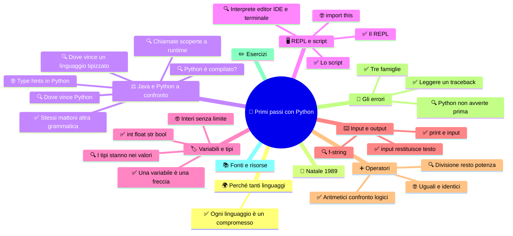

🏠 [Indice](../README.md)

# 🐍 Primi passi con Python

**4CI · Novembre-Dicembre · S1 · Teoria**

⏱️ **Tempo di studio: circa 50 minuti.** ✅ essenziale: 26 min. 🔍 per il voto alto: 20 min. 🤓 si può saltare. Nessun compito obbligatorio a casa.

> **Legenda:** ✅ da sapere · 🔍 per capire fino in fondo · 🤓 facoltativo, per curiosi · 📜 storia · 🧪 esempio · ⚠️ errore comune · 🛠️ strumento · 🔧 lo faremo in laboratorio · ✏️ da fare · 🃏 flashcard: rispondi a voce, poi apri per controllare



## 🌍 Perché tanti linguaggi

Un computer capisce una cosa sola: sequenze di 0 e 1, cioè segnali accesi e spenti. Programmare in quel modo è come costruire una casa usando un solo tipo di mattone, e per di più piccolissimo. Per questo, da più di settant'anni, le persone costruiscono **scale**: ogni linguaggio è un gradino più vicino a come ragionano gli esseri umani.

📜 Nel 1957 un gruppo IBM guidato da John Backus presenta **Fortran**, pensato per le formule di fisici e ingegneri. Nel 1959 nasce **COBOL**, per i conti delle aziende: è ancora in uso in molti sistemi bancari. Nel 1972 Dennis Ritchie scrive **C** nei laboratori Bell, per il sistema Unix: è un antenato di molti linguaggi, Java compreso.

Ogni linguaggio è un **compromesso**. Più è vicino alla macchina, più è veloce ma difficile da leggere. Più è vicino alle persone, più è leggibile ma spesso meno controllabile. Non esiste il linguaggio migliore: esiste quello giusto per il problema che hai davanti.

<details>
<summary>🃏 <b>Perché esistono tanti linguaggi di programmazione?</b></summary>
Ogni linguaggio è un compromesso fra quello che la macchina può eseguire in fretta e quello che le persone riescono a leggere e controllare.
</details>

🔗 Per la mappa dei paradigmi e dei linguaggi esoterici: [Paradigmi e linguaggi](../../Integrazioni%20e%20curiosit%C3%A0/Cultura%20informatica/Paradigmi%20e%20linguaggi%20-%20una%20mappa%20dei%20modi%20di%20programmare.md).

## 🧭 Natale 1989

📜 Dicembre 1989. Nel mondo succedono cose grandi: a novembre è caduto il Muro di Berlino, e a marzo un ricercatore del CERN, Tim Berners-Lee, ha proposto un sistema per collegare documenti che chiamerà World Wide Web.

Ad Amsterdam, un programmatore olandese di nome **Guido van Rossum** ha un problema da persona normale: l'ufficio resta chiuso la settimana di Natale e lui non ha niente da fare. Così si inventa un passatempo. Scrive un **interprete**, cioè un programma che legge altri programmi e li esegue, per un nuovo linguaggio. Lo vuole semplice da leggere, erede di un linguaggio didattico che aveva aiutato a creare, **ABC**. Come nome provvisorio sceglie «Python», perché è un grande fan dei **Monty Python**, il gruppo comico britannico.

Il nome provvisorio non è mai stato cambiato. Oggi Python si usa per automatizzare compiti, analizzare dati e addestrare modelli di intelligenza artificiale (a maggio lo incontreremo).

## ⚖️ Java e Python a confronto

Fino a ottobre hai usato Java. Il ragionamento che conosci (variabili, condizioni, cicli, riferimenti, oggetti) vale anche in Python. Cambiano le regole del gioco: chi controlla il codice, quando lo fa e quanta cerimonia serve.

**Python è compilato?** Né sì né no: dipende da come lo guardi. Quando lanci un file `.py`, Python prima traduce il codice in una forma intermedia, detta *bytecode* (file `.pyc`), e poi la esegue con l'interprete. Anche Java fa così: il compilatore produce il bytecode e la JVM lo esegue. La differenza non sta nella traduzione, ma nel **momento** in cui si controllano gli errori: Java prima di partire, Python mentre il programma gira.

<details>
<summary>🃏 <b>Python è un linguaggio compilato o interpretato?</b></summary>
Entrambe le cose, se si guarda bene: Python traduce il codice in bytecode e poi lo esegue con l'interprete. Dire «interpretato» è una semplificazione comoda.
</details>

### ✅ Stessi mattoni, altra grammatica

| Aspetto | Java | Python |
| --- | --- | --- |
| Tipo delle variabili | dichiarato: `int vita = 100;` | dedotto dal valore: `vita = 100` |
| Controllo dei tipi | prima di partire, dal compilatore | mentre il programma gira |
| Blocchi di codice | parentesi graffe `{ }` | indentazione |
| Fine riga | `;` obbligatorio | niente |
| Punto di partenza | una classe con `main` | un file, eseguito dall'alto in basso |
| Stampa | `System.out.println(x);` | `print(x)` |
| Commento | `// testo` | `# testo` |
| Nasce nel | 1995, Sun Microsystems, con James Gosling | 1991, con Guido van Rossum |

Lo stesso saluto nei due linguaggi:

```java
public class Ciao {
    public static void main(String[] args) {
        System.out.println("Ciao!");
    }
}
```

```python
print("Ciao!")
```

🧪 **Lo stesso problema.** L'eroe sale di livello e guadagna 2 di forza.

```java
int forza = 7;
forza = forza + 2;
System.out.println(forza);   // 9
```

```python
forza = 7
forza = forza + 2
print(forza)   # 9
```

Sono due programmi diversi nella forma e uguali nella logica. Questo è il punto: <u>cambia la grammatica, non il pensiero</u>.

<details>
<summary>🃏 <b>Quando Java controlla i tipi?</b></summary>
Prima di partire, durante la compilazione. Se sbagli un tipo, il programma non parte nemmeno.
</details>
<details>
<summary>🃏 <b>Come si separano i blocchi di codice in Python?</b></summary>
Con l'indentazione, cioè con lo spazio a sinistra. Non ci sono parentesi graffe.
</details>

✏️ **Confronta (2 min).** Scrivi la riga Python equivalente di `String nome = "Aria";` e di `boolean vivo = true;`.

### 🔍 Dove vince un linguaggio tipizzato e a oggetti

Java, C# e C++ danno il meglio quando il software diventa grande: centinaia di file, decine di persone, anni di vita.

- **Errori prima di partire.** Nel dungeon, `vita - danno` con `vita` di tipo testo non compila. L'errore compare mentre scrivi, non in mezzo a una partita.
- **Contratti che il compilatore fa rispettare.** Se una classe promette di implementare un'interfaccia e dimentica un metodo, Java si ferma. In Python lo scopri solo quando quel metodo viene chiamato.
- **Modifiche sicure.** Rinominare un metodo in un progetto enorme è più sicuro, perché il compilatore conosce tutte le chiamate.
- **Chiarimento: le chiamate.** In Python il programma non sa in anticipo quali oggetti hanno un certo metodo. Se scrivi `dungeon.attacca()`, Python controlla solo quando la riga viene eseguita. In un progetto grande, rinominare un metodo può quindi lasciare una chiamata dimenticata che fallisce solo in certi casi. Gli editor aiutano a trovare tutti gli usi, e strumenti come mypy segnalano gli errori prima di partire, se usi i type hints.
- **Velocità.** La JVM ottimizza il codice mentre gira. Per calcoli pesanti, a parità di algoritmo, in genere Java è più veloce di Python.

Il tipo dichiarato è una **promessa** che il compilatore controlla ogni volta, anche dopo mesi e con persone diverse.

<details>
<summary>🃏 <b>Perché in un progetto grande conviene il tipo dichiarato?</b></summary>
Il compilatore controlla ogni uso del tipo, anche quando il codice l'ha scritto qualcun altro.
</details>

✏️ **Scegli (3 min).** Una banca vuole un software con duecento programmatori che lavorano per anni. Quale linguaggio sceglieresti, e che cosa ti fa pensare?

### 🔍 Dove vince Python

Python dà il meglio quando conta provare in fretta e leggere facilmente.

- **Script e automazione.** Rinominare cinquecento foto in base alla data richiede un programma di poche righe, senza cerimonie.
- **Esplorazione.** Il REPL risponde subito: puoi provare un'idea prima di scrivere il programma.
- **Dati e intelligenza artificiale.** Le librerie più usate per analizzare dati e per l'IA hanno Python come linguaggio di lavoro.
- **Chiarimento: perché è così diffuso.** Le librerie più usate per i dati e l'IA, come NumPy, sono scritte in C e fanno i calcoli pesanti in modo veloce. Python fa da regia: tu scrivi poche righe chiare, e il lavoro vero lo svolge il codice veloce che sta sotto.
- **Chiarimento: le prestazioni.** Sì, su un ciclo scritto a mano Python è in genere più lento di Java, spesso di alcune decine di volte (ordine di grandezza, variabile da compito a compito). Il costo si accetta perché, in molti casi, il tempo di scrittura e di prova pesa più dei millisecondi risparmiati. Quando la velocità conta davvero, si usano le librerie scritte in C.
- **Prototipi.** Un'idea si prova in un pomeriggio, non in una settimana.
- **Leggibilità.** Chi impara, o chi scrive poco codice, guadagna molto dalla sintassi pulita.

⚠️ Non è una gara. Python non è «peggiore» di Java: ha un costo diverso. Meno controlli in anticipo, più velocità di sviluppo.

<details>
<summary>🃏 <b>Dove conviene Python?</b></summary>
Negli script, nell'automazione, nell'analisi dei dati, nei prototipi e nell'intelligenza artificiale.
</details>

### 🤓 Type hints: Python con i tipi

Dal 2015 (Python 3.5) si possono scrivere **annotazioni di tipo**, chiamate *type hints*, descritte nella PEP 484:

```python
def somma(a: int, b: int) -> int:
    return a + b

print(somma("ciao", "mondo"))
```

Il programma stampa `ciaomondo`. Python **non controlla** le annotazioni mentre esegue. Un controllore esterno, come mypy, le usa per segnalare l'errore prima di partire. È un po' come Java, ma a scelta tua.

In queste settimane costruiremo un piccolo gioco da terminale: un **dungeon**. Oggi nasce l'eroe.

## 🖥️ REPL e script

### ✅ Il REPL: provare una riga alla volta

**Problema.** Non sei sicuro di che cosa faccia una riga. Creare un progetto intero solo per provarla è troppo.

Il **REPL** è una finestra in cui scrivi una riga e Python risponde subito. Il nome è la sigla di *Read-Eval-Print Loop*: legge, valuta, stampa, ripete. È una calcolatrice che capisce anche le parole. Si apre scrivendo `python` nel terminale (su Windows a volte `py`). Il simbolo `>>>` dice che Python aspetta un comando.

🧪 **Prevedi, poi leggi.** Che cosa risponde Python a `"ciao" * 3`?

```text
>>> 2 + 2
4
>>> "ciao" * 3
'ciaociaociao'
>>> nome = "Aria"
>>> nome
'Aria'
>>> type(nome)
<class 'str'>
```

`type()` dice di che tipo è un valore. Qui `str` vuol dire *stringa*, cioè testo.

🛠️ **Strumento: il REPL.** Serve per provare idee e controllare dubbi in pochi secondi. Non conserva niente: quando lo chiudi, tutto sparisce.

<details>
<summary>🃏 <b>Che cos'è il REPL?</b></summary>
Una finestra in cui scrivi una riga di Python e ottieni subito la risposta.
</details>
<details>
<summary>🃏 <b>Il REPL conserva ciò che scrivi?</b></summary>
No: chiudendolo si perde tutto. Per conservare un programma serve un file.
</details>

✏️ **Prevedi (1 min).** Senza provare: che cosa risponde il REPL a `"ab" * 2`? E a `type(2.5)`?

### ✅ Lo script: conservare il programma

Un **script** è un file di testo con estensione `.py` che contiene molte righe di Python. Si esegue tutto insieme con `python nomefile.py`.

Il REPL è per provare. Lo script è per conservare.

| | REPL | Script |
|---|---|---|
| Come lo usi | una riga alla volta | tutto il file, dall'alto in basso |
| Che cosa resta | niente | il file `.py` |
| Quando serve | per provare e capire | per un programma vero |

🧪 **Script vero.** Il file `eroe.py`: crea il tuo eroe.

```python
# eroe.py
nome = input("Come ti chiami, eroe? ")
vita = 100
forza = int(input("Forza da 1 a 10: "))
print(f"{nome} entra nel dungeon con {vita} punti vita e forza {forza}.")
```

Eseguendolo e scrivendo `Aria` e `7`:

```text
Come ti chiami, eroe? Aria
Forza da 1 a 10: 7
Aria entra nel dungeon con 100 punti vita e forza 7.
```

La riga che comincia con `#` è un **commento**: Python la ignora. In Java si scrive `//`.

🔧 **In laboratorio:** installiamo Python e VS Code e facciamo partire il progetto dungeon con questo eroe.

<details>
<summary>🃏 <b>Che cos'è uno script?</b></summary>
Un file `.py` con molte righe di Python, che si esegue con `python nomefile.py`.
</details>
<details>
<summary>🃏 <b>Come si scrive un commento in Python?</b></summary>
Con `#`; Python ignora il resto della riga. In Java si scrive `//`.
</details>

### 🔍 Interprete, editor, IDE e terminale

Quattro parole diverse, quattro oggetti diversi.

| Parola | Che cos'è | Esempio |
|---|---|---|
| **Interprete** | Il programma che legge il tuo codice e lo esegue | `python` |
| **Editor** | Il programma in cui scrivi il testo | blocco note, VS Code |
| **IDE** | Un editor con molti strumenti in più (esecuzione, debugger, suggerimenti) | VS Code con estensioni, PyCharm |
| **Terminale** | La finestra a comandi da cui avvii l'interprete | PowerShell, Terminale |

In Java il compilatore controllava anche i tipi *prima* di far partire il programma. Python controlla la sintassi prima di partire, ma i tipi li scopre solo mentre esegue. Ne parliamo in fondo alla dispensa.

<details>
<summary>🃏 <b>Che differenza c'è fra editor e interprete?</b></summary>
L'editor serve per scrivere il testo; l'interprete lo legge e lo esegue.
</details>
<details>
<summary>🃏 <b>Che cos'è un IDE?</b></summary>
Un editor con strumenti in più per scrivere, eseguire e correggere il codice, come VS Code.
</details>

### 🤓 `import this`

> Scrivi `import this` nel REPL. Python stampa lo *Zen of Python* di Tim Peters, 19 massime sul modo di scrivere buon codice. Due esempi: *«Simple is better than complex»* (il semplice è meglio del complicato) e *«Readability counts»* (la leggibilità conta).
>
> Provane un'altra: `import antigravity`. Si apre un fumetto: [XKCD n. 353](https://xkcd.com/353/). In Python anche le battute si importano.

## 🏷️ Variabili e tipi

### ✅ Una variabile è una freccia

In Java dichiaravi `int vita = 100;`. In Python scrivi solo `vita = 100`. Non dici il tipo: Python lo capisce dal valore.

| Java | Python |
|---|---|
| `int vita = 100;` | `vita = 100` |
| `String nome = "Aria";` | `nome = "Aria"` |
| `double forza = 7.5;` | `forza = 7.5` |
| `boolean vivo = true;` | `vivo = True` |
| `System.out.println(x);` | `print(x)` |
| `// commento` | `# commento` |
| `;` a fine riga | niente |

⚠️ Le parole `True` e `False` hanno la **maiuscola**. `true` dà un errore.

Ricordi le scatole e le frecce di ottobre? In Python <u>ogni variabile è una freccia che punta a un valore</u>, anche per i numeri e i testi.

```text
vita ───▶ 100
nome ───▶ "Aria"
```

Se scrivi `vita = 70`, la freccia si sposta. Il valore `100` non è stato modificato: la freccia ora punta a `70`.

Due posizioni possono anche puntare allo **stesso** oggetto. Le liste e i dizionari li vedremo meglio più avanti; qui ti basta l'idea delle frecce.

```python
piatto = ["Margherita", 6.0]   # una lista con nome e prezzo
menu = [piatto, piatto]        # menu[0] e menu[1] puntano allo stesso piatto
menu[0][1] = 8.0
print(menu[1][1])              # 8.0
```

Cambiare `menu[0]` cambia anche `menu[1]`, perché sono due frecce verso lo stesso oggetto. Lo stesso accade con gli array in Java. Per avere due piatti distinti, creane due copie: `menu = [list(piatto), list(piatto)]`.

✏️ **Prevedi (2 min).** Dopo `menu[1][1] = 5.0`, quanto vale `piatto[1]`?

<details>
<summary>🃏 <b>Due posizioni di un array possono puntare allo stesso oggetto?</b></summary>
Sì. Sono due frecce verso lo stesso valore: se ne cambi uno, cambia anche l'altra posizione.
</details>

```text
vita ──╳  100
vita ───▶ 70
```

Se scrivi `altra = vita`, ottieni due frecce che puntano allo stesso valore.

<details>
<summary>🃏 <b>Che cosa succede con <code>vita = 70</code> se prima era 100?</b></summary>
La freccia <code>vita</code> si sposta sul valore 70; il valore 100 non viene modificato.
</details>
<details>
<summary>🃏 <b>Quale errore dà <code>true</code> in Python?</b></summary>
NameError: Python non conosce quel nome. Si scrive <code>True</code>, con la maiuscola.
</details>

✏️ **Disegna (2 min).** Disegna le frecce dopo: `x = 4`, `y = x`, `x = 9`. Che cosa vale `y`?

### ✅ Quattro tipi per cominciare

| Tipo | Che cos'è | Esempio |
|---|---|---|
| `int` | numero intero | `100` |
| `float` | numero con la virgola (nel codice è un punto) | `7.5` |
| `str` | testo, fra apici o virgolette | `"Aria"` |
| `bool` | vero o falso | `True`, `False` |

Il tipo di un valore si controlla con `type()`.

```text
>>> type(3)
<class 'int'>
>>> type(3.0)
<class 'float'>
>>> type(True)
<class 'bool'>
```

⚠️ `3` e `3.0` sono lo stesso numero ma tipi diversi: `int` e `float`. E `"3"` è un testo, non un numero.

<details>
<summary>🃏 <b>Quali sono i quattro tipi base?</b></summary>
<code>int</code> (intero), <code>float</code> (con la virgola), <code>str</code> (testo), <code>bool</code> (vero o falso).
</details>
<details>
<summary>🃏 <b>Che differenza c'è fra 3 e "3"?</b></summary>
Il primo è un numero (<code>int</code>), il secondo è un testo (<code>str</code>).
</details>

### 🔍 I tipi stanno nei valori, non nelle variabili

In Java il tipo era scritto sulla scatola: una variabile `int` conteneva solo interi. In Python il tipo è una proprietà del **valore**. La freccia può spostarsi su un valore di un altro tipo.

```text
>>> x = 5
>>> type(x)
<class 'int'>
>>> x = "cinque"
>>> type(x)
<class 'str'>
```

Questo si chiama **tipizzazione dinamica**: il tipo si decide mentre il programma gira. Per Python i tipi esistono eccome: semplicemente non li dichiari.

⚠️ Più libertà vuol dire che nessuno ti ferma se mischi cose che non vanno insieme. Lo scoprirai solo quando la riga viene eseguita.

<details>
<summary>🃏 <b>Il tipo appartiene alla variabile o al valore?</b></summary>
Al valore. La variabile è una freccia che può puntare a valori di tipi diversi.
</details>

### 🤓 Interi senza limite

In Java un `int` ha 32 bit e un `long` 64: se superi il limite, il numero «ricomincia da capo». In Python un `int` cresce quanto serve, finché c'è memoria.

```text
>>> 2 ** 100
1267650600228229401496703205376
```

Il prezzo è che i calcoli con numeri enormi sono più lenti.

## ⌨️ Input e output

### ✅ `print` e `input`

`print()` scrive sullo schermo. `input()` aspetta che l'utente scriva qualcosa e lo restituisce. In Java usavi `System.out.println` e `Scanner`.

```python
print("Il mostro attacca!")
nome = input("Come ti chiami? ")
```

`print` può stampare più cose separate da virgole: le separa con uno spazio.

<details>
<summary>🃏 <b>Che cosa fa <code>input("Nome? ")</code>?</b></summary>
Mostra la domanda, aspetta che l'utente scriva e restituisce ciò che ha scritto.
</details>

### ✅ `input` restituisce sempre testo

<u>Qualunque cosa scriva l'utente, `input()` la restituisce come `str`.</u> Anche se scrive `7`.

🧪 **Prevedi.** Questo script chiede la forza e ne aggiunge 1. Che cosa succede se scrivi `7`?

```python
forza = input("Forza: ")
print(forza + 1)
```

```text
Forza: 7
Traceback (most recent call last):
  File "eroe.py", line 2, in <module>
    print(forza + 1)
          ~~~~~~^~~
TypeError: can only concatenate str (not "int") to str
```

`forza` è il testo `"7"`, non il numero 7: non puoi sommare un testo e un numero. La soluzione è convertire con `int()`:

```python
forza = int(input("Forza: "))
print(forza + 1)   # 8
```

Le conversioni sono `int()`, `float()` e `str()`.

⚠️ Se l'utente scrive `sette`, `int("sette")` dà `ValueError: invalid literal for int() with base 10: 'sette'`. Come gestire questi casi lo vedremo più avanti.

<details>
<summary>🃏 <b>Che tipo restituisce sempre <code>input()</code>?</b></summary>
<code>str</code>, cioè testo, anche se l'utente scrive un numero.
</details>
<details>
<summary>🃏 <b>Come si legge un numero intero da tastiera?</b></summary>
<code>int(input("..."))</code>: <code>input</code> restituisce il testo e <code>int</code> lo converte.
</details>

✏️ **Trova l'errore (2 min).** `eta = input("Età: ")` e poi `print("Tra un anno avrai", eta + 1)`. Dov'è il problema e come lo risolvi?

### 🔍 f-string: testo con valori dentro

Una **f-string** è un testo che comincia con `f` e contiene dei valori fra graffe. Python sostituisce i nomi con i loro valori. In Java dovevi concatenare con `+`.

```python
nome = "Aria"
vita = 70
print(f"{nome} ha {vita} punti vita.")           # Aria ha 70 punti vita.
print(f"{nome} ha {vita / 100:.0%} della vita.")  # Aria ha 70% della vita.
```

Dopo i due punti si può scegliere il formato: `:.0%` stampa una percentuale senza decimali.

<details>
<summary>🃏 <b>Che cos'è una f-string?</b></summary>
Un testo che inizia con <code>f</code> e contiene valori fra graffe, come <code>f"{nome} ha {vita}"</code>.
</details>

## ➕ Operatori

### ✅ Aritmetici, confronto e logici

| Famiglia   | Python                      | In Java         |
| ---------- | --------------------------- | --------------- |
| Aritmetici | `+` `-` `*` `/`             | uguali          |
| Confronto  | `==` `!=` `<` `<=` `>` `>=` | uguali          |
| Logici     | `and` `or` `not`            | `&&` `\|\|` `!` |

I confronti e i logici danno un `bool`.

```text
>>> vita = 100
>>> forza = 7
>>> vita > 0 and forza >= 5
True
>>> not vita > 0
False
```

`+` e `*` funzionano anche sui testi: `"3" + "4"` dà `'34'` (li incolla) e `"ciao" * 3` dà `'ciaociaociao'`.

<details>
<summary>🃏 <b>Come si scrivono «e», «o», «non» logici?</b></summary>
<code>and</code>, <code>or</code>, <code>not</code>. In Java: <code>&&</code>, <code>||</code>, <code>!</code>.
</details>
<details>
<summary>🃏 <b>Che cosa fa <code>"3" + "4"</code>?</b></summary>
Incolla i due testi: il risultato è <code>'34'</code>, non 7.
</details>

✏️ **Prevedi (2 min).** `vita = 40`, `forza = 3`. Quanto vale `vita > 0 and forza >= 5`? E `vita > 0 or forza >= 5`?

### 🔍 Divisione, resto, potenza

| Operatore | Che cosa fa | Esempio | Risultato |
|---|---|---|---|
| `/` | divisione, sempre `float` | `7 / 2` | `3.5` |
| `//` | divisione intera | `7 // 2` | `3` |
| `%` | resto | `7 % 2` | `1` |
| `**` | potenza | `2 ** 10` | `1024` |

⚠️ <u>In Java `7 / 2` dà 3. In Python dà 3.5.</u> Per la divisione intera serve `//`. È l'errore più comune di chi arriva da Java.

🧪 **Esempio nel dungeon.** Una pozione cura metà dei danni, arrotondando per difetto: `cura = danni // 2`. Con 15 danni cura 7.

<details>
<summary>🃏 <b>Quanto fa <code>7 / 2</code> in Python? E <code>7 // 2</code>?</b></summary>
<code>3.5</code> e <code>3</code>. La divisione normale restituisce sempre un <code>float</code>; per quella intera serve <code>//</code>.
</details>
<details>
<summary>🃏 <b>A che serve <code>%</code>?</b></summary>
Dà il resto della divisione: <code>7 % 2</code> vale 1.
</details>

### 🤓 Uguali e identici

`==` chiede: «hanno lo stesso valore?». `is` chiede: «sono proprio lo stesso oggetto, cioè le frecce puntano allo stesso posto?». Due liste con gli stessi elementi (le vedremo in S3) sono uguali ma non identiche.

```text
>>> a = [1, 2]
>>> b = [1, 2]
>>> a == b
True
>>> a is b
False
```

Per confrontare valori usa quasi sempre `==`.

## 🐞 Gli errori

### ✅ Tre famiglie di errori

Gli errori fanno parte del lavoro: non dicono se sei bravo o no, dicono che il programma ti sta parlando. Si dividono in tre famiglie.

| Famiglia | Quando | Esempio | Come te ne accorgi |
|---|---|---|---|
| **Sintassi** | Prima di partire | `print(vita - danno` (parentesi mai chiusa) | Python non esegue niente |
| **Esecuzione** | Mentre gira | sommare testo e numero; dividere per zero | Il programma si ferma a quella riga |
| **Logica** | Mai: gira, ma sbaglia | `media = forza + bonus / 2` | Nessun messaggio: la risposta è sbagliata |

🧪 **Il più difficile è l'ultimo.** Voglio la media di 7 e 3, ma scrivo `forza + bonus / 2`. Per Python la divisione viene prima, quindi calcola `7 + 3 / 2`, cioè 8.5, non 5. Il programma è «corretto» per Python e sbagliato per te. Per trovarlo si **prevede il risultato a mano** e si confronta.

<details>
<summary>🃏 <b>Quali sono le tre famiglie di errori?</b></summary>
Sintassi (prima di partire), esecuzione (mentre gira) e logica (gira ma dà una risposta sbagliata).
</details>
<details>
<summary>🃏 <b>Quale famiglia non produce nessun messaggio?</b></summary>
La logica: il programma gira, ma il risultato è sbagliato.
</details>

### ✅ Leggere un traceback

Quando un programma si ferma per un errore di esecuzione, Python stampa un **traceback**: il rapporto dell'incidente. <u>Si legge dal basso.</u>

```python
# eroe.py
vita = "100"
danno = 30
print("Il mostro attacca!")
print(vita - danno)
```

```text
Il mostro attacca!
Traceback (most recent call last):
  File "eroe.py", line 4, in <module>
    print(vita - danno)
          ~~~~~^~~~~~~
TypeError: unsupported operand type(s) for -: 'str' and 'int'
```

1. **Ultima riga: che cosa è successo.** `TypeError`, tipo sbagliato: non si può sottrarre un `int` da un `str`.
2. **Righe sopra: dove.** File `eroe.py`, riga 4, e la riga di codice.
3. I segni `~~~~~^~~~~~~` indicano la parte che ha dato problemi.

Il problema è che `vita = "100"` è un testo. Basta scrivere `vita = 100`.

Il percorso completo del file è accorciato, e i messaggi cambiano un po' da una versione di Python all'altra: questi sono di Python 3.12.

Il messaggio di un errore di sintassi ha un aspetto diverso, perché Python si ferma prima di partire:

```text
  File "eroe.py", line 4
    print(vita - danno
         ^
SyntaxError: '(' was never closed
```

🛠️ **Strumento: il messaggio di errore.** Il primo passo, sempre, è leggere l'ultima riga e il numero di riga.

<details>
<summary>🃏 <b>Da quale riga si comincia a leggere un traceback?</b></summary>
Dall'ultima: dice che tipo di errore è e perché. Le righe sopra dicono dove.
</details>
<details>
<summary>🃏 <b>Che cosa significa <code>NameError: name 'eroe' is not defined</code>?</b></summary>
Hai usato un nome che non esiste: non l'hai mai creato o l'hai scritto male.
</details>

✏️ **Leggi (3 min).** Un traceback finisce con `ZeroDivisionError: division by zero`. Che cosa è successo? Quale riga del programma pensi di dover cercare?

### 🔍 Python non ti avverte prima

In Java il compilatore controllava i tipi *prima* di eseguire. Qui no: Python esegue riga per riga e si ferma solo quando incontra il guaio.

```python
print("Il mostro attacca!")     # questa riga gira
print("Aria perde 30 punti.")   # anche questa
print(vita - danno)             # qui sale l'errore
```

Quindi un programma può funzionare bene per metà e fermarsi dopo. È il prezzo della libertà: <u>in Python nessun compilatore controlla i tipi per te, quindi devi prevedere e provare tu</u>. Gli strumenti che vedremo nelle prossime settimane (debugger, test) servono proprio a questo.

⚠️ Anche l'indentazione fa parte della sintassi:

```python
vita = 100
if vita > 0:
print("L'eroe è vivo")
```

```text
  File "eroe.py", line 3
    print("L'eroe è vivo")
    ^
IndentationError: expected an indented block after 'if' statement on line 2
```

Dopo i due punti, la riga successiva va spostata a destra. Ne parliamo in S2.

<details>
<summary>🃏 <b>Quando si scopre in Python un errore di tipo?</b></summary>
Solo quando la riga viene eseguita: Python non controlla i tipi prima di partire.
</details>

## ✏️ Esercizi

1. **Prevedi.** `x = 4`, `y = x`, `x = 9`. Che cosa stampa `print(y)`? Disegna le frecce.
2. **Prevedi.** Che cosa stampano `print("3" + "4")`, `print(3 + 4)` e `print("3" * 4)`?
3. **Traduci.** Da Java a Python: `int punti = 12; double bonus = 1.5; System.out.println(punti * bonus);`
4. **Classifica.** Di che famiglia è ciascun errore? (a) `print("ciao"` (b) usare `eroe` senza averlo creato (c) calcolare la media di `a` e `b` con `a + b / 2`.
5. **Scrivi.** Un programma che chiede il nome e gli anni, e stampa «Aria ha 16 anni, tra un anno ne avrà 17». Poi eseguilo davvero.
6. **Scegli e motiva.** Per un programma che rinomina cinquecento foto e per il software di una banca con duecento programmatori, quale linguaggio sceglieresti? Due frasi per ciascuno.

**Uscita:** «In Python una variabile è ... che punta a ...; il tipo appartiene al ...».

## 📚 Fonti e risorse

- [The Python Tutorial, capitolo 3](https://docs.python.org/3/tutorial/introduction.html): la documentazione ufficiale, con numeri, testi e variabili. Leggi la sezione sui numeri dopo la dispensa.
- [Python Tutor](https://pythontutor.com): incolli un programma e lo vedi eseguire passo passo, con le variabili disegnate come frecce. Provalo con `x = 4`, `y = x`, `x = 9`.
- [Foreword for "Programming Python"](https://www.python.org/doc/essays/foreword/): Guido van Rossum racconta come è nato Python, in inglese. Leggi i primi due paragrafi.
- [PEP 20, The Zen of Python](https://peps.python.org/pep-0020/): le 19 massime di `import this`.
- [XKCD n. 353](https://xkcd.com/353/): il fumetto di `import antigravity` (licenza CC BY-NC).
- [PEP 484 - Type Hints](https://peps.python.org/pep-0484/): la proposta che introduce le annotazioni di tipo in Python. Leggi solo l'introduzione.
- [mypy](https://mypy-lang.org/): il controllore dei tipi per Python. Da provare a casa su un file di due righe, come nell'esempio 🤓.

---

🏠 [Indice](../README.md)
