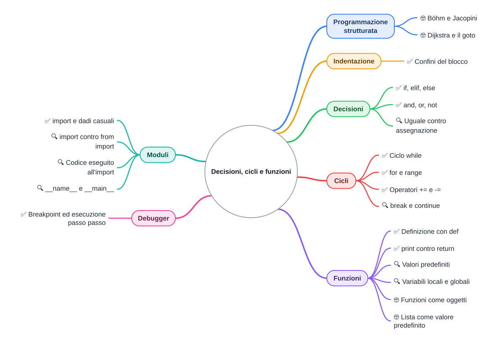

⬅️ [S1 - Primi passi con Python](%28STU%29%204CI%20nov-dic%20S1%20-%20Primi%20passi%20con%20Python.md) · 🏠 [Indice](../README.md) · [S3 - Liste e matrici](%28STU%29%204CI%20nov-dic%20S3%20-%20Liste%20e%20matrici.md) ➡️

# 🎲 Decisioni, cicli e funzioni

**4CI · Novembre-Dicembre · S2 · Teoria**

⏱️ **Tempo di studio: circa 40 minuti, esclusi gli esercizi.** ✅ essenziale: 22 min. 🔍 per il voto alto: altri 18 min. 🤓 si può saltare. Nessun compito obbligatorio a casa.

> **Legenda:** ✅ da sapere · 🔍 per capire fino in fondo · 🤓 facoltativo, per curiosi · 📜 storia · 🧪 esempio · ⚠️ errore comune · 🛠️ strumento · 🔧 lo faremo in laboratorio · ✏️ da fare · 🃏 flashcard: rispondi a voce, poi apri per controllare



## 🧪 Il goblin attacca anche da morto

Sai già scrivere condizioni, cicli e metodi in Java. Qui non ricominciamo da zero: <u>usiamo quello che sai per capire dove Python cambia le regole</u>.

Aria colpisce un goblin. La sua vita scende a zero, ma lui risponde con un morso. Il gioco non si ferma con un errore: semplicemente fa una cosa che non dovrebbe fare.

```python
vita_goblin = 8
danno = 8
vita_goblin -= danno
if vita_goblin > 0:
    print("Il goblin prepara il morso.")
print("Aria perde 4 punti vita.")
```

✏️ **Diagnosi a coppie (2 min).** Prima leggete il codice separatamente: quali messaggi stampa? Poi confrontatevi: quale riga deve dipendere dalla condizione, e come lo direste in Java? Non serve cambiare il danno.

Questa è la missione della settimana: **distinguere un bug dell'algoritmo da una differenza del linguaggio**. Prima prevedi, poi controlla un esempio spiegato; gli esercizi ✏️ restano senza soluzioni. Se la sintassi ti è già chiara, concentrati sui casi in cui il risultato ti sorprende.

## 📜 Dal codice-spaghetti ai blocchi

Nel 1966 due matematici italiani, **Corrado Böhm** e **Giuseppe Jacopini**, mostrano che sequenza, selezione e iterazione bastano per esprimere gli algoritmi, introducendo quando serve variabili di controllo. Sono i tre mattoni che hai già usato in Java: istruzioni in fila, `if` e cicli.

All'epoca i programmatori saltavano da una riga all'altra con un'istruzione chiamata `goto` («vai a»). I programmi diventavano un groviglio di frecce che nessuno riusciva più a seguire: li chiamavano *spaghetti code*. Nel 1968 l'olandese **Edsger Dijkstra** scrive una lettera alla rivista più letta dagli informatici. Il direttore, Niklaus Wirth, le dà un titolo destinato a diventare un proverbio: *«Go To Statement Considered Harmful»*, cioè «l'istruzione goto è considerata dannosa».

Questa storia contribuisce a diffondere la **programmazione strutturata**: organizzare il codice in blocchi comprensibili, invece di saltare ovunque. Java e Python ne ereditano le idee. Python non ha un'istruzione `goto`.

Il problema non è convincere il computer a eseguire il codice: è permettere a una persona di capirlo. Nel nostro dungeon, una riga nel blocco sbagliato basta a resuscitare un goblin.

## 📐 L'indentazione è il blocco

### ✅ L'indentazione decide; quattro spazi è lo standard

In Java un blocco era racchiuso fra `{ }`. Lo spazio a sinistra serviva solo all'occhio. In Python <u>l'indentazione *è* il blocco</u>: le righe spostate a destra dopo i due punti `:` appartengono a quel blocco. Lo standard è di **quattro spazi**.

🧪 **Prevedi, poi leggi il confronto.** Quale messaggio compare con vita zero?

```python
vita = 0
if vita > 0:
    print("Aria combatte.")
print("Fine del turno.")
```

```text
Fine del turno.
```

La fine del turno è fuori dal blocco, quindi viene stampata comunque. Spostando anche quella riga a destra, con vita zero non comparirebbe nessun messaggio. Non cambia la logica dell'`if` che conosci: cambia **come si vede il suo confine**.

| Java | Python |
| --- | --- |
| `if (vita > 0) { ... }` | `if vita > 0:` e righe indentate |
| parentesi tonde obbligatorie | parentesi tonde non obbligatorie |
| il blocco finisce con `}` | il blocco finisce quando l'indentazione torna indietro |

⚠️ Mescolare tabulazioni e spazi può creare errori difficili da vedere. Gli editor possono inserire spazi quando premi `Tab`; la scelta dipende dalle impostazioni. Quattro spazi sono una convenzione, mentre un'indentazione coerente è una regola del linguaggio.

<details>
<summary>🃏 <b>Che cosa delimita un blocco in Python?</b></summary>
L'indentazione: le righe spostate a destra dopo i due punti. Lo standard è di quattro spazi.
</details>
<details>
<summary>🃏 <b>Che cosa mettono Java e Python alla fine della riga dell'<code>if</code>?</b></summary>
Java apre una graffa <code>{</code>; Python mette i due punti <code>:</code>.
</details>

✏️ **Cambia il comportamento (1 min).** Aggiungi al programma una stampa `Aria beve una pozione.` che avvenga solo se Aria è viva, senza rendere condizionale la fine del turno.

## 🔀 Decisioni

### ✅ `if`, `elif`, `else`

Il ragionamento dell'`if` è quello di Java. Ti servono solo le nuove parole e i confini dei blocchi:

| In Java            | In Python                      |
| ------------------ | ------------------------------ |
| `if (...) { ... }` | `if ...:` con blocco indentato |
| `else if (...)`    | `elif ...:`                    |
| `else { ... }`     | `else:`                        |
| `&&`, `\|\|`, `!`  | `and`, `or`, `not`             |
|                    |                                |
|                    |                                |

🧪 **Prevedi il ramo scelto, poi controlla.** Un 6 è critico, da 3 a 5 si colpisce, sotto il 3 si manca:

```python
dado = 4
if dado == 6:
    print("Colpo critico!")
elif dado >= 3:
    print("Colpito.")
else:
    print("Mancato.")
```

```text
Colpito.
```

Come in Java, vince il **primo ramo vero**. `elif` abbrevia *else if*. Non serve imparare un nuovo algoritmo.

<details>
<summary>🃏 <b>Come si scrive <code>else if</code> in Python?</b></summary>
<code>elif</code>.
</details>
<details>
<summary>🃏 <b>Se due condizioni di una catena <code>if/elif</code> sono vere, quali blocchi vengono eseguiti?</b></summary>
Solo il primo: Python si ferma alla prima condizione vera.
</details>

✏️ **Bug di progettazione (2 min).** Un compagno mette `if dado >= 3:` con la stampa `Colpito.`, seguito da `elif dado == 6:` con la stampa `Colpo critico!`. Quale risultato del dado rivela il bug? Spiega perché il problema esisterebbe anche in Java.

### 🔍 ` = ` dentro un `if`
#fatto👍 

Chi arriva da Java sbaglia spesso una lettera. In un `if` serve il confronto ` == `, non l'assegnazione ` = `.

```python
vita = 100
if vita = 0:
    print("Game over")
```

```text
  File "gameover.py", line 2
    if vita = 0:
       ^^^^^^^^
SyntaxError: invalid syntax. Maybe you meant '==' or ':=' instead of '='?
```

È un errore di sintassi: il programma non parte neanche. Il messaggio suggerisce persino la correzione (`:=` è un operatore che non usiamo).

<details>
<summary>🃏 <b>Che errore dà <code>if vita = 0:</code>?</b></summary>
<code>SyntaxError</code>: dentro un <code>if</code> serve il confronto <code>==</code>, non l'assegnazione <code>=</code>.
</details>

## 🔁 Cicli

### ✅ `while`: il combattimento in sei righe
#fatto👍 

`while` controlla la condizione prima di ogni giro, come in Java. `+=` e `-=` hanno lo stesso significato; manca `++`, che diventa `turno += 1`.

🧪 **Prevedi l'ultimo turno, poi controlla.** Usiamo un danno fisso per isolare il ragionamento: la casualità arriverà dopo.

```python
vita_goblin = 30
turno = 0
while vita_goblin > 0:
    turno += 1
    vita_goblin -= 8
    print(f"Turno {turno}: goblin a {vita_goblin}")
```

```text
Turno 1: goblin a 22
Turno 2: goblin a 14
Turno 3: goblin a 6
Turno 4: goblin a -2
```

⚠️ La vita negativa è una scelta non gestita dall'algoritmo, non un errore di Python. In S5 imporremo il limite con una funzione e un test. Per un combattimento con risposta del nemico, la condizione sarà `vita_eroe > 0 and vita_goblin > 0`: **entrambi** devono essere vivi.

<details>
<summary>🃏 <b>Quando si ferma un <code>while</code>?</b></summary>
Quando la condizione, controllata prima di ogni giro, diventa falsa.
</details>
<details>
<summary>🃏 <b>La vita negativa provoca automaticamente un errore?</b></summary>
No: per Python è un intero valido; è il programma a dover far rispettare la regola del gioco.
</details>
<details>
<summary>🃏 <b>Come si scrive <code>turno++</code> in Python?</b></summary>
<code>turno += 1</code>: l'operatore <code>++</code> non esiste.
</details>

✏️ **Distingui i guasti (2 min).** Confronta due modifiche al ciclo: togliere `turno += 1`, oppure togliere `vita_goblin -= 8`. Quale rende il ciclo infinito? Quale altera solo i messaggi? Non eseguire un ciclo che hai previsto infinito.

### ✅ `for` e `range`: ripeti un numero preciso di volte
#fatto👍 

Il `for` di Python non ha i tre pezzi del `for` classico di Java: prende gli elementi uno alla volta. **`range`** fornisce una sequenza di interi, così puoi usarlo per contare.

```text
>>> for turno in range(1, 4):
...     print("Turno", turno)
...
Turno 1
Turno 2
Turno 3

schifo = range(1, 4)  
```

| `range(...)`      | Valori           | In Java                           |
| ----------------- | ---------------- | --------------------------------- |
| `range(5)`        | 0, 1, 2, 3, 4    | `for (int i = 0; i < 5; i++)`     |
| `range(1, 7)`     | 1, 2, 3, 4, 5, 6 | `for (int i = 1; i < 7; i++)`     |
| `range(0, 10, 2)` | 0, 2, 4, 6, 8    | `for (int i = 0; i < 10; i += 2)` |
| `range(3, 0, -1)` | 3, 2, 1          | `for (int i = 3; i > 0; i--)`     |

<u>Il limite finale di `range` non è mai compreso</u>: `range(1, 7)` si ferma a 6. Nel conteggio crescente corrisponde al `<` del `for` Java; nel conteggio decrescente al `>`.

🔍 È più vicino al `for-each` di Java. Un testo è una sequenza di lettere:

```python
for lettera in "Aria":
    print(lettera)
```

```text
A
r
i
a
```

`lettera` riceve le lettere, non i loro indici. In S3 useremo lo stesso meccanismo con le liste.

<details>
<summary>🃏 <b>Quali numeri produce <code>range(2, 5)</code>?</b></summary>
2, 3, 4: l'ultimo numero non è compreso.
</details>
<details>
<summary>🃏 <b>Quando usi <code>for</code> e quando <code>while</code>?</b></summary>
<code>for</code> quando sai quante volte ripetere o hai una sequenza da scorrere; <code>while</code> quando ripeti finché vale una condizione.
</details>

✏️ **Il conto alla rovescia (2 min).** Scrivi un ciclo Python che mostri `3`, `2`, `1`, `0`, poi stampi `La porta si chiude.` una sola volta. Quale limite di `range` devi scegliere?

### 🔍 `break` e `continue`

`break` esce subito dal ciclo. `continue` salta il resto del giro e passa al successivo. Funzionano come in Java.

🧪 **La porta del dungeon.** Per capire il controllo del flusso, immaginiamo tentativi numerati: i numeri pari non sono validi, al 5 la porta si apre. Prevedi quali messaggi compariranno.

```python
for tentativo in range(1, 8):
    if tentativo % 2 == 0:
        continue
    if tentativo == 5:
        print("La porta si apre.")
        break
    print("La porta resiste al tentativo", tentativo)
print(cose)
```

```text
La porta resiste al tentativo 1
La porta resiste al tentativo 3
La porta si apre.
```

Python non ha il `do ... while` di Java. Per leggere almeno una scelta si può usare `while True:` con un `break`:

```python
while True:
    scelta = input("1) Attacca  0) Esci: ")
    if scelta == "0":
        break
    print("Scelta ricevuta:", scelta)
```

Scrivendo `1` e poi `0`, appare `Scelta ricevuta: 1` e il secondo comando chiude il ciclo. Qui accettiamo qualunque testo diverso da `"0"`: in S5 costruiremo il menu vero.

<details>
<summary>🃏 <b>Che differenza c'è fra <code>break</code> e <code>continue</code>?</b></summary>
<code>break</code> esce dal ciclo; <code>continue</code> salta solo il resto del giro corrente.
</details>
<details>
<summary>🃏 <b>Come si imita il <code>do ... while</code> di Java?</b></summary>
Con <code>while True:</code> e un <code>break</code> quando la condizione di uscita è vera.
</details>

✏️ **Prevedi una modifica (1 min).** Nell'esempio dei tentativi, sostituisci mentalmente `continue` con `break`. Fino a quale tentativo arriva il programma?

## 📦 Funzioni

### ✅ `def`: il metodo senza la classe

Conosci già parametri e `return` dai metodi Java. Una **funzione** Python offre lo stesso meccanismo, ma può vivere direttamente nel file, senza una classe attorno. `def` la definisce; i **parametri** sono i nomi con cui riceve i dati.

🧪 **Prevedi il danno, poi controlla.** Separiamo la regola dell'attacco dal dado: così la stessa funzione si può usare con qualunque tiro.

```python
def attacco(forza, tiro):
    return forza + tiro


danno = attacco(7, 4)
print("Danno:", danno)
```

```text
Danno: 11
```

| Java                                              | Python                                             |
| ------------------------------------------------- | -------------------------------------------------- |
| `static int attacco(int forza, int tiro) { ... }` | `def attacco(forza, tiro):`                        |
| tipo restituito e tipi dei parametri obbligatori  | non obbligatori nella definizione                  |
| `camelCase`                                       | `snake_case`, parole separate da `_` (stile PEP 8) |
| `return x;`                                       | `return x`                                         |

La riga `def` crea la funzione: **non esegue il suo corpo**. Il corpo parte con la chiamata. Quando la chiamata viene eseguita, Python deve aver già incontrato la definizione.

<details>
<summary>🃏 <b>Con quale parola si definisce una funzione?</b></summary>
<code>def</code>, seguita dal nome, dai parametri fra parentesi e dai due punti.
</details>
<details>
<summary>🃏 <b>Che stile di nomi usa Python per funzioni e variabili?</b></summary>
<code>snake_case</code>: minuscole e parole separate da <code>_</code>, come <code>tira_dado</code>.
</details>

✏️ **Cambia la regola (2 min).** Scrivi `colpo_critico(forza, tiro)`, che restituisce il doppio della forza più il tiro. Scegli due chiamate che dimostrino che la funzione usa entrambi i parametri.

### ✅ `print` mostra, `return` consegna
#fatto👍 

In Java, stampare e restituire erano già due azioni diverse. La novità è che <u>Python ti lascia usare il risultato di una funzione senza `return`: il risultato è `None`</u>. `None` indica l'assenza di un valore, un po' come `null` in Java.

🧪 **Due funzioni, lo stesso 14 sullo schermo.** Prima prevedi quali valori verranno salvati in `x` e `y`, poi leggi la sessione REPL:

```text
>>> def danno_stampato(forza):
...     print(forza * 2)
...
>>> def danno_restituito(forza):
...     return forza * 2
...
>>> x = danno_stampato(7)
14
>>> y = danno_restituito(7)
>>> print(x)
None
>>> y + 1
15
>>> x + 1
Traceback (most recent call last):
  File "<stdin>", line 1, in <module>
TypeError: unsupported operand type(s) for +: 'NoneType' and 'int'
```

La stampa di 14 non ha riempito `x`: `x` vale `None`. `y`, invece, vale 14 e si può usare in un altro calcolo. <u>Lo schermo non è una variabile.</u> In Java usare così un metodo `void` sarebbe un errore di compilazione; qui il problema emerge quando provi a sommare.

<details>
<summary>🃏 <b>Che cosa restituisce una funzione senza <code>return</code>?</b></summary>
<code>None</code>, il valore «niente» di Python.
</details>
<details>
<summary>🃏 <b>Perché <code>x + 1</code> dà errore se <code>x = danno_stampato(7)</code>?</b></summary>
Perché la funzione stampa ma non restituisce: <code>x</code> vale <code>None</code>, e <code>None</code> non si somma a un numero.
</details>

✏️ **Trova l'errore (2 min).** `def media(a, b): print((a + b) / 2)` e poi `voto = media(6, 8) + 1`. Che cosa succede? Correggi la funzione.

### 🔍 Valori predefiniti

Un parametro può avere un **valore predefinito**: se non lo passi, vale quello. L'armatura di Aria normalmente protegge da 2 punti di danno; una corazza migliore può proteggere di più.

```python
def danno_subito(colpo, armatura=2):
    return max(0, colpo - armatura)


print(danno_subito(7))
print(danno_subito(7, armatura=5))
```

```text
5
2
```

`max(0, risultato)` sceglie il più grande dei due numeri, così la protezione non trasforma il danno in una cura. `armatura=5` nella **chiamata** sceglie un parametro per nome.

In Java avresti potuto usare due metodi con lo stesso nome, cioè l'overloading. Qui la variante predefinita basta: <u>scrivere due `def` con lo stesso nome non crea un overload; la seconda definizione sostituisce la prima</u>.

<details>
<summary>🃏 <b>Che cosa fa <code>armatura=2</code> nella definizione?</b></summary>
Usa 2 se chi chiama non specifica l'armatura; nella chiamata si può scegliere un altro valore anche scrivendo il nome del parametro.
</details>

✏️ **Prova il bordo (1 min).** Scegli una chiamata a `danno_subito` in cui l'armatura supera il colpo. Prevedi il risultato e spiega quale regola del gioco sta proteggendo.

### 🔍 Dove vive una variabile

Una variabile **locale** appartiene a una chiamata della funzione; una **globale** è definita a livello del modulo, cioè fuori dalle funzioni. Il punto interessante è che lo stesso nome non indica per forza la stessa variabile.

🧪 **Prevedi.** Aria vuole curarsi.

```python
vita = 100


def cura():
    vita = vita + 20

cura()
```

```text
Traceback (most recent call last):
  File "cura.py", line 8, in <module>
    cura()
  File "cura.py", line 5, in cura
    vita = vita + 20
           ^^^^
UnboundLocalError: cannot access local variable 'vita' where it is not associated with a value
```

Leggi dal basso. L'assegnazione a `vita` rende quel nome **locale nell'intera funzione**. Quando la riga legge `vita`, il nome locale non ha ancora un valore. Python non ripiega sulla variabile esterna. Il traceback mostra prima la chiamata alla riga 8 e poi l'errore alla riga 5.

Ci sono due soluzioni. La migliore è far **entrare** il dato come parametro e farlo **uscire** con `return`:

```python
def cura(vita):
    return vita + 20


vita = 100
vita = cura(vita)
print(vita)   # 120
```

Con `return vita + 20` la funzione calcola un numero nuovo. Non cambia da sola la freccia esterna: è `vita = cura(vita)` a spostarla.

L'altra soluzione è dichiarare `global vita` dentro la funzione:

```python
vita = 100


def cura_globale():
    global vita
    vita += 20


cura_globale()
print(vita)
```

```text
120
```

Funziona, ma la modifica alla variabile esterna è nascosta dentro la chiamata. <u>Preferisci parametri e `return`: rendono visibile quali dati entrano ed escono.</u>

🔗 Approfondimento: [Python: scope e regola LEGB](../../Integrazioni%20e%20curiosit%C3%A0/Approfondimenti%20didattici/Python%20-%20scope%20e%20regola%20LEGB.md).

<details>
<summary>🃏 <b>Che cos'è una variabile locale?</b></summary>
Un nome che appartiene alla chiamata della funzione, distinto da eventuali nomi uguali fuori.
</details>
<details>
<summary>🃏 <b>Qual è il modo consigliato per far cambiare un dato a una funzione?</b></summary>
Passarlo come parametro e usare il valore restituito con <code>return</code>, invece di <code>global</code>.
</details>

✏️ **Una cura dimenticata (2 min).** Nell'esempio con parametro e `return`, sostituisci `vita = cura(vita)` con `cura(vita)`. Che cosa stampa ora? Disegna la freccia esterna e spiega perché il risultato della cura è andato perso.

## 📚 Moduli

### ✅ `import`: usare il lavoro degli altri
#fatto👍 

Il dungeon deve tirare dadi, non ricevere sempre un tiro scritto a mano. Non serve inventare un generatore: un **modulo** è un'unità di codice importabile, spesso un file `.py`, con funzioni e valori pronti. La **libreria standard** è l'insieme dei moduli distribuiti con Python, fra cui `random` e `math`.

```python
import random


def tira_dado(facce=6):
    return random.randint(1, facce)


print(tira_dado())
```

🧪 Prima di eseguire, puoi prevedere **l'intervallo**, non il numero esatto: `randint(1, 6)` dà un intero da 1 a 6, **estremi compresi**. Per esempio può stampare `4`; l'esecuzione successiva può dare un altro numero. `tira_dado(20)` usa venti facce.

Il punto in `random.randint` significa «il nome `randint` nel modulo `random`». Ricorda `Math.sqrt` di Java, ma qui il contenitore è un modulo, non una classe.

✏️ **Collega i pezzi (2 min).** Usa `attacco(forza, tiro)` e `tira_dado` per calcolare il danno di Aria con forza 7. Quali sono il minimo e il massimo possibili?

<details>
<summary>🃏 <b>Che cos'è un modulo?</b></summary>
Un'unità di codice, spesso un file <code>.py</code>, di cui puoi usare funzioni e valori con <code>import</code>.
</details>
<details>
<summary>🃏 <b>Quale limite include <code>randint</code> che <code>range</code> esclude?</b></summary>
Quello finale: <code>randint(1, 6)</code> può dare 6; <code>range(1, 6)</code> si ferma a 5.
</details>

### 🔍 `import modulo` o `from modulo import nome`

| Forma | Come usi il nome | Quando conviene |
| --- | --- | --- |
| `import math` | `math.sqrt(25)` | quasi sempre: si vede da dove viene il nome |
| `from math import sqrt` | `sqrt(25)` | per pochi nomi usati spesso |

```text
>>> import math
>>> math.sqrt(16)
4.0
>>> from math import sqrt
>>> sqrt(25)
5.0
```

✏️ **Leggibilità (1 min).** Per una funzione chiamata `scelta` in un modulo `dadi`, preferisci leggere `dadi.scelta()` o `scelta()`? Motiva in base a chi dovrà capire il programma, non al numero di caratteri.

### 🔍 Importare può far partire il gioco
#fatto👍 

**Problema.** Vuoi riusare un dado in un altro programma. Lo importi, e il file ti chiede il nome dell'eroe. Non hai chiamato nessuna funzione: perché?

<u>Al primo import, Python esegue il codice a livello del modulo.</u> Definisce le funzioni senza chiamarle, ma esegue eventuali stampe e input scritti fuori dal loro corpo.

🧪 Questo esempio ha **due file nella stessa cartella**. Prima prevedi che cosa stamperà il secondo.

**`regole.py`**

```python
print("Regole del dungeon caricate")
FACCIA_MAX = 6

def facce():
    return FACCIA_MAX
```

**`partita.py`**

```python
import regole
import regole

print(regole.FACCIA_MAX)
print(regole.facce())
```

```text
Regole del dungeon caricate
6
6
```

La stampa iniziale appare **una sola volta**: normalmente Python conserva il modulo già caricato e i successivi import nello stesso processo lo riusano. Le variabili appartengono al modulo: dal secondo file si legge `regole.FACCIA_MAX`, non un nome globale condiviso da tutti i file.

Per separare l'avvio del programma dalle definizioni riutilizzabili, Python fornisce **`__name__`**: vale `"__main__"` nel file lanciato direttamente, ma vale il nome del modulo quando il file viene importato.

Sostituiamo **`regole.py`** con questa versione, lasciando invariato `partita.py`:

```python
FACCIA_MAX = 6


def facce():
    return FACCIA_MAX


if __name__ == "__main__":
    print("Prova delle regole:", facce())
```

Lanciando `regole.py` stampa `Prova delle regole: 6`. Lanciando `partita.py` in un nuovo processo stampa soltanto i due `6`: la prova è sotto una condizione falsa durante l'import. <u>Importare le regole non deve avviare un'intera partita.</u>

<details>
<summary>🃏 <b>Che cosa succede alle righe fuori dalle funzioni quando importi un file?</b></summary>
Al primo import vengono eseguite; normalmente gli import successivi nello stesso processo riusano il modulo già caricato.
</details>
<details>
<summary>🃏 <b>Quando è vera la condizione <code>__name__ == "__main__"</code>?</b></summary>
Quando quel file è lanciato direttamente, non quando è importato come modulo.
</details>
<details>
<summary>🃏 <b>Perché spesso si preferisce <code>import math</code> a <code>from math import sqrt</code>?</b></summary>
Perché nel codice si vede da quale modulo arriva ogni nome.
</details>

✏️ **Un import invadente (2 min).** Immagina che `regole.py` contenga anche `nome = input("Eroe? ")` fuori dalle funzioni. Dove metteresti quella riga perché importare le regole non chieda il nome? Spiega la scelta senza avviare il gioco.

### 🤓 Le funzioni sono oggetti
#fatto👍 

> In Python una funzione è un valore come gli altri. Puoi darle un altro nome e chiamarla con quello:
>
> ```python
> def attacco(forza, tiro):
>     return forza + tiro
>
>
> azione = attacco
> azione = difesa
> print(azione(7, 4))
> ```
>
> Stampa `11`. `azione` è una seconda freccia verso la stessa funzione. Senza parentesi `attacco` indica la funzione; con le parentesi `attacco(7, 4)` la **chiama**. Puoi passare un'azione senza eseguirla subito.

<details>
<summary>🃏 <b>Che differenza c'è fra assegnare <code>attacco</code> e assegnare <code>attacco(7, 4)</code>?</b></summary>
Nel primo caso assegni la funzione; nel secondo il risultato della chiamata.
</details>

### 🤓 La trappola del valore predefinito

> Un valore predefinito viene creato **una volta sola**, quando Python esegue il `def`. Con i numeri non si nota. Con le liste (le vediamo in S3) sì: `[]` è una lista vuota e `.append` aggiunge un elemento, come `add` di un `ArrayList` Java.
>
> ```python
> def aggiungi(oggetto, zaino=[]):
>     zaino.append(oggetto)
>     return zaino
>
>
> print(aggiungi("spada"))
> print(aggiungi("pozione"))
> ```
>
> ```text
> ['spada']
> ['spada', 'pozione']
> ```
>
> Lo zaino «vuoto» è sempre lo stesso oggetto, che si riempie a ogni chiamata. Il rimedio idiomatico è `zaino=None` e, dentro, `if zaino is None: zaino = []`.

<details>
<summary>🃏 <b>Quando viene creata la lista di un parametro predefinito?</b></summary>
Quando viene eseguito il <code>def</code>, non a ogni chiamata: le chiamate che omettono quel parametro condividono la lista.
</details>

## 🛠️ Il debuggery

Un **debugger** ferma il programma e mostra i valori, così puoi confrontare la tua previsione con l'esecuzione. Un **breakpoint** è il punto di arresto scelto su una riga; il **passo-passo** esegue una riga alla volta.

🧪 Nel caso di `cura`, il debugger permette di distinguere il nome locale dal nome del modulo. La domanda utile non è solo «quanto vale `vita`?», ma **«quale `vita` sto guardando?»**. Nel ciclo del goblin, invece, permette di osservare il passaggio da 6 a −2.

In VS Code il passo successivo (`F10`) esegue una chiamata senza seguirne le righe interne; entrare nella funzione (`F11`) permette di seguirle.

🔧 **In laboratorio:** useremo il debugger sul combattimento e sulle funzioni. Qui bastano il modello mentale e il tracciamento a mano; i comandi operativi sono nell'integrazione.

🔗 Più dettagli: [VS Code: trucchi, debug e Live Share](../../Integrazioni%20e%20curiosit%C3%A0/Approfondimenti%20didattici/VS%20Code%20-%20trucchi%2C%20debug%20e%20Live%20Share.md).

<details>
<summary>🃏 <b>A che cosa serve un breakpoint?</b></summary>
A fermare il programma su una riga, per controllare le variabili e proseguire un passo alla volta.
</details>
<details>
<summary>🃏 <b>Che differenza c'è fra «passo successivo» ed «entra nella funzione»?</b></summary>
Il primo esegue la riga intera, anche se contiene una chiamata; il secondo segue la chiamata dentro la funzione.
</details>

### 🤓 Un `goto` per Python

> Il 1° aprile 2004 il programmatore Richie Hindle pubblicò un modulo che aggiungeva `goto` a Python. Era un pesce d'aprile, ma funzionava davvero. Dijkstra non avrebbe riso. Se vuoi ridere tu, cerca la vignetta [XKCD n. 292](https://xkcd.com/292/): c'è un velociraptor.

## ✏️ Esercizi

Scegli una sfida breve sul punto che ti ha sorpreso. La sfida finale collega tutto: non serve svolgere ogni esercizio a casa.

1. **La porta perde un tentativo (✅, 2 min).** La porta deve concedere sei tentativi. Quali numeri stampa il programma e quale limite va corretto?
   ```python
   for tentativo in range(1, 6):
       print("Tentativo", tentativo)
   ```
2. **L'eroe salta un turno (🔍, 3 min).** Il comando `"pausa"` deve saltare l'attacco, `"esci"` deve fermare il ciclo, ogni altro comando deve stampare `Aria attacca.`. Scrivi il ciclo usando `input`, `continue` e `break`. La condizione di uscita deve essere controllata a ogni giro.
3. **La cura non cura (🔍, 2 min).** Perché questo programma non salva il risultato della cura? Quali due cambiamenti servono per farlo?
   ```python
   def pozione(vita):
       print(vita + 15)


   vita = 40
   pozione(vita)
   print("Vita dopo la pozione:", vita)
   ```
4. **Conta i critici (✅, 3 min).** Metti in ordine e indenta queste righe: `return quanti`, `for tiro in range(10):`, `quanti = 0`, `def conta_sei():`, `if tira_dado(6) == 6:`, `quanti += 1`. La funzione deve usare `tira_dado` della sezione Moduli e restituire il numero di 6 su dieci tiri.
5. **Il goblin più resistente (🔍, 4 min).** Progetta `turni_necessari(vita, danno)`: restituisce quanti colpi costanti servono per portare la vita a zero o meno, senza stampare. Assumi `vita >= 0` e `danno > 0`. Scegli due esempi, uno con vita già zero, e prevedi i risultati prima di scrivere la funzione.

### 🔍 Sfida finale: le due regole del combattimento

✏️ **Progetta e difendi la scelta (5 min).** Scrivi `risolvi_turno(vita_eroe, vita_goblin, danno)` con due regole:

- Aria colpisce per prima. Se sconfigge il goblin, restituisce la vita dell'eroe senza modificarla.
- Se il goblin sopravvive, morde per 4 e la funzione restituisce la vita dell'eroe diminuita di 4, senza scendere sotto zero.

Non servono liste né classi. Assumi che entrambi siano vivi all'inizio del turno e che `danno >= 0`. La funzione non stampa e non tira il dado: riceve un danno già calcolato. Provala mentalmente con `(100, 8, 8)`, `(100, 30, 8)` e `(3, 30, 8)`. Poi confronta con un compagno **l'ordine delle istruzioni**, non soltanto il risultato.

**Uscita:** completa «Il goblin morto che morde è un problema di ...; la cura che restituisce `None` è un problema di ...; per distinguerli controllo ...».

## 📚 Fonti e risorse

- [The Python Tutorial, capitolo 4](https://docs.python.org/3/tutorial/controlflow.html): `if`, `for`, `range`, `break` e funzioni nella documentazione ufficiale. Leggi le sezioni 4.1-4.4 e 4.8.
- [The Python Tutorial, capitolo 6](https://docs.python.org/3/tutorial/modules.html): import, nomi dei moduli e `__main__`.
- [Il modulo `random`](https://docs.python.org/3/library/random.html#random.randint): verifica che cosa comprende l'intervallo di `randint`.
- [Python Tutor](https://pythontutor.com): incolla la versione di `cura` con parametro e `return` e confronta il nome locale con quello del modulo.
- [Debugging in VS Code](https://code.visualstudio.com/docs/python/debugging): la guida ufficiale al debugger per Python, in inglese. Guarda solo la parte su breakpoint e passi.
- [Edsger Dijkstra, «Go To Statement Considered Harmful» (1968)](https://homepages.cwi.nl/~storm/teaching/reader/Dijkstra68.pdf): la lettera originale, una pagina e mezza in inglese. Leggi il primo paragrafo.
- [PEP 8](https://peps.python.org/pep-0008/): la guida di stile di Python. Cerca la sezione *Naming Conventions*.
- [XKCD n. 292](https://xkcd.com/292/): il velociraptor e il `goto` (licenza CC BY-NC).

---

⬅️ [S1 - Primi passi con Python](%28STU%29%204CI%20nov-dic%20S1%20-%20Primi%20passi%20con%20Python.md) · 🏠 [Indice](../README.md) · [S3 - Liste e matrici](%28STU%29%204CI%20nov-dic%20S3%20-%20Liste%20e%20matrici.md) ➡️
