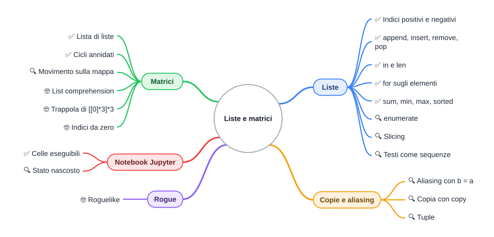

⬅️ [S2 - Decisioni, cicli e funzioni](%28STU%29%204CI%20nov-dic%20S2%20-%20Decisioni%2C%20cicli%20e%20funzioni.md) · 🏠 [Indice](../README.md) · [S4 - Dizionari](%28STU%29%204CI%20nov-dic%20S4%20-%20Dizionari.md) ➡️

# 🎒 Liste e matrici

**4CI · Novembre-Dicembre · S3 · Teoria**

⏱️ **Tempo di studio: circa 45 minuti.** ✅ essenziale: 25 min. 🔍 per il voto alto: 15 min. 🤓 si può saltare. Nessun compito obbligatorio a casa.

> **Legenda:** ✅ da sapere · 🔍 per capire fino in fondo · 🤓 facoltativo, per curiosi · 📜 storia · 🧪 esempio · ⚠️ errore comune · 🛠️ strumento · 🔧 lo faremo in laboratorio · ✏️ da fare · 🃏 flashcard: rispondi a voce, poi apri per controllare



## 📜 Una chiocciola in un labirinto di lettere

1980, Università della California a Santa Cruz. I computer non hanno grafica: solo un terminale che mostra lettere e simboli. Due studenti, **Michael Toy** e **Glenn Wichman**, vogliono un gioco d'avventura che sia diverso ogni volta. Lo chiamano **Rogue**.

Il dungeon è disegnato con i caratteri della tastiera. I muri sono `-` e `|`, i pavimenti sono puntini, l'oro è `*`, e l'eroe è una chiocciola: `@`. Ogni partita il computer genera un labirinto nuovo. Si muore spesso, e quando si muore si ricomincia da capo.

Rogue gira sulle macchine delle università americane e crea un intero genere, che porta ancora il suo nome: i *roguelike*. Molti giochi di oggi discendono da lui.

Il segreto tecnico è semplice. Una mappa è una tabella di caselle; una tabella è una fila di righe; una riga è una fila di caselle. Oggi costruiamo proprio questo: <u>la fila (lista) e la fila di file (matrice)</u>. Anche il nostro eroe sarà una `@`.

## 🎒 Liste

### ✅ Una fila di caselle numerate

**Problema.** Lo zaino di Aria contiene una spada, una pozione e una torcia. Con le variabili di S1 servirebbero `oggetto1`, `oggetto2`, `oggetto3`... e se trova un decimo oggetto? Non puoi aggiungere variabili mentre il programma gira.

Una **lista** è <u>una fila di caselle numerate, che parte da zero</u>. Si scrive fra parentesi quadre, con gli elementi separati da virgole. Il numero di una casella si chiama **indice**.

```text
>>> zaino = ["spada", "pozione", "torcia"]
>>> zaino[0]
'spada'
>>> zaino[-1]
'torcia'
>>> len(zaino)
3
```

```text
indice:     0          1          2
         ┌────────┬──────────┬─────────┐
zaino ──▶│ "spada"│ "pozione"│ "torcia"│
         └────────┴──────────┴─────────┘
indice:    -3         -2         -1
```

Un **indice negativo** conta dalla fine: `-1` è l'ultimo elemento. `len()` dà la lunghezza.

Una lista **cresce** quando serve e può contenere tipi diversi: `["Aria", 100, True]` è una lista valida. Di solito però una lista contiene cose dello stesso genere, come gli oggetti dello zaino.

<details>
<summary>🃏 <b>Da quale numero parte l'indice di una lista?</b></summary>
Da 0: il primo elemento è <code>zaino[0]</code>.
</details>
<details>
<summary>🃏 <b>Che cosa dà <code>zaino[-1]</code>?</b></summary>
L'ultimo elemento della lista: gli indici negativi contano dalla fine.
</details>

✏️ **Disegna (2 min).** Disegna la fila di `zaino = ["arco", "frecce", "mantello", "pane"]` con gli indici positivi sopra e negativi sotto.

### ✅ Aggiungere, togliere, cercare

```text
>>> zaino.append("corda")
>>> zaino
['spada', 'pozione', 'torcia', 'corda']
>>> "pozione" in zaino
True
>>> zaino.remove("pozione")
>>> zaino
['spada', 'torcia', 'corda']
>>> zaino.insert(0, "scudo")
>>> zaino
['scudo', 'spada', 'torcia', 'corda']
>>> zaino.pop()
'corda'
>>> zaino[1] = "ascia"
>>> zaino
['scudo', 'ascia', 'torcia']
```

| Operazione | Che cosa fa | In Java (`ArrayList`) |
| --- | --- | --- |
| `zaino.append(x)` | aggiunge in fondo | `zaino.add(x)` |
| `zaino.insert(i, x)` | inserisce in posizione `i` | `zaino.add(i, x)` |
| `zaino.remove(x)` | toglie il primo `x` | `zaino.remove(x)` |
| `zaino.pop()` | toglie e restituisce l'ultimo | `zaino.remove(zaino.size() - 1)` |
| `zaino[i]` | legge la casella `i` | `zaino.get(i)` |
| `zaino[i] = x` | sostituisce la casella `i` | `zaino.set(i, x)` |
| `x in zaino` | `True` se c'è | `zaino.contains(x)` |
| `len(zaino)` | quanti elementi | `zaino.size()` |

<u>La lista di Python è l'`ArrayList` di Java, con la comodità delle quadre degli array.</u>

⚠️ Se chiedi una casella che non esiste, Python si ferma:

```text
>>> zaino[5]
Traceback (most recent call last):
  File "<stdin>", line 1, in <module>
IndexError: list index out of range
```

*Index out of range*: «indice fuori dall'intervallo». Lo zaino ha 3 caselle, da 0 a 2.

<details>
<summary>🃏 <b>Come si aggiunge un elemento in fondo a una lista?</b></summary>
Con <code>append</code>: <code>zaino.append("corda")</code>.
</details>
<details>
<summary>🃏 <b>Come si controlla se un elemento è nella lista?</b></summary>
Con <code>in</code>: <code>"torcia" in zaino</code> vale <code>True</code> o <code>False</code>.
</details>
<details>
<summary>🃏 <b>Che cosa significa <code>IndexError: list index out of range</code>?</b></summary>
Hai chiesto una casella che non esiste: l'indice è maggiore o uguale alla lunghezza della lista.
</details>

✏️ **Prevedi (2 min).** Parti da `zaino = ["pane", "corda"]`. Dopo `zaino.insert(1, "mappa")` e `zaino.pop()`, che cosa contiene la lista?

### ✅ Scorrere una lista

In S2 hai visto che `for` prende uno alla volta gli elementi di una sequenza. Una lista è una sequenza.

```python
zaino = ["spada", "pozione", "torcia"]
for oggetto in zaino:
    print("Nello zaino:", oggetto)
```

```text
Nello zaino: spada
Nello zaino: pozione
Nello zaino: torcia
```

⚠️ <u>`for oggetto in zaino` dà gli **elementi**, non gli indici.</u> Chi arriva da Java tende a scrivere `for i in range(len(zaino)):` e poi `zaino[i]`. Funziona, ma è più lungo. Se ti servono sia il numero sia l'elemento, usa `enumerate` (🔍):

```python
for numero, oggetto in enumerate(zaino, start=1):
    print(numero, oggetto)
```

```text
1 spada
2 pozione
3 torcia
```

<details>
<summary>🃏 <b>Che cosa contiene la variabile del ciclo in <code>for oggetto in zaino</code>?</b></summary>
Gli elementi della lista, uno alla volta; non gli indici.
</details>
<details>
<summary>🃏 <b>A che cosa serve <code>enumerate</code>?</b></summary>
A scorrere una lista avendo, a ogni giro, sia la posizione sia l'elemento.
</details>

✏️ **Riscrivi (2 min).** Trasforma `for i in range(len(zaino)): print(zaino[i])` nella forma tipica di Python.

### ✅ Somme, massimi, ordinamenti

Le funzioni già pronte lavorano su tutta la lista in una riga. Ecco i danni di quattro turni:

```text
>>> danni = [8, 12, 5, 9]
>>> sum(danni)
34
>>> max(danni)
12
>>> min(danni)
5
>>> sorted(danni)
[5, 8, 9, 12]
>>> danni
[8, 12, 5, 9]
```

🔍 `sorted(danni)` crea una **nuova** lista ordinata e lascia intatta quella vecchia. `danni.sort()` invece ordina la lista stessa e restituisce `None`. È di nuovo la differenza fra *restituire* e *modificare*.

<details>
<summary>🃏 <b>Come calcoli la media dei valori di <code>danni</code>?</b></summary>
<code>sum(danni) / len(danni)</code>.
</details>
<details>
<summary>🃏 <b>Che differenza c'è fra <code>sorted(danni)</code> e <code>danni.sort()</code>?</b></summary>
<code>sorted</code> restituisce una nuova lista ordinata; <code>sort</code> ordina la lista stessa e restituisce <code>None</code>.
</details>

### 🔍 Slicing: tagliare una fetta

Lo **slicing** (letteralmente «affettare») prende una parte della lista: `lista[inizio:fine]`. Come in `range`, <u>la fine non è compresa</u>.

```text
>>> zaino = ["spada", "pozione", "torcia", "corda", "mappa"]
>>> zaino[1:3]
['pozione', 'torcia']
>>> zaino[:2]
['spada', 'pozione']
>>> zaino[3:]
['corda', 'mappa']
>>> zaino[-2:]
['corda', 'mappa']
>>> zaino[::-1]
['mappa', 'corda', 'torcia', 'pozione', 'spada']
```

Se manca l'inizio, si parte da 0; se manca la fine, si arriva in fondo. Il terzo numero è il **passo**: `-1` legge la lista al contrario. Lo slicing restituisce sempre una **nuova** lista.

<details>
<summary>🃏 <b>Che cosa dà <code>zaino[:2]</code>?</b></summary>
I primi due elementi, con indice 0 e 1: la fine non è compresa.
</details>

### 🔍 I testi sono sequenze

Un `str` si comporta come una lista di lettere: ha indici, `len` e slicing. Però <u>non si può modificare</u>.

```text
>>> nome = "Aria"
>>> nome[0]
'A'
>>> len(nome)
4
>>> nome[0] = "I"
Traceback (most recent call last):
  File "<stdin>", line 1, in <module>
TypeError: 'str' object does not support item assignment
```

Un oggetto che non si può modificare si dice **immutabile**. Per «cambiare» un testo se ne crea uno nuovo: `nome = "I" + nome[1:]`.

<details>
<summary>🃏 <b>Si può cambiare una lettera di un <code>str</code>?</b></summary>
No: i testi sono immutabili. Si crea un testo nuovo.
</details>

## 🏹 Copie e frecce

### 🔍 `b = a` non copia la lista

Ricordi le scatole e le frecce? <u>Una variabile è una freccia; `b = a` crea una seconda freccia verso la **stessa** lista.</u> Kofi entra nel dungeon e «copia» lo zaino di Aria:

```text
>>> zaino_aria = ["spada", "pozione"]
>>> zaino_kofi = zaino_aria
>>> zaino_kofi.append("torcia")
>>> zaino_aria
['spada', 'pozione', 'torcia']
>>> zaino_kofi is zaino_aria
True
```

Kofi ha messo la torcia nel suo zaino, e la torcia è comparsa in quello di Aria. Perché lo zaino è uno solo:

```text
zaino_aria ──┐
             ├──▶ ["spada", "pozione", "torcia"]
zaino_kofi ──┘
```

Lo stesso succedeva in Java con gli `ArrayList` e gli oggetti. Questo fenomeno si chiama **aliasing**: due nomi per lo stesso oggetto. Per avere due zaini distinti serve una **copia**:

```text
>>> copia = zaino_aria.copy()
>>> copia.append("corda")
>>> zaino_aria
['spada', 'pozione', 'torcia']
>>> copia
['spada', 'pozione', 'torcia', 'corda']
```

```text
zaino_aria ───▶ ["spada", "pozione", "torcia"]
copia ────────▶ ["spada", "pozione", "torcia", "corda"]
```

Anche `zaino_aria[:]` e `list(zaino_aria)` creano una copia.

<details>
<summary>🃏 <b>Dopo <code>b = a</code> con <code>a</code> lista, quante liste esistono?</b></summary>
Una sola, con due frecce che la puntano: modificare <code>b</code> modifica anche ciò che vedi da <code>a</code>.
</details>
<details>
<summary>🃏 <b>Come si crea una copia di una lista?</b></summary>
Con <code>a.copy()</code>, oppure <code>a[:]</code> o <code>list(a)</code>.
</details>

✏️ **Disegna (3 min).** Disegna scatole e frecce dopo queste righe, poi scrivi che cosa stampa l'ultima: `a = [1, 2]`, `b = a`, `c = a.copy()`, `b.append(3)`, `print(a, c)`.

### 🔍 Tuple: liste che non cambiano

Una **tupla** è una sequenza **immutabile**, scritta fra parentesi tonde. Serve per dati che vanno insieme e non devono cambiare, come le coordinate di una casella.

```text
>>> posizione = (2, 1)
>>> posizione[0]
2
>>> posizione[0] = 3
Traceback (most recent call last):
  File "<stdin>", line 1, in <module>
TypeError: 'tuple' object does not support item assignment
```

Le tuple permettono anche di assegnare più variabili in una riga: `riga, colonna = 1, 1`.

<details>
<summary>🃏 <b>Che differenza c'è fra una lista e una tupla?</b></summary>
La lista si può modificare; la tupla no. La lista usa le quadre, la tupla le tonde.
</details>

## 🗺️ Matrici

### ✅ Una lista di liste

**Problema.** La mappa del dungeon ha righe e colonne. Una sola fila non basta.

Una **matrice** è una tabella di righe e colonne. In Python si costruisce come <u>una lista che contiene liste</u>: ogni lista interna è una riga. In Java scrivevi `String[][] mappa`.

```python
mappa = [
    ["#", "#", "#", "#", "#", "#"],
    ["#", "@", ".", ".", "M", "#"],
    ["#", ".", "#", ".", "$", "#"],
    ["#", "#", "#", "#", "#", "#"],
]
```

`#` è un muro, `.` un pavimento, `@` l'eroe, `M` un mostro, `$` il tesoro. Per leggere una casella servono due indici: <u>prima la riga, poi la colonna</u>.

```text
            colonna:  0    1    2    3    4    5
mappa ──▶ riga 0 ──▶ ["#", "#", "#", "#", "#", "#"]
          riga 1 ──▶ ["#", "@", ".", ".", "M", "#"]
          riga 2 ──▶ ["#", ".", "#", ".", "$", "#"]
          riga 3 ──▶ ["#", "#", "#", "#", "#", "#"]
```

`mappa[1]` è la riga 1, cioè una lista. `mappa[1][4]` è la casella in riga 1 e colonna 4: `'M'`. La mappa ha `len(mappa)` righe, cioè 4, e `len(mappa[0])` colonne, cioè 6.

<details>
<summary>🃏 <b>Come si rappresenta una matrice in Python senza librerie?</b></summary>
Come una lista di liste: ogni lista interna è una riga.
</details>
<details>
<summary>🃏 <b>In <code>mappa[r][c]</code>, che cosa sono <code>r</code> e <code>c</code>?</b></summary>
<code>r</code> è l'indice della riga, <code>c</code> quello della colonna. Prima la riga.
</details>

✏️ **Trova (2 min).** Nella mappa sopra, quali indici ha il tesoro `$`? Che cosa c'è in `mappa[2][2]`?

### ✅ Cicli annidati

Per visitare ogni casella servono due cicli, uno dentro l'altro: il primo scorre le righe, il secondo le caselle della riga.

```python
for riga in mappa:
    for cella in riga:
        print(cella, end=" ")
    print()
```

```text
# # # # # #
# @ . . M #
# . # . $ #
# # # # # #
```

`print(cella, end=" ")` stampa la casella e, al posto di andare a capo, mette uno spazio. Il `print()` vuoto, alla fine di ogni riga, va a capo.

Quando servono le coordinate, si scorrono gli **indici**:

```python
for r in range(len(mappa)):
    for c in range(len(mappa[r])):
        if mappa[r][c] == "$":
            print("Tesoro in riga", r, "colonna", c)
```

```text
Tesoro in riga 2 colonna 4
```

<details>
<summary>🃏 <b>Perché per visitare una matrice servono due cicli?</b></summary>
Il ciclo esterno scorre le righe; quello interno scorre le caselle di ogni riga.
</details>
<details>
<summary>🃏 <b>Che cosa fa <code>end=" "</code> in <code>print</code>?</b></summary>
Sostituisce l'andata a capo finale con uno spazio, così la riga continua.
</details>

### 🔍 Muovere l'eroe

Spostare l'eroe vuol dire cambiare due caselle: quella di partenza torna pavimento, quella di arrivo diventa `@`. Prima però si controlla che non sia un muro.

```python
riga, colonna = 1, 1
nuova_riga, nuova_colonna = riga, colonna + 1   # un passo a destra
if mappa[nuova_riga][nuova_colonna] != "#":
    mappa[riga][colonna] = "."
    mappa[nuova_riga][nuova_colonna] = "@"
    riga, colonna = nuova_riga, nuova_colonna
print(mappa[1])
```

```text
['#', '.', '@', '.', 'M', '#']
```

Un passo in alto è `riga - 1`, in basso `riga + 1`, a sinistra `colonna - 1`.

<details>
<summary>🃏 <b>Quali coordinate ha la casella sopra a <code>(riga, colonna)</code>?</b></summary>
<code>(riga - 1, colonna)</code>: salire vuol dire diminuire l'indice di riga.
</details>

✏️ **Traccia (3 min).** Parti da `riga, colonna = 1, 1` e prova a fare un passo in basso e poi uno a destra. In quale casella finisce l'eroe? Il secondo passo è permesso?

### 🤓 Comprehension e una matrice traditrice

> Una **list comprehension** costruisce una lista in una riga: `[n * n for n in range(5)]` dà `[0, 1, 4, 9, 16]`. Si legge «n per n, per ogni n in range(5)».
>
> Ecco la trappola più famosa delle matrici in Python:
>
> ```text
> >>> griglia = [[0] * 3] * 3
> >>> griglia[0][0] = 9
> >>> griglia
> [[9, 0, 0], [9, 0, 0], [9, 0, 0]]
> ```
>
> `* 3` non ha creato tre righe: ha creato **tre frecce verso la stessa riga**. È l'aliasing, travestito. La forma sicura costruisce una riga nuova a ogni giro: `[[0] * 3 for r in range(3)]`, oppure un ciclo con `append`.

### 🤓 Perché si parte da zero?

> Il Fortran (1957) contava gli elementi da 1. Il C (1972) e i suoi figli, Java compreso, partono da 0: l'indice dice quanti passi fare dall'inizio. Nel 1982 Dijkstra, sì, quello del `goto`, scrisse una nota di una pagina per spiegare perché lo zero è la scelta più elegante: [EWD831, «Why numbering should start at zero»](https://www.cs.utexas.edu/~EWD/transcriptions/EWD08xx/EWD831.html). Lua, MATLAB e R partono ancora da 1, e i programmatori ne discutono da decenni.

## 🛠️ Il notebook Jupyter

Un **notebook** (quaderno) è un documento fatto di **celle**. Alcune celle contengono testo, altre codice che puoi eseguire una alla volta. Il risultato compare sotto la cella. Il formato più usato si chiama **Jupyter**; VS Code lo apre con i file `.ipynb`.

È comodo per esplorare dati: una cella crea la mappa, la successiva la stampa, un'altra conta i mostri. Si usa molto nella ricerca e nell'analisi dei dati.

⚠️ **Lo stato nascosto.** Le celle si possono eseguire in qualsiasi ordine, anche più volte. Se una cella contiene `x = 1` e un'altra `x = x + 1`, eseguire la seconda tre volte dà `x` uguale a 4. Chi riapre il quaderno e lo legge dall'alto in basso si aspetta 2. Prima di consegnare o condividere un notebook, usa **Riavvia ed esegui tutto** (*Restart and Run All*): se funziona così, funziona davvero.

🤓 Il nome *Jupyter* unisce tre linguaggi: **Ju**lia, **Pyt**hon e **R**.

🔧 **In laboratorio:** lo zaino e la mappa del dungeon, e una prima prova con un notebook.

<details>
<summary>🃏 <b>Che cos'è un notebook Jupyter?</b></summary>
Un documento a celle, di testo e di codice, in cui ogni cella di codice si esegue e mostra il risultato sotto di sé.
</details>
<details>
<summary>🃏 <b>Che cos'è lo stato nascosto in un notebook?</b></summary>
Il risultato delle celle eseguite in un ordine diverso da quello in cui sono scritte: il quaderno non mostra più la storia vera delle variabili.
</details>

## ✏️ Esercizi

1. **Prevedi.** `l = [10, 20, 30, 40]`. Che cosa danno `l[1]`, `l[-1]`, `l[1:3]`, `len(l)`?
2. **Prevedi.** Dopo `a = ["x"]`, `b = a`, `b.append("y")`, che cosa stampa `print(len(a))`? Disegna le frecce.
3. **Trova l'errore.** Il programma deve stampare l'ultimo oggetto dello zaino, ma si ferma con un `IndexError`. Perché? Correggilo in due modi.
   ```python
   zaino = ["spada", "pozione", "torcia"]
   print(zaino[len(zaino)])
   ```
4. **Scrivi.** Una funzione `conta_muri(mappa)` che restituisce quanti `#` ci sono in una matrice.
5. **Scrivi.** Una funzione `piu_forte(danni)` che restituisce il danno più alto senza usare `max`: scorri la lista e tieni il record.
6. **Traduci.** Da Java a Python:
   ```java
   ArrayList<String> nemici = new ArrayList<>();
   nemici.add("goblin");
   nemici.add("ragno");
   for (String n : nemici) System.out.println(n);
   ```

**Uscita:** «Una lista è ...; per leggere una casella di una matrice scrivo prima ... e poi ...; `b = a` non crea una copia perché ...».

## 📚 Fonti e risorse

- [The Python Tutorial, sezione 3.1.3 e capitolo 5](https://docs.python.org/3/tutorial/datastructures.html): liste, metodi e tuple nella documentazione ufficiale. Leggi 5.1 e 5.3.
- [Python Tutor](https://pythontutor.com): incolla l'esempio di `zaino_aria` e `zaino_kofi` e guarda le due frecce verso la stessa lista. Poi prova `[[0] * 3] * 3`.
- [Rogue su Wikipedia](https://it.wikipedia.org/wiki/Rogue_(videogioco)): la storia del gioco, con un'immagine della mappa fatta di caratteri.
- [Jupyter in VS Code](https://code.visualstudio.com/docs/datascience/jupyter-notebooks): la guida ufficiale ai notebook, in inglese. Guarda solo come si esegue una cella.
- [EWD831](https://www.cs.utexas.edu/~EWD/transcriptions/EWD08xx/EWD831.html): la nota di Dijkstra sullo zero, una pagina in inglese.

---

⬅️ [S2 - Decisioni, cicli e funzioni](%28STU%29%204CI%20nov-dic%20S2%20-%20Decisioni%2C%20cicli%20e%20funzioni.md) · 🏠 [Indice](../README.md) · [S4 - Dizionari](%28STU%29%204CI%20nov-dic%20S4%20-%20Dizionari.md) ➡️
