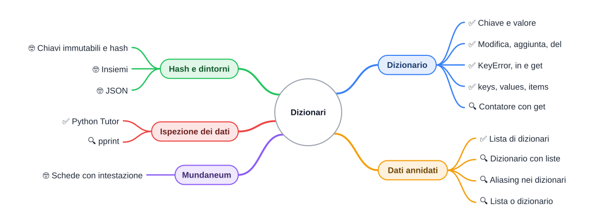

⬅️ [S3 - Liste e matrici](%28STU%29%204CI%20nov-dic%20S3%20-%20Liste%20e%20matrici.md) · 🏠 [Indice](../README.md) · [S5 - Progettare un programma](%28STU%29%204CI%20nov-dic%20S5%20-%20Progettare%20un%20programma.md) ➡️

# 📇 Dizionari

**4CI · Novembre-Dicembre · S4 · Teoria**

⏱️ **Tempo di studio: circa 40 minuti.** ✅ essenziale: 25 min. 🔍 per il voto alto: 12 min. 🤓 si può saltare. Nessun compito obbligatorio a casa.

> **Legenda:** ✅ da sapere · 🔍 per capire fino in fondo · 🤓 facoltativo, per curiosi · 📜 storia · 🧪 esempio · ⚠️ errore comune · 🛠️ strumento · 🔧 lo faremo in laboratorio · ✏️ da fare · 🃏 flashcard: rispondi a voce, poi apri per controllare



## 📜 Il Google di carta

Bruxelles, 1895. Due avvocati belgi, **Paul Otlet** e **Henri La Fontaine**, hanno un'ambizione folle: raccogliere in un unico posto tutto il sapere del mondo. Non comprano libri. Scrivono **schede**: cartoncini tutti della stessa misura, ognuno con un'intestazione in alto e le informazioni sotto.

Le schede finiscono in migliaia di cassetti di legno, ordinate per argomento. Diventano milioni. Chiunque può spedire una domanda per posta, e gli impiegati del **Mundaneum** cercano la scheda giusta e rispondono. Qualcuno, oggi, lo chiama «il Google di carta». La Fontaine riceverà il premio Nobel per la pace nel 1913; il sogno di Otlet, una rete mondiale di documenti collegati, anticipa di decenni il World Wide Web.

Il trucco del Mundaneum sta nell'intestazione. <u>Non cerchi «la scheda numero 4.211.087»: cerchi la scheda che si chiama in un certo modo.</u> Oggi impariamo a fare la stessa cosa in Python.

## 📇 Il dizionario

### ✅ Chiave e valore

**Problema.** La scheda di Aria, scritta come lista, è `["Aria", 100, 7]`. Che cosa vuol dire `scheda[1]`? La vita? La forza? Devi ricordare a memoria che cosa c'è in ogni posizione. Con dieci campi diventa un incubo.

Un **dizionario** è una raccolta di coppie **chiave → valore**. <u>Si cerca un dato dal suo nome (la chiave), non dalla sua posizione.</u> Si scrive fra graffe, con i due punti fra chiave e valore.

```text
>>> scheda = {"nome": "Aria", "vita": 100, "forza": 7}
>>> scheda["vita"]
100
```

```text
             chiave      valore
           ┌─────────┬──────────┐
scheda ──▶ │ "nome"  │  "Aria"  │
           │ "vita"  │   100    │
           │ "forza" │    7     │
           └─────────┴──────────┘
```

Come in una rubrica del telefono: cerchi «Mamma» e trovi il numero. Non ti chiedi in che posizione sia.

| | Lista | Dizionario |
| --- | --- | --- |
| Si scrive | `["Aria", 100, 7]` | `{"nome": "Aria", "vita": 100, "forza": 7}` |
| Si legge con | un indice: `scheda[1]` | una chiave: `scheda["vita"]` |
| Ordine | conta: è il modo per trovare i dati | conta poco: si cerca per nome |
| Esempio | lo zaino, i turni, la mappa | la scheda, la rubrica, l'inventario |

<details>
<summary>🃏 <b>Che cos'è un dizionario?</b></summary>
Una raccolta di coppie chiave → valore, in cui si cerca un dato dalla sua chiave.
</details>
<details>
<summary>🃏 <b>Come si legge la forza in <code>scheda = {"nome": "Aria", "forza": 7}</code>?</b></summary>
<code>scheda["forza"]</code>: la chiave va fra parentesi quadre.
</details>

✏️ **Trasforma (2 min).** Scrivi come dizionario il goblin descritto dalla lista `["Goblin", 30, 4]`, dove i campi sono nome, vita e attacco.

### ✅ Modificare, aggiungere, togliere

```text
>>> scheda["vita"] = 85
>>> scheda["livello"] = 2
>>> scheda
{'nome': 'Aria', 'vita': 85, 'forza': 7, 'livello': 2}
>>> len(scheda)
4
>>> del scheda["livello"]
>>> scheda
{'nome': 'Aria', 'vita': 85, 'forza': 7}
```

<u>La stessa scrittura `scheda[chiave] = valore` modifica una chiave che c'è e aggiunge una chiave che non c'è.</u> `del` toglie una coppia. `len` conta le coppie.

Le chiavi sono quasi sempre testi o numeri. I valori possono essere qualunque cosa, anche liste e altri dizionari.

<details>
<summary>🃏 <b>Che cosa fa <code>scheda["oro"] = 10</code> se la chiave <code>"oro"</code> non c'è?</b></summary>
Aggiunge la nuova coppia <code>"oro": 10</code> al dizionario.
</details>
<details>
<summary>🃏 <b>Come si toglie una chiave da un dizionario?</b></summary>
Con <code>del</code>: <code>del scheda["livello"]</code>.
</details>

### ✅ Chiavi che non ci sono

⚠️ <u>Se chiedi una chiave che non esiste, Python non risponde «niente»: si ferma con un `KeyError`.</u>

```text
>>> scheda["oro"]
Traceback (most recent call last):
  File "<stdin>", line 1, in <module>
KeyError: 'oro'
```

Ci sono due modi per evitarlo. Il primo è **chiedere prima** con `in`. Il secondo è **`get`**, che restituisce `None`, oppure un valore di riserva, se la chiave manca.

```text
>>> "oro" in scheda
False
>>> print(scheda.get("oro"))
None
>>> scheda.get("oro", 0)
0
```

⚠️ Chi arriva dalle liste prova a scrivere `scheda[0]` per avere «il primo campo». Ma `0` non è una chiave della scheda:

```text
>>> scheda[0]
Traceback (most recent call last):
  File "<stdin>", line 1, in <module>
KeyError: 0
```

<details>
<summary>🃏 <b>Che errore dà una chiave che non esiste?</b></summary>
<code>KeyError</code>, con il nome della chiave mancante.
</details>
<details>
<summary>🃏 <b>Che cosa restituisce <code>scheda.get("oro", 0)</code> se <code>"oro"</code> manca?</b></summary>
0, il valore di riserva. Senza il secondo argomento restituirebbe <code>None</code>.
</details>
<details>
<summary>🃏 <b>Come controlli se una chiave c'è?</b></summary>
Con <code>in</code>: <code>"oro" in scheda</code> vale <code>True</code> o <code>False</code>.
</details>

✏️ **Leggi l'errore (2 min).** Un programma si ferma con `KeyError: 'Vita'`. La scheda contiene la chiave `"vita"`. Che cosa è successo?

### ✅ Scorrere un dizionario

Un `for` su un dizionario dà le **chiavi**. Per avere chiave e valore insieme si usa `.items()`.

```python
scheda = {"nome": "Aria", "vita": 100, "forza": 7}
for chiave in scheda:
    print(chiave)
for chiave, valore in scheda.items():
    print(f"{chiave}: {valore}")
```

```text
nome
vita
forza
nome: Aria
vita: 100
forza: 7
```

| Metodo | Che cosa dà |
| --- | --- |
| `scheda.keys()` | le chiavi |
| `scheda.values()` | i valori |
| `scheda.items()` | le coppie (chiave, valore), come tuple |

<details>
<summary>🃏 <b>Che cosa dà <code>for x in scheda</code>?</b></summary>
Le chiavi del dizionario, una alla volta.
</details>
<details>
<summary>🃏 <b>Come scorri insieme chiavi e valori?</b></summary>
Con <code>for chiave, valore in scheda.items():</code>.
</details>

### 🔍 L'inventario: contare con un dizionario

Un dizionario è perfetto per **contare**: la chiave è la cosa, il valore è quante ne hai.

```text
>>> inventario = {"pozione": 3, "freccia": 20}
>>> inventario["pozione"] -= 1
>>> inventario["chiave"] = inventario.get("chiave", 0) + 1
>>> inventario
{'pozione': 2, 'freccia': 20, 'chiave': 1}
>>> sum(inventario.values())
23
```

La riga con `get` è un'espressione da ricordare: <u>«prendi quante ne ho, oppure 0 se non ne ho, e aggiungi 1»</u>. Funziona sia la prima volta sia le successive.

<details>
<summary>🃏 <b>Come aggiungi 1 al conteggio di <code>"chiave"</code> anche se non c'è ancora?</b></summary>
<code>inventario["chiave"] = inventario.get("chiave", 0) + 1</code>.
</details>

✏️ **Scrivi (3 min).** Una funzione `conta_mostri(nomi)` che riceve una lista come `["goblin", "ragno", "goblin"]` e restituisce `{"goblin": 2, "ragno": 1}`.

## 🗂️ Dati annidati

### ✅ Una lista di dizionari è una tabella

**Problema.** Il dungeon ha molti mostri, e ognuno ha la sua scheda.

<u>Una lista di dizionari è una tabella: ogni dizionario è una riga, ogni chiave è una colonna.</u> Si chiama anche lista di **record**, cioè di schede con gli stessi campi.

```python
bestiario = [
    {"nome": "Goblin", "vita": 30, "attacco": 4},
    {"nome": "Scheletro", "vita": 45, "attacco": 6},
    {"nome": "Drago", "vita": 300, "attacco": 25},
]

for mostro in bestiario:
    print(f"{mostro['nome']}: vita {mostro['vita']}, attacco {mostro['attacco']}")
```

```text
Goblin: vita 30, attacco 4
Scheletro: vita 45, attacco 6
Drago: vita 300, attacco 25
```

| nome | vita | attacco |
| --- | --- | --- |
| Goblin | 30 | 4 |
| Scheletro | 45 | 6 |
| Drago | 300 | 25 |

`bestiario[2]["nome"]` si legge da sinistra: il terzo mostro, poi il suo nome. Dà `'Drago'`.

⚠️ Dentro una f-string scritta con le virgolette doppie, la chiave va fra apici singoli: `f"{mostro['nome']}"`. Con le stesse virgolette, fino a Python 3.11 la riga dà errore.

🧪 **Cercare il più pericoloso.** È lo schema del «record» che conosci da Java: tieni il migliore visto finora.

```python
piu_forte = bestiario[0]
for mostro in bestiario:
    if mostro["attacco"] > piu_forte["attacco"]:
        piu_forte = mostro
print("Il più pericoloso è", piu_forte["nome"])
```

```text
Il più pericoloso è Drago
```

<details>
<summary>🃏 <b>Che cosa rappresenta una lista di dizionari?</b></summary>
Una tabella: ogni dizionario è una riga (un record), ogni chiave è una colonna.
</details>
<details>
<summary>🃏 <b>Come leggi la vita del primo mostro di <code>bestiario</code>?</b></summary>
<code>bestiario[0]["vita"]</code>: prima l'indice nella lista, poi la chiave nel dizionario.
</details>

✏️ **Scrivi (3 min).** Una funzione `vita_totale(bestiario)` che restituisce la somma delle vite di tutti i mostri.

### 🔍 Dizionari che contengono liste

Un valore può essere una lista, una tupla o un altro dizionario. La scheda completa dell'eroe tiene insieme dati di tipo diverso:

```text
>>> eroe = {"nome": "Aria", "vita": 100, "zaino": ["spada", "torcia"], "posizione": (1, 1)}
>>> eroe["zaino"][0]
'spada'
>>> eroe["zaino"].append("pozione")
>>> eroe["zaino"]
['spada', 'torcia', 'pozione']
>>> eroe["posizione"][0]
1
```

Si legge da sinistra a destra, un passo alla volta: `eroe["zaino"]` è la lista; `[0]` è il suo primo elemento.

<details>
<summary>🃏 <b>Come aggiungi un oggetto allo zaino di <code>eroe</code>?</b></summary>
<code>eroe["zaino"].append("oggetto")</code>: prima prendi la lista con la chiave, poi chiami <code>append</code>.
</details>

### 🔍 Anche qui, frecce

<u>Un dizionario contiene frecce, come una lista.</u> Se prendi un mostro dal bestiario e lo modifichi, modifichi il bestiario.

```python
goblin = bestiario[0]
goblin["vita"] -= 10
print(bestiario[0])
```

```text
{'nome': 'Goblin', 'vita': 20, 'attacco': 4}
```

```text
bestiario ──▶ [ ● , ● , ● ]
                │
                ▼
goblin ──────▶ {"nome": "Goblin", "vita": 20, "attacco": 4}
```

Nel combattimento è proprio quello che vogliamo: il goblin ferito resta ferito anche nel bestiario. Se invece ti serve una scheda indipendente, usa `bestiario[0].copy()`.

<details>
<summary>🃏 <b>Dopo <code>goblin = bestiario[0]</code>, modificare <code>goblin</code> cambia il bestiario?</b></summary>
Sì: <code>goblin</code> e <code>bestiario[0]</code> sono due frecce verso lo stesso dizionario.
</details>

### 🔍 Lista o dizionario?

| Se ti chiedi... | Usa | Esempio |
| --- | --- | --- |
| «qual è il terzo?», «in che ordine?» | lista | turni, zaino, classifica |
| «quanto vale *questa cosa*?» | dizionario | scheda, inventario, impostazioni |
| «tante cose con gli stessi campi» | lista di dizionari | bestiario, registro di classe |
| «una griglia» | lista di liste | mappa, scacchiera |

<details>
<summary>🃏 <b>Per le impostazioni di un gioco (volume, lingua, difficoltà) meglio una lista o un dizionario?</b></summary>
Un dizionario: ogni impostazione si cerca per nome, non per posizione.
</details>

✏️ **Scegli e motiva (2 min).** Il registro dei voti di una classe: lista, dizionario, lista di dizionari o dizionario di liste? Scrivi una riga per la scelta e una per il motivo.

### 🤓 Chiavi che non cambiano, insiemi e JSON

> **Le chiavi devono essere immutabili.** Un testo, un numero o una tupla vanno bene; una lista no.
>
> ```text
> >>> zaino = {["spada"]: 1}
> Traceback (most recent call last):
>   File "<stdin>", line 1, in <module>
> TypeError: unhashable type: 'list'
> ```
>
> *Unhashable* vuol dire «non se ne può calcolare l'hash». L'**hash** è un numero calcolato dalla chiave, che dice al dizionario in quale cassetto guardare. Per questo cercare in un dizionario è velocissimo, anche con milioni di chiavi: non scorre tutto, va dritto al cassetto. Se la chiave cambiasse, cambierebbe il cassetto, e il dato andrebbe perso. L'idea dei «cassetti calcolati» è descritta da Hans Peter Luhn, un ricercatore IBM, nel 1953. In Java la stessa struttura si chiama `HashMap`.
>
> **Insiemi.** Un `set` è come un dizionario con le sole chiavi: niente doppioni, niente ordine. `{"spada", "torcia", "spada"}` diventa `{'spada', 'torcia'}` (l'ordine stampato può cambiare).
>
> **Ordine.** Da Python 3.7 un dizionario ricorda l'ordine in cui hai inserito le chiavi. Prima no.
>
> **JSON.** Il formato con cui si scambiano dati sul web somiglia moltissimo a un dizionario Python: `{"nome": "Aria", "vita": 100}`. Lo useremo più avanti nell'anno.

## 🛠️ Vedere i dati: Python Tutor e `pprint`

Con i dati annidati, un errore spesso nasce da una freccia che non ti aspettavi. Due strumenti per guardare dentro:

- **Python Tutor** disegna scatole e frecce mentre il programma gira. Incolla l'esempio `goblin = bestiario[0]` e guarda le due frecce verso lo stesso dizionario.
- **`pprint`** (*pretty print*, «stampa carina») stampa i dati lunghi su più righe, allineati. Si importa dal modulo `pprint`.

```python
from pprint import pprint

pprint(bestiario)
```

```text
[{'attacco': 4, 'nome': 'Goblin', 'vita': 20},
 {'attacco': 6, 'nome': 'Scheletro', 'vita': 45},
 {'attacco': 25, 'nome': 'Drago', 'vita': 300}]
```

`pprint` mette le chiavi in ordine alfabetico, per renderle facili da trovare. Nel debugger di VS Code, invece, il pannello *Variables* mostra i dizionari come alberi da aprire con un clic.

🔧 **In laboratorio:** la scheda del personaggio e il bestiario del dungeon.

<details>
<summary>🃏 <b>A che cosa serve <code>pprint</code>?</b></summary>
A stampare dati lunghi o annidati su più righe, in modo leggibile.
</details>
<details>
<summary>🃏 <b>Che cosa mostra Python Tutor?</b></summary>
L'esecuzione del programma passo passo, con le variabili disegnate come scatole e frecce.
</details>

## ✏️ Esercizi

1. **Prevedi.** `d = {"a": 1, "b": 2}`. Dopo `d["a"] = 5` e `d["c"] = 3`, che cosa stampano `print(d)` e `print(len(d))`?
2. **Prevedi.** Che cosa stampa `print(d.get("z", "assente"))`? E `print(d["z"])`?
3. **Trova l'errore.** Il programma vuole stampare i valori della scheda del ragno (`Ragno` e `12`). Che cosa stampa invece, e come lo correggi?
   ```python
   mostro = {"nome": "Ragno", "vita": 12}
   for x in mostro:
       print(x)
   ```
4. **Disegna.** Scatole e frecce per `eroe = {"nome": "Kofi", "zaino": ["arco"]}` e poi `z = eroe["zaino"]`, `z.append("frecce")`. Che cosa contiene `eroe["zaino"]`?
5. **Scrivi.** Una funzione `cerca(bestiario, nome)` che restituisce il dizionario del mostro con quel nome, oppure `None` se non c'è.
6. **Scegli e motiva.** Per memorizzare quante volte ogni giocatore ha vinto: lista o dizionario? Scrivi un esempio di come sarebbe il dato.

**Uscita:** «Uso un dizionario quando cerco un dato per ...; se la chiave manca ottengo ..., a meno di usare ...».

## 📚 Fonti e risorse

- [The Python Tutorial, sezione 5.5](https://docs.python.org/3/tutorial/datastructures.html#dictionaries): i dizionari nella documentazione ufficiale. Leggi anche la 5.6 sui cicli.
- [Python Tutor](https://pythontutor.com): incolla il bestiario e la riga `goblin = bestiario[0]`, poi guarda le frecce.
- [Mundaneum su Wikipedia](https://it.wikipedia.org/wiki/Mundaneum): la storia di Otlet e La Fontaine, con le foto dei cassetti delle schede.
- [Il modulo pprint](https://docs.python.org/3/library/pprint.html): la documentazione ufficiale, in inglese. Guarda solo il primo esempio.
- [Think Python, capitolo 10](https://allendowney.github.io/ThinkPython/chap10.html): dizionari e contatori, libro gratuito in licenza Creative Commons, in inglese.

---

⬅️ [S3 - Liste e matrici](%28STU%29%204CI%20nov-dic%20S3%20-%20Liste%20e%20matrici.md) · 🏠 [Indice](../README.md) · [S5 - Progettare un programma](%28STU%29%204CI%20nov-dic%20S5%20-%20Progettare%20un%20programma.md) ➡️
