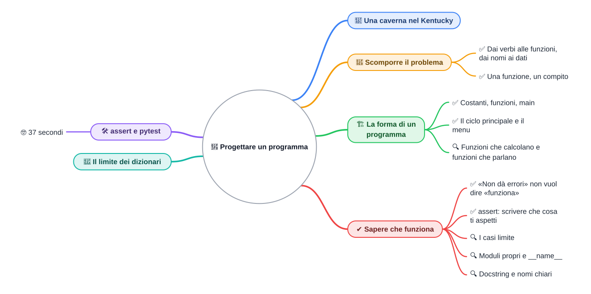

⬅️ [S4 - Dizionari](%28STU%29%204CI%20nov-dic%20S4%20-%20Dizionari.md) · 🏠 [Indice](../README.md) · [S6 - Ripasso in flashcard](%28STU%29%204CI%20nov-dic%20S6%20-%20Ripasso%20in%20flashcard.md) ➡️

# 🏰 Progettare un programma

**4CI · Novembre-Dicembre · S5 · Teoria**

⏱️ **Tempo di studio: circa 40 minuti.** ✅ essenziale: 25 min. 🔍 per il voto alto: 12 min. 🤓 si può saltare. Nessun compito obbligatorio a casa.

> **Legenda:** ✅ da sapere · 🔍 per capire fino in fondo · 🤓 facoltativo, per curiosi · 📜 storia · 🧪 esempio · ⚠️ errore comune · 🛠️ strumento · 🔧 lo faremo in laboratorio · ✏️ da fare · 🃏 flashcard: rispondi a voce, poi apri per controllare



## 📜 Una caverna nel Kentucky

Boston, metà degli anni Settanta. **Will Crowther** lavora per l'azienda che sta costruendo ARPANET, la rete da cui nascerà Internet. Nel tempo libero fa lo speleologo: con la moglie Patricia ha disegnato le mappe di chilometri di gallerie della Mammoth Cave, nel Kentucky.

Poi il matrimonio finisce. Le due figlie vivono con la madre, e Will cerca un modo per passare del tempo con loro. Scrive in Fortran un gioco che parla: descrive una caverna, e tu rispondi con due parole.

```text
YOU ARE STANDING AT THE END OF A ROAD BEFORE A SMALL BRICK BUILDING.
> ENTER BUILDING
```

La caverna del gioco è la sua caverna, ricostruita a memoria. Nel 1977 uno studente di Stanford, **Don Woods**, trova il programma su un computer dell'università, chiede il permesso all'autore e lo amplia con tesori, nani e incantesimi. **Colossal Cave Adventure** si diffonde in tutte le università collegate alla rete. Da lì nascono le avventure testuali e, molto più avanti, tanti giochi di ruolo al computer.

Adventure era un programma di poche migliaia di righe, e ogni pezzo aveva un compito: leggere il comando, muovere il giocatore, descrivere la stanza. Oggi facciamo lo stesso con il nostro dungeon: <u>dividere un problema grande in pezzi piccoli, e sapere che ogni pezzo funziona</u>.

## 🧩 Scomporre il problema

### ✅ Dai verbi alle funzioni, dai nomi ai dati

**Problema.** Il dungeon ormai ha un eroe, un dado, un combattimento, uno zaino, una mappa e un bestiario. Se scrivi tutto in un unico blocco di duecento righe, nessuno, nemmeno tu fra una settimana, capirà dove mettere le mani.

Un trucco semplice per cominciare: scrivi in italiano che cosa deve fare il programma, poi <u>sottolinea i verbi e i nomi</u>.

> L'eroe **guarda** la sua *scheda*, **combatte** i *mostri* del *bestiario* uno alla volta, **subisce** danni e **beve** *pozioni* dallo *zaino*.

| Nella frase | Nel programma | Esempio |
| --- | --- | --- |
| verbi | funzioni | `mostra_scheda`, `combatti`, `subisci_danno`, `cura` |
| nomi | dati | `eroe` (dizionario), `bestiario` (lista di dizionari), `zaino` (lista) |

Non è una regola perfetta, ma è un buon punto di partenza. In ottobre facevi lo stesso per trovare classi e metodi.

<details>
<summary>🃏 <b>Quale trucco aiuta a trovare funzioni e dati di un programma?</b></summary>
Descrivere il programma a parole: i verbi suggeriscono le funzioni, i nomi suggeriscono i dati.
</details>

✏️ **Scomponi (3 min).** «Il mercante mostra la merce, l'eroe sceglie un oggetto, paga con l'oro e lo mette nello zaino.» Trova le funzioni e i dati, e scegli per ogni dato una struttura (lista, dizionario, numero...).

### ✅ Una funzione, un compito

<u>Una buona funzione fa una cosa sola, e il suo nome dice quale.</u> Se per descriverla ti serve una «e», probabilmente sono due funzioni.

| Funzione | Va bene? | Perché |
| --- | --- | --- |
| `subisci_danno(vita, danno)` | ✅ | un compito: calcola la nuova vita |
| `combatti_e_stampa_e_salva()` | ❌ | tre compiti in uno |
| `fai_cose(x)` | ❌ | il nome non dice niente |

Funzioni piccole si leggono, si provano e si riusano. Le scrivi una volta e le chiami da più punti.

<details>
<summary>🃏 <b>Come capisci che una funzione fa troppe cose?</b></summary>
Se per descriverla ti serve una «e», o se il suo nome non dice chiaramente che cosa fa.
</details>

## 🏗️ La forma di un programma

### ✅ Costanti, funzioni, `main`

Questa è una versione ridotta del dungeon, completa e funzionante. Leggila dall'alto: ha quattro parti.

```python
"""Il dungeon di 4CI, in versione ridotta: serve a vedere la struttura."""
import random

VITA_MASSIMA = 100


def tira_dado(facce=6):
    """Restituisce un numero casuale da 1 a facce."""
    return random.randint(1, facce)


def subisci_danno(vita, danno):
    """Restituisce la vita dopo il danno, mai sotto zero."""
    return max(0, vita - danno)


def cura(vita, punti):
    """Restituisce la vita dopo la cura, mai sopra VITA_MASSIMA."""
    return min(VITA_MASSIMA, vita + punti)


def combatti(eroe, mostro):
    """Fa combattere eroe e mostro finché uno cade. True se vince l'eroe."""
    while eroe["vita"] > 0 and mostro["vita"] > 0:
        danno = eroe["forza"] + tira_dado()
        mostro["vita"] = subisci_danno(mostro["vita"], danno)
        if mostro["vita"] > 0:
            eroe["vita"] = subisci_danno(eroe["vita"], mostro["attacco"])
    return eroe["vita"] > 0


def mostra_scheda(eroe):
    """Stampa nome, vita e zaino dell'eroe."""
    print(f"{eroe['nome']}: vita {eroe['vita']}, zaino {eroe['zaino']}")


def main():
    eroe = {"nome": "Aria", "vita": VITA_MASSIMA, "forza": 7, "zaino": ["pozione"]}
    bestiario = [
        {"nome": "Goblin", "vita": 30, "attacco": 4},
        {"nome": "Scheletro", "vita": 45, "attacco": 6},
    ]
    while True:
        print("1) Scheda  2) Combatti  3) Bevi una pozione  0) Esci")
        scelta = input("> ")
        if scelta == "1":
            mostra_scheda(eroe)
        elif scelta == "2":
            if len(bestiario) == 0:
                print("Il dungeon è vuoto: hai vinto!")
                break
            mostro = bestiario.pop(0)
            if combatti(eroe, mostro):
                print(f"{mostro['nome']} sconfitto! Vita di {eroe['nome']}: {eroe['vita']}")
            else:
                print(f"{mostro['nome']} ha vinto. Game over.")
                break
        elif scelta == "3":
            if "pozione" in eroe["zaino"]:
                eroe["zaino"].remove("pozione")
                eroe["vita"] = cura(eroe["vita"], 30)
                print(f"Glu glu. Vita: {eroe['vita']}")
            else:
                print("Lo zaino non ha pozioni.")
        elif scelta == "0":
            print("Alla prossima!")
            break
        else:
            print("Scelta non valida.")


if __name__ == "__main__":
    main()
```

| Parte | Che cosa contiene | Nel file |
| --- | --- | --- |
| 1. In alto | `import` e **costanti**, cioè valori che non cambiano, scritti in MAIUSCOLO | `VITA_MASSIMA = 100` |
| 2. In mezzo | le **funzioni**, dalla più semplice alla più complessa | da `tira_dado` a `mostra_scheda` |
| 3. `main` | il programma vero: crea i dati e fa girare il gioco | `def main():` |
| 4. In fondo | la riga che fa partire `main` solo se il file è lanciato direttamente | `if __name__ == "__main__":` |

In Java il punto di partenza era il metodo `main` di una classe. In Python `main` è solo un'abitudine, ma un'abitudine molto diffusa: chi apre il file sa dove cercare.

`max(0, vita - danno)` è un trucco da ricordare: prende il più grande fra 0 e il risultato, quindi la vita non scende mai sotto zero. `min` fa lo stesso dall'altro lato.

<details>
<summary>🃏 <b>Quali sono le quattro parti tipiche di un programma Python?</b></summary>
Import e costanti in alto, funzioni in mezzo, <code>main</code> con il programma vero, e in fondo <code>if __name__ == "__main__": main()</code>.
</details>
<details>
<summary>🃏 <b>Come si scrive per convenzione una costante in Python?</b></summary>
Con il nome tutto in maiuscolo, come <code>VITA_MASSIMA</code>. Python non impedisce di cambiarla: è un patto fra programmatori.
</details>

### ✅ Il ciclo principale e il menu

Quasi ogni programma interattivo, dai videogiochi ai bancomat, ha la stessa forma: <u>un ciclo che legge un comando, lo esegue e ricomincia</u>. Si chiama **ciclo principale** (*main loop*).

Nel dungeon il ciclo è `while True:`. Ogni ramo dell'`if` chiama una funzione; `break` è l'unica uscita. Una partita, scrivendo `1`, `2`, `3`, `2`, `2`:

```text
1) Scheda  2) Combatti  3) Bevi una pozione  0) Esci
> 1
Aria: vita 100, zaino ['pozione']
1) Scheda  2) Combatti  3) Bevi una pozione  0) Esci
> 2
Goblin sconfitto! Vita di Aria: 88
1) Scheda  2) Combatti  3) Bevi una pozione  0) Esci
> 3
Glu glu. Vita: 100
1) Scheda  2) Combatti  3) Bevi una pozione  0) Esci
> 2
Scheletro sconfitto! Vita di Aria: 82
1) Scheda  2) Combatti  3) Bevi una pozione  0) Esci
> 2
Il dungeon è vuoto: hai vinto!
```

⚠️ `input` restituisce un testo (ricordi S1?), quindi il confronto è con `"1"`, non con `1`. Scrivere `scelta == 1` fa finire ogni scelta nel ramo «Scelta non valida».

<details>
<summary>🃏 <b>Che cos'è il ciclo principale di un programma?</b></summary>
Il ciclo che, finché il programma è acceso, legge un comando, lo esegue e ricomincia.
</details>
<details>
<summary>🃏 <b>Perché nel menu si confronta <code>scelta == "1"</code> e non <code>scelta == 1</code>?</b></summary>
Perché <code>input</code> restituisce sempre un testo, e il testo <code>"1"</code> è diverso dal numero 1.
</details>

✏️ **Aggiungi (3 min).** Scrivi il ramo `elif` per una nuova voce `4) Fuggi`, che stampa «Aria scappa a gambe levate» e chiude il gioco.

### 🔍 Funzioni che calcolano e funzioni che parlano

Guarda le funzioni del dungeon e dividile in due gruppi.

| Funzioni che **calcolano** | Funzioni che **parlano** |
| --- | --- |
| `subisci_danno`, `cura` | `mostra_scheda`, `main` |
| ricevono dati e restituiscono un risultato | usano `print` e `input` |
| stesso input, stesso output, sempre | dipendono da che cosa scrive l'utente |
| si provano con una riga | per provarle serve una persona alla tastiera |

<u>Tieni separati i calcoli dall'input e dall'output.</u> Le funzioni che calcolano si possono controllare in automatico, come vedremo fra poco. `combatti` sta nel mezzo: calcola, ma modifica i dizionari che riceve e usa il dado, quindi è più difficile da provare.

<details>
<summary>🃏 <b>Perché conviene separare i calcoli da <code>print</code> e <code>input</code>?</b></summary>
Perché una funzione che riceve dati e restituisce un risultato si può controllare in automatico, senza nessuno alla tastiera.
</details>

## ✔️ Sapere che funziona

### ✅ «Non dà errori» non vuol dire «funziona»

Ricordi il goblin di S2, finito a `-2` punti vita? Il programma non dava nessun errore. Era un **errore di logica**: Python era contento, il gioco no.

<u>Un programma che non si ferma non è per forza un programma giusto.</u> Per saperlo devi dire in anticipo che cosa ti aspetti, e controllarlo.

### ✅ `assert`: scrivere che cosa ti aspetti

`assert` controlla che una condizione sia vera. Se è vera, non succede niente. Se è falsa, il programma si ferma con un `AssertionError`.

```python
from dungeon import subisci_danno, cura

assert subisci_danno(100, 30) == 70
assert subisci_danno(10, 30) == 0        # caso limite: mai sotto zero
assert subisci_danno(50, 0) == 50        # caso limite: danno nullo
assert cura(90, 30) == 100               # caso limite: mai sopra il massimo
print("Tutti i test sono passati.")
```

```text
Tutti i test sono passati.
```

Queste righe sono un **test**: un piccolo programma che controlla un altro programma. Stanno in un file a parte, `test_dungeon.py`, nella stessa cartella di `dungeon.py`.

🧪 **Un test che fallisce.** Se `subisci_danno` fosse scritta in modo ingenuo, `return vita - danno`, il test sul caso limite lo scoprirebbe subito. Qui, dopo la virgola, l'`assert` ha anche un **messaggio**:

```text
Traceback (most recent call last):
  File "test_ingenuo.py", line 7, in <module>
    assert subisci_danno(10, 30) == 0, "la vita non deve scendere sotto zero"
           ^^^^^^^^^^^^^^^^^^^^^^^^^^
AssertionError: la vita non deve scendere sotto zero
```

Il messaggio compare quando il test fallisce e dice che cosa doveva succedere.

<u>Dopo ogni modifica, riesegui i test.</u> Se tutti passano, non hai rotto niente di quello che controllano.

<details>
<summary>🃏 <b>Che cosa fa <code>assert condizione</code>?</b></summary>
Non fa niente se la condizione è vera; ferma il programma con <code>AssertionError</code> se è falsa.
</details>
<details>
<summary>🃏 <b>Che cos'è un test?</b></summary>
Un piccolo programma che controlla che un altro programma dia i risultati attesi.
</details>
<details>
<summary>🃏 <b>Quando vanno rieseguiti i test?</b></summary>
Dopo ogni modifica, per controllare di non aver rotto qualcosa che prima funzionava.
</details>

✏️ **Scrivi (3 min).** Scrivi tre `assert` per `cura(vita, punti)`: un caso normale, un caso che supera il massimo e un caso con `punti` uguale a 0.

### 🔍 I casi limite

Un **caso limite** è un valore ai bordi: zero, il massimo, una lista vuota, un danno più grande della vita. <u>Gli errori si nascondono quasi sempre ai bordi.</u>

| Funzione | Caso normale | Casi limite da provare |
| --- | --- | --- |
| `subisci_danno(vita, danno)` | `(100, 30)` | danno 0; danno uguale alla vita; danno più grande della vita |
| `cura(vita, punti)` | `(50, 30)` | cura che supera il massimo; vita già al massimo |
| una funzione che riceve il bestiario | tre mostri | bestiario vuoto; un solo mostro |

<details>
<summary>🃏 <b>Che cos'è un caso limite?</b></summary>
Un valore ai bordi, come zero, il massimo o una lista vuota: lì si nascondono spesso gli errori.
</details>

✏️ **Caccia ai bordi (2 min).** Per una funzione `ultimo(zaino)` che restituisce l'ultimo oggetto dello zaino, quale caso limite può farla fermare? Con quale errore?

### 🔍 Moduli propri e `__name__`

`test_dungeon.py` scrive `from dungeon import subisci_danno, cura`: importa le funzioni dal **tuo** file, esattamente come importavi `random`. Ogni file `.py` è un modulo.

Ricordi che all'import Python esegue le righe fuori dalle funzioni? Se `dungeon.py` chiamasse `main()` direttamente, importarlo farebbe partire il gioco, e il test si fermerebbe ad aspettare un `input`. La riga `if __name__ == "__main__":` lo evita: <u>`main` parte solo quando lanci `python dungeon.py`, non quando un altro file lo importa</u>.

<details>
<summary>🃏 <b>Perché <code>main()</code> sta sotto <code>if __name__ == "__main__":</code>?</b></summary>
Perché così parte solo se il file è lanciato direttamente, e non quando un altro file, come un test, lo importa.
</details>

### 🔍 Docstring e nomi chiari

Una **docstring** è il testo fra triple virgolette subito sotto il `def`. Dice che cosa fa la funzione. Python la conserva e la mostra con `help`:

```text
>>> from dungeon import cura
>>> help(cura)
Help on function cura in module dungeon:

cura(vita, punti)
    Restituisce la vita dopo la cura, mai sopra VITA_MASSIMA.
```

È la versione Python dei commenti `/** ... */` di Java (Javadoc). Anche i nomi sono documentazione: `subisci_danno(vita, danno)` si spiega da solo, `sd(v, d)` no. La guida di stile **PEP 8** chiede `snake_case` per funzioni e variabili, MAIUSCOLO per le costanti e quattro spazi di indentazione.

<details>
<summary>🃏 <b>Che cos'è una docstring?</b></summary>
Il testo fra triple virgolette sotto il <code>def</code>, che descrive la funzione; <code>help()</code> lo mostra.
</details>

## 🛠️ `assert` e `pytest`

`assert` è già uno strumento di test: non serve installare niente. Quando i test diventano tanti, i programmatori usano uno strumento apposta. Il più diffuso in Python si chiama **pytest**.

Con pytest ogni test è una funzione il cui nome comincia con `test_`:

```python
from dungeon import subisci_danno, cura


def test_danno_normale():
    assert subisci_danno(100, 30) == 70


def test_vita_mai_sotto_zero():
    assert subisci_danno(10, 30) == 0


def test_cura_mai_sopra_il_massimo():
    assert cura(90, 30) == 100
```

Dal terminale, il comando `pytest` trova da solo i file e le funzioni che cominciano con `test_`, li esegue tutti e fa il riassunto:

```text
...                                                                      [100%]
3 passed in 0.02s
```

Ogni punto è un test passato; un test fallito diventa una `F`, con la spiegazione sotto. Se un test fallisce, pytest continua con gli altri: con l'`assert` semplice, invece, il programma si ferma al primo.

🔧 **In laboratorio:** rifattorizziamo il dungeon in funzioni piccole e scriviamo i test. **Rifattorizzare** vuol dire cambiare la forma del codice senza cambiarne il comportamento: i test servono proprio a garantirlo.

<details>
<summary>🃏 <b>Come riconosce pytest i test da eseguire?</b></summary>
Cerca i file e le funzioni il cui nome comincia con <code>test_</code>.
</details>
<details>
<summary>🃏 <b>Che cosa vuol dire rifattorizzare?</b></summary>
Cambiare la forma del codice, per renderlo più chiaro, senza cambiarne il comportamento.
</details>

### 🤓 37 secondi

> Nel 1968 la NATO riunisce a Garmisch, in Germania, i migliori informatici del mondo. Il tema è la **crisi del software**: i programmi diventano enormi, arrivano in ritardo, costano il doppio e non funzionano. Lì si diffonde un'espressione nuova, *software engineering*: costruire programmi con il rigore con cui si costruiscono i ponti.
>
> Ventotto anni dopo, il 4 giugno 1996, il razzo europeo **Ariane 5** decolla per il suo primo volo. Dopo circa 37 secondi devia, si spezza e si autodistrugge. La causa: un pezzo di software riusato dal vecchio Ariane 4 convertiva una velocità da un numero con la virgola a 64 bit in un intero a 16 bit. Il nuovo razzo era più veloce, il numero non ci stava più, e il programma è andato in errore. Su Ariane 4 quel caso non poteva capitare, quindi nessuno l'aveva provato con le traiettorie del nuovo razzo.
>
> Un caso limite non provato, centinaia di milioni di dollari in fumo. Il tuo goblin a `-2` è lo stesso tipo di errore, in miniatura.

## 🚪 Il limite dei dizionari

Guarda come si chiamano le funzioni del dungeon:

```python
eroe["vita"] = subisci_danno(eroe["vita"], 8)
eroe["vita"] = cura(eroe["vita"], 30)
mostra_scheda(eroe)
```

L'eroe è un dizionario, e le funzioni che lo riguardano vivono **altrove**: ognuna deve ricevere l'eroe, o un pezzo dell'eroe, come parametro. Nessuno impedisce a una riga distratta di scrivere `eroe["vita"] = -50`, o di sbagliare il nome di una chiave.

E se la scheda **sapesse da sola** subire danni, curarsi e mostrarsi? E se la vita non potesse mai essere modificata da fuori?

```python
eroe.subisci_danno(8)
eroe.cura(30)
```

Ti ricorda qualcosa? Dati e azioni insieme, dati protetti. A ottobre in Java lo chiamavi **classe**, con l'**incapsulamento**. A gennaio lo ritroveremo in Python, e il nostro dungeon sarà il primo a cambiare forma.

<details>
<summary>🃏 <b>Qual è il limite di un eroe rappresentato come dizionario?</b></summary>
Dati e funzioni stanno in posti diversi, e nessuno protegge i dati da modifiche sbagliate fatte da fuori.
</details>

## ✏️ Esercizi

1. **Scomponi.** «Il giocatore apre una cassa, trova dell'oro e una pozione, mette la pozione nello zaino e aggiunge l'oro al borsellino.» Elenca funzioni e dati, con la struttura di ogni dato.
2. **Classifica.** Per ciascuna funzione, dì se calcola o parla, e se si può provare con un `assert`: `stampa_mappa(mappa)`, `conta_mostri(bestiario)`, `chiedi_direzione()`, `prossima_casella(riga, colonna, direzione)`.
3. **Trova l'errore.** Il test passa, ma la funzione è sbagliata. Quale caso limite manca nel test?
   ```python
   def cura(vita, punti):
       return vita + punti

   assert cura(50, 30) == 80
   ```
4. **Scrivi i test.** Per `prossima_casella(riga, colonna, direzione)`, che restituisce la tupla della casella dopo un passo (`"su"`, `"giu"`, `"sinistra"`, `"destra"`), scrivi quattro `assert`, uno per direzione, partendo da `(2, 3)`.
5. **Prevedi.** Nel menu del dungeon, l'utente scrive `3` due volte di seguito, all'inizio della partita. Che cosa stampa il programma la seconda volta?
6. **Rifattorizza.** Questa funzione fa troppe cose. Dividila in due: una che calcola e una che parla.
   ```python
   def turno(vita, danno):
       vita = max(0, vita - danno)
       print(f"Vita rimasta: {vita}")
       return vita
   ```

**Uscita:** «Divido un programma in funzioni che fanno ...; so che una funzione è giusta quando ...; a gennaio i dati e le funzioni staranno ...».

## 📚 Fonti e risorse

- [The Python Tutorial, sezione 6.1.1](https://docs.python.org/3/tutorial/modules.html#executing-modules-as-scripts): moduli ed esecuzione come script, cioè il trucco di `__name__`.
- [pytest, Get Started](https://docs.pytest.org/en/stable/getting-started.html): la guida ufficiale, in inglese. Leggi fino al primo test che fallisce.
- [Colossal Cave Adventure su Wikipedia](https://en.wikipedia.org/wiki/Colossal_Cave_Adventure): la storia di Crowther e Woods, in inglese. Si può ancora giocare online cercando il titolo.
- [Ariane flight V88 su Wikipedia](https://en.wikipedia.org/wiki/Ariane_flight_V88): la ricostruzione dell'incidente del primo volo di Ariane 5, in inglese. Leggi l'introduzione.
- [PEP 257](https://peps.python.org/pep-0257/): le convenzioni per le docstring. Leggi solo la parte sulle docstring di una riga.

---

⬅️ [S4 - Dizionari](%28STU%29%204CI%20nov-dic%20S4%20-%20Dizionari.md) · 🏠 [Indice](../README.md) · [S6 - Ripasso in flashcard](%28STU%29%204CI%20nov-dic%20S6%20-%20Ripasso%20in%20flashcard.md) ➡️
