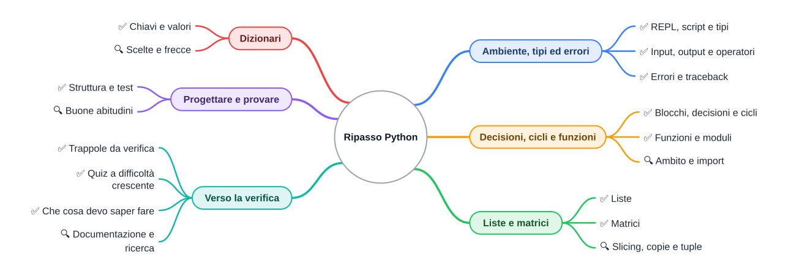

⬅️ [S5 - Progettare un programma](%28STU%29%204CI%20nov-dic%20S5%20-%20Progettare%20un%20programma.md) · 🏠 [Indice](../README.md)

# 🧠 Ripasso Python in flashcard

**4CI · Novembre-Dicembre · S6 · Ripasso**

⏱️ **Tempo di studio: circa 60 minuti, divisi in più giorni.** Meglio quattro sessioni da 15 minuti che un'ora la sera prima. ✅ essenziale: le sezioni A-E. 🔍 e 🤓 per il voto alto e per i curiosi.

> **Legenda:** ✅ da sapere · 🔍 per capire fino in fondo · 🤓 facoltativo, per curiosi · ⚠️ errore comune · 🛠️ strumento · ✏️ da fare · 🃏 flashcard: rispondi a voce, poi apri per controllare



## 🧭 Il diario del dungeon

Cinque settimane fa il dungeon era vuoto. Poi è arrivata un'eroina, Aria, con un nome, cento punti vita e una forza scritta da tastiera. Ha imparato a tirare un dado e a combattere un goblin, un turno dopo l'altro. Ha riempito uno zaino, ha camminato su una mappa di cancelletti e puntini, ha sfogliato un bestiario. Alla fine il dungeon è diventato un gioco vero, con un menu e dei test che dicono quando funziona.

Ogni tappa del viaggio era un pezzo di Python:

| Sezione | Che cosa ripassi | Dispensa |
| --- | --- | --- |
| 🐍 A | ambiente, variabili, tipi, input e output, errori | [S1](%28STU%29%204CI%20nov-dic%20S1%20-%20Primi%20passi%20con%20Python.md) |
| 🎲 B | decisioni, cicli, funzioni, moduli | [S2](%28STU%29%204CI%20nov-dic%20S2%20-%20Decisioni%2C%20cicli%20e%20funzioni.md) |
| 🎒 C | liste, copie, tuple, matrici | [S3](%28STU%29%204CI%20nov-dic%20S3%20-%20Liste%20e%20matrici.md) |
| 📇 D | dizionari e dati annidati | [S4](%28STU%29%204CI%20nov-dic%20S4%20-%20Dizionari.md) |
| 🏰 E | progettare e provare un programma | [S5](%28STU%29%204CI%20nov-dic%20S5%20-%20Progettare%20un%20programma.md) |

**Come usare questa scheda.** Leggi la domanda, rispondi **a voce o per iscritto** e solo dopo apri la risposta. Le flashcard che sbagli, rifalle dopo due giorni. Ricordare da soli, a distanza di tempo, è il modo più efficace che conosciamo per fissare quello che si studia.

## 🐍 A - Ambiente, tipi ed errori

### ✅ REPL, script e tipi

<details>
<summary>🃏 <b>Che differenza c'è fra REPL e script?</b></summary>
Il REPL esegue una riga alla volta e non conserva niente; lo script è un file <code>.py</code> eseguito tutto insieme, dall'alto in basso.
</details>
<details>
<summary>🃏 <b>In Python il tipo appartiene alla variabile o al valore?</b></summary>
Al valore. La variabile è una freccia che può puntare a valori di tipi diversi.
</details>
<details>
<summary>🃏 <b>Quali sono i quattro tipi base e un esempio per ciascuno?</b></summary>
<code>int</code> (<code>100</code>), <code>float</code> (<code>7.5</code>), <code>str</code> (<code>"Aria"</code>), <code>bool</code> (<code>True</code>).
</details>
<details>
<summary>🃏 <b>Che cosa fa <code>x = y</code> in Python?</b></summary>
Fa puntare la freccia <code>x</code> allo stesso oggetto di <code>y</code>. Non crea una copia.
</details>
<details>
<summary>🃏 <b>Come si scrivono vero e falso?</b></summary>
<code>True</code> e <code>False</code>, con la maiuscola.
</details>

### ✅ Input, output e operatori

<details>
<summary>🃏 <b>Che tipo restituisce sempre <code>input()</code>?</b></summary>
<code>str</code>. Per avere un numero serve convertire, per esempio <code>int(input("..."))</code>.
</details>
<details>
<summary>🃏 <b>Che cos'è una f-string?</b></summary>
Un testo che comincia con <code>f</code> e contiene valori fra graffe: <code>f"{nome} ha {vita} punti vita"</code>.
</details>
<details>
<summary>🃏 <b>Quanto fanno <code>7 / 2</code>, <code>7 // 2</code> e <code>7 % 2</code>?</b></summary>
<code>3.5</code>, <code>3</code> e <code>1</code>: divisione, divisione intera e resto.
</details>
<details>
<summary>🃏 <b>Come si scrivono <code>&&</code>, <code>||</code> e <code>!</code> di Java?</b></summary>
<code>and</code>, <code>or</code>, <code>not</code>.
</details>

### ✅ Errori e traceback

<details>
<summary>🃏 <b>Quali sono le tre famiglie di errori?</b></summary>
Sintassi (il programma non parte), esecuzione (si ferma mentre gira), logica (gira ma dà un risultato sbagliato).
</details>
<details>
<summary>🃏 <b>Da dove si comincia a leggere un traceback?</b></summary>
Dal basso: l'ultima riga dice il tipo di errore e il motivo; le righe sopra dicono file, riga e codice.
</details>
<details>
<summary>🃏 <b>Che cosa significa <code>NameError</code>?</b></summary>
Hai usato un nome che non esiste: non l'hai creato, oppure l'hai scritto in modo diverso.
</details>
<details>
<summary>🃏 <b>Che cosa significa <code>TypeError</code>?</b></summary>
Hai usato un'operazione con un tipo che non la supporta, per esempio sommare un testo e un numero.
</details>

### 🔍 Python e Java

<details>
<summary>🃏 <b>Quando si scopre un errore di tipo in Java e quando in Python?</b></summary>
In Java prima di partire, durante la compilazione; in Python solo quando la riga viene eseguita.
</details>
<details>
<summary>🃏 <b>Che cosa fa <code>if __name__ == "__main__":</code>?</b></summary>
Esegue il blocco solo se il file è lanciato direttamente, non quando viene importato da un altro file.
</details>

## 🎲 B - Decisioni, cicli e funzioni

### ✅ Blocchi, decisioni e cicli

<details>
<summary>🃏 <b>Che cosa delimita un blocco in Python?</b></summary>
L'indentazione dopo i due punti, di solito quattro spazi.
</details>
<details>
<summary>🃏 <b>Come si scrive <code>else if</code>?</b></summary>
<code>elif</code>.
</details>
<details>
<summary>🃏 <b>Quali numeri produce <code>range(2, 8, 2)</code>?</b></summary>
2, 4, 6: l'ultimo numero non è mai compreso.
</details>
<details>
<summary>🃏 <b>Quando usi <code>while</code> invece di <code>for</code>?</b></summary>
Quando ripeti finché vale una condizione, senza sapere in anticipo quante volte.
</details>
<details>
<summary>🃏 <b>Come si scrive <code>i++</code>?</b></summary>
<code>i += 1</code>.
</details>
<details>
<summary>🃏 <b>Con che cosa si sostituisce il <code>do ... while</code> di Java?</b></summary>
Con <code>while True:</code> e un <code>break</code> quando si deve uscire.
</details>

### ✅ Funzioni e moduli

<details>
<summary>🃏 <b>Che differenza c'è fra <code>print</code> e <code>return</code> in una funzione?</b></summary>
<code>print</code> mostra un valore sullo schermo; <code>return</code> lo consegna a chi ha chiamato la funzione.
</details>
<details>
<summary>🃏 <b>Che cosa restituisce una funzione senza <code>return</code>?</b></summary>
<code>None</code>.
</details>
<details>
<summary>🃏 <b>Come si usa la funzione <code>randint</code> del modulo <code>random</code>?</b></summary>
<code>import random</code> e poi <code>random.randint(1, 6)</code>, che dà un intero da 1 a 6 compresi.
</details>

### 🔍 Ambito e import

<details>
<summary>🃏 <b>Perché <code>vita = vita + 20</code> dentro una funzione può dare <code>UnboundLocalError</code>?</b></summary>
Perché l'assegnazione rende <code>vita</code> una variabile locale, che è ancora vuota quando la riga prova a leggerla.
</details>
<details>
<summary>🃏 <b>Qual è l'alternativa consigliata a <code>global</code>?</b></summary>
Passare il dato come parametro e usare il valore restituito con <code>return</code>.
</details>
<details>
<summary>🃏 <b>Che cosa succede alle righe fuori dalle funzioni quando un file viene importato?</b></summary>
Vengono eseguite subito.
</details>
<details>
<summary>🃏 <b>A che cosa servono breakpoint e passo-passo nel debugger?</b></summary>
A fermare il programma su una riga e farlo avanzare una riga alla volta, guardando il valore delle variabili.
</details>

## 🎒 C - Liste e matrici

### ✅ Liste

<details>
<summary>🃏 <b>Che cos'è una lista?</b></summary>
Una fila di caselle numerate da zero, che può crescere: <code>["spada", "pozione"]</code>.
</details>
<details>
<summary>🃏 <b>Che cosa danno <code>zaino[0]</code> e <code>zaino[-1]</code>?</b></summary>
Il primo e l'ultimo elemento.
</details>
<details>
<summary>🃏 <b>Quali metodi aggiungono e tolgono elementi?</b></summary>
<code>append</code> e <code>insert</code> aggiungono; <code>remove</code> e <code>pop</code> tolgono.
</details>
<details>
<summary>🃏 <b>Che cosa dà <code>for x in zaino</code>: gli indici o gli elementi?</b></summary>
Gli elementi. Per avere anche la posizione si usa <code>enumerate</code>.
</details>
<details>
<summary>🃏 <b>Che errore dà un indice troppo grande?</b></summary>
<code>IndexError: list index out of range</code>.
</details>

### ✅ Matrici

<details>
<summary>🃏 <b>Come si rappresenta una matrice senza librerie?</b></summary>
Come una lista di liste: ogni lista interna è una riga.
</details>
<details>
<summary>🃏 <b>In <code>mappa[2][5]</code>, quale numero è la riga?</b></summary>
Il primo, 2. Prima la riga, poi la colonna.
</details>
<details>
<summary>🃏 <b>Come visiti tutte le caselle di una matrice?</b></summary>
Con due cicli annidati: uno per le righe e, dentro, uno per le caselle della riga.
</details>

### 🔍 Slicing, copie e tuple

<details>
<summary>🃏 <b>Che cosa dà <code>lista[1:4]</code>?</b></summary>
Una nuova lista con gli elementi di indice 1, 2 e 3.
</details>
<details>
<summary>🃏 <b>Dopo <code>b = a</code>, con <code>a</code> lista, <code>b.append(9)</code> cambia <code>a</code>?</b></summary>
Sì: <code>a</code> e <code>b</code> sono due frecce verso la stessa lista.
</details>
<details>
<summary>🃏 <b>Come si copia una lista?</b></summary>
<code>a.copy()</code>, <code>a[:]</code> oppure <code>list(a)</code>.
</details>
<details>
<summary>🃏 <b>Che differenza c'è fra <code>sorted(l)</code> e <code>l.sort()</code>?</b></summary>
<code>sorted</code> restituisce una nuova lista; <code>sort</code> ordina la lista stessa e restituisce <code>None</code>.
</details>
<details>
<summary>🃏 <b>Che cos'è una tupla?</b></summary>
Una sequenza immutabile fra parentesi tonde, come le coordinate <code>(2, 1)</code>.
</details>

## 📇 D - Dizionari

### ✅ Chiavi e valori

<details>
<summary>🃏 <b>Che cos'è un dizionario?</b></summary>
Una raccolta di coppie chiave → valore, in cui si cerca un dato per nome.
</details>
<details>
<summary>🃏 <b>Che cosa fa <code>scheda["oro"] = 5</code>?</b></summary>
Modifica il valore di <code>"oro"</code> se la chiave c'è; altrimenti aggiunge la coppia.
</details>
<details>
<summary>🃏 <b>Che cosa succede se leggi una chiave che non c'è?</b></summary>
<code>KeyError</code>. Si evita con <code>in</code> oppure con <code>get</code>.
</details>
<details>
<summary>🃏 <b>Come scorri chiavi e valori insieme?</b></summary>
<code>for chiave, valore in scheda.items():</code>.
</details>
<details>
<summary>🃏 <b>Che cosa rappresenta una lista di dizionari?</b></summary>
Una tabella di record: ogni dizionario è una riga, ogni chiave una colonna.
</details>

### 🔍 Scelte e frecce

<details>
<summary>🃏 <b>Come conti degli oggetti con un dizionario?</b></summary>
<code>conteggi[x] = conteggi.get(x, 0) + 1</code>.
</details>
<details>
<summary>🃏 <b>Quando scegli una lista e quando un dizionario?</b></summary>
Lista quando conta la posizione o l'ordine; dizionario quando cerchi un dato per nome.
</details>
<details>
<summary>🃏 <b>Dopo <code>m = bestiario[0]</code>, modificare <code>m</code> cambia il bestiario?</b></summary>
Sì: sono due frecce verso lo stesso dizionario.
</details>

## 🏰 E - Progettare e provare

### ✅ Struttura e test

<details>
<summary>🃏 <b>Come si trovano funzioni e dati partendo dal testo di un problema?</b></summary>
I verbi suggeriscono le funzioni, i nomi suggeriscono i dati.
</details>
<details>
<summary>🃏 <b>Che cosa fa il ciclo principale di un programma interattivo?</b></summary>
Legge un comando, lo esegue e ricomincia, finché non si sceglie di uscire.
</details>
<details>
<summary>🃏 <b>Che cosa fa <code>assert</code>?</b></summary>
Ferma il programma con <code>AssertionError</code> se la condizione è falsa; altrimenti non fa niente.
</details>
<details>
<summary>🃏 <b>Perché un programma senza errori può essere sbagliato?</b></summary>
Perché può contenere errori di logica: gira, ma dà risultati diversi da quelli voluti.
</details>

### 🔍 Buone abitudini

<details>
<summary>🃏 <b>Che cos'è un caso limite? Fai un esempio.</b></summary>
Un valore ai bordi, dove si nascondono gli errori: <em>un danno più grande della vita, una lista vuota</em>.
</details>
<details>
<summary>🃏 <b>Perché separare i calcoli da <code>print</code> e <code>input</code>?</b></summary>
Perché le funzioni che ricevono dati e restituiscono un risultato si possono provare in automatico.
</details>
<details>
<summary>🃏 <b>Che cos'è una docstring e come si legge?</b></summary>
Il testo fra triple virgolette sotto il <code>def</code>; si legge con <code>help(funzione)</code>.
</details>
<details>
<summary>🃏 <b>Qual è il limite di un eroe fatto con un dizionario?</b></summary>
Dati e funzioni stanno separati, e niente protegge i dati da modifiche sbagliate: lo risolveranno le classi.
</details>

## ⚠️ Trappole da verifica

Le idee sbagliate più comuni di chi arriva da Java. Per ognuna, prova a dire perché è sbagliata prima di aprire.

<details>
<summary>🃏 <b>«Python non ha tipi.»</b></summary>
Falso: i valori hanno un tipo, che <code>type()</code> mostra. Non si dichiara, ma c'è.
</details>
<details>
<summary>🃏 <b>«L'indentazione serve solo all'occhio.»</b></summary>
Falso: in Python l'indentazione decide quali righe stanno in un blocco.
</details>
<details>
<summary>🃏 <b>«<code>7 / 2</code> fa 3.»</b></summary>
In Java sì, in Python no: fa <code>3.5</code>. La divisione intera è <code>//</code>.
</details>
<details>
<summary>🃏 <b>«Una funzione che stampa il risultato lo restituisce.»</b></summary>
Falso: senza <code>return</code> la funzione restituisce <code>None</code>.
</details>
<details>
<summary>🃏 <b>«<code>b = a</code> crea una nuova lista.»</b></summary>
Falso: crea una seconda freccia verso la stessa lista.
</details>
<details>
<summary>🃏 <b>«Se la chiave non c'è, ottengo <code>None</code>.»</b></summary>
Solo con <code>get</code>. Con le parentesi quadre si ottiene <code>KeyError</code>.
</details>
<details>
<summary>🃏 <b>«Nel menu, <code>scelta == 1</code> funziona.»</b></summary>
No: <code>input</code> restituisce un testo, quindi serve <code>scelta == "1"</code>.
</details>

### 🤓 Domande per chi vuole di più

<details>
<summary>🃏 <b>Perché <code>[[0] * 3] * 3</code> non è una buona matrice?</b></summary>
Perché contiene tre frecce verso la stessa riga: cambiando una casella, cambia in tutte le righe.
</details>
<details>
<summary>🃏 <b>Perché una lista non può essere chiave di un dizionario?</b></summary>
Perché è modificabile: il dizionario calcola dalla chiave un hash per trovare il «cassetto», e una chiave che cambia finirebbe nel cassetto sbagliato.
</details>
<details>
<summary>🃏 <b>Perché <code>def f(x, l=[])</code> è una trappola?</b></summary>
La lista predefinita viene creata una volta sola e si riempie a ogni chiamata.
</details>

## 🧩 Quiz a difficoltà crescente

Niente soluzioni: prova da solo, poi confronta con un compagno o chiedi in classe. Se un esercizio ti blocca, torna alla sezione indicata.

**Livello 1 · Prevedi l'output** (sezioni A e B)

```python
x = 7
y = x
x = x // 2
print(x, y, 7 / 2)
```

```python
for i in range(1, 10, 3):
    if i == 7:
        break
    print(i)
```

**Livello 2 · Prevedi l'output** (sezioni C e D)

```python
zaino = ["arco", "pane", "corda", "mappa"]
print(zaino[1:3], zaino[-1], len(zaino[2]))
```

```python
scheda = {"vita": 40, "oro": 5}
scheda["oro"] += 10
scheda["livello"] = scheda.get("livello", 1) + 1
print(scheda)
```

**Livello 3 · Disegna le frecce** (sezione C). Disegna scatole e frecce dopo l'ultima riga, poi scrivi che cosa stampa.

```python
a = [1, 2]
b = a
c = a[:]
b.append(3)
print(a, c)
```

**Livello 4 · Trova l'errore dal traceback** (sezioni A ed E). Spiega che cosa è successo e correggi il programma.

```text
Traceback (most recent call last):
  File "media.py", line 7, in <module>
    print(media([]))
          ^^^^^^^^^
  File "media.py", line 5, in media
    return totale / len(voti)
           ~~~~~~~^~~~~~~~~~~
ZeroDivisionError: division by zero
```

```text
Traceback (most recent call last):
  File "eta.py", line 3, in <module>
    print(nome + " ha " + eta + 1 + " anni l'anno prossimo")
          ~~~~~~~~~~~~~~~~~~~~^~~
TypeError: can only concatenate str (not "int") to str
```

**Livello 5 · Completa e riordina** (sezioni B e C). Metti in ordine e indenta le righe di una funzione che restituisce quante caselle `"M"` ci sono in una mappa: `return mostri`, `for cella in riga:`, `def conta_mostri(mappa):`, `mostri += 1`, `for riga in mappa:`, `mostri = 0`, `if cella == "M":`.

**Livello 6 · Traduci** (sezioni B e C). Da Java a Python:

```java
static int contaPari(int[] numeri) {
    int pari = 0;
    for (int n : numeri) {
        if (n % 2 == 0) pari++;
    }
    return pari;
}
```

**Livello 7 · Progetta e motiva** (sezioni D ed E). Un negozio del dungeon vende oggetti con nome, prezzo e quantità disponibile. Scegli la struttura dati, scrivi un esempio con tre oggetti, poi scrivi la funzione `compra(negozio, nome, oro)` che restituisce l'oro rimasto. Aggiungi due `assert`, di cui uno su un caso limite.

## ✅ Che cosa devo saper fare per la verifica

Spunta mentalmente ogni voce. Se una non ti convince, apri la dispensa indicata.

- [ ] Spiegare la differenza fra REPL e script, e leggere un traceback dal basso (S1).
- [ ] Dire il tipo di un valore e convertire un `input` in numero (S1).
- [ ] Prevedere il risultato di `/`, `//`, `%` e degli operatori logici (S1).
- [ ] Scrivere `if/elif/else`, `while` e `for` con `range`, con l'indentazione giusta (S2).
- [ ] Scrivere una funzione con parametri e `return`, e spiegare la differenza con `print` (S2).
- [ ] Creare, leggere, modificare e scorrere una lista; usare `append`, `remove`, `in`, `len` (S3).
- [ ] Leggere e scorrere una matrice con due indici e due cicli (S3).
- [ ] Disegnare scatole e frecce per `b = a` e per una copia (S3, 🔍).
- [ ] Creare, leggere e modificare un dizionario; evitare il `KeyError` (S4).
- [ ] Scorrere una lista di dizionari e cercare un elemento (S4).
- [ ] Scegliere fra lista e dizionario e motivare la scelta (S4, 🔍).
- [ ] Scomporre un problema in funzioni e scrivere un `assert` (S5).
- [ ] Trovare un caso limite e scrivere il test che lo controlla (S5, 🔍).

## 🛠️ Documentazione e ricerca

Nessun programmatore ricorda tutto. Quello che distingue un professionista è sapere **dove cercare**.

- **`help()` nel REPL.** `help(len)`, `help(str.split)` o `help(cura)` mostrano la documentazione di una funzione, anche delle tue, se hanno una docstring.

  ```text
  >>> help(len)
  Help on built-in function len in module builtins:

  len(obj, /)
      Return the number of items in a container.
  ```

- **La documentazione ufficiale.** [docs.python.org](https://docs.python.org/3/) contiene il tutorial e la descrizione di ogni modulo. È in inglese, ma ha una ricerca e molti esempi.
- **Cercare un errore.** Copia **l'ultima riga del traceback** nel motore di ricerca, togliendo i nomi delle tue variabili. Quasi sempre qualcuno ha già avuto lo stesso problema, per esempio su Stack Overflow.
- **Un assistente di intelligenza artificiale, a casa.** Può essere un buon compagno di studio, se lo usi nell'ordine giusto: <u>prima prevedi e prova da solo, poi chiedi una spiegazione</u>. Chiedi «perché questo codice dà `KeyError`?», non «scrivimi l'esercizio». Se ti fai scrivere la soluzione, il programma esiste, ma tu non hai imparato niente. E controlla sempre quello che risponde: può sbagliare con grande sicurezza.

<details>
<summary>🃏 <b>Quale parte di un traceback conviene cercare su internet?</b></summary>
L'ultima riga, cioè il tipo di errore e il messaggio, senza i nomi delle proprie variabili.
</details>
<details>
<summary>🃏 <b>In che ordine conviene usare un assistente di IA per studiare?</b></summary>
Prima prevedere e provare da soli, poi chiedere una spiegazione, e controllare la risposta.
</details>

## 📚 Fonti e risorse

- [The Python Tutorial](https://docs.python.org/3/tutorial/): i capitoli 3, 4 e 5 coprono quasi tutto il bimestre.
- [Python Tutor](https://pythontutor.com): incolla gli esercizi del quiz di livello 3 e confronta le frecce con il tuo disegno.
- [ProgMiscon](https://progmiscon.org/): un catalogo delle idee sbagliate più comuni sulla programmazione, in inglese. Scegli «Python» e leggine tre.
- [Think Python](https://allendowney.github.io/ThinkPython/): il libro di Allen Downey, gratuito, in licenza Creative Commons. I capitoli 5-10 ripassano il bimestre con altri esempi.
- [Retrieval practice](https://www.retrievalpractice.org/): il sito di ricerca sulla pratica del ricordo, il metodo di questa scheda. In inglese.

---

⬅️ [S5 - Progettare un programma](%28STU%29%204CI%20nov-dic%20S5%20-%20Progettare%20un%20programma.md) · 🏠 [Indice](../README.md)
