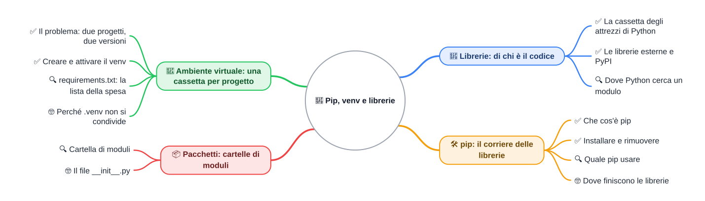

🏠 [Indice](../README.md)

# 🧰 Pip, venv e librerie

**4CI · Novembre-Dicembre · SX · Extra facoltativo**

⏱️ **Tempo di studio: circa 30 minuti.** ✅ essenziale: 12 min. 🔍 per capire fino in fondo: altri 10 min. 🤓 si può saltare. Non entra nella verifica e non assegna compiti a casa.

> **Legenda:** ✅ da sapere · 🔍 per capire fino in fondo · 🤓 facoltativo, per curiosi · 🛠️ strumento · 🧪 esempio · ⚠️ errore comune · 🔧 lo faremo in laboratorio · ✏️ da fare · 🃏 flashcard: rispondi a voce, poi apri per controllare



## 🧰 Librerie: di chi è il codice

### ✅ La cassetta degli attrezzi di Python

Python arriva con una **libreria standard**: moduli già installati, che non devi scaricare. `math` e `random` ne fanno parte. Per usarli basta un `import`.

<u>Se una libreria è già nel tuo Python, non devi installarla.</u>

🧪 Apri il **prompt dei comandi** (o il Terminale) e scrivi `python --version`. Il numero che vedi è la versione di Python che il tuo PC usa. Su alcuni PC il comando è `py --version`: se i due numeri sono diversi, sul tuo PC ci sono due Python installati.

<details>
<summary>🃏 <b>Che cos'è la libreria standard?</b></summary>
L'insieme di moduli che arriva già dentro Python, senza installare nulla.
</details>

### ✅ Le librerie esterne e PyPI

Molte librerie le scrive qualcun altro e le mette a disposizione su **PyPI** (*Python Package Index*), il magazzino pubblico delle librerie Python, su [pypi.org](https://pypi.org/). Una libreria scaricata da PyPI si chiama anche **pacchetto** (*package*): più avanti vedremo che questa parola ha un secondo significato.

🧪 `requests` serve a un programma per parlare con siti web. Non fa parte della libreria standard: la scarichi da PyPI.

<details>
<summary>🃏 <b>Da dove arrivano le librerie esterne?</b></summary>
Da PyPI, il magazzino pubblico di Python. Si installano con pip.
</details>

✏️ **Cerca (2 min).** Apri [pypi.org](https://pypi.org/) e cerca `requests`. Leggi la descrizione sotto il nome e scrivila con parole tue in una frase.

### 🔍 Dove Python cerca un modulo

Quando scrivi `import dungeon`, Python non cerca in tutto il disco. Cerca in quest'ordine: prima nella **cartella del programma**, poi nella **libreria standard**, poi nelle **librerie installate**.

Per questo un tuo file `dungeon.py` funziona solo se sta nella cartella giusta.

⚠️ **Errore comune.** Se nella cartella del programma c'è un file con il nome di una libreria, per esempio `random.py`, Python importa il tuo file e non la libreria vera. Il programma sembra rotto senza motivo.

<details>
<summary>🃏 <b>In che ordine Python cerca un modulo?</b></summary>
Prima nella cartella del programma, poi nella libreria standard, poi nelle librerie installate.
</details>

✏️ **Prevedi.** Hai una cartella con un file `random.py` che stampa `file mio`, e uno script `gioco.py` che contiene `import random`. Che cosa stampa lo script? Prevedilo prima di provarlo.

🔧 In laboratorio: lo proviamo sul PC.

## 🛠️ pip: il corriere delle librerie

### ✅ Che cos'è pip

**pip** è il programma che scarica le librerie da PyPI e le installa. Dal Python 3.4 (2014) è incluso in Python: lo trovi già installato.

🛠️ **Strumento.** Si usa dal terminale. Il comando `python -m pip --version` mostra la versione di pip e il Python a cui è collegato.

<details>
<summary>🃏 <b>Che cosa fa pip?</b></summary>
Scarica le librerie da PyPI e le installa nel Python che stai usando.
</details>

### ✅ Installare e rimuovere

Per installare:

```text
python -m pip install requests
```

Per rimuovere:

```text
python -m pip uninstall requests
```

Per vedere che cosa hai installato: `python -m pip list`.

<u>Il nome da scrivere è quello con cui la libreria appare su PyPI.</u>

<details>
<summary>🃏 <b>Quale comando installa una libreria?</b></summary>
`python -m pip install nome`, dove «nome» è il nome della libreria su PyPI.
</details>

✏️ **Conta (2 min).** Scrivi `python -m pip list` e conta le righe dell'elenco. Confronta il numero con quello di un compagno: è lo stesso?

### 🔍 Quale pip usare

Su un PC possono esserci più Python installati. Il comando `pip` nudo può appartenere a uno di questi, e la libreria finirebbe nel Python sbagliato. Per questo si scrive `python -m pip`: vuol dire «usa il pip di *questo* Python».

⚠️ **Errore comune.** Installi `requests` con un pip, poi esegui il programma con un altro Python: compare `ModuleNotFoundError: No module named 'requests'`, anche se l'hai installata. La cura è scrivere sempre `python -m pip`.

<details>
<summary>🃏 <b>Perché conviene scrivere python -m pip?</b></summary>
Perché usa il pip del Python che stai eseguendo: la libreria finisce dove il programma la cerca.
</details>

### 🤓 Dove finiscono le librerie

Le librerie installate finiscono in una cartella chiamata `site-packages`, dentro l'installazione di Python o dentro un venv. Non serve ricordare il percorso: `python -m pip show requests` mostra la riga `Location`, cioè la cartella.

<details>
<summary>🃏 <b>Come si chiama la cartella delle librerie installate?</b></summary>
`site-packages`.
</details>

## 🧪 Ambiente virtuale: una cassetta per progetto

### ✅ Il problema: due progetti, due versioni

Immagina due progetti sul tuo PC. Il progetto A usa `requests` in una certa versione, il progetto B ne richiede un'altra. Se installi tutto nello stesso Python, aggiornare la libreria per B può rompere A.

Il rimedio è dare a ogni progetto la sua **cassetta**. Si chiama **ambiente virtuale** (*virtual environment*), in breve **venv**: una cartella con un Python e le sue librerie, separata dagli altri progetti.

<table>
  <tr>
    <td valign="top"><b>Python di sistema</b><br>il Python installato sul PC</td>
    <td valign="top"><b>venv del progetto A</b><br>cartella <code>.venv</code> del progetto A</td>
    <td valign="top"><b>venv del progetto B</b><br>cartella <code>.venv</code> del progetto B</td>
  </tr>
  <tr>
    <td valign="top">librerie installate sul PC</td>
    <td valign="top"><code>requests</code> nella versione che serve ad A</td>
    <td valign="top"><code>requests</code> nella versione che serve a B</td>
  </tr>
  <tr>
    <td colspan="3" align="center"><i>ogni progetto vede solo le sue librerie</i></td>
  </tr>
</table>

*Figura: schema tipico, non il tuo PC.*

<details>
<summary>🃏 <b>Che cos'è un ambiente virtuale?</b></summary>
Una cartella con un Python e le sue librerie, separata da quelle degli altri progetti.
</details>

✏️ **Spiega (1 min).** Con parole tue: perché il progetto A e il progetto B hanno bisogno di cassette separate?

### ✅ Creare e attivare il venv

Dentro la cartella del progetto, il comando è:

```text
python -m venv .venv
```

Crea la cartella `.venv`. Per usarla bisogna **attivarla**. Dal prompt dei comandi:

```text
.venv\Scripts\activate
```

In PowerShell:

```text
.venv\Scripts\Activate.ps1
```

Quando il venv è attivo, il prompt inizia con `(.venv)`. Da quel momento `python` e `python -m pip` usano le librerie di quel progetto. Per uscire: `deactivate`.

⚠️ **Errore comune.** Se crei il venv ma non lo attivi, `python -m pip install` installa nel Python di sistema, e il venv resta vuoto.

⚠️ In PowerShell l'attivazione può essere bloccata dalle impostazioni di sicurezza degli script. In quel caso usa il prompt dei comandi o chiedi al docente.

🔧 In laboratorio: creiamo il venv del dungeon.

<details>
<summary>🃏 <b>Come capisci che un venv è attivo?</b></summary>
Il prompt comincia con il nome del venv, per esempio `(.venv)`.
</details>

✏️ **Prevedi.** Crei un venv nuovo, lo attivi e scrivi `python -m pip list`. Quante librerie compaiono, oltre a pip?

### 🔍 requirements.txt: la lista della spesa

Il venv non si copia da un PC all'altro: si **ricrea**. Per farlo serve l'elenco delle librerie, salvato in un file `requirements.txt`:

```text
python -m pip freeze > requirements.txt
```

Su un altro PC, dopo aver creato e attivato un venv vuoto:

```text
python -m pip install -r requirements.txt
```

`freeze` scrive ogni libreria con la sua versione esatta, anche quelle arrivate come dipendenze di altre, per esempio `urllib3`, che serve a `requests`.

<u>Il file con l'elenco basta per ricostruire il venv.</u>

<details>
<summary>🃏 <b>A che cosa serve requirements.txt?</b></summary>
A ricreare il venv su un altro PC, con le stesse librerie e le stesse versioni.
</details>

✏️ **Ordina (2 min).** Metti in ordine i passi per riprendere un progetto su un PC nuovo: installa da requirements, crea il venv, copia il progetto, attiva il venv. Soluzione per il docente: copia, crea, attiva, installa.

### 🤓 Perché `.venv` non si condivide

La cartella `.venv` contiene percorsi del PC che l'ha creata, quindi su un altro PC non funziona. Per questo si condivide `requirements.txt`, non la cartella.

<details>
<summary>🃏 <b>Che cosa si condivide, la cartella .venv o requirements.txt?</b></summary>
requirements.txt. La cartella .venv contiene percorsi del PC che l'ha creata.
</details>

## 📦 Pacchetti: cartelle di moduli

### 🔍 Cartella di moduli

Una cartella con dentro più file `.py` è un **pacchetto** (*package*) nel senso di Python: i suoi moduli si importano usando il nome della cartella. Per esempio:

```text
giochi/
    dadi.py
    combattimento.py
```

Se `dadi.py` contiene `def tira():` con `return 4`, dalla cartella che contiene `giochi/` questo import funziona:

```python
from giochi.dadi import tira
```

⚠️ La parola «pacchetto» indica anche la libreria scaricata da PyPI. Il contesto dice quale dei due significati vale.

<details>
<summary>🃏 <b>Che cos'è un pacchetto in Python?</b></summary>
Una cartella con dentro più moduli, che si importano con il nome della cartella.
</details>

✏️ **Disegna (2 min).** Disegna l'albero di cartelle che serve per importare `tira` da `dadi.py`, partendo dalla cartella del programma.

### 🤓 Il file `__init__.py`

Il file `__init__.py`, di solito vuoto, dichiara in modo esplicito che la cartella è un pacchetto. Python 3.3 e successivi accettano pacchetti anche senza, ma il file rende la cosa chiara. È fuori dal programma del bimestre: basta sapere che esiste.

<details>
<summary>🃏 <b>Serve il file __init__.py per creare un pacchetto?</b></summary>
Non sempre: Python 3.3 e successivi lo accettano anche senza, ma è la forma più chiara.
</details>

## 📚 Fonti e risorse

- [venv: creazione di ambienti virtuali](https://docs.python.org/3/library/venv.html): la documentazione ufficiale del venv, in inglese. Leggi la sezione *Creating virtual environments*.
- [Python Packaging User Guide - Installing packages](https://packaging.python.org/en/latest/tutorials/installing-packages/): la guida ufficiale a pip, in inglese. Leggi solo la parte iniziale.
- [pip user guide](https://pip.pypa.io/en/stable/user_guide/): il manuale di pip. Consultalo quando ti serve un comando.
- [The Python Tutorial, sezione 6.1 Modules](https://docs.python.org/3/tutorial/modules.html): i moduli spiegati dalla documentazione ufficiale.
- [PyPI](https://pypi.org/): il magazzino delle librerie. Cerca `requests` e leggi la descrizione.

---

🏠 [Indice](../README.md)
