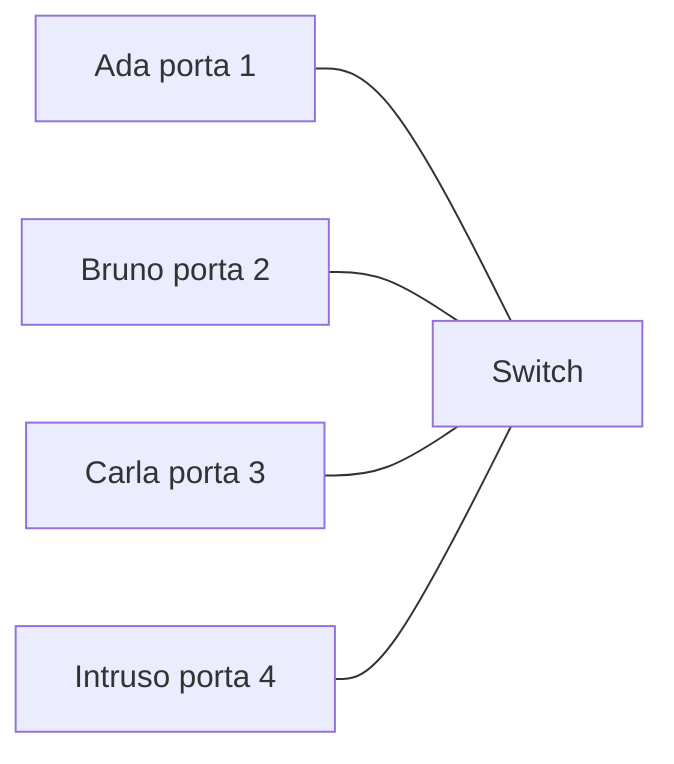

⬅️ [S7 - Ripasso e troubleshooting](%28STU%29%204DI%20sett-ott%20S7%20-%20Ripasso%20e%20troubleshooting.md) · 🏠 [Indice](../README.md)

# 🕵️ Eserciziario · 4DI sett-ott

**4DI · Settembre-Ottobre · Eserciziario con casi reali · Teoria e pratica scritta**

⏱️ **Tempo: un dossier dura 10-25 minuti.** ✅ essenziale: circa 60 minuti in tutto. 🔍 per il voto alto: circa 65 minuti. 🤓 si può saltare. Non è un compito a casa: scegli i dossier che ti servono, anche uno al giorno.

> **Legenda:** ✅ da sapere · 🔍 per capire fino in fondo · 🤓 facoltativo · 📜 caso vero · 🕵️ come funziona l'attacco · 📖 teoria · ✏️ pratica scritta · 🟢 svolto: guarda come si fa · 🎯 da provare: soluzione nascosta · 🧠 da ricordare · ⚠️ errore comune · 📌 controllo · 🃏 soluzione

In azienda nessuno ti dà un esercizietto. Ti dicono: «abbiamo un problema, risolvicelo». In queste pagine sei il nuovo tecnico di una squadra di sicurezza informatica: stile *Mr. Robot*, ma **con un permesso scritto**. Ogni dossier parte da un caso vero o verosimile, spiega come funziona l'attacco e ti chiede i conti che servono per capire la difesa.

<u>Un attacco è quasi sempre una regola della rete usata contro chi l'ha scritta.</u> Lo switch «manda a tutti ciò che non conosce». IP «non controlla il mittente». Il NAT «traduce, non decide». Chi conosce le regole sa dove guardare.

> ⚖️ **Regola d'oro.** Si prova solo su reti **proprie** o con **autorizzazione scritta**. In Italia entrare in un sistema informatico senza permesso è reato (art. 615-ter del Codice penale). Qui impari come funzionano gli attacchi per difenderti: non trovi istruzioni per colpire sistemi veri. Per provare in sicurezza ci sono le gare **CTF** (*Capture The Flag*) e gli ambienti autorizzati, come quelli dell'[Extra](%28STU%29%204DI%20sett-ott%20SX%20-%20Extra%20-%20Giochiamo%20e%20smancciamo%20con%20le%20reti.md).

## Come si usa

- 🟢 **Svolto.** Leggi i passaggi, poi copri la soluzione con la mano e rifai l'esercizio sul quaderno.
- 🎯 **Da provare.** Prima prova tu, sul quaderno. Poi apri la flashcard 🃏 e confronta.
- Ogni dossier ha almeno un esercizio svolto, uno di teoria 📖 e uno di pratica scritta ✏️.
- **Valori.** Nomi, aziende piccole e numeri degli esercizi sono inventati. Gli indirizzi «pubblici» (`192.0.2.x`, `198.51.100.x`, `203.0.113.x`) sono riservati alla documentazione (RFC 5737): non appartengono a nessuno. Gli indirizzi che compaiono nei casi veri sono dichiarati come tali.
- **Strumenti.** Puoi usare la tabella dei prefissi di S5 e la calcolatrice. Nei conti scrivi i passaggi.

| Dossier | Tema                              | Settimana | Caso                                    |
| :-----: | --------------------------------- | :-------: | --------------------------------------- |
|    1    | La busta e il Wi-Fi del bar       |    S1     | Firesheep, 2010                         |
|    2    | Lo switch che impara              |    S2     | MAC casuali e switch sovraccarico       |
|    3    | Indirizzi e botnet                |    S3     | Mirai, 2016                             |
|    4    | Privati, NAT e telecamere esposte |    S4     | Shodan                                  |
|    5    | FLSM: l'hotel a otto piani        |    S4     | DarkHotel, 2014                         |
|    6    | CIDR: di chi è questo IP          |    S5     | Honeypot e YouTube, 2008                |
|    7    | VLSM: l'acquario                  |    S6     | Il casinò e il termometro; Target, 2013 |
|    8    | Livello finale                    |    S7     | Capture The Flag                        |

---

## 🕵️ Dossier 1 · La busta e il Wi-Fi del bar

*Si usa S1: livelli, PDU, incapsulamento.*

### 📜 Caso vero: Firesheep, 2010

Ottobre 2010, conferenza di sicurezza ToorCon a San Diego. Il programmatore Eric Butler pubblica **Firesheep**, un'estensione per il browser Firefox. Basta un clic: sullo schermo compaiono le persone collegate allo stesso Wi-Fi aperto, con il loro profilo Facebook o Twitter. Un altro clic, e sei dentro il loro account. Senza password.

Nessuna magia. All'epoca molti siti proteggevano con HTTPS solo la pagina di login. Dopo, il **cookie di sessione** (il braccialetto che dice al sito «questo sei tu») viaggiava in chiaro dentro la richiesta HTTP. Su un Wi-Fi aperto i frame viaggiano via radio: chi è nel raggio li sente tutti. Firesheep voleva dimostrare il problema ed è considerato una delle spinte che hanno portato i grandi siti a usare HTTPS per tutta la sessione.

🧠 <u>Chi sente i bit può leggere tutto ciò che non è cifrato. Il livello Applicazione decide che cosa resta in chiaro.</u>

### 1.1 📖 Teoria · ✅ · 🟢 Svolto — Che cosa vede chi ascolta

**Consegna.** Il portatile di Dalia, al bar, invia questa richiesta a un sito. Un ascoltatore nel locale cattura il frame. Ecco che cosa contiene (valori inventati):

```text
[ ETH | IP | TCP | dati HTTP ]

dati HTTP:
GET /feed HTTP/1.1
Host: social.example
Cookie: sessione=7f3a9c
```

1. A quale livello TCP/IP appartiene ciascuna parte: ETH, IP, TCP, dati HTTP?
2. Se il sito usa HTTP semplice, dove sta il cookie e chi può leggerlo?
3. Se il sito usa HTTPS, che cosa resta leggibile per l'ascoltatore e che cosa no?

**Svolgimento (soluzioni).**

1. **ETH** è l'header del frame: livello Accesso alla rete. **IP** è l'header del pacchetto: livello Internet. **TCP** è l'header del segmento: livello Trasporto. **dati HTTP** è il messaggio: livello Applicazione.
2. Il cookie sta nei **dati HTTP**, cioè nel livello Applicazione. Con HTTP semplice nessuno lo cifra: chiunque riceva i frame, cioè tutto il bar, può leggerlo.
3. Con HTTPS i dati HTTP viaggiano cifrati: la riga `GET` e il cookie non si leggono più. Restano leggibili gli header esterni: MAC, indirizzo IP del sito e porta del trasporto. L'ascoltatore vede **verso quale sito** vai, non **che cosa** fai.

📌 **Controllo.** Ogni busta ha il suo livello e le cinque PDU sono dati, segmento, pacchetto, frame, segnali. Il cookie è l'unica cosa che l'ascoltatore non deve poter leggere: sta nella busta più interna.

🧠 <u>HTTPS non nasconde l'indirizzo IP del sito. Nasconde il contenuto.</u>

### 1.2 ✏️ Pratica · ✅ · 🎯 Da provare — Dove sta ogni dato

**Consegna.** Il browser di Dalia invia `GET /feed`. Sul quaderno:

1. Scrivi le cinque PDU in ordine, dalla prima a formarsi all'ultima.
2. Per ognuno di questi dati scrivi in quale PDU si trova: **A)** il MAC di destinazione; **B)** l'indirizzo IP di destinazione; **C)** la riga `GET /feed`; **D)** la porta del programma.

<details>
<summary>🃏 <b>1.2 — Soluzione</b></summary>

1. Dati → segmento → pacchetto → frame → segnali.
2. **A)** nel **frame** (header Ethernet). **B)** nel **pacchetto** (header IP). **C)** nei **dati** (livello Applicazione). **D)** nel **segmento** (header del trasporto).

⚠️ **Errore comune:** scrivere «frame» per l'indirizzo IP. L'IP sta nel pacchetto; il frame lo trasporta come contenuto.

</details>

### 1.3 📖 Teoria · 🔍 · 🎯 Da provare — Le frasi del collega

**Consegna.** Nico, assunto da una settimana, dice cinque frasi. Per ognuna scrivi **V** (vera) o **F** (falsa). Se è falsa, correggila in una frase.

1. «Pacchetto e frame sono due nomi della stessa cosa.» F
2. «Il livello di rete è il router.» F/V
3. «Internet funziona con i protocolli del modello ISO/OSI.» F
4. «Con HTTPS, chi ascolta vede ancora l'indirizzo IP del sito.» V
5. «Ogni livello legge e modifica l'header degli altri livelli.» F

<details>
<summary>🃏 <b>1.3 — Soluzione</b></summary>

1. **F.** Il pacchetto è la PDU del livello Rete; il frame è la PDU del collegamento dati. Il pacchetto sta dentro il frame.
2. **F.** I livelli sono funzioni, non pezzi di hardware. Un router svolge la funzione del livello Rete, ma i livelli non sono scatole.
3. **F.** I protocolli veri di Internet sono quelli della famiglia TCP/IP. ISO/OSI è soprattutto una mappa per ragionare.
4. **V.** L'header IP non è cifrato: serve ai router per consegnare il pacchetto.
5. **F.** Ogni livello usa solo il proprio header.

</details>

---

## 🕵️ Dossier 2 · Lo switch che impara

*Si usa S2: frame, MAC, tabella dello switch.*

### 📜 Caso vero: lo stesso indirizzo, due storie

**Il MAC come targa.** Per anni il MAC del tuo telefono è stato una targa fissa. Un negozio con Wi-Fi poteva riconoscerti ogni volta che passavi davanti, senza che ti collegassi: bastava che il telefono cercasse una rete. Per questo i telefoni moderni (iPhone con iOS 14, dal 2020; Android dalla versione 10) possono usare un **MAC casuale diverso per ogni rete Wi-Fi**. Su iPhone si chiama «Indirizzo Wi-Fi privato».

**Lo switch sovraccarico.** Ricordi le tre regole dello switch? Impara il MAC sorgente. Se conosce la destinazione, manda il frame solo su quella porta. Se **non** la conosce, lo manda su **tutte le porte tranne quella di arrivo**. L'attacco **MAC flooding** usa proprio questa terza regola. La tabella dello switch ha una memoria limitata. Chi è collegato a una porta invia migliaia di frame con MAC sorgente inventati: lo switch li impara tutti e la tabella si riempie. Quando è piena, molti MAC reali non si possono più imparare e i loro frame vengono mandati a tutti. L'intruso, sulla sua porta, comincia a ricevere frame che non sono per lui. Strumenti che automatizzano questo gioco esistono da decenni, e si provano nei laboratori autorizzati.

**Difesa.** Si limita il numero di MAC che una porta può imparare (*port security*): se ne arrivano troppi, lo switch blocca la porta e avvisa. E si cifra il contenuto, così un frame letto non basta.



*Una rete d'ufficio: tre persone e un intruso collegato alla porta 4.*

🧠 <u>Una regola comoda («se non so dove sei, lo dico a tutti») diventa una debolezza se qualcuno la può forzare.</u>

### 2.1 ✏️ Pratica · ✅ · 🟢 Svolto — Traccia la tabella

**Consegna.** Uno switch ha quattro porte e la tabella vuota. Collegati: porta 1 Ada (`00:00:00:00:00:AA`), porta 2 Bruno (`…BB`), porta 3 la stampante (`…CC`), porta 4 il portatile di un ospite (`…DD`), che non ha ancora scritto a nessuno. Per brevità scriviamo `AA`, `BB`, `CC`, `DD`. Arrivano in ordine quattro frame:

1. `AA → BB`, entra dalla porta 1.
2. `BB → AA`, entra dalla porta 2.
3. `CC → AA`, entra dalla porta 3.
4. `AA → DD`, entra dalla porta 1.

Per ogni frame scrivi che cosa **impara** lo switch e da quali porte **esce** il frame. Poi scrivi la tabella finale.

**Svolgimento.**

| Frame         | Entra da | Che cosa impara     | Destinazione già in tabella? | Esce da |
| ------------- | :------: | ------------------- | ---------------------------- | ------- |
| 1 · `AA → BB` |    1     | `AA` è alla porta 1 | no: `BB` è sconosciuto       | 2, 3, 4 |
| 2 · `BB → AA` |    2     | `BB` è alla porta 2 | sì: `AA` è alla porta 1      | solo 1  |
| 3 · `CC → AA` |    3     | `CC` è alla porta 3 | sì: `AA` è alla porta 1      | solo 1  |
| 4 · `AA → DD` |    1     | `AA` è già noto     | no: `DD` è sconosciuto       | 2, 3, 4 |

**Tabella finale:** `AA` → 1, `BB` → 2, `CC` → 3. `DD` non c'è: lo switch lo impara solo quando `DD` scrive un frame.

📌 **Controllo.** Chi ha ricevuto un frame non destinato a lui? Il frame 1 è arrivato anche alla stampante (porta 3) e all'ospite (porta 4). Per questo, mentre la tabella è incompleta, anche chi non è il destinatario può ricevere un frame.

🧠 <u>Il frame verso un MAC sconosciuto esce da tutte le porte tranne quella da cui è entrato.</u>

### 2.2 ✏️ Pratica · 🔍 · 🎯 Da provare — Switch sovraccarico

**Consegna.** Modello semplificato: uno switch vero ha migliaia di voci, tempi di scadenza e difese. Qui lo switch ha spazio per **4 voci**. Quando la tabella è piena non impara MAC nuovi, e tratta come sconosciuto ogni MAC che non è in tabella.

All'inizio la tabella contiene `AA` → porta 1 e `BB` → porta 2. Sulla porta 4 l'intruso invia due frame con MAC sorgente inventati, `F1` e `F2`. Poi Carla si collega alla porta 3 (`CC`) e scrive ad Ada.

AA sta sulla porta 1
BB sta sulla porta 2
intruso invia frame con MAC F1 e F2

1. Scrivi la tabella dopo i due frame dell'intruso. È piena?
2. Carla invia `CC → AA`. Lo switch impara `CC`? Da quali porte esce il frame?
3. Ada risponde `AA → CC`. Da quali porte esce? Chi, oltre a Carla, lo riceve?
4. L'intruso può leggere i frame fra Ada (`AA`) e Bruno (`BB`)? Perché?
5. Quale regola dello switch è stata usata contro di lui? Come si può difendere?

<details>
<summary>🃏 <b>2.2 — Soluzione</b></summary>

1. `AA` → 1, `BB` → 2, `F1` → 4, `F2` → 4. Sono 4 voci: la tabella è **piena**.
2. No: la tabella è piena, quindi `CC` non viene imparato. Però la destinazione `AA` è in tabella: il frame esce **solo dalla porta 1**.
3. `CC` è sconosciuto: il frame esce da tutte le porte tranne la 1, cioè dalle porte **2, 3 e 4**. Lo ricevono anche Bruno (porta 2) e l'**intruso** (porta 4).
4. No, finché `AA` e `BB` restano in tabella: i loro frame escono solo dalle porte 1 e 2. In una rete vera le voci scadono dopo qualche minuto, e l'intruso continua a inviare frame falsi: prima o poi anche loro diventano «sconosciuti».
5. La regola «se non conosci la destinazione, manda il frame a tutte le porte», unita alla tabella limitata. Difese: limitare i MAC per porta (*port security*) e cifrare il contenuto.

</details>

### 2.3 ✏️ Pratica · ✅ · 🎯 Da provare — Chi cambia e chi resta

**Consegna.** Due sedi di un'azienda sono collegate da due router, senza NAT. Il PC di Elia (`10.1.1.5`, MAC `…0A`) scrive al server (`10.9.9.9`, MAC `…5E`). Il viaggio ha tre tratti:

- **Tratto 1:** PC ↔ router R1. Il lato di R1 verso il PC ha MAC `…11`.
- **Tratto 2:** R1 ↔ router R2. Il lato di R1 ha MAC `…12`, il lato di R2 ha MAC `…21`.
- **Tratto 3:** R2 ↔ server. Il lato di R2 verso il server ha MAC `…22`.

Compila la tabella con i valori che si leggono **dentro il frame** di ogni tratto.

| Tratto | MAC sorgente | MAC destinazione | IP sorgente | IP destinazione |
| :---: | --- | --- | --- | --- |
| 1 | | | | |
| 2 | | | | |
| 3 | | | | |

Poi rispondi in una frase: perché serve l'IP, se c'è già il MAC?

<details>
<summary>🃏 <b>2.3 — Soluzione</b></summary>

| Tratto | MAC sorgente | MAC destinazione | IP sorgente | IP destinazione |
| :---: | --- | --- | --- | --- |
| 1 | `0A` | `11` | `10.1.1.5` | `10.9.9.9` |
| 2 | `12` | `21` | `10.1.1.5` | `10.9.9.9` |
| 3 | `22` | `5E` | `10.1.1.5` | `10.9.9.9` |

I **MAC cambiano a ogni tratto**; gli **IP restano uguali** da un capo all'altro (senza NAT). Il MAC serve a consegnare il frame al prossimo passaggio, l'IP dice dove deve arrivare il pacchetto alla fine.

⚠️ **Errore comune:** cambiare anche gli IP a ogni tratto, o lasciare gli stessi MAC. Il router apre il frame, legge il pacchetto e lo richiude in un frame nuovo.

</details>

### 2.4 📖 Teoria · ✅ · 🎯 Da provare — Switch o router

**Consegna.** Per ogni frase scrivi **switch** o **router**.

1. Decide guardando il MAC di destinazione.
2. Decide guardando l'indirizzo IP di destinazione.
3. Tiene una tabella «MAC → porta».
4. Collega reti diverse.
5. Non apre il pacchetto IP.
6. Se non conosce la destinazione di un frame, lo manda su tutte le porte tranne quella di arrivo.

<details>
<summary>🃏 <b>2.4 — Soluzione</b></summary>

1 switch · 2 router · 3 switch · 4 router · 5 switch · 6 switch.

Nelle reti vere le due funzioni stanno spesso nella stessa scatola, ma sono due decisioni diverse.

</details>

### 2.5 🤓 · 🎯 Da provare — Come si riconosce un MAC casuale

> Un MAC è fatto da sei byte. Nel **primo byte**, se il **secondo carattere** è `2`, `6`, `A` o `E`, l'indirizzo è «assegnato localmente»: non è quello scritto dal produttore, e spesso è un MAC casuale.
>
> **Consegna.** Quali di questi MAC sembrano casuali? `00:1A:2B:3C:4D:5E` · `3A:5C:11:90:77:E2` · `B2:44:0F:12:C8:01` · `7C:D1:C3:0A:99:10`

<details>
<summary>🃏 <b>2.5 — Soluzione</b></summary>

Il secondo e il terzo. `3A` ha secondo carattere `A`; `B2` ha secondo carattere `2`. Gli altri finiscono in `0` (`00`) e in `C` (`7C`).

</details>

---

## 🕵️ Dossier 3 · Indirizzi e botnet

*Si usa S3: indirizzo IPv4, prefisso, AND, header del pacchetto. Per i privati serve anche S4.*

### 📜 Caso vero: Mirai, 2016

Autunno 2016. Un programma chiamato **Mirai** scansiona Internet: genera indirizzi IPv4 a caso e prova a collegarsi a ognuno con **Telnet**, un vecchio programma di accesso remoto. Cerca telecamere, videoregistratori e router rimasti con la password di fabbrica. Nel suo codice c'è una lista di circa sessanta coppie nome-password (come `admin` / `admin`). Ogni dispositivo conquistato entra in una **botnet**: una rete di dispositivi comandati a distanza. Mirai ne ha infettati centinaia di migliaia.

Il 21 ottobre 2016 la botnet inonda di traffico Dyn, un'azienda che offre servizi di nomi di Internet. Per alcune ore diventano difficili da raggiungere siti come Twitter, Netflix e Spotify in molte zone degli Stati Uniti. I proprietari delle telecamere non si erano accorti di niente.

Un dettaglio per chi legge gli indirizzi: il generatore di Mirai **salta** alcuni intervalli. Salta i privati e localhost, perché non sono raggiungibili da Internet: scansionarli è tempo perso. Salta anche blocchi di enti molto attenti, come il Dipartimento della Difesa degli Stati Uniti, per non attirare l'attenzione.

**Difesa.** Cambiare le password di fabbrica, aggiornare i dispositivi e non esporli a Internet senza motivo.

### 3.1 ✏️ Pratica · ✅ · 🟢 Svolto — Chi viene saltato

**Consegna.** Il generatore di Mirai estrae sei indirizzi a caso. Per ognuno scrivi se **viene saltato** e perché. Ti servono i tre intervalli privati di S4 e l'indirizzo di localhost di S3.

| | Indirizzo |
| :---: | --- |
| A | `10.200.3.4` |
| B | `172.31.250.9` |
| C | `172.32.0.9` |
| D | `192.168.200.1` |
| E | `192.169.0.1` |
| F | `127.0.0.1` |

**Svolgimento.** I tre intervalli privati sono `10.0.0.0/8`, `172.16.0.0/12` (da `172.16.0.0` a `172.31.255.255`) e `192.168.0.0/16`. Localhost è `127.0.0.1`.

| | Indirizzo | Dentro un intervallo da saltare? | Esito |
| :---: | --- | --- | --- |
| A | `10.200.3.4` | sì, `10.0.0.0/8` | saltato |
| B | `172.31.250.9` | sì: il secondo numero, 31, è fra 16 e 31 | saltato |
| C | `172.32.0.9` | no: 32 è oltre 31 | **scansionato** |
| D | `192.168.200.1` | sì, `192.168.0.0/16` | saltato |
| E | `192.169.0.1` | no: il secondo numero è 169, non 168 | **scansionato** |
| F | `127.0.0.1` | sì, localhost | saltato |

Vengono scansionati **solo C ed E**.

⚠️ **Errore comune:** pensare che ogni `172.x.x.x` o `192.x.x.x` sia privato. Il numero giusto è il **secondo**: per `172` deve stare fra 16 e 31; per `192` deve essere 168.

🧠 <u>Un indirizzo è privato solo se cade dentro uno dei tre intervalli. Il primo numero da solo non basta.</u>

### 3.2 ✏️ Pratica · 🔍 · 🎯 Da provare — Stessa rete o no

**Consegna.** In un'aula d'informatica la rete usa il prefisso `/27`. Un malware su un portatile di studente (`10.50.4.70/27`) cerca altri PC da attaccare. I bersagli sono `10.50.4.93` e `10.50.4.100`.

1. Scrivi la maschera `/27` in notazione decimale.
2. Trova la rete di `10.50.4.70/27` con l'AND in binario sull'ultimo numero. Scrivi anche il broadcast.
3. Quali bersagli stanno nella **stessa rete** del portatile?
4. La scuola passa a `/28` per separare le aule. Ricalcola: quali bersagli stanno ora nella stessa rete?
5. Che cosa cambia per il malware?

<details>
<summary>🃏 <b>3.2 — Soluzione</b></summary>

1. `/27` → `255.255.255.224`.
2. 70 = `01000110`, 224 = `11100000`; AND = `01000000` = 64. Rete `10.50.4.64/27`, broadcast `10.50.4.95`, host da `.65` a `.94`.
3. `10.50.4.93` sì (sta in 64-95). `10.50.4.100` no: sta nella rete `10.50.4.96/27`.
4. Con `/28` il salto è 16. `.70` sta in `10.50.4.64/28` (64-79). `.93` sta in `10.50.4.80/28` (80-95), `.100` in `10.50.4.96/28` (96-111). **Nessuno** dei due bersagli è nella stessa rete.
5. Con `/27` il malware poteva raggiungere `.93` direttamente, sul tratto locale. Con `/28` per arrivarci il traffico deve passare da un router, dove si possono mettere regole.

📌 **Controllo.** Con il salto: 70 sta fra 64 e 95 (`/27`) e fra 64 e 79 (`/28`).

⚠️ **Errore comune:** dire che `.93` e `.100` stanno insieme perché «hanno lo stesso `10.50.4`»: conta il prefisso.

</details>

### 3.3 📖 Teoria · 🔍 · 🎯 Da provare — Leggi l'intestazione

**Consegna.** Il firewall di un'azienda registra l'intestazione di un pacchetto (valori inventati):

```text
Versione: 4   TTL: 57 (non serve)   Protocollo: 6
Indirizzo sorgente:      192.0.2.201
Indirizzo destinazione:  172.20.5.10
```

*Nel campo Protocollo il valore 6 significa TCP, il valore 17 significa UDP.*

1. Chi ha inviato il pacchetto e chi deve riceverlo?
2. Quale campo dice al ricevente a quale protocollo consegnare i dati? Quale campo del frame Ethernet fa un lavoro simile?
3. L'indirizzo di destinazione è pubblico o privato? Che cosa ti dice sul punto in cui è stato registrato il pacchetto?
4. Chi scrive l'indirizzo sorgente? IP controlla che sia vero? Che cosa può farci un attaccante?

<details>
<summary>🃏 <b>3.3 — Soluzione</b></summary>

1. Sorgente `192.0.2.201`, destinazione `172.20.5.10`.
2. Il campo **Protocollo** (qui 6, cioè TCP). Nel frame Ethernet lo fa l'**EtherType**: dice che cosa c'è nella busta successiva.
3. È **privato**: `172.20.5.10` sta in `172.16.0.0/12`. Il pacchetto è stato registrato dentro la rete dell'azienda. Il mittente `192.0.2.201` è un indirizzo pubblico di esempio.
4. Lo scrive **chi invia**. IP è best effort e **non controlla** che sia vero. Un attaccante può scrivere un sorgente falso. La risposta andrà all'indirizzo falso, non a lui: gli serve quando non vuole la risposta, o quando vuole che la risposta arrivi a un'altra vittima.

🤓 *Così funzionano gli attacchi «a riflessione»: l'attaccante scrive come mittente l'indirizzo della vittima, e molti server inviano la loro risposta alla vittima. Nel 2018 GitHub ha ricevuto un'ondata di traffico di circa 1,35 terabit al secondo con questo schema.*

</details>

---

## 🕵️ Dossier 4 · Privati, NAT e telecamere esposte

*Si usa S4: indirizzi privati, NAT, differenza NAT e firewall.*

### 📜 Caso vero: Shodan

Nel 2009 il programmatore John Matherly lancia **Shodan**. È un motore di ricerca che, invece delle pagine web, cataloga i **dispositivi** collegati a Internet con un indirizzo pubblico: telecamere, stampanti, router, impianti. Non rompe niente: elenca ciò che già risponde.

Molte di quelle telecamere sono lì per una ragione semplice. Qualcuno voleva guardarle dal telefono e ha detto al router: «fai passare il traffico verso la mia telecamera». Poi ha lasciato la password di fabbrica.

🕵️ **Come funziona.** Il NAT di casa traduce soltanto. Se un pacchetto arriva da fuori e non c'è una riga in tabella, il router non sa a chi consegnarlo. L'**inoltro di porta** (*port forwarding*) è una riga **scritta a mano**: «ciò che arriva alla porta 8080 dell'indirizzo pubblico, mandalo alla telecamera». Quella riga è una porta aperta, per chiunque.

### 4.1 ✏️ Pratica · ✅ · 🟢 Svolto — Leggi la tabella del NAT

**Consegna.** Un router d'ufficio ha un solo indirizzo pubblico, `192.0.2.5` (di esempio). Ecco la sua tabella (tutte le righe sono TCP):

| # | Sorgente interna | Sorgente riscritta | Server esterno |
| :---: | --- | --- | --- |
| 1 | `192.168.0.10:50210` | `192.0.2.5:61001` | `203.0.113.8:443` |
| 2 | `192.168.0.11:50210` | `192.0.2.5:61002` | `203.0.113.8:443` |
| 3 | `192.168.0.12:43000` | `192.0.2.5:61003` | `198.51.100.20:80` |

1. Il server `203.0.113.8` risponde a `192.0.2.5:61002`. A quale PC consegna la risposta il router? Con quale destinazione riscritta?
2. I PC `.10` e `.11` usano la stessa porta locale, 50210. È un problema? Perché?
3. Da fuori arriva un pacchetto da `198.51.100.99` verso `192.0.2.5:61999`. Nessuna riga corrisponde. Che cosa succede?
4. Chi ha scelto le porte 61001, 61002 e 61003: i PC o il router?

**Svolgimento.**

1. Il router cerca `61002` nella colonna «riscritta»: è la riga 2. Consegna al PC `192.168.0.11` e riscrive la destinazione in `192.168.0.11:50210`.
2. No. I due PC hanno **indirizzi IP diversi**, e il router assegna **porte esterne diverse** (61001 e 61002): così distingue le risposte.
3. Il router non sa a quale PC consegnarlo: non c'è una corrispondenza né una regola configurata. In genere non lo inoltra.
4. Il **router**: assegna lui le porte esterne.

📌 **Controllo.** Ogni risposta da un server deve trovare la sua riga: se non c'è, il router non può inventare il PC.

🧠 <u>La tabella del NAT è la memoria del router. Traduce: non decide chi può entrare.</u>

### 4.2 📖 Teoria · ✅ · 🎯 Da provare — La telecamera del bar

**Consegna.** Luca, il barista, vuole vedere la telecamera del locale dal telefono. Nel router aggiunge una regola di inoltro: `192.0.2.30:8080` → `192.168.0.64:80` (indirizzo pubblico di esempio → telecamera interna). La telecamera ha ancora la password di fabbrica.

1. Chi può raggiungere la telecamera?
2. Perché un servizio come Shodan potrebbe trovarla?
3. Luca dice: «Ho il NAT, quindi sono al sicuro». Correggilo in una frase, usando le parole **NAT** e **firewall**.
4. Scrivi due cose che Luca può fare per ridurre il rischio.

<details>
<summary>🃏 <b>4.2 — Soluzione</b></summary>

1. **Chiunque** in Internet conosca o scopra `192.0.2.30:8080`: la regola vale per tutti, non solo per Luca.
2. Perché la telecamera risponde su un indirizzo pubblico. Chi cerca prova indirizzi e porte: non servono trucchi.
3. Il NAT **traduce** gli indirizzi, non decide chi può entrare. Le regole di accesso le applica un firewall, e qui la regola configurata ha aperto un passaggio.
4. Per esempio: cambiare la password di fabbrica; togliere la regola di inoltro; aggiornare la telecamera; usare un accesso protetto (una VPN) invece dell'apertura diretta. Ne bastano due.

</details>

---

## 🕵️ Dossier 5 · FLSM: l'hotel a otto piani

*Si usa S4: FLSM e dimensione dei blocchi.*

### 📜 Caso vero: DarkHotel, 2014

Nel 2014 l'azienda di sicurezza Kaspersky descrive una campagna di spionaggio chiamata **DarkHotel**. I bersagli erano dirigenti in viaggio, colpiti tramite il Wi-Fi di alberghi di lusso. Il dirigente si collegava alla rete della camera e gli veniva proposto di installare l'«aggiornamento» di un programma noto. L'aggiornamento era falso.

La lezione per chi progetta la rete di un hotel è semplice: <u>la rete degli ospiti deve stare separata da tutto il resto</u>. Dividere gli indirizzi in sottoreti è il primo passo.

### 5.1 ✏️ Pratica · ✅ · 🟢 Svolto — Una rete per piano

**Consegna.** L'Hotel Belvedere (nome e numeri inventati) ha otto piani. Riceve il blocco privato `10.80.0.0/24` e vuole una sottorete per piano, tutte della **stessa dimensione** (FLSM). Trova quanti bit prendere in prestito, il nuovo prefisso e la dimensione di ogni rete. Poi compila la tabella.

**Svolgimento.**

1. **Quante reti servono?** 8. Con 3 bit si ottengono $2^3 = 8$ reti: si prendono in prestito **3 bit**.
2. **Nuovo prefisso:** $24 + 3 = $ **`/27`**.
3. **Dimensione:** 5 bit host → $2^5 = 32$ indirizzi, 30 host ordinari. Il salto è $256 - 224 = 32$.

| Piano | Rete | Host ordinari | Broadcast |
| :---: | --- | --- | --- |
| 1 | `10.80.0.0/27` | `.1` - `.30` | `10.80.0.31` |
| 2 | `10.80.0.32/27` | `.33` - `.62` | `10.80.0.63` |
| 3 | `10.80.0.64/27` | `.65` - `.94` | `10.80.0.95` |
| 4 | `10.80.0.96/27` | `.97` - `.126` | `10.80.0.127` |
| 5 | `10.80.0.128/27` | `.129` - `.158` | `10.80.0.159` |
| 6 | `10.80.0.160/27` | `.161` - `.190` | `10.80.0.191` |
| 7 | `10.80.0.192/27` | `.193` - `.222` | `10.80.0.223` |
| 8 | `10.80.0.224/27` | `.225` - `.254` | `10.80.0.255` |

📌 **Controllo.** $8 \times 32 = 256$: le otto reti coprono tutto il `/24`. L'ultimo broadcast è `.255`, come quello della `/24`.

⚠️ **Errore comune:** dimenticare che ogni piano ha solo **30** host ordinari. Un piano con 35 dispositivi non ci starebbe.

### 5.2 ✏️ Pratica · ✅ · 🎯 Da provare — Mezzo blocco, quattro reti

**Consegna.** Un ostello riceve il blocco privato `172.18.6.128/25` (da `.128` a `.255`). Lo divide in **4 reti uguali**.

1. Quanti bit prendi in prestito e qual è il nuovo prefisso?
2. Compila la tabella con rete, broadcast e host ordinari di ciascuna.

| Rete | Indirizzo | Broadcast | Host ordinari |
| :---: | --- | --- | --- |
| 1 | | | |
| 2 | | | |
| 3 | | | |
| 4 | | | |

<details>
<summary>🃏 <b>5.2 — Soluzione</b></summary>

1. 4 reti → $2^2 = 4$ → **2 bit**; prefisso $25 + 2 = $ **`/27`**. Ogni rete ha 32 indirizzi e 30 host ordinari.
2.

| Rete | Indirizzo | Broadcast | Host ordinari |
| :---: | --- | --- | --- |
| 1 | `172.18.6.128/27` | `172.18.6.159` | `.129` - `.158` |
| 2 | `172.18.6.160/27` | `172.18.6.191` | `.161` - `.190` |
| 3 | `172.18.6.192/27` | `172.18.6.223` | `.193` - `.222` |
| 4 | `172.18.6.224/27` | `172.18.6.255` | `.225` - `.254` |

📌 **Controllo.** L'ultimo broadcast è `.255`, come quello del blocco `/25` di partenza.

⚠️ **Errore comune:** partire da `.0`. Il blocco inizia a `.128`.

</details>

### 5.3 📖 Teoria · 🔍 · 🎯 Da provare — Quando FLSM non basta

**Consegna.** L'Hotel Belvedere ha bisogno di tre reti: **Ospiti Wi-Fi** (100 dispositivi), **Gestionale** (20) e **Telecamere** (6). I numeri comprendono già il gateway. Lo spazio è `10.80.0.0/24`. Un tecnico propone FLSM.

1. Quante reti uguali puoi ottenere con 1 bit in prestito? E con 2 bit? Quanti host ordinari ha ciascuna?
2. Con FLSM esiste una dimensione unica che accontenta tutte e tre le richieste? Spiega.
3. Gli indirizzi totali del `/24` bastano, in teoria? Quale tecnica di S6 risolve il problema?

<details>
<summary>🃏 <b>5.3 — Soluzione</b></summary>

1. Con 1 bit: 2 reti `/25`, ciascuna con 126 host ordinari. Con 2 bit: 4 reti `/26`, ciascuna con 62 host ordinari.
2. **No.** Servono almeno 3 reti, quindi bisogna usare almeno 2 bit: reti da `/26`, 62 host. Ma gli Ospiti ne chiedono 100. Con le `/25` gli Ospiti entrano, ma le reti sono solo 2 e ne servono 3.
3. Sì: $100 + 20 + 6 = 126$ host sono molto meno di 256 indirizzi. Il problema non è lo spazio, ma la **forma unica** dei blocchi. Lo risolve **VLSM**: ogni rete ha la dimensione che le serve (qui `/25`, `/27` e `/29`).

</details>

---

## 🕵️ Dossier 6 · CIDR: di chi è questo IP

*Si usa S5: prefisso, rete, broadcast, intervallo, catena IANA → RIR → ISP → cliente.*

### 📜 Caso vero: il server-trappola

Un **honeypot** («vasetto di miele») è un server finto, isolato e senza dati veri, messo online solo per **registrare chi bussa**. Dopo poche ore cominciano ad arrivare tentativi di accesso da tutto il mondo: sono scansioni automatiche, come quelle di Mirai.

Un tentativo arriva da un indirizzo. Chi c'è dietro? Si interroga **WHOIS**, l'elenco pubblico dei registri di indirizzi (per l'Europa, il RIPE NCC). Il registro non dice il nome della persona. Dice **a chi è stato assegnato il blocco**, scritto come intervallo. Un esempio inventato:

```text
inetnum:  192.0.2.136 - 192.0.2.143
netname:  VALDARNO-NET-CLIENTE
descr:    Cliente business di Valdarno Net (provider di esempio)
```

*Un record WHOIS europeo scrive il blocco come «primo - ultimo», non come `/prefisso`: tradurre è compito tuo.*

### 6.1 ✏️ Pratica · ✅ · 🟢 Svolto — Dal log al blocco

**Consegna.** L'honeypot registra un accesso da `192.0.2.141`. WHOIS risponde con l'intervallo qui sopra.

1. Scrivi il blocco in notazione CIDR.
2. Scrivi maschera decimale, rete, broadcast e host ordinari.
3. Imposti la regola del firewall «blocca `192.0.2.136/29`». Quali di questi indirizzi del log sono bloccati? `192.0.2.139` · `192.0.2.143` · `192.0.2.144` · `192.0.2.135` · `192.0.2.141`

**Svolgimento.**

1. Da `.136` a `.143` ci sono **8 indirizzi**, cioè $2^3$: 3 bit host. Il prefisso è $32 - 3 = $ **`/29`**. Controllo: 136 è un multiplo di 8 ($17 \times 8$), quindi il blocco è allineato.
2. Maschera: $256 - 8 = 248$, cioè `255.255.255.248`. Rete `192.0.2.136`. Broadcast `192.0.2.143`. Host ordinari da `.137` a `.142`: 6.
3. Sono bloccati `.139`, `.141` e anche `.143` (il broadcast sta nel blocco). **Non** sono bloccati `.144` (è il primo indirizzo del blocco dopo) e `.135` (è prima).

📌 **Controllo con l'AND.** 141 = `10001101`, 248 = `11111000`. AND = `10001000` = 136. La rete torna.

⚠️ **Errore comune:** calcolare gli indirizzi come $143 - 136 = 7$. Il primo si conta: sono 8.

🧠 <u>Un intervallo «primo - ultimo» è un blocco CIDR solo se la dimensione è una potenza di 2 e l'inizio è allineato.</u>

### 6.2 ✏️ Pratica · ✅ · 🎯 Da provare — Tre visitatori, tre schede

**Consegna.** L'honeypot registra tre indirizzi e WHOIS indica per ciascuno il prefisso del blocco. Compila una scheda per ciascuno: maschera decimale, rete, broadcast, primo e ultimo host ordinario.

- `192.0.2.77/27`
- `203.0.113.200/28`
- `198.51.100.18/30`

Controlla **uno** dei tre anche con l'AND.

<details>
<summary>🃏 <b>6.2 — Soluzione</b></summary>

| Indirizzo | Maschera | Rete | Broadcast | Primo - ultimo host |
| --- | --- | --- | --- | --- |
| `192.0.2.77/27` | `255.255.255.224` | `192.0.2.64` | `192.0.2.95` | `.65` - `.94` |
| `203.0.113.200/28` | `255.255.255.240` | `203.0.113.192` | `203.0.113.207` | `.193` - `.206` |
| `198.51.100.18/30` | `255.255.255.252` | `198.51.100.16` | `198.51.100.19` | `.17` - `.18` |

**Salto.** `/27` → 32: il 77 sta fra 64 e 95. `/28` → 16: il 200 sta fra 192 e 207. `/30` → 4: il 18 sta fra 16 e 19.

**AND (per `/27`).** 77 = `01001101`, 224 = `11100000`. AND = `01000000` = 64.

⚠️ **Errore comune:** la `/30` ha solo **2** host ordinari: `.17` e `.18`. Non `.16` e `.19`: sono rete e broadcast.

</details>

### 6.3 📖 Teoria · ✅ · 🎯 Da provare — Chi sa che cosa

**Consegna.** Con WHOIS hai scoperto che `192.0.2.136/29` è stato assegnato a «Valdarno Net», un provider di esempio.

1. Scrivi in ordine, dall'alto, la catena che porta un blocco dalla riserva mondiale al cliente. Usa: **IANA**, **ISP**, **cliente**, **RIPE NCC**.
2. Chi può sapere quale cliente usava `192.0.2.141` alle 03:12 di ieri? Perché WHOIS non lo dice?
3. Basta l'indirizzo IP per dire «l'attacco è partito dal cliente»? Scrivi una ragione per cui potrebbe non essere vero.

<details>
<summary>🃏 <b>6.3 — Soluzione</b></summary>

1. **IANA → RIPE NCC → ISP → cliente.**
2. Lo sa l'**ISP**: conserva i registri di quale cliente aveva quell'indirizzo a quell'ora, e li consegna alle autorità su richiesta formale. WHOIS dice solo a chi appartiene il **blocco**.
3. **No.** Un indirizzo indica un punto della rete, non una persona. Un dispositivo del cliente può essere stato infettato (come le telecamere di Mirai), oppure un'altra persona può aver usato la sua connessione, per esempio un Wi-Fi aperto.

</details>

### 6.4 🤓 · 🎯 Da provare — Il giorno in cui YouTube sparì

> 24 febbraio 2008. Il governo del Pakistan ordina di bloccare YouTube nel paese. Pakistan Telecom prova a farlo «annunciando» ai router vicini di essere la strada verso un pezzo degli indirizzi di YouTube: `208.65.153.0/24`. L'annuncio, per errore, esce dal Pakistan e arriva in tutto il mondo. I router preferiscono la strada **più specifica**, cioè quella con il prefisso più lungo: molti mandano il traffico verso quei 256 indirizzi in Pakistan, dove si perde. YouTube resta irraggiungibile per circa due ore. Come scelgono i router lo vedremo più avanti.
>
> Il blocco vero di YouTube era `208.65.152.0/22`.
>
> **Consegna (5 min).** Una `/22` ha 22 bit di rete: nel terzo numero il salto è $256 - 252 = 4$.
> 1. Scrivi primo e ultimo indirizzo della `/22`.
> 2. `208.65.153.0/24` sta dentro? Quanti indirizzi ha la `/22`, e quale frazione ne copriva l'annuncio?

<details>
<summary>🃏 <b>6.4 — Soluzione</b></summary>

1. I blocchi `/22` partono da 152, 156, 160... nel terzo numero. Il blocco che contiene 152 va da **`208.65.152.0`** a **`208.65.155.255`**.
2. Sì: 153 sta fra 152 e 155. La `/22` ha $2^{10} = 1024$ indirizzi; la `/24` ne ha 256, cioè **un quarto**.

</details>

---

## 🕵️ Dossier 7 · VLSM: l'acquario

*Si usa S6: dimensiona, ordina, alloca, controlla.*

### 📜 Caso vero: il termometro dell'acquario

Un casinò nordamericano (il nome non è mai stato reso noto) ha un acquario nella hall. Il termometro dell'acquario è collegato a Internet, per regolare la temperatura dell'acqua. Secondo quanto raccontato nel 2017 dalla responsabile di Darktrace, un'azienda di sicurezza, gli attaccanti entrano proprio da quel termometro. Dallo stesso punto trovano il database dei clienti più ricchi e ne copiano circa 10 GB verso un server all'estero.

Un caso simile, più grande: nel 2013 gli attaccanti di **Target**, catena di negozi americana, entrano con le credenziali rubate a un fornitore di impianti di climatizzazione. Da lì, secondo le ricostruzioni giornalistiche, la rete non era abbastanza separata e raggiungono le casse di quasi 1.800 negozi: circa 40 milioni di carte.

🕵️ **Come funziona.** Si chiama **movimento laterale**: l'attaccante entra dal punto più debole e si sposta verso quello che vale. **Difesa:** dividere la rete in sottoreti per funzione (sensori, casse, uffici, ospiti) e mettere regole fra una e l'altra.

⚠️ Dividere gli indirizzi non basta: serve anche un **firewall** con regole fra le sottoreti. La sottorete è l'organizzazione; la sicurezza arriva dalle regole.

### 7.1 ✏️ Pratica · 🔍 · 🟢 Svolto — Il piano dell'acquario

**Consegna.** L'Acquario civico «Mare Nostrum» (nome e numeri inventati) riceve il blocco privato `172.20.40.0/24`. Vuole quattro sottoreti separate. I numeri comprendono già il gateway:

| Reparto | Dispositivi |
| --- | ---: |
| Visitatori Wi-Fi | 100 |
| Uffici | 40 |
| Sensori vasche | 20 |
| Casse | 12 |

Costruisci il piano VLSM con i quattro passaggi: dimensiona, ordina, alloca, controlla.

**Svolgimento.**

1. **Dimensiona.** Per ogni reparto trova i bit host minimi $h$ con $2^h - 2 \ge$ richiesta.

| Reparto | Richiesta | Bit host | Prefisso | Indirizzi nel blocco |
| --- | ---: | :---: | :---: | ---: |
| Visitatori Wi-Fi | 100 | 7 | `/25` | 128 |
| Uffici | 40 | 6 | `/26` | 64 |
| Sensori vasche | 20 | 5 | `/27` | 32 |
| Casse | 12 | 4 | `/28` | 16 |

2. **Ordina.** Dal più grande al più piccolo: l'elenco è già in ordine.
3. **Alloca.** Ogni blocco inizia dove finisce il precedente.

| Reparto | Rete | Host ordinari | Broadcast |
| --- | --- | --- | --- |
| Visitatori Wi-Fi | `172.20.40.0/25` | `.1` - `.126` | `172.20.40.127` |
| Uffici | `172.20.40.128/26` | `.129` - `.190` | `172.20.40.191` |
| Sensori vasche | `172.20.40.192/27` | `.193` - `.222` | `172.20.40.223` |
| Casse | `172.20.40.224/28` | `.225` - `.238` | `172.20.40.239` |

```text
0                       128          192     224  240  255
|------ Visitatori ------|--- Uffici ---|Sensori|Casse|libero|
          128                  64          32     16     16
```

*I 256 indirizzi della `/24`: quattro blocchi assegnati e 16 indirizzi liberi.*

4. **Controlla.**
   - **Capienza:** ogni blocco ha host ordinari a sufficienza (126, 62, 30, 14).
   - **Allineamento:** 0, 128, 192 e 224 sono multipli delle dimensioni dei blocchi che iniziano lì (128, 64, 32, 16).
   - **Non sovrapposizione:** gli intervalli sono separati.
   - **Tracciabilità:** la tabella dice rete, prefisso, host e broadcast.

Restano liberi gli indirizzi da `172.20.40.240` a `172.20.40.255`.

🧠 <u>Dimensiona, ordina, alloca, controlla. E tieni i sensori lontani dalle casse.</u>

### 7.2 ✏️ Pratica · 🔍 · 🎯 Da provare — L'ordine conta

**Consegna.** Un hackerspace (nome inventato) riceve il blocco privato `192.168.12.0/25`: 128 indirizzi, da `.0` a `.127`. Le richieste arrivano in quest'ordine (gateway compreso):

| Reparto | Dispositivi |
| --- | ---: |
| Stampa 3D e IoT | 5 |
| Laboratorio | 58 |
| Sala corsi | 28 |
| Ufficio | 13 |

1. **Dimensiona** ogni richiesta (prefisso e indirizzi nel blocco).
2. **Assegna nell'ordine di arrivo**, senza tornare indietro e rispettando l'allineamento. Dove si blocca il piano?
3. **Rifai dal più grande al più piccolo.** Scrivi rete e broadcast di ogni blocco.
4. Quanti indirizzi restano liberi?

<details>
<summary>🃏 <b>7.2 — Soluzione</b></summary>

1. Stampa 3D e IoT: 5 → 3 bit host → `/29`, 8 indirizzi. Laboratorio: 58 → 6 bit → `/26`, 64. Sala corsi: 28 → 5 bit → `/27`, 32. Ufficio: 13 → 4 bit → `/28`, 16.
2. Stampa 3D e IoT prende `.0` - `.7`. Il Laboratorio (`/26`) deve iniziare su un multiplo di 64: `.64` - `.127`. La Sala corsi (`/27`) dovrebbe iniziare a `.128`, ma lo spazio finisce a `.127`: **non entra**. Nemmeno l'Ufficio. La somma richiesta è $8 + 64 + 32 + 16 = 120 \le 128$, eppure il piano fallisce.
3.

| Reparto | Rete | Broadcast |
| --- | --- | --- |
| Laboratorio | `192.168.12.0/26` | `192.168.12.63` |
| Sala corsi | `192.168.12.64/27` | `192.168.12.95` |
| Ufficio | `192.168.12.96/28` | `192.168.12.111` |
| Stampa 3D e IoT | `192.168.12.112/29` | `192.168.12.119` |

4. Restano liberi 8 indirizzi, da `.120` a `.127`.

⚠️ **Errore comune:** pensare che basti la somma. Contano anche l'**ordine** e l'**allineamento**.

</details>

### 7.3 ✏️ Pratica · 🔍 · 🎯 Da provare — Arriva la nuova vasca

**Consegna.** Riprendi il piano dell'acquario (7.1). Lo spazio libero è da `172.20.40.240` a `172.20.40.255`.

1. Si apre la «Vasca tropicale» con **10 dispositivi** (gateway compreso). Quale prefisso serve? C'è posto? Scrivi rete, broadcast e host ordinari.
2. Poi arriva il reparto «Laboratori», con **25 dispositivi**. Entra nella `172.20.40.0/24`? Che cosa può fare il tecnico?

<details>
<summary>🃏 <b>7.3 — Soluzione</b></summary>

1. 10 dispositivi → 4 bit host (14 ≥ 10) → **`/28`**. Il blocco `172.20.40.240/28` è allineato ($240 = 15 \times 16$). Broadcast `172.20.40.255`; host ordinari da `.241` a `.254`. C'è posto, e usa tutto lo spazio libero.
2. 25 dispositivi → 5 bit → `/27`, 32 indirizzi allineati. **Non entra**: nella `/24` non resta spazio. Il tecnico può riorganizzare il piano (difficile e rischioso su una rete in uso) oppure assegnare un nuovo blocco privato, per esempio `172.20.41.0/24`.

🧠 Per questo un buon piano lascia una **riserva** ragionata, come si dice nella sezione 🤓 di S6.

</details>

### 7.4 📖 Teoria · ✅ · 🎯 Da provare — Perché separare

**Consegna.** Rispondi in poche righe:

1. Perché i «Sensori vasche» stanno in una sottorete a parte, e non insieme alle «Casse»?
2. Basta dare un prefisso diverso a ogni reparto per essere al sicuro?
3. Come si chiama lo spostamento dell'attaccante dal punto debole a quello prezioso?

<details>
<summary>🃏 <b>7.4 — Soluzione</b></summary>

1. Un sensore economico è il punto più debole. Se cade, l'attaccante resta nella sua sottorete: per arrivare alle casse deve attraversare un router, dove si possono mettere regole.
2. **No.** La sottorete organizza gli indirizzi; la sicurezza viene dalle regole (il firewall) fra le sottoreti.
3. **Movimento laterale.**

</details>

---

## 🕵️ Dossier 8 · Livello finale

*Si usa tutto il bimestre, come in S7.*

### 📜 Caso vero: le gare CTF

Una **CTF** (*Capture The Flag*, «cattura la bandiera») è una gara di hacking etico. Ogni squadra risolve sfide e trova una stringa nascosta, la **flag**, scritta nel formato `FLAG{...}`. In Italia ci sono gare per studenti delle superiori: **OliCyber.IT** (dai 14 anni) e **CyberChallenge.IT** (dai 16 ai 24 anni). I link sono nelle fonti.

### 8.1 ✏️ Pratica · 🔍 · 🟢 Svolto + 🎯 Da provare — Tre ticket

**Consegna.** All'help desk arrivano tre ticket. Per ognuno applica il percorso dei sei controlli di S7 e scrivi **dove** non torna e **perché**. Un ticket può essere corretto: in quel caso dimostralo.

- **Ticket A (svolto).** Il PC di Sara ha `192.168.30.100/27` e gateway `192.168.30.129`. Non esce dalla rete.
- **Ticket B.** A un server hanno assegnato `10.0.5.63/26`.
- **Ticket C.** Il PC di Pietro ha `172.16.20.70/26` e gateway `172.16.20.65`.

**Svolgimento del ticket A.**

1. **Prefisso e maschera.** `/27` è `255.255.255.224`. Torna.
2. **Bit host.** 5 bit: 32 indirizzi.
3. **Allineamento.** Il salto è 32 e 100 sta fra 96 e 127: la rete è `192.168.30.96/27`, il broadcast `192.168.30.127`, gli host da `.97` a `.126`.
4. **Rete, host e broadcast distinti.** `.100` è un host valido.
5. **Sovrapposizioni.** Qui non ci sono altri blocchi da confrontare.
6. **Gateway.** `192.168.30.129` **non sta** in `.96` - `.127`: appartiene a un'altra rete (`.128/27`). Il gateway deve stare nella **stessa** sottorete dell'host. **Qui non torna.**

Correzione possibile: un gateway valido della stessa rete, per esempio `192.168.30.97`.

<details>
<summary>🃏 <b>8.1 — Soluzione dei ticket B e C</b></summary>

**Ticket B.** `/26`: salto 64. La rete di `10.0.5.63` è `10.0.5.0/26`, con broadcast **`10.0.5.63`**. L'indirizzo assegnato al server è il broadcast: non si assegna a un dispositivo (controllo 4). Va scelto un host da `.1` a `.62`.

**Ticket C.** `/26`: salto 64. `172.16.20.70` sta fra 64 e 127: rete `172.16.20.64/26`, host da `.65` a `.126`. `.70` è un host valido. Il gateway `172.16.20.65` sta nella stessa rete ed è un host valido. **Nessun errore.**

</details>

### 8.2 ✏️ Pratica · 🔍 · 🎯 Da provare — Capture the flag su carta

**Consegna.** Un intruso è passato dal server di «Radio Pirata», un club di radioamatori (nome inventato). Per riprendere il controllo devi trovare la **flag**. Risolvi le quattro sfide: ti danno cinque frammenti. La flag è:

```text
FLAG{frammento 1 - frammento 2 - frammento 3 - frammento 4 - frammento 5}
```

**Sfida 1 · La busta.** Il programma dell'intruso invia una richiesta. Scrivi le **iniziali** delle cinque PDU nell'ordine in cui si formano (dati, segmento, pacchetto, frame, segnali). **Frammento 1.**

**Sfida 2 · Il confine.** L'intruso usa il PC `10.66.9.141/28`. **Frammento 2:** l'ultimo numero dell'indirizzo di **rete**. **Frammento 3:** l'ultimo numero del **broadcast**.

**Sfida 3 · Il NAT.** Il router del club ha l'indirizzo pubblico `192.0.2.9` (di esempio). La sua tabella (TCP):

| Sorgente interna | Sorgente riscritta | Server esterno |
| --- | --- | --- |
| `192.168.0.10:49200` | `192.0.2.9:62001` | `203.0.113.50:443` |
| `192.168.0.11:49200` | `192.0.2.9:62002` | `203.0.113.50:443` |
| `192.168.0.12:51500` | `192.0.2.9:62003` | `198.51.100.7:80` |

Arriva una risposta da `198.51.100.7:80` verso `192.0.2.9:62003`. **Frammento 4:** l'ultimo numero dell'indirizzo interno a cui il router la consegna.

**Sfida 4 · Lo spazio.** Il club ha **45 dispositivi** (gateway compreso). **Frammento 5:** il prefisso (solo il numero) del blocco più piccolo che basta.

**Controllo.** Calcola l'impronta SHA-256 della tua flag con uno strumento online (la flag è inventata, quindi non è un segreto). L'impronta deve iniziare con `2646a40e`.

<details>
<summary>🃏 <b>8.2 — Soluzione</b></summary>

1. **Frammento 1:** `DSPFS` (Dati, Segmento, Pacchetto, Frame, Segnali).
2. `/28` → salto 16; 141 sta fra 128 e 143. Rete `10.66.9.128`, broadcast `10.66.9.143`. **Frammento 2:** `128`. **Frammento 3:** `143`.
3. La porta esterna `62003` corrisponde alla riga 3: `192.168.0.12:51500`. **Frammento 4:** `12`.
4. 45 dispositivi → 6 bit host ($2^6 - 2 = 62 \ge 45$; con 5 bit sono solo 30) → `/26`. **Frammento 5:** `26`.

**Flag:** `FLAG{DSPFS-128-143-12-26}`

🤓 *Perché si può pubblicare l'inizio dell'impronta senza rivelare la flag? L'impronta si calcola in un attimo dalla flag, ma da sola non permette di ricostruirla. Con una flag corta e prevedibile come questa si potrebbe indovinare provandole tutte: nelle gare vere le flag sono lunghe e casuali.*

</details>

---

**Uscita.** Scegli un dossier e completa la frase: «Un attacco usa la regola ... in questo modo ..., e per difendersi si ...».

## 📚 Fonti e risorse

- [Eric Butler - Firesheep](https://codebutler.com/2010/10/24/firesheep/): l'annuncio originale, in inglese. Dura cinque minuti; guarda come descrive il problema dei cookie.
- [Antonakakis e altri - Understanding the Mirai Botnet](https://www.usenix.org/conference/usenixsecurity17/technical-sessions/presentation/antonakakis): l'articolo scientifico del 2017, in inglese. Leggi l'abstract e osserva quanto è semplice l'idea.
- [RIPE NCC - YouTube Hijacking: A RIPE NCC RIS case study](https://www.ripe.net/about-us/news/youtube-hijacking-a-ripe-ncc-ris-case-study/): il caso del 2008 raccontato dal registro europeo, con i prefissi veri. Per i curiosi (🤓).
- [Krebs on Security - Target Hackers Broke in Via HVAC Company](https://krebsonsecurity.com/2014/02/target-hackers-broke-in-via-hvac-company/): la ricostruzione del giornalista che ha scoperto il caso Target. In inglese.
- [The Hacker News - Casino Gets Hacked Through Its Internet-Connected Fish Tank Thermometer](https://thehackernews.com/2018/04/iot-hacking-thermometer.html): il caso del casinò e dell'acquario, in inglese. Si legge in tre minuti.
- [OliCyber.IT](https://olicyber.it/) e [CyberChallenge.IT](https://cyberchallenge.it/): le gare italiane di cybersicurezza per giovani. Se un dossier ti è piaciuto, guarda le date di iscrizione.
- [RFC 5737 - IPv4 Address Blocks Reserved for Documentation](https://www.rfc-editor.org/rfc/rfc5737) e [RFC 1918 - Address Allocation for Private Internets](https://www.rfc-editor.org/rfc/rfc1918): perché gli indirizzi degli esempi non appartengono a nessuno e quali sono i privati. Per consultazione.

---

⬅️ [S7 - Ripasso e troubleshooting](%28STU%29%204DI%20sett-ott%20S7%20-%20Ripasso%20e%20troubleshooting.md) · 🏠 [Indice](../README.md)
