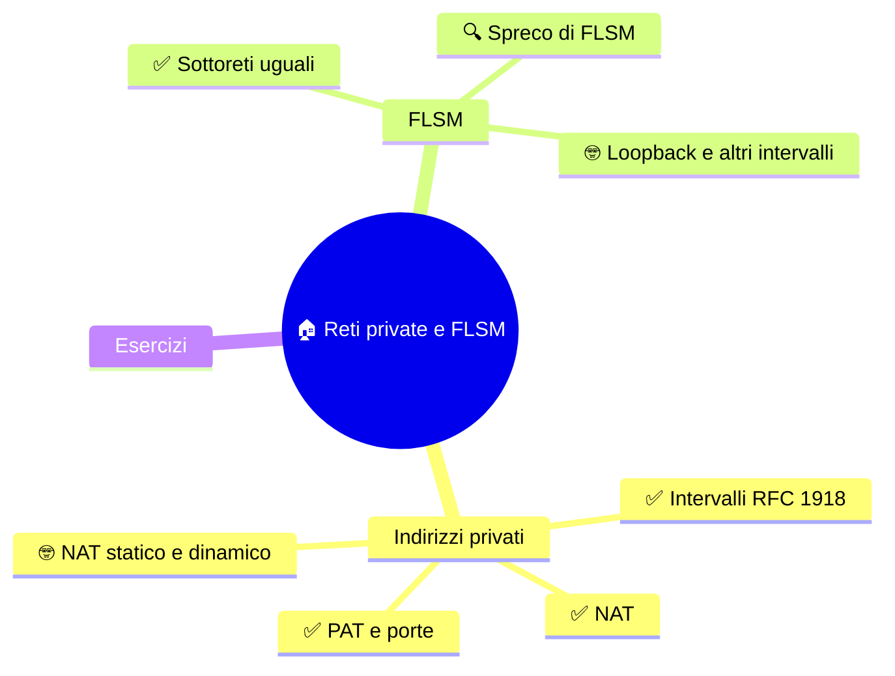

⬅️ [S3 - IPv4 e il pacchetto](%28STU%29%204DI%20sett-ott%20S3%20-%20IPv4%20e%20il%20pacchetto.md) · 🏠 [Indice](../README.md) · [S5 - CIDR e intervalli](%28STU%29%204DI%20sett-ott%20S5%20-%20CIDR%20e%20intervalli.md) ➡️

# 🏠 Reti private e FLSM

**4DI · Settembre-Ottobre · S4 · Teoria**

⏱️ **Tempo di studio: circa 48 minuti.** ✅ essenziale: 32 min. 🔍 per il voto alto: 14 min. 🤓 si può saltare. Nessun compito obbligatorio a casa.

> **Legenda:** ✅ da sapere · 🔍 per capire fino in fondo · 🤓 facoltativo · 📜 storia · 🧪 esempio · ⚠️ errore comune · 🧠 da ricordare · ✏️ da fare · 🃏 flashcard (rispondi a voce, poi apri)

## 🗺️ Mappa


## 📜 Quando i numeri sono finiti
> **La storia di Nora.** La scuola affida a Nora la rete dei laboratori. Prima deve capire perché tanti dispositivi usano indirizzi privati e condividono un'uscita; poi dovrà dividere la rete della scuola in blocchi ordinati. Seguiamo il problema dalla scarsità degli indirizzi fino al progetto delle sottoreti.

3 febbraio 2011. In una sala per conferenze stampa, i responsabili dell'**IANA** (*Internet Assigned Numbers Authority*), l'ente che coordina risorse Internet come gli indirizzi IP, annunciano un fatto storico. Distribuiscono gli **ultimi** grandi blocchi liberi: cinque, uno a ciascuna delle cinque organizzazioni regionali. Da quel giorno, l'IANA non ha più indirizzi IPv4 da assegnare.

Non è una sorpresa. Gli ingegneri lo avevano capito già nel 1992: con 32 bit e lo spreco delle assegnazioni a classi che abbiamo già visto nella lezione precedente, gli indirizzi non sarebbero bastati. Servivano **trucchi**. Ne arrivano due.

Il primo è **CIDR** (1993), che vedremo in S5: smettere di sprecare. Il secondo è il **NAT**: riutilizzare. Se non ci sono abbastanza numeri per tutti, ogni casa e ogni azienda usa **numeri privati**, gli stessi che usa il vicino, e passa dal mondo esterno con un solo indirizzo pubblico. Nel 1994 un documento ufficiale (RFC 1631) lo descrive con grande onestà: è una **«soluzione a breve termine»**. Nel 1996 viene definito lo spazio privato (RFC 1918).

Doveva durare pochi anni, in attesa di una soluzione definitiva. Oggi è dentro quasi ogni router di casa. Il provvisorio, in informatica, ha una strana abitudine: **resta**.

Anche in Europa arriva il momento. Il **RIPE NCC**, l'organizzazione che assegna gli indirizzi per l'Europa, esaurisce le sue scorte il 14 settembre 2012. È stata la seconda al mondo.

![[image-1.webp]]*Logo della IANA

#ai riconvertire il logo

## 🏠 Indirizzi privati

> **Nora, primo passo.** I computer dei laboratori hanno bisogno di numeri per comunicare dentro la scuola. Nora assegna loro indirizzi privati; la scuola vicina può usare gli stessi numeri nella propria rete senza che i due laboratori si confondano.

### ✅ Gli indirizzi privati si riutilizzano
Lo standard **RFC 1918** riserva tre intervalli IPv4 all'uso **privato**:

| Intervallo                        | Prefisso | Esempio        |     |
| --------------------------------- | -------: | -------------- | --- |
| `10.0.0.0` - `10.255.255.255`     |     `/8` | `10.2.4.8`     |     |
| `172.16.0.0` - `172.31.255.255`   |    `/12` | `172.20.5.10`  |     |
| `192.168.0.0` - `192.168.255.255` |    `/16` | `192.168.1.20` |     |

<u>Un indirizzo privato vale solo dentro la propria rete. I router di Internet non lo instradano.</u>

Per questo chiunque può usarli. La tua rete di casa e quella del vicino possono entrambe avere un PC con `192.168.1.20`. Non si confondono, finché le due reti non si collegano.

⚠️ Se due reti private con gli stessi numeri vengono unite, lo stesso indirizzo indica due dispositivi diversi. Bisogna rinumerare una rete o usare una traduzione.

<details>
<summary>🃏 <b>Quali sono i tre intervalli privati di RFC 1918?</b></summary>
10.0.0.0/8, 172.16.0.0/12 e 192.168.0.0/16.
</details>
<details>
<summary>🃏 <b>Due reti isolate possono usare lo stesso indirizzo privato?</b></summary>
Sì. Se vengono collegate, la sovrapposizione va gestita.
</details>
<details>
<summary>🃏 <b>Un indirizzo privato viaggia in Internet?</b></summary>
No: i router di Internet non lo instradano.
</details>

✏️ **Riconosci (2 min).** Quali di questi sono privati? `172.20.5.10` · `172.32.0.1` · `192.169.1.1` · `10.200.1.1`. *(Attenzione ai limiti di `172.16.0.0/12`.)*

### ✅ Il NAT traduce gli indirizzi
#fatto

Un PC con indirizzo privato vuole aprire una pagina in Internet. Il server non può far arrivare una risposta a quell'indirizzo attraverso Internet. Entra in gioco il **NAT** (*Network Address Translation*), di solito nel router di casa: riscrive gli indirizzi nei pacchetti che attraversano il confine.

**Ma se due PC escono con lo stesso IP pubblico, come distinguiamo le risposte?** Nel caso domestico si traducono anche le **porte**: questa variante si chiama **PAT** (*Port Address Translation*), o **NAPT** (*Network Address and Port Translation*).

Una porta TCP o UDP è un **numero che aiuta a distinguere le comunicazioni delle applicazioni**, non una presa del router. Scriviamo `IP:porta`: per esempio `192.168.1.20:51000`. Per il nostro esempio usiamo **TCP**, un protocollo di trasporto; il server web riceve le connessioni HTTPS sulla porta `443`. Non serve imparare qui il funzionamento di TCP.

> 🤓 **NAT statico, dinamico e PAT.** Sono modi diversi di associare indirizzi:
>
> - **Statico:** un'associazione fissa uno-a-uno, per esempio `192.168.1.20` ↔ `203.0.113.20`. La corrispondenza resta configurata; questo da solo non sostituisce le regole del firewall.
> - **Dinamico:** quando serve, il router assegna a un dispositivo un indirizzo pubblico libero da un gruppo disponibile. La corrispondenza è temporanea; se il gruppo è esaurito, un nuovo dispositivo deve aspettare.
> - **PAT/NAPT:** più dispositivi condividono lo stesso IP pubblico; il router distingue le comunicazioni con le porte e registra le corrispondenze, come nell'esempio qui sotto. È la soluzione comune nei router domestici.
>
> *I nomi non sono sempre usati allo stesso modo: a volte si chiama «NAT dinamico» anche il PAT. Qui teniamo distinti il pool di IP del NAT dinamico e la condivisione tramite porte del PAT.*

🧪 **Due PC aprono lo stesso sito.** Tutti i valori sono scelti per l'esempio; gli IP esterni appartengono a intervalli riservati alla documentazione, non a server da contattare.

| Dispositivo | Sorgente nella rete privata | Server di destinazione |
| --- | --- | --- |
| PC A | `192.168.1.20:51000` | `198.51.100.10:443` |
| PC B | `192.168.1.21:51000` | `198.51.100.10:443` |

I PC possono scegliere la stessa porta locale: hanno IP diversi. Il router ha un solo IP pubblico, `203.0.113.5`, quindi assegna **due porte esterne diverse** e registra le corrispondenze:

| Protocollo | Sorgente interna | Sorgente riscritta verso Internet | Server esterno |
| --- | --- | --- | --- |
| TCP | `192.168.1.20:51000` | `203.0.113.5:62001` | `198.51.100.10:443` |
| TCP | `192.168.1.21:51000` | `203.0.113.5:62002` | `198.51.100.10:443` |

<u>Questa è la memoria del router: una tabella di corrispondenze, non un riconoscimento del contenuto della pagina.</u>

Seguiamo il PC A:

1. **Uscita:** il pacchetto parte da `192.168.1.20:51000` verso `198.51.100.10:443`. Il router registra la prima riga e riscrive la sorgente in `203.0.113.5:62001`.
2. **Risposta del server:** il server vede quella sorgente e risponde da `198.51.100.10:443` a **`203.0.113.5:62001`**. Non conosce l'IP privato del PC.
3. **Ritorno al router:** il router consulta la tabella per quella comunicazione TCP. La porta esterna `62001` corrisponde a `192.168.1.20:51000`.
4. **Consegna:** riscrive la **destinazione** della risposta in `192.168.1.20:51000` e la inoltra al PC A. Per la risposta destinata a `62002` fa lo stesso verso il PC B.

La porta esterna non deve essere sempre diversa da quella interna: il router può conservarla quando non ci sono conflitti. Nella tabella abbiamo scelto numeri diversi per rendere visibile la traduzione.

La registrazione vale per i pacchetti successivi della comunicazione, non solo per una singola richiesta web. Viene rimossa alla chiusura o dopo un periodo di inattività, secondo il protocollo e il dispositivo. Questa è una tabella didattica: i dettagli di associazione e controllo possono variare fra router.

🧠 <u>Il PAT permette di condividere un IP pubblico usando corrispondenze fra IP e porte. Il NAT traduce: non è un firewall.</u>

| | NAT | Firewall |
|---|---|---|
| Che cosa fa | **traduce** gli indirizzi | **decide** quali comunicazioni consentire |

*Un router può fare entrambe le cose, ma restano compiti diversi.*

🔍 **E se la comunicazione parte dall'esterno?** Se non esiste una corrispondenza dinamica né una regola configurata, il router non sa a quale PC privato tradurre la destinazione. Ospitare un servizio da casa richiede quindi una configurazione apposita, per esempio un inoltro di porta (*port forwarding*), che non configuriamo qui. Una risposta a una comunicazione già registrata è un caso diverso: la corrispondenza esiste già. Le regole del firewall stabiliscono comunque se il traffico può passare.

> 😄 «Non c'è posto come 127.0.0.1»: l'indirizzo di casa del computer, che vedremo più avanti. Anche i tecnici hanno la loro nostalgia.

<details>
<summary>🃏 <b>Che cosa fa il NAT?</b></summary>
Traduce gli indirizzi quando il traffico attraversa il confine fra rete privata e Internet.
</details>
<details>
<summary>🃏 <b>Come fa il router a consegnare la risposta al PC giusto?</b></summary>
Consulta la tabella e traduce IP e porta di destinazione esterni in quelli interni: per esempio 203.0.113.5:62001 diventa 192.168.1.20:51000.
</details>
<details>
<summary>🃏 <b>Che cos'è il PAT?</b></summary>
Un NAT che traduce anche le porte, così molti dispositivi condividono un indirizzo pubblico.
</details>
<details>
<summary>🃏 <b>Perché il server risponde alla porta esterna scelta dal router?</b></summary>
Perché quella porta, insieme all'IP pubblico, è la sorgente che il server vede nei pacchetti ricevuti.
</details>
<details>
<summary>🃏 <b>Il router deve leggere la pagina web per capire a chi consegnarla?</b></summary>
No: usa le informazioni della comunicazione e le corrispondenze registrate, non il contenuto della pagina.
</details>
<details>
<summary>🃏 <b>NAT e firewall sono la stessa cosa?</b></summary>
No: il NAT traduce indirizzi, il firewall applica regole di accesso.
</details>

✏️ **Trova l'errore (2 min).** «Ho il NAT, quindi sono protetto da ogni attacco.» Che cosa confonde questa frase? *(Indizio: tradurre non è decidere.)*

✏️ **Segui la risposta (1 min).** Usando la tabella, descrivi cosa riscrive il router quando arriva un pacchetto TCP dal server `198.51.100.10:443` diretto a `203.0.113.5:62002`. Indica IP e porta prima e dopo la traduzione.

## ✂️ FLSM
> **Nora, secondo passo.** Sistemata l'uscita verso Internet, Nora deve organizzare gli indirizzi interni: la rete `192.168.10.0/24` andrà divisa fra quattro laboratori. Per ora le chiedono blocchi uguali; più avanti vedrà come risparmiare spazio assegnando blocchi diversi.

### ✅ FLSM divide la rete in blocchi uguali
Nora ha una rete `192.168.10.0/24` e deve assegnare **un blocco a ciascuno di quattro laboratori**. Le sottoreti sono pezzi distinti della stessa rete: ogni laboratorio riceve un proprio intervallo di indirizzi.

**FLSM** (*Fixed Length Subnet Masking*) divide la rete in blocchi **tutti della stessa grandezza**. Vediamo come trovare quei blocchi.

#### Prima: che cosa ci dice `/24`?
Un indirizzo IPv4 ha 32 bit. `/24` significa che i primi 24 identificano la rete; gli **8 bit che restano** possono distinguere gli indirizzi al suo interno.

```text
192.168.10 | 00000000
parte rete | 8 bit disponibili nella rete
```

Gli 8 bit possono formare `2⁸ = 256` combinazioni: da `192.168.10.0` a `192.168.10.255`.

#### Dividiamo in quattro blocchi uguali

1. **Quanti bit ci servono per numerare quattro blocchi?** Due: con due bit si formano quattro combinazioni, `00`, `01`, `10`, `11`.
2. **Da dove prendiamo quei bit?** Dagli 8 bit disponibili nella rete. Dopo averne usati 2 per distinguere i blocchi, ne restano 6 per gli indirizzi di ciascun blocco.
3. **Qual è il nuovo prefisso?** I bit di rete sono diventati `24 + 2 = 26`: ogni blocco è una sottorete `/26`.
4. **Quanti indirizzi ci sono in ogni blocco?** Restano 6 bit: `2⁶ = 64` indirizzi. Controllo: `4 blocchi × 64 = 256`, tutti gli indirizzi iniziali.

```text
Rete iniziale /24: 256 indirizzi
├── 00xxxxxx  →  .0   –  .63    (64 indirizzi)
├── 01xxxxxx  →  .64  –  .127   (64 indirizzi)
├── 10xxxxxx  →  .128 –  .191   (64 indirizzi)
└── 11xxxxxx  →  .192 –  .255   (64 indirizzi)
```

I primi due bit dell'ultimo ottetto scelgono il blocco; le sei `x` scelgono uno dei 64 indirizzi al suo interno. Per questo i blocchi iniziano a `.0`, `.64`, `.128` e `.192`.

La maschera `/26` è `255.255.255.192`: nell'ultimo ottetto il prefisso lascia due bit per numerare le sottoreti e sei bit per gli indirizzi dentro ciascuna.

| Sottorete | Primo indirizzo (rete) | Indirizzi assegnabili agli host | Ultimo indirizzo (broadcast) |
|---|---|---|---|
| 1 | `192.168.10.0/26` | `.1` – `.62` (62 indirizzi) | `.63` |
| 2 | `192.168.10.64/26` | `.65` – `.126` (62 indirizzi) | `.127` |
| 3 | `192.168.10.128/26` | `.129` – `.190` (62 indirizzi) | `.191` |
| 4 | `192.168.10.192/26` | `.193` – `.254` (62 indirizzi) | `.255` |

In ogni blocco, il primo indirizzo identifica la sottorete e l'ultimo è il broadcast; nel caso ordinario non si assegnano agli host. Perciò restano `64 - 2 = 62` indirizzi assegnabili.

🧪 **Controlliamo un indirizzo.** Il computer `192.168.10.70` appartiene al secondo blocco: `.70` è fra `.64` e `.127`. La sua rete è quindi `192.168.10.64/26`, non `192.168.10.70/26`. Il `.70` identifica un host dentro la sottorete.

⚠️ **`.65/26` non è l'indirizzo di rete.** È il primo indirizzo assegnabile a un host nel blocco `192.168.10.64/26`.

Il **gateway**, se c'è, usa un indirizzo assegnabile della sottorete; per esempio si può scegliere `.65` per la prima rete. La convenzione va dichiarata. Per ora non serve sapere come inoltra il traffico: lo vedremo più avanti.

🧠 <u>Ogni bit preso alla parte host raddoppia il numero dei blocchi e dimezza la loro grandezza.</u>

#### 🤓 Perché dividere la rete? E che cosa serve?
Dividere una rete in sottoreti permette di **organizzare i dispositivi in gruppi** (per esempio, un laboratorio per sottorete). Così i broadcast restano nel proprio gruppo e si possono applicare regole diverse alle comunicazioni: per esempio, impedire ai computer degli studenti di raggiungere la rete della segreteria. Per ottenere davvero separazione e sicurezza servono anche una configurazione adeguata e regole di accesso: il solo indirizzo IP non basta.

**Che cosa serve collegare?** Cavi e switch collegano i computer all'interno della rete locale. I gruppi possono essere collegati a switch distinti, oppure separati sullo stesso switch gestito tramite **VLAN**. Per comunicare tra sottoreti serve un router (o uno switch di livello 3), che riceve il traffico tramite il **gateway**. Non occorre necessariamente un router fisico per ogni sottorete.

<details>
<summary>🃏 <b>Che cosa significa FLSM?</b></summary>
Fixed Length Subnet Masking: sottoreti con lo stesso prefisso, quindi della stessa dimensione.
</details>
<details>
<summary>🃏 <b>Quanti bit servono per 4 sottoreti uguali?</b></summary>
Due, perché 2² fa 4.
</details>
<details>
<summary>🃏 <b>Quanti indirizzi ha un blocco /26?</b></summary>
64, perché restano 6 bit host e 2⁶ fa 64.
</details>
<details>
<summary>🃏 <b>Quanti host ordinari offre una /26?</b></summary>
62: si tolgono l'indirizzo di rete e il broadcast.
</details>
<details>
<summary>🃏 <b>Quale maschera corrisponde a /26?</b></summary>
255.255.255.192.
</details>
<details>
<summary>🃏 <b>In 192.168.10.64/26, .65 è un indirizzo di rete?</b></summary>
No: è un host del blocco che inizia a .64.
</details>

✏️ **Prevedi, poi calcola (3 min).** Con lo stesso ragionamento, quanti bit servono per **sei** sottoreti? Quante sottoreti ottieni davvero? Poi dividi `192.168.20.0/24` in quattro parti e trova per ciascuna rete, host assegnabili e broadcast.

### 🔍 FLSM è semplice ma può sprecare

FLSM dà a tutti **lo stesso spazio**. Va bene se i gruppi sono simili. Ma se quattro reparti hanno bisogno di 50, 25, 12 e 6 host, assegnare a ciascuno un blocco da 62 lascia **molti indirizzi inutilizzati** nei reparti piccoli.

| Reparto | Host necessari | Blocco FLSM (/26) | Indirizzi inutilizzati |
|---|---:|---:|---:|
| A | 50 | 62 | 12 |
| B | 25 | 62 | 37 |
| C | 12 | 62 | 50 |
| D | 6 | 62 | 56 |

*Per un reparto da 6 host, il blocco da 62 è un salone per una cena a due.*

La soluzione è dare **blocchi di dimensioni diverse**: **VLSM**, che vedremo in S6. Per ora basta capire il compromesso: FLSM è facile da calcolare, ma può essere uno spreco.

<details>
<summary>🃏 <b>Perché FLSM può sprecare indirizzi?</b></summary>
Perché dà blocchi uguali a gruppi con bisogni diversi.
</details>
<details>
<summary>🃏 <b>Quale tecnica permette sottoreti di dimensioni diverse?</b></summary>
VLSM, che vedremo in S6.
</details>

✏️ **Spiega in una frase (2 min).** Quando FLSM è una buona scelta e quando no?

### 🤓 Gli intervalli speciali di IPv4

> Oltre agli indirizzi privati, IPv4 ha altri intervalli con usi particolari. Per esempio `127.0.0.1` è il **loopback**: indica «questo stesso computer». I programmi lo usano per parlare con servizi sulla stessa macchina, senza mandare nulla in rete.
>
> Esistono anche intervalli per il **multicast** (un messaggio a un gruppo di destinatari). L'elenco ufficiale è il registro dello IANA. Non serve memorizzarlo: serve ricordare che **un numero da solo non basta**, conta anche l'intervallo.

<details>
<summary>🃏 <b>Che cosa indica 127.0.0.1?</b></summary>
Il computer stesso (loopback): il traffico non esce in rete.
</details>

## ✏️ Esercizi

> **Tocca a te.** Nora ha preparato un piano, ma prima di applicarlo vuole un controllo: verifica gli indirizzi privati, ricostruisci i quattro blocchi e trova l'errore.

1. **Ricopia.** Scrivi i tre intervalli privati senza guardare la tabella.
2. **Completa.** Dividi `192.168.20.0/24` in quattro sottoreti uguali. Per ognuna: rete, prefisso, host ordinari, broadcast.
3. **Trova l'errore.** «192.168.20.100/26 è l'indirizzo di rete della seconda sottorete.» Perché no?
4. **Spiega.** Perché il NAT non sostituisce un firewall?
5. **Collega (S3).** In `192.168.20.0/26`, quale parte è NetID e quale HostID?

**Uscita:** completa «FLSM crea ..., mentre il NAT ...».

## 📚 Fonti e risorse

> **Ultima scena.** Nora annota gli standard e gli strumenti usati, così chi aggiornerà la rete potrà controllare le scelte invece di doverle indovinare.

- [RFC 1918 - Address Allocation for Private Internets](https://www.rfc-editor.org/rfc/rfc1918): gli intervalli privati (febbraio 1996). Per consultazione.
- [RFC 1631 - The IP Network Address Translator](https://www.rfc-editor.org/rfc/rfc1631): il NAT presentato nel 1994 come «soluzione a breve termine». Si legge l'inizio.
- [Wikipedia - IPv4 address exhaustion](https://en.wikipedia.org/wiki/IPv4_address_exhaustion): la cronologia dell'esaurimento, con le date dello IANA (2011) e del RIPE NCC (2012).
- [RIPE NCC - IPv4 Subnetting](https://www.ripe.net/manage-ips-and-asns/ipv4/ipv4-subnetting/): uno strumento per **controllare** i calcoli. Prima calcola a mano.

---

⬅️ [S3 - IPv4 e il pacchetto](%28STU%29%204DI%20sett-ott%20S3%20-%20IPv4%20e%20il%20pacchetto.md) · 🏠 [Indice](../README.md) · [S5 - CIDR e intervalli](%28STU%29%204DI%20sett-ott%20S5%20-%20CIDR%20e%20intervalli.md) ➡️
