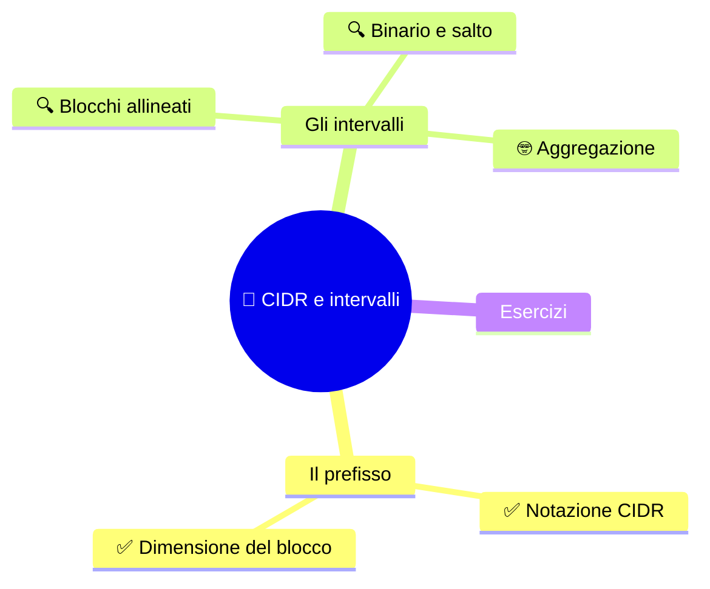

⬅️ [S4 - Reti private e FLSM](%28STU%29%204DI%20sett-ott%20S4%20-%20Reti%20private%20e%20FLSM.md) · 🏠 [Indice](../README.md) · [S6 - VLSM e progettazione](%28STU%29%204DI%20sett-ott%20S6%20-%20VLSM%20e%20progettazione.md) ➡️

# 🔢 CIDR e intervalli

**4DI · Settembre-Ottobre · S5 · Teoria**

⏱️ **Tempo di studio: circa 30 minuti.** ✅ essenziale: 17 min. 🔍 per il voto alto: 13 min. 🤓 si può saltare. Nessun compito obbligatorio a casa.

> **Legenda:** ✅ da sapere · 🔍 per capire fino in fondo · 🤓 facoltativo · 📜 storia · 🧪 esempio · ⚠️ errore comune · 🧠 da ricordare · ✏️ da fare · 🃏 flashcard (rispondi a voce, poi apri)

## 🗺️ Mappa



## 📜 Il collasso che non è arrivato

Primi anni Novanta: le **classi** sprecano indirizzi e ogni rete assegnata aggiunge una riga alle tabelle dei router. Gli ingegneri temono che le tabelle crescano troppo.

Nel 1993 RFC 1518 e 1519 introducono **CIDR** (*Classless Inter-Domain Routing*): il confine della rete non dipende più dal primo ottetto, ma si scrive con un prefisso, per esempio `/26`. Così si possono assegnare blocchi di taglie diverse e aggregare più reti.

Nel 1995 Bob Metcalfe, inventore di Ethernet, prevede un «collasso catastrofico» di Internet entro l'anno successivo. Nel 1997, dopo che non accade, frulla e beve una copia della sua rubrica.

CIDR non ha salvato Internet da solo, ma ha reso più efficiente l'assegnazione degli indirizzi e limitato la crescita delle tabelle.


*L'ha fatto davvero (pare)!*

## 🔢 Il prefisso

### ✅ CIDR scrive il prefisso accanto all'indirizzo

In `192.168.40.0/26`, `/26` indica che i primi 26 bit sono di rete; i restanti $32 - 26 = 6$ sono bit host. Il prefisso e la **maschera** esprimono lo stesso confine.

Nella pratica il prefisso accompagna l'indirizzo quando si configura un'interfaccia o si progetta una rete: `192.168.40.110/27` permette di capire a quale sottorete appartiene l'indirizzo.

| Prefisso | Maschera | Bit host | Indirizzi nel blocco | Host ordinari |
|---:|---|---:|---:|---:|
| `/24` | `255.255.255.0` | 8 | 256 | 254 |
| `/25` | `255.255.255.128` | 7 | 128 | 126 |
| `/26` | `255.255.255.192` | 6 | 64 | 62 |
| `/27` | `255.255.255.224` | 5 | 32 | 30 |
| `/28` | `255.255.255.240` | 4 | 16 | 14 |
| `/29` | `255.255.255.248` | 3 | 8 | 6 |
| `/30` | `255.255.255.252` | 2 | 4 | 2 |

⚠️ **Più il prefisso è lungo, più il blocco è piccolo:** una `/30` contiene 4 indirizzi, una `/24` ne contiene 256. Con $h$ bit host, il blocco contiene $2^h$ indirizzi e, nel caso ordinario, $2^h - 2$ host assegnabili: rete e broadcast hanno ruoli speciali.

**Nella pratica**, l'indirizzo di rete identifica il blocco nel piano degli indirizzi e aiuta a verificare se due dispositivi appartengono alla stessa sottorete. Il broadcast indica tutti gli host della sottorete come destinatari.

🧪 **Esempio inventato: laboratorio scolastico `192.168.40.96/27`.** Il gateway è `192.168.40.97`; un PC è `192.168.40.110`.

| Indirizzo | A che cosa serve nel caso |
|---|---|
| `192.168.40.96` | Identifica la sottorete nel piano degli indirizzi. Non si assegna al PC. |
| `192.168.40.110` | Identifica il PC dentro quella sottorete. |
| `192.168.40.127` | È il broadcast della sottorete: se un pacchetto lo usa come destinazione, è rivolto a tutti i suoi host. Non si assegna al PC. |

Un uso reale del broadcast è cercare un servizio nella rete locale, senza contattare i dispositivi uno per uno. Per esempio, all'avvio un PC può chiedere i parametri di rete con **DHCP** (argomento successivo). Poiché non conosce ancora la propria sottorete, il primo messaggio usa il broadcast generale `255.255.255.255`, non per forza `192.168.40.127`. I router normalmente non inoltrano i broadcast locali alle altre reti.

<u>Rete = identifica il blocco; broadcast = destinatario «tutti gli host»; gli indirizzi dei dispositivi stanno fra i due.</u>

<details>
<summary>🃏 <b>Che cosa indica il prefisso /p?</b></summary>
Quanti bit iniziali dell'indirizzo sono di rete.
</details>
<details>
<summary>🃏 <b>Quanti indirizzi contiene una /27, e quanti host ordinari?</b></summary>
32 indirizzi, 30 host ordinari.
</details>
<details>
<summary>🃏 <b>In una rete scolastica, a che cosa servono rete e broadcast?</b></summary>
La rete identifica il blocco; il broadcast indica tutti i suoi host come destinatari.
</details>

✏️ **Completa (3 min).** Ricostruisci le righe `/27` e `/29` della tabella senza guardare.

### ✅ Dal prefisso al salto
Per trovare il blocco di un indirizzo e calcolare rete e broadcast, per le maschere `/25`-`/30` si usa il salto:

```text
salto = 256 − (valore dell'ottetto della maschera)
```

🧪 **Esempio `/27`:** maschera finale 224, quindi salto $256 - 224 = 32$. I blocchi iniziano a `.0`, `.32`, `.64`, `.96` e così via.

🧠 <u>Il salto è la dimensione del blocco. Le reti iniziano sui multipli del salto.</u>

| Prefisso | Ottetto della maschera | Salto |
|---:|---:|---:|
| `/25` | 128 | 128 |
| `/26` | 192 | 64 |
| `/27` | 224 | 32 |
| `/28` | 240 | 16 |

<details>
<summary>🃏 <b>Come si calcola il salto?</b></summary>
256 meno il valore dell'ottetto della maschera.
</details>
✏️ **Prevedi (2 min).** Senza guardare la tabella: qual è il salto di una `/28`? E di una `/25`?

### 🔍 Ogni indirizzo cade in un blocco allineato
Per trovare la rete, si prende il **multiplo del salto più vicino che non supera l'indirizzo**.

🧪 **Esempio svolto: trovare la rete di `192.168.40.110/27`.**

1. **Salto:** 32.
2. **Blocco:** 110 è fra 96 e 127, quindi la rete inizia a 96.
3. **Estremi:** rete `.96`; broadcast `.96 + 32 - 1 = .127`; gli host stanno fra i due.

| Informazione | Valore |
|---|---|
| Indirizzo dato | `192.168.40.110/27` |
| Rete, primo indirizzo del blocco | `192.168.40.96/27` |
| Host ordinari | `192.168.40.97` - `192.168.40.126` |
| Broadcast, ultimo indirizzo del blocco | `192.168.40.127` |

`192.168.40.110` è un host ordinario, non la rete. ⚠️ `.0` non significa sempre rete né `.255` broadcast: con `/26`, `192.168.40.64` è una rete e `192.168.40.127` un broadcast; con `/24`, `192.168.40.127` è un host.

<details>
<summary>🃏 <b>Qual è la rete di 192.168.40.110/27?</b></summary>
192.168.40.96/27.
</details>
<details>
<summary>🃏 <b>192.168.40.110 è il Network ID di una /27?</b></summary>
No: è un host della sottorete `192.168.40.96/27`.
</details>

✏️ **Linea dei numeri (3 min).** Disegna i blocchi `/27` da 0 a 255 e segna dove cadono `.110`, rete e broadcast.

### 🔍 Due metodi che si controllano a vicenda
Controlla il risultato con il salto e con l'AND in binario.

🧪 **`172.16.5.70/26`.**

**Salto:** $256 - 192 = 64$. Nell'ultimo ottetto i blocchi sono 0-63, 64-127, 128-191 e 192-255: 70 cade nel secondo.

**AND binario:** $70 = 01000110$; la maschera $192 = 11000000$.

```text
70   = 01000110
192  = 11000000
AND  = 01000000  → 64
```

Rete: `172.16.5.64/26`; host ordinari: `172.16.5.65`-`172.16.5.126`; broadcast: `172.16.5.127`. Entrambi i metodi danno 64 nell'ultimo ottetto.

Se i metodi non coincidono, ricontrolla i passaggi.

<details>
<summary>🃏 <b>Qual è la rete di 172.16.5.70/26?</b></summary>
172.16.5.64/26.
</details>

✏️ **Controlla (4 min).** Trova rete e intervallo host di `10.4.9.45/28` con il salto e verifica la rete con l'AND.

### 🤓 Più reti, un solo prefisso

> Quattro blocchi `/26` contigui e allineati riempiono una `/24`: descriverli con un unico prefisso più corto si chiama **aggregazione** (*summarization*). Si può fare solo se il prefisso comune non include indirizzi estranei. Così CIDR può ridurre le righe nelle tabelle dei router; il routing si studia più avanti.

<details>
<summary>🃏 <b>Quale prefisso descrive quattro /26 consecutive e allineate?</b></summary>
La /24 che le contiene tutte.
</details>
<details>
<summary>🃏 <b>Che cosa va controllato prima di aggregare?</b></summary>
Che i blocchi siano contigui e allineati e che il prefisso non includa indirizzi estranei.
</details>

## ✏️ Esercizi
1. **Completa.** Quanti bit host restano in una `/28`? Quanti indirizzi ha il blocco? Quanti host ordinari?
2. **Trova la rete.** Per `192.168.7.160/27`: rete, host ordinari, broadcast.
3. **Trova l'errore.** «`192.168.40.100/27` è l'indirizzo di rete.» Dove sbaglia?
4. **Spiega in una frase.** Perché una `/27` ha 32 indirizzi ma 30 host ordinari?
5. **Collega (S3).** Con le vecchie classi `192.168.1.25` era una C. Con CIDR può essere una `/27`? Che cosa cambia?

**Uscita:** «In una rete `/p` restano ... bit host, quindi il blocco contiene ... indirizzi».

## 📚 Fonti e risorse

- [RFC 4632 - Classless Inter-domain Routing](https://www.rfc-editor.org/rfc/rfc4632): la versione aggiornata (2006) dello standard CIDR. Per consultazione.
- [Wikipedia - Classless Inter-Domain Routing](https://en.wikipedia.org/wiki/Classless_Inter-Domain_Routing): storia e motivazioni del 1993.
- [Wikipedia - Robert Metcalfe](https://en.wikipedia.org/wiki/Robert_Metcalfe): la sezione «Predicted Internet collapse» racconta la storia del frullatore.
- [RIPE NCC - IPv4 Subnetting](https://www.ripe.net/manage-ips-and-asns/ipv4/ipv4-subnetting/): uno strumento per **controllare** i risultati. Prima prova a mano.

---

⬅️ [S4 - Reti private e FLSM](%28STU%29%204DI%20sett-ott%20S4%20-%20Reti%20private%20e%20FLSM.md) · 🏠 [Indice](../README.md) · [S6 - VLSM e progettazione](%28STU%29%204DI%20sett-ott%20S6%20-%20VLSM%20e%20progettazione.md) ➡️
