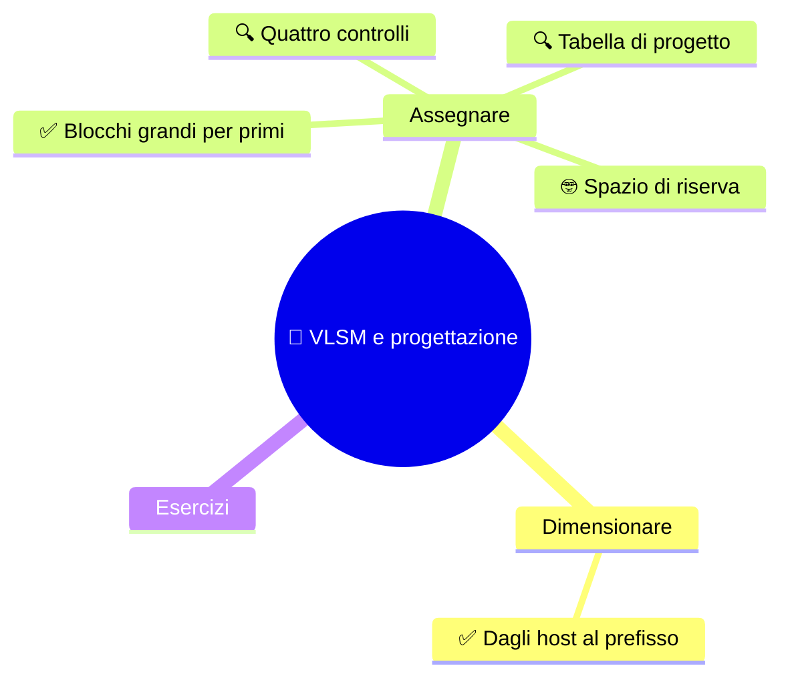

⬅️ [S5 - CIDR e intervalli](%28STU%29%204DI%20sett-ott%20S5%20-%20CIDR%20e%20intervalli.md) · 🏠 [Indice](../README.md) · [S7 - Ripasso e troubleshooting](%28STU%29%204DI%20sett-ott%20S7%20-%20Ripasso%20e%20troubleshooting.md) ➡️

# 🧩 VLSM e progettazione

**4DI · Settembre-Ottobre · S6 · Teoria**

⏱️ **Tempo di studio: circa 35 minuti.** ✅ essenziale: 20 min. 🔍 per il voto alto: 15 min. 🤓 si può saltare. Nessun compito obbligatorio a casa.

> **Legenda:** ✅ da sapere · 🔍 per capire fino in fondo · 🤓 facoltativo · 📜 storia · 🧪 esempio · ⚠️ errore comune · 🧠 da ricordare · ✏️ da fare · 🃏 flashcard (rispondi a voce, poi apri)

## 🗺️ Mappa



## 📜 La mappa dei numeri
Negli anni Ottanta gli indirizzi sembrano infiniti. Le organizzazioni che ne fanno richiesta ricevono **blocchi interi** da oltre sedici milioni di indirizzi: i blocchi `/8`, che corrispondevano alla classe A studiata in S3. Poche organizzazioni ricevono blocchi enormi.

Nel 2006 Randall Munroe, autore del fumetto *xkcd*, disegna una mappa di tutto lo spazio IPv4. Usa una curva che tiene vicine sulla pagina alcune zone con indirizzi vicini. Ogni quadrato numerato rappresenta un blocco `/8`. Guarda quali organizzazioni compaiono in alto a sinistra.


*«Map of the Internet», xkcd n. 195, di Randall Munroe, licenza CC BY-NC 2.5. Immagine caricata dal sito [xkcd.com/195](https://xkcd.com/195/).*

Nel disegno, organizzazioni come General Electric, IBM, Xerox, HP, DEC, Apple, MIT e Ford hanno ciascuna un `/8`, cioè circa 16,7 milioni di indirizzi.

In seguito gli indirizzi IPv4 disponibili diminuiscono, come hai visto in S4. Alcune organizzazioni restituiscono i blocchi che non usano. Per esempio, la Stanford University restituisce `36.0.0.0/8`, contribuendo a rendere di nuovo disponibile quel grande blocco.

Questa storia mostra che **chiedere più indirizzi del necessario ha un costo**. VLSM aiuta a dimensionare le sottoreti in base alle necessità e a registrare le assegnazioni in una tabella verificabile.

> 😄 Un nome per il lavoro che stai per fare: **Tetris degli indirizzi**. Pezzi di forme diverse, un campo di 256 caselle, e nessuna riga si cancella da sola.

## 🧮 Dimensionare

### ✅ Dal numero di host al prefisso

Con **FLSM** (S4) tutte le sottoreti hanno la stessa dimensione. Con **VLSM** (*Variable Length Subnet Masking*), invece, ogni sottorete può avere una dimensione diversa, scelta in base al numero di host che deve contenere.

Per prima cosa **dimensiona** ogni richiesta: trova il blocco più piccolo che può contenere tutti gli host richiesti.

1. **Conta** quanti host servono e aggiungi il gateway, se userà un indirizzo della sottorete.
2. **Trova** il numero minimo $h$ di bit host per cui $2^h - 2$ è almeno pari al numero di host richiesti.
3. **Calcola** il prefisso sottraendo $h$ da 32: prefisso $= 32 - h$.

| Host richiesti | Bit host minimi | Prefisso | Indirizzi nel blocco | Host ordinari |
| -------------: | --------------: | -------: | -------------------: | ------------: |
|             50 |               6 |    `/26` |                   64 |            62 |
|             25 |               5 |    `/27` |                   32 |            30 |
|             12 |               4 |    `/28` |                   16 |            14 |
|              6 |               3 |    `/29` |                    8 |             6 |

⚠️ **Anche il gateway occupa un indirizzo host.** Se un reparto ha 62 dispositivi e il gateway usa un indirizzo della stessa sottorete, servono 63 indirizzi host. Una `/26` ne offre solo 62, quindi serve una `/25`. Quando calcoli la richiesta, dichiara sempre se hai contato il gateway.

🧠 <u>Prima dimensiona ogni sottorete; poi assegna i blocchi.</u>

<details>
<summary>🃏 <b>Quale prefisso corrisponde a 6 bit host?</b></summary>
Il prefisso è `/26`, perché $32 - 6 = 26$.
</details>
<details>
<summary>🃏 <b>Quale prefisso offre almeno 25 host ordinari?</b></summary>
Una `/27` offre 30 host ordinari.
</details>
<details>
<summary>🃏 <b>Quanti host ordinari offre una /29?</b></summary>
6.
</details>
<details>
<summary>🃏 <b>Perché bisogna contare il gateway fra gli host richiesti?</b></summary>
Perché, se usa un indirizzo della sottorete, il gateway occupa uno dei suoi indirizzi host.
</details>

✏️ **Prevedi (3 min).** Calcola il prefisso minimo per sottoreti da 100, 14 e 3 host. Poi verifica ogni scelta con la formula $2^h - 2$.

## 🧮 Assegnare

### ✅ Si assegnano prima i blocchi grandi

Per assegnare i blocchi, segui questi quattro passaggi:

1. **Dimensiona** ogni richiesta: stabilisci il prefisso e il numero di indirizzi del blocco.
2. **Ordina** le richieste dalla più grande alla più piccola.
3. **Alloca** i blocchi in sequenza, a partire dall'inizio dello spazio disponibile. Ogni blocco deve iniziare su un confine **allineato** alla propria dimensione.
4. **Controlla** il piano con i quattro criteri della sezione 🔍.

🧪 **Esempio svolto: piano di una rete scolastica inventata.** Dividiamo `192.168.60.0/24` fra quattro gruppi. Le richieste sono di 50, 25, 12 e 6 indirizzi host complessivi: se il gruppo usa un gateway nella propria sottorete, il suo indirizzo è già compreso nella richiesta. Per ogni gruppo scegliamo il primo indirizzo host come gateway.

| Gruppo      | Indirizzi richiesti | Bit host $h$ | Prefisso | Indirizzi nel blocco | Rete             | Intervallo host                     | Gateway          | Broadcast        |
| ----------- | ------------------: | -----------: | -------: | -------------------: | ---------------- | ----------------------------------- | ---------------- | ---------------- |
| Laboratorio |                  50 |            6 |    `/26` |                   64 | `192.168.60.0`   | `192.168.60.1` - `192.168.60.62`    | `192.168.60.1`   | `192.168.60.63`  |
| Aula        |                  25 |            5 |    `/27` |                   32 | `192.168.60.64`  | `192.168.60.65` - `192.168.60.94`   | `192.168.60.65`  | `192.168.60.95`  |
| Docenti     |                  12 |            4 |    `/28` |                   16 | `192.168.60.96`  | `192.168.60.97` - `192.168.60.110`  | `192.168.60.97`  | `192.168.60.111` |
| Stampanti   |                   6 |            3 |    `/29` |                    8 | `192.168.60.112` | `192.168.60.113` - `192.168.60.118` | `192.168.60.113` | `192.168.60.119` |

**Come ricaviamo prefisso e dimensione?** Per il laboratorio servono almeno 50 indirizzi host. Con 5 bit host avremmo $2^5 - 2 = 30$ indirizzi utilizzabili, quindi non bastano. Con 6 bit host ne abbiamo $2^6 - 2 = 62$. Il prefisso è `/26`, perché $32 - 6 = 26$; il blocco contiene $2^6 = 64$ indirizzi. Gli altri gruppi si dimensionano allo stesso modo.

Ogni blocco inizia subito dopo il precedente. Gli indirizzi da `.120` a `.255` restano liberi.

```text
0        64        96  112  120                            255
|--- 64 --|-- 32 --|-16-|-8-|........ spazio libero ........|
```

*La striscia mostra i 256 indirizzi della `/24`: i quattro blocchi assegnati e lo spazio ancora libero.*

**Perché assegniamo prima il blocco più grande?** Consideriamo uno spazio di 64 indirizzi e quattro richieste da 8, 32, 16 e 8 indirizzi. Se assegniamo i blocchi nell'ordine di arrivo e non torniamo a riempire i buchi, il blocco da 16 potrebbe non trovare posto:

```text
Nell'ordine in cui arrivano (8, 32, 16, 8), senza tornare indietro:
|8| . . . . . . .|-------- 32 --------|  → il 16 non trova più posto

Dal più grande (32, 16, 8, 8):
|-------- 32 --------|---- 16 ----|8|8|  → entrano tutti
```

Ogni blocco deve iniziare su un multiplo della propria dimensione. Per questo, se assegniamo prima blocchi piccoli e non riordiniamo il piano, possiamo lasciare buchi inutilizzabili per i blocchi grandi. Assegnare prima i blocchi grandi riduce questo rischio.

⚠️ **La somma degli indirizzi può bastare, ma il piano può comunque fallire.** Bisogna rispettare anche l'ordine e l'allineamento dei blocchi.

<details>
<summary>🃏 <b>Quali sono i quattro passaggi di un progetto VLSM?</b></summary>
Dimensiona, ordina, alloca, controlla.
</details>
<details>
<summary>🃏 <b>In quale ordine assegniamo i blocchi con questo metodo?</b></summary>
Assegniamo prima il blocco più grande e poi procediamo in ordine decrescente.
</details>
<details>
<summary>🃏 <b>Perché questo metodo assegna prima i blocchi grandi?</b></summary>
Per ridurre il rischio che l'allineamento lasci buchi troppo piccoli per i blocchi grandi rimasti.
</details>
<details>
<summary>🃏 <b>Quanti indirizzi hanno i blocchi per 50, 25, 12 e 6 host?</b></summary>
Hanno rispettivamente 64, 32, 16 e 8 indirizzi.
</details>

✏️ **Disegna (4 min).** Disegna una striscia da 0 a 255. Rappresenta i quattro blocchi dell'esempio in scala e colora lo spazio rimasto libero.

### 🔍 Quattro controlli per un piano affidabile

Quando hai assegnato i blocchi, **controlla** il piano con questi quattro criteri:

| Controllo               | Domanda                                                    |
| ----------------------- | ---------------------------------------------------------- |
| **Capienza**            | ogni sottorete ha abbastanza host ordinari?                |
| **Allineamento**        | ogni rete inizia su un multiplo della propria dimensione?  |
| **Non sovrapposizione** | gli intervalli sono separati?                              |
| **Tracciabilità**       | la tabella dice rete, prefisso, host, broadcast e gateway? |

🧪 **Controllo dell'allineamento.** Una `/27` contiene 32 indirizzi. Nell'ultimo ottetto, le reti `/27` possono quindi iniziare a 0, 32, 64, 96 e così via. L'indirizzo `.70` appartiene al blocco che inizia a `.64`, ma **non** può essere l'indirizzo di rete di una `/27`.

<details>
<summary>🃏 <b>Quali sono i quattro controlli di un piano VLSM?</b></summary>
Capienza, allineamento, non sovrapposizione e tracciabilità.
</details>
<details>
<summary>🃏 <b>Perché .70 non può essere l'indirizzo di rete di una /27?</b></summary>
Perché il blocco da 32 indirizzi che contiene `.70` inizia a `.64`.
</details>
<details>
<summary>🃏 <b>Qual è il broadcast della rete .64/27?</b></summary>
È `.95`, l'ultimo indirizzo del blocco da `.64` a `.95`.
</details>

✏️ **Trova l'errore (3 min).** Un piano indica `192.168.60.40/27` come rete per un gruppo da 25 host. Spiega perché l'indirizzo non è allineato e trova la rete `/27` che contiene `.40`.

### 🔍 La tabella è il progetto

La tabella dell'esempio sopra è un **piano VLSM**: registra quale blocco spetta a ogni gruppo e quali indirizzi si possono usare. In una rete reale, chi configura i dispositivi può consultarla per assegnare gli indirizzi senza sovrapporre le sottoreti.

Per esempio, l'aula richiede 25 indirizzi host: 24 per i computer e uno per il gateway. 
- Il piano le assegna la rete `192.168.60.64/27`, che offre 30 indirizzi host (32 - 2), da `192.168.60.65` a `192.168.60.94`. L'indirizzo `192.168.60.65` va al gateway. 
- Restano 29 indirizzi per i computer, quindi il piano può soddisfare la richiesta e lasciare 5 indirizzi liberi. L'indirizzo `192.168.60.95` è il broadcast e non si assegna a un singolo dispositivo.

Il piano è verificabile perché riporta richiesta, bit host, dimensione del blocco, rete e prefisso, intervallo host, gateway e broadcast. Se il gateway usa un altro indirizzo host, per esempio l'ultimo indirizzo utile del blocco, la tabella lo scrive nella colonna «Gateway». Così chi configura i dispositivi sa quale indirizzo usare, senza doverlo indovinare.

<details>
<summary>🃏 <b>Quali dati rendono verificabile una tabella VLSM?</b></summary>
La tabella indica gruppo, richiesta, bit host, dimensione del blocco, rete e prefisso, intervallo degli host, broadcast e gateway.
</details>
<details>
<summary>🃏 <b>Il gateway deve usare per forza il primo indirizzo host?</b></summary>
No: può seguire un'altra convenzione, purché usi un indirizzo host valido e il piano dichiari la scelta.
</details>

### 🤓 Lo spazio libero può essere una scelta

> Lasciare indirizzi liberi non è sempre uno spreco. Uno **spazio di riserva** ragionato permette di aggiungere un reparto o ampliare una sottorete senza riprogettare tutto. Se il piano non spiega a che cosa serve lo spazio libero, però, nessuno sa se sia una riserva o un'assegnazione dimenticata.
>
> Un piano corretto e facile da estendere è più utile di un piano che assegna ogni indirizzo ma è difficile da modificare.
> 
> Come "thumb rule" (regola a spanne) dicono di prevedere almeno un 20% - 30% di spazi liberi per un'azienda che è destinata a crescere.

<details>
<summary>🃏 <b>Quando è utile lasciare indirizzi non assegnati?</b></summary>
Quando una riserva motivata permette alla rete di crescere o riorganizzarsi.
</details>

## ✏️ Esercizi

1. **Dimensiona.** Calcola il prefisso minimo e la dimensione del blocco per sottoreti da 40, 20 e 10 host.
2. **Progetta.** Assegna le tre sottoreti dentro `10.10.10.0/24`, dalla più grande alla più piccola. Per ciascuna indica rete, host ordinari e broadcast.
3. **Controlla.** Verifica il tuo piano usando i quattro controlli della sezione precedente.
4. **Riordina.** Scrivi nell'ordine corretto questi passaggi: alloca, controlla, ordina, dimensiona.
5. **Collega S5.** Trova il salto di ogni prefisso che hai scelto e verifica che le reti inizino su multipli di quel salto.

**Uscita:** completa la frase: «Prima di assegnare un blocco, controllo che ... perché ...».

## 📚 Fonti e risorse
- [xkcd 195 - Map of the Internet](https://xkcd.com/195/): il fumetto-mappa dello spazio IPv4 nel 2006. Guarda chi aveva un `/8` intero.
- [Wikipedia - List of assigned /8 IPv4 address blocks](https://en.wikipedia.org/wiki/List_of_assigned_/8_IPv4_address_blocks): chi aveva ricevuto quali blocchi, e chi li ha restituiti.
- [RIPE NCC - IPv4 Subnetting](https://www.ripe.net/manage-ips-and-asns/ipv4/ipv4-subnetting/): uno strumento per **controllare** il tuo piano. Prima progetta a mano.

[[Esempio subnetting da IANA a utente finale]]

---

⬅️ [S5 - CIDR e intervalli](%28STU%29%204DI%20sett-ott%20S5%20-%20CIDR%20e%20intervalli.md) · 🏠 [Indice](../README.md) · [S7 - Ripasso e troubleshooting](%28STU%29%204DI%20sett-ott%20S7%20-%20Ripasso%20e%20troubleshooting.md) ➡️
