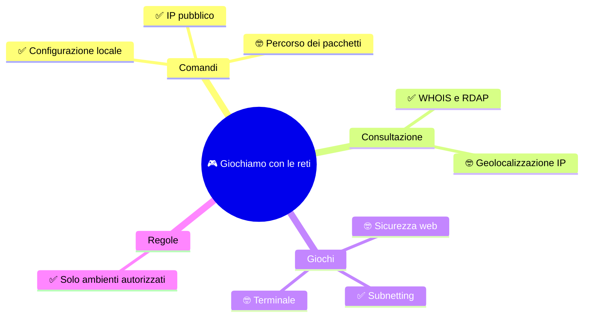

🏠 [Indice SETT-OTT](%28STU%29%204DI%20-%20SETT-OTT.md)

# 🎮 Giochiamo con le reti

**4DI · Settembre-Ottobre · Extra facoltativo**

⏱️ **Scegli una o due attività: 10-25 minuti.** Non è una nuova settimana, non aggiunge argomenti alla verifica e non assegna compiti a casa.

> **Legenda:** ✅ collegato agli argomenti studiati · 🤓 curiosità fuori programma · 🧪 prova · ⚠️ attenzione · ✏️ missione

## 🗺️ Mappa



## ⚙️ Guarda la tua rete

### ✅ Leggi i tuoi parametri

Su Windows apri **Prompt dei comandi** o **Terminale** e scrivi:

```text
ipconfig
```

Individua il tuo indirizzo IPv4, la maschera di sottorete e il gateway predefinito. Sono proprio i dati con cui si descrive una rete e si colloca un dispositivo nella sottorete giusta.

✏️ **Missione (3 min).** Sul quaderno, senza copiare l'output completo, scrivi quali tre voci hai trovato. Per la maschera, usa la tabella di [S5](%28STU%29%204DI%20sett-ott%20S5%20-%20CIDR%20e%20intervalli.md) per ricavare il prefisso. Non pubblicare né inviare a nessuno l'output: contiene dettagli della tua rete.

### ✅ “Who am I?”: l'IP visto da Internet

Un servizio **“what is my IP?”** (*qual è il mio IP?*) mostra l'indirizzo pubblico che il servizio vede arrivare dalla tua connessione. Da Windows, PowerShell o macOS/Linux puoi provare:

```text
curl.exe https://api.ipify.org
```

Su macOS/Linux:

```text
curl https://api.ipify.org
```

Altri servizi equivalenti sono [ifconfig.me](https://ifconfig.me/) e [Amazon Check IP](https://checkip.amazonaws.com/). Puoi anche aprire direttamente [api.ipify.org](https://api.ipify.org/) nel browser. Il risultato è il tuo **IP pubblico di uscita**, non necessariamente l'indirizzo privato mostrato da `ipconfig`. Se sei dietro al NAT di casa o della scuola, più dispositivi possono uscire con lo stesso IP pubblico. Una VPN o una rete mobile può mostrare l'indirizzo del servizio o della rete usata, non quello della tua connessione abituale.

⚠️ L'IP pubblico è un dato della connessione: non copiarlo in chat, non pubblicarlo e non cercare l'IP personale di un compagno. Per gli esercizi di consultazione qui sotto usiamo l'indirizzo pubblico di esempio `1.1.1.1`.

✏️ **Missione (2 min).** Confronta, senza annotarli o condividerli, l'indirizzo IPv4 locale di `ipconfig` e quello restituito dal servizio. Sono uguali? Se no, il NAT o un'altra rete intermedia può spiegare la differenza.

### ✅ WHOIS: cerca a chi è assegnato un IP

**WHOIS** è un servizio di consultazione dei registri Internet. Dato un indirizzo IP, può mostrare a quale organizzazione è assegnato un blocco e gli estremi del blocco. **RDAP** è il sistema web più recente per consultare dati analoghi, in un formato standard.

Puoi cercare `1.1.1.1` su [RIPEstat](https://stat.ripe.net/) oppure leggere la risposta RDAP da [rdap.org](https://rdap.org/ip/1.1.1.1). Per un confronto più immediato, [IPinfo](https://ipinfo.io/1.1.1.1) mostra una scheda informativa sull'indirizzo. [VirusTotal](https://www.virustotal.com/gui/ip-address/1.1.1.1) raccoglie anche segnalazioni e indicatori di reputazione. Nei risultati cerca il **prefisso o intervallo** e l'**organizzazione**: collegali a quello che hai imparato su IP e CIDR.

Se sul computer è già disponibile un programma WHOIS, puoi anche usare il terminale:

```text
whois 1.1.1.1
```

Il comando `whois` non è incluso in tutte le installazioni, in particolare non è normalmente disponibile nel Prompt dei comandi di Windows. In quel caso usa uno dei siti sopra: non occorre installare nulla.

⚠️ **WHOIS/RDAP non identificano la persona al computer.** Indicano informazioni di registrazione del blocco IP, per esempio organizzazione, registro regionale e intervallo. Una mappa dell'IP può stimare una città o un Paese, ma non è una posizione precisa: VPN, reti mobili e database incompleti possono renderla fuorviante.

⚠️ I siti di reputazione come VirusTotal mostrano dati raccolti e segnalazioni, non una sentenza: un IP segnalato non prova da solo che chi lo usa stia facendo qualcosa di male. Non inserire nei servizi pubblici IP privati, dati personali o indirizzi che non hai il permesso di consultare.

✏️ **Missione (5 min).** Cerca `1.1.1.1` su RIPEstat o RDAP e annota soltanto: prefisso, organizzazione indicata e registro che risponde. Poi confronta il prefisso trovato con l'intervallo che contiene l'indirizzo. Non eseguire scansioni o tentare connessioni all'indirizzo.

### 🤓 Segui un percorso, per curiosità

Questo comando mostra alcuni passaggi del percorso verso una destinazione:

```text
tracert -d 1.1.1.1
```

Su Linux o macOS il comando si chiama spesso `traceroute 1.1.1.1`; potrebbe non essere installato. `tracert` prova a scoprire il percorso aumentando a ogni prova il **TTL** (*Time To Live*): in pratica, un contatore che i router riducono mentre inoltrano un pacchetto. Se un passaggio non risponde, può apparire `*`: non significa per forza che la destinazione sia irraggiungibile.

⚠️ **È un'anteprima di routing e TTL, argomenti di novembre-dicembre, non un esercizio da verificare in SETT-OTT.** I risultati dipendono dalla rete e possono cambiare. Fai al massimo una prova dalla tua rete o con il permesso dell'insegnante; non eseguire scansioni e non cercare di aggirare i filtri della rete scolastica.

## 🎯 Sfide nel browser

### ✅ Il gioco delle sottoreti

🔗 [Subnetting.net](https://www.subnetting.net/)

Dal menu scegli **The Subnet Game!** per una sfida a punti oppure **Subnetting Practice** per domande di esercizio. Il sito è in inglese: concentrati su rete, intervallo e broadcast, usando solo i prefissi già studiati. Se una funzione chiede un account o un pagamento, non serve registrarsi: passa agli esercizi accessibili.

### 🤓 Una missione da hacker, ma nel recinto

🔗 [Natas di OverTheWire](https://overthewire.org/wargames/natas/)

È un wargame, cioè un gioco di sicurezza con livelli e obiettivi preparati apposta. Si usa il browser per esplorare **solo** il sito-laboratorio del livello assegnato. Per iniziare, la pagina ufficiale indica l'utente e la password `natas0` e il [sito del livello 0](http://natas0.natas.labs.overthewire.org). Usa solo queste credenziali di gioco, mai una password personale.

Qui si studia sicurezza web, non CIDR: è una curiosità extra e può essere difficile. Fermati quando vuoi; non provare gli stessi metodi su siti reali, account o dispositivi di altre persone.

## 🧑‍💻 Una missione nel terminale

### 🤓 Bandit: il primo accesso

🔗 [Bandit di OverTheWire](https://overthewire.org/wargames/bandit/)

Bandit è un gioco a livelli per chi comincia con il terminale. Il primo passaggio usa **SSH**, un programma per aprire una sessione di testo su un computer remoto. Il computer remoto è il server di gioco indicato da OverTheWire, non un bersaglio da scegliere.

Se hai il permesso dell'insegnante e il client SSH è disponibile, il [livello 0](https://overthewire.org/wargames/bandit/bandit0.html) indica questo comando:

```text
ssh bandit0@bandit.labs.overthewire.org -p 2220
```

La pagina del livello fornisce le credenziali iniziali e le istruzioni. La connessione può essere bloccata da alcune reti: in quel caso fermati, non cercare di superare il blocco.

⚠️ **Giocare all'hacker significa imparare in un ambiente autorizzato.** Usa soltanto i laboratori creati per l'esercizio e le istruzioni ufficiali. Niente scansioni di indirizzi, tentativi su reti scolastiche o domestiche altrui, né prove su siti veri.

## 📚 Fonti e risorse

- [Subnetting.net](https://www.subnetting.net/): il sito presenta esercizi e un gioco sulle sottoreti; usalo per allenare i calcoli di S5.
- [Microsoft Learn: `ipconfig`](https://learn.microsoft.com/en-us/windows-server/administration/windows-commands/ipconfig): documentazione del comando Windows per leggere la configurazione di rete.
- [ipify](https://www.ipify.org/): servizio semplice per vedere l'IP pubblico osservato dalla connessione; non pubblicare il risultato.
- [ifconfig.me](https://ifconfig.me/) e [Amazon Check IP](https://checkip.amazonaws.com/): due alternative per vedere quale IP pubblico arriva al servizio.
- [RIPEstat](https://stat.ripe.net/): portale RIPE NCC per consultare dati su indirizzi IP e numeri di sistema autonomo; prova la ricerca `1.1.1.1`.
- [RDAP di rdap.org](https://rdap.org/ip/1.1.1.1): interrogazione di esempio del registro RDAP per `1.1.1.1`; restituisce dati strutturati sul blocco assegnato.
- [IPinfo](https://ipinfo.io/1.1.1.1): scheda di esempio di un IP; usa l'eventuale geolocalizzazione come stima, non come posizione certa.
- [VirusTotal](https://www.virustotal.com/gui/ip-address/1.1.1.1): consultazione di reputazione e segnalazioni associate a un IP; i risultati possono essere incompleti o falsi positivi.
- [Microsoft Learn: `tracert`](https://learn.microsoft.com/en-us/windows-server/administration/windows-commands/tracert): spiega il percorso mostrato e il ruolo del TTL; consultalo solo come curiosità fuori programma.
- [RFC 9082 - RDAP query format](https://www.rfc-editor.org/rfc/rfc9082): specifica la forma delle interrogazioni RDAP per le risorse Internet.
- [OverTheWire: wargames](https://overthewire.org/wargames/): presenta i giochi e l'ordine suggerito; [Bandit](https://overthewire.org/wargames/bandit/) è per le basi del terminale e [Natas](https://overthewire.org/wargames/natas/) per la sicurezza web. I livelli sono ambienti di esercitazione autorizzati.

---

🏠 [Indice SETT-OTT](%28STU%29%204DI%20-%20SETT-OTT.md)
