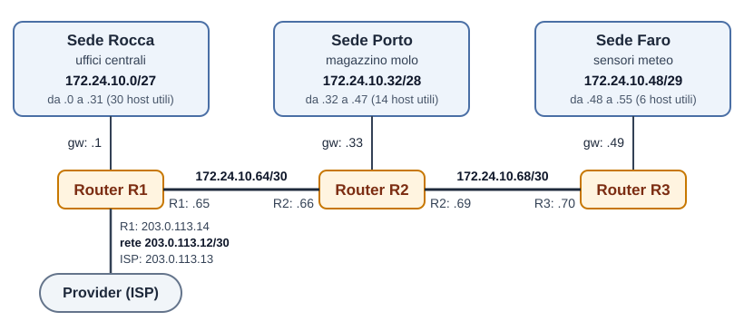

⬅️ [S5 - Ripasso e recupero](./%28STU%29%204DI%20nov-dic%20S5%20-%20Ripasso%20e%20recupero.md) · 🏠 [Indice](../README.md)

# 🕵️ Eserciziario · 4DI nov-dic

**4DI · Novembre-Dicembre · Eserciziario con casi reali · Teoria e pratica scritta**

⏱️ **Tempo: un dossier dura 10-15 minuti.** ✅ essenziale: circa 35 minuti in tutto. 🔍 per il voto alto: circa 30 minuti. 🤓 si può saltare. Non è un compito a casa: scegli i dossier che ti servono per prepararti alla verifica, anche uno alla volta.

> **Legenda:** ✅ da sapere · 🔍 per capire fino in fondo · 🤓 facoltativo · 📜 caso vero · 🕵️ come funziona il problema · 📖 teoria · ✏️ pratica scritta · 🟢 svolto: guarda come si fa · 🎯 da provare: soluzione nascosta · 🧠 da ricordare · ⚠️ errore comune · 📌 controllo · 🃏 flashcard o soluzione

In azienda nessuno ti consegna l'esercizietto. Ti dicono: «c'è un traffico strano, capisci da dove passa». In queste pagine torni nel ruolo di tecnico di una squadra di sicurezza e risposta agli incidenti, **con autorizzazione scritta**. Ogni dossier apre con un caso reale, ti scalda con poche flashcard secche, ti mostra **un esercizio svolto per intero** e poi ti lascia **due prove mirate** con la soluzione nascosta.

<u>Ogni errore o attacco sul livello Rete nasce dalle stesse poche regole che usano i router ogni secondo.</u> Un prefisso più lungo attira il traffico. Un indirizzo `fe80` parla sul cavo anche se nessuno ha configurato IPv4. Due rotte predefinite che si guardano in faccia palleggiano i pacchetti fino a farli morire. Chi padroneggia queste regole non tira a indovinare: legge la tabella e vede subito dove non torna.

> ⚖️ **Regola d'oro.** Si prova solo su reti **proprie** o con **autorizzazione scritta**. In Italia accedere abusivamente a un sistema informatico o telematico è reato (art. 615-ter del Codice penale). Qui studi il funzionamento delle reti per diagnosticarle e difenderle: non trovi comandi o istruzioni contro sistemi reali. Per mettersi alla prova in modo legale esistono i simulatori e le gare **CTF** (*Capture The Flag*), come raccontato nell'[Extra di sett-ott](../1%20SETT-OTT/%28STU%29%204DI%20sett-ott%20SX%20-%20Extra%20-%20Giochiamo%20e%20smancciamo%20con%20le%20reti.md).

## Come si usa

- 🃏 **Flashcard iniziali.** Rispondi a voce prima di aprirle: ti servono per fissare le definizioni che userai subito dopo negli esercizi.
- 🟢 **Svolto.** Leggi tutti i passaggi, poi copri lo svolgimento con la mano e rifallo sul quaderno.
- 🎯 **Da provare.** Scrivi prima la tua risposta completa sul quaderno; apri la soluzione `🃏` solo alla fine per confrontare.
- **Valori.** Aziende, nomi e numeri degli scenari sono inventati per la didattica. Gli indirizzi «pubblici» degli esercizi usano i blocchi riservati alla documentazione (`192.0.2.0/24`, `198.51.100.0/24`, `203.0.113.0/24` per IPv4, RFC 5737; `2001:db8::/32` per IPv6, RFC 3849): non appartengono a nessuna rete reale. I prefissi storici citati nei casi veri sono dichiarati come tali.

| Dossier | Tema                              |                                       Settimana                                        | Caso                                                  |
| :-----: | --------------------------------- | :------------------------------------------------------------------------------------: | ----------------------------------------------------- |
|    1    | L'indirizzo invisibile sul cavo   |                  [S1](./%28STU%29%204DI%20nov-dic%20S1%20-%20IPv6.md)                  | Esaurimento IANA (2011) e IPv6 «dimenticato acceso»   |
|    2    | Il prefisso che rubò YouTube      |  [S2](./%28STU%29%204DI%20nov-dic%20S2%20-%20Router%20e%20tabelle%20di%20routing.md)   | Pakistan Telecom e YouTube, 24 febbraio 2008          |
|    3    | Strade a senso unico e buchi neri |           [S3](./%28STU%29%204DI%20nov-dic%20S3%20-%20Routing%20statico.md)            | Loop di default route, `traceroute` e rotte blackhole |
|    4    | Quando un vicino racconta bugie   | [S4](./%28STU%29%204DI%20nov-dic%20S4%20-%20Introduzione%20al%20routing%20dinamico.md) | ARPANET 1979: dal passaparola alla mappa completa     |
|    5    | Collaudo finale                   |         [S5](./%28STU%29%204DI%20nov-dic%20S5%20-%20Ripasso%20e%20recupero.md)         | Tre ticket al SOC e *Capture The Flag* su carta       |

---

## 🌐 Dossier 1 · L'indirizzo invisibile sul cavo

*Si usa [S1](./%28STU%29%204DI%20nov-dic%20S1%20-%20IPv6.md): 128 bit, compressione con `::`, prefisso `/64`, tipi di indirizzo.*

### 📜 Caso vero: la rete ombra che nessuno guardava

Il 3 febbraio 2011 la **IANA** distribuisce gli ultimi grandi blocchi centrali di IPv4; il 6 giugno 2012 il *World IPv6 Launch* avvia su scala mondiale il passaggio ai **128 bit**. Nei sistemi operativi moderni IPv6 è spesso attivo per impostazione predefinita. Su un collegamento IPv6 attivo, un dispositivo configura normalmente un indirizzo *link-local* (`fe80::/10`) e può ricevere traffico multicast locale, anche senza un router IPv6.

🕵️ **Come nasce il problema.** Una rete può avere controlli applicati solo a IPv4: se IPv6 è attivo e le regole non lo coprono, il traffico IPv6 consentito sul collegamento potrebbe non essere filtrato come previsto. Questo non significa che tutti i dispositivi siano automaticamente raggiungibili: contano anche le regole del firewall e la configurazione della rete. **Difesa:** l'amministratore verifica e applica le regole di sicurezza a entrambi i protocolli.

🧠 <u>Un indirizzo link-local può esistere anche senza un router IPv6; da solo non rende un dispositivo raggiungibile da altre reti.</u>

### 🃏 Riscaldamento rapido

<details>
<summary>🃏 <b>Quanti bit ha un indirizzo IPv6, in quanti gruppi si scrive e quanti bit vale ogni cifra esadecimale?</b></summary>
Ha 128 bit divisi in 8 gruppi da 16 bit; ogni cifra esadecimale (0-9, a-f) vale 4 bit.
</details>
<details>
<summary>🃏 <b>Perché la scorciatoia <code>::</code> si può usare una sola volta nello stesso indirizzo?</b></summary>
Perché con due <code>::</code> non si saprebbe quanti gruppi di zeri mettere a sinistra e quanti a destra, rendendo l'indirizzo ambiguo.
</details>
<details>
<summary>🃏 <b>Che differenza c'è fra <code>2000::/3</code>, <code>fe80::/10</code> e <code>ff02::1</code>?</b></summary>
<code>2000::/3</code> è globale unicast (viaggia su Internet), <code>fe80::/10</code> è link-local (resta sul collegamento locale) e <code>ff02::1</code> è multicast per tutti i nodi locali (sostituisce il broadcast).
</details>

### 1.1 ✏️ Pratica · ✅ · 🟢 Svolto — Comprimere e leggere una `/64`

**Consegna.** Nei registri di un server di prova trovi scritto per esteso questo indirizzo con il suo prefisso (blocco di documentazione):

```text
2001:0db8:00c0:0000:0000:0000:0a00:0030/64

forma compressa: 2001:0db8:00c0::0a00:0030/64
rete /64:        2001:0db8:00c0::/64

```

1. Scrivi l'indirizzo nella forma compressa più corta possibile.
2. Scrivi l'indirizzo della sua rete nella forma `prefisso::/64`.
3. Indica quanti gruppi appartengono alla rete e quanti indirizzi totali contiene una `/64`.

**Svolgimento.**

1. **Togli gli zeri iniziali** da ciascuno degli 8 gruppi: `2001:db8:c0:0:0:0:a00:30`. Poi sostituisci l'unica fila di gruppi tutti a zero (i tre `0` centrali) con `::` → **`2001:db8:c0::a00:30`**.
2. Il prefisso `/64` prende i primi 64 bit, cioè i **primi 4 gruppi** (`2001`, `0db8`, `00c0`, `0000`), e mette a zero i 4 gruppi dell'interfaccia → `2001:db8:c0:0:0:0:0:0/64`, che compresso si scrive **`2001:db8:c0::/64`**.
3. Alla rete appartengono **4 gruppi** ($4 \times 16 = 64$ bit). Restano 64 bit per le interfacce, quindi **$2^{64}$ indirizzi** (circa 18 miliardi di miliardi).

📌 **Controllo.** Nella forma compressa `2001:db8:c0::a00:30` vedi **5 gruppi** scritti; quindi `::` vale $8 - 5 = 3$ gruppi di zeri. I conti tornano.

⚠️ **Errore comune.** Cancellare anche gli zeri **finali** di un gruppo: `0a00` diventa `a00` (che vale 2560), **non** `a` (che vale 10!), e `0030` diventa `30`, **non** `3`. Altro errore tipico: leggere `/64` come «64 dispositivi».

🧠 <u>Si tolgono solo gli zeri a sinistra del gruppo; gli zeri a destra cambiano il numero.</u>

### 1.2 ✏️ Pratica · 🔍 · 🎯 Da provare — Quattro indirizzi nei log: veri o impossibili?

**Consegna.** In un verbale d'incidente compaiono quattro stringhe copiate a mano. Per ciascuna scrivi sul quaderno se è un indirizzo IPv6 **valido** o **non valido**:
- se **non è valido**, spiega in una frase quale regola viola;
- se **è valido**, riscrivilo per esteso con tutti gli 8 gruppi da 4 cifre.

- **A)** `2001:db8::1::5`
- **B)** `2001:db8:0:0:0:0:0:0:9`
- **C)** `fe80:0000:0000:0000:021a:4bff:fe10:0080`
- **D)** `2001:db8:4g00::1`

<details>
<summary>🃏 <b>1.2 — Soluzione</b></summary>

- **A) Non valido.** Usa `::` due volte: non è possibile sapere quanti gruppi di zeri stiano nel primo `::` e quanti nel secondo (per esempio 1+3, 2+2 o 3+1).
- **B) Non valido.** Conta 9 gruppi separati dai due punti (`2001`, `db8`, sei `0` e `9`), mentre un indirizzo IPv6 ha esattamente 8 gruppi.
- **C) Valido.** Ci sono 5 gruppi visibili (`fe80` a sinistra; `21a`, `4bff`, `fe10`, `80` a destra), quindi `::` sostituisce $8 - 5 = 3$ gruppi a zero. Esteso: **`fe80:0000:0000:0000:021a:4bff:fe10:0080`**.
- **D) Non valido.** Contiene la lettera `g`: il sistema esadecimale usa soltanto le cifre `0–9` e le lettere `a–f`.

</details>

### 1.3 📖 Teoria · ✅ · 🎯 Da provare — Chi può attraversare il router?

**Consegna.** Un sensore in laboratorio ha IPv6 attivo e nei suoi pacchetti compaiono tre indirizzi: `fe80::99`, `ff02::1` e `2001:db8:c0::99` (quest'ultimo rappresenta nel test un indirizzo pubblico).

1. Associa ciascuno dei tre al suo tipo (**globale unicast**, **link-local**, **multicast**).
2. Un attaccante esterno, da un'altra rete al di là del router, prova a spedire un pacchetto con destinazione `fe80::99`: può raggiungere il sensore? Spiega perché in una frase.
3. Dato che in IPv6 il broadcast non esiste più, quale dei tre indirizzi viene usato per mandare un annuncio contemporaneamente a tutti i dispositivi collegati allo stesso cavo locale?

<details>
<summary>🃏 <b>1.3 — Soluzione</b></summary>

1. `fe80::99` → **link-local** (`fe80::/10`); `ff02::1` → **multicast** (`ff00::/8`); `2001:db8:c0::99` → **globale unicast** (`2000::/3`, qui nel blocco riservato alla documentazione).
2. **No.** Un indirizzo *link-local* vale esclusivamente sul collegamento locale (cavo o Wi-Fi diretto): per regola del protocollo il router non inoltra mai pacchetti `fe80::/10` verso altre reti.
3. Si usa l'indirizzo multicast **`ff02::1`**, che identifica il gruppo di tutti i nodi del collegamento locale.

</details>

---

## 🧭 Dossier 2 · Il prefisso che rubò YouTube

*Si usa [S2](./%28STU%29%204DI%20nov-dic%20S2%20-%20Router%20e%20tabelle%20di%20routing.md): switch contro router, gateway, tabella di instradamento, rotta predefinita, prefisso più lungo.*

### 📜 Caso vero: domenica 24 febbraio 2008, YouTube sparisce nel mondo

Domenica 24 febbraio 2008 il governo del Pakistan ordina ai fornitori nazionali di bloccare l'accesso a YouTube dentro il Paese. Secondo lo studio pubblicato dal **RIPE NCC** (il registro europeo delle reti), YouTube trasmetteva dal blocco pubblico vero **`208.65.152.0/22`**. Per deviare le richieste interne verso un «buco nero», l'operatore *Pakistan Telecom* inserisce una rotta per **`208.65.153.0/24`** e, per errore, la annuncia anche ai router internazionali.

In pochi minuti i router di mezzo pianeta ricevono due indicazioni valide per gli stessi server di YouTube: la `/22` legittima in California e la `/24` pakistana. Nessun router controlla «chi ha ragione»: applica la regola della **riga più stretta** (*longest prefix match*). Poiché `/24` è più lungo di `/22`, vince la rotta pakistana e il traffico mondiale verso YouTube finisce in Pakistan, oscurando il sito per circa due ore.

🕵️ **Difesa.** Oggi gli operatori filtrano quali prefissi un vicino ha il permesso di annunciare e firmano crittograficamente i blocchi autorizzati, proprio perché un router da solo premia sempre il prefisso più lungo.

🧠 <u>Quando due righe contengono lo stesso indirizzo, il router sceglie sempre il prefisso più lungo, anche se porta nel posto sbagliato.</u>

### 🃏 Riscaldamento rapido

<details>
<summary>🃏 <b>Qual è la differenza di confine fra uno switch e un router?</b></summary>
Lo switch lavora dentro una sola rete locale; il router sta sul bordo fra reti diverse e sceglie la direzione leggendo la sua tabella.
</details>

<details>
<summary>🃏 <b>Che cos'è il prossimo passo (next hop) scritto in una tabella di routing?</b></summary>
È l'indirizzo del router vicino a cui consegnare il pacchetto per il tratto successivo, mai la destinazione finale.
</details>

<details>
<summary>🃏 <b>Quando viene scelta la rotta predefinita <code>0.0.0.0/0</code>?</b></summary>
Solo come ultima istanza, quando nessuna riga più specifica della tabella contiene l'indirizzo di destinazione.
</details>

<details>
<summary>🃏 <b>Quali sono i tre passi ordinati con cui un router sceglie la riga nella tabella?</b></summary>
1) Trova il prefisso (quali righe contengono l'indirizzo); 2) scegli la riga (la più stretta); 3) verifica il prossimo passo (vicino o rete collegata).
</details>

### Scenario del dossier: il router R-Clinica

Il router **R-Clinica** della clinica veterinaria «San Rocco» (valori inventati) collega due reparti locali, la rete centrale del gruppo sanitario (tramite il collegamento `10.40.99.0/30`, dove R-Clinica ha `.1` e il router Centrale ha `.2`) e il provider Internet (tramite `198.51.100.8/30`, dove R-Clinica ha `.10` e il provider ha `.9`):

| Rete di destinazione | Prefisso | Prossimo passo | Interfaccia / Uscita |
| --- | :---: | --- | --- |
| `10.40.10.0` | `/24` | — (collegata) | LAN Ambulatori (`10.40.10.1`) |
| `10.40.20.0` | `/24` | — (collegata) | LAN Radiologia (`10.40.20.1`) |
| `10.40.99.0` | `/30` | — (collegata) | cavo verso Centrale (`10.40.99.1`) |
| `10.40.0.0` | `/16` | `10.40.99.2` | altre sedi del gruppo sanitario |
| `198.51.100.8` | `/30` | — (collegata) | cavo verso provider (`198.51.100.10`) |
| `0.0.0.0` | `/0` | `198.51.100.9` | uscita verso Internet |

### 2.1 ✏️ Pratica · ✅ · 🟢 Svolto — Seguire tre pacchetti con i tre passi

**Consegna.** Applica i tre passi (*trova il prefisso*, *scegli la riga*, *verifica il prossimo passo*) per tre pacchetti che arrivano a R-Clinica:
- **A)** destinazione `10.40.20.45`;
- **B)** destinazione `10.40.55.12`;
- **C)** destinazione `192.0.2.80` (un server web esterno).

**Svolgimento.**

| Pacchetto | 1. Righe che contengono la destinazione | 2. Riga scelta (più stretta) | 3. Prossimo passo / azione |
| --- | --- | --- | --- |
| **A** · `10.40.20.45` | `10.40.20.0/24`, `10.40.0.0/16`, `0.0.0.0/0` | **`10.40.20.0/24`** | Nessun vicino: consegna diretta sulla LAN Radiologia |
| **B** · `10.40.55.12` | `10.40.0.0/16`, `0.0.0.0/0` | **`10.40.0.0/16`** | Consegna al router Centrale **`10.40.99.2`** |
| **C** · `192.0.2.80` | solo `0.0.0.0/0` | **`0.0.0.0/0`** | Consegna al provider **`198.51.100.9`** |

📌 **Controllo.** Nel pacchetto A i primi due numeri sono `10.40` (quindi entra nella `/16`) e i primi tre sono `10.40.20` (quindi entra anche nella `/24`): fra `/24`, `/16` e `/0` vince `/24` perché $24 > 16 > 0$. Nel pacchetto B il terzo numero è `55`, quindi né `.10.0/24` né `.20.0/24` corrispondono: vince `/16`.

⚠️ **Errore comune.** Fermarsi alla prima riga dall'alto che sembra andare bene senza controllare tutta la tabella, oppure scrivere `192.0.2.80` nella colonna del prossimo passo.

🧠 <u>Più il prefisso è lungo, più il recinto di indirizzi è piccolo e specifico: vince sempre lui.</u>

### 2.2 ✏️ Pratica · 🔍 · 🎯 Da provare — L'effetto YouTube dentro la clinica

**Consegna.** Rispondi alle due domande sul quaderno:

1. **Il caso vero del 2008:** il blocco di YouTube era `208.65.152.0/22` (ricorda da sett-ott: una `/22` ha salto 4 nel terzo ottetto, quindi $2^{10} = 1024$ indirizzi da `208.65.152.0` a `208.65.155.255`). Spiega perché l'annuncio `208.65.153.0/24` era contenuto lì dentro e perché batteva la `/22` sui router mondiali.
2. **In clinica:** per un errore di copia-incolla, qualcuno aggiunge su R-Clinica una rotta statica `10.40.20.128/25` (da `.128` a `.255`) con prossimo passo `198.51.100.9` (il provider). Che cosa succede quando un medico in Ambulatori invia una lastra alla macchina RX `10.40.20.150`? E quando scrive invece alla stampante `10.40.20.30`?

<details>
<summary>🃏 <b>2.2 — Soluzione</b></summary>

1. Il terzo ottetto `153` cade fra `152` e `155`, quindi i 256 indirizzi di `208.65.153.0/24` sono un quarto esatto del blocco `/22` di YouTube. Per quegli indirizzi corrispondevano sia `/22` sia `/24`, e i router hanno scelto **`/24`** perché ha il prefisso più lungo ($24 > 22$).
2.
   - Verso **`10.40.20.150`**: l'indirizzo cade sia in `10.40.20.0/24` sia nella nuova `10.40.20.128/25` (che copre `.128`–`.255`). Vince **`/25`** ($25 > 24$): R-Clinica spedisce per errore il traffico interno verso il provider `198.51.100.9` invece di consegnarlo in Radiologia!
   - Verso **`10.40.20.30`**: `.30` è minore di `.128`, quindi **non** entra nella `/25`. La riga più stretta resta `10.40.20.0/24` e la stampante continua a funzionare regolarmente: un guasto «a metà reparto» tipico dei prefissi sbagliati.

</details>

### 2.3 📖 Teoria · ✅ · 🎯 Da provare — Quattro frasi da verificare

**Consegna.** Per ognuna di queste frasi dette durante il turno scrivi **V** (vera) o **F** (falsa). Correggi in una frase quelle false.

1. «Per far parlare un PC degli Ambulatori (`10.40.10.25`) con uno della Radiologia (`10.40.20.45`) basta uno switch, visto che sono sullo stesso piano.»
2. «Il gateway configurato sui PC degli Ambulatori deve essere `10.40.10.1`, non `198.51.100.9`.»
3. «Perché i medici possano navigare sul web, R-Clinica deve avere in tabella una riga per ogni sito di Internet.»
4. «Se cade il cavo verso il provider e sparisce la riga `0.0.0.0/0`, Ambulatori e Radiologia continuano comunque a scambiarsi dati attraverso R-Clinica.»

<details>
<summary>🃏 <b>2.3 — Soluzione</b></summary>

1. **F.** Non conta il piano dell'edificio ma il confine di rete: `10.40.10.0/24` e `10.40.20.0/24` sono due reti diverse, quindi lo switch non basta e serve il router R-Clinica.
2. **V.** Il gateway di un PC deve appartenere alla **stessa rete locale** del PC (`10.40.10.0/24`), cioè l'interfaccia di R-Clinica verso gli Ambulatori (`.1`).
3. **F.** A R-Clinica basta l'unica riga predefinita `0.0.0.0/0` verso il vicino del provider (`198.51.100.9`); saranno i router successivi a conoscere il resto della strada.
4. **V.** Per andare fra `10.40.10.0/24` e `10.40.20.0/24` R-Clinica usa le sue due righe collegate `/24`, senza toccare la rotta predefinita.

</details>

---

## 🛣️ Dossier 3 · Strade a senso unico e buchi neri

*Si usa [S3](./%28STU%29%204DI%20nov-dic%20S3%20-%20Routing%20statico.md): rotta statica, collegamenti `/30`, controllo del prossimo passo, default route, `ping` e `traceroute`.*

### 📜 Caso vero: palleggi infiniti e buchi neri voluti

Quando le tabelle sono scritte a mano, i router obbediscono alla lettera senza fare domande. Nella pratica quotidiana delle reti questo genera due fenomeni opposti e famosissimi:
- **Il loop di routing (errore):** se il router R1 manda «tutto ciò che non conosco» (`0.0.0.0/0`) a R2 e R2 manda «tutto ciò che non conosco» a R1, un pacchetto per una rete inesistente rimbalza avanti e indietro fra R1 e R2 come una pallina da ping-pong. Non gira in eterno solo grazie al campo **TTL** (*Time To Live*, visto in S3 sett-ott), che cala di 1 a ogni salto finché arriva a zero e il router scarta il pacchetto.
- **La rotta *blackhole* (difesa):** quando un indirizzo pubblico subisce un attacco che intasa i cavi, i difensori creano apposta una rotta statica `/32` che butta i pacchetti per quell'indirizzo direttamente nel cestino (*null route*) già sul bordo esterno, salvando il resto dell'azienda.

🧠 <u>Una rotta statica fa esattamente ciò che hai scritto: controlla sempre il prossimo passo e la strada di ritorno.</u>

### 🃏 Riscaldamento rapido

<details>
<summary>🃏 <b>Quale controllo devi fare sempre sull'indirizzo scelto come prossimo passo?</b></summary>
Deve appartenere a una rete collegata direttamente al router su cui stai scrivendo la rotta (ed essere l'indirizzo del vicino, non il proprio).
</details>

<details>
<summary>🃏 <b>Perché fra due router collegati da un cavo si usa spesso un prefisso <code>/30</code>?</b></summary>
Perché un <code>/30</code> contiene 4 indirizzi totali e lascia esattamente 2 indirizzi utili (tolti rete e broadcast), uno per ciascun router.
</details>

<details>
<summary>🃏 <b>Come si scrive la rotta predefinita in IPv6?</b></summary>
Si scrive <code>::/0</code>: prefisso zero, quindi corrisponde a qualunque indirizzo IPv6 quando non c'è una riga più specifica.
</details>

<details>
<summary>🃏 <b>Che cosa mostra in più <code>traceroute</code> rispetto a <code>ping</code> quando una comunicazione non riesce?</b></summary>
<code>ping</code> dice solo se la risposta torna o no; <code>traceroute</code> elenca uno per uno i router raggiunti e mostra l'ultimo punto prima dell'interruzione.
</details>

### Topologia del dossier: la cooperativa marittima «Tre Fari»

Tre sedi lungo la costa (valori inventati) sono unite in fila dai router **R1**, **R2** e **R3**, con due collegamenti `/30`:



*Schema della rete «Tre Fari» (schema originale per questa dispensa): Rocca (`172.24.10.0/27`), Porto (`172.24.10.32/28`), Faro (`172.24.10.48/29`), collegamenti R1–R2 (`.64/30`) e R2–R3 (`.68/30`).*

### 3.1 ✏️ Pratica · ✅ · 🟢 Svolto — Scrivere le rotte mancanti su R1 e R2

**Consegna.** Osserva lo schema di «Tre Fari»:
1. Scrivi la rotta statica che serve su **R1** per raggiungere la sede **Faro** (`172.24.10.48/29`), eseguendo il controllo sul prossimo passo.
2. Completa le due righe statiche che mancano nella tabella del router centrale **R2** (verso **Rocca** e verso **Faro**).

**Svolgimento.**

1. **Su R1 verso Faro:**
   - **Rete e prefisso:** `172.24.10.48/29`.
   - **Prossimo passo:** per andare verso R3, R1 deve passare il pacchetto al vicino **R2** sul cavo che li unisce → **`172.24.10.66`**.
   - **Controllo:** R1 è collegato a `172.24.10.64/30` (indirizzi utili `.65` e `.66`). `.66` sta su quella rete ed è l'indirizzo di R2 (non di R1). Controllo superato.

2. **Tabella completa delle sedi su R2:** R2 vede già direttamente Porto (`.32/28`), il cavo R1–R2 (`.64/30`) e il cavo R2–R3 (`.68/30`). Gli mancano le due sedi esterne:

| Rete di destinazione | Prefisso | Prossimo passo | Controllo del vicino |
| --- | :---: | --- | --- |
| `172.24.10.0` (Rocca) | `/27` | **`172.24.10.65`** | `.65` è R1 sul cavo `.64/30` collegato a R2 |
| `172.24.10.48` (Faro) | `/29` | **`172.24.10.70`** | `.70` è R3 sul cavo `.68/30` collegato a R2 |

📌 **Controllo.** Nessuna riga usa come prossimo passo un indirizzo proprio di R2 (`.33`, `.66`, `.69`).

⚠️ **Errore comune.** Scrivere su R1 `172.24.10.70` (R3) come prossimo passo per Faro: R1 non è collegato al cavo `.68/30`, quindi non sa come raggiungere direttamente `.70`!

🧠 <u>Su una catena di router, ogni router indica solo il vicino del primo salto: non salta mai al router in fondo.</u>

### 3.2 ✏️ Pratica · 🔍 · 🎯 Da provare — Due guasti diagnosticati su carta

**Consegna.** Sulla rete «Tre Fari» ti segnalano due problemi distinti. Analizzali:

- **Incidente A (andata senza ritorno):** su R1 e R2 tutte le rotte sono perfette. Sul router **R3** del Faro, invece, ci sono soltanto le due reti collegate direttamente (`172.24.10.48/29` e `172.24.10.68/30`) e nessuna rotta statica. Un tecnico dalla sede Rocca (`172.24.10.10`) lancia un `ping` verso il sensore del Faro (`172.24.10.50`) e non riceve risposta.
  1. Il pacchetto di andata arriva fino al sensore `.50` oppure si ferma prima? Dove si perde la comunicazione e perché?
  2. Siccome dal Faro c'è un solo cavo per uscire verso tutto il resto della cooperativa e verso Internet, scrivi l'**unica riga** (`0.0.0.0/0`) da aggiungere su R3 per far funzionare tutto, indicando rete, prefisso e prossimo passo.
- **Incidente B (la riga sbagliata):** su R1 un apprendista scrive la rotta verso Porto così: rete `172.24.10.32`, prefisso `/28`, prossimo passo `172.24.10.33`. Spiega quale controllo fallisce e correggi il prossimo passo.

<details>
<summary>🃏 <b>3.2 — Soluzione</b></summary>

- **Incidente A:**
  1. Il pacchetto di **andata arriva** regolarmente fino al sensore `172.24.10.50` (R1 lo passa a R2 `.66`, R2 lo passa a R3 `.70`, R3 lo consegna sulla LAN Faro). Quando però il sensore risponde verso `172.24.10.10`, consegna la risposta al suo gateway **R3**, che cerca `172.24.10.10` nella propria tabella: non trovando nessuna riga per `.0/27` né una rotta predefinita, **R3 scarta il pacchetto di ritorno**.
  2. Basta aggiungere su R3 la rotta predefinita **`0.0.0.0/0` con prossimo passo `172.24.10.69`** (l'interfaccia di R2 sul cavo `172.24.10.68/30`, collegato direttamente a R3).
- **Incidente B:** `172.24.10.33` è l'interfaccia LAN di R2 dentro Porto (`.32/28`), una rete che **non** è collegata direttamente a R1. Il prossimo passo corretto su R1 è **`172.24.10.66`** (R2 sul cavo `.64/30`).

</details>

### 3.3 📖 Teoria · 🔍 · 🎯 Da provare — Il ping-pong fra R1 e R2

**Consegna.** Normalmente R2 ha la rotta predefinita `0.0.0.0/0` verso R1 (`172.24.10.65`), e R1 ha `0.0.0.0/0` verso il provider (`203.0.113.13`). Immagina che per errore qualcuno modifichi la `0.0.0.0/0` di R1 mettendole come prossimo passo R2 (`172.24.10.66`).

1. Che cosa succede passo dopo passo quando un PC di Rocca invia un pacchetto a `172.24.10.200` (un indirizzo che non appartiene a nessuna delle tre sedi)?
2. Che cosa vedresti nell'elenco delle tappe di un `traceroute` lanciato verso `172.24.10.200`, e perché il pacchetto alla fine viene eliminato?

<details>
<summary>🃏 <b>3.3 — Soluzione</b></summary>

1. Su R1 nessuna riga specifica contiene `172.24.10.200`, quindi R1 usa `0.0.0.0/0` e lo manda a **R2** (`.66`). Anche su R2 nessuna riga specifica corrisponde, quindi R2 usa la propria `0.0.0.0/0` e lo rimanda a **R1** (`.65`), che lo rimanda a R2, creando un **ciclo (loop) di instradamento**.
2. Nel `traceroute` vedresti alternarsi ripetutamente gli indirizzi di R1 e R2 (`172.24.10.1`, `.66`, `.65`, `.66`, `.65`…). Il pacchetto non gira per sempre perché a ogni passaggio i router diminuiscono di 1 il campo **TTL** dell'header IP finché arriva a zero e il pacchetto viene scartato.

</details>

---

## 🔄 Dossier 4 · Quando un vicino racconta bugie

*Si usa [S4](./%28STU%29%204DI%20nov-dic%20S4%20-%20Introduzione%20al%20routing%20dinamico.md): limiti del routing statico, Distance Vector, Link State, costo e convergenza.*

### 📜 Caso vero: maggio 1979, la ARPANET cambia cervello

Per i suoi primi dieci anni la rete **ARPANET** aggiorna le tabelle con un meccanismo basato sul passaparola (*Distance Vector*): ogni nodo comunica periodicamente ai vicini la propria tabella di distanze. Con il crescere della rete emerge un difetto pesante: quando cade un collegamento, la brutta notizia viaggia una tappa alla volta, e nel frattempo un vicino non ancora aggiornato può convincere gli altri di avere ancora una strada valida, facendo rimbalzare i pacchetti nel vuoto.

Nel maggio 1979 gli ingegneri McQuillan, Richer e Rosen sostituiscono l'algoritmo con il modello **Link State**: ogni router diffonde ai vicini lo stato dei propri collegamenti diretti; gli annunci si propagano lungo la rete. Quando li ricevono, i router aggiornano la **mappa completa** e ricalcolano le strade migliori. La diffusione richiede tempo: la rete deve convergere.

🕵️ **Angolo sicurezza.** Il routing dinamico si basa sulla fiducia nei messaggi ricevuti: se un intruso collegasse un finto router annunciando «raggiungo tutte le reti a costo 1!», attirerebbe a sé i pacchetti. Per questo nelle reti professionali i router firmano e autenticano gli annunci di routing prima di accettarli.

🧠 <u>Distance Vector si fida delle distanze raccontate dai vicini; Link State ricostruisce la mappa intera e calcola da sé.</u>

### 🃏 Riscaldamento rapido

<details>
<summary>🃏 <b>Che cosa si scambiano i router nel principio Distance Vector?</b></summary>
Si scambiano con i soli vicini diretti la propria tabella di distanze («arrivo alla rete X con costo d»).
</details>

<details>
<summary>🃏 <b>Che cosa si scambiano invece i router nel principio Link State?</b></summary>
Si scambiano gli annunci sui propri collegamenti attivi e i relativi costi, così tutti costruiscono la stessa mappa completa della rete.
</details>

<details>
<summary>🃏 <b>Che cos'è la convergenza dopo un guasto?</b></summary>
È il momento in cui tutti i router hanno terminato di scambiarsi gli aggiornamenti e hanno di nuovo tabelle coerenti sulla nuova topologia.
</details>

<details>
<summary>🃏 <b>🤓 Quale principio usa il protocollo RIP e quale usa OSPF?</b></summary>
<i>RIP</i> usa il principio Distance Vector; <i>OSPF</i> usa il principio Link State.
</details>

### 4.1 📖 Teoria · ✅ · 🟢 Svolto — Passaparola e mappa su un triangolo

**Consegna.** Tre router **M**, **N** e **T** sono collegati a triangolo con questi costi inventati:
- collegamento **M–N**: costo **2**;
- collegamento **N–T**: costo **3**;
- collegamento diretto **M–T**: costo **8**.

1. Con **Distance Vector**, M non vede il tratto N–T, ma riceve dal vicino N il messaggio: *«Raggiungo T con costo 3»*. Quale calcolo fa M e quale prossimo passo sceglie per andare verso T?
2. Con **Link State**, che cosa possiede M in memoria e come arriva a scegliere la strada verso T?

**Svolgimento.**

1. **Con Distance Vector:** M somma il costo per arrivare al vicino N (`2`) al costo annunciato da N (`3`), ottenendo $2 + 3 = 5$. Poi confronta `5` (via N) con `8` (cavo diretto M–T): poiché $5 < 8$, sceglie **prossimo passo N** con **costo totale 5**.
2. **Con Link State:** M ha ricevuto gli annunci di tutti i router e possiede in memoria la **mappa completa** dei tre nodi e dei tre collegamenti (`M–N = 2`, `N–T = 3`, `M–T = 8`). Sulla mappa calcola da solo tutti i percorsi possibili da M a T (`M → N → T = 5` contro `M → T = 8`) e mette in tabella **prossimo passo N**, costo **5**.

📌 **Controllo.** Con la rete integra i due principi arrivano alla **stessa tabella finale**; cambia il modo in cui ci arrivano e come reagiscono ai guasti.

⚠️ **Errore comune.** Scrivere che il costo via N vale `3` dimenticando di sommare il `2` del primo tratto M–N, oppure pensare che costo `8` significhi «8 chilometri» o «più veloce di 5»: un costo più basso indica sempre un percorso migliore.

🧠 <u>Il costo di un percorso è la somma dei costi di tutti i collegamenti attraversati; vince il costo minore.</u>

### 4.2 ✏️ Pratica · 🔍 · 🎯 Da provare — Un cavo tranciato nella notte

**Consegna.** Riprendi lo stesso triangolo (**M–N = 2**, **N–T = 3**, **M–T = 8**). Alle 02:00 uno scavo stradale trancia di netto il cavo **N–T**.

1. Se sulla rete ci fossero solo **rotte statiche** configurate sul percorso migliore di prima, dove continuerebbe M a mandare i pacchetti per T, e che fine farebbero?
2. Con il **routing dinamico**, una volta raggiunta la **convergenza**, quale strada usa M per raggiungere T e con quale costo?
3. Confronta le informazioni disponibili nei due principi mentre la rete converge: perché un router *Distance Vector* può continuare temporaneamente a usare una distanza vecchia? Che cosa deve ricevere un router *Link State* prima di ricalcolare? Ricorda che nessuno dei due reagisce istantaneamente e che i tempi dipendono dal protocollo e dalla rete.

<details>
<summary>🃏 <b>4.2 — Soluzione</b></summary>

1. Con rotte statiche la tabella di M non si accorge del guasto: continua a mandare i pacchetti a **N**, e N non potendo più inoltrarli sul cavo N–T rotto li **scarta** (anche se il cavo diretto M–T è perfettamente funzionante!).
2. Dopo la convergenza M usa l'unico percorso rimasto, cioè il collegamento diretto **M → T**, con **costo 8**.
3. Nel *Distance Vector* l'informazione sul guasto si propaga attraverso gli aggiornamenti scambiati tra vicini; finché non riceve un aggiornamento, un router può conservare una distanza non più valida. Nel *Link State* i router diffondono un annuncio sul collegamento caduto e ricalcolano quando lo ricevono. Anche questa diffusione richiede tempo: entrambi i principi hanno una fase di convergenza, la cui durata dipende dal protocollo e dalla rete.

</details>

### 4.3 📖 Teoria · ✅ · 🎯 Da provare — Distance Vector, Link State o entrambi?

**Consegna.** Per ciascuna delle quattro frasi scrivi sul quaderno se vale solo per **DV** (*Distance Vector*), solo per **LS** (*Link State*) oppure per **Entrambi**:

1. Aggiorna da solo le tabelle dei router quando un collegamento cade, senza che un tecnico debba riscriverle a mano.
2. Ogni router conosce soltanto i propri vicini diretti e i costi che loro dichiarano, senza sapere com'è fatta la rete più in là.
3. Ogni router conserva la mappa completa dei collegamenti della rete e calcola localmente i percorsi migliori.
4. Ha un prezzo rispetto al routing statico: consuma traffico per i messaggi tra router, lavoro di calcolo e un breve tempo di convergenza.

<details>
<summary>🃏 <b>4.3 — Soluzione</b></summary>

1. **Entrambi** (è lo scopo stesso del routing dinamico).
2. **DV** (*Distance Vector*).
3. **LS** (*Link State*).
4. **Entrambi** (nessun protocollo dinamico è «gratis»: scambio di messaggi e convergenza sono il compromesso per adattarsi ai guasti).

</details>

---

## 🏁 Dossier 5 · Collaudo finale: SOC e Capture The Flag

*Si usa tutto il bimestre insieme ([S1](./%28STU%29%204DI%20nov-dic%20S1%20-%20IPv6.md)–[S4](./%28STU%29%204DI%20nov-dic%20S4%20-%20Introduzione%20al%20routing%20dinamico.md)), senza suggerire quale regola applicare.*

### 📜 Caso vero: le gare Capture The Flag

Nelle competizioni **CTF** (*Capture The Flag*) studentesche e universitarie — come le italiane **OliCyber.IT** e **CyberChallenge.IT** — le squadre analizzano reti simulate, configurazioni rotte e tracce di traffico per ricostruire una stringa di verifica chiamata **flag**, scritta nella forma `FLAG{...}`. È il modo più vicino al lavoro vero per verificare se sai unire tutti i pezzi senza andare a memoria.

### 5.1 ✏️ Pratica · 🔍 · 🟢 Svolto + 🎯 Da provare — Tre ticket di fine turno

**Consegna.** Al banco assistenza arrivano tre segnalazioni. Il **Ticket A** è svolto come modello; risolvi sul quaderno il **Ticket B** e il **Ticket C** indicando **che cosa non torna** (o chi sbaglia) e **perché**.

- **Ticket A (🟢 Svolto).** Un tecnico assegna a una stampante di rete solo l'indirizzo IPv6 `fe80::50/64` e apre un ticket perché dai PC di un altro reparto, separato da un router, nessuno riesce a stamparci.
- **Ticket B (🎯 Da provare).** Il router **Nord** vede la propria LAN `10.10.1.0/24` (interfaccia `.1`) e il collegamento `10.10.99.0/30` verso il router **Sud** (Nord ha `10.10.99.1`, Sud ha `10.10.99.2`). Per raggiungere la LAN di Sud (`10.10.2.0/24`) sul router Nord è stata scritta la riga: `10.10.2.0/24` → prossimo passo `10.10.99.1`. Nessun pacchetto arriva a Sud.
- **Ticket C (🎯 Da provare).** Sul router **Est** ci sono tre righe valide: `172.30.0.0/16` → vicino A, `172.30.12.0/24` → vicino B, `0.0.0.0/0` → vicino C. Un pacchetto diretto a `172.30.12.90` esce regolarmente verso il **vicino B**. Un collega dice: *«Funziona grazie alla riga `172.30.0.0/16`!»*. Ha ragione o torto?

**Svolgimento del Ticket A.**

1. **Riconosci l'indirizzo:** `fe80::50` inizia con `fe80`, quindi appartiene al blocco `fe80::/10` (**link-local**).
2. **Applica la regola di confine:** gli indirizzi *link-local* funzionano solo dentro lo stesso tratto locale (cavo/switch) e **non vengono mai inoltrati da un router**.
3. **Correzione:** per essere raggiunta attraverso un router, la stampante deve avere un indirizzo instradabile fra reti (come un globale `2000::/3`, nei test `2001:db8:...`), oltre al giusto gateway.

<details>
<summary>🃏 <b>5.1 — Soluzione dei Ticket B e C</b></summary>

- **Ticket B:** `10.10.99.1` è l'indirizzo del router **Nord stesso**, non del vicino! Il prossimo passo deve essere l'indirizzo dell'altro capo del cavo `/30`, cioè **`10.10.99.2`** (router Sud).
- **Ticket C:** Il collega ha **torto sul motivo**. L'indirizzo `172.30.12.90` cade in tutte e tre le righe (`/16`, `/24` e `/0`), ma il router sceglie il vicino B perché vince **`172.30.12.0/24`**, che ha il prefisso più lungo ($24 > 16 > 0$). Se avesse usato la `/16`, il pacchetto sarebbe andato dal vicino A.

</details>

### 5.2 ✏️ Pratica · 🔍 · 🎯 Da provare — Capture The Flag su carta

**Consegna.** Risolvi le quattro sfide qui sotto per ricostruire i cinque frammenti della flag dell'incidente:

```text
FLAG{frammento1-frammento2-frammento3-frammento4-frammento5}
```

- **Sfida 1 · Lo spazio compresso.** Nei log compare l'indirizzo IPv6 valido `2001:db8:90::42:1`. **Frammento 1:** il numero di gruppi da 16 bit tutti a zero nascosti dentro `::`.
- **Sfida 2 · Vince la più stretta.** Un router ha quattro righe in tabella: `0.0.0.0/0`, `10.90.0.0/16`, `10.90.4.0/22` (che copre da `10.90.4.0` a `10.90.7.255`) e `10.90.8.0/24`. Arriva un pacchetto per `10.90.6.25`. **Frammento 2:** il numero del prefisso della riga scelta dal router (solo il numero, senza la barra `/`).
- **Sfida 3 · Il salto vicino.** Il router **Alfa** vede la propria LAN `192.168.50.0/27` e il collegamento `192.168.50.80/30` (Alfa ha `.81`, il vicino **Beta** ha `.82`). Per scrivere su Alfa la rotta statica verso la LAN `192.168.50.64/28` che sta dietro Beta, quale prossimo passo devi indicare? **Frammento 3:** solo l'ultimo numero (dopo l'ultimo punto) di quell'indirizzo.
- **Sfida 4 · Il guasto nel triangolo.** Tre router P, Q, R hanno questi costi: `P–Q = 3`, `Q–R = 4`, `P–R diretto = 9`. Si rompe il cavo `Q–R`.
  - **Frammento 4:** il nuovo costo totale del percorso da P a R una volta raggiunta la convergenza.
  - **Frammento 5:** le **due iniziali maiuscole** (senza spazi né punti) del principio di routing dinamico in cui ogni router possiede la mappa completa dei collegamenti.

📌 **Autoverifica da gara.** Se vuoi controllare da solo prima di aprire la soluzione, calcola l'impronta SHA-256 della tua stringa esatta `FLAG{...}` (rispettando maiuscole e trattini, senza spazi): deve iniziare con **`c7a2ef20`**.

<details>
<summary>🃏 <b>5.2 — Soluzione</b></summary>

1. **Frammento 1 → `3`:** in `2001:db8:90::42:1` i gruppi scritti sono 5 (`2001`, `db8`, `90`, `42`, `1`), quindi `::` nasconde $8 - 5 = 3$ gruppi di zeri.
2. **Frammento 2 → `22`:** `10.90.6.25` cade in `/0`, in `10.90.0.0/16` e in `10.90.4.0/22` (perché `6` sta fra `4` e `7`), mentre **non** cade in `10.90.8.0/24`. Fra `/0`, `/16` e `/22` vince il prefisso più lungo: **`22`**.
3. **Frammento 3 → `82`:** il vicino collegato direttamente ad Alfa sul cavo `192.168.50.80/30` è Beta, con indirizzo `192.168.50.82` → ultimo numero **`82`**.
4. **Frammento 4 → `9`** e **Frammento 5 → `LS`:** caduto `Q–R`, il percorso `P → Q → R` (costo 7) sparisce e resta il collegamento diretto `P → R` di costo **`9`**; il principio basato sulla mappa completa è **Link State** (**`LS`**).

**Flag completa:** `FLAG{3-22-82-9-LS}` (impronta SHA-256: `c7a2ef20...`).

</details>

### 🩹 Dove riprendere se un dossier ti ha bloccato

| Se hai avuto dubbi nel... | Riprendi subito |
| --- | --- |
| **Dossier 1** (`::`, gruppi da 16 bit, `/64`, `fe80::/10`, `ff02::1`) | [S1 - IPv6](./%28STU%29%204DI%20nov-dic%20S1%20-%20IPv6.md) |
| **Dossier 2** (switch vs router, gateway, prefisso più lungo) | [S2 - Router e tabelle di routing](./%28STU%29%204DI%20nov-dic%20S2%20-%20Router%20e%20tabelle%20di%20routing.md) |
| **Dossier 3** (rotte statiche, `/30`, prossimo passo, `0.0.0.0/0`, `traceroute`) | [S3 - Routing statico](./%28STU%29%204DI%20nov-dic%20S3%20-%20Routing%20statico.md) |
| **Dossier 4** (*Distance Vector* vs *Link State*, costi, convergenza) | [S4 - Introduzione al routing dinamico](./%28STU%29%204DI%20nov-dic%20S4%20-%20Introduzione%20al%20routing%20dinamico.md) |
| Ripasso trasversale di tutte le flashcard del bimestre | [S5 - Ripasso e recupero](./%28STU%29%204DI%20nov-dic%20S5%20-%20Ripasso%20e%20recupero.md) |

---

## 📚 Fonti e risorse

- [RIPE NCC - YouTube Hijacking: A RIPE NCC RIS case study](https://www.ripe.net/about-us/news/youtube-hijacking-a-ripe-ncc-ris-case-study/): la ricostruzione tecnica dell'incidente del 24 febbraio 2008 con i prefissi veri `/22` e `/24`. Si legge in dieci minuti; osserva il grafico di come l'annuncio si propaga nei router.
- [World IPv6 Launch](https://www.worldipv6launch.org/) e [IPv4 address exhaustion (Wikipedia)](https://en.wikipedia.org/wiki/IPv4_address_exhaustion): le tappe storiche del 2011 e del 2012 raccontate nel Dossier 1.
- [RFC 4291 - IPv6 Addressing Architecture](https://www.rfc-editor.org/rfc/rfc4291) e [RFC 5952 - Text Representation of IPv6 Addresses](https://www.rfc-editor.org/rfc/rfc5952): tipi di indirizzo IPv6 e regole ufficiali di compressione con `::`. La RFC 5952 è breve e chiarissima per controllare i casi limite.
- [RFC 3849](https://www.rfc-editor.org/rfc/rfc3849) (`2001:db8::/32`) e [RFC 5737](https://www.rfc-editor.org/rfc/rfc5737) (`192.0.2.0/24`, `198.51.100.0/24`, `203.0.113.0/24`): i blocchi riservati agli esempi didattici e alla documentazione.
- McQuillan, Richer, Rosen, *The New Routing Algorithm for the ARPANET*, IEEE Transactions on Communications, 1980: l'articolo storico sul passaggio del 1979 dal passaparola alla mappa completa (Dossier 4).
- [OliCyber.IT](https://olicyber.it/) e [CyberChallenge.IT](https://cyberchallenge.it/): i programmi nazionali gratuiti per allenarsi alle gare CTF nelle scuole superiori.
- Schema *Topologia della cooperativa Tre Fari* (`Allegati/nov-dic-eserciziario-topologia-faro.svg`): schema originale realizzato per questo eserciziario, con valori inventati.

---

⬅️ [S5 - Ripasso e recupero](./%28STU%29%204DI%20nov-dic%20S5%20-%20Ripasso%20e%20recupero.md) · 🏠 [Indice](../README.md)
