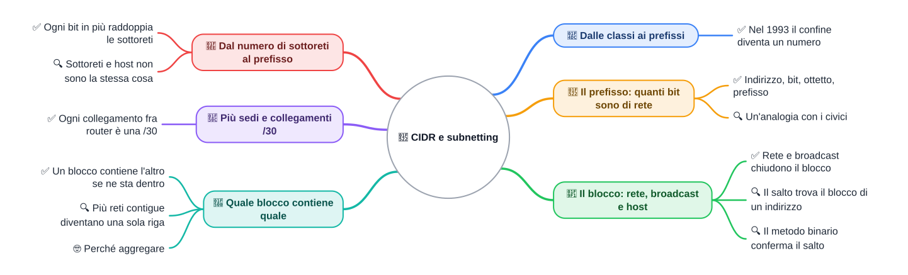
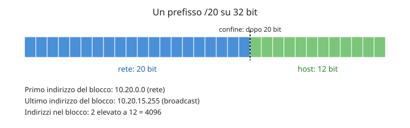

🏠 [Indice](../README.md) · [S2](./%28STU%29%204DI%20nov-dic%20S2%20-%20VLSM.md) ➡️

# 🔢 CIDR e subnetting

**4DI · Novembre-Dicembre · S1 · Teoria**

⏱️ **Tempo di studio: circa 40 minuti.** ✅ essenziale: 25 min. 🔍 per il voto alto: 15 min. 🤓 si può saltare. Nessun compito obbligatorio a casa.

> **Legenda:** ✅ da sapere · 🔍 per capire fino in fondo · 🤓 facoltativo · 📜 storia · 🧪 esempio · ⚠️ errore comune · 🧠 da ricordare · ✏️ da fare · 🃏 flashcard · 🔧 In laboratorio · 🗺️ mappa

> **Valori inventati.** Gli indirizzi di questa dispensa sono inventati per l'esercizio, salvo dove è scritto diversamente.

## 🗺️ Mappa



## 📜 Dalle classi ai prefissi

### ✅ Nel 1993 il confine diventa un numero

Prima del 1993 la taglia di una rete era fissa: il primo ottetto decideva quanti indirizzi ottenevi. Un'azienda con 40 computer riceveva una rete di classe C, cioè 254 host ordinari: 214 indirizzi restavano sprecati.

Nel 1993 l'IETF, il gruppo che scrive gli standard di Internet, pubblica le RFC 1518 e 1519. Introducono **CIDR** (*Classless Inter-Domain Routing*, instradamento senza classi): <u>il confine di una rete si scrive con un prefisso, per esempio `/26`, e può cadere in qualsiasi punto</u>.

🧠 <u>Il prefisso sostituisce la classe: il numero dopo la barra dice dove passa il confine.</u>

## 🔢 Il prefisso: quanti bit sono di rete

### ✅ Indirizzo, bit, ottetto, prefisso

Un **indirizzo IPv4** è un numero di 32 **bit**, cifre binarie che valgono 0 o 1. Per leggerlo si divide in quattro **ottetti**, gruppi di 8 bit che si scrivono come numeri da 0 a 255. Per esempio `10.20.5.17` ha quattro ottetti: 10, 20, 5 e 17.

Il **prefisso** è il numero dopo la barra, come `/20`. <u>Dice quanti bit iniziali dell'indirizzo sono della rete</u>. I bit rimasti identificano i dispositivi, che si chiamano **host**.

La **maschera** è lo stesso confine scritto come un indirizzo: ogni bit di rete vale 1, ogni bit di host vale 0. Per questo `/20` e `255.255.240.0` dicono la stessa cosa.

Parti da un problema. Un PC ha indirizzo `10.20.5.17/20` e deve inviare un pacchetto a `10.20.9.4`. Il PC deve decidere: il destinatario è nella mia rete, oppure devo passare dal router? Per rispondere deve sapere dove finisce la rete. Il prefisso dice esattamente questo.

| Prefisso | Maschera          | Bit host | Indirizzi nel blocco | Host ordinari |
| -------: | ----------------- | -------: | -------------------: | ------------: |
|    `/20` | `255.255.240.0`   |       12 |                 4096 |          4094 |
|    `/22` | `255.255.252.0`   |       10 |                 1024 |          1022 |
|    `/24` | `255.255.255.0`   |        8 |                  256 |           254 |
|    `/27` | `255.255.255.224` |        5 |                   32 |            30 |
|    `/30` | `255.255.255.252` |        2 |                    4 |             2 |



*Un prefisso `/20` separa 20 bit di rete da 12 bit di host: il confine sta sempre nello stesso punto.*

🧠 <u>Il blocco contiene $2^h$ indirizzi, dove $h$ è il numero di bit host.</u>

🧪 **Esempio inventato: `10.20.0.0/20`.** Ha $32 - 20 = 12$ bit host, quindi $2^{12} = 4096$ indirizzi. Va da `10.20.0.0` a `10.20.15.255`. Il PC di prima, `10.20.5.17`, sta dentro questo blocco, e anche `10.20.9.4`: restano nella stessa rete.

<details>
<summary>🃏 <b>Che cosa indica il prefisso /p?</b></summary>
Quanti bit iniziali dell'indirizzo sono di rete.
</details>
<details>
<summary>🃏 <b>Quanti indirizzi contiene una /22?</b></summary>
1024 indirizzi, cioè 2 elevato a 10. Gli host ordinari sono 1022.
</details>
<details>
<summary>🃏 <b>Perché il prefisso serve a un PC che invia un pacchetto?</b></summary>
Per capire se il destinatario sta nello stesso blocco di rete, oppure se il pacchetto va passato al router.
</details>

✏️ **Calcola (2 min).** Quanti bit host restano in una `/20`? Quanti indirizzi contiene il blocco?

### 🔍 Un'analogia con i civici

Un indirizzo IP è come un numero civico. Via Roma 10 identifica un punto preciso, e la via è la parte comune a tutti i numeri che stanno lì.

⚠️ <u>L'analogia si rompe su un punto:</u> in una rete il primo e l'ultimo indirizzo del blocco hanno un ruolo speciale e non si assegnano mai a un dispositivo. Un civico, invece, si può assegnare.

## 🧱 Il blocco: rete, broadcast e host

### ✅ Rete e broadcast chiudono il blocco

Ogni blocco ha tre parti.

- **Rete** (*network address*): il primo indirizzo del blocco. Identifica la rete, non si assegna a un PC.
- **Broadcast**: l'ultimo indirizzo del blocco. Un pacchetto diretto qui arriva a tutti gli host della rete.
- **Host ordinari**: tutti gli indirizzi fra i due. Sono quelli che si assegnano ai dispositivi.

🧪 **Esempio inventato: `10.20.0.0/20`.** Rete `10.20.0.0`, primo host `10.20.0.1`, ultimo host `10.20.15.254`, broadcast `10.20.15.255`. Host ordinari: 4096 − 2 = 4094.

🧠 <u>Host ordinari = indirizzi nel blocco − 2: si tolgono la rete e il broadcast.</u>

<details>
<summary>🃏 <b>Qual è il broadcast di 10.20.0.0/20?</b></summary>
10.20.15.255, l'ultimo indirizzo del blocco.
</details>
<details>
<summary>🃏 <b>Quanti host ordinari ha una /30?</b></summary>
2: sono 4 indirizzi meno la rete e il broadcast.
</details>

✏️ **Trova l'errore (2 min).** Uno studente scrive che il broadcast di `10.20.0.0/20` è `10.20.0.255`. Dove sbaglia? Qual è l'ultimo indirizzo del blocco?

### 🔍 Il salto trova il blocco di un indirizzo

Per trovare rete e broadcast di un indirizzo come `172.16.200.50/22` si usa il **salto**: la dimensione dei blocchi nell'ottetto dove cade il confine. Il salto si calcola così:

```text
salto = 256 − (valore dell'ottetto della maschera)
```

🧪 **Esempio svolto: `172.16.200.50/22`.**

1. **Maschera.** Il prefisso `/22` diventa `255.255.252.0`: il confine cade nel terzo ottetto.
2. **Salto.** $256 - 252 = 4$. I blocchi del terzo ottetto iniziano a 0, 4, 8, …, 200, 204.
3. **Rete.** Il terzo ottetto dell'indirizzo è 200, che è multiplo di 4: la rete è `172.16.200.0/22`.
4. **Broadcast.** $200 + 4 - 1 = 203$: il broadcast è `172.16.203.255`.
5. **Host.** Vanno da `172.16.200.1` a `172.16.203.254`: sono 1022.

⚠️ <u>Il salto non sta nel quarto ottetto.</u> Il `50` finale non conta per trovare il blocco: il confine cade nel terzo.

*Richiamo: nella S5 di sett-ott il salto si cercava nell'ultimo ottetto (per esempio con `/26` o `/27`). Qui il confine cade nel terzo ottetto.* Rivedi [S5 - CIDR e intervalli](../1%20SETT-OTT/%28STU%29%204DI%20sett-ott%20S5%20-%20CIDR%20e%20intervalli.md).

<details>
<summary>🃏 <b>Che cos'è il salto?</b></summary>
256 meno il valore dell'ottetto della maschera: è la dimensione dei blocchi in quell'ottetto.
</details>
<details>
<summary>🃏 <b>Qual è la rete di 172.16.200.50/22?</b></summary>
172.16.200.0/22.
</details>
<details>
<summary>🃏 <b>Quanto vale il salto di una /22?</b></summary>
4, perché la maschera nel terzo ottetto è 252. <i>Esempio: 256 − 252 = 4, quindi i blocchi partono da 200, 204, 208 e così via.</i>
</details>

✏️ **Prevedi (2 min).** Senza calcolare, dire se `172.16.203.9` sta nello stesso blocco di `172.16.200.50/22`. Poi verifica con il salto.

### 🔍 Il metodo binario conferma il salto

Il metodo binario usa la maschera come filtro. Si scrive il terzo ottetto in bit e si fa **AND** con la maschera. L'AND è un'operazione che tiene un bit solo se è 1 in entrambi i numeri: <u>il risultato è l'inizio del blocco</u>.

```text
200  = 11001000
252  = 11111100
AND  = 11001000  → 200: la rete è 172.16.200.0/22
```

<u>Se il salto e il binario danno lo stesso risultato, il calcolo è giusto.</u> Se non coincidono, si ricontrolla.

## 🧮 Dal numero di sottoreti al prefisso

### ✅ Ogni bit in più raddoppia le sottoreti

Una **sottorete** è una parte di una rete più grande. Pensa alla scuola che riceve il blocco `192.168.50.0/24` (256 indirizzi, valori inventati) e deve dare una sottorete a ciascuna di 8 aule-laboratorio. Quale prefisso scegliere?

Si ragiona al contrario: si parte dal numero di sottoreti e si cerca il prefisso.

1. **Sottoreti necessarie:** 8.
2. **Bit da prendere in prestito:** $2^3 = 8$, quindi 3 bit.
3. **Prefisso:** $24 + 3 = 27$, cioè `/27`.
4. **Controllo:** 8 sottoreti da 32 indirizzi fanno 256, gli indirizzi del `/24`.

| Bit presi in prestito | Sottoreti | Prefisso |
| --------------------: | --------: | -------: |
|                     1 |         2 |      /25 |
|                     2 |         4 |      /26 |
|                     3 |         8 |      /27 |

Le otto sottoreti sono: `192.168.50.0/27`, `192.168.50.32/27`, `192.168.50.64/27`, `192.168.50.96/27`, `192.168.50.128/27`, `192.168.50.160/27`, `192.168.50.192/27`, `192.168.50.224/27`.

🧠 <u>Ogni bit preso in prestito raddoppia il numero di sottoreti e dimezza la loro dimensione.</u>

### 🔍 Sottoreti e host non sono la stessa cosa

⚠️ Otto sottoreti non significano otto computer. Ogni sottorete `/27` ha 30 host ordinari, quindi in totale le otto aule hanno 240 host possibili.

Richiamo: la S4 di sett-ott ha introdotto la **FLSM** (*Fixed Length Subnet Mask*), cioè la suddivisione in sottoreti tutte uguali. Vedi [S4 - Reti private e FLSM](../1%20SETT-OTT/%28STU%29%204DI%20sett-ott%20S4%20-%20Reti%20private%20e%20FLSM.md).

<details>
<summary>🃏 <b>Quanti bit servono per ottenere 8 sottoreti?</b></summary>
3, perché 2 elevato a 3 fa 8.
</details>
<details>
<summary>🃏 <b>Da una /24, quanto dà un prefisso /26 in sottoreti?</b></summary>
4 sottoreti da 64 indirizzi ciascuna.
</details>

✏️ **Calcola (3 min).** Servono 5 sottoreti da una `/24`. Quale prefisso scegli? Quanti indirizzi ha ogni sottorete?

## 🔌 Più sedi e collegamenti /30

### ✅ Ogni collegamento fra router è una /30

Un istituto ha tre sedi, A, B e C. Ogni sede ha una LAN, la rete locale dei suoi PC. Il router di A deve parlare con quello di B: il collegamento fra i due router è un tratto con due soli estremi. Per questo si usa una **/30**: <u>4 indirizzi in tutto, di cui solo 2 host, uno per ciascun router</u>.

Piano inventato, con tre sedi e due collegamenti:

| Rete | Prefisso | Rete (primo) | Host | Broadcast (ultimo) |
| --- | --- | --- | --- | --- |
| Sede A, PC | `/27` | `172.16.20.0` | `172.16.20.1`–`172.16.20.30` | `172.16.20.31` |
| Sede B, PC | `/27` | `172.16.20.32` | `172.16.20.33`–`172.16.20.62` | `172.16.20.63` |
| Sede C, PC | `/27` | `172.16.20.64` | `172.16.20.65`–`172.16.20.94` | `172.16.20.95` |
| Collegamento A-B | `/30` | `172.16.20.128` | `172.16.20.129` (router A), `172.16.20.130` (router B) | `172.16.20.131` |
| Collegamento B-C | `/30` | `172.16.20.132` | `172.16.20.133` (router B), `172.16.20.134` (router C) | `172.16.20.135` |

Convenzione dichiarata per l'esempio: il primo host di ogni collegamento va al router della sede di partenza.

Richiamo: la S6 di sett-ott ha introdotto il VLSM, cioè sottoreti di dimensioni diverse, dimensionando da quella più grande. Vedi [S6 - VLSM e progettazione](../1%20SETT-OTT/%28STU%29%204DI%20sett-ott%20S6%20-%20VLSM%20e%20progettazione.md).

🧠 <u>Un collegamento fra router occupa spazio come una rete: 4 indirizzi, dei quali 2 usabili.</u>

⚠️ Errore comune: contare il collegamento come se fosse una sede, cioè usare una `/27` per un cavo fra due router.

<details>
<summary>🃏 <b>Perché un collegamento fra due router ha una /30?</b></summary>
Perché servono solo due indirizzi host, uno per ciascun router. <i>Esempio: <code>172.16.20.128/30</code> ha host <code>.129</code> e <code>.130</code>.</i>
</details>
<details>
<summary>🃏 <b>Quali indirizzi di 172.16.20.128/30 non si assegnano?</b></summary>
172.16.20.128, che è la rete, e 172.16.20.131, che è il broadcast.
</details>

✏️ **Trova l'errore (2 min).** Per il collegamento A-B uno studente scrive: `172.16.20.130/30`, router A `172.16.20.131`, router B `172.16.20.132`. Quale blocco contiene `130`? Quali indirizzi scritti sono fuori da quel blocco o non assegnabili?

🔧 **In laboratorio:** su Packet Tracer questi indirizzi si assegnano alle interfacce dei router. Qui facciamo solo il calcolo su carta.

## 🔀 Quale blocco contiene quale

### ✅ Un blocco contiene l'altro se ne sta dentro

Un blocco più grande **contiene** uno più piccolo quando tutti gli indirizzi del piccolo stanno nel grande.

🧪 **Esempio inventato: `172.16.200.0/22`.** Va da `172.16.200.0` a `172.16.203.255`. Il blocco `172.16.203.0/24` sta dentro: va da `172.16.203.0` a `172.16.203.255`, tutto compreso nel grande.

🧠 <u>Per controllare, si guarda l'ottetto del confine: il terzo, per una /22.</u>

<details>
<summary>🃏 <b>Quando un blocco contiene un altro?</b></summary>
Quando tutti gli indirizzi del blocco piccolo stanno dentro il blocco grande.
</details>

✏️ **Prevedi (2 min).** `10.20.16.0/24` sta dentro `10.20.0.0/20`? Prima prevedi, poi verifica con il salto del terzo ottetto.

### 🔍 Più reti contigue diventano una sola riga

Quattro reti `/26` consecutive e allineate, cioè `192.168.0.0/26`, `192.168.0.64/26`, `192.168.0.128/26` e `192.168.0.192/26`, coprono insieme tutti gli indirizzi da `192.168.0.0` a `192.168.0.255`. Si possono scrivere come una sola `/24`.

⚠️ Non sempre si può: `192.168.0.64/26` e `192.168.0.128/26` sono vicine, ma insieme non formano una `/25`, che deve partire da 0 o da 128.

<details>
<summary>🃏 <b>Quale prefisso riassume quattro /26 consecutive e allineate?</b></summary>
La /24 che le contiene tutte.
</details>

### 🤓 Perché aggregare

> Un router con una riga invece di quattro ha una tabella più piccola. Questo è il motivo per cui CIDR permette di **aggregare**: sostituire più reti con un prefisso più corto. Il routing si studierà nelle prossime settimane.

## ✏️ Esercizi
1. **Calcola.** Quanti bit host restano in una `/28`? Quanti indirizzi ha il blocco?
2. **Prevedi e verifica.** Senza guardare, qual è il salto di una `/25`? Verifica con il metodo.

## 📚 Fonti e risorse

- [RFC 1519 - Classless Inter-Domain Routing (CIDR)](https://www.rfc-editor.org/rfc/rfc1519): la proposta del 1993 che introduce il prefisso. Basta leggere l'introduzione.
- [RFC 4632 - Classless Inter-domain Routing (CIDR)](https://www.rfc-editor.org/rfc/rfc4632): versione aggiornata del 2006. Per consultazione.
- [Wikipedia - Classless Inter-Domain Routing](https://en.wikipedia.org/wiki/Classless_Inter-Domain_Routing): storia e motivazioni, in inglese.
- Immagine: `Allegati/cidr-prefisso-20-schema.svg`, disegno originale creato per questa dispensa (schema di un prefisso `/20`). Nessuna licenza di terzi.

---

🏠 [Indice](../README.md) · [S2](./%28STU%29%204DI%20nov-dic%20S2%20-%20VLSM.md) ➡️
