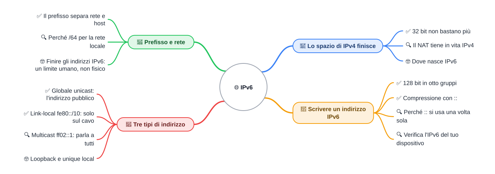
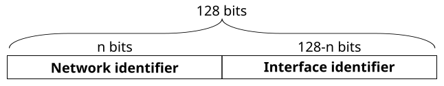
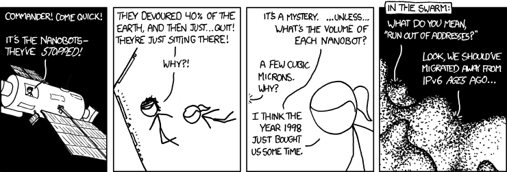

🏠 [Indice](../README.md) · [S2](./%28STU%29%204DI%20nov-dic%20S2%20-%20Router%20e%20tabelle%20di%20routing.md) ➡️

# 🌐 IPv6

**Libro:** Unità 4, pagina 158

**4DI · Novembre-Dicembre · S1 · Teoria**

⏱️ **Tempo di studio: circa 40 minuti.** ✅ essenziale: 25 min. 🔍 per il voto alto: 15 min. 🤓 si può saltare. Nessun compito obbligatorio a casa.

> **Legenda:** ✅ da sapere · 🔍 per capire fino in fondo · 🤓 facoltativo · 📜 storia · ⚙️ come si legge · 🧪 esempio · ⚠️ errore comune · 🧠 da ricordare · ✏️ da fare · 🔧 In laboratorio · 🃏 flashcard (rispondi a voce, poi apri)

> 📜 **Il quadro — e che cosa te ne fai tu.** Nel 1981 un indirizzo di 32 bit sembra infinito. Trent'anni dopo, ogni telefono, console e termostato ne vuole uno, e nel 2011 la riserva centrale di IPv4 finisce. IPv6 non è teoria da museo: **circa metà del traffico Internet mondiale verso i grandi servizi viaggia già su IPv6**, molti operatori mobili lo usano ogni giorno sul tuo telefono, e i provider cloud fanno pagare gli IPv4 pubblici mentre gli IPv6 sono gratuiti.
>
> Saper leggere questi indirizzi ti serve per capire quello che vedi già oggi in `ipconfig`, per configurare un router o una partita online senza impazzire dietro al NAT, e perché qualsiasi rete moderna lavora in **dual-stack** (IPv4 e IPv6 insieme).
>
> 🧪 **Quanto spazio è, davvero?** La superficie totale della Terra (terre emerse più oceani) è di circa $5{,}1 \times 10^{14}$ metri quadrati, cioè $5{,}1 \times 10^{20}$ millimetri quadrati.
>
- **Risultato:** con gli indirizzi IPv6 potremmo assegnare <u>oltre 660 milioni di miliardi $6{,}6 \times 10^{17}$ di indirizzi a ogni singolo millimetro quadrato</u> della superficie terrestre.

## 📜 Lo spazio di IPv4 finisce

### ✅ 32 bit non bastano più
#fatto👍 

Un indirizzo IPv4 ha 32 bit (lo abbiamo visto in S3 di sett-ott). Con 32 bit ci sono 2^32 = 4 294 967 296 indirizzi: circa **4,3 miliardi**.

Nel 1981 sembrano tantissimi. Oggi ogni persona ha più dispositivi connessi. Nel 2011 la riserva centrale di indirizzi si svuota: <u>il mondo ha più dispositivi che numeri disponibili.</u>

**IANA** (*Internet Assigned Numbers Authority*) è l'ente che distribuisce i grandi blocchi di indirizzi. Come un ufficio che assegna i numeri civici ai comuni: quando finiscono i numeri, il comune nuovo non ne riceve altri.

✏️ **Prevedi (1 min).** Otto miliardi di persone, ognuna con tre dispositivi connessi. Bastano 4,3 miliardi di indirizzi IPv4? Scrivi la risposta prima di proseguire.

🃏 <b>Quanti indirizzi IPv4 esistono?</b>

Circa 4,3 miliardi, cioè 2^32.

🃏 <b>Che cosa fa IANA?</b>

Distribuisce i grandi blocchi di indirizzi IP agli enti che li assegnano.

### 🔍 Il NAT tiene in vita IPv4
#fatto👍 

**NAT** (*Network Address Translation*, traduzione degli indirizzi) è il trucco che salva IPv4. Il router di casa ha un solo indirizzo pubblico; i dispositivi dietro di lui hanno indirizzi privati.

🧪 Il telefono `192.168.1.25` chiede una pagina web. Il router cambia l'indirizzo di partenza in quello pubblico, per esempio `203.0.113.7` (valore inventato), e ricorda chi ha chiesto che cosa. Quando la risposta torna, la rimette al telefono giusto.

⚠️ Il NAT è un rattoppo, non una soluzione. Un dispositivo dietro il NAT si fa trovare con più fatica da fuori, e il router deve tenere una lista di tutte le richieste.

🃏 <b>Che cosa fa il NAT?</b>

Il router traduce gli indirizzi privati dei dispositivi in un indirizzo pubblico.

🃏 <b>Perché il NAT è un rattoppo e non una cura?</b>

Non aumenta gli indirizzi: li condivide, e rende più difficile farsi raggiungere da fuori.

### 🤓 Dove nasce IPv6
#fatto👍 

Nel 1995 l'IETF, il gruppo che scrive gli standard di Internet, pubblica la prima specifica di IPv6. La versione in uso oggi è l'**RFC 8200** del 2017. Il numero sale da 4 a 6 perché il 5 era già stato usato per un protocollo sperimentale.

Il 6 giugno 2012 avviene il *World IPv6 Launch*: grandi fornitori attivano IPv6 in modo permanente. Da allora il meme «IPv6 arriverà l'anno prossimo» fa sorridere, ma convive con IPv4: oggi vanno avanti insieme.

🃏 <b>Perché IPv6 si chiama così?</b>

Perché è la sesta versione di IP: il numero 5 era già usato per un protocollo sperimentale.

✏️ **Esercizio (2 min).** Scrivi in una frase che cosa succede se una rete finisce gli indirizzi IPv4, e quale rattoppo usa.

## 🔢 Scrivere un indirizzo IPv6

### ✅ 128 bit in otto gruppi
#fatto👍 

IPv6 usa **128 bit**. Il numero di indirizzi è 2^128: un numero con 39 cifre, circa 3,4 × 10^38.

Per scriverlo si usano **otto gruppi** di 16 bit. Ogni gruppo si scrive in **esadecimale**: un sistema a 16 cifre (0-9, poi a-f). Una cifra esadecimale vale 4 bit: `f` vale 15, cioè `1111` in binario.

🧪 `2001:0db8:0000:0000:0000:0000:0000:0001`: otto gruppi, separati da due punti.

⚙️ Quattro cifre esadecimali fanno un gruppo di 16 bit. Otto gruppi fanno 128 bit.

🃏 <b>Quanti bit ha un indirizzo IPv6?</b>

128 bit, scritti in otto gruppi.

🃏 <b>Quanti bit copre una cifra esadecimale?</b>

4 bit: per esempio `f` vale 15, cioè `1111`.

### ✅ Compressione con ::
#fatto👍 

Otto gruppi sono lunghi da scrivere. Due regole lo accorciano:

1. Togli gli zeri iniziali di ogni gruppo: `0db8` diventa `db8`, `0000` diventa `0`.
2. Una sola sequenza di gruppi tutti a zero si sostituisce con `::`.

🧪 `2001:0db8:0000:0000:0000:0000:0000:0001` → `2001:db8:0:0:0:0:0:1` → `2001:db8::1`

Nell'ultimo passaggio `::` vale cinque gruppi a zero: otto gruppi meno i tre che restano (`2001`, `db8`, `1`).

<u>I due punti doppi `::` si usano una sola volta in tutto l'indirizzo.</u>

🃏 <b>Che cosa sostituisce il simbolo ::?</b>

Una sola sequenza di gruppi tutti a zero.

🃏 <b>Quante volte si può usare ::?</b>

Una sola volta in tutto l'indirizzo.

### 🔍 Perché :: si usa una sola volta
#fatto👍 

Immagina un indirizzo `2001:db8::1::5`. Ci sono quattro gruppi scritti e quattro gruppi di zeri da distribuire. Il primo `::` potrebbe avere 1 zero e il secondo 3; oppure 2 e 2; oppure 3 e 1. Non si sa quale sia giusto.

⚠️ Per questo il protocollo vieta un secondo `::`: l'indirizzo deve essere **univoco**, cioè avere una sola lettura possibile.

🃏 <b>Perché non si può scrivere 2001:db8::1::5?</b>

Perché non si capisce quanti zeri stanno in ciascun `::`: l'indirizzo sarebbe ambiguo.

### 🔍 Verifica l'IPv6 del tuo dispositivo
#fatto👍 

**Sul telefono:** apri le impostazioni del Wi-Fi, poi la rete a cui sei connesso. Cerca la voce «IPv6» o «indirizzo IP». Il percorso cambia con il modello e con il sistema. Se trovi solo un indirizzo a quattro gruppi di cifre decimali, come `192.168.1.25`, quella è la versione IPv4: la rete del tuo telefono può non avere IPv6.

**Sul PC:** il comando cambia con il sistema operativo:
- **Windows:** `ipconfig`; cerca «Indirizzo IPv6».
- **Linux:** `ip -6 address`; cerca gli indirizzi `inet6` dell'interfaccia di rete.
- **macOS:** `ifconfig`; cerca gli indirizzi `inet6` dell'interfaccia Wi-Fi, spesso `en0`.

🧪 Esempio inventato, con il prefisso di documentazione: `2001:db8:4f2a:17:5c1e:9d3b:7a20:4e81`. Il tuo indirizzo sarà diverso: questo è solo un modello di come si legge.

🔧 **In laboratorio:** useremo lo stesso comando sui PC della classe. Nessuna consegna.

🃏 <b>Quali comandi mostrano gli indirizzi IPv6 su Windows, Linux e macOS?</b>

Windows: `ipconfig`; Linux: `ip -6 address`; macOS: `ifconfig`.

✏️ **Esercizio (3 min).** Comprimi `2001:0db8:0000:0000:0000:0000:0000:0042`. Poi trova l'errore in `2001:db8::1::5` e spiega in una frase perché è sbagliato.

## 📐 Prefisso e rete

### ✅ Il prefisso separa rete e host
#fatto👍 

Come in IPv4, il **prefisso** dice quanti bit sono di rete. In IPv6 la rete locale tipica ha prefisso **/64**: i primi 64 bit identificano la rete, gli altri 64 identificano l'interfaccia.

🧪 `2001:db8:4f2a:17::/64` indica la rete che inizia con `2001:db8:4f2a:17`. L'indirizzo `2001:db8:4f2a:17:5c1e:9d3b:7a20:4e81` appartiene a quella rete.

*Struttura generale di un indirizzo IPv6 unicast: prima il prefisso di rete, poi l'identificatore dell'interfaccia.*

Un operatore (ISP) di solito assegna un blocco più grande (per esempio un prefisso `/48` o `/56`), e la rete di casa ne prende un `/64`. Sono valori tipici, non regole fisse.

🃏 <b>Quanti bit ha il prefisso di una rete locale tipica?</b>

64, cioè /64.

🃏 <b>Quali bit indicano la rete in 2001:db8:4f2a:17::/64?</b>

I primi 64 bit, cioè i primi quattro gruppi: 2001, db8, 4f2a e 17.

### 🔍 Perché /64 per la rete locale

Con /64 restano 64 bit per le interfacce. È una scelta standard: lascia spazio a tantissimi dispositivi, e permette ai dispositivi di costruirsi da soli il proprio indirizzo partendo dal prefisso. È la prassi comune, non un obbligo dell'intero protocollo.

⚠️ `/64` non vuol dire «64 host». Vuol dire 64 bit di rete. Gli indirizzi disponibili in una rete /64 sono 2^64, circa 18 miliardi di miliardi.

🃏 <b>Quanti indirizzi ci sono in una rete /64?</b>

2^64, circa 18 miliardi di miliardi.

### 🤓 Finire gli indirizzi IPv6: un limite umano, non fisico

Viene spontaneo chiedersi: **è fisicamente possibile esaurire anche gli indirizzi IPv6?**

Se contiamo i dispositivi uno per uno, **fisicamente no**. La superficie dell'intera Terra (oceani compresi) misura circa $5{,}1 \times 10^{20}$ millimetri quadrati: dividendo $2^{128}$ indirizzi per quella superficie, restano circa **670 milioni di miliardi di indirizzi per ogni singolo millimetro quadrato del pianeta**. Anche accendendo un milione di miliardi di nuovi dispositivi al secondo, servirebbero oltre **10 milioni di miliardi di anni** per finirli: quasi un milione di volte l'età dell'universo.

Il vero punto debole non è la fisica, ma **come assegniamo i prefissi**. In IPv6 non si consegnano indirizzi sciolti, ma intere reti `/64`, quindi i bit che contano per dividere il mondo sono i primi 64. Oggi inoltre si usa solo **un ottavo** dello spazio totale (`2000::/3`). Eppure già questo solo ottavo contiene $2^{61}$ reti `/64`: circa **288 milioni di reti locali intere per ciascuno degli 8 miliardi di esseri umani**, mentre gli altri **sette ottavi** di IPv6 restano intatti in cassaforte. L'unico modo per rimanere a secco sarebbe uno spreco burocratico colossale nel distribuire prefissi giganti; e anche in quel caso basterebbe aprire uno dei sette ottavi di riserva. La vignetta **xkcd #865** (*Nanobots*) ci scherza su immaginando un futuro invaso da sciami di nanobot che riescono a bruciare pure i 128 bit.

*Vignetta **xkcd #865** (*Nanobots*), di Randall Munroe, licenza CC BY-NC 2.5: i nanobot si fermano perché a un certo punto finiscono lo spazio fisico, non gli indirizzi. In inglese, un minuto di lettura.

🃏 <b>🤓 È fisicamente possibile finire i 2^128 indirizzi IPv6 collegando dispositivi?</b>

No: ci sono circa 670 milioni di miliardi di indirizzi per ogni millimetro quadrato della Terra; solo uno spreco enorme di prefissi potrebbe consumare il blocco attuale, ma restano sette ottavi dello spazio in riserva.

✏️ **Esercizio (1 min).** Perché si dice "un ottavo", nel testo sopra?
✏️ **Esercizio (2 min).** Scrivi la rete di `2001:db8:4f2a:17:5c1e:9d3b:7a20:4e81/64`. Sottolinea i gruppi che fanno parte della rete e cerchia quelli che identificano l'interfaccia.

## 🧭 Tre tipi di indirizzo

Il tipo di un indirizzo IPv6 si riconosce subito dalle prime cifre. Nel mondo reale i tuoi dispositivi — smartphone, PC e router di casa — **usano tutti e tre questi indirizzi contemporaneamente**, spesso senza che tu te ne accorga, per svolgere tre compiti molto diversi.

### ✅ Globale unicast: l'indirizzo pubblico

**Unicast** vuol dire: un indirizzo per una sola interfaccia. **Globale** vuol dire: valido su Internet. Gli indirizzi globali iniziano con `2` o `3` (il blocco è `2000::/3`). Funziona come l'indirizzo IPv4 pubblico, ma senza bisogno del NAT: <u>ogni dispositivo può avere il suo indirizzo pubblico personale</u>.

**Che cosa ci fa davvero il tuo dispositivo:**
- **Navigare e guardare video:** quando apri YouTube o Netflix dal telefono su una rete con IPv6 attivo, il telefono usa il proprio Globale Unicast per chiedere il video direttamente ai server di Google o Netflix.
- **Gaming online e videochiamate dirette:** il traffico viaggia direttamente fra il tuo Globale Unicast e quello dell'altro giocatore o server, senza i blocchi tipici del NAT.
- **Accesso da fuori casa:** se hai un piccolo server domestico (per esempio un NAS o Home Assistant), puoi raggiungerlo da fuori digitando il suo Globale Unicast (se il firewall del router lo permette).

🧪 `2001:db8::1` è un esempio di Globale Unicast. Il blocco `2001:db8::/32` è riservato per legge ai libri di testo, ai manuali e agli esercizi (proprio come i numeri di telefono `555-...` nei film americani): nessun computer vero su Internet ha questo indirizzo, così possiamo usarlo negli esempi senza disturbare nessuno.

Come un numero di telefono internazionale: è unico nel mondo, ma da solo non dice in quale città si trova la persona; servono i router per instradare la chiamata.

🃏 <b>Che cosa vuol dire globale unicast?</b>

Un indirizzo unico nel mondo per un singolo dispositivo, raggiungibile direttamente su Internet senza NAT. *Es.: 2001:db8::1 (blocco riservato agli esempi).*

### ✅ Link-local fe80::/10: solo sul cavo

Un indirizzo **link-local** vale solo nel collegamento locale: fra dispositivi attaccati allo stesso cavo o allo stesso Wi-Fi. Il router non lo inoltra mai su Internet. Ogni dispositivo IPv6 se ne costruisce uno da solo appena si accende. Il prefisso `fe80::/10` copre tutti gli indirizzi da `fe80` a `febf`.

Questo indirizzo non lo digiti quasi mai a mano: i dispositivi lo usano **dietro le quinte** ancora prima di avere Internet funzionante.

**Che cosa ci fa davvero il tuo dispositivo:**
- **Chiedere «chi è il router?» (Gateway predefinito):** appena ti colleghi al Wi-Fi, il PC non ha ancora il suo indirizzo globale. Usa il suo `fe80::...` per parlare con il router di casa (che ha anche lui un `fe80::...`). Se controlli `ipconfig` sul PC, vedrai che il **Gateway predefinito** IPv6 è quasi sempre un indirizzo `fe80::...`!
- **Scambio di rotte tra router:** nelle reti aziendali e dei provider, due router collegati da un cavo in fibra usano i loro indirizzi Link-Local per scambiarsi le tabelle di instradamento.
- **Due PC collegati da un solo cavo:** se unisci due computer con un cavo Ethernet senza router né Wi-Fi, entrambi si danno da soli un `fe80::...` e possono subito scambiarsi file o fare `ping`.

🧪 `fe80::211:22ff:fe33:4455` è un esempio inventato. È come chiamare un compagno solo per nome: funziona finché siete nella stessa aula, ma fuori dall'aula non basta più.

⚠️ `fe80` non è un indirizzo «privato» come `192.168`: `192.168` può attraversare più router interni di un'azienda, mentre `fe80` non supera nemmeno il primo router.

🃏 <b>Dove vale un indirizzo link-local, e dove lo vedi spesso su un PC?</b>

Vale solo nel collegamento locale (stesso cavo o Wi-Fi); su un PC compare spesso in <code>ipconfig</code> anche come indirizzo del Gateway predefinito.

🃏 <b>Quali indirizzi appartengono a fe80::/10?</b>

Quelli che iniziano con un valore da fe80 a febf.

### 🔍 Multicast ff02::1: parla a tutti

**Multicast** è un pacchetto indirizzato a un **gruppo specifico di dispositivi interessati**, senza disturbare gli altri. Il prefisso multicast è `ff00::/8`. IPv4 usava il **broadcast** (urlare a chiunque sulla rete locale); <u>IPv6 abolisce il broadcast e usa al suo posto il multicast</u>. 

**Che cosa ci fa davvero il tuo dispositivo:**
- **Trovare i vicini e il router (*Neighbor Discovery*):** `ff02::1` è il gruppo di *tutti i nodi* del collegamento locale (come un annuncio dall'altoparlante della scuola: lo sentono tutti nel palazzo, nessuno fuori). Quando invece il tuo telefono entra nel Wi-Fi e cerca solo il router, scrive a **`ff02::2`** (*tutti i router sul collegamento*): il router risponde dandogli i parametri per navigare, mentre TV e stampanti ignorano il messaggio.
- **Stampanti Wi-Fi, Chromecast e AirDrop:** quando premi «Stampa» dal telefono o cerchi una TV su cui trasmettere lo schermo, il telefono manda un pacchetto multicast (per esempio a `ff02::fb`) per chiedere: *«C'è una stampante o un Chromecast qui intorno?»*.
- **TV in diretta degli operatori (IPTV):** per trasmettere una partita in diretta, l'operatore invia un solo flusso multicast dalla centrale verso migliaia di decoder invece di spedire migliaia di copie identiche dello stesso video.

🃏 <b>Che cos'è ff02::1, e che differenza c'è con ff02::2?</b>

<code>ff02::1</code> è il gruppo multicast di tutti i dispositivi del collegamento locale; <code>ff02::2</code> raggiunge invece solo i router di quel collegamento.

🃏 <b>Che cosa usa IPv6 al posto del broadcast?</b>

Il multicast (blocco <code>ff00::/8</code>), che permette di parlare solo al gruppo interessato.

> 🧠 **In sintesi — i tre indirizzi in un secondo di vita vera:** quando accendi il PC o entri nel Wi-Fi, il dispositivo usa **Link-Local** (`fe80::...`) e **Multicast** (`ff02::...`) per presentarsi al router di casa e ricevere la configurazione; un secondo dopo, usa il **Globale Unicast** (`2000::/3`) per aprire YouTube o Google.

### 🤓 Loopback e unique local

`::1` è il **loopback**: il dispositivo parla con se stesso, esattamente come `127.0.0.1` in IPv4 (utile per provare un programma di rete sul proprio PC anche senza Wi-Fi).

Gli **unique local** (`fd00::/8` nella pratica) sono l'equivalente degli indirizzi privati di un'azienda: possono attraversare più router interni, ma non escono mai su Internet.

Esiste infine l'**anycast**: lo stesso identico indirizzo viene assegnato a decine di server sparsi nel mondo (così funzionano i grandi DNS pubblici come `2001:4860:4860::8888` di Google), e i router consegnano automaticamente la tua richiesta al server più vicino a te.

🃏 <b>🤓 Che cosa indica ::1?</b>

Il loopback: l'indirizzo con cui il dispositivo parla con se stesso, come 127.0.0.1 in IPv4.

✏️ **Esercizio (2 min).** Per `2001:db8::1`, `fe80::1` e `ff02::1` scrivi il tipo: globale, link-local o multicast. Poi dì quale dei tre un router non inoltra su Internet.

## 📚 Fonti e risorse

- [RFC 4291 - IPv6 Addressing Architecture](https://www.rfc-editor.org/rfc/rfc4291): la specifica dei tipi di indirizzo e del prefisso `/64`. Per consultazione.
- [RFC 5952 - Testo degli indirizzi IPv6](https://www.rfc-editor.org/rfc/rfc5952): le regole di scrittura e compressione con `::`. Si legge in pochi minuti.
- [RFC 8200 - IPv6](https://www.rfc-editor.org/rfc/rfc8200): la versione di IPv6 in uso oggi, in inglese.
- [RFC 3849 - Prefisso di documentazione 2001:db8::/32](https://www.rfc-editor.org/rfc/rfc3849): perché gli esempi usano `2001:db8`.
- [RFC 5737 - Indirizzi di documentazione IPv4](https://www.rfc-editor.org/rfc/rfc5737): perché l'esempio `203.0.113.7` è sicuro.
- [World IPv6 Launch](https://www.worldipv6launch.org/): il lancio del 6 giugno 2012, con gli aggiornamenti dei fornitori.
- [xkcd #865 - Nanobots](https://xkcd.com/865/): una vignetta classica (in inglese, un minuto di lettura) sull'idea di riuscire un giorno a esaurire perfino $2^{128}$ indirizzi.

**Immagini:** *IPv6 address structure-en.svg*, di Michel Bakni, licenza CC BY-SA 4.0 (Wikimedia Commons), modificata solo aggiungendo uno sfondo bianco (l'originale è trasparente e non si legge in tema scuro): <https://commons.wikimedia.org/wiki/File:IPv6_address_stracture-en.svg>. *xkcd #865 - Nanobots*, di Randall Munroe, licenza CC BY-NC 2.5, non modificata: <https://xkcd.com/865/>.

**Valori inventati:** tutti gli indirizzi degli esempi, tranne i prefissi e gli indirizzi standard `2000::/3`, `2001:db8::/32`, `fe80::/10`, `ff00::/8`, `ff02::1`, `ff02::2`, `ff02::fb`, `::1`, `fd00::/8` e `2001:4860:4860::8888`, che sono reali.

---

🏠 [Indice](../README.md) · [S2](./%28STU%29%204DI%20nov-dic%20S2%20-%20Router%20e%20tabelle%20di%20routing.md) ➡️
