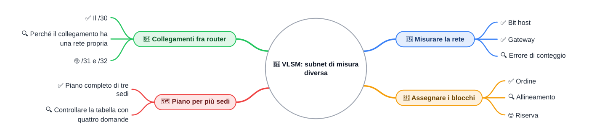
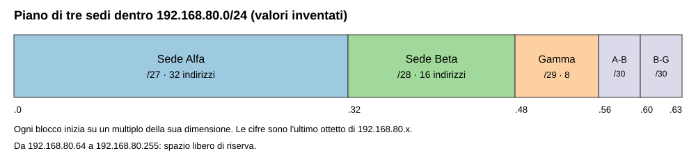

⬅️ [S1](./%28STU%29%204DI%20nov-dic%20S1%20-%20CIDR%20e%20subnetting.md) · 🏠 [Indice](../README.md) · [S3](./%28STU%29%204DI%20nov-dic%20S3%20-%20IPv6.md) ➡️

# 🧩 VLSM: subnet di misura diversa

**4DI · Novembre-Dicembre · S2 · Teoria**

⏱️ **Tempo di studio: circa 45 minuti.** ✅ essenziale: 25 min. 🔍 per il voto alto: 20 min. 🤓 si può saltare. Nessun compito obbligatorio a casa.

> **Legenda:** ✅ da sapere · 🔍 per capire fino in fondo · 🤓 facoltativo, per curiosi · 📜 storia · 🧪 esempio · ⚠️ errore comune · 🧠 da ricordare · ✏️ da fare · 🔗 richiamo a settimane precedenti · 🔧 rimando al laboratorio · 🃏 flashcard (rispondi a voce, poi apri)

> Tutti gli indirizzi di questa dispensa sono **valori inventati per la didattica**, salvo dove è scritto il contrario.

## 🗺️ Mappa



## 📜 Lo spazio che non basta

Immagina una città dove ogni casa ha un numero civico, e i numeri non possono finire. Un prefisso dice quante case entrano in un quartiere. Il problema è che le case non sono tutte uguali: una scuola ha bisogno di più stanze di un ripostiglio.

Nel 1985 la RFC 950 (le RFC sono i documenti con cui gli ingegneri di Internet propongono le regole della rete) permette di dividere una rete in sottoreti più piccole. Tutte hanno però la **stessa misura**: è la logica di FLSM, già vista in S4 di sett-ott.

Poi arrivano protocolli di routing che trasportano anche la maschera di ogni rete: OSPF nel 1991 (RFC 1247) e RIPv2 nel 1993 (RFC 1388). Così i router capiscono che una rete è più grande dell'altra. Nel settembre 1993 la RFC 1519 descrive CIDR. Il grande passo è questo: **le sottoreti possono avere misure diverse**.

- **Sottorete** (*subnet*): una parte di una rete più grande, con un proprio intervallo di indirizzi. Esempio: la rete `192.168.80.0/24` si può dividere in una sottorete per la sede Alfa e una per la sede Beta.
- **VLSM** (*Variable Length Subnet Masking*, maschera di lunghezza variabile): il metodo che permette a ogni sottorete di avere la misura che serve. Esempio: una sede da 28 dispositivi e un collegamento da 2 router ricevono blocchi di misura diversa.

😄 Il metodo si potrebbe chiamare **Tetris degli indirizzi**: pezzi di forma diversa, un campo da riempire, e nessuna riga che si cancella da sola.

## 📏 Misurare la rete

### ✅ Dal numero di dispositivi al prefisso

Per ogni rete scegli il blocco più piccolo che basta. Questi sono i passaggi, come in S6 di sett-ott:

1. **Conta** i dispositivi e aggiungi il **gateway**: il router che la rete usa per uscire verso le altre reti. Esempio: il PC della sede Alfa manda i pacchetti per Beta al gateway della sede Alfa, che conta come un dispositivo in più.
2. **Trova** il numero minimo $h$ di **bit host**, cioè i bit finali dell'indirizzo che numerano i dispositivi, con $2^h - 2 \geq$ dispositivi con gateway. Il $-2$ serve perché l'indirizzo di rete e quello di broadcast non si assegnano.
3. **Calcola** il prefisso: $32 - h$.

| Dispositivi | Con gateway | Bit host $h$ | Prefisso | Indirizzi nel blocco | Host utili |
| ----------: | ----------: | -----------: | -------: | -------------------: | ---------: |
|          50 |          51 |            6 |    `/26` |                   64 |         62 |
|          28 |          29 |            5 |    `/27` |                   32 |         30 |
|          14 |          15 |            5 |    `/27` |                   32 |         30 |
|          12 |          13 |            4 |    `/28` |                   16 |         14 |
|           5 |           6 |            3 |    `/29` |                    8 |          6 |

🧠 <u>Prima si dimensiona ogni rete; poi si assegnano gli indirizzi.</u>

🔗 Il conteggio con il prefisso e il broadcast viene da S1 (CIDR e subnetting): se un prefisso non ti è chiaro, ripassa lì prima di continuare.

<details>
<summary>🃏 <b>Quanti bit host servono per 13 dispositivi con gateway?</b></summary>
Quattro bit, perché 2^4 - 2 = 14 indirizzi utili bastano, mentre con tre bit ne avresti 6.
</details>
<details>
<summary>🃏 <b>Quale prefisso corrisponde a 5 bit host?</b></summary>
/27, perché 32 - 5 = 27, e il blocco contiene 32 indirizzi.
</details>
<details>
<summary>🃏 <b>Quanti host utili offre una /29?</b></summary>
6, perché il blocco ha 8 indirizzi e due sono riservati (rete e broadcast).
</details>
<details>
<summary>🃏 <b>Perché il gateway si conta fra i dispositivi?</b></summary>
Perché anche il gateway occupa un indirizzo host della propria rete.
</details>

✏️ **(base) Prevedi, poi calcola.** Per sottoreti da 58, 27 e 9 dispositivi (gateway incluso) scrivi il prefisso minimo prima di fare il conto con la formula.

### 🔍 Il conteggio sbagliato

⚠️ Errore comune: fermarsi ai dispositivi e dimenticare il gateway. Una sede con 14 dispositivi sembra entrare in una `/28`, che ha 14 host utili. Con il gateway i dispositivi diventano 15, e la `/28` non basta: serve una `/27`.

🧪 Un controllo rapido: se il numero con gateway è esattamente 2^h - 2 (per esempio 14), il blocco è giusto; se supera 2^h - 2 di uno (per esempio 15 con h = 4), il blocco è troppo piccolo.

<details>
<summary>🃏 <b>Una sede con 14 dispositivi entra in una /28?</b></summary>
No, se si conta anche il gateway: 14 dispositivi più il gateway fanno 15, mentre una /28 ha 14 host utili.
</details>

✏️ **(medio) Trova l'errore.** Un piano assegna una `/27` a una sede con 30 dispositivi, gateway incluso. Spiega in una frase perché il blocco non basta.

## 🧱 Assegnare i blocchi

### ✅ Prima i blocchi grandi, poi quelli piccoli

Quando hai dimensionato tutte le reti, assegnale in questo ordine: dalla più grande alla più piccola. Ogni blocco deve iniziare su un **multiplo** della propria dimensione, cioè su un indirizzo che si ottiene partendo da zero e sommando la dimensione del blocco. Si dice che il blocco è **allineato**.

📜 Il metodo ha una storia semplice: chi assegna i blocchi nell'ordine di arrivo delle richieste, senza mai tornare indietro, può scoprire che il blocco grande non trova più posto. Non era un errore di calcolo: era un errore di ordine.

🧪 **Esempio con 64 indirizzi.** Arrivano quattro richieste: 8, 32, 16 e 8 indirizzi. Ogni blocco inizia su un proprio multiplo.

```text
Ordine di arrivo (8, 32, 16, 8), senza tornare indietro:
|8|  buco di 24  |---------- 32 ----------|   il 16 non trova più posto

Dal più grande (32, 16, 8, 8):
|---------- 32 ----------|---- 16 ----|8|8|  tutti entrano
```

🧠 <u>Il blocco più grande decide il resto: mettilo per primo.</u>

<details>
<summary>🃏 <b>In quale ordine si assegnano i blocchi VLSM?</b></summary>
Dal più grande al più piccolo.
</details>
<details>
<summary>🃏 <b>Quanti indirizzi ha un blocco /28?</b></summary>
16 indirizzi, cioè 2^4.
</details>
<details>
<summary>🃏 <b>Che cosa significa che un blocco è allineato?</b></summary>
Che inizia su un multiplo della sua dimensione: una /27 può iniziare solo a 0, 32, 64, 96 e così via.
</details>

✏️ **(base) Riordina.** Scrivi in ordine di assegnazione i blocchi /29, /26, /28, /30 e /27.

🔗 Il metodo dei quattro passaggi (dimensiona, ordina, alloca, controlla) è quello di [S6 di sett-ott](../1%20SETT-OTT/%28STU%29%204DI%20sett-ott%20S6%20-%20VLSM%20e%20progettazione.md): qui lo usi con misure più varie.

### 🔍 Allineamento e controllo del piano

Dopo aver assegnato i blocchi, controlla il piano con quattro domande:

| Controllo | Domanda |
| --------- | ------- |
| **Capienza** | ogni rete ha abbastanza host utili? |
| **Allineamento** | ogni rete inizia su un multiplo della sua dimensione? |
| **Non sovrapposizione** | gli intervalli sono separati? |
| **Tracciabilità** | la tabella riporta rete, prefisso, intervallo, broadcast e gateway? |

⚠️ Errore comune: sommare le dimensioni e pensare che il piano sia giusto. Anche con la somma giusta, un blocco non allineato lascia buchi inutilizzabili.

🧪 **Controllo dell'allineamento.** Un gruppo chiede una `/28`, cioè 16 indirizzi. Il piano la mette alla rete `192.168.80.40`. Il numero 40 è multiplo di 8, ma non di 16: i blocchi `/28` iniziano a `192.168.80.32`, `192.168.80.48` e così via. Quindi `192.168.80.40` non può essere la rete di una `/28`.

<details>
<summary>🃏 <b>Quali sono i quattro controlli di un piano VLSM?</b></summary>
Capienza, allineamento, non sovrapposizione e tracciabilità.
</details>
<details>
<summary>🃏 <b>Perché 192.168.80.40 non può essere la rete di una /28?</b></summary>
Perché le /28 iniziano a multipli di 16, e 40 non lo è; la rete corretta è 192.168.80.32.
</details>

✏️ **(base) Disegna (4 min).** Disegna una striscia da `192.168.80.0` a `192.168.80.63`, divisa in cinque blocchi con il loro prefisso. Colora lo spazio libero.

✏️ **(medio) Trova l'errore.** Un piano assegna a una sede da 12 dispositivi la rete `192.168.80.40/28`. Spiega perché l'indirizzo non è allineato e indica la rete `/28` che contiene `192.168.80.40`.

### 🤓 Lo spazio libero come riserva

> Lasciare indirizzi liberi non è sempre uno spreco. Una **riserva** motivata permette di aggiungere un reparto senza rifare il piano.
>
> Se però il piano non dice a che cosa serve lo spazio libero, nessuno sa se sia una riserva o un'assegnazione dimenticata.
>
> Come regola a spanne, si può prevedere uno spazio libero del 20-30% in una rete che deve crescere: è una convenzione, non una legge.

<details>
<summary>🃏 <b>Quando è utile lasciare indirizzi non assegnati?</b></summary>
Quando una riserva motivata e scritta nel piano permette alla rete di crescere senza essere riprogettata.
</details>

## 🔗 Collegamenti fra router: il /30

### ✅ Un /30 per ogni collegamento punto-punto

Un **collegamento punto-punto** collega esattamente due apparati, per esempio due router. Ogni collegamento è una rete con due soli dispositivi: per questo usa una sottorete **`/30`**.

Una `/30` ha 4 indirizzi: il primo è la rete, il secondo e il terzo sono i due host utili, l'ultimo è il broadcast.

🧪 Esempio: la rete `192.168.80.56/30`.

- Rete: `192.168.80.56`
- Host utili: `192.168.80.57` e `192.168.80.58`
- Broadcast: `192.168.80.59`

Ogni router prende un indirizzo del collegamento. Dove agisce? Il collegamento sta **fra** due router, non dentro una sede. Immagina tre sedi (inventate): Alfa a Torino, Beta a Genova, Gamma a Milano.

```text
Torino (sede Alfa)            Genova (sede Beta)
[PC Alfa] ... [router Alfa] ==== [router Beta] ... [PC Beta]
                 192.168.80.57     192.168.80.58
             |<----- collegamento 192.168.80.56/30 ----->|
```

<u>Il collegamento non è un dispositivo della sede: ha una rete tutta sua.</u>

⚠️ Errore comune: contare il collegamento fra i dispositivi di una sede. Il collegamento occupa 4 indirizzi di un piano, ma non serve a un PC.

<details>
<summary>🃏 <b>Quanti indirizzi ha una /30 e quanti host utili?</b></summary>
4 indirizzi, dei quali 2 host utili.
</details>
<details>
<summary>🃏 <b>Quali sono rete, host e broadcast della /30 che inizia a 192.168.80.60?</b></summary>
Rete 192.168.80.60, host 192.168.80.61 e 192.168.80.62, broadcast 192.168.80.63.
</details>

✏️ **(base) Scrivi la /30.** Per la rete `192.168.80.84/30` scrivi rete, i due host utili e il broadcast.

### 🔍 Perché il collegamento ha una rete propria

Un router sceglie la strada guardando la rete di destinazione. Se il collegamento non fosse una rete, i due router non avrebbero un intervallo comune in cui scambiarsi i pacchetti. Con una `/30`, invece, ogni lato sa quale indirizzo usare dall'altra parte.

Il prezzo è piccolo: 4 indirizzi per collegamento. Su un piano con molti collegamenti, però, quei 4 indirizzi si sommano, ed è per questo che la `/30` è la misura giusta: non ne spreca di più.

<details>
<summary>🃏 <b>Perché ogni collegamento fra due router ha una sottorete?</b></summary>
Perché ogni router deve sapere a quale rete mandare i pacchetti, e il collegamento è una rete con due soli apparati.
</details>

✏️ **(medio) Spiega.** In una frase scrivi perché il collegamento Alfa–Beta non può stare dentro la rete `192.168.80.0/27` della sede Alfa.

### 🤓 /31 e /32: casi particolari

> Esiste anche la `/31`, che usa solo 2 indirizzi per un collegamento punto-punto, senza broadcast (RFC 3021). La `/32` identifica un solo indirizzo. Non sono richieste per le verifiche di questo bimestre.

## 🗺️ Un piano per più sedi

### ✅ Il piano completo di tre sedi

Una scuola ha tre sedi: Alfa, Beta e Gamma. Le sedi sono inventate. Il piano usa la rete `192.168.80.0/24`, con:

- sede Alfa: 28 dispositivi, più gateway;
- sede Beta: 12 dispositivi, più gateway;
- sede Gamma: 5 dispositivi, più gateway;
- collegamento Alfa–Beta e collegamento Beta–Gamma: due `/30`.

🧪 **Passo per passo.** Dimensiona: Alfa usa `/27` (29 indirizzi su 30 utili), Beta usa `/28` (13 su 14), Gamma usa `/29` (6 su 6). Ordina: `/27`, `/28`, `/29`, poi le due `/30`. Alloca dall'inizio dello spazio, senza buchi.

| Blocco | Rete | Intervallo host | Broadcast | Note |
| ------ | ---- | --------------- | --------- | ---- |
| Sede Alfa | `192.168.80.0/27` | `192.168.80.1` – `192.168.80.30` | `192.168.80.31` | gateway `192.168.80.1` |
| Sede Beta | `192.168.80.32/28` | `192.168.80.33` – `192.168.80.46` | `192.168.80.47` | gateway `192.168.80.33` |
| Sede Gamma | `192.168.80.48/29` | `192.168.80.49` – `192.168.80.54` | `192.168.80.55` | gateway `192.168.80.49` |
| Collegamento Alfa–Beta | `192.168.80.56/30` | `192.168.80.57` – `192.168.80.58` | `192.168.80.59` | router Alfa `.57`, router Beta `.58` |
| Collegamento Beta–Gamma | `192.168.80.60/30` | `192.168.80.61` – `192.168.80.62` | `192.168.80.63` | router Beta `.61`, router Gamma `.62` |

Gli indirizzi da `192.168.80.64` a `192.168.80.255` restano liberi: spazio di riserva per una quarta sede.



*Lo schema dei cinque blocchi del piano: ogni blocco inizia su un proprio multiplo. Schema originale per questa dispensa.*

🔧 In laboratorio questo piano si ripeterà sugli apparati reali. Qui si lavora solo su carta, senza consegne.

<details>
<summary>🃏 <b>Quale rete collega le sedi Alfa e Beta nel piano dell'esempio?</b></summary>
192.168.80.56/30, con i router su 192.168.80.57 e 192.168.80.58.
</details>
<details>
<summary>🃏 <b>Quanti dispositivi con gateway servono alla sede Beta?</b></summary>
13: 12 dispositivi più il gateway, e il blocco è una /28.
</details>
<details>
<summary>🃏 <b>Che cosa contiene la tabella di un piano VLSM?</b></summary>
Per ogni blocco: rete, prefisso, intervallo degli host, broadcast e uso.
</details>

✏️ **(avanzato) Costruisci la tabella.** Dentro `172.16.40.0/24` assegna: sede A con 28 dispositivi, sede B con 14, sede C con 6, più gateway in ogni sede; collegamento A–B e collegamento B–C come `/30`. Compila una tabella con rete, prefisso, intervallo, broadcast e gateway.

### 🔍 Leggere la tabella come progetto

La tabella è il documento del progetto. Chi configura i dispositivi la legge e sa quale indirizzo usare, senza indovinarlo. Per questo la tabella deve dire tutto: rete, prefisso, intervallo, broadcast e gateway.

Confronta con la tabella dell'esempio: ogni riga ha abbastanza indirizzi, nessuna rete inizia in un punto sbagliato, e nessun intervallo si sovrappone a un altro.

⚠️ Errore comune: una tabella con la rete giusta ma senza gateway. Chi configura non sa quale indirizzo dare al PC.

<details>
<summary>🃏 <b>Quale controllo verifica che due reti non si sovrappongano?</b></summary>
Non sovrapposizione: gli intervalli degli indirizzi devono essere separati.
</details>

### 🤓 Dalla RFC alla tabella di un router

> Quando un router riceve un pacchetto, confronta l'indirizzo di destinazione con le reti della sua tabella e sceglie la più specifica che contiene l'indirizzo. Lo vedremo in S4. Il piano che hai costruito oggi è la tabella da cui il router partirà.

## 📚 Fonti e risorse

- [RFC 950 - Internet Standard Subnetting Procedure](https://www.rfc-editor.org/rfc/rfc950): il documento del 1985 che introduce le sottoreti. Leggi solo l'introduzione.
- [RFC 1519 - Classless Inter-Domain Routing (CIDR)](https://www.rfc-editor.org/rfc/rfc1519): la base del prefisso `/n` usato in tutta la dispensa.
- [RFC 3021 - Using 31-Bit Prefixes on IPv4 Point-to-Point Links](https://www.rfc-editor.org/rfc/rfc3021): per la 🤓 sulla `/31`.
- [RIPE NCC - IPv4 Subnetting](https://www.ripe.net/manage-ips-and-asns/ipv4/ipv4-subnetting/): uno strumento per **controllare** il tuo piano. Prima fai il conto a mano.
- Immagine: schema originale per questa dispensa, con blocchi e valori inventati.

---

⬅️ [S1](./%28STU%29%204DI%20nov-dic%20S1%20-%20CIDR%20e%20subnetting.md) · 🏠 [Indice](../README.md) · [S3](./%28STU%29%204DI%20nov-dic%20S3%20-%20IPv6.md) ➡️
