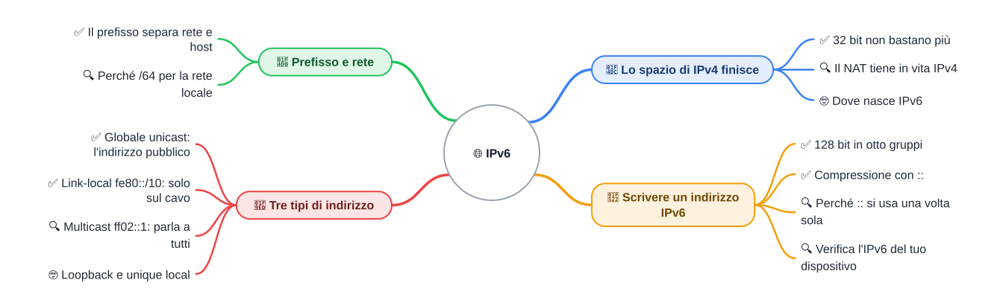

⬅️ [S2](./%28STU%29%204DI%20nov-dic%20S2%20-%20VLSM.md) · 🏠 [Indice](../README.md) · [S4](./%28STU%29%204DI%20nov-dic%20S4%20-%20Router%20e%20tabelle%20di%20routing.md) ➡️

# 🌐 IPv6

**4DI · Novembre-Dicembre · S3 · Teoria**

⏱️ **Tempo di studio: circa 40 minuti.** ✅ essenziale: 25 min. 🔍 per il voto alto: 15 min. 🤓 si può saltare. Nessun compito obbligatorio a casa.

> **Legenda:** ✅ da sapere · 🔍 per capire fino in fondo · 🤓 facoltativo · 📜 storia · ⚙️ come si legge · 🧪 esempio · ⚠️ errore comune · 🧠 da ricordare · ✏️ da fare · 🔧 In laboratorio · 🃏 flashcard (rispondi a voce, poi apri)

> 📜 **Il quadro.** Nel 1981 un indirizzo di 32 bit sembra un numero enorme. Trent'anni dopo, ogni telefono, console e termostato ne vuole uno. I numeri a disposizione finiscono prima del previsto. IPv6 non è un capriccio tecnico: è il numero nuovo, più lungo, che la rete ha dovuto inventare per continuare a crescere.

## 📜 Lo spazio di IPv4 finisce

### ✅ 32 bit non bastano più

Un indirizzo IPv4 ha 32 bit (lo abbiamo visto in S3 di sett-ott). Con 32 bit ci sono 2^32 = 4 294 967 296 indirizzi: circa **4,3 miliardi**.

Nel 1981 sembrano tantissimi. Oggi ogni persona ha più dispositivi connessi. Nel 2011 la riserva centrale di indirizzi si svuota: <u>il mondo ha più dispositivi che numeri disponibili.</u>

**IANA** (*Internet Assigned Numbers Authority*) è l'ente che distribuisce i grandi blocchi di indirizzi. Come un ufficio che assegna i numeri civici ai comuni: quando finiscono i numeri, il comune nuovo non ne riceve altri.

✏️ **Prevedi (1 min).** Otto miliardi di persone, ognuna con tre dispositivi connessi. Bastano 4,3 miliardi di indirizzi IPv4? Scrivi la risposta prima di proseguire.

🃏 <b>Quanti indirizzi IPv4 esistono?</b>

Circa 4,3 miliardi, cioè 2^32.

🃏 <b>Che cosa fa IANA?</b>

Distribuisce i grandi blocchi di indirizzi IP agli enti che li assegnano.

### 🔍 Il NAT tiene in vita IPv4

**NAT** (*Network Address Translation*, traduzione degli indirizzi) è il trucco che salva IPv4. Il router di casa ha un solo indirizzo pubblico; i dispositivi dietro di lui hanno indirizzi privati.

🧪 Il telefono `192.168.1.25` chiede una pagina web. Il router cambia l'indirizzo di partenza in quello pubblico, per esempio `203.0.113.7` (valore inventato), e ricorda chi ha chiesto che cosa. Quando la risposta torna, la rimette al telefono giusto.

⚠️ Il NAT è un rattoppo, non una soluzione. Un dispositivo dietro il NAT si fa trovare con più fatica da fuori, e il router deve tenere una lista di tutte le richieste.

🃏 <b>Che cosa fa il NAT?</b>

Il router traduce gli indirizzi privati dei dispositivi in un indirizzo pubblico.

🃏 <b>Perché il NAT è un rattoppo e non una cura?</b>

Non aumenta gli indirizzi: li condivide, e rende più difficile farsi raggiungere da fuori.

### 🤓 Dove nasce IPv6

> Nel 1995 l'IETF, il gruppo che scrive gli standard di Internet, pubblica la prima specifica di IPv6. La versione in uso oggi è l'**RFC 8200** del 2017. Il numero sale da 4 a 6 perché il 5 era già stato usato per un protocollo sperimentale.
> Il 6 giugno 2012 avviene il *World IPv6 Launch*: grandi fornitori attivano IPv6 in modo permanente. Da allora il meme «IPv6 arriverà l'anno prossimo» fa sorridere, ma convive con IPv4: oggi vanno avanti insieme.

🃏 <b>Perché IPv6 si chiama così?</b>

Perché è la sesta versione di IP: il numero 5 era già usato per un protocollo sperimentale.

✏️ **Esercizio (2 min).** Scrivi in una frase che cosa succede se una rete finisce gli indirizzi IPv4, e quale rattoppo usa.

## 🔢 Scrivere un indirizzo IPv6

### ✅ 128 bit in otto gruppi

IPv6 usa **128 bit**. Il numero di indirizzi è 2^128: un numero con 39 cifre, circa 3,4 × 10^38.

Per scriverlo si usano **otto gruppi** di 16 bit. Ogni gruppo si scrive in **esadecimale**: un sistema a 16 cifre (0-9, poi a-f). Una cifra esadecimale vale 4 bit: `f` vale 15, cioè `1111` in binario.

🧪 `2001:0db8:0000:0000:0000:0000:0000:0001`: otto gruppi, separati da due punti.

⚙️ Quattro cifre esadecimali fanno un gruppo di 16 bit. Otto gruppi fanno 128 bit.

🃏 <b>Quanti bit ha un indirizzo IPv6?</b>

128 bit, scritti in otto gruppi.

🃏 <b>Quanti bit copre una cifra esadecimale?</b>

4 bit: per esempio `f` vale 15, cioè `1111`.

### ✅ Compressione con ::

Otto gruppi sono lunghi da scrivere. Due regole lo accorciano:

1. Togli gli zeri iniziali di ogni gruppo: `0db8` diventa `db8`, `0000` diventa `0`.
2. Una sola sequenza di gruppi tutti a zero si sostituisce con `::`.

🧪 `2001:0db8:0000:0000:0000:0000:0000:0001` → `2001:db8:0:0:0:0:0:1` → `2001:db8::1`

Nell'ultimo passaggio `::` vale cinque gruppi a zero: otto gruppi meno i tre che restano (`2001`, `db8`, `1`).

<u>I due punti doppi `::` si usano una sola volta in tutto l'indirizzo.</u>

🃏 <b>Che cosa sostituisce il simbolo ::?</b>

Una sola sequenza di gruppi tutti a zero.

🃏 <b>Quante volte si può usare ::?</b>

Una sola volta in tutto l'indirizzo.

### 🔍 Perché :: si usa una sola volta

Immagina un indirizzo `2001:db8::1::5`. Ci sono quattro gruppi scritti e quattro gruppi di zeri da distribuire. Il primo `::` potrebbe avere 1 zero e il secondo 3; oppure 2 e 2; oppure 3 e 1. Non si sa quale sia giusto.

⚠️ Per questo il protocollo vieta un secondo `::`: l'indirizzo deve essere **univoco**, cioè avere una sola lettura possibile.

🃏 <b>Perché non si può scrivere 2001:db8::1::5?</b>

Perché non si capisce quanti zeri stanno in ciascun `::`: l'indirizzo sarebbe ambiguo.

### 🔍 Verifica l'IPv6 del tuo dispositivo

**Sul telefono:** apri le impostazioni del Wi-Fi, poi la rete a cui sei connesso. Cerca la voce «IPv6» o «indirizzo IP». Il percorso cambia con il modello e con il sistema. Se trovi solo un indirizzo a quattro gruppi di cifre decimali, come `192.168.1.25`, quella è la versione IPv4: la rete del tuo telefono può non avere IPv6.

**Sul PC Windows:** apri il prompt dei comandi e scrivi `ipconfig`. Cerca la riga «Indirizzo IPv6».

🧪 Esempio inventato, con il prefisso di documentazione: `2001:db8:4f2a:17:5c1e:9d3b:7a20:4e81`. Il tuo indirizzo sarà diverso: questo è solo un modello di come si legge.

🔧 **In laboratorio:** useremo lo stesso comando sui PC della classe. Nessuna consegna.

🃏 <b>Quale comando mostra l'IPv6 di un PC Windows?</b>

`ipconfig`, nel prompt dei comandi.

✏️ **Esercizio (3 min).** Comprimi `2001:0db8:0000:0000:0000:0000:0000:0042`. Poi trova l'errore in `2001:db8::1::5` e spiega in una frase perché è sbagliato.

## 📐 Prefisso e rete

### ✅ Il prefisso separa rete e host

Come in IPv4, il **prefisso** dice quanti bit sono di rete. In IPv6 la rete locale tipica ha prefisso **/64**: i primi 64 bit identificano la rete, gli altri 64 identificano l'interfaccia.

🧪 `2001:db8:4f2a:17::/64` indica la rete che inizia con `2001:db8:4f2a:17`. L'indirizzo `2001:db8:4f2a:17:5c1e:9d3b:7a20:4e81` appartiene a quella rete.

*Struttura generale di un indirizzo IPv6 unicast: prima il prefisso di rete, poi l'identificatore dell'interfaccia.*

Un operatore di solito assegna un blocco più grande (per esempio un prefisso `/48` o `/56`), e la rete di casa ne prende un `/64`. Sono valori tipici, non regole fisse.

🃏 <b>Quanti bit ha il prefisso di una rete locale tipica?</b>

64, cioè /64.

🃏 <b>Quali bit indicano la rete in 2001:db8:4f2a:17::/64?</b>

I primi 64 bit, cioè i primi quattro gruppi: 2001, db8, 4f2a e 17.

### 🔍 Perché /64 per la rete locale

Con /64 restano 64 bit per le interfacce. È una scelta standard: lascia spazio a tantissimi dispositivi, e permette ai dispositivi di costruirsi da soli il proprio indirizzo partendo dal prefisso. È la prassi comune, non un obbligo dell'intero protocollo.

⚠️ `/64` non vuol dire «64 host». Vuol dire 64 bit di rete. Gli indirizzi disponibili in una rete /64 sono 2^64, circa 18 miliardi di miliardi.

🃏 <b>Quanti indirizzi ci sono in una rete /64?</b>

2^64, circa 18 miliardi di miliardi.

✏️ **Esercizio (2 min).** Scrivi la rete di `2001:db8:4f2a:17:5c1e:9d3b:7a20:4e81/64`. Sottolinea i gruppi che fanno parte della rete e cerchia quelli che identificano l'interfaccia.

## 🧭 Tre tipi di indirizzo

Il tipo di un indirizzo IPv6 si riconosce dalle prime cifre. Tre tipi bastano per iniziare.

### ✅ Globale unicast: l'indirizzo pubblico

**Unicast** vuol dire: un indirizzo per una sola interfaccia. **Globale** vuol dire: valido su Internet. Gli indirizzi globali iniziano con `2` o `3` (il blocco è `2000::/3`).

🧪 `2001:db8::1` è un esempio. Il prefisso `2001:db8::/32` è riservato alla documentazione: nessuna rete reale lo usa, quindi l'esempio è sicuro.

Come un numero di telefono internazionale: è unico nel mondo. Dove smette di funzionare: il numero da solo non dice dove si trova la persona, serve la rete che lo instrada.

🃏 <b>Che cosa vuol dire globale unicast?</b>

Un indirizzo unico nel mondo, raggiungibile su Internet. *Es.: 2001:db8::1 (esempio di documentazione).*

### ✅ Link-local fe80::/10: solo sul cavo

Un indirizzo **link-local** vale solo nel collegamento locale: fra dispositivi sullo stesso cavo o sullo stesso Wi-Fi. Il router non lo inoltra su Internet. Ogni dispositivo IPv6 ne ha uno.

Il prefisso `fe80::/10` copre tutti gli indirizzi da `fe80` a `febf`.

🧪 `fe80::211:22ff:fe33:4455` è un esempio inventato. Come il nome che ti chiamano in aula: vale dentro l'aula. Dove smette di funzionare: fuori dall'aula quel nome non basta.

⚠️ `fe80` non è un indirizzo «privato» come `192.168`: è valido solo nel collegamento.

🃏 <b>Dove vale un indirizzo link-local?</b>

Solo nel collegamento locale, cioè fra dispositivi vicini. *Es.: fe80::211:22ff:fe33:4455 (inventato).*

🃏 <b>Quali indirizzi appartengono a fe80::/10?</b>

Quelli che iniziano con un valore da fe80 a febf.

### 🔍 Multicast ff02::1: parla a tutti

**Multicast** è un pacchetto indirizzato a un gruppo. Il prefisso multicast è `ff00::/8`.

🧪 `ff02::1` è il gruppo di tutti i nodi del collegamento locale: raggiunge ogni dispositivo della rete locale. È come l'annuncio dall'altoparlante della scuola: lo sentono tutti in quel palazzo, non chi sta fuori.

IPv4 aveva il **broadcast**, cioè il messaggio a tutti. IPv6 non lo ha: al suo posto usa il multicast.

🃏 <b>Che cos'è ff02::1?</b>

Il gruppo multicast di tutti i nodi del collegamento locale.

🃏 <b>Che cosa usa IPv6 al posto del broadcast?</b>

Il multicast, per esempio il gruppo ff02::1.

### 🤓 Loopback e unique local

> `::1` è il **loopback**: il dispositivo parla con se stesso, come `127.0.0.1` in IPv4.
> Gli **unique local** (`fd00::/8` in pratica) sono simili agli indirizzi privati: restano dentro la rete e non escono su Internet.
> Esiste anche l'**anycast**, un indirizzo condiviso da più apparati: il pacchetto va al più vicino. Non si verifica.

🃏 <b>Che cosa indica ::1?</b>

Il loopback: il dispositivo verso se stesso, come 127.0.0.1 in IPv4.

✏️ **Esercizio (2 min).** Per `2001:db8::1`, `fe80::1` e `ff02::1` scrivi il tipo: globale, link-local o multicast. Poi dì quale dei tre un router non inoltra su Internet.

## 📚 Fonti e risorse

- [RFC 4291 - IPv6 Addressing Architecture](https://www.rfc-editor.org/rfc/rfc4291): la specifica dei tipi di indirizzo e del prefisso `/64`. Per consultazione.
- [RFC 5952 - Testo degli indirizzi IPv6](https://www.rfc-editor.org/rfc/rfc5952): le regole di scrittura e compressione con `::`. Si legge in pochi minuti.
- [RFC 8200 - IPv6](https://www.rfc-editor.org/rfc/rfc8200): la versione di IPv6 in uso oggi, in inglese.
- [RFC 3849 - Prefisso di documentazione 2001:db8::/32](https://www.rfc-editor.org/rfc/rfc3849): perché gli esempi usano `2001:db8`.
- [RFC 5737 - Indirizzi di documentazione IPv4](https://www.rfc-editor.org/rfc/rfc5737): perché l'esempio `203.0.113.7` è sicuro.
- [World IPv6 Launch](https://www.worldipv6launch.org/): il lancio del 6 giugno 2012, con gli aggiornamenti dei fornitori.

**Immagine:** *IPv6 address structure-en.svg*, di Michel Bakni, licenza CC BY-SA 4.0 (Wikimedia Commons), non modificata: <https://commons.wikimedia.org/wiki/File:IPv6_address_stracture-en.svg>.

**Valori inventati:** tutti gli indirizzi degli esempi, tranne i prefissi `2001:db8::/32`, `fe80::/10`, `ff02::1` e `ff00::/8`, che sono reali.

---

⬅️ [S2](./%28STU%29%204DI%20nov-dic%20S2%20-%20VLSM.md) · 🏠 [Indice](../README.md) · [S4](./%28STU%29%204DI%20nov-dic%20S4%20-%20Router%20e%20tabelle%20di%20routing.md) ➡️
