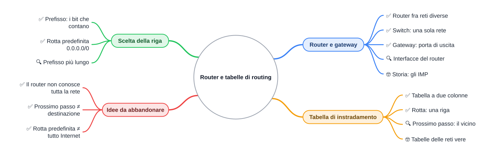
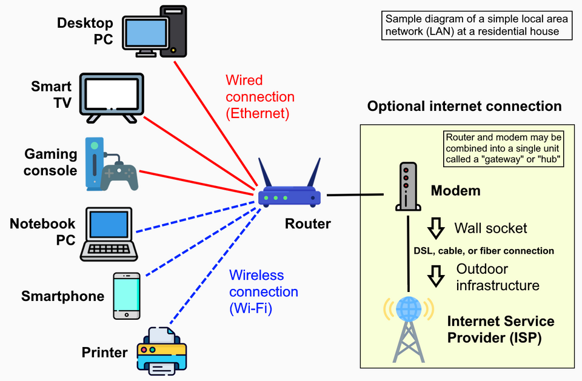

⬅️ [S3](./%28STU%29%204DI%20nov-dic%20S3%20-%20IPv6.md) · 🏠 [Indice](../README.md) · [S5](./%28STU%29%204DI%20nov-dic%20S5%20-%20Routing%20statico.md) ➡️

# 🧭 Router e tabelle di routing

**4DI · Novembre-Dicembre · S4 · Teoria**

⏱️ **Tempo di studio: circa 45 minuti.** ✅ essenziale: 25 min. 🔍 per il voto alto: 20 min. 🤓 si può saltare. Nessun compito obbligatorio a casa.

> **Legenda:** ✅ da sapere · 🔍 per capire fino in fondo · 🤓 facoltativo · 📜 storia · 🧪 esempio · ⚠️ errore comune · 🧠 da ricordare · ✏️ da fare · 🃏 flashcard · 🔧 In laboratorio

*Valori inventati per l'esercizio, salvo quelli dichiarati reali: `0.0.0.0/0` (rotta predefinita), `8.8.8.8` (indirizzo pubblico reale), `203.0.113.0/24` (blocco riservato alla documentazione).*

## 🗺️ Mappa



## 🌍 Cornice: le strade e i cartelli

Per secoli le città si sono collegate con strade. A ogni incrocio c'è un cartello: «per il mare, dritto; per la montagna, a sinistra». Nessun viaggiatore conosce la mappa intera del paese: gli basta il cartello dell'incrocio in cui si trova. Su Internet succede lo stesso: i pacchetti sono i viaggiatori, i router sono i cartelli.

Ore 8:05, segreteria di una scuola. La segretaria apre il registro elettronico sul suo PC. Il server che lo custodisce è in un'altra stanza, su un'altra rete. La richiesta esce dal PC, arriva al bordo della sua rete e si ferma davanti a un cartello: «dove vuoi andare? per quale strada?». Il cartello non conosce tutta la scuola. Conosce le sue poche righe, e da quelle decide.

Questa dispensa studia quel cartello: che cos'è un router, com'è fatta la sua tabella, come sceglie una riga.

## 🚪 Router e gateway: il vigile fra due reti

### ✅ Router: collega reti diverse

**Rete locale** (LAN): dispositivi che si parlano direttamente, come i PC di un'aula o di una casa.

**Router** (instradatore): apparecchio che collega due o più reti e decide, per ogni pacchetto, in quale direzione mandarlo. Esempio: il router di casa tua, quello con la lucina del Wi-Fi, collega la **rete di casa** (PC, telefono, TV) alla rete del **provider**, cioè la rete di chi ti dà Internet.

<u>Il router sta sul confine fra due reti, non dentro una sola.</u>

🧠 **Dove agisce:** al bordo fra due reti. Il router di casa sta fra la LAN di casa e il provider.



*Una rete di casa: il router è il punto in cui la LAN incontra Internet.* Fonte e licenza in fondo.

<details>
<summary>🃏 <b>Che cos'è un router?</b></summary>
Un apparecchio che collega due o più reti diverse e decide dove mandare ogni pacchetto.
</details>
<details>
<summary>🃏 <b>Tra quali reti sta il router di casa?</b></summary>
Fra la LAN di casa e la rete del provider.
</details>

✏️ **Disegna i confini (2 min).** Disegna quattro cerchi: aula, server, segreteria, Internet. Metti un quadratino dove sta il router e scrivi su ogni tratto quale rete collega. Quanti tratti hai disegnato?

### ✅ Switch e router: chi lavora dove

Lo **switch** collega i dispositivi di una sola rete locale. Non sa nulla delle altre reti: consegna i frame dentro il suo tratto (lo hai visto in S2 sett-ott).

Se un pacchetto deve uscire dalla propria rete, lo switch non basta: non conosce i confini. Serve qualcuno che li conosca.

| Apparato | Lavora dentro | Collega |
|---|---|---|
| Switch | una sola rete locale | PC, stampanti e server della stessa rete |
| Router | il bordo fra reti diverse | la rete di casa e quella del provider |

<u>Lo switch sta dentro la rete; il router sta sul suo bordo.</u>

⚠️ Non confondere: uno switch che «manda in rete» un pacchetto non sa quale strada prenderà. Lo decide il router.

<details>
<summary>🃏 <b>Che cosa non fa uno switch?</b></summary>
Non collega reti diverse: lavora dentro una sola rete locale.
</details>
<details>
<summary>🃏 <b>Dove sta un router rispetto a una rete?</b></summary>
Sul suo bordo: collega due reti, non ne fa parte come un PC.
</details>

### ✅ Gateway: la porta verso l'altra rete

**Gateway** (gateway predefinito, porta di uscita): l'indirizzo del router sulla rete in cui si trova un PC. Il PC dice: «tutto ciò che non è nella mia rete, mandalo a lui».

🧪 **Esempio (valori inventati).** Un PC in aula ha indirizzo `172.20.1.23`. Il suo gateway è `172.20.1.1`: l'indirizzo che il router ha sulla rete dell'aula. Per uscire dall'aula, il PC consegna il pacchetto a `172.20.1.1`.

🧪 **Verifica sul tuo PC.** Nelle impostazioni di rete (Windows: *Impostazioni → Rete e Internet*) cerca il gateway della connessione: è l'indirizzo del router di casa.

<u>Il gateway è il router visto dal PC: la porta per uscire.</u>

⚠️ Il gateway non è la destinazione. È solo la prima tappa verso l'esterno.

<details>
<summary>🃏 <b>Che cos'è il gateway di un PC?</b></summary>
L'indirizzo del router sulla rete del PC: la porta per uscire verso le altre reti.
</details>
<details>
<summary>🃏 <b>Per un PC in aula, il gateway di <code>172.20.1.23</code> è sulla stessa rete?</b></summary>
Sì: il gateway <code>172.20.1.1</code> sta nella rete <code>172.20.1.0/24</code> dell'aula.
</details>

### 🔍 Interfacce: un router, più indirizzi

**Interfaccia**: il punto in cui un apparato si collega a una rete, con il suo indirizzo. Un router ha un'interfaccia per ogni rete a cui è collegato, e ogni interfaccia ha un indirizzo **dentro quella rete**.

Il **prefisso** (il numero dopo la barra, come `/24`) dice quanti bit iniziali identificano la rete. Richiamo di S5 sett-ott: `/24` significa 256 indirizzi.

🧪 **La scuola (valori inventati).** Un router R con quattro interfacce:

| Rete | Prefisso | Indirizzo di R su quella rete | Chi ci sta |
|---|---|---|---|
| Aula | `172.20.1.0/24` | `172.20.1.1` | PC dell'aula |
| Server | `172.20.2.0/24` | `172.20.2.1` | il server della scuola |
| Segreteria | `172.20.3.0/24` | `172.20.3.1` | PC della segreteria |
| Collegamento verso il provider | `203.0.113.0/30` | `203.0.113.2` | il router P del provider, che ha `203.0.113.1` |

*Il collegamento verso il provider è un `/30`: quattro indirizzi, due utili. Bastano per collegare due apparati.*

🧠 **Richiamo di S3 sett-ott:** un indirizzo IPv4 ha 32 bit, cioè quattro numeri da 0 a 255. Il prefisso separa la parte che identifica la rete da quella dell'apparecchio. Ogni riga della tabella di R usa questa stessa separazione.

Ogni riga della tabella è una **rete di cui R è il confine**. R è il vigile di quattro strade.

<details>
<summary>🃏 <b>Quante interfacce ha R nell'esempio?</b></summary>
Quattro: una per rete (tre LAN e il collegamento verso il provider).
</details>
<details>
<summary>🃏 <b>Un'interfaccia ha un indirizzo di quale rete?</b></summary>
Della rete a cui è collegata: il suo indirizzo sta dentro quel prefisso.
</details>

✏️ **Prevedi un indirizzo (2 min).** Un PC nuovo entra nella rete della segreteria. Scrivi un indirizzo plausibile per lui, poi controlla la tabella: il suo indirizzo deve stare in `172.20.3.0/24`.

### 🤓 Storia: gli IMP di ARPANET

> 📜 Nel 1969 la rete ARPANET, antenata di Internet, collega i primi nodi universitari. Ogni nodo ha un apparecchio che fa da portiere: gli **IMP** (*Interface Message Processor*), costruiti dalla società BBN su un minicomputer Honeywell. A dicembre 1969 i nodi attivi sono quattro (UCLA, SRI, UCSB e l'Università dello Utah). Gli IMP instradano i messaggi fra i nodi: sono gli antenati dei router di oggi.

## 🗺️ La tabella di instradamento

### ✅ Il modello: confine → direzione

**Tabella di instradamento** (*routing table*): elenco di righe. Ogni riga dice: per questo confine di rete, prendi questa direzione.

**Rotta** (*route*): una riga della tabella.

Il modello più semplice ha due colonne:

| Confine (prefisso) | Direzione |
|---|---|
| `172.20.1.0/24` (aula) | direttamente sulla rete dell'aula |
| `172.20.2.0/24` (server) | direttamente sulla rete del server |
| `172.20.3.0/24` (segreteria) | direttamente sulla rete della segreteria |
| `0.0.0.0/0` (tutto il resto) | verso `203.0.113.1` (provider) |

⚠️ **Questo è un modello, non il funzionamento esatto di un apparato.** Nella pratica le righe hanno più colonne, come nella tabella che segue.

<u>Una riga = un confine + una direzione.</u>

<details>
<summary>🃏 <b>Che cosa collega ogni riga della tabella?</b></summary>
Un confine di rete (un prefisso) a una direzione da prendere.
</details>
<details>
<summary>🃏 <b>Che cosa significa il /24 in <code>172.20.1.0/24</code>?</b></summary>
I primi 24 bit identificano la rete: sono 256 indirizzi. <i>Esempio: 172.20.1.0 fino a 172.20.1.255.</i>
</details>

### ✅ La tabella in pratica

Il **prossimo passo** (*next hop*) è il router vicino a cui consegnare il pacchetto perché continui il viaggio. Nella colonna «Prossimo passo» il trattino vuol dire: la destinazione è direttamente su una rete collegata, non serve un vicino.

| Rete di destinazione | Prefisso | Prossimo passo | Interfaccia d'uscita |
|---|---|---|---|
| `172.20.1.0` | `/24` | — (collegata) | aula, `172.20.1.1` |
| `172.20.2.0` | `/24` | — (collegata) | server, `172.20.2.1` |
| `172.20.3.0` | `/24` | — (collegata) | segreteria, `172.20.3.1` |
| `0.0.0.0` | `/0` | `203.0.113.1` | verso provider, `203.0.113.2` |

🧠 Tutta la tabella di R sta in quattro righe: il router non sa altro.

🔧 **In laboratorio:** sugli apparati reali la tabella si legge con un comando. Qui la leggiamo solo su carta.

<details>
<summary>🃏 <b>Che cos'è il prossimo passo?</b></summary>
Il router vicino a cui consegnare il pacchetto, non la destinazione finale.
</details>

✏️ **Disegna il percorso (4 min).** Su uno schema con tre reti (aula, server, segreteria) e il provider, traccia il percorso di un pacchetto dal PC dell'aula a un PC della segreteria. Scrivi accanto a ogni passo la riga della tabella che lo decide.

### 🔍 Il prossimo passo: il vicino, non la destinazione

🧪 **Un pacchetto verso `8.8.8.8` (indirizzo pubblico reale).** Parte dal PC dell'aula, `172.20.1.23`:

```text
PC aula 172.20.1.23 → R (172.20.1.1) → P (203.0.113.1) → … → 8.8.8.8
```

R non sa come arrivare a `8.8.8.8`. Sa solo che il vicino P è la strada giusta. Da P in poi decide P, con la sua tabella. Ogni tappa vede solo il passo successivo.

<details>
<summary>🃏 <b>Il prossimo passo è sempre la destinazione finale?</b></summary>
No: è il vicino a cui il router consegna il pacchetto per il tratto successivo.
</details>
<details>
<summary>🃏 <b>Chi decide la tappa successiva dopo P?</b></summary>
Il router P, con la sua tabella.
</details>

### 🤓 Quante righe ha una tabella vera

> 🤓 Le tabelle dei router dei grandi operatori di Internet contengono centinaia di migliaia di prefissi (ordine di grandezza, variabile nel tempo). Nessun router di casa le tiene: gli basta la rotta predefinita verso il provider.

## 🎯 Scegliere la riga giusta

### ✅ Trovare la riga: tre passi

Per un indirizzo di destinazione, il router segue tre passi. Usa le stesse etichette in ogni esercizio:

1. **trova il prefisso**: quali righe contengono l'indirizzo? (i bit del prefisso coincidono)
2. **scegli la riga**: se ce n'è una, è quella; se ce ne sono più, vince la più stretta (vedi 🔍);
3. **verifica il prossimo passo**: è il vicino giusto, oppure la rete è collegata direttamente?

🧪 **Tre pacchetti (valori inventati) sulla tabella di R:**

| Destinazione | Righe che la contengono | Riga scelta | Direzione |
|---|---|---|---|
| `172.20.2.9` | `172.20.2.0/24`, `0.0.0.0/0` | `172.20.2.0/24` | direttamente sulla rete server |
| `172.20.3.200` | `172.20.3.0/24`, `0.0.0.0/0` | `172.20.3.0/24` | direttamente sulla rete segreteria |
| `8.8.8.8` | `0.0.0.0/0` | `0.0.0.0/0` | verso `203.0.113.1` |

<u>Il prefisso decide quali bit devono coincidere: nella riga, i primi bit dell'indirizzo sono quelli della rete.</u>

<details>
<summary>🃏 <b>Che cosa devono avere in comune un indirizzo e un prefisso per stare nella stessa riga?</b></summary>
I primi bit, quelli indicati dal prefisso, devono coincidere con la rete.
</details>

✏️ **Prevedi prima (3 min).** Per `172.20.1.200` e per `172.20.4.10` scrivi quale riga sceglie R, prima di rileggere la tabella. Quale delle due finisce sulla rotta predefinita, e perché?

### ✅ Rotta predefinita: la riga di ultima istanza

**Rotta predefinita** (*default route*): la riga `0.0.0.0/0`. Il prefisso `/0` non richiede nessun bit uguale: ogni indirizzo la contiene. Il router la usa quando nessuna riga più stretta corrisponde.

🧠 Analogia: in una città, se non conosci la strada giusta prendi la statale per uscire. La statale non ti porta a casa: ti porta fuori.

⚠️ La rotta predefinita non è «tutto Internet». È il prossimo passo per ciò che la tabella non sa. Se il vicino non sa nulla, il pacchetto si ferma lì.

<details>
<summary>🃏 <b>Che cos'è la rotta predefinita?</b></summary>
La riga <code>0.0.0.0/0</code>, usata quando nessun'altra riga corrisponde.
</details>
<details>
<summary>🃏 <b>Quanti bit devono coincidere con un prefisso <code>/0</code>?</b></summary>
Nessuno: per questo ogni indirizzo rientra nella riga <code>0.0.0.0/0</code>.
</details>

✏️ **Trova la riga mancante (3 min).** Un router Q ha solo due righe: `172.20.1.0/24` e `172.20.2.0/24`, e nessuna rotta predefinita. Un pacchetto per `8.8.8.8` non trova riga. Scrivi la riga che lo farebbe uscire verso il provider `203.0.113.1`, con prefisso e prossimo passo.

### 🔍 Due righe corrispondono: vince la più stretta

Quando più righe contengono lo stesso indirizzo, il router sceglie quella con il **prefisso più lungo** (la più stretta). È la regola della *corrispondenza sul prefisso più lungo*: si legge come «vince la riga più specifica».

🧪 **Riga ipotetica (inventata), non nella tabella di R:** `172.20.0.0/16`, cioè tutta la scuola. Per `172.20.2.9` corrispondono tre righe:

| Riga | Numero di indirizzi | Vince? |
|---|---|---|
| `0.0.0.0/0` | 2^32 = 4 294 967 296 | no, è la più larga |
| `172.20.0.0/16` | 2^16 = 65 536 | no, è più larga di `/24` |
| `172.20.2.0/24` | 2^8 = 256 | **sì**, è la più stretta |

<u>Più il prefisso è lungo, più la riga è stretta e vince.</u>

⚠️ Il numero di indirizzi cresce al diminuire del prefisso: `/24` ne ha 256, `/16` ne ha 65 536.

<details>
<summary>🃏 <b>Se due righe contengono l'indirizzo, quale vince?</b></summary>
Quella con il prefisso più lungo, cioè la più stretta.
</details>
<details>
<summary>🃏 <b>Quanti indirizzi ha un prefisso <code>/24</code>?</b></summary>
256, perché restano 8 bit liberi (2^8).
</details>

## 🧠 Idee da abbandonare

### ✅ Tre fraintendimenti da correggere

| Idea sbagliata | Idea giusta |
|---|---|
| Il router conosce tutta la rete | conosce solo le righe della sua tabella |
| Il prossimo passo è il sito finale | è il vicino a cui consegnare il pacchetto |
| La rotta predefinita è tutto Internet | è la riga di ultima istanza, per ciò che la tabella non sa |

✏️ **Spiega in una frase (2 min).** Perché il router R dell'esempio non deve sapere dove sta `8.8.8.8`? Scrivila come se la spiegassi a un compagno.

<details>
<summary>🃏 <b>Il router conosce tutta la rete?</b></summary>
No: conosce solo le righe della sua tabella.
</details>
<details>
<summary>🃏 <b>La rotta predefinita porta a tutto Internet?</b></summary>
No: è la riga usata per ciò che non ha altra riga; il resto lo decidono i router successivi.
</details>

## 📚 Fonti e risorse

- **Immagine** «Home LAN local area network example diagram» (schema di rete domestica con router): autore Own work (utente di Wikimedia Commons), licenza **CC0 1.0** (pubblico dominio), <https://commons.wikimedia.org/wiki/File:Home_LAN_local_area_network_example_diagram.png>.
- **RFC 791**, *Internet Protocol* (IPv4): <https://www.rfc-editor.org/rfc/rfc791>.
- **RFC 1812**, *Requirements for IP Version 4 Routers*: <https://www.rfc-editor.org/rfc/rfc1812>. È il documento che descrive che cosa deve fare un router IPv4: leggilo solo se ti incuriosisce.
- **RFC 5737**, indirizzi riservati alla documentazione (`203.0.113.0/24`): <https://www.rfc-editor.org/rfc/rfc5737>.
- **Storia degli IMP**: voce *Interface Message Processor* su Wikipedia: <https://en.wikipedia.org/wiki/Interface_Message_Processor>.
- **Libro di testo**: Baldino, Rondano, Spano, Iacobelli, *Internetworking Sistemi e Reti*, Juvenilia Scuola (capitolo sul routing).

---

⬅️ [S3](./%28STU%29%204DI%20nov-dic%20S3%20-%20IPv6.md) · 🏠 [Indice](../README.md) · [S5](./%28STU%29%204DI%20nov-dic%20S5%20-%20Routing%20statico.md) ➡️
