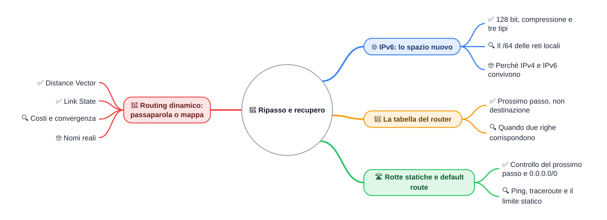
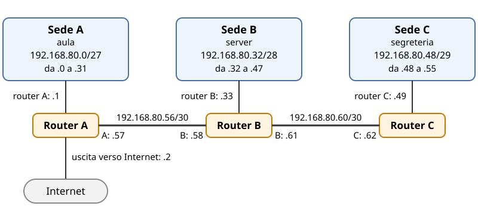

⬅️ [S4](./%28STU%29%204DI%20nov-dic%20S4%20-%20Introduzione%20al%20routing%20dinamico.md) · 🏠 [Indice](../README.md)

# 🧠 Ripasso e recupero

**4DI · Novembre-Dicembre · S5 · Teoria**

⏱️ **Tempo di studio: circa 50 minuti**, in tre sessioni brevi. ✅ essenziale: 30 min. 🔍 per il voto alto: 20 min. 🤓 si può saltare. Nessun argomento nuovo, nessun compito obbligatorio a casa. I valori degli esercizi sono inventati per l'esercizio, salvo dove è dichiarato reale.

> **Legenda:** ✅ da sapere · 🔍 per capire fino in fondo · 🤓 facoltativo · 📜 storia · ⚙️ tecnica · 🧪 esempio · 🧠 da ricordare · ✏️ da fare · ⚠️ errore comune · 🔁 ripasso · 🩹 recupero · 🔧 in laboratorio · 🃏 flashcard (rispondi a voce, poi apri)

## 🗺️ Mappa del bimestre

## 📜 Il pacchetto e il confine

📜 Il 29 ottobre 1969 due computer dell'ARPANET, uno all'UCLA e uno allo SRI in California, provano a scambiarsi la parola «LOGIN». Arrivano solo le prime due lettere, «LO», poi il sistema va in crash. Era il primo collegamento fra reti lontane, e la mappa delle strade era ancora tutta da costruire.

Quarant'anni dopo, il 3 febbraio 2011, la IANA assegna gli ultimi grandi blocchi liberi di IPv4; il 6 giugno 2012 il *World IPv6 Launch* accende in modo permanente lo spazio nuovo a 128 bit. Eppure un principio non è cambiato di una virgola: <u>nessun pacchetto conosce la rete intera; segue confini scritti nelle tabelle dei router.</u>

**A che cosa ti serve mettere insieme questi quattro pezzi?** Oggi qualsiasi rete reale — dal tuo telefono in 5G fino a un'azienda con più sedi — mescola indirizzi IPv6, tabelle di routing, rotte statiche verso il provider o la VPN e routing dinamico per sopravvivere ai guasti. Questo ripasso ti allena a leggere una rete come fa un tecnico: capire *chi* parla, *quale riga* della tabella decide la strada e *perché* un pacchetto arriva oppure si ferma.

## 🌐 IPv6: lo spazio nuovo

### ✅ 128 bit, compressione e tre tipi

Con 32 bit IPv4 offre circa 4,3 miliardi di indirizzi ($2^{32}$). IPv6 usa **128 bit** ($2^{128}$, circa $3{,}4 \times 10^{38}$ indirizzi), scritti in **otto gruppi** da 16 bit in esadecimale, separati da due punti.

🧪 **Esempio:** `2001:0db8:0000:0000:0000:0000:0000:0001` si comprime in `2001:db8::1` (`2001:db8::/32` è il prefisso reale riservato alla documentazione, RFC 3849).

⚙️ **Compressione in due mosse:**
1. Togli gli zeri iniziali di ogni gruppo (`0db8` → `db8`, `0000` → `0`).
2. Sostituisci una sola sequenza di gruppi tutti a zero con `::`. <u>Il simbolo `::` si usa una sola volta</u>, altrimenti l'indirizzo diventa ambiguo.

Tre tipi riconoscibili subito dalle prime cifre:
- **Globale unicast** (`2000::/3`, inizia per `2` o `3`): indirizzo pubblico raggiungibile su Internet.
- **Link-local** (`fe80::/10`): valido solo sul cavo o Wi-Fi locale; il router non lo inoltra fuori.
- **Multicast** (`ff00::/8`, es. `ff02::1` per tutti i nodi locali): parla a un gruppo e sostituisce il broadcast di IPv4.

⚠️ Errore comune: pensare che con IPv6 il prefisso non serva più. Serve sempre: separa la rete dall'interfaccia.

### 🔍 Il /64 delle reti locali

Nelle reti locali la prassi comune usa il prefisso **`/64`**: 64 bit per la rete (i primi quattro gruppi) e 64 bit per l'interfaccia ($2^{64}$ indirizzi disponibili). ⚠️ `/64` indica 64 bit di rete, non «64 host».

### Perché IPv4 e IPv6 convivono

> Il NAT (visto in sett-ott) ha permesso a miliardi di dispositivi privati di condividere pochi IPv4 pubblici. IPv6 risolve alla radice la scarsità di indirizzi, ma aggiornare tutta Internet richiede decenni: per questo oggi i due protocolli lavorano fianco a fianco.

🃏 <b>Quanti gruppi e quanti bit ha un indirizzo IPv6?</b>

Otto gruppi da 16 bit ciascuno (4 cifre esadecimali per gruppo), per un totale di 128 bit.

🃏 <b>Che cosa sostituisce il broadcast in IPv6?</b>

Il multicast, come l'indirizzo <i>ff02::1</i> che raggiunge tutti i nodi del collegamento locale.

✏️ **Comprimi e controlla (3 min).** Scrivi la forma compressa di `2001:0db8:0000:0000:0042:0000:0000:0001`. Poi spiega in una frase perché `2001:db8::42::1` è sbagliato.

## 🧭 La tabella del router

### ✅ Prossimo passo, non destinazione

Ripasso di S2: lo **switch** consegna frame dentro una sola rete locale; il **router** sta sul confine fra reti diverse, ha un'**interfaccia** per ciascuna rete (che per i PC di quella rete fa da **gateway**) e sceglie dove mandare ogni pacchetto leggendo la propria **tabella di instradamento**.

🧪 **Scena (valori inventati):** un router R collega aula (`172.20.1.0/24`), server (`172.20.2.0/24`), segreteria (`172.20.3.0/24`) e il collegamento `/30` verso il router P del provider (`203.0.113.1`).

| Rete di destinazione | Prefisso | Prossimo passo |
|---|---|---|
| `172.20.1.0` | `/24` | collegata: aula |
| `172.20.2.0` | `/24` | collegata: server |
| `172.20.3.0` | `/24` | collegata: segreteria |
| `0.0.0.0` | `/0` | `203.0.113.1` (provider) |

Il **prossimo passo** (*next hop*) è l'indirizzo del router vicino a cui consegnare il pacchetto, non la destinazione finale. <u>Un router non conosce tutta Internet: conosce solo le righe della sua tabella.</u>

### 🔍 Quando due righe corrispondono

Per ogni pacchetto il router applica tre passi: **trova il prefisso**, **scegli la riga**, **verifica il prossimo passo**. Se più righe contengono lo stesso indirizzo (per esempio `172.20.2.9` cade sia in `172.20.2.0/24` sia in `0.0.0.0/0`), <u>vince sempre la riga con il prefisso più lungo</u> (*longest prefix match*), perché è la più specifica.

🃏 <b>Qual è la differenza di ruolo fra switch e router?</b>

Lo switch collega dispositivi della stessa rete locale; il router collega reti diverse e sceglie la strada fra loro.

🃏 <b>Quale riga vince se sia /16 sia /24 contengono la destinazione?</b>

Vince la riga /24, perché ha il prefisso più lungo ed è più stretta.

✏️ **Prevedi la riga (2 min).** Sulla tabella sopra, scrivi prima quale riga sceglie R per `172.20.3.200` e per `172.20.9.15`, poi verifica con i tre passi.

## 🛣️ Rotte statiche e default route

### ✅ Controllo del prossimo passo e 0.0.0.0/0

Ripasso di S3: una **rotta statica** è una riga scritta a mano da una persona (rete di destinazione, prefisso, prossimo passo). Ogni collegamento punto-punto fra due router usa tipicamente una rete **`/30`** (4 indirizzi totali, 2 utili: uno per ciascun router).

*Topologia delle sedi A (`192.168.80.0/27`), B (`192.168.80.32/28`) e C (`192.168.80.48/29`), unite dai collegamenti `/30` A-B (`.56/30`: A `.57`, B `.58`) e B-C (`.60/30`: B `.61`, C `.62`).*

✅ **Controllo fondamentale:** <u>il prossimo passo deve appartenere a una rete collegata direttamente al router che scrive la riga.</u> Per andare in C, il router A scrive come prossimo passo `.58` (che vede sul collegamento A-B), mai `.62` (che non vede) e mai `.57` (che è se stesso).

La **rotta predefinita** (`0.0.0.0/0` in IPv4, `::/0` in IPv6) ha prefisso zero: corrisponde a qualunque indirizzo, ma avendo il prefisso più corto vince **solo come ultima risorsa**, quando nessun'altra riga corrisponde.

### 🔍 Ping, traceroute e il limite statico

- **Ping** invia un messaggio di prova e attende risposta: funziona solo se esistono sia la rotta di **andata** sia quella di **ritorno** (e nessun firewall lo blocca).
- **Traceroute** elenca i router attraversati uno per uno: mostra l'ultimo router raggiunto prima che la strada si interrompa.
- **Limite:** su reti grandi o soggette a guasti, riscrivere le righe a mano su decine di router è lento e soggetto a errori.

🃏 <b>Perché un ping può fallire anche se la rotta di andata sul primo router è giusta?</b>

Perché la risposta deve tornare indietro: serve una strada valida anche nel verso di ritorno (oppure un firewall blocca il messaggio).

✏️ **Scrivi la riga (4 min).** Osserva la topologia A-B-C: scrivi la rotta statica che serve sul router C per raggiungere la sede A (rete, prefisso e prossimo passo) e verifica che il prossimo passo sia collegato direttamente a C.

## 🔄 Routing dinamico: passaparola o mappa

### ✅ Distance Vector

Ripasso di S4: nel **routing dinamico** i router usano un protocollo per scambiarsi messaggi e aggiornare le tabelle da soli quando un collegamento cade. Nel principio **Distance Vector** (passaparola) ogni router conosce solo i propri vicini e invia loro la propria tabella («so andare a X con distanza *d*»). Non vede la mappa intera.

### ✅ Link State

Nel principio **Link State** ogni router annuncia a tutti quali collegamenti possiede e il loro costo; tutti ricostruiscono la **stessa mappa completa** della rete e ciascun router calcola da sé i percorsi migliori.

### 🔍 Costi e convergenza

Il **costo** misura quanto è «caro» attraversare un collegamento (più è basso, più conviene): in un triangolo dove A–B costa 1, B–C costa 2 e A–C costa 5, da A verso C conviene passare da B ($1 + 2 = 3 < 5$). Quando un collegamento cade, il momento in cui tutti i router tornano ad avere tabelle coerenti e aggiornate si chiama **convergenza**. Nel Distance Vector il passaparola di vicino in vicino può far circolare temporaneamente **notizie vecchie**.

### Nomi reali

> **RIP** (RFC 1058) è un protocollo *Distance Vector*; **OSPF** (RFC 2328) è un protocollo *Link State* molto diffuso nelle reti aziendali. Li conosciamo per nome, senza comandi di configurazione.

🃏 <b>Qual è la differenza chiave fra ciò che sa un router Distance Vector e un router Link State?</b>

Il Distance Vector sa solo ciò che gli dicono i vicini; il Link State possiede la mappa completa di router e collegamenti.

✏️ **Prevedi il guasto (3 min).** Nel triangolo (A–B costo 1, B–C costo 2, A–C costo 5) si rompe B–C. Quale percorso sceglie A dopo la convergenza, e con quale costo?

## 🔁 Mazzo mescolato ed esercizi

Qui le flashcard coprono **tutto il bimestre** (S1–S4) e tutti i livelli (✅, 🔍, 🤓), **mescolate fuori ordine** proprio come accade davanti a un problema vero: prima di aprire ciascuna carta, riconosci di quale argomento parla e rispondi a voce.

🃏 <b>Un router con sole rotte statiche si accorge da solo se cade un collegamento due salti più avanti?</b>

No: la riga statica resta scritta uguale e continua a mandare i pacchetti verso la strada interrotta.

🃏 <b>Quante volte puoi usare il simbolo <code>::</code> dentro uno stesso indirizzo IPv6, e perché?</b>

Una sola volta: con due <code>::</code> non si saprebbe quanti gruppi di zeri mettere a sinistra e quanti a destra.

🃏 <b>Che cos'è il gateway predefinito configurato su un PC?</b>

È l'indirizzo dell'interfaccia del router sulla stessa rete locale del PC: la porta a cui il PC consegna tutto ciò che deve uscire dalla propria rete.

🃏 <b>Che cosa significa convergenza nel routing dinamico?</b>

È lo stato raggiunto quando, dopo un cambiamento o un guasto, tutti i router hanno finito di aggiornarsi e condividono informazioni coerenti.

🃏 <b>Quale tipo di indirizzo IPv6 inizia con <code>fe80</code>, e fin dove può viaggiare?</b>

È un indirizzo <i>link-local</i> (<code>fe80::/10</code>): vale solo sul collegamento locale (cavo o Wi-Fi) e il router non lo inoltra su altre reti.

🃏 <b>Sul router A (collegato a <code>.56/30</code> con indirizzo <code>.57</code>, vicino B a <code>.58</code>), perché <code>.57</code> non può essere il prossimo passo di una rotta?</b>

Perché <code>.57</code> è l'indirizzo del router A stesso: il prossimo passo deve essere l'indirizzo del router vicino (<code>.58</code>).

🃏 <b>Che cosa si scambiano due router Link State, a differenza di due router Distance Vector?</b>

Si scambiano gli annunci sui propri collegamenti attivi e i relativi costi, non la propria tabella di distanze.

🃏 <b>Come si scrive la rotta predefinita in IPv4 e come si scrive in IPv6?</b>

<code>0.0.0.0/0</code> in IPv4 e <code>::/0</code> in IPv6: in entrambi i casi il prefisso <code>/0</code> indica zero bit fissi.

🃏 <b>Che cosa indica il prefisso <code>2001:db8::/32</code>?</b>

È il blocco reale riservato alla documentazione e agli esempi didattici: non viene mai assegnato a reti vere su Internet.

🃏 <b>Un pacchetto per <code>192.168.80.50</code> trova nella tabella sia <code>192.168.80.48/29</code> sia <code>0.0.0.0/0</code>: quale riga usa il router e perché?</b>

Usa <code>192.168.80.48/29</code> per la regola del prefisso più lungo: 29 bit coincidenti sono più specifici di 0 bit.

🃏 <b>Che differenza c'è fra ciò che ti dice un <code>ping</code> fallito e ciò che ti mostra un <code>traceroute</code>?</b>

Il <code>ping</code> dice solo che la risposta non è tornata; il <code>traceroute</code> elenca i router raggiunti lungo la strada e mostra dove il viaggio si ferma.

🃏 <b>Quante cifre esadecimali formano un gruppo intero di un indirizzo IPv6, e quanti bit vale ogni cifra?</b>

Quattro cifre esadecimali per gruppo; ogni cifra vale 4 bit, quindi un gruppo vale 16 bit.

🃏 <b>Perché in un protocollo Distance Vector possono circolare «notizie vecchie» dopo un guasto?</b>

Perché ogni router impara solo dai vicini diretti: la notizia passa di tabella in tabella e impiega tempo a propagarsi.

🃏 <b>Che cosa fa IANA e quale evento storico è avvenuto nel 2011?</b>

IANA distribuisce i grandi blocchi globali di indirizzi IP; nel 2011 ha esaurito le ultime riserve centrali di blocchi IPv4.

🃏 <b>Quanti indirizzi utili offre un collegamento <code>/30</code> fra due router, e perché si usa proprio quel prefisso?</b>

Offre 2 indirizzi utili (su 4 totali, tolti rete e broadcast): esattamente uno per ciascuna delle due interfacce dei router collegati.

🃏 <b>Quali sono i nomi di un protocollo reale Distance Vector e di uno Link State?</b>

<i>RIP</i> per il principio Distance Vector e <i>OSPF</i> per il principio Link State.

🃏 <b>È vero che la rotta predefinita <code>0.0.0.0/0</code> contiene l'elenco di tutta Internet?</b>

No: dice solo a quale vicino consegnare i pacchetti che non corrispondono a nessuna riga più specifica della tabella.

🃏 <b>Che cosa significa che un indirizzo IPv6 inizia con <code>2</code> o <code>3</code> (blocco <code>2000::/3</code>)?</b>

Che è un indirizzo <i>globale unicast</i>, cioè unico nel mondo e instradabile su Internet.

🃏 <b>🤓 Come si chiamavano gli antenati dei router nella prima rete ARPANET del 1969, e come si scrive il loopback in IPv6?</b>

Gli antenati dei router si chiamavano <i>IMP</i> (Interface Message Processor); il loopback in IPv6 si scrive <code>::1</code>.

🃏 <b>In una rete con prefisso <code>2001:db8:4f2a:17::/64</code>, quanti host ci stanno: 64 o molti di più?</b>

Molti di più: <code>/64</code> lascia 64 bit per le interfacce, cioè $2^{64}$ indirizzi (circa 18 miliardi di miliardi).

---

### Esercizi graduati (riconosci tu il metodo)

Prima guarda i dati: ti stanno chiedendo di leggere un indirizzo IPv6, scegliere una riga, completare una rotta statica o ragionare su un guasto?

✏️ **Base (5 min).** Hai tre indirizzi IPv6: `2001:0db8:0000:0000:0000:0000:0010:00a0`, `fe80:0000:0000:0000:0200:5eff:fe00:0102` e `ff02:0000:0000:0000:0000:0000:0000:0001`. Comprimili tutti e tre, indica il tipo di ciascuno e dì quali di essi un router **non** inoltra verso Internet.

✏️ **Medio (8 min).** Nella topologia delle sedi A-B-C vista sopra, un tecnico configura sul router B queste tre sole righe: `192.168.80.32/28` (collegata), `192.168.80.56/30` (collegata), `192.168.80.60/30` (collegata). Un PC della sede A (`192.168.80.10`) lancia un `traceroute` verso `192.168.80.50` (sede C), sapendo che sul router A le rotte ci sono tutte. A quale indirizzo si ferma il `traceroute`? Scrivi le due righe statiche che mancano sul router B (verso A e verso C) con rete, prefisso e prossimo passo.

✏️ **Avanzato (10 min).** Tre router X, Y, Z formano un triangolo: X–Y ha costo 2, Y–Z ha costo 2, X–Z diretto ha costo 7.
1. Con la rete integra, quale prossimo passo mette X nella propria tabella per raggiungere la rete dietro Z, e con quale costo totale?
2. Improvvisamente si taglia il cavo Y–Z. Confronta in tre righe che cosa succede subito dopo il taglio se la rete usa rotte statiche, se usa *Distance Vector* o se usa *Link State*.

## 🩹 Recupero: dove riprendere

Il recupero non è un voto: è tornare al punto giusto. Quando un passaggio non ti torna, riprendi la dispensa corrispondente.

| Se ti blocchi su questo punto... | Riprendi |
|---|---|
| comprimere un IPv6, usare `::` o riconoscere `fe80::/10` e `ff02::1` | [S1 - IPv6](./%28STU%29%204DI%20nov-dic%20S1%20-%20IPv6.md) |
| distinguere switch, gateway e router o scegliere la riga più specifica | [S2 - Router e tabelle di routing](./%28STU%29%204DI%20nov-dic%20S2%20-%20Router%20e%20tabelle%20di%20routing.md) |
| scrivere il prossimo passo su un `/30`, usare `0.0.0.0/0` o leggere un `traceroute` | [S3 - Routing statico](./%28STU%29%204DI%20nov-dic%20S3%20-%20Routing%20statico.md) |
| distinguere *Distance Vector* e *Link State*, costi e convergenza | [S4 - Introduzione al routing dinamico](./%28STU%29%204DI%20nov-dic%20S4%20-%20Introduzione%20al%20routing%20dinamico.md) |
| leggere quanti indirizzi contiene un prefisso IPv4 (`/27`, `/29`, `/30`) | [S5 sett-ott - CIDR e intervalli](../1%20SETT-OTT/%28STU%29%204DI%20sett-ott%20S5%20-%20CIDR%20e%20intervalli.md) |

## 🔧 In laboratorio

🔧 Topologie, tabelle di routing e indirizzi IPv6 si provano su Packet Tracer durante le ore di laboratorio: qui ragioniamo su carta, senza comandi CLI e senza consegne.

## 📚 Fonti e risorse

- RFC 4291 (indirizzamento IPv6), RFC 5952 (compressione `::`), RFC 3849 (prefisso `2001:db8::/32`), RFC 8200 (IPv6): <https://www.rfc-editor.org/>.
- RFC 1812 (requisiti per i router IPv4), RFC 1058 (RIP) e RFC 2328 (OSPF): <https://www.rfc-editor.org/>.
- Storia di ARPANET e primo messaggio del 29 ottobre 1969: <https://en.wikipedia.org/wiki/ARPANET>.
- Schema topologia sedi A, B e C (`Allegati/nov-dic-s3-topologia-sedi-abc.svg`): schema originale per queste dispense, con valori inventati.

---

⬅️ [S4](./%28STU%29%204DI%20nov-dic%20S4%20-%20Introduzione%20al%20routing%20dinamico.md) · 🏠 [Indice](../README.md)
