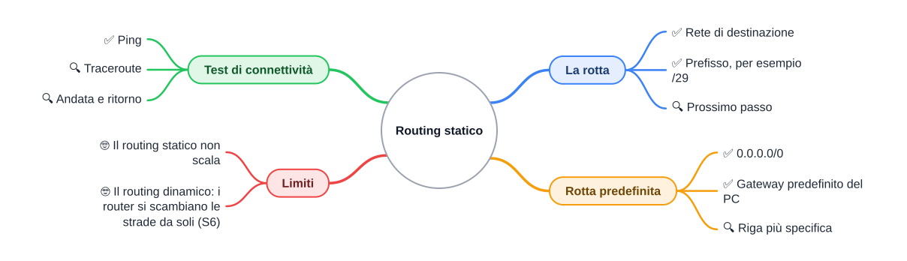
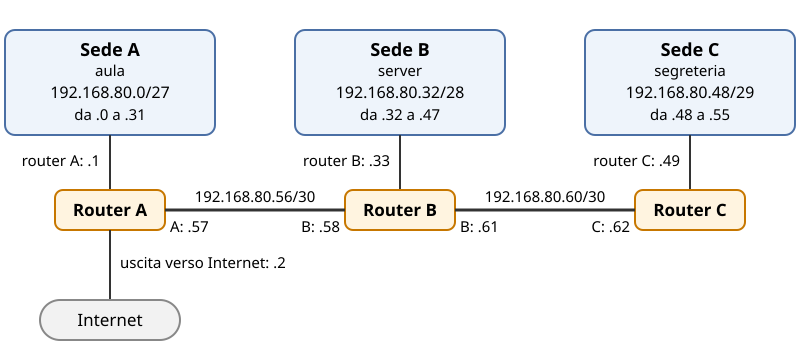

⬅️ [S4](./%28STU%29%204DI%20nov-dic%20S4%20-%20Router%20e%20tabelle%20di%20routing.md) · 🏠 [Indice](../README.md) · [S6](./%28STU%29%204DI%20nov-dic%20S6%20-%20Introduzione%20al%20routing%20dinamico.md) ➡️

# 🧭 Routing statico

**4DI · Novembre-Dicembre · S5 · Teoria**

⏱️ **Tempo di studio: circa 40 minuti.** ✅ essenziale: 25 min. 🔍 per il voto alto: 15 min. 🤓 si può saltare. Nessun compito obbligatorio a casa.

> **Legenda:** ✅ da sapere · 🔍 per capire fino in fondo · 🤓 facoltativo · 📜 storia · 🧪 esempio · ⚠️ errore comune · 🧠 da ricordare · ✏️ da fare · 🃏 flashcard · 🔧 In laboratorio · 🗺️ mappa · 😄 umorismo

> Ti servono: la S2 (il collegamento fra due router è una rete `/30`) e la S4 (la tabella di routing è fatta di righe).

> Tutti gli indirizzi di questa dispensa sono **inventati per l'esercizio**, tranne `8.8.8.8` (un DNS pubblico reale, usato solo come destinazione esterna) e le notazioni `0.0.0.0/0` e `::/0`, che sono standard.

## 🗺️ Mappa

## 📜 Strade disegnate a mano

Per quasi tutta la storia umana, chi voleva arrivare lontano si fidava di una strada già tracciata. I Romani piantavano cippi di pietra lungo le vie, con scritta la distanza dalla città più vicina. Il viaggiatore leggeva il cartello e proseguiva. Nessuno inventava la strada al momento: qualcuno l'aveva già scritta.

Un router funziona così. Ha un elenco di strade, la **tabella**, e per ogni pacchetto cerca la riga giusta. Se quella riga l'ha scritta una persona, si parla di **routing statico**.

😄 Il routing statico è il cartello stradale messo una volta per tutte: perfetto, finché nessuno sposta una strada.

📜 **Scena: 29 ottobre 1969.** All'università UCLA di Los Angeles un tecnico digita il primo messaggio della rete ARPANET, per collegarsi a un computer dello SRI, a Menlo Park, a centinaia di chilometri di distanza. Il messaggio doveva essere `LOGIN`. Il sistema si blocca dopo le prime due lettere: `LO`. Era una rete con pochi nodi e strade scritte con cura. Alla fine degli anni Settanta ARPANET passò a un calcolo automatico dei percorsi: le strade non erano più scritte a mano.

## 🧭 La rotta: una riga della tabella

### ✅ Rete, prefisso e prossimo passo

Scena: un PC nella sede A vuole scrivere a un PC nella sede C. Il router A vede la propria sede e il collegamento verso B. Non vede la sede C. Gli serve una riga che dica: «per arrivare a C, consegna a B».

- **Rete di destinazione**: il gruppo di indirizzi a cui vuoi arrivare. Esempio: `192.168.80.48` è il primo indirizzo della sede C.
- **Prefisso**: il numero dopo la barra. `/29` dice quanti bit iniziali sono fissi. Con 29 bit fissi ne restano 3 liberi, quindi 2 elevato a 3, cioè **8 indirizzi**.
- **Interfaccia**: la presa del router con il suo indirizzo. Nello schema, il router A ha una presa verso la sede A (`.1`) e una verso B (`.57`).
- **Prossimo passo** (*next hop*): l'indirizzo del router vicino, collegato direttamente, a cui si consegna il pacchetto. **Non** è la destinazione finale.
- **Rotta**: una riga della tabella, fatta di rete, prefisso e prossimo passo. La **tabella di routing** è l'elenco di tutte le rotte di un router.

Richiamo di S2: un collegamento fra due router è una rete `/30`, con 4 indirizzi, di cui 2 usabili, uno per ciascun router.

Schema della topologia: tre sedi in fila, valori inventati. Il percorso da A a C passa per il router A, poi il router B, poi il router C.

*Schema 1. Le sedi A, B e C con i loro collegamenti. Ogni sede è una rete; ogni collegamento fra router è un `/30`.*

| Tratto | Rete | Dal primo all'ultimo indirizzo | Indirizzi dei router |
|---|---|---|---|
| Sede A (aula) | 192.168.80.0/27 | .0 → .31 | router A: .1 (gateway dei PC di A) · uscita verso Internet: .2 |
| Collegamento A-B | 192.168.80.56/30 | .56 → .59 | A: .57 · B: .58 |
| Sede B (server) | 192.168.80.32/28 | .32 → .47 | router B: .33 |
| Collegamento B-C | 192.168.80.60/30 | .60 → .63 | B: .61 · C: .62 |
| Sede C (segreteria) | 192.168.80.48/29 | .48 → .55 | router C: .49 |

🧪 **Esempio.** La riga che il router A deve avere per la sede C è: rete `192.168.80.48`, prefisso `/29`, prossimo passo `192.168.80.58`. Si legge così: se la destinazione sta fra `.48` e `.55`, consegna il pacchetto a `.58`, cioè al router B.

<u>Una rotta statica è una riga scritta da una persona: il router non la calcola da solo.</u>

⚙️ **Dove agisce.** Il routing statico vive sul router, fra due reti diverse. Dentro una sede non serve: lì i PC si trovano già con lo switch, come nella S2.

🃏 <b>Che cos'è una rotta statica?</b>

Una riga della tabella di routing scritta a mano, con rete di destinazione, prefisso e prossimo passo.

🃏 <b>Quanti indirizzi ha una rete /29?</b>

8 indirizzi: con 29 bit fissi restano 3 bit liberi, e 2 elevato a 3 fa 8.

🃏 <b>Il prossimo passo è la destinazione finale del pacchetto?</b>

No. È il router vicino a cui si consegna il pacchetto. *Esempio: per la sede C, il prossimo passo di A è .58, cioè il router B.*

🃏 <b>Quanti indirizzi utili ha un collegamento /30 fra due router?</b>

Due: uno per ogni router. *Esempio: .57 per A e .58 per B; .56 e .59 non si assegnano.*

✏️ **Completa la tabella (4 min).** Questa è la tabella del router B. Le prime tre righe sono già scritte. Completa le ultime due: per ciascuna scrivi il prossimo passo e una frase che spiega perché proprio quell'indirizzo.

| Rete di destinazione | Prefisso | Prossimo passo |
|---|---|---|
| 192.168.80.32 (sede B) | /28 | collegata direttamente |
| 192.168.80.56 (collegamento A-B) | /30 | collegata direttamente |
| 192.168.80.60 (collegamento B-C) | /30 | collegata direttamente |
| 192.168.80.0 (sede A) | /27 | ? |
| 192.168.80.48 (sede C) | /29 | ? |

## 🛣️ Il prossimo passo deve essere vicino

### ✅ Il prossimo passo deve stare su un collegamento diretto

Un router può consegnare solo a chi è collegato direttamente a lui. Quindi, prima di scrivere una rotta, fai questo controllo: l'indirizzo del prossimo passo sta in una rete che il router vede già?

🧪 **Esempio.** Il router A vede la sede A (`192.168.80.0/27`) e il collegamento A-B (`192.168.80.56/30`).
- `192.168.80.58` sta nel collegamento A-B: il controllo passa, quindi A può usarlo come prossimo passo.
- `192.168.80.62` sta nel collegamento B-C: A non lo vede, quindi A non può usarlo.

⚠️ **Errore comune.** Scrivere come prossimo passo l'indirizzo del proprio router (per A, `.57`) oppure un indirizzo lontano. Il prossimo passo è sempre il vicino dall'altra parte del collegamento.

🃏 <b>Quando un prossimo passo è valido?</b>

Quando sta in una rete collegata direttamente al router. *Esempio: A vede il collegamento .56/30, quindi può usare .58.*

🃏 <b>Che cosa succede se il prossimo passo sta in una rete che il router non vede?</b>

Il router non può usare quella rotta, perché il vicino indicato non è collegato a lui. *Esempio: A non può usare .62 come vicino.*

✏️ **Trova l'errore (3 min).** Sul router A c'è questa riga: rete `192.168.80.48`, prefisso `/29`, prossimo passo `192.168.80.62`. Spiega in una frase quale controllo fallisce e perché.

## 🌐 La rotta predefinita

### ✅ Gateway predefinito e rotta 0.0.0.0/0

Il tuo PC conosce solo la propria rete. Tutto il resto lo affida a un router. Quel router è il **gateway predefinito** del PC: la porta d'uscita della rete in cui si trova il PC.

Dove vederlo sul tuo dispositivo:
- **Windows:** Impostazioni → Rete e Internet → Wi-Fi (o Ethernet) → Proprietà. La voce si chiama «Gateway predefinito».
- **Smartphone:** Impostazioni → Wi-Fi → tocca la rete a cui sei connesso. Cerca la voce «Gateway» o «Router».

Esempio inventato: il gateway del PC dello studente è `192.168.1.1`, un valore tipico delle reti di casa. Il tuo può essere diverso.

**Rotta predefinita** (*default route*): la riga di riserva. Si scrive `0.0.0.0/0`. Il prefisso è zero: nessun bit è fisso, quindi la riga copre ogni indirizzo IPv4. In IPv6 la stessa riga si scrive `::/0`.

⚠️ La rotta predefinita **non** è «la rotta per tutto Internet». È la riga usata solo quando nessun'altra riga corrisponde. Per esempio, `8.8.8.8` non sta in nessuna riga del router A, tranne quella predefinita: il pacchetto va al router `192.168.80.2`, l'uscita di sede A.

🧠 Il gateway predefinito del PC e la rotta predefinita del router fanno lo stesso mestiere: consegnano a un altro router ciò che non sanno dove mandare.

🃏 <b>Che cos'è il gateway predefinito?</b>

Il router a cui il PC consegna tutto ciò che non sta nella propria rete.

🃏 <b>Come si scrive la rotta predefinita in IPv6?</b>

Con `::/0`: prefisso zero, quindi copre tutti gli indirizzi IPv6.

🃏 <b>La rotta predefinita serve per tutto Internet?</b>

No: serve quando nessun'altra riga corrisponde. *Esempio: per 8.8.8.8 il router A usa solo la riga 0.0.0.0/0.*

✏️ **Prevedi (3 min).** Ecco la tabella del router A, con la sua riga predefinita. Prima di guardare la risposta, scrivi per ciascun indirizzo la riga scelta e il prossimo passo: `192.168.80.5`, `192.168.80.40`, `192.168.80.50`, `8.8.8.8`.

| Rete di destinazione | Prefisso | Prossimo passo |
|---|---|---|
| 192.168.80.0 (sede A) | /27 | collegata direttamente |
| 192.168.80.56 (collegamento A-B) | /30 | collegata direttamente |
| 192.168.80.32 (sede B) | /28 | 192.168.80.58 |
| 192.168.80.48 (sede C) | /29 | 192.168.80.58 |
| 192.168.80.60 (collegamento B-C) | /30 | 192.168.80.58 |
| 0.0.0.0 (rotta predefinita) | /0 | 192.168.80.2 |

### 🔍 Vince la riga più specifica

Può succedere che più righe contengano lo stesso indirizzo. Il router allora sceglie la riga con il prefisso più lungo, cioè la più precisa. Si chiama **longest prefix match**: «la corrispondenza più lunga vince».

🧪 **Esempio.** Il router A riceve un pacchetto per `192.168.80.50`:

| Riga | Prefisso | Contiene 192.168.80.50? |
|---|---|---|
| 192.168.80.48 (sede C) | /29 | sì: l'intervallo va da .48 a .55 |
| 0.0.0.0 (predefinita) | /0 | sì: contiene tutto |

Vince `/29`, perché ha il prefisso più lungo. Il pacchetto va a `.58`, non a `.2`. Lo stesso accade per `192.168.80.40`: vince `/28` della sede B, non la predefinita.

🃏 <b>Quando due righe contengono lo stesso indirizzo, quale vince?</b>

La riga con il prefisso più lungo, cioè la più specifica. *Esempio: per 192.168.80.50, /29 batte /0.*

🃏 <b>Perché la rotta /0 è sempre l'ultima scelta?</b>

Perché ha il prefisso più corto, quindi contiene tutto ed è la riga più generica.

## 🧪 Test: ping e traceroute

### ✅ Ping: un messaggio di prova

**Connettività**: la possibilità che due dispositivi si scambino messaggi.

Il **ping** manda un piccolo messaggio di prova a un indirizzo e aspetta la risposta. Se la risposta torna, la strada esiste nei due sensi. Se non torna, la strada può essere rotta, ma il ping non dice dove.

🧠 Il ping risponde solo «sì, torna» oppure «nessuna risposta». Per sapere dove si ferma la strada serve il traceroute.

⚠️ **Errore comune.** Il silenzio non sempre vuol dire guasto. Un **firewall** (un filtro che blocca alcuni messaggi) può bloccare il ping anche quando la rete funziona.

### 🔍 Traceroute: dove si ferma la strada

Il **traceroute** elenca i router uno dopo l'altro, dal primo fino al destinatario. Per ogni router mostra la risposta. Così si vede l'ultimo punto in cui la strada funziona.

🧪 **Esempio.** Un PC in sede A (`192.168.80.10`) fa traceroute verso un PC in sede C (`192.168.80.50`). Se la strada è completa, la lista è:
1. `192.168.80.1`: router A
2. `192.168.80.58`: router B
3. `192.168.80.62`: router C
4. `192.168.80.50`: il PC in sede C

Se la riga per la sede C manca nel router B, la lista si ferma alla riga 2.

### 🔍 Andata e ritorno: servono due strade

Un ping funziona solo se la strada c'è nei due sensi. Il messaggio va da A a C, e la risposta torna da C ad A. Ogni router lungo il percorso deve conoscere una riga per l'andata e una per il ritorno.

✏️ **Trova il buco (4 min).** Un PC in sede A fa traceroute verso `192.168.80.50`. La lista si ferma dopo `192.168.80.58`. Quale router manca di una riga? Scrivi la riga mancante con rete, prefisso e prossimo passo.

🔧 **In laboratorio:** ping e traceroute si provano in Packet Tracer, sulla stessa topologia. Qui li leggiamo su carta, senza comandi.

### 🤓 Il routing statico non scala

> Con tre sedi, la tabella scritta a mano va bene. Con cento router, ogni cambiamento richiede di riscrivere righe in molti apparati, e un errore passa inosservato. Per questo esiste il **routing dinamico**: i router si scambiano le strade da soli. Lo vedremo nella S6.

## 📚 Fonti e risorse

- RFC 4632, CIDR e notazione `/prefisso`: <https://www.rfc-editor.org/rfc/rfc4632>
- RFC 1812, requisiti per i router IPv4 (inoltro e tabelle): <https://www.rfc-editor.org/rfc/rfc1812>
- RFC 4291, indirizzamento IPv6 e notazione: <https://www.rfc-editor.org/rfc/rfc4291>
- ARPANET, primo messaggio del 29 ottobre 1969: <https://en.wikipedia.org/wiki/ARPANET>
- Libro di testo: Baldino, Rondano, Spano, Iacobelli, *Internetworking Sistemi e Reti*, Juvenilia Scuola.
- Schema 1 (topologia e tabelle): opera propria, in SVG, con valori inventati.

⬅️ [S4](./%28STU%29%204DI%20nov-dic%20S4%20-%20Router%20e%20tabelle%20di%20routing.md) · 🏠 [Indice](../README.md) · [S6](./%28STU%29%204DI%20nov-dic%20S6%20-%20Introduzione%20al%20routing%20dinamico.md) ➡️
