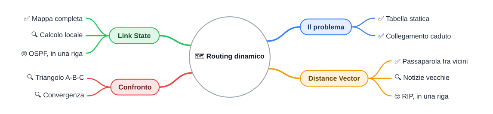

⬅️ [S5](./%28STU%29%204DI%20nov-dic%20S5%20-%20Routing%20statico.md) · 🏠 [Indice](../README.md) · [S7](./%28STU%29%204DI%20nov-dic%20S7%20-%20Ripasso%20e%20recupero.md) ➡️

# Introduzione al routing dinamico

**4DI · Novembre-Dicembre · S6 · Teoria**

⏱️ **Tempo di studio: circa 35 minuti.** ✅ essenziale: 20 min. 🔍 per il voto alto: 10 min. 🤓 si può saltare. Nessun compito a casa obbligatorio.

> **Legenda:** ✅ da sapere · 🔍 per capire fino in fondo · 🤓 facoltativo · 📜 storia · 🧪 esempio · ⚠️ errore comune · 🧠 da ricordare · ✏️ da fare · 🃏 flashcard · 🔧 In laboratorio · 🗺️ mappa

## 🗺️ Mappa

## 🌍 Perché le reti imparano a passarsi le notizie

Per millenni un'informazione ha viaggiato alla velocità di un cavallo o di una nave. Chi voleva sapere la strada per un porto la chiedeva a un marinaio, oppure copiava una mappa da chi c'era già stato. La mappa fissava la conoscenza di chi aveva viaggiato; il passaparola la portava a chi non poteva leggere una carta.

Le reti di computer hanno dovuto scegliere fra questi due modi. Il routing dinamico è la risposta a una domanda semplice: <u>quando una strada si rompe, chi dice agli altri che cosa è successo?</u>

Scena ricostruita, non un verbale: alla fine degli anni Settanta, in un laboratorio, un cavo si rompe e i messaggi continuano a girare su strade che non esistono più. È la ARPANET, la rete americana nata nel 1969 e antenata di Internet. Il fatto che la rete abbia cambiato metodo è documentato, e la sua storia torna nel 🤓.

## 1. Il problema: un collegamento cade

Due parole prima di tutto.

- **Router**: apparato che collega reti diverse e sceglie la strada per ogni pacchetto. Lo hai già visto in S4.
- **Collegamento**: il tratto fra due router, per esempio un cavo.

### ✅ La tabella statica non si accorge di nulla

Nel routing statico la tabella è scritta a mano: rete di destinazione, prefisso, prossimo passo (S4 e S5). Se un collegamento cade, la tabella continua a indicare la strada rotta.

🧪 *Come una cartina di carta: se un ponte crolla, la cartina lo disegna ancora. Chi la segue si ferma davanti al fiume.*

⚠️ Un errore comune: pensare che il router «si accorga» da solo. Con la tabella statica no: nessuno aggiorna la riga.

🃏 <b>Che cosa fa una tabella statica quando un collegamento cade?</b>

Continua a indicare la strada rotta, e i pacchetti non arrivano a destinazione.

### ✅ Il routing dinamico: i router si scambiano messaggi

**Routing dinamico**: i router si scambiano informazioni e aggiornano le proprie tabelle da soli.

**Protocollo**: l'insieme di regole con cui due apparati si parlano, come le regole di una telefonata (chi parla per primo, che cosa si dice).

🧪 *Anna chiede a Luca: «Come si va a Torino?». Luca risponde: «Io ci vado in due ore». Anna non ha la carta, ma ha una notizia. Il routing dinamico funziona così.*

🃏 <b>Che cos'è un protocollo di routing?</b>

Un insieme di regole con cui i router si scambiano informazioni per aggiornare le tabelle.

✏️ **Prevedi (2 min).** Tre router in fila: A, B, C. Il collegamento fra B e C cade. Con una tabella statica che porta da A a C passando da B, che cosa succede ai pacchetti? Scrivi una frase prima di continuare.

## 2. Distance Vector: chiedere ai vicini

**Distance Vector** (vettore di distanze): ogni router conosce solo i propri **vicini**, cioè i router collegati direttamente a lui. Ciascuno manda ai vicini la propria tabella: «so andare a X, con distanza d, passando da te». Il ragionamento è per **distanza e direzione**: quanto è lontano, e da quale vicino passare.

Nel passaparola fra amici è così: ognuno sa solo ciò che gli ha detto il vicino.

### ✅ Il principio

- Ogni router invia la sua tabella ai vicini.
- Ogni router riceve le tabelle dei vicini e, per ogni destinazione, tiene la strada con distanza minore.
- Il processo si ripete finché le tabelle non cambiano più.

<u>Il router Distance Vector non conosce la mappa: sa solo ciò che gli dicono i vicini.</u>

🃏 <b>Che cosa si scambiano due router Distance Vector?</b>

Le proprie tabelle di distanze, con la direzione da seguire. *Esempio: «verso C, distanza 3, passo da B».*

### 🔍 Notizie vecchie

La notizia viaggia di vicino in vicino e ci mette tempo. Un router può ancora credere a una strada che non esiste più, perché il vicino non gli ha ancora detto che è caduta. Per questo il Distance Vector può usare informazioni in ritardo.

🃏 <b>Perché un router Distance Vector può avere notizie vecchie?</b>

Perché ogni informazione passa di vicino in vicino, e ci mette tempo ad arrivare.

✏️ **Spiega in una frase (2 min).** Perché, con il passaparola, una strada caduta può restare nelle tabelle anche dopo che è caduta?

### 🤓 Dalla ARPANET al passaparola

> 📜 **Scenario reale.** Nei primi anni della ARPANET i router usavano un metodo basato sulle distanze, simile al Distance Vector. Nel 1979 la rete passò a un nuovo algoritmo, descritto nel 1980 da McQuillan, Richer e Rosen. Il vecchio metodo reagiva lentamente ai guasti e a volte faceva girare i messaggi in tondo.
>
> **RIP** (Routing Information Protocol, descritto nella RFC 1058) è il protocollo Distance Vector più noto nelle reti piccole. Lo nominiamo soltanto: non lo configuriamo.

## 3. Link State: conoscere la mappa

**Link State** (stato dei collegamenti): ogni router conosce la mappa completa della rete, cioè quali router esistono e quali collegamenti funzionano, con il loro **costo**.

**Costo**: un numero che misura quanto costa usare un collegamento. Un cavo veloce può costare 1, un collegamento lento 5. I valori sono inventati per l'esempio.

🧪 *Il navigatore con la mappa scaricata vede tutte le strade e sceglie quella più corta. Non chiede a nessuno.* Il navigatore è un'analogia: vedi il ⚠️ nella sezione 3.

### ✅ Il principio

- Ogni router annuncia ai vicini quali collegamenti ha e quanto costano. Non annuncia la propria tabella.
- Ogni router riceve gli annunci e ricostruisce la stessa mappa.
- Ogni router calcola da sé il percorso migliore con la mappa.

<u>Tutti hanno la stessa mappa, e ognuno calcola la propria strada.</u>

🃏 <b>Che cosa conosce un router Link State che un Distance Vector non conosce?</b>

La mappa completa di router e collegamenti. *Come il navigatore con la mappa scaricata, contro chi chiede solo la direzione.*

### 🔍 Mappa uguale, calcoli locali

Se tutti hanno la stessa mappa, nessuno racconta una storia diversa dagli altri. Quando un collegamento cade, l'annuncio arriva a tutti e ognuno ricalcola. Non serve aspettare che una notizia rimbalzi di tabella in tabella.

Non è istantaneo: l'annuncio ci mette tempo ad arrivare. Il momento in cui tutti hanno la stessa informazione aggiornata si chiama **convergenza**.

🧠 <u>Distance Vector: chiedo ai vicini. Link State: guardo la mappa.</u>

🃏 <b>Che cos'è la convergenza?</b>

Il momento in cui tutti i router hanno la stessa informazione aggiornata.

⚠️ Il navigatore è un'analogia, non un protocollo. Si ferma dove un router non c'è: il router non scarica una mappa da un server, ma riceve annunci dai vicini.

### 🤓 OSPF, in una riga

> **OSPF** (Open Shortest Path First, descritto nella RFC 2328) è il protocollo Link State molto usato nelle reti aziendali. Lo nominiamo soltanto. In laboratorio si vedrà solo la tabella che produce.

🃏 <b>Quale protocollo Link State compare in 🤓?</b>

OSPF, descritto nella RFC 2328.

✏️ **Disegna la mappa (5 min).** Su carta disegna tre router A, B, C con due collegamenti: A–B di costo 1 e B–C di costo 2. Accanto a ogni router scrivi la mappa completa che conosce.

## 4. Confronto su uno scenario

### ✅ Due modi a confronto

| Aspetto | Distance Vector | Link State |
|---|---|---|
| **Che cosa si scambiano** | la propria tabella di distanze | gli annunci dei propri collegamenti |
| **Che cosa conosce il router** | solo i vicini e le loro distanze | la mappa completa |
| **Come sceglie la strada** | prende quella che il vicino dice più corta | la calcola da sé sulla mappa |
| **Dopo un guasto** | la notizia passa di vicino in vicino | l'annuncio arriva a tutti, poi ognuno ricalcola |
| **Rischio tipico** | notizie vecchie | una mappa sbagliata se un annuncio manca |

<u>Distance Vector ragiona per distanza e direzione; Link State ragiona sulla mappa.</u>

### 🔍 Triangolo A-B-C

Valori inventati: collegamento A–B di costo 1, B–C di costo 2, A–C di costo 5. A vuole raggiungere C.

- Percorso diretto A → C: costo 5.
- Percorso via B: 1 + 2 = 3. A sceglie via B.

Poi cade il collegamento B–C.

- **Link State:** A riceve l'annuncio, ricalcola sulla mappa e sceglie il percorso diretto, costo 5.
- **Distance Vector:** A continua a credere a «C via B, distanza 3» finché la notizia non arriva. Poi arriva alla stessa strada diretta, costo 5.

🧠 <u>Il risultato finale può essere lo stesso: cambia il percorso per arrivarci, cioè il tempo e le notizie che intermediano.</u>

✏️ **Prevedi (3 min).** Stesso triangolo, ma cade il collegamento A–B invece di B–C. Quale percorso sceglie A, con ciascun principio? Scrivi la risposta prima di rileggere la sezione.

✏️ **Confronta (3 min).** In due frasi: perché, dopo la caduta di B–C, il Distance Vector ha bisogno di più tempo per stabilizzarsi del Link State?

⚠️ Attenzione alla parola «distanza»: nel Distance Vector e nel Link State è un costo, non una velocità. Un collegamento a costo basso non è necessariamente un collegamento veloce.

## 📚 Fonti e risorse

- [RFC 1058 - Routing Information Protocol](https://www.rfc-editor.org/rfc/rfc1058): il documento tecnico di RIP. Per consultazione, non va letto per intero.
- [RFC 2328 - OSPF Version 2](https://www.rfc-editor.org/rfc/rfc2328): il documento tecnico di OSPF. Per consultazione.
- McQuillan, Richer, Rosen, *The New Routing Algorithm for the ARPANET*, IEEE Transactions on Communications, 1980: la storia del passaggio della ARPANET al nuovo algoritmo, citata nel 🤓.
- RFC (Request for Comments): i documenti tecnici con cui si descrivono i protocolli di Internet, pubblicati dall'IETF (Internet Engineering Task Force).

---

⬅️ [S5](./%28STU%29%204DI%20nov-dic%20S5%20-%20Routing%20statico.md) · 🏠 [Indice](../README.md) · [S7](./%28STU%29%204DI%20nov-dic%20S7%20-%20Ripasso%20e%20recupero.md) ➡️
